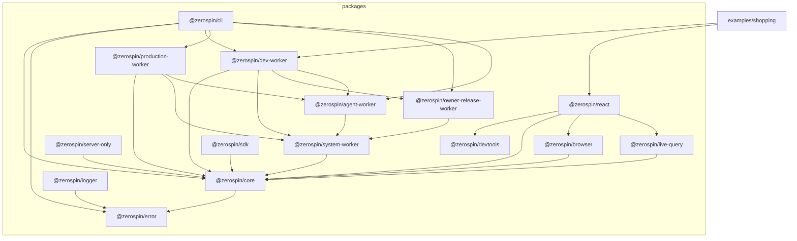
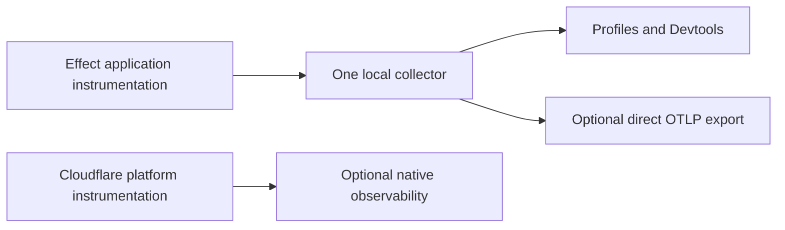

# Zerospin

## Vendor

`vendor/` contains external repositories vendored with `git subtree`. Consumer
origin of record is this README:

| Prefix          | Origin                                    | Branch |
| --------------- | ----------------------------------------- | ------ |
| `vendor/effect` | `https://github.com/Effect-TS/effect.git` | `main` |

Shared code-shape guidance is provided by the globally installed `$use-morgs32-wiki-patterns`
skill. `wiki/` is first-party Zerospin-domain guidance (not a subtree).

## Structure

The workspace contains the public documentation site, reusable packages, and
the runnable Shopping example:



### Workers and configuration

- `@zerospin/browser` owns synchronized and standalone SharedWorker execution.
  Applications create one unbundled ESM entrypoint per session with `makeSharedWorker`
  and register that session's definition.
  Standalone tabs stage synchronously; the worker owns authoritative IndexedDB
  SQLite and publishes committed command outcomes.
- `@zerospin/production-worker/SystemWorker` supplies a common executable for
  every self-hosted System. Its deployed version receives the exact SystemSpec
  and release bindings. It hosts the gateway, `SystemRepo`, and the Aggregate
  and Service root Chains.
- `@zerospin/owner-release-worker` exports `AggregateReleaseWorker` and
  `ServiceReleaseWorker`. Each executes one named release and hosts its
  VersionRepo, evaluated history, and Actor projections and sockets.
- `@zerospin/agent-worker/AgentWorker` hosts the Agent Node Repos, versioned Agent
  projections and sockets. Agent projections read evaluated history on the
  bound owner release, and Agent Nodes submit through the matching root Chain.
- `@zerospin/system-worker` supplies shared server APIs, Repo lookup contracts and runtime
  utilities as well as the Durable Objects owned by the stable System Worker.

`zerospin dev` builds `SystemWorker`, the registered Aggregate and Service
release Workers, and `AgentWorker` from the checkout. One local Workerd
session runs them with the same ownership and bindings as deployment.

`config` is a build-time module alias to the selected application's configuration.
Worker typechecks use the declaration from `@zerospin/system-worker`. Wrangler
resolves the alias to the application's module.

## Package exports and type resolution

- Package exports generally resolve declarations and runtime imports to `dist/*`.
  TypeScript project references and Nx build prerequisites provide those outputs.
- `@zerospin/system-worker` resolves types to packed declarations while retaining its
  TypeScript runtime exports for Worker bundling. Core also retains intentional
  TypeScript source exports. Installed consumers use the released outputs;
  Zerospin owns their builds.
- `@zerospin/dev-worker`, `@zerospin/production-worker`,
  `@zerospin/owner-release-worker` and `@zerospin/agent-worker` expose compiled
  Worker entrypoints under `dist/*`. The CLI resolves those modules for
  Wrangler. Nx builds the entrypoints before consumers run.
- Our `build` / `lib` task wiring already handles dependency ordering, so dependent package build/lib tasks run first before consumers.
- `@zerospin/cli` is intentionally different: it does not define package `exports` and is consumed through its `bin` entry.

## Development

### Public npm prereleases

Nx Release versions the `zerospin` release group together. From the commit
containing the prerelease version, publish the group to npm with the `alpha`
dist-tag. The registry override selects public npm.

```bash
pnpm nx run-many -t lib -p '@zerospin/*'
pnpm nx release publish --groups zerospin --registry https://registry.npmjs.org/ --tag alpha --access public --dry-run
pnpm nx release publish --groups zerospin --registry https://registry.npmjs.org/ --tag alpha --access public
```

### Local package releases

QRK installs exact package versions from the local registry.

In local release `43.0.2`, managed connected session sign-out
clears remembered authentication while loading, failed, disabled, or retired,
without deleting retained models. Connected browser AggregateNode and
ServiceNode storage now uses stable authenticated-identity namespaces and an
explicit forward-only schema-upgrade lifecycle. A pending supported SQL upgrade
imports persisted tab journals, drains the frozen command prefix through retained
final outcomes, then commits local SQL, version and migration ledger together
before readiness. The first release starts a migration-aware layout-22 baseline
with ledger baseline 0 and no production ALTER edge.

First adoption requires finishing pending work through the compatible old runtime
and retiring its clients before changing dependencies. Earlier runtime-hash
Node databases and discovery records are preserved; they are not automatically
adopted, copied or reset. Standalone, Native and backend storage policies remain
unchanged. The `42.0.0` AggregateChain cutover still requires empty affected
storage when upgrading from earlier releases. Publication and consumer dependency
updates do not reset storage or deploy applications.

The `30.0.0` release's browser and React session construction
uses five concrete entry points, with pure definitions, application layers and
transport settings supplied separately. Shared lifetime, authentication,
persistence and mock behavior are unchanged. This release preserves the shared
typed HTTP/native SystemApi from `29.0.0` and the `29.0.2` fix that retains early
staged commands until the Node attachment is ready. The `30.0.0` construction
cutover changes no storage schema, partition or namespace and requires no storage
reset.

Connected browser sessions use `makeConnectedAggregateSession` and
`makeConnectedServiceSession`. Import the same pure session definition into the
page and its worker entrypoint, and register it with `makeSharedWorker`. Supply
the application layer, credentials schema where applicable, and the bundler
SharedWorker URL as `sharedWorkerUrl` directly to the concrete constructor or React
initializer. Host configuration stays separate from the domain definition. React
initializers require `renderError` for terminal session failures. Actors expose
public models through `exposedModels`.

#### Earlier cutovers (26.0.2 context)

The following command-shape, Worker-naming and schema notes record the earlier
development-line cutovers described at `26.0.2`. Their adoption requirements do
not apply again when upgrading from `29.0.2` to `30.0.0`.

Commands retain all business inputs,
including named model IDs, in payload. Contracts declare readable models and
query current rows explicitly; `resourceId` belongs to individual model operations.
Agent wakes declare an ordinary contract and an explicit payload selector. This
is a hard cutover with empty affected storage and no legacy command shape.

Generated backend Worker names are
`${system.name}-zerospin`. Existing deployments must rename their Worker and update
frontend backend URLs to retain the same Worker and Durable Object namespaces.
System IDs and domain versions are unchanged by this naming convention.

Contract declarations name canonical
operation definitions; programs call recording methods and return only their
domain result. Checked evaluation returns `{ operations, result }`. Contract
adapters evaluate the public declaration once, provide that checked output through
its version-specific `execution` tag, and explicitly record their entire canonical
batch. Public operations are never appended automatically.

Actors declare exposed `models` separately from canonical query databases and
row selections. `makeLimitedModelVersion` keeps only public top-level attributes
and framework fields. Public server programs read current actor-visible rows and
columns in the canonical transaction; adapters and authoritative policies retain
canonical reads. Browser history carries nullable private `failure`; confirmed
occurrence IDs settle optimism, while canonical finalization remains on the server.
Async operations retain concrete aggregate/service receiving addresses.

Changed fixed schemas require empty affected storage: Node schema 20 and native
session schema 9. Persistent browser aggregate, service, and standalone Nodes
automatically reset on the typed `node-storage-reset-required` compatibility error
and retry current-schema initialization once. This default discards unsent commands
and standalone-only data. Connected Nodes require authenticated server baselines
before readiness; standalone Nodes install current captured seeds. Application
localStorage, native files, and backend databases retain their existing policy.
The release contains no compatibility fields, fallback decoders or storage
translations. Earlier registry releases remain available unchanged.

Each retained owner release computes its own replay results. If it lacks a
system command supported by the command's source release, replay records that
release's refusal and advances its cursor instead of quarantining the
materializer. Missing source authority and original execution failures remain
errors; the source release's successful result is preserved.

#### Release workflow

Use each repository's pinned package manager: Zerospin uses pnpm `11.1.1` and
QRK uses pnpm `10.33.0`. Consumer verification follows QRK's declared toolchain.

Start the registry in a separate terminal and keep it running:

```bash
pnpm install --frozen-lockfile
pnpm nx run zerospin:local-registry
curl --fail http://127.0.0.1:4873/-/ping
```

Verify that Nx prints `http://127.0.0.1:4873`: its registry executor can select
another port when that one is occupied. Releases persist across restarts in
`tmp/local-registry/storage`; do not clear that directory when consumers depend
on its locked versions. Verdaccio is pinned to `6.3.2` because newer package
exports prevent the installed Nx executor from resolving its executable.

Record the bump and release notes alongside a change, then preview and generate
the release metadata:

```bash
pnpm nx release plan patch --groups zerospin --message "Describe the change"
pnpm release --dry-run
pnpm release
```

Use `minor` or `major` for the corresponding semantic version change. Version
plans live in the tracked `.nx/version-plans/` directory and are consumed after
changelog generation. `pnpm release` uses Nx's version/changelog APIs without
staging, committing, tagging, pushing, or publishing. Perform Git operations
separately after reviewing the changes. Source `workspace:*` references stay
intact; pnpm packing writes the concrete versions consumers install.

For local publication, supply the nonsecret marker used by Nx's Verdaccio
integration through an ignored, project-local configuration file. This satisfies
pnpm's login check without changing the home or global npm configuration:

```bash
mkdir -p tmp/local-registry
printf '//127.0.0.1:4873/:_authToken=secretVerdaccioToken\n' > tmp/local-registry/publish.npmrc
NPM_CONFIG_USERCONFIG="$PWD/tmp/local-registry/publish.npmrc" pnpm nx release publish --groups zerospin --registry http://127.0.0.1:4873/ --dry-run
NPM_CONFIG_USERCONFIG="$PWD/tmp/local-registry/publish.npmrc" pnpm nx release publish --groups zerospin --registry http://127.0.0.1:4873/
```

`@zerospin/machine@14.0.0` provides the Effect-native state-machine runtime.
Install it from the running registry with
`pnpm add @zerospin/machine@14.0.0 effect@4.0.2 --registry http://127.0.0.1:4873/`.
Import its declarations through `@zerospin/machine/makeState`, `/makeMachine`,
and `/makeActor`; see [the package README](packages/machine/README.md).
Publish only this package with
`node scripts/publish-machine.mjs`,
using the same local authentication configuration shown above.

The local registry accepts new publications under `@zerospin/*` and serves
previously published `system-worker` versions locally. Other dependencies
proxy to npm. Published versions are retained:
changed artifacts require a new version. Fresh QRK installations require this
registry to be running with the versions recorded in QRK's frozen lockfile.

The SDK, browser and React packages include versioned consumer skills. In a
consuming workspace, install the pinned loader and allow these packages in the
root `package.json`:

```bash
pnpm add --save-dev --workspace-root --save-exact @tanstack/intent@0.5.5
```

```json
{
  "intent": {
    "skills": ["@zerospin/sdk", "@zerospin/browser", "@zerospin/react"]
  }
}
```

Merge that policy into the existing manifest, then run `pnpm exec intent install`
to add the managed agent guidance. Inspect the available skills with
`pnpm exec intent list`; load the pilot with
`pnpm exec intent load '@zerospin/sdk#zerospin-author-feature'`. Loading reads the
installed dependency's files, including bundled references. Updating the SDK
updates that guidance without copying skills into the application repository.

The Shopping and Tic-Tac-Toe web examples use TanStack Start in explicit SPA mode for development.
They have no build, preview or deployment scripts. Install the pinned workspace
dependencies, then run an example:

```bash
pnpm install
pnpm nx run shopping:dev
```

Shopping runs at `https://shopping.zerospin.localhost/`, with a Portless-allocated
Vite port (direct fallback 12000), and starts its Zerospin API on port 12002. For
Tic-Tac-Toe, run `pnpm nx run tic-tac-toe:zerospin:dev` and
`pnpm nx run tic-tac-toe:dev` in separate terminals; open
`https://tic-tac-toe.zerospin.localhost/`, with an allocated Vite port (direct
fallback 12001) and its API on port 12003. Frontends honor `PORT`; example
backends honor `ZEROSPIN_PORT`. The pinned Portless dependency registers these independent HTTPS
origins on the shared port-443 proxy. Earlier-origin browser stores remain
untouched; this hard cutover performs no browser-data migration.

The [developer documentation](https://docs.zerospin.localhost/) runs in
[the docs app](docs/README.md), with articles in `docs/content/`. Runtime
implementation workflows live in [wiki/architecture](wiki/architecture/AuthoredSystem.md).
Run package and example tasks through Nx, for example `pnpm nx run docs:dev`,
`pnpm nx run shopping:dev` or `pnpm nx run tic-tac-toe:ts`.

Follow the [Shopping](examples/shopping/README.md#development) and
[Tic-Tac-Toe](examples/tic-tac-toe/README.md) instructions for local authentication
configuration. Tic-Tac-Toe includes a value-free environment template:

```bash
cp examples/tic-tac-toe/.env.example examples/tic-tac-toe/.env.local
```

Never commit populated `.env` files. Any credential previously committed in an
environment file must be rotated before this repository is made public.

## Telemetry

Effect v4 produces the application span hierarchy. One collector retains names,
parents, causal links, structured attributes and failed Causes for local profiles
and Devtools. Worker invocations can export their own completed records directly
to an OTLP provider through Effect's exporter; imported remote history remains
available for local inspection without being exported again.



Supply optional deployment telemetry in `makeConfig`, outside the immutable
System and authored contracts. Omission disables hosted delivery while retaining
local capture. For example, pass this object as the `telemetry` property:

```ts
const telemetry = {
  otlp: {
    tracesEndpoint: 'https://telemetry.example.com/v1/traces',
    logsEndpoint: 'https://telemetry.example.com/v1/logs',
    samplingRate: 1,
    secretHeaders: { Authorization: 'OTLP_AUTHORIZATION' },
  },
  cloudflare: {
    traces: { samplingRate: 0.1, persist: false },
  },
};
```

Sampling rates are explicit numbers from zero to one. `headers` contains
nonsecret values; `secretHeaders` maps header names to Worker binding names,
whose values are resolved at execution. Supply the complete header value, such
as `Bearer …`, through that binding. Endpoints use HTTP(S) without userinfo. See
the [configuration schema](packages/core/src/system/TelemetryConfigSchema.ts) and
[CLI binding lifecycle](packages/cli/README.md).

Cloudflare-native logs and traces are configured independently and provide
platform visibility. They do not replace or reproduce the Effect application
tree. Native observability settings are shared Worker settings, applied when
Wrangler deploys versions even if a staged candidate receives zero traffic.

Export runs outside domain SQL, with a bounded lifetime. Diagnostic conversion,
credentials, transport and cleanup failures preserve the original domain result
and complete Cause. A transport response does not prove provider persistence or
indexing. Diagnostics have no SQLite fallback. Actor authentication, claims
validation and authorization run without durable audit writes. The retired
SystemLogRepo audit is not replaced by an equivalent hosted durability guarantee;
[ADR 017](wiki/adrs/017-admission-without-durable-audit.md) records that decision.

### Local telemetry

Start the development Grafana stack from the repository root:

```sh
docker compose -f compose.telemetry.yaml up -d
```

Open <http://127.0.0.1:12300>. The pinned Grafana development image includes
the OTLP collector, trace/log storage and preconfigured data sources. It is
available only on loopback and stores its data in the named Docker volume.
The development UI allows anonymous access; keep it local.

Add `ZEROSPIN_TELEMETRY=1` to Shopping's or TicTacToe's `.env.local`, then start
that example's normal `zerospin:dev` command. If the example uses `.dev.vars`,
also put the flag there: Wrangler loads that file instead of `.env` files.
A shell-only flag does not configure the Worker's runtime binding.

The examples send all captured invocations to `http://127.0.0.1:4318/v1/traces`
and `/v1/logs`. In Grafana's Explore view, select Tempo for traces or Loki for
logs. Application names distinguish `shopping` and `tic-tac-toe`; error
references provide exact trace/span identifiers for lookup. Telemetry stays
disabled when the flag is absent.

Stop the container without deleting its stored telemetry:

```sh
docker compose -f compose.telemetry.yaml stop
```

This local development setup does not establish hosted-provider delivery.

## Backend trace references

Configured, sampled framework API failures can carry
`extra.backendTrace = { traceId, spanId }`. `getBackendTrace(error)` is exported by
`@zerospin/error` and both SDK entrypoints. It returns a valid reference or `null`
and leaves scoped business failures unchanged. The backend copies the encoded
failure rather than mutating authored, reused or frozen errors, and preserves a
valid originating reference.

The identifiers are the actual OTLP identities: local `trc_` plus 32 hexadecimal
digits and `spn_` plus 16 hexadecimal digits become those same raw digits.
An identifier cannot be all zero.
References permit investigation; they make no delivery, retention or immediate
lookup guarantee. Detailed Causes remain in captured failed spans.

`zerospin studio` opens the authored Declaration Board at
`http://127.0.0.1:5555`. It loads `zerospin.config.ts` locally and passes serialized
SystemSpec metadata through a React Server Component to
`@zerospin/system-diagrams`. Restart the CLI to refresh declarations.

Zerospin Cloud's customer console provides active-instance Repo and table
inspection and imports the same Declaration Board package. Local Studio requires
neither a running backend nor a Zerospin secret key. Trace-provider navigation
is deferred; applications can display `getBackendTrace(error)` identifiers for
investigation in their configured provider.

```tsx
import { getBackendTrace } from '@zerospin/sdk/browser';

function BackendErrorReference({ error }: { error: unknown }) {
  const trace = getBackendTrace(error);
  if (trace === null) return null;
  return (
    <p>
      Trace reference: {trace.traceId} / {trace.spanId}
    </p>
  );
}
```

## Browser persistence reset

Plan 056 starts a new browser-persistence epoch. If Zerospin reports
`browser-persistence-reset-required`, close every Zerospin page for that origin
and confirm its Zerospin SharedWorker has stopped. Then run this in DevTools for
that same origin:

```js
for (const { name } of await indexedDB.databases()) {
  if (
    name?.startsWith('/zerospin/') ||
    name?.startsWith('zerospin/') ||
    name?.startsWith('zerospin:')
  ) {
    await new Promise((resolve, reject) => {
      const request = indexedDB.deleteDatabase(name);
      request.onsuccess = () => resolve();
      request.onerror = () => reject(request.error);
      request.onblocked = () =>
        reject(new Error(`Close every old Zerospin page and worker: ${name}`));
    });
  }
}

for (const key of Object.keys(localStorage)) {
  if (key.startsWith('zerospin:')) localStorage.removeItem(key);
}
```

Reload and authenticate again. This deletes only origin-local IndexedDB
databases whose names begin with `/zerospin/`, `zerospin/` or `zerospin:`
(including discovery databases), and `localStorage` keys beginning with `zerospin:`. It does not reset remote/server state or unrelated origin
storage.

## Production Durable Object cutover

The first deployment that consolidates lifecycle state into
`SystemRepo(systemId)` requires a fresh remote Worker lifecycle. Reset the
existing pre-cutover Worker or deploy under a new Worker name before running
`zerospin deploy`. `--clean` starts a detached, predecessor-free
generation inside SystemRepo; it does not reset Cloudflare's Durable Object
class-migration history.
