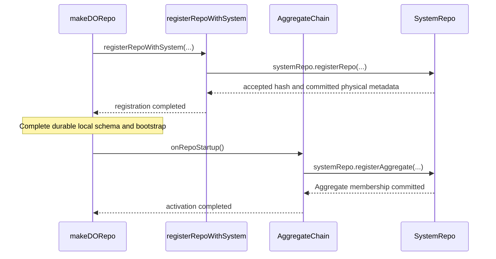
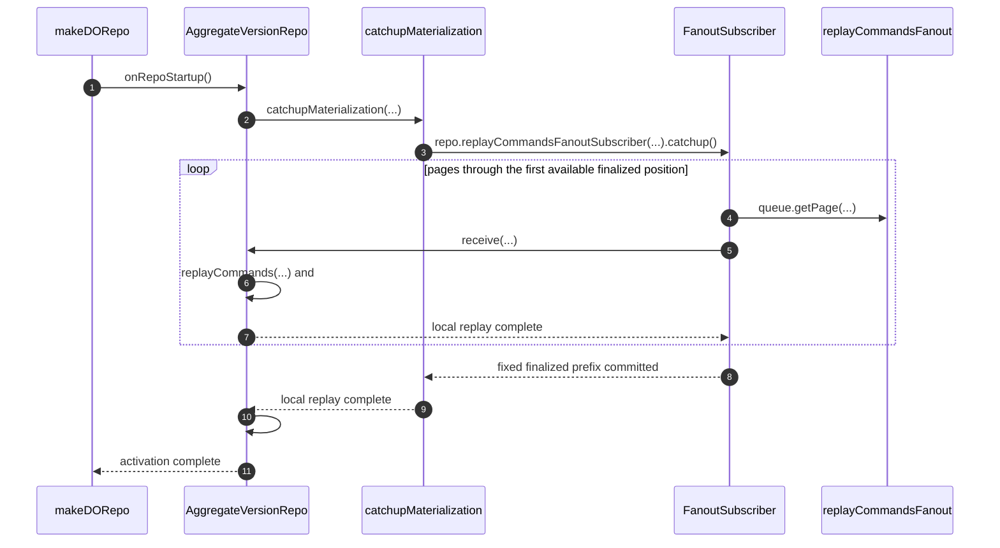
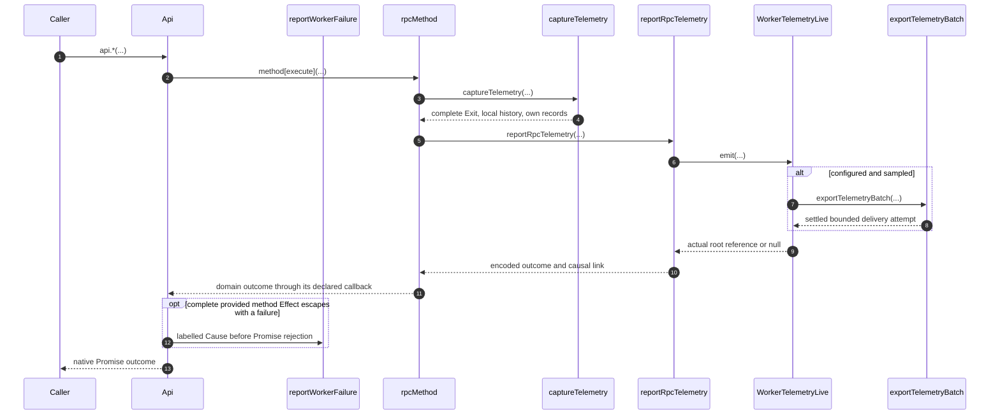
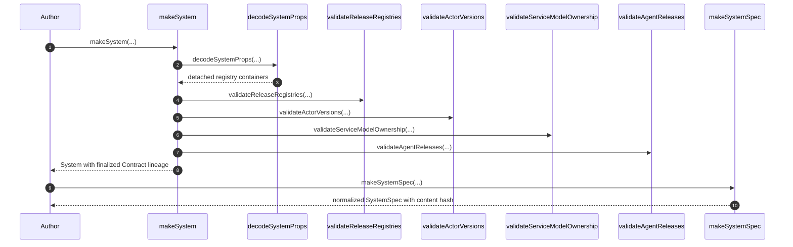
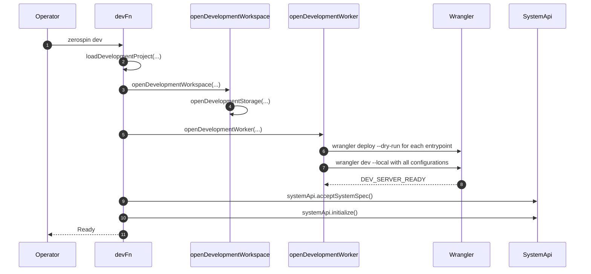
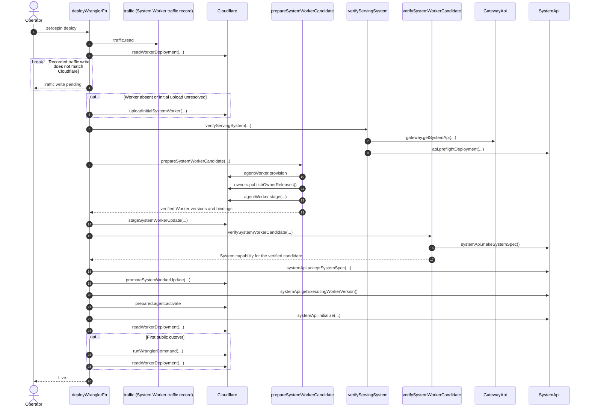
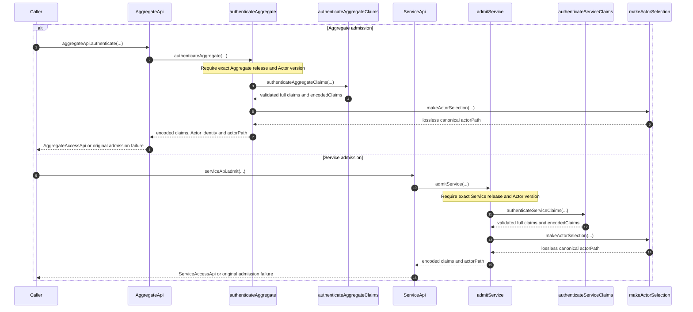

# Authored System and Static Worker

The root `zerospin.config.ts` default-exports `makeConfig({ system, systemId })`.
The CLI evaluates the full authored System and compiles the SystemSpec. For
`ownerReleaseSources`, the CLI resolves each registered Aggregate and Service
release's named export against the same module graph. A generated Wrangler
entrypoint statically imports that release and the corresponding framework
entrypoint and supplies the System identity, compiled hash, and destination
System grants as data. Separate build inputs select Agent and co-located dev
configuration through the `config` alias. The seed CLI imports a separately
selected command module.

The self-hosted SystemWorker uses its framework Effect runtime and loads the
CLI-compiled SystemSpec from the text module attached to the serving version.
Each Aggregate or Service release Worker imports its selected release and
reachable dependencies. The attached SystemSpec text module holds the complete
portable composition. At startup the Worker verifies that its imported release's
portable declarations match the corresponding entries in that snapshot.

- [Shopping configuration](../../examples/shopping/zerospin.config.ts)
- [CLI config loader](../../packages/cli/src/deploy/loadZerospinConfigFn.ts)
- [Owner release entrypoint generator](../../packages/cli/src/deploy/utils/writeOwnerReleaseEntrypoint.ts)

## Generated backend configuration

`makeWranglerConfig` names the Worker `${system.name}-zerospin`, validates that name, and owns the
entrypoint, config alias, compatibility settings, static DO bindings, SQLite
exports, optional native observability, environment, and production version metadata.
Project configuration exposes `systemId` and optional portable `telemetry`; it has no Wrangler overrides.

- [`makeWranglerConfig.ts`](../../packages/dev-worker/src/makeWranglerConfig.ts) — produces the common backend configuration.
- [`ZerospinConfigSchema.ts:13-59`](../../packages/core/src/system/ZerospinConfigSchema.ts#L13-L59) — validates the explicit system ID and live System.

Application OTLP and Cloudflare-native observability are separate deployment
choices, outside immutable System definitions and authored contracts. OTLP declares
trace/log endpoints, an explicit sampling rate, nonsecret headers and secret
binding names; binding values are resolved only at Worker execution. Optional
native logs/traces declare their own sampling, persistence and destinations.
Omitted integrations perform no hosted delivery while local Effect capture remains available.

- [`makeConfig.ts:92-110`](../../packages/core/src/system/make/makeConfig.ts#L92-L110) — accepts deployment telemetry beside the authored System and identity.
- [`TelemetryConfigSchema.ts:37-73`](../../packages/core/src/system/TelemetryConfigSchema.ts#L37-L73) — declares independent optional OTLP and native Cloudflare sections with explicit sampling and header binding names.
- [`makeWranglerConfig.ts:79-104`](../../packages/dev-worker/src/makeWranglerConfig.ts#L79-L104) — maps each configured native signal to Wrangler observability and disables omitted signals.

Native observability is shared Worker configuration. Staging a candidate at zero
traffic still invokes `versions deploy`, which synchronizes those non-versioned
settings; application OTLP remains part of the selected version's config.
Present telemetry credentials enter a scoped mode0600 secret file alongside
framework keys, and do not enter the Wrangler subprocess environment.

- [`writeSystemWorkerTraffic.ts:19-37`](../../packages/cli/src/deploy/utils/writeSystemWorkerTraffic.ts#L19-L37) — runs `versions deploy` for the recorded split before reading back Cloudflare’s deployment.
- [`openWranglerDeploymentWorkspace.ts:50-59`](../../packages/cli/src/deploy/utils/openWranglerDeploymentWorkspace.ts#L50-L59) — removes framework and declared telemetry binding values from the child environment.
- [`openWranglerDeploymentWorkspace.ts:76-84`](../../packages/cli/src/deploy/utils/openWranglerDeploymentWorkspace.ts#L76-L84) — writes selected telemetry secret values into the private temporary secrets file.

Generated Wrangler configs live in unique directories under
`.wrangler/zerospin/`. CLI scopes dispose their generated files;
local dev persistence remains in `dev-worker/<systemId>` under that same root.
Deployment loads project keys separately and writes a
scoped mode-0600 secrets file.

- [`openDevelopmentWorkspace.ts`](../../packages/cli/src/dev/openDevelopmentWorkspace.ts) — selects persistence and supplies project-root local variables.
- [`deployWranglerFn.ts`](../../packages/cli/src/deploy/deployWranglerFn.ts) — generates production configuration and separate secrets with scoped cleanup.

Shopping owns its session hosting configuration, but has no backend Worker,
backend Wrangler files, or generated backend type declarations.

- [`vite.config.ts`](../../examples/shopping/vite.config.ts) — retains the app-owned session Wrangler configuration.
- [`tsconfig.json`](../../examples/shopping/tsconfig.json) — checks application sources without generated backend declarations.

`makeSystem` validates the supplied owner/version registries, then finalizes all reachable contract lineage nodes. Upgrades must be declared before composing any System using those shared declarations. Reusing finalized declarations remains valid; a later upgrade that would extend their graph refuses.

`makeSystemSpec` compiles every reachable Contract version's own immutable schema
facts and canonical models into owner-local version registries. Each owner stores
`modelVersions`, `contractVersions`, `actorVersions` and `agentVersions` once per
name/version identity. `releases` binds exact versions and preserves declared
Aggregate and Service predecessors. Contract and Agent reads bind model versions. Mutation
metadata references `{ modelName, version }`. Actor exposed-model projections stay
inline inside the Actor version. Conflicting identities are refused. The returned
JSON includes its SHA-256 hash without freezing the snapshot. Node selections
remain root composition facts. Runtime links and callback bodies are not serialized.

- [`makeSystem.ts:79-99`](../../packages/core/src/system/make/makeSystem/makeSystem.ts#L79-L99) — validates composition before finalizing contract lineages and returning the System.
- [`makeSystemSpec.ts:159-242`](../../packages/core/src/system/make/makeSystemSpec.ts#L159-L242) — compiles Aggregate and Service owner metadata from finalized executable declarations, and emits the Service history selector.
- [`hashSystemSpec.ts:7-46`](../../packages/core/src/system/hashSystemSpec.ts#L7-L46) — hashes schema-normalized canonical JSON excluding the hash field.

## Persistence invariant

System Repos retain forward-only framework history in each physical Durable Object's `applied_migrations` table, with exactly `migrationId` and `definitionChecksum`. Every represented entry remains in the exact supported ordered prefix. The SHA-256 checksum binds the exact `[id, name, sqlStatements]` tuple; the constant baseline checksum does not fingerprint physical schema or data. Fresh storage provisions the current graph and stamps represented history in one synchronous transaction, without executing historical SQL. Cold activation validates that history, applies pending SQL and stamps each migration atomically, then confirms each committed step with `storage.sync()` before proceeding. The ledger retains no application or commit timestamp. It verifies the actual current schema separately before bootstrap or recovery. Undeclared views, triggers and column collations are refused; final graph validation follows the ledger stamp within the same migration transaction. Existing unstamped storage and the superseded four-column ledger require empty affected storage; there is no automatic adoption, reset or translation.

Concrete system Repos declare their authored `system`. The factory validates physical identity and configured system ownership; versioned database resolvers retain their exact release/Actor/Agent existence checks. Before child SQL, it derives the configured SystemSpec hash and registers through SystemRepo. Registration requires prior acceptance of that hash. SystemRepo is exempt from self-registration so initial acceptance can bootstrap; standalone configurations retain their independent path. Registration and local initialization remain separate commits, so metadata may survive a later initialization failure.

- [`makeDORepo.ts:270-287`](../../packages/system-worker/src/makeDORepo/makeDORepo.ts#L270-L287) — waits for accepted-hash registration before PRAGMA, schema provisioning, bootstrap and activation.
- [`registerRepoWithSystem.ts:11-34`](../../packages/system-worker/src/SystemRepo/registerRepo/registerRepoWithSystem.ts#L11-L34) — sends the derived content hash with physical table metadata to the configured singleton.

- [`migrationLedgerDbConfig.ts:5-12`](../../packages/system-worker/src/makeMigratableDORepo/migrationLedgerDbConfig.ts#L5-L12) — declares the two physical ledger columns, with `migrationId` as the integer primary key.
- [`migrationHistory.ts:30-44`](../../packages/system-worker/src/makeMigratableDORepo/migrationHistory.ts#L30-L44) — prepares baseline zero and SHA-256 checksums of authored ID, name and exact ordered SQL.
- [`migrationHistory.ts:57-78`](../../packages/system-worker/src/makeMigratableDORepo/migrationHistory.ts#L57-L78) — rejects empty or unsupported longer history and compares every stored entry with the corresponding authored ID and checksum.
- [`provisionMigratableSchemaTx.ts:19-24`](../../packages/system-worker/src/makeMigratableDORepo/provisionMigratableSchemaTx.ts#L19-L24) — provisions and verifies the current graph, then stamps its represented history in the same transaction.
- [`initializeMigratableSchema.ts:34-42`](../../packages/system-worker/src/makeMigratableDORepo/initializeMigratableSchema.ts#L34-L42) — awaits `ctx.storage.sync()` and classifies failed durability confirmation.
- [`initializeMigratableSchema.ts:75-104`](../../packages/system-worker/src/makeMigratableDORepo/initializeMigratableSchema.ts#L75-L104) — refuses unstamped application objects and confirms each committed migration before proceeding.

- [`applyMigratableDORepoMigrationTx.ts:23-40`](../../packages/system-worker/src/makeMigratableDORepo/applyMigratableDORepoMigrationTx.ts#L23-L40) — applies SQL, stamps and validates retained history, then checks the final graph before committing.
- [`validateDbSchema.ts:25-42`](../../packages/core/src/drizzle/provisionDb/validateDbSchema.ts#L25-L42) — rejects unsupported objects and validates the exact declared tables.
- [`validateTableSchema.ts:11-19`](../../packages/core/src/drizzle/provisionDb/validateTableSchema.ts#L11-L19) — checks retained table SQL for undeclared constraints, including column collations.

SystemRepo retains complete accepted SystemSpecs as unique `hash` plus typed JSON `spec` rows in `acceptedSystemSpecs`. Acceptance strictly validates the supplied candidate, verifies its canonical content hash and compares immutable owner-scoped model/Contract/release/Actor/Agent facts against every retained snapshot inside one transaction. Any conflict rejects the whole candidate without insertion; equal acceptance is idempotent. Omitted versions remain protected by earlier snapshots. Root Node selections may change without redefining unchanged versioned declarations. Executable callbacks, adapters and codec transformations remain outside portable equality.

- [`systemRepoDbConfig.ts:8-20`](../../packages/system-worker/src/SystemRepo/systemRepoDbConfig.ts#L8-L20) — stores whole accepted SystemSpecs and their unique hash.
- [`registerSystemSpec.ts:14-44`](../../packages/system-worker/src/SystemRepo/registerSystemSpec/registerSystemSpec.ts#L14-L44) — verifies the supplied candidate, which may differ from SystemRepo's executing System.
- [`registerSystemSpecTx.ts:54-104`](../../packages/system-worker/src/SystemRepo/registerSystemSpec/registerSystemSpecTx.ts#L54-L104) — checks all retained immutable facts before one whole-snapshot insert.

This storage/spec cutover has no compatibility reader or translation migration. Empty affected storage requires separate authorization; no automatic reset is performed. Acceptance records approved declared metadata independently of a successful Cloud system deployment, Worker promotion or initialization.

## Accepted SystemSpec hash gates

Child activation uses the configured executable System's compiled hash. SystemRepo validates hash membership before registration writes; it does not repeat structural comparisons or accept unseen snapshots during startup. Previously accepted hashes remain valid after a later whole snapshot is accepted.

### Trigger

1. A child constructor enters its concurrency gate before starting local SQL.
   - [`makeDORepo.ts:270-287`](../../packages/system-worker/src/makeDORepo/makeDORepo.ts#L270-L287) — derives its actual configured SystemSpec hash and awaits registration.

For AggregateChain, physical registration precedes local initialization; Aggregate
catalogue membership is a separate awaited operation during activation.



## Annotated workflow steps

1. Supply the actual compiled hash with physical identity and table metadata.
   - [`makeDORepo.ts:270-280`](../../packages/system-worker/src/makeDORepo/makeDORepo.ts#L270-L280) — derives the configured System's hash and awaits ordinary registration.
2. Delegate through the configured SystemRepo registration RPC.
   - [`registerRepoWithSystem.ts:19-33`](../../packages/system-worker/src/SystemRepo/registerRepo/registerRepoWithSystem.ts#L19-L33) — sends physical Repo metadata and `systemSpecHash`, without reading Aggregate identity.
3. Require prior whole-snapshot acceptance, then commit physical metadata only.
   - [`registerRepo.ts:27-49`](../../packages/system-worker/src/SystemRepo/registerRepo/registerRepo.ts#L27-L49) — checks accepted hash membership before the physical upsert.
4. Continue local initialization after the successful registration envelope is decoded.
   - [`registerRepoWithSystem.ts:31-33`](../../packages/system-worker/src/SystemRepo/registerRepo/registerRepoWithSystem.ts#L31-L33) — propagates registration refusal through `readRpcEnvelope`.
5. Invoke the owning activation hook only after schema and bootstrap are durable.
   - [`makeDORepo.ts:285-304`](../../packages/system-worker/src/makeDORepo/makeDORepo.ts#L285-L304) — initializes schema, confirms bootstrap durability and awaits `onRepoStartup`.
6. Register Aggregate catalogue membership before later activation work.
   - [`AggregateChain.ts:446-454`](../../packages/system-worker/src/AggregateChain/AggregateChain.ts#L446-L454) — addresses its SystemRepo and awaits `registerAggregate` with its exact Aggregate name and ID.
7. Commit membership independently of physical Repo registration.
   - [`SystemRepo.ts:208-228`](../../packages/system-worker/src/SystemRepo/SystemRepo.ts#L208-L228) — validates the identity once and delegates to the typed membership procedure.
   - [`registerAggregate.ts:8-19`](../../packages/system-worker/src/SystemRepo/registerAggregate/registerAggregate.ts#L8-L19) — inserts the name/ID pair idempotently in its own synchronous transaction.
8. Complete activation after existing recovery holds, release enrollment and queue wakeups.
   - [`AggregateChain.ts:455-469`](../../packages/system-worker/src/AggregateChain/AggregateChain.ts#L455-L469) — preserves the scheduled-Agent hold and existing activation work after membership succeeds.

Hash refusal prevents local initialization. Membership refusal propagates from
activation while physical registration remains committed; the next addressed
activation retries both idempotent operations. During the gap, discovery omits
the Aggregate and Agent selection refuses it. Membership may also remain after
a later activation step fails, so neither catalogue proves completed activation.
AggregateChain's existing Agent initialization recovery handles identities missed
by SystemRepo's concurrent catalogue scan.

- [`makeDORepo.ts:270-304`](../../packages/system-worker/src/makeDORepo/makeDORepo.ts#L270-L304) — sequences hash-gated registration, local initialization and awaited activation without a cross-Repo transaction.
- [`resolveRegisteredAggregateAgentSelection.ts:34-44`](../../packages/system-worker/src/SystemApi/openAggregateAgentSession/resolveRegisteredAggregateAgentSelection.ts#L34-L44) — refuses an Aggregate identity absent from the catalogue.
- [`AggregateChain.ts:455-460`](../../packages/system-worker/src/AggregateChain/AggregateChain.ts#L455-L460) — retains scheduled-Agent initialization recovery before opening the constructor gate.

Version-owned Repos still require their exact executable release and Actor/Agent view. Removing scoped selectors does not restore retired declarations from portable JSON. Aggregate and Service Agent Version Chains validate the enclosing Agent declaration while resolving their database configuration. Agent Node removal retains its existing delivery/drain behavior.

AggregateActorVersionChain and ServiceActorVersionChain use fixed history schemas independently of current authored declarations, as AVC/SVC do for evaluated history. Deregistration does not prevent retained public/private reads or Archive recovery. SystemRepo still validates authored session/claims/path authority for new admission, and Actor socket capability reads require the exact current release and Actor before disclosure from a retained or hibernated connection. Resource materialization and pending authored execution retain their exact-code requirements.

- [`aggregateActorVersionChainMigratableDORepoConfig.ts:7-12`](../../packages/system-worker/src/AggregateActorVersionChain/aggregateActorVersionChainMigratableDORepoConfig.ts#L7-L12) — initializes Aggregate Actor history from its fixed database configuration.
- [`serviceActorVersionChainMigratableDORepoConfig.ts:5-10`](../../packages/system-worker/src/ServiceActorVersionChain/serviceActorVersionChainMigratableDORepoConfig.ts#L5-L10) — initializes Service Actor history without an authored release resolver.
- [`readAggregateConnectionCapabilities.ts:30-138`](../../packages/system-worker/src/aggregateSessionChain/readAggregateConnectionCapabilities.ts#L30-L138) — retains current Aggregate release/Actor/identity validation for socket capabilities independently of schema activation.

Session-ticket creation checks SystemRepo's own executing SystemSpec hash locally after current session authority validation and before secret generation/retention. The candidate accepted through SystemApi may originate from another Worker version, so acceptance does not substitute SystemRepo's local snapshot for that candidate. Ticket consumption keeps its existing one-use, expiry and family validation.

- [`createSessionWebSocketTicket.ts:44-75`](../../packages/system-worker/src/SystemRepo/sessionWebSocketTickets/createSessionWebSocketTicket.ts#L44-L75) — uses the current `System` service for the ticket prerequisite.
- [`validateSessionAdmission.ts:19-86`](../../packages/system-worker/src/SystemRepo/sessionWebSocketTickets/validateSessionAdmission.ts#L19-L86) — retains exact release/session/Agent bindings and Actor claims/identity checks.

New commands must match the addressed release's exact contract version. Metadata needed by historical replay grants no fresh admission. Replay performs existing payload decoding and edge-by-edge adaptation without an acceptance RPC, and restoration of retained evaluated output reapplies exact-model operations without rerunning adapters or programs.

- [`validateNewAggregateCommand.ts:26-71`](../../packages/system-worker/src/AggregateChain/admitAggregateCommands/validateNewAggregateCommand.ts#L26-L71) — requires the exact principal grant and registered contract version before Actor claims and submitted-payload validation.
- [`checkAdmission.ts:15-40`](../../packages/system-worker/src/checkAdmission.ts#L15-L40) — preserves the corresponding Service/ordinary admission boundary.
- [`prepareReplayAppliedOperation.ts:55-77`](../../packages/core/src/contracts/prepareReplayAppliedOperation.ts#L55-L77) — decodes retained operations using the exact selected model.

## Repo lookup and published history

Every Aggregate release after the first names a registered earlier release through
`branchFrom` or `rebuildFrom`. When `AggregateChain` enrolls new releases for an
instance, it saves the same admitted position for all of them. Each release reads
its prefix through that position from its named predecessor. `AggregateChain`
delivers subsequent finalized commands and keeps them until the releases that
depend on its delivery have acknowledged. Durable publication backs reads of
the compacted prefix. A branch applies the predecessor’s retained output. A rebuild replays the predecessor’s commands with AggregateChain identity checks.

- [`initializeAggregatePredecessor.ts:73-93`](../../packages/owner-release-worker/src/AggregateVersionRepo/initializeAggregatePredecessor.ts#L73-L93) — applies each retained branch command or marks the rebuild page as predecessor input for replay.
- [`validateReleaseRegistries.ts:26-71`](../../packages/core/src/system/make/makeSystem/validateReleaseRegistries.ts#L26-L71) — requires the exact registered earlier Aggregate predecessor.
- [`onRepoStartup.ts:26-55`](../../packages/system-worker/src/AggregateChain/onRepoStartup/onRepoStartup.ts#L26-L55) — captures the admitted position in the enrollment transaction and preserves prior enrollment records on conflict.
- [`compactAggregateHistory.ts:23-53`](../../packages/system-worker/src/AggregateChain/compactAggregateHistory.ts#L23-L53) — bounds deletion by finalized progress, durable publication, and release delivery obligations.

A Service registry entry contains its releases. `ServiceChain` retains admitted commands. Recorded System and Agent producer checkpoints preserve retry progress.

The cutover requires empty affected storage, including `acceptedSystemSpecs` with
incompatible retained Aggregate metadata. See [Canonical History Handoff](./server/CanonicalHistoryHandoff.md)
for the runtime sequence.

- [`preflightAcceptedSystemSpec.ts:25-50`](../../packages/system-worker/src/SystemRepo/preflightAcceptedSystemSpec.ts#L25-L50) — checks each retained snapshot against the current codec and recomputes its hash before the candidate can change storage.

Generic Worker factories require the composition root's execution policies: `makeMigratableDORepo` and `makeFanoutQueue` require `runInvocation` and `encodeRpcOutcome`; `makeOutboxQueue` requires `runInvocation`; both subscriber factories require `encodeRpcOutcome`. The generic factories retain no default Worker runtime or application-config import. Recovery registration receives the plain drain Effect because Repo recovery dispatch already owns capture/runtime. Direct background drain entry invokes the supplied policy once, preserving the original Cause and receiver acknowledgement.

- [`makeDORepo.ts:103-106`](../../packages/system-worker/src/makeDORepo/makeDORepo.ts#L103-L106) — requires both injected policies alongside the existing managed runtime.
- [`makeDORepo.ts:339-350`](../../packages/system-worker/src/makeDORepo/makeDORepo.ts#L339-L350) — wraps recovery once and encodes the ready RPC at its boundary.
- [`makeFanoutQueue.ts:132-133`](../../packages/system-worker/src/makeFanoutQueue/makeFanoutQueue.ts#L132-L133) — requires both fanout queue policies.
- [`makeFanoutQueue.ts:346-353`](../../packages/system-worker/src/makeFanoutQueue/makeFanoutQueue.ts#L346-L353) — registers plain recovery drain and applies `runInvocation` only at direct background entry.
- [`makeOutboxQueue.ts:309-320`](../../packages/system-worker/src/makeOutboxQueue/makeOutboxQueue.ts#L309-L320) — registers its plain drain and applies the supplied invocation policy when `wake` starts background delivery.
- [`makeFanoutSubscriber.ts:101-105`](../../packages/system-worker/src/makeFanoutSubscriber/makeFanoutSubscriber.ts#L101-L105) — requires its boundary encoder.
- [`makeOutboxSubscriber.ts:49-52`](../../packages/system-worker/src/makeOutboxSubscriber/makeOutboxSubscriber.ts#L49-L52) — requires the corresponding outbox subscriber encoder.

Static `getRepo({ key })` constructs an exact physical name and resolves its
native capability when the Effect runs. The configured systemId is retained at
acquisition and rechecked during physical activation. `AggregateChain` reads
compacted command inputs from a VersionChain whose acknowledgement covers the
requested position. `ServiceChain` reads its compacted prefix from a ServiceVersionChain with acknowledged publication coverage. Both read the newer local suffix directly. VersionRepos and Actor
projection Repos and Chains require their enclosing release. AggregateVersionChain
and ServiceVersionChain can open retained history without that declaration.

- [`getPublishedAggregateHistory.ts:16-32`](../../packages/system-worker/src/AggregateChain/getPublishedAggregateHistory.ts#L16-L32) — resolves an AggregateVersionChain using a retained publication acknowledgement that covers the requested range.

AggregateVersionRepo owns release resources, finalization, a minimal `materializationHead` and complete pending evaluated-command publication. `finalizeCommand` returns the full admitted `IEvaluatedAggregateCommand` with canonical `id`, release-local `outcome: { result, finalizedAt }`, ordered operations and `dispositionChainHash`. AggregateVersionArchive owns that permanent evaluated history. AggregateVersionChain owns the Archive directory and advances the published head after the full page is durable. Actor and Agent fanout reads through that head and advances independent subscriber cursors. [Version Chain Archives](./server/VersionChainArchives.md) owns that workflow. AggregateChain synchronously validates every immutable admitted field and the finalized predecessor, then retains the original outcome and complete pending external requests atomically. Exact duplicate outcomes preserve `finalizedAt` and do not recreate requests. On redelivery, AggregateVersionRepo compares the pending command supplied by AggregateChain with its complete evaluated command in the publication outbox or AggregateVersionChain and returns the saved result. Fresh administrative and authorization invocations allocate a new ID and return the addressed VersionRepo's own awaited outcome. They do not read a potentially different canonical historical outcome as their result. [ADR 016](../adrs/016-aggregate-original-operations-and-external-work.md) governs the complete model and external-request ownership.

- [`finalizeCommand.ts:43-78`](../../packages/owner-release-worker/src/AggregateVersionRepo/finalizeCommand/finalizeCommand.ts#L43-L78) — checks the owner, release, index and pending command, then passes that delivered command into recovery when the materialization head already covers it.
- [`findEvaluatedCommand.ts:41-73`](../../packages/owner-release-worker/src/AggregateVersionRepo/readEvaluatedCommand/findEvaluatedCommand.ts#L41-L73) — loads the evaluated command from AggregateVersionChain or the outbox and checks its index and identity before returning it.
- [`validateCommandIdentity.ts:28-44`](../../packages/owner-release-worker/src/AggregateVersionRepo/validateCommandIdentity.ts#L28-L44) — uses the supplied admitted command directly and obtains finalized AggregateChain input when only the index is available.

`AggregateVersionChain.actorVersionChainFanoutSubscribers` stores only `actorName`, canonical `actorPath` and monotonic `acknowledgedAggregateIndex`. The actor pair is unique. Before membership/progress changes, AggregateVersionChain validates the complete incoming Repo key's `actorVersion` against its bound immutable Aggregate release; reconstruction derives the version from that release. Complete AggregateActorVersionRepo keys still include `actorVersion`. `makeFanoutQueue` matches the stored pair for enrollment, acknowledgement and exclusion before the delivery limit, preserving independent actor-path progress. The fixed-schema change requires empty affected AggregateVersionChain storage; no reset is authorized or performed and no compatibility migration/fallback exists.

- [`aggregateVersionChainDbConfig.ts`](../../packages/system-worker/src/AggregateVersionChain/aggregateVersionChainDbConfig.ts) — declares the three nonnullable columns and unique actor pair.
- [`AggregateVersionChain.ts:119-136`](../../packages/system-worker/src/AggregateVersionChain/AggregateVersionChain.ts#L119-L136) — validates the incoming actor version and derives it from the bound Aggregate release for complete recipient keys.
- [`makeFanoutQueueStorage.ts`](../../packages/system-worker/src/makeFanoutQueue/makeFanoutQueueStorage.ts) — matches every stored identity field and advances acknowledgement monotonically.

`AggregateVersionChain.agentVersionChainFanoutSubscribers` stores agentName,
agentVersion and monotonic acknowledgedAggregateIndex, unique by the Agent release
pair. AggregateVersionChain reconstructs the complete receiving Repo key from that
pair and its bound Aggregate instance/release. Only the configured Agent release
is eligible for new delivery. Inactive subscriber rows and cursors stay retained;
no new release inherits another release's acknowledgement.

- [`aggregateVersionChainDbConfig.ts:48-62`](../../packages/system-worker/src/AggregateVersionChain/aggregateVersionChainDbConfig.ts#L48-L62) — declares agentName/agentVersion membership and the unique pair.
- [`AggregateVersionChain.ts:229-238`](../../packages/system-worker/src/AggregateVersionChain/AggregateVersionChain.ts#L229-L238) — reconstructs exact release-qualified recipient keys and derives available Agent identities from its exact bound release.

AggregateActorVersionRepo and AggregateAgentVersionRepo own projection resources, selections, `materializationHead` and complete pending selected publication. The materialization head row is `{ singletonId, aggregateIndex, dispositionChainHash }` in singleton slot 1, committed with resources and pending publication. Both corresponding Chains retain public `exposedCommands`; only AggregateActorVersionChain retains private `commandResolutions`. AggregateActorVersionChain retains per-connection SQL capabilities and sockets; AggregateAgentVersionChain derives observer capabilities from its exact enclosing release and embedded Agent and retains variable admission in trusted socket attachments. Capture resources/checkpoint N locally, publish through N and verify exactly N. Actor snapshots additionally recover private completion through N; Agent snapshots are public-only. ServiceVersionRepo and ServiceActorVersionRepo own resources, complete pending publication and `materializationHead` with `{ singletonId, serviceIndex, dispositionChainHash }`; ServiceVersionChain retains complete commands and delivers them directly through its logical actor queue; acknowledgement advances only subscriber progress without deleting history or maintaining a payload copy; ServiceActorVersionChain retains public `exposedCommands` and optional private `commandResolutions`, under [ADR 015](../adrs/015-service-delivery-history-and-projection-ownership.md).

- [`aggregateVersionRepoDbConfig.ts:8-19`](../../packages/system-worker/src/AggregateVersionRepo/aggregateVersionRepoDbConfig.ts#L8-L19) — declares materializationHead with singletonId/index/hash and the complete evaluated-command publication table.
- [`finalizeCommandRows.ts:19-39`](../../packages/owner-release-worker/src/AggregateVersionRepo/finalizeCommand/finalizeCommandRows.ts#L19-L39) — returns each complete committed evaluated command with canonical id and full admitted input.
- [`recordOriginalCommandOutcomeTx.ts:30-77`](../../packages/system-worker/src/AggregateChain/recordOriginalCommandOutcomeTx.ts#L30-L77) — validates the bound reply, retains the first exact outcome and requires a finalized predecessor.
- [`aggregateVersionChainDbConfig.ts`](../../packages/system-worker/src/AggregateVersionChain/aggregateVersionChainDbConfig.ts) — retains immutable `commands` and independent actor/agent subscriber progress, without duplicate fanout payload tables.
- [`aggregateProjectionDbConfig.ts:8-15`](../../packages/system-worker/src/aggregateProjection/aggregateProjectionDbConfig.ts#L8-L15) — names the Aggregate actor/agent materialization head and its three fields.
- [`getSnapshot.ts:92-127`](../../packages/system-worker/src/aggregateProjection/getSnapshot/getSnapshot.ts#L92-L127) — captures the committed selected graph and verifies publication/private recovery at exactly that position.

- [`serviceVersionRepoDbConfig.ts:7-18`](../../packages/owner-release-worker/src/ServiceVersionRepo/serviceVersionRepoDbConfig.ts#L7-L18) — declares the three-field Service materializationHead and complete pending evaluated command without a command ID in the head.
- [`serviceVersionChainDbConfig.ts`](../../packages/system-worker/src/ServiceVersionChain/serviceVersionChainDbConfig.ts) — declares permanent commands and actor subscriber acknowledgements without a physical fanout payload copy.
- [`serviceProjectionDbConfig.ts:8-22`](../../packages/system-worker/src/serviceProjection/serviceProjectionDbConfig.ts#L8-L22) — binds Service actor materializationHead with singletonId/serviceIndex/hash and complete pending selected publication.
- [`serviceActorVersionChainDbConfig.ts:9-19`](../../packages/system-worker/src/ServiceActorVersionChain/serviceActorVersionChainDbConfig.ts#L9-L19) — retains projected history and connection locks without application resource models.

The materializationHead fixed-schema change requires empty AggregateVersionRepo,
AggregateActorVersionRepo, AggregateAgentVersionRepo, ServiceVersionRepo and
ServiceActorVersionRepo storage. No reset or migration is supplied. Historical
Chain checkpoint readers retain their arbitrary-position meaning.

- [Aggregate admission/result ownership](./server/admitAggregateCommands.md)
- [Service execution/result ownership](./server/serviceExecution.md)
- [System administration and registration](./SystemApi.md)

## VersionRepo activation and current reads

AggregateVersionRepo and ServiceVersionRepo await the real local
`catchupMaterialization` procedure inside the existing constructor concurrency
gate. Their existing replay subscribers capture one finalized prefix on the first
page and commit through it; later admitted commands or source progress do not
extend that pass. Source Chains keep authored release enrollment, so activation
uses `.catchup()` rather than enrolling again. A local materializationHead above
the finalized source prefix succeeds unchanged after a lost original reply.

The Aggregate sequence below shows the shared lifecycle. Each VersionRepo replay
receiver acquires its publication queue's producer lease before producing pending
rows. Activation explicitly wakes publication on exit, including when the captured
prefix has no new rows. AggregateVersionRepo waits for publication through the last index of each replayed page before returning it to the subscriber. Failed later
pages preserve previously committed command rows for restart; a fixed prefix bounds
followed history rather than total startup duration.



## Annotated workflow steps

1. Invoke and await the concrete owner activation after durable schema and optional bootstrap.
   - [`makeDORepo.ts:289-304`](../../packages/system-worker/src/makeDORepo/makeDORepo.ts#L289-L304) — confirms bootstrap writes before awaiting `this.onRepoStartup()` inside constructor startup.
2. Enter the owner's named local materialization procedure.
   - [`AggregateVersionRepo.ts:296-329`](../../packages/owner-release-worker/src/AggregateVersionRepo/AggregateVersionRepo.ts#L296-L329) — initializes a declared predecessor, calls `catchupMaterialization` and registers publication wake on exit.
   - [`ServiceVersionRepo.ts:110-114`](../../packages/owner-release-worker/src/ServiceVersionRepo/ServiceVersionRepo.ts#L110-L114) — enters the corresponding Service catch-up with its own publication finalizer.
3. Call the existing source-bound replay subscriber's `catchup()` without new enrollment or a public progress RPC.
   - [`catchupMaterialization.ts:13-16`](../../packages/owner-release-worker/src/AggregateVersionRepo/catchupMaterialization/catchupMaterialization.ts#L13-L16) — obtains the Aggregate subscriber and awaits its catch-up envelope.
   - [`catchupMaterialization.ts:12-15`](../../packages/owner-release-worker/src/ServiceVersionRepo/catchupMaterialization/catchupMaterialization.ts#L12-L15) — invokes the separate Service finalized-prefix catch-up path.
4. Request each retained suffix through the first observed finalized boundary.
   - [`runFanoutCatchup.ts:55-75`](../../packages/system-worker/src/makeFanoutSubscriber/runFanoutCatchup.ts#L55-L75) — sends `queue.getPage`, fixes `destination` once and bounds later pages without extending it to later source tips.
5. Pass every pulled page to the same owner receive Effect used by pushed replay.
   - [`runFanoutCatchup.ts:88-92`](../../packages/system-worker/src/makeFanoutSubscriber/runFanoutCatchup.ts#L88-L92) — applies the bound Chain page with `receive(delivery, 'pull')` and rereads the committed cursor.
   - [`makeFanoutSubscriber.ts:126-145`](../../packages/system-worker/src/makeFanoutSubscriber/makeFanoutSubscriber.ts#L126-L145) — validates the RPC delivery envelope and marks its rows as pushed.
   - [`replayCommand.ts:48-53`](../../packages/owner-release-worker/src/AggregateVersionRepo/replayCommands/replayCommand.ts#L48-L53) — rejects pending Aggregate commands and invokes identity validation against AggregateChain for pushed rows and predecessor rebuilds.
   - [`replayCommand.ts:42-47`](../../packages/owner-release-worker/src/ServiceVersionRepo/replayCommands/replayCommand.ts#L42-L47) — rejects pending Service commands and invokes identity validation against ServiceChain for pushed rows.
   - [`validateCommandIdentity.ts:27-53`](../../packages/owner-release-worker/src/ServiceVersionRepo/validateCommandIdentity.ts#L27-L53) — uses the admitted row from a pulled page directly. For a push it obtains the row at the delivered index through the hosted replay RPC or the bound replay queue.
6. Commit replay resources, checkpoint and evaluated output. AggregateVersionRepo then publishes through the page’s last index.
   - [`AggregateVersionRepo.ts:249-277`](../../packages/owner-release-worker/src/AggregateVersionRepo/AggregateVersionRepo.ts#L249-L277) — holds the producer lease through replay, wakes publication on exit from replay and drains pending publication through the page’s last Aggregate index before returning.
   - [`replayCommand.ts:149-169`](../../packages/owner-release-worker/src/AggregateVersionRepo/replayCommands/replayCommand.ts#L149-L169) — runs the synchronous materialization transaction under the execution permit, then validates committed identity or recovers a concurrent commit.
   - [`retainEvaluatedCommandTx.ts:19-44`](../../packages/system-worker/src/AggregateVersionRepo/utils/retainEvaluatedCommandTx.ts#L19-L44) — inserts complete pending output and advances the materialization head within that resource transaction.
   - [`ServiceVersionRepo.ts:225-243`](../../packages/owner-release-worker/src/ServiceVersionRepo/ServiceVersionRepo.ts#L225-L243) — protects Service replay with its own producer lease, bound history services and publication wake.
   - [`replayCommand.ts:138-157`](../../packages/owner-release-worker/src/ServiceVersionRepo/replayCommands/replayCommand.ts#L138-L157) — commits Service replay under the execution permit and compares the saved result with the delivered command, including a result recovered after a concurrent commit.
7. Return from the owner’s replay Effect and read its durable cursor before requesting another page.
   - [`runFanoutCatchup.ts:89-100`](../../packages/system-worker/src/makeFanoutSubscriber/runFanoutCatchup.ts#L89-L100) — requires newly committed progress before requesting another page and fails a nonadvancing receiver.
8. Complete the subscriber pass when its durable cursor covers the captured finalized prefix, disposing the source capability.
   - [`runFanoutCatchup.ts:75-78`](../../packages/system-worker/src/makeFanoutSubscriber/runFanoutCatchup.ts#L75-L78) — returns at the fixed destination, including progress committed concurrently while a page was in flight.
   - [`runFanoutCatchup.ts:101-104`](../../packages/system-worker/src/makeFanoutSubscriber/runFanoutCatchup.ts#L101-L104) — releases the acquired queue capability on pass exit.
9. Propagate the catch-up envelope to owner activation without converting a failed replay into readiness.
   - [`catchupMaterialization.ts:14-16`](../../packages/owner-release-worker/src/AggregateVersionRepo/catchupMaterialization/catchupMaterialization.ts#L14-L16) — consumes the subscriber result through `readRpcEnvelope` before the materialization Effect returns.
10. Run the activation publication finalizer, including when replay produced no rows.
    - [`AggregateVersionRepo.ts:324-329`](../../packages/owner-release-worker/src/AggregateVersionRepo/AggregateVersionRepo.ts#L324-L329) — executes `aggregateVersionChainOutbox.wake()` on activation exit without awaiting delivery acknowledgement.
    - [`ServiceVersionRepo.ts:110-113`](../../packages/owner-release-worker/src/ServiceVersionRepo/ServiceVersionRepo.ts#L110-L113) — explicitly wakes Service publication on the same exit boundary.
11. Finish the constructor gate after the complete activation Effect; outgoing delivery remains independently recoverable.
    - [`makeDORepo.ts:304-308`](../../packages/system-worker/src/makeDORepo/makeDORepo.ts#L304-L308) — awaits the supplied runtime/invocation startup before `blockConcurrencyWhile` resolves.

AggregateChain and ServiceChain restore pending external requests during their own
activation. Each Chain holds original delivery and replay recovery before authored
release enrollment, then starts its own external recovery without awaiting requests.

- [`AggregateChain.ts:333-341`](../../packages/system-worker/src/AggregateChain/AggregateChain.ts#L333-L341) — completes Aggregate enrollment before invoking its local external recovery.
- [`ServiceChain.ts:321-329`](../../packages/system-worker/src/ServiceChain/ServiceChain.ts#L321-L329) — completes Service enrollment before invoking its local external recovery.

Ordinary snapshots, queries and session authorization read current committed
materialization after activation and live subscription progress. They do not force
pending admitted originals to execute or promise all commands admitted before the
request. Snapshot capture still fixes resources/checkpoint N together, validates
Aggregate selected-history publication at N and bounds private completion by N.
Explicit commands and original N's predecessor replay through N-1 retain their
normal command-specific waits.

Fanout catch-up invokes `runFanoutCatchup` directly. Subscription invokes `subscribeFanout` with the same configured page reader. It completes catch-up before rereading the durable local cursor and enrolling at the source. It disposes the acquired source queue capability after the subscription reply.

- [`makeFanoutSubscriber.ts:149-189`](../../packages/system-worker/src/makeFanoutSubscriber/makeFanoutSubscriber.ts#L149-L189) — validates public indices and invokes the direct catch-up/subscription procedures through the required encoder.
- [`subscribe.ts:32-54`](../../packages/system-worker/src/makeFanoutSubscriber/subscribe.ts#L32-L54) — passes the subscriber options to catch-up so a hosted release reads through its scoped capability, then enrolls at the committed cursor and disposes the source queue.

- [`executeAggregateQuery.ts:40-54`](../../packages/owner-release-worker/src/AggregateVersionRepo/executeAggregateQuery/executeAggregateQuery.ts#L40-L54) — compiles and reads local rows under the execution permit.
- [`getSnapshot.ts:92-127`](../../packages/system-worker/src/aggregateProjection/getSnapshot/getSnapshot.ts#L92-L127) — captures locally, then publishes/verifies exactly N and reads private progress through N.
- [`captureServiceSnapshot.ts:83-141`](../../packages/system-worker/src/serviceProjection/captureServiceSnapshot.ts#L83-L141) — captures selected resources/checkpoint N, then publishes/verifies N and recovers lock-filtered private progress through exactly N outside SQL.

## Explicit alarm ownership and asynchronous recovery

Concrete Repos construct their own registry before dependent queues. RecoveryRegistry protects pending delivery; WakeRegistry schedules durable Agent deadlines and frozen Agent command delivery. Registration remains inert. The lifecycle factory dispatches either the inherited initialized alarm path or the concrete native-compatible hook exactly once through the supplied runtime/invocation policy.

- [`makeDORepo.ts:339-350`](../../packages/system-worker/src/makeDORepo/makeDORepo.ts#L339-L350) — chooses inherited alarm or concrete hook without constructing a registry.

[RepoLifecycle](./server/RepoLifecycle.md#explicit-alarm-ownership) owns construction and alarm dispatch. [DeliveryAndRecovery](./server/DeliveryAndRecovery.md#independent-failures-and-durable-recovery) owns producer leases, durable recovery holds, fixed-boundary drains and external request uncertainty. [AgentExecution](./server/AgentExecution.md#rebinding-removal-and-recovery) owns durable deadline readers, one-shot wake attempts and watchdog reconciliation. These procedures do not change canonical command admission/execution ownership.

## Authored replay release membership

AggregateChain retains `replaySubscribers(aggregateVersion, acknowledgedAggregateIndex)`; ServiceChain retains `replaySubscribers(serviceVersion, acknowledgedServiceIndex)`. The release alone identifies its receiving VersionRepo within the bound Chain; zero is the nonnullable initial acknowledgement. The Chain reconstructs the complete receiver key from its own identity and the receiving release. Authored aggregate or service release membership supplies executable code availability for both enrollment and delivery. Activation holds original and replay recovery before transactionally inserting missing authored releases at zero with conflict-do-nothing. Removed releases retain dormant rows and cursors; returning code resumes that history. The retained command's source release still owns original execution, independently of each receiving release. Other releases replay the finalized admitted prefix without producing external work. Receipt recovery does not make an omitted release executable.

- [`onRepoStartup.ts:17-38`](../../packages/system-worker/src/AggregateChain/onRepoStartup/onRepoStartup.ts#L17-L38) — holds original/replay recovery and inserts authored releases at zero with on-conflict preservation of existing acknowledgements.
- [`AggregateChain.ts:137-149`](../../packages/system-worker/src/AggregateChain/AggregateChain.ts#L137-L149) — binds the release/cursor columns, reconstructs receiving keys from Chain context and supplies the authored availability list.
- [`serviceChainDbConfig.ts:78-84`](../../packages/system-worker/src/ServiceChain/serviceChainDbConfig.ts#L78-L84) — declares only the receiving service release and its nonnullable acknowledgement.
- [`onRepoStartup.ts:18-39`](../../packages/system-worker/src/ServiceChain/onRepoStartup/onRepoStartup.ts#L18-L39) — holds both recovery alarms before atomically inserting missing authored service releases without changing retained cursors.
- [`ServiceChain.ts:114-127`](../../packages/system-worker/src/ServiceChain/ServiceChain.ts#L114-L127) — binds service release identity and acknowledgement, reconstructs owner-qualified receiving keys and supplies the same authored release set to enrollment and dispatch.

## Recovery and inspection

Original outboxes, finalized-prefix replay and canonical result fanout each recover from their actual durable source and subscriber cursor. Each fanout drain fixes one source tip, so ongoing production cannot extend the pass. Missing history for a selected lagging recipient fails its attempt and retains recovery. Fanout recipient errors and defects settle independently, preserve acknowledgement and exclude the recipient only for that drain; later durable alarms retry backlog without stored suspension or manual resume. Source-wide failures and interruption preserve their complete Causes and recovery. The recovery registry coordinates wake-ups; authored aggregate or service release membership determines receiving code availability. Aggregate and Service result recovery use complete pending Aggregate or Service evaluated commands, or permanent VersionChain history, without reevaluation. Command-specific waits remain; public flush/progress controls are absent. Aggregate and Service projection Repos commit resources/progress/pending publication together; separate Chains commit projected history before broadcasting and isolate connection failures afterward. SystemApi inspection accepts registered table names instead of arbitrary SQL. Application diagnostics use local capture and optional OTLP, without diagnostic SQL or a provider-query API.

- [`runFanoutDeliveries.ts:19-55`](../../packages/system-worker/src/makeFanoutQueue/runFanoutDeliveries.ts#L19-L55) — fixes one source tip, captures every child Exit and combines recipient Causes after independent settlement.
- [`makeFanoutQueue.ts:301-343`](../../packages/system-worker/src/makeFanoutQueue/makeFanoutQueue.ts#L301-L343) — unsuccessful drains renew a durable alarm; settled drains release only with no active producer or changed revision.

[Plan 222](../archive/plans/222-plan-remove-system-log-repo-and-admission-audit.md) removes SystemLogRepo and retires its permanent admission-attempt audit guarantee under [ADR 017](../adrs/017-admission-without-durable-audit.md). Admission has no durable audit prerequisite or replacement SQL owner. Optional, sampled diagnostics do not promise complete or permanent audit history. Existing storage/deployment transitions require the normal empty-storage cutover; this source change performs no deployed data deletion or reset. Scoped verification completed on 2026-10-23: public Aggregate/Service admission and authorization, diagnostic failure containment, seventeen-kind configuration generation and representative native/PartyServer registration pass within the 101-test System Worker suite. These local proofs do not establish network RPC transport or deployed activation. Plan 143 retains its separate hosted-provider arrival/indexing obligation.

## Source-owned Effect diagnostics

Each application execution owns one Effect collector. Complete local snapshots
retain imported remote history for profiles and Devtools; only records produced
by that execution are offered to hosted export. Span creation and completion are
synchronous, and export follows the domain Exit outside its SQL transactions.



## Annotated workflow steps

1. A caller invokes one generated native capability method.
   - [`makeRpcApi.ts:115-121`](../../packages/system-worker/src/makeRpcApi/makeRpcApi.ts#L115-L121) — installs the public method that delegates to the instance-owned symbol execution boundary.
2. The native receiver dispatches its method definition through the shared application runtime.
   - [`makeRpcApi.ts:87-98`](../../packages/system-worker/src/makeRpcApi/makeRpcApi.ts#L87-L98) — executes the declared program with instance services and configured Repo services.
3. The method definition captures one complete execution using the application tracer.
   - [`makeRpcApi.ts:272-274`](../../packages/system-worker/src/makeRpcApi/makeRpcApi.ts#L272-L274) — restores interruptibility for the traced domain program inside captureTelemetry.
4. Capture returns the original Exit, full local inspection history and the producing execution's records.
   - [`captureTelemetry.ts:24-34`](../../packages/logger/src/captureTelemetry.ts#L24-L34) — creates a fresh collector, observes the complete Exit and drains own records before the full snapshot.
   - [`TelemetryCollector.ts:47-61`](../../packages/logger/src/TelemetryCollector.ts#L47-L61) — imports remote batches without adding them to the arrays drained by flushOwn.
5. The RPC method definition reports those diagnostics before its outcome callback.
   - [`makeRpcApi.ts:275-286`](../../packages/system-worker/src/makeRpcApi/makeRpcApi.ts#L275-L286) — reports capture before selecting exactly one success or failure conversion.
6. Reporting derives the actual root and causal edge, then offers only source-owned records to the configured emitter.
   - [`reportRpcTelemetry.ts:17-38`](../../packages/system-worker/src/reportRpcTelemetry/reportRpcTelemetry.ts#L17-L38) — chooses an own root, appends its causal link and isolates emission failures.
7. `WorkerTelemetryLive` exports configured, sampled records with the existing `config.system.name` as both signals' resource `service.name`; no new setting is introduced.
   - [`WorkerTelemetryLive.ts:38-76`](../../packages/system-worker/src/repoServices/WorkerTelemetryLive.ts#L38-L76) — selects configuration and sampling, derives the resource from the System name and resolves headers for delivery.
8. Export configures a scoped five-second delivery timeout and isolates diagnostic failures.
   - [`exportTelemetryBatch.ts:12`](../../packages/system-worker/src/exportTelemetryBatch/exportTelemetryBatch.ts#L12) — declares the five-second delivery timeout used by exporter shutdown and the outer delivery scope.
   - [`exportTelemetryBatch.ts:70-92`](../../packages/system-worker/src/exportTelemetryBatch/exportTelemetryBatch.ts#L70-L92) — scopes the fetch-backed standard exporter, bounds completion and absorbs diagnostic failures.
9. The emitter returns an actual root correlation reference or null, without claiming provider retention.
   - [`WorkerTelemetryLive.ts:62-81`](../../packages/system-worker/src/repoServices/WorkerTelemetryLive.ts#L62-L81) — maps the source root into raw OTLP IDs independently of a provider indexing acknowledgment.
10. Reporting encodes the original Exit and copies a framework failure only when a new reference is needed.
    - [`reportRpcTelemetry.ts:39-62`](../../packages/system-worker/src/reportRpcTelemetry/reportRpcTelemetry.ts#L39-L62) — preserves scoped failures and valid originating references while constructing an encoded failure copy.

11. The method returns the declared public outcome, optionally accompanied by its causal link.
    - [`makeRpcApi.ts:281-286`](../../packages/system-worker/src/makeRpcApi/makeRpcApi.ts#L281-L286) — converts the outcome after reporting and returns the linked shape for linked method definitions.

12. The native receiver reports failures escaping the complete method Effect after instance/Repo service provision, including callback or encoding defects.
    - [`makeRpcApi.ts:89-96`](../../packages/system-worker/src/makeRpcApi/makeRpcApi.ts#L89-L96) — adds the shared reporter after both service providers with the declared method name as its label.
    - [`reportWorkerFailure.ts:4-16`](../../packages/system-worker/src/reportWorkerFailure/reportWorkerFailure.ts#L4-L16) — skips pure interruption and writes a formatted Cause without allowing a formatting/console defect to replace it.

13. The native receiver returns the shared runtime Promise to its caller.
    - [`makeRpcApi.ts:87-98`](../../packages/system-worker/src/makeRpcApi/makeRpcApi.ts#L87-L98) — preserves the declared Effect's success or rejection after observation.

Incoming Repo RPCs use the same reporter for correlation from their actual own
root, without fabricating an internal caller context. Production composition
injects invocation ownership into generic activation/alarm and ready/inspection
boundaries; the generic Repo factory retains its caller-owned runtime. Socket
messages share their outer invocation collector and send admission receipts and
release the admission claim before that invocation offers diagnostics for export.

- [`runWorkerInvocation.ts:54-69`](../../packages/system-worker/src/runWorkerInvocation/runWorkerInvocation.ts#L54-L69) — captures the Repo program, reports its own root and observes failures escaping envelope construction.
- [`makeDORepo.ts:306-323`](../../packages/system-worker/src/makeDORepo/makeDORepo.ts#L306-L323) — captures owner startup through the injected invocation procedure and throws a native `Error` containing the formatted failed Cause at the activation gate. This prevents Workerd from replacing a plain encoded failure with `#<Object>`.
- [`makeDORepo.ts:339-350`](../../packages/system-worker/src/makeDORepo/makeDORepo.ts#L339-L350) — delegates the inherited/concrete alarm hook and uses the injected encoder for readiness.
- [`AggregateActorVersionChain.ts:117-123`](../../packages/system-worker/src/AggregateActorVersionChain/AggregateActorVersionChain.ts#L117-L123) — gives each incoming actor socket message one owning invocation.
- [`admitAggregateSocketCommand.ts:47-86`](../../packages/system-worker/src/aggregateSessionChain/onMessage/admitAggregateSocketCommand.ts#L47-L86) — sends the admission outcome and releases its synchronous claim before returning to the outer exporter.

Readable native failure diagnostics use the System Worker-local `reportWorkerFailure` in every server environment, independently of OTLP configuration or sampling. The reporter labels the escaping Cause, reuses bounded `prettyUnknownFailure` formatting, skips interruption-only cancellation, and absorbs formatting/console defects. The invocation and internal RPC observers run inside their existing uninterruptible masks, so cleanup defects are reported before pending interruption resumes. Capture itself stays quiet; resolved public business `Failure` results keep their existing encoding. A propagated exception may be observed at more than one native seam. The diagnostic adds no request or payload logging and promises no process-wide exactly-once record.

- [`reportWorkerFailure.ts:4-16`](../../packages/system-worker/src/reportWorkerFailure/reportWorkerFailure.ts#L4-L16) — prints one labelled full-Cause string through best-effort synchronous reporting.
- [`runWorkerInvocation.ts:26-43`](../../packages/system-worker/src/runWorkerInvocation/runWorkerInvocation.ts#L26-L43) — observes invocation failures inside the existing uninterruptible mask before pending interruption is restored.
- [`runWorkerInvocation.ts:54-69`](../../packages/system-worker/src/runWorkerInvocation/runWorkerInvocation.ts#L54-L69) — observes envelope-construction defects inside the existing mask before pending interruption resumes; resolved `Failure` results remain values.
- [`makeDORepo.ts:246-261`](../../packages/system-worker/src/makeDORepo/makeDORepo.ts#L246-L261) — reports the final synchronous initialization Exit after `runSynchronousExit` before preserving the original constructor throw/value behavior; no asynchronous exporter runs there.

Detached outbox/fanout drains retain the complete drain-plus-export Promise
through the owning Repo's background hook. Drains already run by an owning
alarm reuse that capture instead of opening another collector. This lifetime
wiring is independent of a provider's indexing or retention.

- [`AggregateChain.ts:174-191`](../../packages/system-worker/src/AggregateChain/AggregateChain.ts#L174-L191) — supplies the shared runtime, invocation procedure and ctx.waitUntil background hook to its outbox.
- [`makeOutboxQueue.ts:316-327`](../../packages/system-worker/src/makeOutboxQueue/makeOutboxQueue.ts#L316-L327) — passes the complete detached delivery invocation to the host retention hook.
- [`makeOutboxQueue.ts:307-313`](../../packages/system-worker/src/makeOutboxQueue/makeOutboxQueue.ts#L307-L313) — leaves configured alarm drains inside the alarm's existing invocation.
- [`makeFanoutQueue.ts:351-366`](../../packages/system-worker/src/makeFanoutQueue/makeFanoutQueue.ts#L351-L366) — retains its complete drain invocation and returns the original Promise to awaiting callers.

Effect owns named function spans and failure stacks. Production and ordinary
tests do not automatically snapshot function arguments or results. Diagnostic
tests (`--mode profile`) select bounded argument/result/exit annotation for named
procedures. Root RPC snapshots receive an Effect Redacted wrapper around the raw
transport request. The boundary unwraps it for normal schema decoding and domain
execution; wire inputs and admission policy are unchanged. The snapshot policy
masks sensitive property names and the exact `ticket` bearer field, while
permitting nonsecret `ticketHash` diagnostics.

- [`makeRpcApi.ts:272-274`](../../packages/system-worker/src/makeRpcApi/makeRpcApi.ts#L272-L274) — supplies Redacted.make(request) to the traced root execution.
- [`makeRpcApi.ts:243-260`](../../packages/system-worker/src/makeRpcApi/makeRpcApi.ts#L243-L260) — unwraps the request inside the body before the existing schema boundary.
- [`annotateFunctionSpan.ts:35-39`](../../packages/logger/src/annotateFunctionSpan.ts#L35-L39) — recognizes Redacted values before inspecting wrapped properties.
- [`annotateFunctionSpan.ts:174-180`](../../packages/logger/src/annotateFunctionSpan.ts#L174-L180) — hides secret/key/credential properties and the exact ticket field before reading their values.

Local and wire IDs remain `trc_` plus 32 hexadecimal digits and `spn_` plus 16,
with all-zero identities rejected. OTLP spans, parents, logs, links and public
backend references use the exact same digits with only those prefixes removed.
There is one application tracer; export converts completed records through Effect
v4's OTLP transport rather than allocating a second span hierarchy. Native
Cloudflare traces provide independent platform visibility and do not promise a
joined native/Effect tree.

- [`makeOtlpTelemetryBatch.ts:11-23`](../../packages/system-worker/src/exportTelemetryBatch/makeOtlpTelemetryBatch.ts#L11-L23) — validates canonical local identities and removes the prefixes for OTLP.
- [`makeTelemetryLayer.ts:14-20`](../../packages/logger/src/makeTelemetryLayer.ts#L14-L20) — installs the collector-backed Effect tracer and merges its diagnostic logger with authored loggers.
- [`exportTelemetryBatch.ts:27-63`](../../packages/system-worker/src/exportTelemetryBatch/exportTelemetryBatch.ts#L27-L63) — converts completed records with the supplied resource and pushes trace/log payloads into Effect's standard exporters.

`extra.backendTrace` contains captured backend trace and span identifiers without
a delivery, retention or provider-indexing guarantee. `getBackendTrace` validates
the reference; `ZerospinErrorPage` displays it. Studio receives authored
declaration metadata; its trace pages and provider links are deferred.

- [`getBackendTrace.ts:13-18`](../../packages/error/src/getBackendTrace.ts#L13-L18) — excludes scoped business failures and returns only a schema-valid reference.
- [`ErrorPage.tsx:276-280`](../../packages/error-boundary/src/ErrorPage.tsx#L276-L280) — displays the present trace and span identifiers without constructing a navigation URL.
- [`makeStudioViteConfig.ts:21-26`](../../packages/studio/src/server/makeStudioViteConfig.ts#L21-L26) — accepts and serializes the public SystemSpec without telemetry configuration.

## Authoring integrity

The authored graph is validated at its owning constructors. Factories decode input and capture their native registry containers while retaining canonical Model, concrete Contract and other identity-bearing capability references. Portable schema metadata is compiled explicitly by `makeSystemSpec`; it is not an executable declaration or a separately accepted factory snapshot.

`Model`, `AggregateContractRelease` and `ServiceContractRelease` acceptance requires private completed-constructor provenance, as well as the correct package instance. A copied prototype, bare instance or fabricated spec cannot become a trusted declaration. The public constructors do not expose a trusted publication bypass. Actor construction checks exact model references and ordinary-contract claims requirements before release composition. External operations bind exact owner implementations; their external commands carry no Actor claims. Authored versions must be positive safe integers; actor identity patterns and SQL placeholders are validated against their declared claims fields.

`makeSystem` retains detached outer/version maps and owner-scoped Node selections. Constructors establish local declaration invariants, including canonical Agent dependencies. System composition checks registration identities, historical Actor/Agent conflicts, cross-Service model ownership and canonical Node selections. Omitted Service and Node maps become empty; declaring an Agent does not enable automation.

### Trigger

1. Construct native models, Contracts, Actors and independent owner Releases. Actor construction captures selections; portable definitions are projected later by `makeSystemSpec`.
   - [`makeAggregateActorRelease.ts:303-319`](../../packages/core/src/aggregateActor/make/makeAggregateActorRelease/makeAggregateActorRelease.ts#L303-L319) — retains canonical Contract/model bindings and captures selections on the Aggregate Actor.
   - [`makeServiceActorRelease.ts:188-210`](../../packages/core/src/serviceActor/make/makeServiceActorRelease.ts#L188-L210) — retains Service authentication, grants and captured selections on the native Actor.
2. Register exact release versions through `makeSystem`.
3. Compile complete deterministic SystemSpec metadata and its hash through `makeSystemSpec`; session builders retain their selected-version lock fields.



## Annotated workflow steps

1. Register already-constructed canonical releases.
   - [`makeSystem.ts:79-82`](../../packages/core/src/system/make/makeSystem/makeSystem.ts#L79-L82) — decodes the supplied System registries before composition checks.

2. Strictly decode the System boundary.
   - [`decodeSystemProps.ts:36-57`](../../packages/core/src/system/make/makeSystem/decodeSystemProps/decodeSystemProps.ts#L36-L57) — decodes Aggregate and Service release maps, and rejects excess fields.

3. Detach registry containers.
   - [`decodeSystemProps.ts:58-74`](../../packages/core/src/system/make/makeSystem/decodeSystemProps/decodeSystemProps.ts#L58-L74) — copies owner and release containers and owner-scoped Node maps while retaining declaration objects.

4. Validate exact release identities, Aggregate predecessor references and the Service history selector.
   - [`validateReleaseRegistries.ts:6-25`](../../packages/core/src/system/make/makeSystem/validateReleaseRegistries.ts#L6-L25) — requires Service registry keys and declared predecessors to match registered releases.
   - [`validateReleaseRegistries.ts:26-71`](../../packages/core/src/system/make/makeSystem/validateReleaseRegistries.ts#L26-L71) — compares Aggregate registry keys and requires a registered predecessor for every release after the first.

5. Reject conflicting actor declarations across registered releases.
   - [`validateActorVersions.ts:6-46`](../../packages/core/src/system/make/makeSystem/validateActorVersions.ts#L6-L46) — Actor keys and same-name/version object identity are checked within each owner registry.

6. Enforce one service owner for each canonical model object.
   - [`validateServiceModelOwnership.ts:7-24`](../../packages/core/src/system/make/makeSystem/validateServiceModelOwnership.ts#L7-L24) — The registry-wide map refuses a model reused by a different service.

7. Validate canonical cross-release Agent identities and owner-scoped Node selections.
   - [`validateAgentReleases.ts:6-64`](../../packages/core/src/system/make/makeSystem/validateAgentReleases.ts#L6-L64) — validates owner-local canonical Agent revisions and exact registered Node selections.
   - [`validateAgentReleases.ts:6-64`](../../packages/core/src/system/make/makeSystem/validateAgentReleases.ts#L6-L64) — requires canonical owner models and captured query sources for each retained release.
   - [`validateAgentReleases.ts:6-64`](../../packages/core/src/system/make/makeSystem/validateAgentReleases.ts#L6-L64) — requires exact claims-free ordinary contracts and explicit selected read models.

8. Finalize every reachable Contract lineage, then return the composed System.
   - [`makeSystem.ts:82-99`](../../packages/core/src/system/make/makeSystem/makeSystem.ts#L82-L99) — finalizes reachable Contract lineages after all System composition checks.

9. Compile owner-local model, Contract, Actor and Agent definitions beside exact release bindings.
   - [`makeSystemSpec.ts:78-197`](../../packages/core/src/system/make/makeSystemSpec.ts#L78-L197) — collects canonical models, finalized Contract lineage, Actor and Agent versions without repeating full definitions in release maps.

10. Return the normalized portable snapshot with its content hash.
    - [`makeSystemSpec.ts:200-201`](../../packages/core/src/system/make/makeSystemSpec.ts#L200-L201) — attaches the hash of the complete normalized body without freezing the result.

### Native declarations and portable session facts

Aggregate, Service, Actor and Agent factories retain native model, Contract and
capability references. Actor constructors capture selections; they do not publish
separate portable snapshots. `makeSystemSpec` is the explicit metadata compiler.
It projects schema facts and authored selection definitions after composition has
finalized the participating Contract graph. Native callback and codec identities
remain outside portable JSON. Session builders independently select the facts
needed for their existing lock format.

The complete portable shape stores canonical models, Contracts, Actors and Agents
once in owner-local name/version registries. Release maps contain exact numeric
bindings, including required `system` and `external` grants and the derived
Contract inventory. Contract and Agent model maps bind canonical model versions;
mutation operations carry `{ modelName, version }`. Actor `exposedModels` stays
complete and inline within each Actor version so limited views preserve their
exact fields. Reading a binding never reconstructs executable capability.

- [`makeActorSpecs.ts:40-64`](../../packages/core/src/declaration/makeActorSpecs.ts#L40-L64) — projects Actor grants, inline exposed Models, identity schemas and captured selection definitions.
- [`makeReleaseSpecs.ts:34-102`](../../packages/core/src/declaration/makeReleaseSpecs.ts#L34-L102) — projects owner release and Agent model/Contract maps as numeric version bindings.
- [`makeSystemSpec.ts:78-197`](../../packages/core/src/system/make/makeSystemSpec.ts#L78-L197) — compiles reachable complete definitions into owner-local registries, preserving release composition.
- [`SystemSpecSchema.ts:113-375`](../../packages/core/src/system/SystemSpecSchema.ts#L113-L375) — validates immutable registry identities, model references, projections and explicit release grants.
- [`AggregateSpecSchema.ts:6-15`](../../packages/core/src/aggregate/AggregateSpecSchema.ts#L6-L15) — requires Aggregate release name/version and numeric model, Contract, Actor, Agent and System/external bindings.
- [`ServiceSpecSchema.ts:6-15`](../../packages/core/src/service/ServiceSpecSchema.ts#L6-L15) — requires the corresponding exact Service release bindings.
- [`ReleaseSpecSchemas.ts:17-47`](../../packages/core/src/declaration/ReleaseSpecSchemas.ts#L17-L47) — defines Actor grants, inline exposed-model projections and the distinct Aggregate/Service authentication shapes.

`makeTable` captures complete scalar descriptors and index containers, constructs its codecs immediately, and seals its metadata. A descriptor's `kind` describes its value; `primaryKey`, `unique`, `nullable` and optional plain `references` describe source-column constraints. Relationships, including self relationships, name logical tables and columns without retaining another Table or rewriting the source shape. Live JSON codecs retain identity. Shape codecs use the same scalar semantics, with separate decoded, row, portable-complete and portable-patch projections. Date defaults return detached values; patch codecs never apply row defaults.

- [`makeTable.ts`](../../packages/shapes/src/makeTable.ts) — captures the scalar shape, validates its local primary key, and constructs its row codec without a database graph.
- [`compileDescriptor.ts`](../../packages/shapes/src/compileDescriptor.ts) — validates scalar options, key constraints and plain relationship metadata before compiling the value codec.
- [`bindDatabaseDefinition.ts`](../../packages/core/src/drizzle/definition/bindDatabaseDefinition.ts) — validates logical relationship names against the selected table graph and checks compatible primary keys.
- [`IdentitySchema.ts`](../../packages/core/src/identity/make/makeActorIdentity/IdentitySchema/IdentitySchema.ts) — validates aggregate and service identity declarations and reversible selection patterns.
- [`makeModelVersion.ts`](../../packages/core/src/models/make/makeModelVersion.ts) — constructs the Model-owned scalar table and attaches owned descriptors, shapes, indexes, and the table object.
- [`makeModelVersion.ts`](../../packages/core/src/models/make/makeModelVersion.ts) — builds the serializable model spec.

An aggregate or service registry maps exact integer versions to authored releases
for one named owner. `system.aggregates` and `system.services` map names to those
registries. A release is an authored definition whether deployed or not; its
`version` is the numeric registry key. Runtime validation compares each physical
JavaScript key with `String(release.version)`; it does not coerce alternate spellings.
Only explicit route codecs decode canonical positive decimal segments to numbers.
Revision numbers do not allocate themselves or imply compatibility; explicit
lineage still governs contract payload adaptation.

The authoring factories produce canonical instances of
`Model`, `AggregateContractRelease`, `ServiceContractRelease`, `ServiceRelease`, and `AggregateRelease`.
`makeAggregateSessionDefinition` and `makeServiceSessionDefinition` construct pure authored session definitions. Their metadata builders validate models and contracts and construct lock inputs. The five concrete browser constructors receive pure `definition`, application `layer` and actual host/instance inputs separately, then create independent cold live facades. The `ServiceRelease` and `AggregateRelease` constructors stay private to their factory modules.

- [`makeModelVersion.ts`](../../packages/core/src/models/make/makeModelVersion.ts) — constructs the canonical owned `Model`.
- [`makeAggregateSessionDefinition.ts`](../../packages/core/src/sessionDefinition/makeAggregateSessionDefinition.ts) — constructs and validates pure aggregate session metadata without allocating execution resources.
- [`makeServiceSessionDefinition.ts`](../../packages/core/src/serviceSession/make/makeServiceSessionDefinition.ts) — constructs and validates pure service session metadata.
- [`makeServiceRelease.ts:54-58`](../../packages/core/src/service/make/makeServiceRelease.ts#L54-L58) — keeps `ServiceRelease` private while exposing its internal canonical-instance schema.
- [`makeAggregateRelease.ts:65-70`](../../packages/core/src/aggregate/make/makeAggregateRelease.ts#L65-L70) — keeps `AggregateRelease` private while exposing its internal canonical-instance schema.

Session definition constructors accept the aggregate or service identity, `sessionName`, selected models, flat contracts, and claims/credential schemas. The pure definition retains these selections and the bound system identity; per-instance admission inputs belong to the concrete browser constructors. Session specs serialize `sessionName`
and the selected `aggregateVersion` or `serviceVersion`. Specs and locks do not copy
`systemName`; that identity lives on the owning system spec, the session bind,
commands, and gateway request context. Model specs describe the exact selected
version without historical-definition arrays.

`projectModelSpec` and `projectSessionFacts` retain their selected-declaration responsibilities. SystemSpec compilation projects finalized runtime Contract versions and canonical models into owner-local registries, separately from exact release/Actor/Agent bindings. Public session locks include only selected ordinary contracts and the exact selected model graph; they do not use the normalized SystemSpec registries as their lock format. Locks and specs use deterministic sorted record projections. Session admission selects available declarations first, constructs the whole expected lock with the same projectors, then compares once; diagnostics run only after mismatch.

- [`types.ts:1-224`](../../packages/core/src/aggregateSession/types.ts#L1-L224) — defines canonical aggregate session definition metadata.
- [`types.ts`](../../packages/core/src/serviceSession/types.ts) — defines canonical service session definition metadata.
- [`makeAggregateSessionDefinition.ts`](../../packages/core/src/sessionDefinition/makeAggregateSessionDefinition.ts) — requires a nonempty aggregate version and flat contracts keyed by their command names; aggregate scope is supplied separately when constructing the live instance.
- [`makeServiceSessionDefinition.ts`](../../packages/core/src/serviceSession/make/makeServiceSessionDefinition.ts) — requires a nonempty service version and authoritative models.
- [`makeAggregateSessionSpec.ts`](../../packages/core/src/aggregateSession/make/makeAggregateSessionSpec.ts) — serializes aggregate definition identity and builds aggregate lock fields from the definition alone.
- [`makeServiceSessionSpec.ts`](../../packages/core/src/serviceSession/make/makeServiceSessionSpec.ts) — serializes service definition identity and builds service lock fields from the definition alone.

`makeServiceRelease` owns service actors, authoritative models and contracts. `makeAggregateRelease` owns aggregate-local model, selection, guard and command-construction checks. Each service actor’s optional `authorize` callback
receives `{ claims, sessionName, db }`, with `db` limited to model queries.
Omitting it allows access without an authored authorization check. Aggregate
definitions do not configure browser session execution. Each constructs its decoded registries and
the query, selection, and capability containers it owns.
Neither factory takes `systemName` as an owner-level prop.

- [`makeServiceRelease.ts:60-221`](../../packages/core/src/service/make/makeServiceRelease.ts#L60-L221) — constructs one complete authored service release.
- [`makeAggregateRelease.ts:72-267`](../../packages/core/src/aggregate/make/makeAggregateRelease.ts#L72-L267) — constructs one complete authored aggregate release.
- [`authorizeAggregateSession.ts`](../../packages/owner-release-worker/src/AggregateVersionRepo/authorizeAggregateSession/authorizeAggregateSession.ts) — validates the session lock and claims against the Repo-owned aggregate instance and release, invokes the actor authorizer with owner-local model queries, and returns the checked session spec.

Aggregate and Service releases derive one readonly `contracts` execution inventory from `actors[*].contracts`, explicit permission-neutral `contracts`, `system` and `external`. Agents independently grant only owner-declared contracts; registering a contract gives no System invocation permission. The same canonical ordinary release can be explicitly granted to multiple principals and coalesces once; another object or version competing for the same command name is rejected. Omitted authored System/external maps mean no grants; completed and portable releases retain explicit empty maps. Ordinary contracts describe business behavior and lineage without an immutable invocation kind or principal.

Actor grants validate claims requirements against that Actor identity. Agent/System grants require claims-free ordinary contracts; the absence of a claims codec alone grants no permission. External implementations belong only in `external`. Map keys, command family, read requirements, exact mutation models and emitted external operation definitions remain validated. An Actor must expose the fields its contracts read and the complete canonical models they mutate; external command reads use the canonical owner database. Completed releases retain their exact owner definition as `definition`.

- [`assembleOwnerContracts.ts:6-48`](../../packages/core/src/declaration/assembleOwnerContracts.ts#L6-L48) — coalesces identical canonical grants and rejects conflicting names, external/ordinary mismatches and claims-dependent non-Actor grants.

Actor validation checks local contract keys, canonical model ownership and reachable claims requirements. External operation definitions capture browser-safe external contract definitions. Owner release validation resolves each to its exact same-family backend implementation. The pinned emitting release builds a claims-free ordinary continuation and the originating Chain admits it with `kind: 'system'`. Requests may perform authored remote commands through an explicitly acquired backend capability without forwarding local actor claims.

- [`validateActorContracts.ts:61-89`](../../packages/core/src/declaration/validateActorContracts.ts#L61-L89) — checks the actor's local model and claims graph.
- [`externalContract.ts:25-36`](../../packages/core/src/contracts/externalContract.ts#L25-L36) — rejects invalid ordinary contract entries in selected principal/session maps rather than silently filtering them.

`updateAggregateActorRelease(previous, changes)` inherits omitted declaration fields and merges supplied `contracts` and `selections` by key. Supplied entries replace matching keys; an empty map preserves existing entries. Database, identity, and authorization overrides replace inherited values, and the complete merged declaration receives the same constructor validation.

Authored `selections` are native `actorDb.query.model.findMany(...)` queries. `makeQueryDbVersion({ models })` pins the database graph without opening storage. `makeActorIdentity({ claims, actorPath })` derives identity codecs from the path and exposes typed `sql.placeholder(name)` inputs. The actor captures SQL, serializable bindings, and row mapping once at construction as `actor.capturedSelections`.

Contracts expose checked `evaluate(input)` methods. Their authored guards and programs remain private to construction. Aggregate and service invocation procedures establish concrete input and validate payload and claims. The originating release uses the external response codec and retained observation to build an ordinary continuation before admission. Serialized payload version selection and adaptation stay in the owning workflow. Evaluation scopes reads, runs this implementation's guard, binds named recording methods to a fresh collector, executes its result-only Effect program, validates the complete collected batch and decoded result, and returns `{ operations, result }` without applying anything. Owner and actor guards keep their mandatory authoritative execution responsibilities.

- [`evaluateContract.ts:48-86`](../../packages/core/src/contracts/evaluateContract.ts#L48-L86) — scopes the input database, runs the private guard/program and validates one owned readonly batch plus decoded result.
- [`prepareAggregateInvocation.ts:30-47`](../../packages/core/src/contracts/prepare/prepareAggregateInvocation.ts#L30-L47) — establishes an ordinary aggregate invocation with its required nonempty instance ID.
- [`prepareServiceInvocation.ts:28-40`](../../packages/core/src/contracts/prepare/prepareServiceInvocation.ts#L28-L40) — refuses aggregate fields on an ordinary service invocation.
- [`buildExternalContinuation.ts`](../../packages/core/src/contracts/externalExecution/buildExternalContinuation.ts) — decodes the frozen payload and recorded observation on the emitting release and encodes the ordinary continuation.

An ordinary contract has one program. Optimistic staging and canonical execution
validate that program's complete ordered model/command/external batch and result.
AggregateVersionRepo and ServiceVersionRepo evaluate ordinary commands with `kind: 'actor'`
against current actor-selected rows and exposed columns. Owner guards retain their
separate canonical policy scope. An explicit claims-free ordinary contract invoked
with `kind: 'system'` can read its owner's canonical models; recording a command to
that contract supplies a durable boundary for private derivation.

- [`evaluateAggregateCommand.ts:41-60`](../../packages/system-worker/src/AggregateVersionRepo/utils/evaluateAggregateCommand.ts#L41-L60) — selects actor-visible reads for ordinary Actor aggregate commands before the single contract evaluation.
- [`evaluateServiceCommand.ts:35-54`](../../packages/owner-release-worker/src/ServiceVersionRepo/utils/evaluateServiceCommand.ts#L35-L54) — selects the service actor's current visible graph for ordinary actor commands.
- [`checkoutV1.ts:134-170`](../../examples/shopping/src/zerospin/aggregates/user/contracts/checkoutV1.ts#L134-L170) — records its local purchase/cart mutations and pure external quotation operation in one ordinary program.

`models` grants read access; named operation definitions grant recording permission
independently. Model operation definitions expose `.schema` and lazy `.make`; program
props receive corresponding recording methods, while guards receive none. Ordinary
programs and recorded external commands may record command and external operation
definitions of their own family. `operationsSchema` validates the complete
batch independently of local method names. Reads see pre-application state.
Browser staging and optimistic replay apply only model members without allocating
destination IDs or invoking providers; original sparse indexes, inverse order and
undo state remain intact. Original canonical execution alone prepares outgoing work.

- [`operationSchema.ts:14-84`](../../packages/core/src/contracts/operationSchema.ts#L14-L84) — orders distinct operation definitions by their domain references and separately deduplicates schemas.
- [`constructContractRelease.ts:242-254`](../../packages/core/src/contracts/make/constructContractRelease.ts#L242-L254) — accepts model and command operation definitions and validates the external operation family.
- [`applyOptimisticOperationsTx.ts:24-48`](../../packages/core/src/sessionExecution/applyOptimisticOperationsTx.ts#L24-L48) — validates the full batch, skips async application and retains original model operation indexes.

Browser-safe `makeCommandOperation` binds an exact `defineAggregate` or
`defineService` object, an explicit release version and an exact claims-free
ordinary contract. System composition resolves family/name/version and requires
that exact contract in the destination release's `system` map; original preparation
checks the same grant before allocating a child command ID. Portable metadata cannot reconstruct
execution authority. Aggregate destinations require an aggregate instance ID at
recording. Source changes, encoded result/`outcome` and complete ordered intents
commit together. Failure retains no successful output or dispatchable work.

- [`makeCommandOperation.ts:81-100`](../../packages/core/src/contracts/makeCommandOperation.ts#L81-L100) — requires a canonical owner definition, explicit release version and claims-free ordinary contract of that family.
- [`makeCommandOperation.ts:133-166`](../../packages/core/src/contracts/makeCommandOperation.ts#L133-L166) — encodes portable destination facts and restores the captured exact owner/contract binding when decoding.
- [`validateCommandOperations.ts:15-34`](../../packages/core/src/system/make/makeSystem/validateCommandOperations.ts#L15-L34) — resolves each command operation definition to its exact registered owner definition and claims-free ordinary System grant.
- [`prepareCommandOperation.ts:27-58`](../../packages/core/src/contracts/prepareCommandOperation.ts#L27-L58) — requires the exact destination System grant before allocating and freezing the original System command.

`defineAggregateExternalContract` and `defineServiceExternalContract` own pure
name/version/payload/response/timeout declarations and `.externalOperation`.
Backend `make*ExternalContract(definition, { request, program, ... })` consumes the
same definition without repeating codecs. Request callbacks, external guards,
models, secrets and Layers stay in backend modules. External operation recording takes
payload alone; provider destinations remain opaque application data. Owner
validation resolves the implementation by name and version and compares its
external operation definition by identity. External implementation constructors accept no `claims` option;
external guards and programs receive `claims: null`. Original preparation
checks the binding again under the emitting owner/release.

- [`defineAggregateExternalContract.ts:120-210`](../../packages/core/src/contracts/defineAggregateExternalContract.ts#L120-L210) — creates the pure aggregate definition and its exact-definition-bound external operation definition without provider callbacks.
- [`defineServiceExternalContract.ts:120-210`](../../packages/core/src/contracts/defineServiceExternalContract.ts#L120-L210) — creates the same pure declaration and operation definition for service work.
- [`validateActorContracts.ts:38-59`](../../packages/core/src/declaration/validateActorContracts.ts#L38-L59) — binds emitted definitions to exact owner-local implementations.
- [`prepareExternalOperation.ts:37-51`](../../packages/system-worker/src/externalOperations/prepareExternalOperation.ts#L37-L51) — rejects a different implementation definition before freezing an external invocation.

Only original execution freezes external work. Replay discards external
descriptions before preparation while preserving model operations' authored
indexes, including gaps. AggregateVersionRepo and ServiceVersionRepo commit the
frozen descriptions in their complete Aggregate and Service evaluated commands; their
VersionChains retain those descriptions as immutable history. AggregateChain and
ServiceChain own pending external requests and invoke the authored request code.

- [`prepareAggregateOutput.ts:27-55`](../../packages/system-worker/src/AggregateVersionRepo/utils/prepareAggregateOutput.ts#L27-L55) — preserves model positions and prepares command/external descriptions only in original Aggregate execution.
- [`prepareServiceOutput.ts:26-57`](../../packages/owner-release-worker/src/ServiceVersionRepo/utils/prepareServiceOutput.ts#L26-L57) — omits replay command/external descriptions before identity allocation while preserving Service model positions.
- [`aggregateVersionChainDbConfig.ts`](../../packages/system-worker/src/AggregateVersionChain/aggregateVersionChainDbConfig.ts) — retains complete evaluated `commands` read directly by both Aggregate fanout queues.
- [`serviceVersionChainDbConfig.ts`](../../packages/system-worker/src/ServiceVersionChain/serviceVersionChainDbConfig.ts) — retains complete Service commands read directly by the logical actor fanout; projection subscriber acknowledgement never deletes logical history; independent Archive acknowledgement permits physical relocation.

Aggregate evaluated commands retain full admitted input with canonical `id` and one ordered `operations` union for model mutations
and frozen external descriptions. `operationName: 'external'` identifies the latter;
model members retain create/update/delete/move. Every member retains its authored
`operationIndex`; replay removes external emissions without renumbering the remaining
model positions. Aggregate projections select model members, while AggregateChain
selects the external command ID, exact contract name/version and frozen payload
from external members, and supplies `originCommandId: input.id` and original
`aggregateVersion` before retaining complete pending requests plus a nullable first external observation. The
immediate parent ID is retained for causality; sparse `operationIndex` remains in
evaluated-command history rather than pending storage.
The evaluated command's `aggregateVersion` always retains the
original admission release, independently of the release that evaluated replay.
Service retains the corresponding full admitted `IEvaluatedServiceCommand` with
canonical `id`, original `serviceVersion` and one ordered union. Its own `id`
supplies the next child's `originCommandId`, even when this parent is itself a
external command; the bound original release supplies emitting release context.
Replay preserves
the admitted `serviceVersion`; source and projection writes use the retained
`outcome.finalizedAt` without an execution-start clock.

- [`evaluatedAggregateCommand.ts:13-43`](../../packages/system-worker/src/AggregateVersionChain/evaluatedAggregateCommand.ts#L13-L43) — defines full admitted input, the outer outcome and the ordered Aggregate operation union.
- [`applyAggregateOperationsTx.ts:21-43`](../../packages/system-worker/src/AggregateVersionRepo/utils/applyAggregateOperationsTx.ts#L21-L43) — appends both encoded variants in prepared authored order while applying only model mutations.
- [`prepareEvaluatedCommandForReplay.ts:45-73`](../../packages/system-worker/src/aggregateProjection/applyEvaluatedCommands/prepareEvaluatedCommandForReplay.ts#L45-L73) — validates increasing mixed positions and maps only model variants for projection application.
- [`recordOriginalCommandOutcomeTx.ts:122-141`](../../packages/system-worker/src/AggregateChain/recordOriginalCommandOutcomeTx.ts#L122-L141) — supplies the producing command's own `id` as `originCommandId` and its original Aggregate release for each pending row.

AggregateChain's `externalOperationOutbox` contains complete pending invocation
fields: stable `externalCommandId`, exact external contract name/version, frozen
payload, immediate `originCommandId`, original `aggregateVersion` and nullable
retained `externalOutcome`. The external
command ID remains unique; no pending parent/index pair or composite index remains.
ServiceChain retains the corresponding fields with `serviceVersion`. Neither
pending format copies Actor/Agent identity, claims or Node metadata.
AggregateChain acknowledgement atomically sets
`commands.outcome` and inserts these pending requests. ServiceChain
acknowledgement likewise sets `commands.outcome` and inserts complete pending
requests. Both Chains compare exact retained `outcome`, including finalizedAt,
before any repeated request insertion; equal outcomes ignore operation/hash
differences and never recreate requests that already produced an observation.
ServiceChain retains no original operation history or hash. ServiceVersionChain
`commands` owns complete Service output equality and release-local hash validation.
AggregateVersionChain owns complete Aggregate evaluated-command history and validates full
duplicate equality there.

- [`aggregateChainDbConfig.ts:110-123`](../../packages/system-worker/src/AggregateChain/aggregateChainDbConfig.ts#L110-L123) — declares complete Aggregate pending invocation and nullable first observation with immediate parent ID and unique external command ID.
- [`serviceChainDbConfig.ts:110-123`](../../packages/system-worker/src/ServiceChain/serviceChainDbConfig.ts#L110-L123) — declares the same claims-free pending context with its emitting Service release.
- [`recordOriginalCommandOutcomeTx.ts:59-63`](../../packages/system-worker/src/AggregateChain/recordOriginalCommandOutcomeTx.ts#L59-L63) — compares the exact retained `outcome` and returns before pending requests can be inserted again.
- [`recordOriginalCommandOutcomeTx.ts`](../../packages/system-worker/src/ServiceChain/recordOriginalCommandOutcomeTx.ts) — compares the exact retained Service outcome before returning without pending-request insertion.
- [`recordOriginalCommandOutcomeTx.ts:82-143`](../../packages/system-worker/src/AggregateChain/recordOriginalCommandOutcomeTx.ts#L82-L143) — validates authored operation positions, then updates `commands.outcome` and inserts complete Aggregate requests with no retained observation yet with the immediate parent ID in one synchronous transaction.
- [`recordOriginalCommandOutcomeTx.ts:88-139`](../../packages/system-worker/src/ServiceChain/recordOriginalCommandOutcomeTx.ts#L88-L139) — sets Service commands.outcome and retains complete pending requests with no retained observation yet with `originCommandId: input.id` and the original bound release atomically.
- [`AggregateVersionChain.ts:451-467`](../../packages/system-worker/src/AggregateVersionChain/AggregateVersionChain.ts#L451-L467) — compares duplicate publications with the complete immutable command in AggregateVersionArchive.

The first `externalOutcome` commits on the pending row. The pinned emitting
release uses the observation and frozen payload to build an ordinary
continuation. Recovery reuses the observation. The owning Chain appends one
ordinary command at its next aggregateIndex or serviceIndex and deletes pending
work in the same transaction. The admitted command carries the stable child ID,
emitting owner release and selected ordinary contract's name, version and
encoded payload. Original execution finalizes the continuation's own outcome.

- [Aggregate external settlement](../../packages/system-worker/src/AggregateChain/recordExternalOutcomeAndAdmitCommandTx.ts)
- [Service external settlement](../../packages/system-worker/src/ServiceChain/recordExternalOutcomeAndAdmitCommandTx.ts)

### External command causality

## Trigger

1. Original execution returns the complete evaluated parent; the owning Chain retains its outcome and pending work before any request.
   - [`recordOriginalCommandOutcomeTx.ts:92-141`](../../packages/system-worker/src/AggregateChain/recordOriginalCommandOutcomeTx.ts#L92-L141) — commits the parent outcome and pending child IDs with `originCommandId: input.id`.
2. Pending-work recovery performs the exact request, then records its first observation through that retained work occurrence.
   - [`makeExternalOperationQueue.ts:95-128`](../../packages/system-worker/src/externalOperations/makeExternalOperationQueue.ts#L95-L128) — converts the settled request Exit to an observation and invokes the Chain-owned recorder.

```mermaid
sequenceDiagram
  participant AggregateVersionRepo
  participant AggregateChain
  participant externalOperationQueue
  participant external
  AggregateVersionRepo-->>AggregateChain: evaluated parent A and frozen child B
  AggregateChain->>AggregateChain: recordOriginalCommandOutcomeTx(...)
  AggregateChain->>externalOperationQueue: externalOperationQueue.wake()
  externalOperationQueue->>external: external.request(...)
  external-->>externalOperationQueue: first Success or Failure observation
  externalOperationQueue->>AggregateChain: recordExternalOutcomeAndAdmitCommand(...)
  AggregateChain-->>externalOperationQueue: B admitted as external command emitted by A; pending B deleted
```

## Annotated workflow steps

1. Return the parent's complete frozen output to its admission Chain.
   - [`finalizeCommandRows.ts:19-39`](../../packages/owner-release-worker/src/AggregateVersionRepo/finalizeCommand/finalizeCommandRows.ts#L19-L39) — returns the complete evaluated command rather than reconstructing external work.
2. Retain the first outcome and immediate-parent linkage atomically.
   - [`recordOriginalCommandOutcomeTx.ts:92-141`](../../packages/system-worker/src/AggregateChain/recordOriginalCommandOutcomeTx.ts#L92-L141) — stores `originCommandId: input.id` beside each already allocated external child ID.
3. Start pending requests after parent acknowledgement.
   - [`AggregateChain.ts:286-303`](../../packages/system-worker/src/AggregateChain/AggregateChain.ts#L286-L303) — invokes the external queue from original completion while protecting replay and command delivery recovery.
4. Resolve the exact retained contract and invoke its request outside SQL.
   - [`makeExternalOperationQueue.ts:71-111`](../../packages/system-worker/src/externalOperations/makeExternalOperationQueue.ts#L71-L111) — validates the frozen definition/payload and executes the request.
5. Observe the request after its finalizers settle, preserving successful JSON null.
   - [`executeExternalRequest.ts:14-22`](../../packages/core/src/contracts/externalExecution/executeExternalRequest.ts#L14-L22) — awaits the request under its timeout before encoding the response.
6. Build the claims-free ordinary command from pending work and the observation.
   - [`recordExternalOutcomeAndAdmitCommandTx.ts:28-59`](../../packages/system-worker/src/AggregateChain/recordExternalOutcomeAndAdmitCommandTx.ts#L28-L59) — takes the frozen child ID and release from the exact pending row.
7. Commit admission and deletion together; a missing pending occurrence produces no command.
   - [`recordExternalOutcomeAndAdmitCommandTx.ts:60-67`](../../packages/system-worker/src/AggregateChain/recordExternalOutcomeAndAdmitCommandTx.ts#L60-L67) — appends the ordinary command and deletes its pending occurrence in one transaction.

If B emits child C, the same parent-outcome path stores `originCommandId: B.id`.
Execution needs neither parent traversal nor Actor claims hydration. An ordinary
command emitted through `makeCommandOperation` remains `kind: 'system'`.

- [`recordOriginalCommandOutcomeTx.ts:118-137`](../../packages/system-worker/src/ServiceChain/recordOriginalCommandOutcomeTx.ts#L118-L137) — derives the next child's immediate parent from the currently acknowledged command's own ID.
- [`prepareCommandOperation.ts:49-56`](../../packages/core/src/contracts/prepareCommandOperation.ts#L49-L56) — freezes ordinary destination commands with scalar System kind and null external outcome.

Original delivery retains its alarm through acknowledgement and completion.
AggregateChain and ServiceChain completion hooks acquire the scoped replay
`producerLease`, run external recovery and explicitly wake replay on exit before
original recovery can release. The revision prevents an older drain with a
pre-finalization tip from clearing recovery before the queued replay pass starts.
A restarted original drain repeats that hook even when every admitted command has a retained
`outcome`, preserving a wake lost after acknowledgement commit. External
observation admission separately arms the normal original queue before deleting
its pending request; an empty external queue therefore cannot lose external command
execution recovery.

- [`AggregateChain.ts:242-252`](../../packages/system-worker/src/AggregateChain/AggregateChain.ts#L242-L252) — acquires replay's producer lease and restores pending external requests after original acknowledgement.
- [`ServiceChain.ts:212-222`](../../packages/system-worker/src/ServiceChain/ServiceChain.ts#L212-L222) — performs the corresponding Service replay/external recovery handoff.
- [`makeOutboxQueue.ts:330-342`](../../packages/system-worker/src/makeOutboxQueue/makeOutboxQueue.ts#L330-L342) — repeats the completion hook before original alarm release even when no pending original remains.
- [`AggregateChain.ts:269-279`](../../packages/system-worker/src/AggregateChain/AggregateChain.ts#L269-L279) — holds original queue recovery around Aggregate observation admission.
- [`ServiceChain.ts:241-251`](../../packages/system-worker/src/ServiceChain/ServiceChain.ts#L241-L251) — holds original queue recovery around Service observation admission.

Changing an actor's database requires rebuilding its selections against that definition. Selections have no independent identity or version; the actor version locks their compiled SQL and parameter bindings along with selected model declarations.

`makeGuard({ models, payload, claims, failures?, program })` constructs a reusable
Effect check from decoded inputs and declared model reads. Its returned callback
scopes the database to those models and preserves the program's service
requirements. Owning contract and owner-guard declarations enforce failure scopes;
application layers supply any required capabilities.

- [`makeAggregateActorRelease.ts`](../../packages/core/src/aggregateActor/make/makeAggregateActorRelease/makeAggregateActorRelease.ts) — validates actor contract, selection, and identity composition.
- [`makeQueryDbVersion.ts`](../../packages/core/src/models/make/makeQueryDbVersion.ts) — constructs native relational queries and captures transaction-local execution.
- [`makeGuard.ts`](../../packages/core/src/guards/make/makeGuard.ts) — scopes reusable checks to declared models and retains decoded inputs, failures, and service requirements.
- [`makeAggregateExternalContractRelease.ts:131-159`](../../packages/core/src/contracts/make/makeAggregateExternalContractRelease.ts#L131-L159) — binds backend request/external-command code to the exact pure definition and its payload/response codecs and timeout.
- [`executeExternalRequest.ts`](../../packages/core/src/contracts/externalExecution/executeExternalRequest.ts) — executes the authored external request within its timeout and encodes a usable response independently of command output.
- [`runContractGuard.ts`](../../packages/core/src/contracts/runContractGuard.ts) — supplies declared failures and scoped reads, enforces void success, and validates declared failures. Guards remain Effects and contribute no operation output; defects retain their original cause.

Declare a shared identity with `defineAggregate({ name: 'user' })`, which
returns `{ name }`. Construct each aggregate version independently with
`makeAggregateRelease(user, completeDeclarations)`; the version props do not repeat the name.

- [`defineAggregate.ts:16-28`](../../packages/core/src/aggregate/defineAggregate.ts#L16-L28) — validates only name, retains a frozen runtime object and records its exact canonical identity without extra runtime fields.
- [`index.ts`](../../packages/sdk/src/index.ts) — explicitly exports server authoring functions.

Each Aggregate or Service release owns one exact positive integer version and its declared models. Actor/Agent contract maps plus explicit `system` and `external` maps derive its single execution inventory. Identical canonical releases may appear in several grants; competing objects under one command name are errors. Earlier owner releases remain unchanged. Register older releases explicitly in `makeSystem`; owner definitions and specs contain no `historicalDefinitions`.

- [`makeAggregateRelease.ts:140-266`](../../packages/core/src/aggregate/make/makeAggregateRelease.ts#L140-L266) — composes and validates independent aggregate releases.
- [`makeSystemSpec.ts:177-198`](../../packages/core/src/system/make/makeSystemSpec.ts#L177-L198) — projects every registered Service release into exact bindings beside complete owner-local definitions.
- [`makeSystemSpec.ts:154-175`](../../packages/core/src/system/make/makeSystemSpec.ts#L154-L175) — projects every registered Aggregate release into exact bindings beside complete owner-local definitions.

Parent factories decode canonical owner instances. System assembly validates owner registry names and exact versions, unambiguous actor versions, and exclusive service-model ownership before retaining the supplied registries. Versions of the same service may share a canonical model; different services may not. Aggregates have no inferred service pins. RPC, persistence, and session inputs retain their boundary validation.

- [`makeSystem.ts:79-100`](../../packages/core/src/system/make/makeSystem/makeSystem.ts#L79-L100) — validates and retains owner registries and owner-local Agent and Node selections.

Contract programs and guards receive prepared payload, decoded claims, scoped
`db` reads, and declared `failures`. Aggregate callbacks additionally receive
`aggregateId`. Ordinary continuations receive their authored payload. Execution
requirements come from the actual evaluator Effect and authored historical guard/program lineage. Claims remain invocation context, outside
command payloads.

Aggregate contracts resolve only through the recorded actor name/version and that actor’s contract lineage. Explicit payload and failure adaptation remains supported within that lineage; another actor cannot supply a missing contract. Service and session registries contain canonical concrete declarations; guards belong to each selected implementation.

Each Aggregate or Service release supplies its authored Effect dependencies through
`layer`. Its execution host acquires and reuses the release runtime lazily within
the Worker isolate. AggregateChain and ServiceChain route external requests to
their exact emitting release in split deployments. The addressed owner Worker
runs the request and its continuation mapper with the imported release's Layer.
Co-located dev invokes the same callbacks using the addressed release's Layer. Framework services and
deployment bindings come from the host. The synchronous SQL transaction encloses
the same writes as before. The portable SystemSpec excludes executable Layers.
Browser sessions acquire their own application Layer.

Guards, programs and owner guards receive a read-only database scoped
to their declared models. They compose `findFirst` and `findMany` Effects with
typed object filters and relations; relation traversal cannot escape the declared
model set. UI/live queries remain synchronous. Tab and server entrypoints enforce
synchronous evaluation, while standalone worker reads await the same physical
SQLite connection used by the command transaction. Claims remain invocation
arguments; service commands pass `null`.

`makeConfig` lazily acquires capabilities once and reuses them through `config.managedRuntime.runSync`, `config.managedRuntime.runPromise`, and `config.managedRuntime.runPromiseExit`. Runtime config imports belong in Durable Object class files and Worker entrypoints; procedures obtain the authored definition with `yield* System`, and shared queues receive the same managedRuntime explicitly. Its author layer must acquire synchronously because Durable Object construction uses `runSync`.
Admission validates payloads and claims without running state guards.

- [`makeConfig.ts`](../../packages/core/src/system/make/makeConfig.ts) — constructs the shared runtime with System, default, and authored capabilities.

`makeConnectedAggregateSession`, `makeConnectedServiceSession`, `makeStandaloneAggregateSession`, `makeMockAggregateSession` and `makeMockServiceSession` receive a pure checked `definition` separately from application services, credentials and transport inputs. Core retains only that pure declaration; the application worker registers the same declaration with an independent projection layer. Each constructor creates a cold facade with its own stable store, synchronous failure reporter and private lazy runtime. Admission inputs are captured at construction; `initialize()` takes no identity arguments. Connected constructors accept the existing transport retry option. Agent sessions retain their separate explicit Node factories. No combined browser definitions or construction discriminator remain. Several instances can share a definition while retaining independent identities and resources.

Connected aggregate and service instance owners retain their first verified full claims across disposal and reinitialization. Every subsequent snapshot must match before initialized capability publication. Fresh credentials may renew admission for that identity; changed full claims require a fresh instance.

Each live, standalone, or mock session owns its application-layer acquisitions.
Construction creates the stable store synchronously; the private runtime is acquired lazily without opening SQLite or a connection. Initialization composes the collector, logger, and tracer after application services, preserving authored loggers. Aggregate initialization publishes one immutable `state.initialized` session containing the SQLite database, canonical session definition, and admitted IDs; its presence establishes readiness. Decoded admitted claims and their encoded identity are captured privately, and each read returns a detached copy. Reactive progress, diagnostics, backup state, and telemetry remain alongside the initialized session. Owners retain resources privately until execution is permitted and withdraw publication on a blocking failure or ownership loss. Ordinary offline operation remains usable. Progress updates preserve its reference; every new admission replaces it. Commands, full validation, and replay use ordinary module functions and reuse the runtime services; tab staging remains synchronous. Callers run Effects through typed `session.runSync` and `session.runPromise`; the ManagedRuntime stays private. General execution lazily acquires application services even before initialization, while cold domain staging returns its readiness failure without acquiring the application layer.

Live, standalone, and mock aggregate commands use synchronous
`stageAggregateSessionCommand({ session, contractName, payload })` to commit
pending optimistic work. Standalone Nodes execute the retained invocation against
authoritative SQLite. The selected contract determines payload, local result and
recognized failure types. Every aggregate, service and browser Agent session
publishes lifecycle `status` and latest `failure` through its existing store.
`reportFailure({ origin: 'command', error })` reports recognized originating
staging, admission and execution refusals without stopping readiness. Receipt-only
admission advances submission progress while optimism remains pending. The
originating-command observer filters identity and suppresses duplicate delivery.

`reportFailure({ origin: 'session', error })` fences execution, retires publication
and atomically publishes `failed`, a normalized `IZerospinError` and null
initialized capability. Runtime reporting distinguishes Effect Fail from Die
before normalization and preserves the original Exit/Cause. Each report stores a
fresh error occurrence; the first terminal occurrence is pinned through cleanup.
The public lifecycle statuses are `idle`, `initializing`, `ready`, `disposed` and
`failed`. Lazy runtime acquisition stays idle, ordinary disposal permits
reinitialization after cleanup, and only a fresh instance clears failure.

Managed React hooks install their `{ onFailure }` observer before initialization
and release the underlying store subscription with each generation. A changed
nonnull failure with `status !== 'failed'` presents a refusal or recovery notice
without replaying the prior occurrence. Other hosts subscribe directly to the
store and release that subscription with their own lifetime. Throwing store
observers are isolated and logged. Managed construction failures become handle
errors. The `SessionReady` boundary renders normalized session diagnostics and
reports owned render-time query failures from `componentDidCatch`. Foreign query
errors propagate toward their owning session boundary. Ordinary UI render
exceptions propagate to an enclosing React error boundary.
Committed query reread failures report synchronously and end their subscription,
fencing execution before React renders terminal UI. [Aggregate command
lifecycle](./browser/AggregateCommandLifecycle.md) traces the command boundaries.

- [`makeSessionFailureObserver.ts:24-43`](../../packages/browser/src/Node/makeSessionFailureObserver.ts#L24-L43) — recognizes originating command failures, removes their IDs, then reports command origin.
- [`AggregateNode.ts:673-706`](../../packages/core/src/AggregateNode/AggregateNode.ts#L673-L706) — validates canonical ID against the retained pushIndex and advances only admission progress, retaining unresolved original history.

Aggregate and service sessions own a synchronous `release()` transition. Browser factories delegate disposal to it before closing resources: aggregate release clears `state.initialized`, execution progress, and Node state; service release revokes its bound command execution and clears readiness, service identity, progress, and Node state. `onInitialized` subscriptions cancel queued delivery and fence released or replaced initialization. Standalone `stageServiceSessionCommand` uses the selected contract's payload and decoded result types; its browser lifetime binds execution on the session and revokes it on cleanup. Expected preview failures remain returned failures. Escaping JavaScript defects report session origin at the execution boundary and preserve the original throw or rejection; recognized staging refusals report command origin. Acceptance and result decoding remain outside staging reporting.

Aggregate, service, standalone, and browser aggregate agent sessions share one private lifecycle. Each lifetime owns one application runtime, cancellation controller, work/resource Scopes and initialization/disposal completions. Finite initialization resolves after its successful complete Exit while the lifetime remains active. Agent reconnects can withdraw capability while that lifetime remains active. `dispose()` synchronously fences execution, aborts cancellation, and withdraws the core capability. Cleanup joins initialization and owned execution work, closes resources sequentially and disposes application services. Connection cleanup precedes replica subscriptions/handoff and SQLite closure. It also releases services acquired directly before initialization. A later initialization waits for successful complete shutdown while preserving the session/store object; failed cleanup and terminal failure prohibit replacement. Saved public execution delegates select the current lifetime; submitted work and bootstrap callbacks remain pinned to their original lifetime. React unmount/remount follows this same ownership. Duplicate initialization is rejected synchronously in every family, and failed or canceled startup cleans up its partial acquisition.

Aggregate staging captures the initialized object once and requires it before evaluation and at both ends of its transaction; release or reinitialization during codecs rolls back its writes.

Standalone storage is selected by the generated backup path and session definition scope.
The compiled worker version and incidental claims do not select a new database.
One aggregate ID binds storage, and each attachment retains its full claims.
The application worker imports session definitions and its own worker-safe
layer; its lifetime Web Lock serializes builds before opening SQLite. Accepted
commands survive tab disposal. `reset()` atomically reseeds resources and history,
rotates `nodeId`, fences old acceptance capabilities, and rebuilds all attached tabs.
See [standalone SharedWorker execution](./browser/StandaloneSharedWorkerExecution.md).

- [`makeSessionLifecycle.ts`](../../packages/browser/src/makeSessionLifecycle.ts) — reserves initialization, selects the current lifetime, and queues replacement behind its complete shutdown.
- [`SessionLifetime.ts:21-32`](../../packages/browser/src/sessionLifecycle/SessionLifetime.ts#L21-L32) — creates cancellation, work/resource Scopes and the shared closed completion for one application runtime.
- [`makeStandaloneSharedWorker.ts`](../../packages/browser/src/StandaloneNode/makeStandaloneSharedWorker.ts) — owns persistent standalone execution, attachment claims, and namespace locking.
- [`makeConnectedAggregateSession.ts`](../../packages/browser/src/makeConnectedAggregateSession.ts) — constructs the connected aggregate facade from a pure definition and captured instance inputs.
- [`makeConnectedServiceSession.ts:120-157`](../../packages/browser/src/makeConnectedServiceSession.ts#L120-L157) — constructs the connected service facade and retains its first verified full claims across reinitialization.
- [`makeInitializedAggregateSession.ts:31-100`](../../packages/core/src/aggregateSession/makeInitializedAggregateSession.ts#L31-L100) — captures the one immutable initialized session with admitted identity and protected claims.
- [`makeAggregateSession.ts:128-147`](../../packages/core/src/aggregateSession/make/makeAggregateSession.ts#L128-L147) — owns stable data, execution delegates, readiness, and release.
- [`stageAggregateSessionCommand.ts:70-96`](../../packages/core/src/aggregateSession/stageCommand/stageAggregateSessionCommand.ts#L70-L96) — evaluates the selected contract and commits pending staging.

AggregateNode schema 22 retains seven `nodeMetadata` fields: durable `nodeId`,
`aggregateId`, `sessionKey`, independent `admittedThroughPushIndex`, nullable
`aggregateIndex` and `dispositionChainHash`, and explicit `pushPaused`. Ordinary
reads require exactly one row without a constant key. A durable producer identity
precedes baseline authentication; both checkpoint fields are null until validated
resources and their checkpoint commit atomically. Partial pairs are invalid, and
zero/genesis is a valid installed baseline. Readiness and new admission/final
application require the actual checkpoint rather than a retained flag or a
fabricated prebaseline index/hash.

Append/producer positions derive from retained command maxima in each append
transaction. Exact original retry returns retained coordinates before new-allocation exhaustion
checks, preserving safe integer/successor ceilings. Private `outcomeIndex` derives
the contiguous ordered original push/same-ID-final prefix through the first gap.
Snapshots expose these three progress fields at the top level beside raw metadata;
published state and strict resume use the same real facts. Identity fingerprint,
standalone same-owner reset, pause policy and close/reset acknowledgement fences
remain independent. The framework cutover requires empty affected Aggregate Node
storage across connected browser, standalone browser and Native hosts. ServiceNode
metadata uses schema 22 as well; Native replica schema 11 and Agent
storage remain independently owned. Plans 230/231 retain their independent
verification records; Plan 234 records the current host checks for this Node cutover.

- [`aggregateNodeTables.ts`](../../packages/core/src/AggregateNode/aggregateNodeTables.ts) — declares the seven-field producer/binding/checkpoint/pause row.
- [`hasAggregateNodeCheckpoint.ts`](../../packages/core/src/AggregateNode/hasAggregateNodeCheckpoint.ts) — distinguishes baseline absence from a real materialized checkpoint.
- [`readAggregateNodeMetadata.ts`](../../packages/core/src/AggregateNode/readAggregateNodeMetadata.ts) — enforces singleton state and paired checkpoint presence.
- [`readAggregateNodeIndexes.ts`](../../packages/core/src/AggregateNode/readAggregateNodeIndexes.ts) — derives retained append and producer maxima.
- [`readAggregateNodeOutcomeIndex.ts`](../../packages/core/src/AggregateNode/readAggregateNodeOutcomeIndex.ts) — derives the first-gap private final prefix from same-ID retained evidence.

ServiceNode schema 22 retains exactly six nodeMetadata fields: nodeId, sessionKey,
admittedThroughPushIndex, nullable serviceIndex and dispositionChainHash, and
pushPaused. Ordinary access requires exactly one row; both checkpoint fields are
null before baseline authentication and partial pairs are invalid. Validated
resources and a present checkpoint commit atomically; index zero/genesis is a valid
installed baseline. The producer nodeId is durable before this commit, allowing
authentication without a fabricated resource checkpoint. The complete storage
fingerprint persists through connected replacement. No separate owner field or
standalone/Native ServiceNode host is introduced.

ServiceNode derives append/producer maxima and the first-gap contiguous original
push-position/same-ID-final outcomeIndex from retained commands. Appends allocate
within their owning transaction; exact retries precede new-allocation exhaustion.
Snapshots expose nodeIndex, pushIndex and outcomeIndex at top level beside actual
six-column metadata. Admission receipts remain independently durable while final
exposure is pending; validated rewind cannot contradict retained final evidence.
Automatic submission respects durable pause, manual submission bypasses it, and
connected replacement clears it while rotating nodeId and atomically replacing
resources, commands and checkpoint. Cleared commands naturally reset derived
progress. The dated Plan 232 review deferred independent verification and
preservation comparisons; its own record governs their current status. Empty
affected connected-browser storage is required, with no migration, compatibility
path or new reset mechanism; that schema review did not invoke a reset. Service
command normalization is recorded below; AggregateNode guard 22, Native replica
schema 11 and Agent storage retain independent physical models.

- [`serviceNodeTables.ts`](../../packages/core/src/ServiceNode/serviceNodeTables.ts) — declares the six-field producer/binding/admission/checkpoint/pause row.
- [`hasServiceNodeCheckpoint.ts`](../../packages/core/src/ServiceNode/hasServiceNodeCheckpoint.ts) — identifies actual resource-baseline readiness.
- [`readServiceNodeMetadata.ts`](../../packages/core/src/ServiceNode/readServiceNodeMetadata.ts) — enforces singleton and paired-checkpoint access.
- [`readServiceNodeIndexes.ts`](../../packages/core/src/ServiceNode/readServiceNodeIndexes.ts) — derives retained append and producer maxima.
- [`readServiceNodeOutcomeIndex.ts`](../../packages/core/src/ServiceNode/readServiceNodeOutcomeIndex.ts) — derives the first-gap same-ID private final prefix.

ServiceNode commands retains twelve fields: nodeIndex, id, sessionId, sessionIndex,
pushIndex, commandName, payload, stagingOutcome, failure, serviceIndex,
dispositionChainHash and exposedDelta. Plan 276 added sessionId/sessionIndex for
original submission identity. An original leaves id null and reconstructs its
canonical ID from the durable nodeId and allocated pushIndex; a final stores id
and leaves sessionId/sessionIndex null.
Service/Actor/session names and full encoded claims reconstruct from its immutable
bound definition; contractVersion reconstructs from the exact selected contract.
New-original admission requires own selected registry membership, matching embedded
canonical name and exact incoming version before allocation or insertion. Retry
compares complete reconstructed input before current readiness/blocked/allocation
guards. Recovery and dispatch retain complete original protocol input, including
claims/version; SQL copies are removed because Service has one full-claims binding.

Two immutable append phases retain distinct local-submission and final-ID unique
indexes, alongside Node, push and Service position constraints. Coherent
readers reject mixed original/final fields and invalid positive-safe coordinates;
foreign final names need not belong to selected original contracts. SQL exposedDelta
maps to unchanged wire delta. The six-column metadata, command-derived progress,
original staging evidence, private failure, historical selected output and atomic
resource/final/checkpoint/admission commit retain their roles. Whole-generation
replacement and close/drain boundaries remain. Empty affected storage is required.
The dated Plan 233 review deferred independent verification and preservation
comparisons; its own record governs their current status.

- [`serviceNodeTables.ts:22-52`](../../packages/core/src/ServiceNode/serviceNodeTables.ts#L22-L52) — declares twelve retained command fields and separate submission/final-ID uniqueness.
- [`readServiceNodeRecord.ts:13-64`](../../packages/core/src/ServiceNode/readServiceNodeRecord.ts#L13-L64) — reconstructs complete originals, including canonical ID from Node allocation.
- [`readServiceNodeRecord.ts:67-100`](../../packages/core/src/ServiceNode/readServiceNodeRecord.ts#L67-L100) — validates a final row and maps exposedDelta to wire delta.
- [`acceptServiceOriginalTx.ts:28-114`](../../packages/core/src/ServiceNode/acceptServiceOriginalTx.ts#L28-L114) — compares the complete original by local submission identity before new allocation and returns its retained coordinates.

AggregateNode's thirteen-field command journal retains two immutable phases with
distinct local-submission and final-ID indexes. Originals retain sessionId/sessionIndex,
allocated pushIndex, encoded
payload, complete per-command claims and compact `stagingOutcome` as immutable
local result/completedAt. Captured Node definition/lock reconstructs bound
Aggregate owner/name/version, session name and exact selected contractVersion.
The journal reader constructs flat `kind: 'actor'`, `actorName` and
`actorVersion` beside the per-command claims and allocated Node position. New-original admission validates that selected
name/version, while retry compares the complete reconstructed original with
incoming input. Standalone command claims can differ within one storage owner
and never derive from the current attachment. Final SQL `exposedDelta` maps to
unchanged exposed-command wire `delta`; original/final journal phases remain unchanged.

Node view capture validates full owned input, known coordinates and compact final evidence against the inclusive captured nodeIndex. AggregateNode and ServiceNode retain original/final history but publish a derived optimistic resource graph rather than phase pages. Sessions install that graph atomically and replay only their own uncovered originals. Node retention returns only sessionId/sessionIndex/nodeId/nodeIndex/pushIndex; it establishes allocation without resolving the local overlay. Native replica schema 11 independently retains the ten-column local command model; Node guards use schema 22. Plan 234 left direct Agent storage unchanged. Plan 244 subsequently replaced that direct storage with transient Agent Nodes. [Plan 234](../archive/plans/234-plan-node-owned-optimistic-views-and-session-replicas.md) owns the current host, recovery and lifecycle verification record.

- [`aggregateNodeTables.ts:26-59`](../../packages/core/src/AggregateNode/aggregateNodeTables.ts#L26-L59) — declares thirteen command fields and the original/final identity indexes.
- [`readAggregateNodeRecord.ts:16-70`](../../packages/core/src/AggregateNode/readAggregateNodeRecord.ts#L16-L70) — validates an original's phase fields and reconstructs the flat Actor command from the stable lock, row claims and Node allocation.
- [`NodeCommandCoverage.ts:6-29`](../../packages/core/src/Node/NodeCommandCoverage.ts#L6-L29) — defines the five-field retention result and all-null/all-known canonical allocation.
- [`installAggregateNodeView.ts:61-166`](../../packages/core/src/aggregateSession/installAggregateNodeView.ts#L61-L166) — validates bound identity, captured prefix, local coverage and compact final evidence before replacing resources.
- [`installAggregateNodeView.ts:168-224`](../../packages/core/src/aggregateSession/installAggregateNodeView.ts#L168-L224) — commits resources, existing local-row resolution, metadata and uncovered-local replay together.
- [`installServiceNodeView.ts:170-217`](../../packages/core/src/serviceSession/installServiceNodeView.ts#L170-L217) — owns the corresponding Service resource/checkpoint/resolution/replay transaction.
- [`AggregateNode.ts:173-205`](../../packages/core/src/AggregateNode/AggregateNode.ts#L173-L205) — refuses unsupported nonempty Aggregate Node storage before reuse.
- [`ServiceNode.ts:159-206`](../../packages/core/src/ServiceNode/ServiceNode.ts#L159-L206) — requires schema 22 for nonempty Service Node storage and stamps fresh storage at that version.
- [`openPersistentAggregateReplica.ts:66-102`](../../packages/native/src/openPersistentAggregateReplica.ts#L66-L102) — refuses unsupported nonempty Native replica storage before provisioning and stamps fresh storage at schema 11.

Worker entrypoints provide the framework runtime and select each release's Layer for its authored callbacks. Materializers evaluate each command inside a scoped native business savepoint, then classify its complete Cause after rollback. Aggregate finalization atomically retains resources, materialization head and one complete pending `IEvaluatedAggregateCommand`; its original reply returns that same value for synchronous AggregateChain outcome retention. ServiceVersionRepo has the corresponding resource/checkpoint/pending publication commit and exact returned original outcome; ServiceVersionChain retains complete output in commands. External-emission preparation belongs inside that savepoint. Admission acquires outbox holds and external provenance before its complete synchronous preparation/retention phase. Aggregate projection Repos apply operations, compute selected deltas and retain progress plus complete pending publication atomically. Their separate Chains retain immutable selected output and sockets. Snapshot capture fixes resources/checkpoint N locally before exact publication/private-prefix recovery outside SQL. ServiceActorVersionRepo owns the corresponding selected application and captured-N publication/private-prefix recovery through ServiceActorVersionChain.

Server and tab programs and their dependencies must reach a synchronous exit; standalone worker evaluation awaits SQLite reads through its asynchronous interpreter. Named recording methods return void Effects after constructing validated deferred descriptions; programs return only their domain result, and guards and reads remain Effects. Domain failures retain the normal failed command outcome; suspended work is interrupted and flushed before rollback so it cannot resume. Session staging constructs, evaluates, and commits one command without an asynchronous gap. AVR and SVR evaluate and commit each command in its owning transaction before starting the next program. AVR atomically commits owned operations and complete pending publication. Programs observe state before their emitted operations apply.

- [`makeConfig.ts`](../../packages/core/src/system/make/makeConfig.ts) — owns server execution, cancels synchronous suspension, and preserves full asynchronous Exits including acquisition failures.
- [`runSynchronousExit.ts`](../../packages/shapes/src/runSynchronousExit.ts) — flushes queued synchronous work, requests interruption on suspension and preserves synchronous cleanup failures and independent interruption. Transaction callers fence SQL before cancellation. Asynchronous finalizers and uninterruptible work can outlive the call; nested completed boundaries retain their existing Cause once.
- [`stageAggregateSessionCommandTx.ts`](../../packages/core/src/aggregateSession/stageCommand/stageAggregateSessionCommandTx/stageAggregateSessionCommandTx.ts) — commits Aggregate command rows with original stagingOutcome, current inverseOperations, resource changes and sequence progress together.
- [`checkAdmission.ts:16-39`](../../packages/system-worker/src/checkAdmission.ts#L16-L39) — resolves the submitted version and validates its payload before materializer adaptation; claims remain with ingress and VersionRepo execution.

Aggregate and Service staging return a local submission and typed local `stagingOutcome.result` after commit. `stagingOutcome` retains only that original result and its single logical `completedAt`, reused for local resource writes and replay. Current compact undo data lives separately in `commands.inverseOperations` and is replaced on rebase: null means no applied optimism and `[]` means an applied no-op. Attached Aggregate and Service replicas keep ten-column local command rows keyed by sessionIndex and no selected final delta copy. Node allocation remains unknown until retention supplies nodeId/nodeIndex/pushIndex. Their bound Node owns shared history and shared pending optimism; a coherent view installs resources, own coverage and compact final resolution atomically, then replays only uncovered local originals. The Service replica derives repeated names from its release and full encoded claims from its bound admitted identity; ServiceNode input retains that complete identity and the original staging outcome. The transaction constructs the encoded input used by persistence and delivery. Staging refusals are encoded and recognized once after rollback and report command origin; defects escaping the session boundary report session origin before the original exception propagates. The shared outbox owns ordered receive attempts and retention-coordinate coordination; the session adapter owns commit-driven wakeups and uncertainty. A handoff failure preserves the successful local staging result. Exhausted browser delivery waits for a new originating commit; server outboxes retain alarm recovery.

The Service tab replica owns a fresh in-memory database per Scope. Its
`serviceSessionMetadata` has four required fields: `lastSessionIndex`, `afterNodeIndex`,
`serviceIndex` and `dispositionChainHash`. Initialization rejects ambiguous
checkpoint state before replacing resources and commits exactly one checkpoint
with the captured baseline; ordinary staging/view installation requires that singleton.
Local `sessionId` belongs to the initialized capability and Devtools, with exact
database/current-capability lifetime checks. Bound release and admitted identity
supply names, versions and full claims. Each new local submission increments
`lastSessionIndex` and inserts its `sessionIndex` inside the same transaction;
metadata stores no replacement identity key. ServiceNode
submission/admission/private-outcome positions remain separate.

- [`openServiceReplica.ts`](../../packages/browser/src/sessionReplica/openServiceReplica.ts) — acquires the Service replica database within its owning Scope.
- [`serviceSessionRepoTables.ts:11-53`](../../packages/core/src/serviceSession/serviceSessionRepoTables.ts#L11-L53) — declares ten local command fields and four-field allocation/checkpoint metadata.
- [`allocateServiceSessionIndexTx.ts:8-31`](../../packages/core/src/serviceSession/allocateServiceSessionIndexTx.ts#L8-L31) — validates singleton metadata and advances lastSessionIndex within the command insertion transaction.
- [`installServiceNodeView.ts`](../../packages/core/src/serviceSession/installServiceNodeView.ts) — installs the Node graph, checkpoint, own resolutions and uncovered-local replay together after validation.
- [`makeServiceReplicaValidator.ts`](../../packages/browser/src/sessionReplica/makeServiceReplicaValidator.ts) — rejects use of a different capability, local session ID or database.

Browser Agent Sessions expose one transient `AggregateAgentNode` or
`ServiceAgentNode` through `store.node`. Each owns main-thread memory SQLite
selected model tables and a checkpoint-only `nodeMetadata` singleton.
Snapshot/command-delta materialization and checkpoint changes commit in one
synchronous transaction. The Session owns lifecycle and telemetry.

Read publication is epoch-guarded and withdrawn before reconciliation. Reconnect
retains the observer Node and resumes its checkpoint; revocation and disposal
retire every captured reader. Agent browser Nodes have no originating input,
producer admission state, optimistic graph or behavior timer.

- [AggregateAgentNode](../../packages/core/src/AggregateAgentNode/AggregateAgentNode.ts) — owns the selected Aggregate observation and guarded read publication.
- [ServiceAgentNode](../../packages/core/src/ServiceAgentNode/ServiceAgentNode.ts) — owns corresponding Service observation.
- [Aggregate observer schema](../../packages/core/src/AggregateAgentNode/aggregateAgentNodeDbConfig.ts), [Service observer schema](../../packages/core/src/ServiceAgentNode/serviceAgentNodeDbConfig.ts) — declare checkpoint-only metadata.

Concrete managed React hooks receive `(definition, optionsOrResolver, observers?)`
and select the matching browser constructor without merging host wiring into the
pure declaration. They return without suspending and commit acquisition and
replacement after render. Requested identity changes hide the old capability
before effects commit. The lifetime manager fences stale generations, detaches
the previous facade, owns asynchronous release, installs nonterminal observers
before initialization and rearms retry only for the current failed attempt.

- [`useConnectedAggregateSession.ts:26-39`](../../packages/react/src/useConnectedAggregateSession.ts#L26-L39) — delegates connected construction while reading credentials from the latest committed options.
- [`useManagedSession.ts:25-67`](../../packages/react/src/managedSession/useManagedSession.ts#L25-L67) — evaluates optional selection, commits ownership and suppresses a mismatched prior capability during render.
- [`makeManagedSession.ts:67-169`](../../packages/react/src/managedSession/makeManagedSession.ts#L67-L169) — replaces an attempt, observes failures before initialization and starts only after owned cleanup.

`SessionProvider` publishes an already-owned handle and keeps public children at
the same React position. Definition lookup follows nearest matching context,
including nested bindings of the same declaration. `SessionReady` gates only
readers/commands for that definition and owns local terminal presentation with
required `renderError(error, retry)`. Foreign query errors propagate to their
matching session boundary. Connected and mock hooks use these same consumers;
there is no separately authored UI binding module.

- [`SessionProvider.tsx:18-46`](../../packages/react/src/SessionProvider.tsx#L18-L46) — publishes the handle and resolves the nearest exact definition identity.
- [`SessionReady.tsx:35-86`](../../packages/react/src/SessionReady.tsx#L35-L86) — gates availability and reports owned render-time query failures while public provider children stay mounted.
- [`makeConnectedAggregateSession.ts:92-111`](../../packages/browser/src/makeConnectedAggregateSession.ts#L92-L111) — passes the pure definition to core and supplies the runtime layer independently.
- [Main-thread session bootstrap](./browser/bootstrapBrowserSession.md) — traces the captured admission and worker connection.

Canonical Model, Contract, release and query capabilities retain reference identity. System assembly validates graph relationships, copies registration containers and finalizes participating Contract lineage. Owner factories retain native descriptors, indexes, guards and captured selections; portable definition registries are compiled afterward by `makeSystemSpec`. Executable functions and Effect schemas are not serialized.

Models bind exact owner schemas. Contract operations use registered model identity; Aggregate selected actor Repos apply immutable evaluated commands from their release-specific AggregateVersionChain; Service selected Chains retain their direct VersionRepo result flow. Session locks serialize the selected model shapes without external-source metadata.

Downstream lookup-and-trust starts from the completed `ISystem`. The Agent
Worker loads the authored configuration through its `config` alias. The
SystemWorker serves a SystemSpec snapshot. Each release Worker imports its
declared executable and owns the Durable Objects for that release.

- [`openDevelopmentWorkspace.ts:72-113`](../../packages/cli/src/dev/openDevelopmentWorkspace.ts#L72-L113) — assembles deployed Agent and release bindings for the local session.
- [`makeSystemWorkerEntrypoint.ts`](../../packages/cli/src/deploy/utils/makeSystemWorkerEntrypoint.ts) — configures the serving snapshot in development and deployment.
- [`SystemWorker.ts:32-38`](../../packages/production-worker/src/SystemWorker.ts#L32-L38) — exposes the bootstrap GatewayApi while the CLI prepares the public System.
- [`ISystemApi.ts:1-4`](../../packages/core/src/systemApi/ISystemApi.ts#L1-L4) — exposes one typed administrative interface for HTTP and native acquisition.
- [`getSystemApi.ts:12-18`](../../packages/core/src/utils/getSystemApi/getSystemApi.ts#L12-L18) — selects the secret-key HTTP capability before constructing the typed interface.
- [`makeSystemApi.ts:34-87`](../../packages/core/src/utils/getSystemApi/makeSystemApi.ts#L34-L87) — prepares a service selection, validates its compiler/layout evidence and maps rows inside the concrete typed method.
- [`getNativeSystemApi.ts:70-88`](../../packages/system-worker/src/getNativeSystemApi/getNativeSystemApi.ts#L70-L88) — binds an existing trusted System identity to native invocation and returns that same typed interface. Native callers supply a selection rather than transport callbacks or linked-envelope decoding.
- [`executeServiceQuery.ts`](../../packages/system-worker/src/executeServiceQuery/executeServiceQuery.ts) — resolves the exact requested service release in the trusted System and dispatches a declarative read to its keyed ServiceVersionRepo.

1. The `dev` command parses `--clean` and `--port` and mounts the development step.
   - [`dev.tsx`](../../packages/cli/src/commands/dev.tsx) — passes both options to `DevStep`.
2. The development step runs `devFn(...)` under Node services; the Effect loads and validates the project configuration before starting Wrangler.
   - [`Dev.tsx`](../../packages/cli/src/dev/Dev.tsx) — supplies filesystem, path, and final services.
   - [`devFn.ts`](../../packages/cli/src/dev/devFn.ts) — obtains `systemId` from the loaded configuration.

## zerospin dev

One scoped CLI invocation builds the deployed Worker roles in a temporary
workspace and starts them in one local Workerd session. The serving
`SystemWorker` receives the generated SystemSpec and uses the same Durable
Object placement and service bindings as deployment. Each start builds
from the checkout. Restart to pick up source changes.



## Annotated workflow steps

1. Run scoped development with clean, port, state directory and shared R2 options.
   - [`dev.tsx:8-39`](../../packages/cli/src/commands/dev.tsx#L8-L39) — parses dev options and passes them to `DevStep`.
2. Load authored configuration and the exact owner release sources.
   - [`loadDevelopmentProject.ts:76-82`](../../packages/cli/src/dev/loadDevelopmentProject.ts#L76-L82) — resolves registered release source files and compiles the SystemSpec.
3. Generate Worker entrypoints and bindings.
   - [`openDevelopmentWorkspace.ts:43-156`](../../packages/cli/src/dev/openDevelopmentWorkspace.ts#L43-L156) — uses deployment config builders for the root, Agent and owner release Workers and attaches the serving SystemSpec.
4. Select a compatible local System history.
   - [`openDevelopmentStorage.ts:27-38`](../../packages/cli/src/dev/openDevelopmentStorage.ts#L27-L38) — refuses an incompatible layout and directs the operator to a fresh `--state-dir`.
5. Start the scoped Worker session.
   - [`devFn.ts:30-39`](../../packages/cli/src/dev/devFn.ts#L30-L39) — races startup and serving against the owned stop signal.
6. Bundle each Worker from the checkout.
   - [`openDevelopmentWorker.ts:54-79`](../../packages/cli/src/dev/openDevelopmentWorker.ts#L54-L79) — compiles checkout sources and text modules into the temporary workspace with no upload.
7. Run all Workers in one local Workerd session.
   - [`openDevelopmentWorker.ts:124-137`](../../packages/cli/src/dev/openDevelopmentWorker.ts#L124-L137) — passes all generated configs to one local Wrangler process.
8. Wait for Wrangler's readiness notification.
   - [`openDevelopmentWorker.ts:148-166`](../../packages/cli/src/dev/openDevelopmentWorker.ts#L148-L166) — resolves the serving API URL from the ready IPC message.
9. Ask the serving SystemApi to accept the SystemSpec.
   - [`initializeDevelopmentSystem.ts:15-30`](../../packages/cli/src/dev/initializeDevelopmentSystem.ts#L15-L30) — acquires the local capability with `sk_dev` and verifies acceptance.
10. Initialize the local System.
    - [`initializeDevelopmentSystem.ts:31-39`](../../packages/cli/src/dev/initializeDevelopmentSystem.ts#L31-L39) — waits for initialization after acceptance.
11. Report readiness.
    - [`initializeDevelopmentSystem.ts:40-48`](../../packages/cli/src/dev/initializeDevelopmentSystem.ts#L40-L48) — displays the local URL after startup succeeds.

The development scope closes Wrangler before removing generated configs
and bundles. Local System storage persists across compatible restarts.

## zerospin deploy

The laptop CLI deploys the working tree in one Cloudflare account and prints
progress through **Live**. Run one deployment at a time. The CLI matches local
traffic intent to Cloudflare’s deployment before resuming work.

### Trigger

1. `zerospin deploy` reads the backend project's production keys and System
   declaration.
   - [`loadDeploymentProject.ts:31-47`](../../packages/cli/src/deploy/utils/loadDeploymentProject.ts#L31-L47) — loads project environment files and returns generated keys when required.
2. `deployWranglerFn()` selects the Cloudflare account and derives the
   SystemWorker name from the authored System name.
   - [`resolveDeploymentAccount.ts:14-41`](../../packages/cli/src/deploy/utils/resolveDeploymentAccount.ts#L14-L41) — uses the explicitly selected account or resolves a single account in Wrangler.



## Annotated workflow steps

1. The operator runs `zerospin deploy` from the backend project on the laptop.
   - [`loadDeploymentProject.ts:31-47`](../../packages/cli/src/deploy/utils/loadDeploymentProject.ts#L31-L47) — loads project environment files and returns generated keys when required.
2. The CLI reads the last locally recorded System Worker traffic intent.
   - [`systemTrafficRecord.ts:59-94`](../../packages/cli/src/deploy/utils/systemTrafficRecord.ts#L59-L94) — finds the record by Cloudflare account and Worker name and validates its System ID.
3. The CLI reads the deployment for the expected Worker name.
   - [`readWorkerDeployment.ts:28-44`](../../packages/cli/src/deploy/utils/readWorkerDeployment.ts#L28-L44) — reads the latest Cloudflare deployment and its exact version IDs and traffic weights.
4. A mismatch between saved intent and Cloudflare’s active deployment stops
   the run before publication.
   - [`deployWranglerFn.ts:83-101`](../../packages/cli/src/deploy/deployWranglerFn.ts#L83-L101) — reports the observed deployment and the local record path.
   - [`systemTrafficRecord.ts:118-138`](../../packages/cli/src/deploy/utils/systemTrafficRecord.ts#L118-L138) — requires a new deployment ID, exact message, version IDs, and traffic weights to confirm the write.
5. The CLI uploads the initial Worker with ingress closed only after
   Cloudflare confirms the Worker is absent. It reconciles a pending upload
   by reading the tagged serving version.
   - [`openDeploymentCloudflare.ts:160-187`](../../packages/cli/src/deploy/utils/openDeploymentCloudflare.ts#L160-L187) — sends the tagged script upload directly to Cloudflare.
6. The CLI connects through a remote service binding to the version receiving
   100% of traffic. Any existing 0% candidate must match the recorded stage.
   - [`verifyServingSystem.ts:25-52`](../../packages/cli/src/deploy/utils/verifyServingSystem.ts#L25-L52) — selects the version at 100% and rejects an unrecognized split before opening the binding.
7. The gateway authenticates the System's production secret key.
   - [`getSystemApi.ts:20-30`](../../packages/system-worker/src/GatewayApi/getSystemApi/getSystemApi.ts#L20-L30) — validates the production secret key before granting the System capability.
8. The CLI verifies the serving version and runs a read-only preflight against
   every retained SystemSpec, including accepted snapshots of previously
   staged candidates. The bootstrap Worker checks the same catalog.
   - [`preflightDeployment.ts:33-62`](../../packages/system-worker/src/SystemApi/preflightDeployment/preflightDeployment.ts#L33-L62) — compares the System name and ID, preflights the retained catalog, and attests the Worker version.
   - [`preflightAcceptedSystemSpec.ts:28-70`](../../packages/system-worker/src/SystemRepo/preflightAcceptedSystemSpec.ts#L28-L70) — decodes and verifies retained snapshots before comparing the candidate against them.
   - [`verifyServingSystem.ts:76-92`](../../packages/cli/src/deploy/utils/verifyServingSystem.ts#L76-L92) — requires the same deployment ID and an attestation from the version receiving 100%.
9. The CLI checks the serving namespace layout and loads the exact owner
   release bindings before publishing dependencies.
   - [`prepareSystemWorkerCandidate.ts:28-54`](../../packages/cli/src/deploy/utils/prepareSystemWorkerCandidate.ts#L28-L54) — loads the serving version’s binding inventory and rejects a mismatch with its owner release manifest.
10. On a fresh installation, the CLI gives AgentWorker its Agent Node
    namespaces. A redeploy reads and preserves the existing IDs.
    - [`prepareAgentWorker.ts:175-193`](../../packages/cli/src/deploy/utils/prepareAgentWorker.ts#L175-L193) — provisions the initial private AgentWorker or reuses the serving deployment.
11. The CLI publishes missing owner release Workers and keeps the executable
    version IDs reported by already-bound owner releases.
    - [`prepareSystemWorkerCandidate.ts:54-60`](../../packages/cli/src/deploy/utils/prepareSystemWorkerCandidate.ts#L54-L60) — keeps the exact versions of bound releases while adding newly published release versions.
12. The CLI prepares the AgentWorker version that binds those owner
    releases and verifies its namespace IDs.
    - [`prepareAgentWorker.ts:194-221`](../../packages/cli/src/deploy/utils/prepareAgentWorker.ts#L194-L221) — uploads and checks the exact AgentWorker version before activation.
13. The preparation returns the exact owner and Agent Worker versions and
    the bound candidate configuration.
    - [`prepareSystemWorkerCandidate.ts:61-107`](../../packages/cli/src/deploy/utils/prepareSystemWorkerCandidate.ts#L61-L107) — writes the candidate configuration and reports the versions of the owner and Agent Workers.
14. The CLI uploads the candidate built from disk and stages it at 0% with
    one traffic write. If a prior candidate was staged, the new split
    replaces it while the incumbent stays at 100%.
    - [`stageSystemWorkerUpdate.ts:34-79`](../../packages/cli/src/deploy/utils/stageSystemWorkerUpdate.ts#L34-L79) — uploads the new version, rechecks the incumbent deployment, and requests the exact split.
    - [`writeSystemWorkerTraffic.ts:19-54`](../../packages/cli/src/deploy/utils/writeSystemWorkerTraffic.ts#L19-L54) — saves the intent before calling Wrangler and checks Cloudflare’s active deployment before returning.
15. The CLI reads bindings by exact candidate version and checks their
    namespace IDs against the serving layout.
    - [`verifySystemWorkerCandidate.ts:21-26`](../../packages/cli/src/deploy/utils/verifySystemWorkerCandidate.ts#L21-L26) — compares the staged version’s Chain, owner release, and Agent bindings to the prepared configuration.
16. The CLI checks the hash of the SystemSpec from the staged version.
    - [`verifySystemWorkerCandidate.ts:27-39`](../../packages/cli/src/deploy/utils/verifySystemWorkerCandidate.ts#L27-L39) — connects to the exact staged version and recomputes its compiled SystemSpec hash.
17. After verifying the exact version and spec hash for each bound owner
    Worker, the candidate check returns the System capability.
    - [`verifySystemWorkerCandidate.ts:42-57`](../../packages/cli/src/deploy/utils/verifySystemWorkerCandidate.ts#L42-L57) — reads the exact version and SystemSpec hash across each bound owner Worker to finish verification.
18. The CLI accepts the SystemSpec with the verified candidate version ID.
    - [`deployWranglerFn.ts:180-182`](../../packages/cli/src/deploy/deployWranglerFn.ts#L180-L182) — passes the staged Worker version ID so acceptance can reject a version mismatch before writing.
19. The CLI rechecks the staged deployment ID and traffic weights, then saves
    the promotion intent, requests 100% for the candidate, and verifies the write.
    - [`promoteSystemWorkerUpdate.ts:20-49`](../../packages/cli/src/deploy/utils/promoteSystemWorkerUpdate.ts#L20-L49) — verifies the exact stage before making the promotion request.
20. The CLI checks that SystemRepo reports the promoted candidate version.
    - [`awaitSystemRepoVersion.ts:17-39`](../../packages/cli/src/deploy/utils/awaitSystemRepoVersion.ts#L17-L39) — waits for the addressed SystemRepo to report the candidate version.
21. The CLI finishes AgentWorker activation and verifies its deployment ID
    and serving version.
    - [`prepareAgentWorker.ts:222-233`](../../packages/cli/src/deploy/utils/prepareAgentWorker.ts#L222-L233) — checks the AgentWorker incumbent deployment ID before activating the prepared version.
    - [`activateWorkerVersion.ts:35-62`](../../packages/cli/src/deploy/utils/activateWorkerVersion.ts#L35-L62) — verifies the new deployment ID and requires the exact version at 100%.
22. The CLI initializes the promoted System using the expected version ID.
    - [`deployWranglerFn.ts:198-215`](../../packages/cli/src/deploy/deployWranglerFn.ts#L198-L215) — passes the promoted version ID to guard the initialization writes.
23. The CLI verifies that Cloudflare is still serving the same deployment.
    - [`deployWranglerFn.ts:216-226`](../../packages/cli/src/deploy/deployWranglerFn.ts#L216-L226) — rejects a deployment ID change during initialization.
24. The CLI opens public ingress for a first deployment after initialization.
    - [`deployWranglerFn.ts:227-252`](../../packages/cli/src/deploy/deployWranglerFn.ts#L227-L252) — reads back public ingress settings after applying the Worker triggers.
25. The CLI checks that the same deployment is still serving after public
    ingress opens, then clears the bootstrap record.
    - [`deployWranglerFn.ts:253-264`](../../packages/cli/src/deploy/deployWranglerFn.ts#L253-L264) — requires the promoted deployment to remain active through first cutover before clearing the bootstrap record.
26. The CLI clears the System Worker traffic record and reports **Live**.
    - [`deployWranglerFn.ts:266-273`](../../packages/cli/src/deploy/deployWranglerFn.ts#L266-L273) — clears the recorded traffic intent and prints the serving version after readiness.

When Cloudflare confirms a prior promotion to 100%, the next invocation uses
that version as its incumbent and deploys from disk. This also applies after
an interruption before Agent Worker activation or `SystemApi.initialize`.

- [`deployWranglerFn.ts:83-128`](../../packages/cli/src/deploy/deployWranglerFn.ts#L83-L128) — verifies the recorded traffic intent and passes the confirmed Cloudflare deployment into serving preflight.

If the initial upload response is lost, rerun the command from the same
project on the same laptop. The CLI reads the exact serving version and
matches its upload tag against the local record. A missing or mismatched tag
leaves the upload pending. The record is cleared after initialization and
public ingress verification.

- [`uploadInitialSystemWorker.ts:81-113`](../../packages/cli/src/deploy/utils/uploadInitialSystemWorker.ts#L81-L113) — matches the serving version’s upload tag to the recorded run and confirms that ingress is closed.

## Static Worker entrypoints

SystemWorker owns GatewayApi, SystemRepo, and the root Chains. The executable
loads the deployment-bound SystemSpec and checks its hash before serving
GatewayApi.

- [`SystemWorker.ts`](../../packages/production-worker/src/SystemWorker.ts) — routes ticket upgrades to SystemRepo and serves the GatewayApi.
- [`workerConfiguration.ts`](../../packages/system-worker/src/workerConfiguration/workerConfiguration.ts) — checks the immutable per-version snapshot and supplies the framework Effect runtime.

AggregateReleaseWorker and ServiceReleaseWorker each own the addressed
release's VersionRepo, evaluated VersionChain and Archives, and Actor
projection, VersionChain, Archives and sockets. Root Chains read compacted
history from the release that retains it. SystemRepo spends a family-matching
ticket and forwards the socket to the addressed projection owner.

- [`releaseRepoNamespaces.ts`](../../packages/system-worker/src/ownerOperations/releaseRepoNamespaces.ts) — resolves the exact owner binding for retained history and Actor projection access.
- [`forwardSessionSocket.ts`](../../packages/system-worker/src/SystemRepo/handleFetch/forwardSessionSocket.ts) — synthesizes the trusted admission headers for the socket owner.

AgentWorker owns the versioned Agent projections, selected histories and
sockets, plus the active Agent Node Repos. The Agent projections subscribe to
evaluated history from the exact owner release. Local development runs these
roles with deployed ownership and local bindings.

- [`AgentWorker.ts`](../../packages/agent-worker/src/AgentWorker.ts) — exports the projection and Agent Node Durable Objects together.
- [`makeWranglerConfig.ts`](../../packages/dev-worker/src/makeWranglerConfig.ts) — generates the local and self-hosted namespace bindings.

## Seeds

After loading `.env.local` and `.env`, the seed CLI selects its endpoint from
`ZEROSPIN_API_URL`, then `VITE_ZEROSPIN_API_URL`, then
`NEXT_PUBLIC_ZEROSPIN_API_URL`, falling back to `https://api.zerospin.dev`.

- [`seedFn.ts:23-29`](../../packages/cli/src/seed/seedFn.ts#L23-L29) — applies seed endpoint precedence after configuration loading.
- [`loadConfigFn.ts`](../../packages/cli/src/deploy/loadConfigFn.ts) — loads environment files and supplies the hosted default.

`zerospin seed <file>` loads the specified TypeScript or JavaScript module using
project aliases. Relative paths resolve from the working directory. Its named
`seeds` export is an `ISeedProgram`: `(api: ISystemApi) => Effect<void, unknown, never>`.
The CLI acquires the administrative capability, calls the function once, requires
an Effect result and runs that program through its existing failure boundary.
The CLI reports “Seed program completed” when the procedure succeeds.

- [`ISeedProgram.ts:1-6`](../../packages/core/src/systemApi/ISeedProgram.ts#L1-L6) — defines one authored program receiving the existing typed administrative interface.
- [`seedFn.ts:32-105`](../../packages/cli/src/seed/seedFn.ts#L32-L105) — resolves/imports the named function, validates its returned Effect and runs it against the acquired typed SystemApi.
- [`seed.tsx:23-40`](../../packages/cli/src/commands/seed.tsx#L23-L40) — runs the void seed procedure and displays “Seed program completed” only after procedure success.

The program owns command order and business-outcome checks; admitting Chains allocate canonical command IDs.
A fulfilled execution Effect may contain `outcome.result._tag === 'Failure'`;
Shopping fails the program on that branch before submitting the next product.
Each command owns its transaction, so earlier successes remain committed after a
later failure. No whole-program rollback, automatic retry or parallel submission
is introduced.

Shopping grants its existing claims-free `createProductV1` to both the catalog
Actor and `marketplaceServiceReleaseV1.system`. Its twelve unchanged products use
fresh Chain-allocated command IDs for every invocation. Rerunning stops on the first
existing create; no previous outcome recovery or product overwrite is implied.

- [`seeds.ts:83-97`](../../examples/shopping/src/zerospin/seeds.ts#L83-L97) — sequentially executes typed System-granted creation, checks every business result and stops on the first Failure while earlier commits remain.

`makeAggregateSessionModelId({ session, model })` and `makeServiceSessionModelId({ session, model })` return model-prefixed IDs synchronously through each initialized session owner. Authored programs retain the lower-level `makeId(model)` Effect, which generates a model-prefixed ID
through `CuidFactory`. `prefixId(model, suffix)` synchronously prefixes an
explicit suffix without services. It throws an `Error` if the suffix already
starts with the model's abbreviation followed by `_`; empty suffixes and other
models' prefixes are accepted.

- [`makeId.ts`](../../packages/core/src/models/make/makeId.ts) — generates suffixes through the ID factory.
- [`prefixId.ts`](../../packages/core/src/models/prefixId.ts) — prefixes explicit suffixes and rejects an existing matching prefix.

## Callers

- [System API](./SystemApi.md)
- [Command chains and materialization](./server/admitAggregateCommands.md)
- [Architecture overview](../overview.md)

## Model mutation versions

`defineModel({ name, abbreviation })` declares an identity with literal
name and abbreviation types. `makeModelVersion(model, props)` supplies its
attributes, indexes, and version separately.
`modelId({ model })` declares a caller-supplied prefixed ID from that stable identity.
It retains the abbreviation without creating a local relationship. Nonnullable IDs
are required; decoding never generates them. `modelRef({ model, relation, inverse })`
adds `references: { tableName: model.name, columnName: 'id', relation, inverse }`
to the same ID descriptor. The owner selects the concrete referenced model version.
Generic table keys use `primitives.id({ abbreviation, primaryKey: true })`, and
generic relationships attach `references` to an ID, integer or text scalar.
Framework model construction synthesizes the model's ID primary key. Contract
payload descriptors permit scalar IDs and canonical `primaryKey: false`, while
rejecting `primaryKey: true` and present `references`.

- [`modelId.ts`](../../packages/core/src/models/modelId.ts) — captures the stable model's scalar ID contract without model/table/version pointers.
- [`modelRef.ts`](../../packages/core/src/models/modelRef.ts) — adds immutable local relationship names to that scalar ID contract.
- [`primitiveMaps.ts`](../../packages/shapes/src/primitiveMaps.ts) — compiles scalar columns and then applies source primary, unique and reference constraints.
- [`constructContractRelease.ts`](../../packages/core/src/contracts/make/constructContractRelease.ts) — admits payload values and rejects local references and primary keys by metadata.
- [`index.ts`](../../packages/sdk/src/browser/index.ts) — explicitly exports shared model authoring functions.
- [`defineModel.ts`](../../packages/core/src/models/defineModel.ts) — validates and snapshots the model identity.
- [`makeModelVersion.ts`](../../packages/core/src/models/make/makeModelVersion.ts) — constructs each model version.

Model definitions carry identity, attributes, indexes, tables, schemas, and their
spec; library operations are exposed through the `models` namespace.
`requireVersion(model, version)` returns an Effect that requires an exact
version match and preserves the selected definition's identity.
`model.table` and `model.drizzleSchema` describe stored rows: authored attributes
plus `id`, `createdAt` and `updatedAt`. `model.propertiesShape`, resource schemas
and published specifications retain the complete resource envelope, including
`modelName` and positive safe integer `version`. The resource version uses an
integer scalar descriptor, but model construction omits both envelope constants
from the physical table shape. Ordinary SQL reads return rows, and neither
identity constant is a query column, filter, ordering field or index column.
`encodeRowAsResource(model, row)` reconstructs the exact bound model name/version and
validates the complete resource before encoding its JSON attributes; native Date
values are preserved and supplied full-resource identity must match. Captured
selections use this boundary before graph export. `model.resourceJsonCodec`
separately describes JSON-compatible resource objects. Whole-message JSON text
is handled by the message schema composed with `Schema.fromJsonString`.
Operation writes and inverse restoration validate exact incoming model identity
before storing rows through existing table codecs. Independently requested versions are
checked with `requireVersion` before encoding; no version adaptation occurs.

Nodes, ordinary Aggregate/Service replicas, Agent observer resource tables and
derived optimistic databases use the same row format. Their resource boundaries
validate full incoming envelopes and reconstruct them for snapshots. Encoded
resource boundaries preserve JSON strings; decoded row/query codecs preserve
JSON values, while timestamps retain their Date codecs. There is no application
opt-in, release storage policy, parallel table graph or query adapter.
[Plan 236](../archive/plans/236-plan-model-rows-and-resource-envelopes.md) records this
cutover and its verification evidence. Changed persistent model schemas require
empty affected storage; strict schema/definition gates remain in place, without
translation migrations or an automatic reset.

- [`types.ts`](../../packages/core/src/models/types.ts) — defines model data and canonical operation definitions without applying writes.
- [`requireVersion.ts`](../../packages/core/src/models/requireVersion.ts) — checks an explicit version against the selected definition.
- [`encodeRowAsResource.ts`](../../packages/core/src/models/encodeRowAsResource.ts) — validates identity and current resource attributes, then encodes JSON attributes while preserving native Dates.
- [`resourceEnvelope.ts:14-40`](../../packages/core/src/Node/resourceEnvelope.ts#L14-L40) — strips the validated envelope constants for encoded row installation and restores them from the bound Model for export.
- [`primitiveMaps.ts:156-163`](../../packages/shapes/src/primitiveMaps.ts#L156-L163) — stores Model JSON attributes as SQLite text in direct table schemas.
- [`primitiveMaps.ts:280-290`](../../packages/shapes/src/primitiveMaps.ts#L280-L290) — adds JSON decoding only to query schemas that request it.

Models have no historical definitions or resource adapters. `upgradeModelVersion(previous, props)`
authors a separate model version: omitted attributes are inherited,
descriptors add or replace attributes, and `null` removes an existing attribute.
Model name and abbreviation remain unchanged. Indexes are inherited unless
explicitly replaced; indexes referencing removed attributes are rejected. This
declaration does not migrate stored resources or retain historical adapters.
Contract versions declare `models: { cart: { model: cartV1, fields: ['status'] } }` for scoped reads and an independent named operation definition map for mutations. The ID is implicit. Guard and program access the projected model through `db.models.cart`, and a compatible selected model can have a different version. Programs `yield* operations.createCart({ resourceId, attributes })`, then return only the domain result. Each injected method lazily validates and snapshots its description, records it in invocation order and returns void. Operations retain exact model identity/version; their evaluated batch types derive from `operationsSchema`. Local map names do not enter portable bytes. Operation definition codecs restore the exact canonical model reference when decoding; journals retain their own envelope and inverse-state ownership.

- [`readProjection.ts:159-194`](../../packages/core/src/contracts/readProjection.ts#L159-L194) — validates and captures declared fields and their read requirements.
- [`evaluateContract.ts:74-93`](../../packages/core/src/contracts/evaluateContract.ts#L74-L93) — checks projected model compatibility and scopes the database before the guard and program execute.
- [`modelOperationDefinitions.ts:105-141`](../../packages/core/src/contracts/modelOperationDefinitions.ts#L105-L141) — constructs model-bound descriptions lazily and validates them through an isolated codec before recording can occur.
- [`operationCodecs.ts:165-218`](../../packages/core/src/contracts/operationCodecs.ts#L165-L218) — encodes portable model identity/body, refuses foreign decoded identity and restores the captured canonical Model on decode.
- [`operationSchema.ts:85-88`](../../packages/core/src/contracts/operationSchema.ts#L85-L88) — selects the declared operation definitions independently from read models.

Contract upgrades inherit model declarations by key. A model adds or replaces a
declaration; `null` removes one, and unknown removals are rejected. Each version
retains its own resolved read declarations and explicitly owns its operation/result codecs. Specs include read-model declarations and operation specifications separately.

- [`constructContractRelease.ts`](../../packages/core/src/contracts/make/constructContractRelease.ts) — validates declarations, retains authored callbacks, resolves upgrade patches, and emits model specs.

Session model locks must match the controller's model version exactly. Resource
encoding validates that exact version and does not adapt historical resources.

- [`makeAggregateSessionSpec.ts`](../../packages/core/src/aggregateSession/make/makeAggregateSessionSpec.ts) — builds aggregate model locks from the exact session definitions.
- [`makeServiceSessionSpec.ts`](../../packages/core/src/serviceSession/make/makeServiceSessionSpec.ts) — builds service model locks from the exact session definitions.

- [`makeAggregateContractRelease.ts`](../../packages/core/src/contracts/make/makeAggregateContractRelease.ts) — Infers the program result and rejects obsolete declaration properties.
- [`evaluateContract.ts`](../../packages/core/src/contracts/evaluateContract.ts) — Validates the complete collected operation array and decoded result; result encoding belongs to the owning execution workflow.
- [`prepareReplayAppliedOperation.ts:55-77`](../../packages/core/src/contracts/prepareReplayAppliedOperation.ts#L55-L77) — Resolves the exact completed Model and decodes its replay body through the retained model codecs.

## Contract upgrades

`defineAggregateContract(name)` and `defineServiceContract(name)` construct separate canonical concrete definition families with the literal command name. Aggregate/service ordinary and external declarations preserve nominal family provenance through construction, registries and lineage; contracts and contract specs have no `ownerKind` field. Wrong-family declarations are rejected even when authored callbacks take no arguments. Aggregate callbacks require `aggregateId: string`; service callback inputs exclude framework aggregate scope. External requests remain payload-only.

- [`definition.ts:1-38`](../../packages/core/src/contracts/definition.ts#L1-L38) — keeps separate internal family symbols, classes and completed definition sets.
- [`constructContractRelease.ts:107-134`](../../packages/core/src/contracts/make/constructContractRelease.ts#L107-L134) — recognizes exact completed aggregate/service contracts and distinguishes ordinary contracts from external implementations.

`upgradeAggregateContractRelease(previous, props)` inherits omitted
payload fields, adds or replaces descriptors, and removes fields marked `null`.
Omitted `up` creates a forward identity adapter with destination validation; omitted programs inherit. `down` is optional.
Adapters receive decoded payloads and return Effects. Each result is validated
against its destination's decoded schema without generating new identities.
Completed contract objects and owned metadata are frozen; lineage edges remain in private maps. Readonly `up` and `down` getters expose
the authored adapters on each child definition; both are undefined on a root.
Readonly `previous` and `next` getters expose
adjacent definitions, with `undefined` at either end. An upgrade links its parent
only after construction succeeds; a second child from the same parent is rejected.
The links are not included in the serializable contract spec. `makeSystem` finalizes every participating node after validation; later upgrades of those shared declarations are refused.

`contracts.getVersion(contract, version)` returns an Effect resolving the supplied contract or an actual ancestor, preserving canonical object identity. Validation and encoding use the requested
version's codec. `contracts.decodeAndAdaptPayload(contract, { command })` finds the exact source through `previous` / `next`,
decodes with that source's codec, and adapts to the receiving contract through only
the required edges. Discovery follows object links rather than numeric order. `contracts.adaptPayload(contract, { fromVersion, toVersion, payload })` supports either
direction within that chain; downward traversal fails if an edge has no `down`.
Unknown versions, invalid output, and adapter failures are rejected.

Session contract locks use each bound contract's own version and payload schema.
Sessions validate and execute that same version, preserving its payload and version
in the encoded command; React has no separate contract-version selection. Contract specs describe their own
version, with no historical-definition arrays.

- [`makeAggregateContractRelease.ts`](../../packages/core/src/contracts/make/makeAggregateContractRelease.ts) — infers upgrade payloads and mutations and exposes authored adapters and adjacent definitions.
- [`types.ts`](../../packages/core/src/contracts/types.ts) — describes authored contract content, payload histories, and historical guard requirements.
- [`getVersion.ts`](../../packages/core/src/contracts/getVersion.ts) — selects the supplied version or walks `previous` links to an exact ancestor version.
- [`validatePayload.ts`](../../packages/core/src/contracts/validatePayload.ts) — validates authored input and decoded JSON fields using the requested version's payload schema.
- [`encodePayload.ts`](../../packages/core/src/contracts/encodePayload.ts) — ties payload input to the selected version and encodes with its exact schema, without running payload adapters.
- [`decodeAndAdaptPayload.ts`](../../packages/core/src/contracts/decodeAndAdaptPayload/decodeAndAdaptPayload.ts) — checks the command identity, decodes its source version, and adapts toward the selected definition.
- [`adaptPayload.ts`](../../packages/core/src/contracts/decodeAndAdaptPayload/adaptPayload/adaptPayload.ts) — traverses authored `up` and `down` adapters and validates every output.
- [`makeAggregateSession.ts`](../../packages/core/src/aggregateSession/make/makeAggregateSession.ts) — uses the bound contract version for validation, guards, and optimistic execution.
- [`makeAggregateSessionSpec.ts`](../../packages/core/src/aggregateSession/make/makeAggregateSessionSpec.ts) — derives contract locks directly from aggregate session definitions.
- [`validateAggregateSessionLock.ts`](../../packages/system-worker/src/AggregateVersionRepo/authorizeAggregateSession/validateAggregateSessionLock.ts) — resolves the actor from the selected aggregate release, checks its exact version once, and validates the submitted aggregate session lock during Repo admission.

## Actor-owned aggregate identity

`defineAggregateActor({ name })` and `makeAggregateActorRelease(identity, props)` author one
named view. An actor version receives a database definition and actor identity,
which owns its identity schema, derived selection schema, and path; its required `authentication: { credentialsSchema, authenticate }` validates credentials and returns server-accepted claims on every admission. It also owns session-admission `authorize`, capability
`selections` containing existing model queries. Services use the separate `defineServiceActor` and
`makeServiceActorRelease` APIs for the same ownership boundary.

Aggregate actor authoring can omit `authorize`; construction installs a function returning
`Effect.void`. Every constructed actor has a callable authorizer, and updates inherit
it unless an explicit replacement is supplied. `AggregateVersionRepo.authorizeAggregateSession`
always validates the selected actor, lock, and claims before invoking that function.
Administrative sessions use their existing actor-free authority flow.

Shopping registers only User `1` with `userActorV1`; the shopper Session chooses
User and actor `1`. Marketplace and Promotion use release `1`. User release `1` declares Purchases Agent `1`; Promotion release `1` declares Reservations Agent `1`. Explicit owner-scoped Node maps select both enclosing releases.
The current behavior is authored directly, with superseded Shopping definitions
removed for the clean-state reset in Plan 252.
Marketplace and Promotion own their separate shopper Actors. Fulfillment belongs
to canonical User contracts. Aggregate Agents use their authored projection
in AggregateAgentVersionRepo and immutable history in AggregateAgentVersionChain
without an application Actor.

- [`userAggregateReleaseV1.ts:15-35`](../../examples/shopping/src/zerospin/aggregates/user/userAggregateReleaseV1.ts#L15-L35) — registers ordinary programs directly beside commitment/quotation/payment external commands and binds `userActorV1`.
- [`shopperSessionDefinition.ts`](../../examples/shopping/src/zerospin/shopperSessionDefinition.ts) — selects User and actor `1` for the shopper Session.
- [`promotionServiceReleaseV1.ts:13-27`](../../examples/shopping/src/zerospin/services/promotion/promotionServiceReleaseV1.ts#L13-L27) — registers the current reservation lifecycle and administrative release contract at revision `1`.
- [`purchasesAgentV1.ts:16-34`](../../examples/shopping/src/zerospin/agents/purchasesAgentV1.ts#L16-L34) — declares Purchases Agent release `1` behaviors and capabilities.

Aggregate versions expose their named definitions through `actors`. Each actor
version declares `exposedModels` separately from its canonical query `db`, authored
`selections` and `capturedSelections`. Aggregate `models` remain the complete
registered definitions. Projection precedes delta comparison and snapshot encoding;
actor versions govern visibility changes.

Registry keys equal actor names, and filter models must be the aggregate's
exact registered model objects. Omitted filters expose no rows.
Actor update helpers inherit omitted fields and merge authored selections by key. Aggregates retain canonical models,
database registration and shared guards; actor releases own contracts.

Aggregate sessions receive browser-safe `claimsSchema` and `credentialsSchema` and
capture `{ aggregateId, getCredentials, expectedClaims? }` in `makeConnectedAggregateSession` and call `initialize()` without arguments. Every application aggregate actor declares
`authentication: { credentialsSchema, authenticate }`; every admission validates credentials,
invokes the callback, and validates the returned claims before granting access. Claims mean
server-accepted actor context. Public callbacks explicitly accept public inputs without proving
ownership; verified callbacks determine which fields are verified identity. Expected claims are
only a local comparison expectation. Service policies and actor-free administrative sessions
retain their existing admission behavior.

`authenticateAggregate` and `admitService` directly resolve the requested release and exact Actor version before authenticating claims. `authenticateAggregateClaims` strictly validates the policy and credentials, invokes the authored authentication callback with the requested aggregate ID, validates full returned claims and requires the same aggregate ID. `authenticateServiceClaims` preserves the Service policy: `none` requires supplied claims; an authenticated Actor requires validated credentials and the authored callback. Both helpers validate and encode complete claims. `makeActorSelection` then validates only the Actor path fields and proves a lossless canonical path round trip.

Admission returns complete encoded claims and `actorPath`; Aggregate admission also retains its exact Actor identity. The outer API retains the admitted release/Actor context and constructs the access capability through its existing outcome callback. Session lock validation, resource authorization and command authorization remain owned by their existing capability/Repo boundaries. Authentication failures and authored callback Causes propagate through the existing RPC handling without an audit-write failure taking priority. Named admission spans, local capture and optional source-owned diagnostic export remain; no full-claims telemetry requirement or durable replacement event is introduced.

### Trigger

1. `AggregateApi.authenticate` validates the Aggregate authentication request before invoking `authenticateAggregate` with its bound release and Actor identity.
   - [`authenticate.ts:19-46`](../../packages/system-worker/src/AggregateApi/authenticate/authenticate.ts#L19-L46) — retains bound Aggregate/Actor context, delegates admission and constructs the settled access/failure capability.
2. `ServiceApi.admit` validates the Service request before invoking `admitService` with its bound Service release and requested Actor identity.
   - [`admit.ts:31-56`](../../packages/system-worker/src/ServiceApi/admit/admit.ts#L31-L56) — preserves claims-versus-credentials input and constructs the capability from the settled admission result.



## Annotated workflow steps

1. Submit the Aggregate authentication request.
   - [`authenticate.ts:1-18`](../../packages/system-worker/src/AggregateApi/authenticate/authenticate.ts#L1-L18) — the schema-backed boundary strictly decodes the request before admission.
2. Delegate with the bound Aggregate release and Actor identity.
   - [`authenticateAggregate.ts:30-44`](../../packages/system-worker/src/AggregateApi/authenticate/authenticateAggregate/authenticateAggregate.ts#L30-L44) — rejects an unavailable release or a missing/mismatched Actor version before authentication.
3. Authenticate claims for the requested aggregate ID.
   - [`authenticateAggregateClaims.ts:22-63`](../../packages/system-worker/src/AggregateApi/authenticate/authenticateAggregate/utils/authenticateAggregateClaims.ts#L22-L63) — strictly validates policy/credentials and invokes the authored callback through `runAuthoredCallback`.
4. Recover validated claims and their complete encoded representation.
   - [`authenticateAggregateClaims.ts:51-89`](../../packages/system-worker/src/AggregateApi/authenticate/authenticateAggregate/utils/authenticateAggregateClaims.ts#L51-L89) — strictly validates returned claims, checks Aggregate-ID equality and encodes the complete claims schema.
5. Derive the Actor's canonical path from the validated claims.
   - [`authenticateAggregate.ts:53-57`](../../packages/system-worker/src/AggregateApi/authenticate/authenticateAggregate/authenticateAggregate.ts#L53-L57) — passes the exact Actor identity and decoded claims to `makeActorSelection`.
6. Return the canonical path after proving it is reversible.
   - [`makeActorSelection.ts:49-90`](../../packages/system-worker/src/actorAdmission/utils/makeActorSelection.ts#L49-L90) — proves semantic identity equality and canonical path equality after matching.
7. Return full claims and exact Actor identity to AggregateApi.
   - [`authenticateAggregate.ts:58-64`](../../packages/system-worker/src/AggregateApi/authenticate/authenticateAggregate/authenticateAggregate.ts#L58-L64) — returns encoded claims, Actor name/version, `actorPath` and System name without an audit prerequisite.
8. Settle the Aggregate access capability or admission failure.
   - [`authenticate.ts:34-46`](../../packages/system-worker/src/AggregateApi/authenticate/authenticate.ts#L34-L46) — maps the settled domain result through the existing access/failure capability callbacks.
9. Submit the Service admission request.
   - [`admit.ts:10-29`](../../packages/system-worker/src/ServiceApi/admit/admit.ts#L10-L29) — decodes claims/credentials and requested Actor identity before delegation.
10. Delegate with the bound Service release and exact Actor identity.
    - [`admitService.ts:21-33`](../../packages/system-worker/src/ServiceApi/admit/admitService/admitService.ts#L21-L33) — rejects an unavailable Service release or unsupported Actor version before authentication.
11. Apply the Actor's existing Service authentication policy.
    - [`authenticateServiceClaims.ts:33-57`](../../packages/system-worker/src/ServiceApi/admit/admitService/utils/authenticateServiceClaims.ts#L33-L57) — `none` requires claims; authenticated Actors require strict credentials validation and the authored callback.
12. Recover validated full claims and their encoding.
    - [`authenticateServiceClaims.ts:58-74`](../../packages/system-worker/src/ServiceApi/admit/admitService/utils/authenticateServiceClaims.ts#L58-L74) — strictly validates the complete claims schema and encodes it without replacing it with a path selection or hash.
13. Derive the exact Service Actor path.
    - [`admitService.ts:39-42`](../../packages/system-worker/src/ServiceApi/admit/admitService/admitService.ts#L39-L42) — passes validated claims and the resolved Actor identity to `makeActorSelection`.
14. Return the canonical path after its lossless round trip.
    - [`makeActorSelection.ts:70-90`](../../packages/system-worker/src/actorAdmission/utils/makeActorSelection.ts#L70-L90) — rejects a noncanonical or nonreversible path before returning its canonical value.
15. Return admitted Service claims and path.
    - [`admitService.ts:43-47`](../../packages/system-worker/src/ServiceApi/admit/admitService/admitService.ts#L43-L47) — returns full encoded claims, `actorPath` and System name without audit-only hash or returned selection.
16. Settle the Service access capability or admission failure.
    - [`admit.ts:44-56`](../../packages/system-worker/src/ServiceApi/admit/admit.ts#L44-L56) — retains the exact Actor/Service context and converts the settled result into its access or failure capability.

[Plan 222](../archive/plans/222-plan-remove-system-log-repo-and-admission-audit.md) and [ADR 017](../adrs/017-admission-without-durable-audit.md) retire begin-before-authentication, unfinished-on-interruption and completion-before-access audit records. Optional diagnostic delivery provides no permanent local admission history. Scoped verification completed on 2026-10-23: public Aggregate/Service admission and authorization, diagnostic failure containment, seventeen-kind configuration generation and representative native/PartyServer registration pass within the 101-test System Worker suite. These local proofs do not establish network RPC transport or deployed activation. Local capture or historical telemetry checks do not establish hosted-provider arrival/indexing, which remains Plan 143 work.

`makeActorIdentity` derives the selection schema and SQL placeholders from the
identity schema and parsed path. Every path parameter must name a required field
that decodes and encodes as a string. Other identity fields remain available to
commands without changing the selection path. Every field that changes the selected
view must distinguish its path.

```ts
const identity = sdk.makeActorIdentity({
  schema: claimsSchema,
  actorPath: RoutePattern.parse('/:userId'),
});
const db = sdk.makeQueryDbVersion({ models: { user: User, list: List } });
const selections = {
  list: db.query.list.findMany({
    where: { user: { id: { eq: identity.sql.placeholder('userId') } } },
  }),
};
```

Selections must return complete root rows. Partial columns, nested materialization,
computed additions, and `findFirst` are rejected; relationship predicates remain native
Drizzle predicates. Registering models alone selects no rows. Construction rejects
foreign database queries and every placeholder outside the derived identity, including
ordinary Drizzle placeholders. Native Drizzle execution does not infer identity
requirements; Zerospin supplies decoded identity values at its execution boundary.

Construction captures compiled SQL, bindings, and Drizzle's row mapper. Each execution
prepares that captured query on the current resource transaction and returns mapped
rows synchronously. It never executes on the authoring database or recompiles mutable
query configuration. Dates, booleans, and JSON retain Drizzle's mappings and encoders.

Actor specs store authored selection definitions, identity references and selected
Model facts. Runtime SQL, encoders and row mappers are not serialized. SystemRepo
compares compiled Actor facts by owner namespace/name and Actor name/version inside
whole-SystemSpec acceptance; enclosing owner Release version is excluded from that
comparison. A new owner Release cannot redefine a reused Actor version. Whole accepted
snapshots remain retained after omission. Authored selection, identity or Model-fact
changes require a new Actor version; SQL compiler changes alone do not change those
portable facts. Actor definitions reside once in `actorVersions`; owner releases
bind their exact versions. The normalized portable format requires the explicit
SystemSpec storage cutover described above.

- [`makeAggregateActorRelease.ts`](../../packages/core/src/aggregateActor/make/makeAggregateActorRelease/makeAggregateActorRelease.ts) — validates the view and retains its capability dependencies.
- [`makeAggregateRelease.ts:182-220`](../../packages/core/src/aggregate/make/makeAggregateRelease.ts#L182-L220) — validates named registrations and exact models.
- [`makeActorSpecs.ts:40-64`](../../packages/core/src/declaration/makeActorSpecs.ts#L40-L64) — projects numeric Contract grants, inline exposed Models, identity schemas, pattern source and authored selection definitions for the owner-local Actor registry.
- [`registerSystemSpecTx.ts:17-46`](../../packages/system-worker/src/SystemRepo/registerSystemSpec/registerSystemSpecTx.ts#L17-L46) — collects owner-local model, Contract, Actor and Agent facts independently of release binding inventories.

Contracts consume domain capability interfaces supplied by `config` execution functions on
servers and the session runtime in browsers. Decoded claims and the
invocation database are explicit callback arguments. Shared contract guards run
locally and during replay, and inside the server mutation transaction. Programs
and guards complete synchronously. Declared business failures retain their normal
refusal path; missing service wiring remains a defect.
Session-admission `authorize` retains its aggregate query surface.

Authenticated Actor commands retain flat actor name/version, encoded claims and
a complete Node submission tuple. Trusted ingress binds that exact identity;
authoritative execution resolves it across supported owner releases. Conflicting
definitions are rejected; replay never chooses a newer Actor. Aggregate
provisioning can invoke an exact claims-free ordinary contract granted in the owner's
`system` map through `authorize.executeCommand`; Zerospin supplies scalar System kind and bound owner
fields. That command need not appear in the Actor's public contract map. Service
authorization retains its query-only capability.

- [`getAggregateActorVersion.ts`](../../packages/core/src/aggregateActor/getAggregateActorVersion.ts) — exact supported-version lookup and conflict rejection.
- [`authorizeAggregateSession.ts:116-190`](../../packages/owner-release-worker/src/AggregateVersionRepo/authorizeAggregateSession/authorizeAggregateSession.ts#L116-L190) — accepts only caller-owned command ID/name/version/payload and stamps the Aggregate-bound System envelope before direct execution.
- [`types.ts:16-25`](../../packages/core/src/serviceActor/types.ts#L16-L25) — limits Service authorization to claims, session name and query access.
- [`makeConfig.ts`](../../packages/core/src/system/make/makeConfig.ts) — shared server capability runtime.
- [`authenticateAggregate.ts`](../../packages/system-worker/src/AggregateApi/authenticate/authenticateAggregate/authenticateAggregate.ts) — exact Aggregate/Actor resolution, authentication and canonical path derivation.
- [`admitService.ts`](../../packages/system-worker/src/ServiceApi/admit/admitService/admitService.ts) — exact Service/Actor resolution with the existing Service authentication policy.
- [`authenticateAggregateClaims.ts`](../../packages/system-worker/src/AggregateApi/authenticate/authenticateAggregate/utils/authenticateAggregateClaims.ts) — strict authentication and complete claims bound to the requested aggregate ID.
- [`makeActorSelection.ts`](../../packages/system-worker/src/actorAdmission/utils/makeActorSelection.ts) — actor partition field codecs and lossless canonical path checks.
- [`finalizeCommand.ts:92-108`](../../packages/owner-release-worker/src/AggregateVersionRepo/finalizeCommand/finalizeCommand.ts#L92-L108) — resolves the Aggregate release and materializes the admitted command in original execution mode.

Aggregate sessions bind `actorName` and `actorVersion`, and declare the
matching claims schema. Browser sessions select flat model and ordinary-contract declarations; external entries are rejected. Online authorization validates these selections against the exact Actor grant. Service sessions select authoritative models and ordinary contracts; external commands do not enter their locks. Browser session layers supply application services;
server actor modules never enter the browser import graph. Session model
schemas can include aggregate models needed by contract mutations, while only
selection filters determine visible server rows. Locks validate exact aggregate
model definitions and the selected identity declaration. Actor projection keys,
snapshots, sessions, locks, and tickets include the actor identity, so equal
path parameters do not join different actors.

- [`makeAggregateSessionLock.ts:12-37`](../../packages/core/src/aggregateSession/make/makeAggregateSessionLock.ts#L12-L37) — locks actor name/version and claims schema.
- [`makeSessionLifecycle.ts`](../../packages/browser/src/makeSessionLifecycle.ts) — composes the lazy application runtime with telemetry, session failures, and required infrastructure for each lifetime.
- [Identity workflow](./browser/Identity.md) — admission, selection partitions, and offline lookup.

This cutover changes fixed command, session metadata, ticket, and authored-spec
schemas. Affected server storage and browser journals/backups require empty storage;
there is no compatibility decoder or translation migration. Nothing automatically
deletes existing state. Drizzle selection verification is recorded in the
[implementation spec](../archive/specs/004-spec-drizzle-actor-selections.md#implementation-verification).

Mutation replay requires the exact registered model name and version. Aggregate and service definitions do not accept mutation adapter registries.

- [`prepareReplayAppliedOperation.ts:55-77`](../../packages/core/src/contracts/prepareReplayAppliedOperation.ts#L55-L77) — rejects unavailable model versions and validates replay against the exact model.

## Flat SDK authoring surface

Applications use namespace imports from `@zerospin/sdk` for server authoring and
`@zerospin/sdk/browser` for shared browser authoring. Both entrypoints explicitly
export their public functions and types. Component utility namespaces are absent;
version lookup, payload codecs, guard acquisition, sessions, provisioning, locks,
and canonical implementation classes remain internal.

- [`index.ts`](../../packages/sdk/src/index.ts) — defines the complete root allowlist, including generic contract factories, typed administrative acquisition, `ISeedProgram` and `makeConfig`.
- [`index.ts`](../../packages/sdk/src/browser/index.ts) — defines the shared allowlist without server factories.

Administrative callers use `api.executeServiceCommand(serviceRelease, input)` or
`api.executeAggregateCommand(aggregateRelease, input)`. Names and payloads infer
from the selected readonly `release.system`; Aggregate input also requires
`aggregateId`. Preparation validates and freezes ID-less input with exact owner/contract
versions. AggregateChain or ServiceChain validates fresh admission, allocates the
shared logical position, derives its canonical ID and retains the admitted command
atomically. Each Effect execution creates another command, including a retry after
an ambiguous timeout. Canonical business Failure remains in
`outcome.result`; transport/preparation failures use the Effect failure channel.
The caller decodes encoded Success with the selected ordinary result codec.

- [`makeSystemApi.ts:89-120`](../../packages/core/src/utils/getSystemApi/makeSystemApi.ts#L89-L120) — captures prepared Aggregate/Service commands before constructing their transport Effects.
- [`prepareSystemAggregateCommand.ts:21-75`](../../packages/core/src/utils/getSystemApi/prepareSystemAggregateCommand.ts#L21-L75) — validates the exact System grant and nonempty Aggregate ID, then freezes the encoded Aggregate command.
- [`prepareSystemServiceCommand.ts:20-72`](../../packages/core/src/utils/getSystemApi/prepareSystemServiceCommand.ts#L20-L72) — validates the exact System grant and freezes the encoded Service command.

Aggregate session facades expose canonical `sessionDefinition` metadata, lifecycle, reactive state and typed general execution. Constructor types require the services used by both contract programs and guards. Public domain operations interpret their own Effects and return settled values: `stageAggregateSessionCommand` commits pending optimism, `validateAggregateSessionCommand` runs a full synchronous rehearsal, and `makeAggregateSessionModelId` generates a model-prefixed ID. Agent browser Sessions expose selected-resource observation without command staging or validation. Corresponding service operations are `stageServiceSessionCommand` (a synchronous local staging result), `validateServiceSessionCommand` and `makeServiceSessionModelId`.

Validation returns `Success<void>` or a recognized refusal synchronously, checks the captured initialized identity before and after authored evaluation, uses disposable ID factories, and discards collected operations/results without retaining changes. Recognized refusals are silent; escaping defects report through the owning execution boundary. Injected services and arbitrary authored side effects still execute. Staging evaluates again with real IDs; it never consumes a prior validation result.

- [`types.ts:1-224`](../../packages/core/src/aggregateSession/types.ts#L1-L224) — derives required services from the selected contracts and exposes only lifecycle/general execution as bound methods.
- [`validateAggregateSessionCommand.ts:40-87`](../../packages/core/src/aggregateSession/validateAggregateSessionCommand.ts#L40-L87) — checks readiness, evaluates the complete command in an always-rollback transaction, fences initialization and supplies disposable ID factories.
- [`makeAggregateSessionModelId.ts`](../../packages/core/src/aggregateSession/makeAggregateSessionModelId.ts) — checks initialized readiness before acquiring the real ID factory.
- [`stageServiceSessionCommand.ts`](../../packages/core/src/serviceSession/stageServiceSessionCommand.ts) — captures one lifetime execution capability, stages synchronously, then accepts and decodes outside staging notifications.
- [`validateServiceSessionCommand.ts`](../../packages/core/src/serviceSession/validateServiceSessionCommand.ts) — fences session identity and current phase before the bound rehearsal, returning selected-contract recognition without staging notifications.
- [`makeServiceSessionModelId.ts`](../../packages/core/src/serviceSession/makeServiceSessionModelId.ts) — fences the initialized session identity before generating an ID; bootstrapping remains allowed.

## Versioned business failures

Contracts declare inline camelCase `failures` records of scoped error schemas. Guards and programs receive the record's constructors; omitted or empty records declare no business failures. The derived codec validates producer errors and recognizes received failures against the bound contract, without version adapters. Unfamiliar failures preserve their public code, scope, and encoded extra; the general runtime extra type is `unknown`. `matchZerospinErrorCode({ failure, onMatch, onUnknown })` dispatches validated known failures by wire code and sends unfamiliar or unhandled failures to the required fallback. Persistence codecs remain synchronous and context-free. The System spec locks historical failure schemas; session locks select one version's schema.

- [`makeAggregateContractRelease.ts`](../../packages/core/src/contracts/make/makeAggregateContractRelease.ts) — authoring validation, inference, and version edges.
- [`failureCodec.ts`](../../packages/core/src/contracts/failureCodec.ts) — synchronous persistence, provenance, and adaptation.

## Aggregate and service actors

Use `defineAggregateActor` / `makeAggregateActorRelease` for aggregates and
`defineServiceActor` / `makeServiceActorRelease` for services. Register exact actor
versions in the owner's `actors` registry. The two actor kinds are distinct;
service actors do not require `aggregateId` or receive aggregate provisioning capabilities.

`updateServiceActorRelease(previous, changes)` creates a validated new declaration with the same name and required version. Omitted database, identity, authentication and authorization inherit. Contracts, guards and selections merge by key: omitted entries inherit, supplied entries replace matching keys, and an empty map preserves existing entries. Other supplied fields replace inherited values. Unknown change keys are rejected. The complete declaration is validated by `makeServiceActorRelease`, which captures the new native bindings and selections; portable Actor facts are compiled later into `actorVersions`. Aggregate Actor updates likewise reach their ordinary constructor. These helpers are server-only and do not migrate storage.

Actors own explicit `exposedModels`, identity, optional authorization, authored resource `selections`, and `capturedSelections`. Their query `db` retains canonical models; exposed attributes must agree with canonical descriptors and codecs. Visible relations require visible destination schemas and selected reference closure. A model without a selection exposes no existing rows.
Aggregate sessions import claims and required credentials schemas directly. Service sessions retain optional credentials schemas.
`makeActorIdentity` derives the selection schema from `actorPath` parameters;
there is no separately authored partition schema. Only this subset parameterizes selection queries.

Both session kinds pin `actorName` and `actorVersion` in their locks. Service
actor projections and chains use `{ systemId, serviceName, serviceVersion, actorName,
actorVersion, actorPath }`. Sessions sharing this identity share projection and
history; `sessionName` remains connection/admission metadata. Each connection's
lock still limits the models delivered to that session.

Service projection replays retained owned operations, evaluates actor selections, and commits
selected changes with its actor checkpoint atomically. Every service position emits an
output, including empty selected deltas. Snapshot reads evaluate the same actor view.
Changing any actor identity field cannot reuse another view's actor projection or browser
lock key. This is an empty-storage cutover, with no aliases or conversion migration.

- [`makeServiceActorRelease.ts`](../../packages/core/src/serviceActor/make/makeServiceActorRelease.ts) — service actor declarations and actor schema constraints.
- [`resolveServiceActorView.ts`](../../packages/system-worker/src/serviceProjection/resolveServiceActorView.ts) — canonical actor-path decoding for the sole selected service owner.
- [`applyEvaluatedCommandsTx.ts`](../../packages/system-worker/src/serviceProjection/applyEvaluatedCommandsTx.ts) — atomically applies immutable evaluated Service commands, selected changes, projection progress and complete pending selected publication; ServiceActorVersionChain retains separate public exposed commands and optional private resolutions.

Actor publication uses one six-field `exposedCommandOutbox`: parent position,
`dispositionChainHash`, canonical admitted `id`, `commandName`, selected `delta`
and nullable `commandResolution`. A present resolution carries required node,
push index, session and full original encoded claims, plus nullable public failure.
The immutable Chain owner supplies Actor name/version. Aggregate projection constructs the complete `commandResolution` directly from the admitted Actor command after matching the bound Actor key and identity partition; the projection transaction retains those original claims and producer fields unchanged. Public `exposedCommands`
and optional `commandResolutions` append atomically before one acknowledgement.
Insertion seals the exact child or its absence; a later retry cannot attach or
change resolution metadata. Each child position is its primary/foreign key, and
`(nodeId, pushIndex)` is unique. Private recovery reads the local child relation
through the captured parent position and proves contiguous producer progress.
There is no separate resolution queue, writer, acknowledgement or browser stream.

- [`aggregateSessionChainDbConfig.ts:11-54`](../../packages/system-worker/src/aggregateSessionChain/aggregateSessionChainDbConfig.ts#L11-L54) — declares Actor public history and its required-field private child, with parent and Node/push constraints.
- [`serviceActorVersionChainDbConfig.ts:12-39`](../../packages/system-worker/src/ServiceActorVersionChain/serviceActorVersionChainDbConfig.ts#L12-L39) — declares the same Service actor publication relationship at `serviceIndex`.
- [`aggregateExposedCommandsTable.ts:10-19`](../../packages/core/src/aggregateSession/aggregateExposedCommandsTable.ts#L10-L19) — retains public Aggregate command fields without private recipient metadata.
- [`applyEvaluatedCommandsTx.ts:94-99`](../../packages/system-worker/src/aggregateProjection/applyEvaluatedCommands/applyEvaluatedCommandsTx.ts#L94-L99) — matches Actor command name/version and partition against the bound Actor projection before assigning private completion ownership.
- [`applyEvaluatedCommandsTx.ts:135-142`](../../packages/system-worker/src/aggregateProjection/applyEvaluatedCommands/applyEvaluatedCommandsTx.ts#L135-L142) — copies the admitted Node/push/session/full claims and private failure directly into the complete resolution.
- [`applyEvaluatedCommandsTx.ts:101-146`](../../packages/system-worker/src/aggregateProjection/applyEvaluatedCommands/applyEvaluatedCommandsTx.ts#L101-L146) — retains that resolution beside the selected delta in the resource transaction.

`IAggregateExposedCommand` and `IServiceExposedCommand` retain nullable private
`failure` for Actor browser recovery. Service canonical evaluated commands retain the full admitted command with
canonical `id`, original `serviceVersion` and one ordered operations union. Source and projection model
writes share `outcome.finalizedAt`; selected history receives those resource
timestamps in `delta` and stores no separate execution clock.

Agent publications and retained history are
public-only: canonical command ID, owner-local index, `dispositionChainHash`,
command name and selected delta. Agent Repos retain complete pending public
publications; their Chains retain immutable public history and one fixed Node
Repo acknowledgement. They have no private completion tables or outcomes RPCs.
Already frozen public publication can finish after a declaration repins its owner;
new materialization and observer capabilities still require the exact current pin.
Actor private recovery retains its existing ownership and protocol.
[Plan 211](../archive/plans/211-plan-agent-exposed-command-history.md) tracks current
public-history verification. Its earlier Agent private-history requirements are
superseded; the historical Plan 249 evidence below retains its recorded limits.

- [`aggregateProjectionDbConfig.ts:32-42`](../../packages/system-worker/src/aggregateProjection/aggregateProjectionDbConfig.ts#L32-L42) — stores Agent public pending rows with the materialization head.
- [`decodeAgentOutboxPublication.ts:7-19`](../../packages/system-worker/src/aggregateProjection/decodeAgentOutboxPublication.ts#L7-L19) — validates frozen public input without consulting the live Agent declaration.
- [`aggregateSessionChainDbConfig.ts:60-66`](../../packages/system-worker/src/aggregateSessionChain/aggregateSessionChainDbConfig.ts#L60-L66) — retains Agent public history and fixed Node acknowledgement without a private child.

AggregateAgentVersionChain has no physical `connectionLocks`. Full initial lock
validation requires equality with the exact retained agentVersion, the configured
embedded Agent declaration and this Aggregate release. Capability reads derive selected models and lock
contract facts while validating Aggregate owner, declared session
and issued/resumed observer Node identity against the bound Agent name/version. Initial admission decodes the separate Agent Origin header; the retained observer attachment is claim-free. Those contract facts grant no browser
command submission. ServiceAgentVersionChain similarly validates its exact owner,
Agent/session and Node attachment, then derives readable models from `agent.db.models`.
Both Agent protocols only resume public observation and retain no private cursor.
The configured `System` is supplied synchronously for Aggregate broadcast and replay.
Disposal attempts attachment invalidation and closure independently; per-socket
failure cannot reject a retained public append. Actor SQL capabilities and private
recovery retain their independent ownership.
[Plan 212](../archive/plans/212-plan-agent-derived-connection-capabilities.md) tracks current
observer verification, including hibernating sockets and failure cleanup. Its
removed producer/version and private recovery requirements are superseded. Current
verification passes 107 System Worker tests across 25 files, including six new Agent publication/observer cases with trusted forwarded headers and disposable SQLite. No production source or schema changed.

- [`readAggregateConnectionCapabilities.ts:30-137`](../../packages/system-worker/src/aggregateSessionChain/readAggregateConnectionCapabilities.ts#L30-L137) — validates owner/phase attachment identity, reads Actor SQL capabilities and derives the pinned Agent's lock facts.
- [`disposeConnection.ts:17-25`](../../packages/system-worker/src/aggregateSessionChain/disposeConnection.ts#L17-L25) — attempts Agent attachment invalidation before closure with no Agent SQL deletion.
- [`AggregateSessionChain.ts:61-130`](../../packages/system-worker/src/aggregateSessionChain/AggregateSessionChain.ts#L61-L130) — supplies configured System to synchronous capability reads and isolates per-socket broadcast/cleanup failures.
- [`connection.ts:14-70`](../../packages/system-worker/src/ServiceAgentVersionChain/connection.ts#L14-L70) — invalidates Service Agent attachments and derives readable models only after exact owner, Agent, session and Node checks.

## Contract result codecs

Each contract release owns its optional `result` codec. `IInferContractResult` derives from that codec, and evaluated operation types derive from `operationsSchema['Type'][number]`. Public specs and session locks include alias-independent operation specifications for the same ordinary program. System specs add historical payload shapes and failures plus external response/timeout facts. Public session and Agent projection selects ordinary declarations and excludes external command implementations.

- [`externalContract.ts:25-36`](../../packages/core/src/contracts/externalContract.ts#L25-L36) — rejects external or mismatched-key entries in selected ordinary contract maps.

Factory callback constraints check inferred Effect success with `PROGRAM & NoInfer<...>` without replacing contextual callback or service inference. Authored callbacks stay private; concrete interfaces expose `evaluate` plus public identity/history and codecs. Historical execution requirements remain in lineage without widening the current operation permission.

- [`makeAggregateContractRelease.ts:71-92`](../../packages/core/src/contracts/make/makeAggregateContractRelease.ts#L71-L92) — ties callback success to the declared domain result and operation recording methods while preserving actual Effect service requirements.

Evaluation returns decoded domain output. The owning workflow encodes the selected implementation's result once, before applying operations, inside its savepoint. Encoding must finish without caller services and produce JSON. Command metadata retains contract identity; `resolveContractResult` verifies it before decoding saved result. Shared authoritative `outcome` is `{ result: Success | Failure, finalizedAt }`, with `{ _tag: 'Success', success: encodedJson }` or `{ _tag: 'Failure', failure }` under `result`. Neither result branch has a timestamp. AggregateVersionRepo samples `finalizedAt` once inside synchronous materialization after identity/progress checks and reuses it for source model application, outcome construction and late projection resource writes. Selected Aggregate history retains no redundant clock column; its delta already carries resulting resource timestamps. No separate Aggregate execution-start timestamp remains. ServiceVersionRepo follows the same one-sample rule: source writes, retained Success/Failure and projection application reuse outcome.finalizedAt, without a separate execution-start clock or second finalization sample. ServiceChain retains its first original commands.outcome; ServiceVersionChain commands and pending publication retain complete output for exact reply recovery. Both Chains compare exact original outcomes, while immutable VersionChain history validates complete output. `externalOutcome.recordedAt` remains the first external request observation. Private completion delivery retains its existing authority.

- [`CommandOutcomeSchema.ts:5-18`](../../packages/core/src/contracts/CommandOutcomeSchema.ts#L5-L18) — places the tagged result and finalizedAt alongside each other.
- [`readAggregateCommandTx.ts:40-73`](../../packages/system-worker/src/AggregateVersionRepo/utils/readAggregateCommandTx.ts#L40-L73) — validates progress and input before sampling the new command's finalization time.
- [`makeEvaluatedAggregateCommand.ts:21-43`](../../packages/system-worker/src/AggregateVersionRepo/utils/makeEvaluatedAggregateCommand.ts#L21-L43) — reuses that sample for the outcome and hashes only its result tag.
- [`applyAggregateOperationsTx.ts:21-42`](../../packages/system-worker/src/AggregateVersionRepo/utils/applyAggregateOperationsTx.ts#L21-L42) — supplies the shared sample to source model application.
- [`prepareEvaluatedCommandForReplay.ts:45-73`](../../packages/system-worker/src/aggregateProjection/applyEvaluatedCommands/prepareEvaluatedCommandForReplay.ts#L45-L73) — maps model operations with the retained outcome.finalizedAt.

- [`resultCodec.ts:36-65`](../../packages/core/src/contracts/resultCodec.ts#L36-L65) — isolates result encoding and validates the encoded JSON value.
- [`evaluateAggregateCommand.ts:55-60`](../../packages/system-worker/src/AggregateVersionRepo/utils/evaluateAggregateCommand.ts#L55-L60) — evaluates the selected implementation and encodes its result before returning operations for preparation/application.

Failure escaping evaluation exposes no operations. A later preparation or result-encoding failure rolls back source model changes and outbound intents in the owning transaction. Retrying the whole evaluation starts a fresh collector; the command is the atomic boundary. Queries observe pre-application state. Evaluation creates no new resource scope or transaction and uses the existing owning scope. Synchronous SQLite boundaries retain suspension cancellation, finalizer settlement, rollback and complete Cause handling; standalone execution awaits its existing asynchronous SQLite adapter.

- [`evaluateContract.ts:72-86`](../../packages/core/src/contracts/evaluateContract.ts#L72-L86) — validates the complete collected batch and domain result before publishing an owned readonly array.
- [`withSavepoint.ts:44-50`](../../packages/core/src/drizzle/withSavepoint.ts#L44-L50) — closes the transaction fence and captures synchronous execution failure before rollback.

SQLite table observation settles after statement execution and the outer transaction. `makeCommitObservation` keeps only execution and transaction depth counters; it flushes committed table changes when both reach zero and isolates observer failures from the settled SQL result. Statement execution collects rows and `changes` before leaving its barrier. The outer transaction enters its barrier only after successful BEGIN and leaves it after COMMIT or ROLLBACK; nested transactions retain native SAVEPOINT/RELEASE and rollback ordering. The adapters continue to own changed-table sets, savepoint snapshots and reentrant notification flushing.

- [`makeCommitObservation.ts:4-31`](../../packages/core/src/drizzle/makeCommitObservation.ts#L4-L31) — owns only the two settlement counters and isolated table-change flushing.
- [`executeStatementRows.ts:48-76`](../../packages/core/src/drizzle/executeStatementRows.ts#L48-L76) — finalizes each statement and captures its changes count before execution settlement can notify observers.
- [`SqliteSession.ts:119-132`](../../packages/core/src/drizzle/SqliteSession.ts#L119-L132) — brackets the outer transaction body and commit/rollback with the table-observation barrier.
- [`SqliteSession.ts:180-190`](../../packages/core/src/drizzle/SqliteSession.ts#L180-L190) — preserves nested native savepoint release and rollback without another observation stack.

## Independent Agents, selected-row wakes and hosts

Independent Agent releases bind one exact Aggregate or Service release and serve
as their own session definitions. They declare their selected view, ordinary
contract grants and named row-based wake rules. System assembly validates the complete graph. Owner releases contain
Actors and their own contract registry, without embedding Agents.

System registers Agents in `aggregateAgents[aggregateName][agentName]` or
`serviceAgents[serviceName][agentName]`, each containing `{ releases, active }`.
Replacing an Agent does not require a new owner release. Portable Agent facts
remain in owner-scoped `agentVersions`, including exact `ownerReleaseVersion`.
Every registered Agent projection may serve observers independently of selection.

[AgentExecution](./server/AgentExecution.md) owns selected-delta publication,
row-based scheduling, pending wakes, initialization failures, atomic schema and
snapshot installation, frozen command delivery and alarm recovery. The stable
Agent Repo identity omits release versions. Its installed checkpoint and pending
command rows retain exact owner and Agent versions. Removal and replacement abandon the retired installation’s pending deliveries.
The owner Chain retains admitted commands and fences admissions by installation generation.

Browser observation uses `openAggregateAgentSession` or `openServiceAgentSession`
with exact owner and Agent identity. It snapshots the corresponding projection
and issues a bound observation ticket. Opening or closing an observer does not
start or stop automatic callbacks. Shopping's reservations Agent rebuilds keyed
wakes from confirmed selected rows and refreshes them as selected history changes. Its wake callback stages the granted reservation release command.

- [Agent declarations](../../packages/core/src/agent/compileAgentRelease.ts)
- [System validation](../../packages/core/src/system/make/makeSystem/validateAgentReleases.ts)
- [Shopping registration](../../examples/shopping/src/zerospin/system.ts)

## Service ordered output and original-outcome retention amendment

[Plan 214](../archive/plans/214-plan-service-ordered-operations-and-finalized-at.md) implemented
the then-ten-field Service publication/history, ordered model/external operations,
one logical outcome.finalizedAt and the ServiceVersionChain commands name.
ServiceChain retains nullable commands.outcome and complete pending external
requests, without originalExecutions or output reconstruction joins. Direct replay
reads expose only its contiguous finalized prefix. The original cutover preserved then-eight-field pending request storage; Plan 219
subsequently narrows it to six complete invocation fields. Service heads and
selected/private/session schemas were outside this cutover. Plan 214 completed
scoped Workerd/SQLite recovery, publication, finalized-prefix replay and atomic
Actor/Agent projection verification on 2026-10-22. Separate provider delivery,
activation/enrollment, selected Chain and authentication obligations remain with
their owning plans. Source citations below identify the governing modules.

- [`evaluatedServiceCommand.ts:13-45`](../../packages/system-worker/src/ServiceVersionChain/evaluatedServiceCommand.ts#L13-L45) — declares the full admitted Service command and its release-local evaluation for pending publication, history and fanout.
- [`recordOriginalCommandOutcomeTx.ts`](../../packages/system-worker/src/ServiceChain/recordOriginalCommandOutcomeTx.ts) — retains exact original outcome and complete pending requests atomically; equal outcomes return before insertion.

[Plan 256](../archive/plans/256-plan-service-evaluated-commands.md) supersedes the
selected input representation from Plan 214. Original replies, pending publication,
ServiceVersionChain `commands` and actor/Agent delivery retain the same full
`IEvaluatedServiceCommand`, including canonical `id`, encoded payload, external
observation, contract version, Service identity and original `serviceVersion`.
The bound VersionRepo/VersionChain identifies the evaluating release; selected
browser publication remains explicit. The changed fixed schemas require empty
affected storage; no reset or compatibility path is supplied. Plan 256 records
verification separately from Plan 214's historical results.

Plan 215 removes only ServiceVersionChain's physical actor fanout copy and unused
shared fanout-copy hooks. Complete commands directly supply bounded delivery and
catch-up; subscriber cursors, exact source/privacy checks, receiving transactions,
producer leases and alarms retain their responsibilities. No fanout payload backfill or
per-subscriber payload-pruning machinery remains. Archive acknowledgement now permits
physical command relocation while archive-backed readers preserve the same logical
history; see [Version Chain Archives](./server/VersionChainArchives.md). Empty affected ServiceVersionChain storage is required. [Plan 215](../archive/plans/215-plan-service-commands-backed-actor-fanout.md) completed
scoped Workerd/SQLite verification on 2026-10-22: independent recipient failure,
postcommit lost replies/reconstruction, fixed-tip paging, gap-free enrollment and
producer/alarm protection. Source acknowledgement proves local projection commit;
selected Chain delivery, authentication/private filtering and automatic activation
retain their independent verification ownership.

[Plan 216](../archive/plans/216-plan-service-actor-subscriber-identity.md) replaces
ServiceVersionChain actor subscriber names with exactly nonnullable actorName,
actorPath and acknowledgedServiceIndex, unique over the Actor pair. The complete
enrollment RPC key retains actorVersion and transport currentIndex. Validate the
supplied Actor version against this Chain's exact bound Service release before
extracting the stored pair; wrong versions or source owners cannot mutate
membership. Derive the receiving version only from
boundServiceRelease.actors[actorName].version. Scoped Workerd verification completed
on 2026-10-22: exact release/version binding, independent names/paths, receiver
source/canonical-path guards and matching pending private-resolution ownership
with full claims. Selected Chain full-claims filtering is not established here.
Missing bound code retains membership, cursor, history and alarm without fallback
to another available release; restoring the original binding resumes native alarm
delivery. These unavailable-code cases bypass the SystemRepo accepted-hash
SystemSpec acceptance in the fixture. They prove queue retention/recovery, not acceptance
of production redeployment that changes an immutable projected Service definition.
Authentication/browser/provider integration, selected Chain delivery and automatic
activation remain separate. The fixed schema requires empty affected storage;
no reset or deployment is performed.

- [`serviceVersionChainDbConfig.ts`](../../packages/system-worker/src/ServiceVersionChain/serviceVersionChainDbConfig.ts) — declares actorName, actorPath and acknowledgedServiceIndex with unique actor pair.
- [`ServiceVersionChain.ts:131-149`](../../packages/system-worker/src/ServiceVersionChain/ServiceVersionChain.ts#L131-L149) — validates the complete enrollment version before reducing identity and reconstructs delivery using only the bound Service release.

## Aggregate Actor snapshots and private recipient context

Aggregate Actor snapshots carry `actorName`, `actorVersion` and full actual `claims` directly; public Agent snapshots keep their separate Agent Origin. Runtime Actor connections likewise retain actual claims and phase/Node/session/owner state, with Actor name/version supplied by the validated bound projection key. The unchanged declaration lock keeps its Actor/Agent discriminator. SystemRepo forwards Actor claims separately from that lock, and `onConnect` checks its Actor binding before installing the attachment.

- [`types.ts:28-46`](../../packages/system-worker/src/aggregateProjection/types.ts#L28-L46) — declares separate Actor and Agent snapshot requests rather than a runtime session-origin union.
- [`forwardSessionSocket.ts:120-138`](../../packages/system-worker/src/SystemRepo/handleFetch/forwardSessionSocket.ts#L120-L138) — forwards actual Actor claims separately and retains the Agent Origin header only on the Agent branch.
- [`onConnect.ts:44-104`](../../packages/system-worker/src/aggregateSessionChain/onConnect/onConnect.ts#L44-L104) — validates the bound Actor lock or exact Agent admission before installing separate attachment state.

Projection execution produces one nullable `ICommandResolution` containing Node, push position, session, full claims and nullable failure. The same value passes through transaction commitment, retained publication and post-commit live broadcast. Private prefix/replay/broadcast compares full claims and session/Node within the bound Actor projection; it neither rebuilds a nested Actor identity nor grants Agent private recovery. [SelectedViews](./server/SelectedViews.md) owns this complete protocol.

- [`applyEvaluatedCommandsTx.ts:107-141`](../../packages/system-worker/src/aggregateProjection/applyEvaluatedCommands/applyEvaluatedCommandsTx.ts#L107-L141) — constructs and passes the complete nullable private resolution into projection commitment.
- [`appendExposedCommands.ts:119-129`](../../packages/system-worker/src/aggregateSessionChain/appendExposedCommands.ts#L119-L129) — passes the same retained resolution into live broadcast after public/private insertion.
- [`AggregateSessionChain.ts:98-112`](../../packages/system-worker/src/aggregateSessionChain/AggregateSessionChain.ts#L98-L112) — checks full actual claims, session and Node within the bound Actor key before revealing private failure.

## Documentation workflows

[SelectedViews](./server/SelectedViews.md) owns exact Actor/Agent resource identities, selection compilation bindings, captured resource/checkpoint publication, private resolution and connection recovery. [QueriesAndTransactions](./QueriesAndTransactions.md) owns row/envelope codecs, selection SQL compilation and synchronous transaction/savepoint mechanics. [RepoLifecycle](./server/RepoLifecycle.md) owns physical registration, accepted whole-SystemSpec gating, current schema/bootstrap and fallible activation. [AgentExecution](./server/AgentExecution.md) owns automatic Agent production; [DeliveryAndRecovery](./server/DeliveryAndRecovery.md) owns pending command/request delivery and permanent-history subscriber acknowledgement. Application concepts and public API examples belong to [the docs app](../../docs/README.md), with Actor authoring in its [handbook](../../docs/content/handbook/actors-and-authorization.md).

The current constructor behavior remains source-owned: Actor factories capture selections and eager immutable portable specs without opening a runtime/transaction; owner Releases embed those facts, and successful `makeSystem` composition finalizes reachable contract lineage. Public exposure is separate from canonical query authority. Older README claims that Agent definitions lack versions or that browser observers produce automatic commands are superseded by the exact source-owned bindings documented above. Historical verification stays dated in its plans and commit-pinned README evidence; no other active plan is closed by this consolidation.
