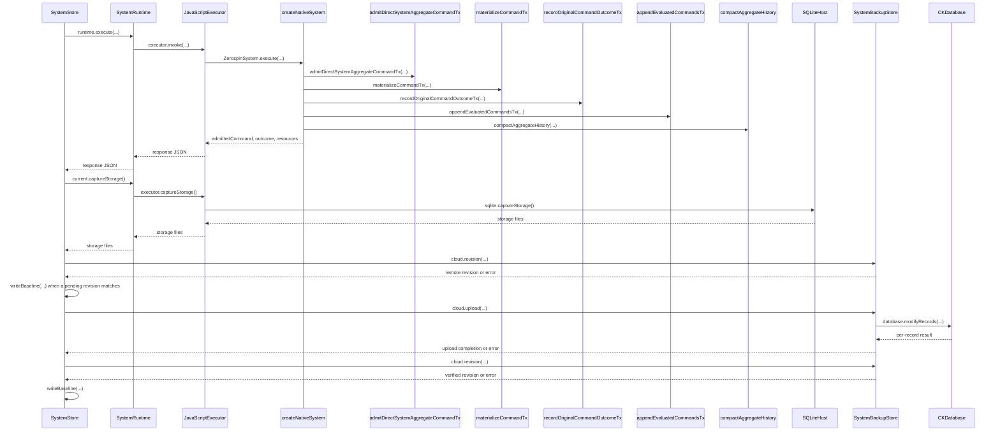

# Native System Host

The iPhone System host installs trusted authored JavaScript and runs ordinary
System-granted Aggregate commands against local SQLite. Each installed System
has a distinct identity, directory, runtime, and iCloud snapshot; one public
GitHub repository may have one installation. Each package supports one Aggregate
definition and one Aggregate release, with multiple Aggregate IDs. iCloud
snapshots are recovery data, not a second command execution owner.

## Trigger

1. A System author runs `zerospin package --platform ios` and publishes the
   resulting ZIP as a GitHub Release asset.
   - [`packageSystem.ts:18-61`](../../packages/cli/src/package/packageSystem.ts#L18-L61) — bundles the authored System and writes its manifest and `SystemSpec` into the archive.
2. `SystemStore` scans installed Systems and checks iCloud before allowing a new installation.
   - [`SystemStore.swift:101-113`](../../ios/Zerospin/SystemStore.swift#L101-L113) — loads local installations, checks CloudKit, and resumes pending captures.
   - [`SystemStore.swift:142-190`](../../ios/Zerospin/SystemStore.swift#L142-L190) — checks account bindings, discovers backups, and marks conflicts.
3. `SystemStore` loads public GitHub releases, and the person selects a release containing a System package.
   - [`SystemStore.swift:267-304`](../../ios/Zerospin/SystemStore.swift#L267-L304) — follows GitHub release pagination and selects releases with the package asset.
   - [`SystemStore.swift:307-373`](../../ios/Zerospin/SystemStore.swift#L307-L373) — rejects duplicate repositories, validates the package, and stages the installation under its new System ID.
4. The person opens an installed System and invokes a System-granted command for its selected Aggregate ID.
   - [`SystemStore.swift:198-224`](../../ios/Zerospin/SystemStore.swift#L198-L224) — opens the selected System runtime and loads its console state.
   - [`SystemStore.swift:376-400`](../../ios/Zerospin/SystemStore.swift#L376-L400) — invokes the command, displays the `outcome` and resources, and requests a backup capture.

## Command execution and backup

## Annotated workflow steps

1. `SystemStore` sends the selected command and JSON payload to `SystemRuntime`.
   - [`SystemStore.swift:384-400`](../../ios/Zerospin/SystemStore.swift#L384-L400) — calls `runtime.execute` and extracts the returned `outcome` and resources.
2. `SystemRuntime` serializes the invocation through `JavaScriptExecutor`.
   - [`SystemRuntime.swift:87-93`](../../packages/swift/Sources/Zerospin/SystemRuntime.swift#L87-L93) — decodes the JSON payload and invokes `execute`.
   - [`SystemRuntime.swift:125-133`](../../packages/swift/Sources/Zerospin/SystemRuntime.swift#L125-L133) — rejects concurrent operations and calls `executor.invoke`.
3. `JavaScriptExecutor` invokes the package's `ZerospinSystem.execute` entry.
   - [`JavaScriptExecutor.swift:121-145`](../../packages/swift/Sources/Zerospin/JavaScriptExecutor.swift#L121-L145) — evaluates the selected global method and resolves its JSON reply.
4. `createNativeSystem` admits the direct System command through the shared
   AggregateChain transaction.
   - [`createNativeSystem.ts:584-614`](../../packages/native/src/createNativeSystem.ts#L584-L614) — checks the System grant and supplies the exact Aggregate and contract versions to admission.
5. `createNativeSystem` materializes an admitted command without a retained
   `outcome` using the authored Aggregate release.
   - [`createNativeSystem.ts:369-419`](../../packages/native/src/createNativeSystem.ts#L369-L419) — reads retained admitted commands and calls `materializeCommandTx` for unresolved work.
6. `createNativeSystem` retains the original command's `outcome` on
   AggregateChain.
   - [`createNativeSystem.ts:423-444`](../../packages/native/src/createNativeSystem.ts#L423-L444) — decodes the evaluated command and records its original `outcome`.
7. `createNativeSystem` appends the evaluated command to AggregateVersionArchive.
   - [`createNativeSystem.ts:445-448`](../../packages/native/src/createNativeSystem.ts#L445-L448) — appends the complete evaluated command to retained history.
8. `createNativeSystem` acknowledges publication and compacts the
   AggregateChain before removing the pending materialization delivery.
   - [`createNativeSystem.ts:449-465`](../../packages/native/src/createNativeSystem.ts#L449-L465) — records the sole release's acknowledgement and compacts in one transaction, then deletes the Repo outbox row.
9. `createNativeSystem` returns the admitted command, retained `outcome`, and
   resources.
   - [`createNativeSystem.ts:615-637`](../../packages/native/src/createNativeSystem.ts#L615-L637) — reads the evaluated command from Archive and returns its `outcome` and current resources.
10. `JavaScriptExecutor` resolves the serialized JSON reply.
    - [`JavaScriptExecutor.swift:121-145`](../../packages/swift/Sources/Zerospin/JavaScriptExecutor.swift#L121-L145) — converts the JavaScript Promise result into the Swift continuation.
11. `SystemRuntime` returns the reply to `SystemStore`.
    - [`SystemRuntime.swift:125-133`](../../packages/swift/Sources/Zerospin/SystemRuntime.swift#L125-L133) — awaits the invocation task and returns its result.
12. `SystemStore` asks the active runtime to capture its storage while the
    runtime retains its ownership lease.
    - [`SystemStore.swift:587-598`](../../ios/Zerospin/SystemStore.swift#L587-L598) — advances the backup sequence and calls `current.captureStorage`.
13. `SystemRuntime` excludes concurrent operations and asks its executor to
    capture storage.
    - [`SystemRuntime.swift:101-108`](../../packages/swift/Sources/Zerospin/SystemRuntime.swift#L101-L108) — rejects overlapping work and awaits `executor.captureStorage`.
14. `JavaScriptExecutor` performs the capture on its serialized queue while it
    owns the directory lease.
    - [`JavaScriptExecutor.swift:150-163`](../../packages/swift/Sources/Zerospin/JavaScriptExecutor.swift#L150-L163) — checks ownership and calls `sqlite.captureStorage` on the executor queue.
15. `SQLiteHost` returns a stable collection of files. For open databases it
    captures committed WAL content with SQLite's backup API; closed files are
    copied while the lease is held.
    - [`SQLiteHost.swift:115-172`](../../packages/swift/Sources/Zerospin/SQLiteHost.swift#L115-L172) — rejects active transactions and captures open databases and closed files.
    - [`SQLiteHost.swift:175-196`](../../packages/swift/Sources/Zerospin/SQLiteHost.swift#L175-L196) — uses `sqlite3_backup` and closes a self-contained snapshot database.
16. `JavaScriptExecutor` returns the captured files to `SystemRuntime`.
    - [`JavaScriptExecutor.swift:150-163`](../../packages/swift/Sources/Zerospin/JavaScriptExecutor.swift#L150-L163) — returns the `SQLiteHost` result through the continuation.
17. `SystemRuntime` returns the captured files to `SystemStore`, which pairs
    them with the installed package before starting the upload.
    - [`SystemRuntime.swift:101-108`](../../packages/swift/Sources/Zerospin/SystemRuntime.swift#L101-L108) — returns the capture task's result.
    - [`SystemStore.swift:597-605`](../../ios/Zerospin/SystemStore.swift#L597-L605) — builds the backup with captured files and the exact package, and queues it for upload.
18. `SystemStore` asks `SystemBackupStore` for the current remote revision before uploading.
    - [`SystemStore.swift:618-623`](../../ios/Zerospin/SystemStore.swift#L618-L623) — loads the account and baseline and requests the remote revision.
19. `SystemBackupStore` returns the verified remote revision or an error.
    - [`SystemBackup.swift:179-200`](../../ios/Zerospin/SystemBackup.swift#L179-L200) — addresses the account's catalog and per-System record and validates their identities.
20. When the remote revision matches a durable pending revision newer than the baseline, `SystemStore` records it as the baseline before uploading.
    - [`SystemStore.swift:624-631`](../../ios/Zerospin/SystemStore.swift#L624-L631) — reconciles a saved revision whose acknowledgement was lost.
    - [`SystemStore.swift:688-692`](../../ios/Zerospin/SystemStore.swift#L688-L692) — checks the retained revision sequence and digest.
21. `SystemStore` sends the pending snapshot to `SystemBackupStore`.
    - [`SystemStore.swift:633-634`](../../ios/Zerospin/SystemStore.swift#L633-L634) — uploads the snapshot against the reconciled baseline.
22. `SystemBackupStore` saves the complete snapshot as a CloudKit asset with a conditional record update.
    - [`SystemBackup.swift:250-268`](../../ios/Zerospin/SystemBackup.swift#L250-L268) — publishes the asset and, on first publication, the catalog in one conditional atomic save.
23. CloudKit returns a per-record result.
    - [`SystemBackup.swift:268-273`](../../ios/Zerospin/SystemBackup.swift#L268-L273) — requires each saved-record result and verifies its record ID.
24. `SystemBackupStore` returns the upload result to `SystemStore`.
    - [`SystemBackup.swift:268-275`](../../ios/Zerospin/SystemBackup.swift#L268-L275) — checks the per-record identities and returns after the account check.
25. `SystemStore` requests the saved revision to verify the publication.
    - [`SystemStore.swift:633-636`](../../ios/Zerospin/SystemStore.swift#L633-L636) — reads back the revision and compares it with the pending snapshot.
26. `SystemBackupStore` returns the verified revision for the System.
    - [`SystemBackup.swift:179-200`](../../ios/Zerospin/SystemBackup.swift#L179-L200) — validates the account-addressed per-System record and catalog.
27. `SystemStore` records the verified baseline, removes the pending marker only if it still matches the captured state, or reports a pending backup.
    - [`SystemStore.swift:638-660`](../../ios/Zerospin/SystemStore.swift#L638-L660) — saves the baseline, checks the marker and sequence, and retains failed uploads for retry.

## Preflight, recovery, and boundaries

The package manifest uses format version 2; `SystemPackage` rejects other
versions. `SystemRuntime.inspect` evaluates the candidate without storage or
network access and checks that its executable declarations match the package.
For an existing store, `SystemRuntime` holds its ownership lock while
initializing a copy with networking disabled. It checks the initialization
response's declarations and `recoveryFailures` shape before the serving path
opens.

- [`packageSystem.ts:48-60`](../../packages/cli/src/package/packageSystem.ts#L48-L60) — creates the format 2 manifest, JavaScript bundle, and `SystemSpec` entries.
- [`SystemPackage.swift:20-33`](../../packages/swift/Sources/Zerospin/SystemPackage.swift#L20-L33) — rejects package formats other than 2 and checks the manifest identity and digest.
- [`SystemRuntime.swift:25-49`](../../packages/swift/Sources/Zerospin/SystemRuntime.swift#L25-L49) — compares inspected declarations with the package manifest and `SystemSpec`.
- [`SystemRuntime.swift:51-80`](../../packages/swift/Sources/Zerospin/SystemRuntime.swift#L51-L80) — runs existing-storage preflight before creating the serving executor.
- [`SystemRuntime.swift:142-167`](../../packages/swift/Sources/Zerospin/SystemRuntime.swift#L142-L167) — validates the initialization response, including command declarations and per-Aggregate recovery failures.
- [`SystemRuntime.swift:170-212`](../../packages/swift/Sources/Zerospin/SystemRuntime.swift#L170-L212) — locks the source, copies it, and validates initialization of the copy with networking disabled.
- [`createNativeSystem.ts:508-574`](../../packages/native/src/createNativeSystem.ts#L508-L574) — validates retained System identity and registered Aggregate schemas before writable initialization and drains pending work.

If a crash follows publication but precedes outbox cleanup, `createNativeSystem`
checks `compactedThroughIndex` and confirms the Archive append before deleting
the pending delivery.

- [`createNativeSystem.ts:467-502`](../../packages/native/src/createNativeSystem.ts#L467-L502) — reconciles pending Repo outbox rows against the compaction boundary and Archive history.

Each System has its own CloudKit record and captured storage. A fixed catalog in a
custom CloudKit zone makes published records discoverable without relying on
query-index timing. First publication saves the catalog and System record
atomically. Discovery validates the snapshot for each cataloged System.

- [`SystemBackup.swift:84-139`](../../ios/Zerospin/SystemBackup.swift#L84-L139) — discovers account-addressed catalog entries, validates snapshots, and reports failures.
- [`SystemBackup.swift:211-217`](../../ios/Zerospin/SystemBackup.swift#L211-L217) — checks the returned zone identity and requires atomic publication.
- [`SystemBackup.swift:260-273`](../../ios/Zerospin/SystemBackup.swift#L260-L273) — saves the first per-System record with its catalog entry atomically and checks returned identities.

`SystemStore` retains an account binding and a verified CloudKit revision per
installation. It compares each expected revision before upload, retains a marker
until the matching captured snapshot is verified, reconciles a remote revision
that matches a durable pending revision, and quarantines a conflicting remote revision.
`SystemBackupStore` derives the CloudKit zone, catalog, and System record IDs
from the bound account for each operation and rejects the current-user alias;
it checks returned IDs before using them. This requests account-bound record
publication. An actual account switch during an upload and the handling of any
asset bytes transferred before a rejected record save remain unverified.

- [`SystemStore.swift:142-190`](../../ios/Zerospin/SystemStore.swift#L142-L190) — checks account bindings and compares local baselines to remote revisions.
- [`SystemStore.swift:588-605`](../../ios/Zerospin/SystemStore.swift#L588-L605) — records a new pending marker, captures storage, and retains its revision.
- [`SystemStore.swift:633-660`](../../ios/Zerospin/SystemStore.swift#L633-L660) — verifies the saved revision and clears only the matching pending marker.
- [`SystemBackup.swift:60-81`](../../ios/Zerospin/SystemBackup.swift#L60-L81) — rejects ambiguous account identities and checks the currently signed-in account.
- [`SystemBackup.swift:203-217`](../../ios/Zerospin/SystemBackup.swift#L203-L217) — constructs account-addressed record IDs and checks the zone returned by CloudKit.
- [`SystemBackup.swift:237-248`](../../ios/Zerospin/SystemBackup.swift#L237-L248) — rejects a remote revision that does not match the expected baseline.

Restore stages and validates
each missing System independently, verifies that its CloudKit revision has not
changed, and reports failures for retry without replacing local Systems.
Initialization and refresh can change durable state, so both arrange a backup
capture as well as command execution.

- [`SystemStore.swift:434-513`](../../ios/Zerospin/SystemStore.swift#L434-L513) — restores each missing System, validates staged storage, and refuses replacement.
- [`SystemStore.swift:403-431`](../../ios/Zerospin/SystemStore.swift#L403-L431) — marks the selected System for capture before refreshing its Aggregate data.

The host does not provide application Effect services; a command requiring one
can remain admitted and pending. Initialization records that recovery failure
for the affected Aggregate and continues recovering other Aggregate IDs; a
snapshot can still return that Aggregate's committed resources and failure.
iCloud backup and replacement-device recovery require a provisioned CloudKit
capability. Before the multi-System changes, a signed app on one iOS simulator uploaded a snapshot after
`addListItem`; a second signed-in simulator restored the System and observed the
same item, version, and original timestamps. This verifies that round trip,
not account-switch fencing or every CloudKit failure path. A physical iPhone
also restored the original item, retained a Success `outcome` and added
`lit_offline` through `addListItem@1` while offline, reported backup pending,
and reported a completed retry after reconnection. CloudKit Console showed a
subsequently modified private backup record and snapshot asset, but the asset
was then restored on an isolated simulator clone into a separate local directory.
The clone retained both items, their two admitted commands with Success
`outcome`s, and the exact package; all four restored SQLite databases passed
`integrity_check`. The clone initiated a post-restore upload, whose server
acknowledgement was not independently checked. These checks predate the
multi-System implementation. For the owner-bound implementation, a signed
temporary macOS harness used the production backup and System store methods
with a unique CloudKit zone and a temporary local root. It saved and read back
an explicit-owner asset, rejected ambiguous or wrong owners and stale updates,
and preserved a usable local System after a staged restore failed. The
disposable zone and local root were removed. Signed iPhone and simulator builds
passed. These checks did not exercise a real account switch or observe asset
transfer before a rejected record save. Apple App Review acceptance of
downloaded System code remains unresolved.

- [`createNativeSystem.ts:131-171`](../../packages/native/src/createNativeSystem.ts#L131-L171) — rejects unsupported release categories and command operations.
- [`createNativeSystem.ts:204-209`](../../packages/native/src/createNativeSystem.ts#L204-L209) — supplies only the `System` Effect service.
- [`createNativeSystem.ts:376-395`](../../packages/native/src/createNativeSystem.ts#L376-L395) — reports an unavailable application service without fabricating an `outcome`.
- [`createNativeSystem.ts:548-562`](../../packages/native/src/createNativeSystem.ts#L548-L562) — returns per-Aggregate missing-service recovery failures while continuing the remaining Aggregate IDs.
- [`createNativeSystem.ts:627-638`](../../packages/native/src/createNativeSystem.ts#L627-L638) — returns committed resources and the selected Aggregate's recovery failure.
- [iOS System research](../research/ios-downloaded-zerospin-systems.md) — records platform and App Review constraints.
