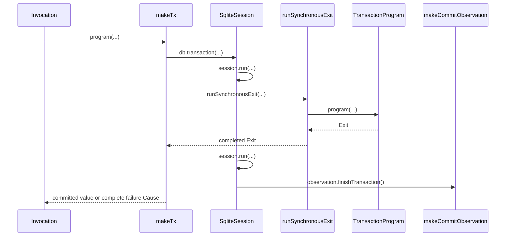

# Queries, transactions and fixed persistence

Application queries return stored model rows. Runtime adapters own encoding, statement execution, synchronous transaction lifetime, fixed physical schema and committed-table observation. This page connects those boundaries; [Query data](../../docs/content/guides/query-data.md) owns public usage.

## Trigger

1. Bind authored tables with `makeDbConfig` or model tables with `makeResourceDbConfig` before opening a runtime database.
   - [`makeDbConfig.ts:12-37`](../../packages/core/src/drizzle/make/makeDbConfig/makeDbConfig.ts#L12-L37) — validates/composes tables and renders immutable persistence, relational and provisioning definitions once.
2. Provision the bound fixed definition before exposing queries or running a transaction.
   - [`provisionDbTx.ts:5-11`](../../packages/core/src/drizzle/provisionDb/provisionDbTx/provisionDbTx.ts#L5-L11) — runs provisioning in one synchronous `makeTx` program.

## Annotated workflow steps

1. Execute a named transaction program against its explicit database.
   - [`makeTx.ts:16-54`](../../packages/core/src/drizzle/make/makeTx.ts#L16-L54) — binds the program, definition source and database while preserving inferred requirements/errors.
2. Enter the native synchronous transaction; nested `makeTx` invocation is refused.
   - [`makeTx.ts:65-79`](../../packages/core/src/drizzle/make/makeTx.ts#L65-L79) — captures the context and fences the native transaction handle before evaluation.
3. Begin SQLite before evaluating the callback.
   - [`SqliteSession.ts:107-120`](../../packages/core/src/drizzle/SqliteSession.ts#L107-L120) — creates the transaction handle and executes BEGIN before the callback.
4. Run the Effect to synchronous completion with the transaction close fence.
   - [`makeTx.ts:74-94`](../../packages/core/src/drizzle/make/makeTx.ts#L74-L94) — supplies the complete execution context, captures rollback-only/failure exits and closes the transaction handle.
5. Evaluate the transaction program and cancel suspended work before returning control to SQL.
   - [`runSynchronousExit.ts:1-75`](../../packages/shapes/src/runSynchronousExit.ts#L1-L75) — captures the Exit, fences on suspension, interrupts and flushes the suspended fiber while preserving independent cleanup reasons.
6. Return the complete synchronous Exit to the transaction owner.
   - [`makeTx.ts:80-89`](../../packages/core/src/drizzle/make/makeTx.ts#L80-L89) — retains failure or always-rollback success before raising its private rollback sentinel.
7. Fence transaction-owned builders before the native callback exits.
   - [`makeTx.ts:90-95`](../../packages/core/src/drizzle/make/makeTx.ts#L90-L95) — closes the handle in `finally` before any committed observer can start new work.
8. Commit successful work or roll back the captured refusal/defect.
   - [`SqliteSession.ts:122-129`](../../packages/core/src/drizzle/SqliteSession.ts#L122-L129) — commits after callback completion and rolls back thrown failures.
9. Publish committed table changes after statement and outer transaction completion.
   - [`SqliteSession.ts:130-133`](../../packages/core/src/drizzle/SqliteSession.ts#L130-L133) — settles transaction observation after COMMIT or ROLLBACK.
   - [`makeCommitObservation.ts:8-29`](../../packages/core/src/drizzle/makeCommitObservation.ts#L8-L29) — waits for zero transaction/execution depth and isolates observer failure.
10. Return a value after successful commitment or propagate every captured execution reason after rollback.
    - [`makeTx.ts:97-125`](../../packages/core/src/drizzle/make/makeTx.ts#L97-L125) — recognizes only its exact rollback sentinel, records SQL failure with captured execution Cause, or returns/fails from the complete Exit.

## Rows, resources and JSON boundaries

A model SQL row contains authored attributes plus `id`, `createdAt` and `updatedAt`. Bound `modelName` and `version` are envelope identity, never SQL/query/index columns. Complete incoming resources are validated before those constants are removed. Export reconstructs both from the same model binding. JSON-text attributes and native Dates remain encoded persistence values; JSON serialization of a complete message is a separate schema boundary.

- [`resourceEnvelope.ts:13-63`](../../packages/core/src/Node/resourceEnvelope.ts#L13-L63) — validates full identity/attributes, removes envelope constants for storage, and reconstructs complete outgoing resources while preserving encoded JSON attributes.
- [`encodeRowAsResource.ts:7-54`](../../packages/core/src/models/encodeRowAsResource.ts#L7-L54) — validates a decoded row under bound model identity and encodes authored properties.

`table.encodeRow`/`decodeRow` convert full table rows, retaining Date values while encoding/decoding declared JSON columns. `model.resourceJsonCodec` converts complete decoded resources to JSON-compatible objects, including declared Date fields. `ResourceEnvelopeJsonCodec` only declares the framework envelope timestamps; the model-specific properties codec validates authored Date attributes. `Schema.fromJsonString(MessageSchema)` owns an entire JSON message string.

- [`makeEncodedShapeRowCodec.ts:1-66`](../../packages/shapes/src/makeEncodedShapeRowCodec.ts#L1-L66) — derives each encoded property codec from the complete authored shape.
- [`ResourceEnvelopeJsonCodec.ts:1-19`](../../packages/core/src/models/ResourceEnvelopeJsonCodec.ts#L1-L19) — declares the generic resource envelope and framework timestamp conversion.

Persistence `config.schema`/`model.drizzleSchema` accepts encoded SQLite values. Relational `db.query`/`tx.query` uses separately rendered decoded JSON fields, including internal registered tables. Predicates encode decoded JSON values before binding; selected columns/relations retain their inferred decoded values and invalid selected JSON fails. Raw SQL expressions require their explicit mapping. `findFirstOrThrow` shares filters/columns/relations with `findFirst` but rejects an absent row in synchronous, awaited and prepared execution.

- [`makeDbConfig.ts:12-18`](../../packages/core/src/drizzle/make/makeDbConfig/makeDbConfig.ts#L12-L18) — renders persistence and decoded query schemas separately from one bound graph.
- [`SqliteRelationalQueryBuilder.ts:24-54`](../../packages/core/src/drizzle/SqliteRelationalQueryBuilder.ts#L24-L54) — checks required-row presence in the shared prepared mapper.
- [`makeSqliteDrizzle.ts:38-69`](../../packages/core/src/drizzle/make/makeSqliteDrizzle.ts#L38-L69) — installs durable SQLite codecs and relational definitions on the connection.

Inside `makeTx`, `tx.query` sees preceding writes in the same transaction. Contract/guard query capabilities expose reads; constructing a recorded operation does not mutate subsequent query results. Parallel model writes remain command execution/replay responsibility. `useLiveQuery` receives model-only reads; it cannot mutate or read internal command tables through that callback.

- [`makeContractReadDb.ts:280-304`](../../packages/core/src/contracts/make/makeContractReadDb.ts#L280-L304) — binds declared model query capabilities to the invocation's database.
- [`useLiveQuery.ts:77-118`](../../packages/react/src/useLiveQuery.ts#L77-L118) — binds the session's current initialized query database and selected model read surface.

## Savepoints, cancellation and error ownership

`withSavepoint` uses the same synchronous Exit/fence discipline inside an existing transaction. Domain policies recognize a single expected refusal only after rollback; composite Causes, cleanup defects and independent interruptions remain intact. The runner filters only interruption it induced itself. SQL begin/savepoint/commit/release/rollback failure belongs to the owning transaction error. A rollback failure remains primary and records the original execution Cause in diagnostics.

- [`withSavepoint.ts:35-80`](../../packages/core/src/drizzle/withSavepoint.ts#L35-L80) — fences suspended execution, retains the full Exit across successful rollback and reports SQL failure separately.
- [`fenceTransaction.ts:24-70`](../../packages/core/src/drizzle/fenceTransaction.ts#L24-L70) — wraps transaction methods and prebuilt query builders, rejecting use after close.
- [`replayOptimisticCommandTx.ts:59-79`](../../packages/core/src/sessionExecution/replayOptimisticCommandTx.ts#L59-L77) — returns null only for a sole recognized refusal after savepoint completion; other reasons propagate.

An already uninterruptible asynchronous release can finish later, but the fenced handle cannot issue SQL after commit or rollback. Returned data and the parent database retain their normal lifetimes.

## Statements and committed-table observation

One statement engine normalizes supported parameters, copies byte buffers, prepares/binds statements, collects array/object rows and finalizes before publication. It captures SQLite `changes` before observers can reenter. Query metadata remains available to Drizzle prepared queries.

- [`executeStatementRows.ts:14-79`](../../packages/core/src/drizzle/executeStatementRows.ts#L14-L79) — normalizes parameters and brackets prepared statement execution/finalization with observation depth.

SQLite authorizer `SQLITE_READ` callbacks record physical dependencies during preparation and automatic repreparation, including joins, subqueries, views and empty results. A query with no table reads watches no tables. Update/commit hooks record names and commit state; they do not run queries or publish SQL statements. Savepoint rollback restores earlier pending change sets and drops later ones. Isolated observers run after stepping/finalization and settled outer SQL; reentrant observer writes form later batches. Restore callers publish restored table names only after the live connection is ready.

- [`makeInMemorySQLite3.ts:55-86`](../../packages/core/src/drizzle/make/makeInMemorySQLite3/makeInMemorySQLite3.ts#L55-L86) — tracks read tables, savepoints and committed write sets in the browser-compatible adapter.
- [`makeInMemorySQLite3.ts:184-245`](../../packages/core/src/drizzle/make/makeInMemorySQLite3/makeInMemorySQLite3.ts#L184-L245) — records update/commit hooks and flushes isolated observer batches after autocommit resumes.

## Fixed schema and declarative selections

The bound graph validates table identity, physical names, sole primary keys, relation names/cycles and index names/columns before runtime opening. Provisioning quotes identifiers, retains foreign-key actions and supports declared single-column null/not-null partial indexes. Existing column/key/unique/foreign-key/index metadata must match; missing tables/indexes are provisioned atomically. A mismatch requires empty storage. Provisioning neither migrates nor erases existing rows, and this documentation migration authorizes no storage reset.

- [`bindDatabaseDefinition.ts:1-90`](../../packages/core/src/drizzle/definition/bindDatabaseDefinition.ts#L1-L90) — validates and freezes the authored database graph.
- [`compileSqliteTableDefinition.ts:1-79`](../../packages/core/src/drizzle/definition/compileSqliteTableDefinition.ts#L1-L79) — derives named table/index provisioning from raw Drizzle metadata.
- [`provisionDbTables.ts:15-47`](../../packages/core/src/drizzle/provisionDb/provisionDbTables.ts#L15-L47) — validates existing fixed tables before creating missing indexes and reports a storage-reset-required mismatch.

Selections retain authored options, identity references and explicit SQL expression structure separately from compiled SQL/positional bindings. Compiler changes can change executable SQL while the accepted definition remains equal; changing a filter, identity reference, ordering, limit or authored SQL fragment changes the declaration. RAW/order callbacks must be pure; capture retains the returned expression rather than JavaScript source. Unsupported executable values, cycles, undeclared identity placeholders and noncanonical models are refused.

- [`captureSelectionDefinition.ts:24-93`](../../packages/core/src/models/captureSelectionDefinition.ts#L24-L93) — captures serializable authored options and canonical table/column/identity references while rejecting unsupported cycles/values.
- [`makeQueryDbVersion.ts:207-326`](../../packages/core/src/models/make/makeQueryDbVersion.ts#L207-L326) — captures authored selection identity and separately freezes compiled SQL and bindings.

The pinned upstream Drizzle release and its `durable-sqlite/codecs` define the executable SQLite compilation and row mapping. Drizzle compiles nested to-one relation filters into a correlated `EXISTS` for each hop. Plan 236 retains its own runtime verification requirements.
