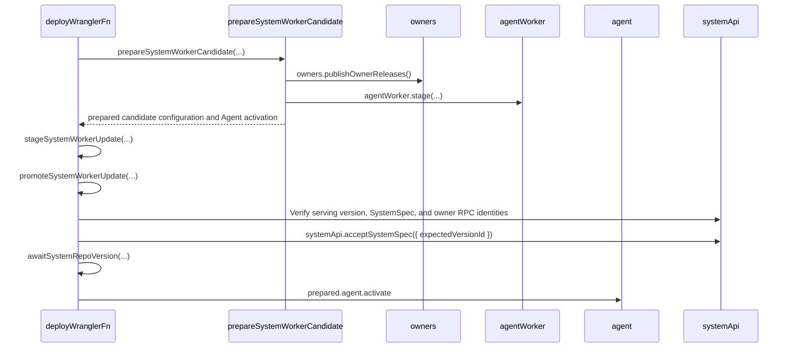

# Self-hosted System deployment

**Self-hosted on Cloudflare** means the operator runs `zerospin deploy` and the System runs in the operator’s Cloudflare account. For a System **hosted on ZeroSpinner**, ZeroSpinner deploys and runs the System in its own Cloudflare account.

A System deployment coordinates one SystemWorker, one shared Agent Worker and one Worker for each Aggregate or Service release. A Cloudflare Worker version identifies an uploaded executable. An owner release identifies the Aggregate or Service name and its declared release version.

## Trigger

1. Running `zerospin deploy` renders `DeployWrangler`, which starts the deployment.
   - [`deploy.tsx:7-18`](../../packages/cli/src/commands/deploy.tsx#L7-L18) — mounts the deploy component.
   - [`DeployWrangler.tsx:16-25`](../../packages/cli/src/deploy/DeployWrangler.tsx#L16-L25) — runs the deploy Effect.
2. On first deploy the CLI uploads or recovers the bootstrap SystemWorker. Both first deploy and redeploy then verify the serving System before preparing a candidate.
   - [`deployWranglerFn.ts:72-74`](../../packages/cli/src/deploy/deployWranglerFn.ts#L72-L74) — resolves the deployment account and scopes the local deployment records to it.
   - [`deployWranglerFn.ts:117-131`](../../packages/cli/src/deploy/deployWranglerFn.ts#L117-L131) — selects the initial upload or observed deployment and passes it to verification.

## Worker publication and activation

## Annotated workflow steps

1. Prepare the candidate against the serving deployment.
   - [`deployWranglerFn.ts:163-171`](../../packages/cli/src/deploy/deployWranglerFn.ts#L163-L171) — passes the verified serving deployment into preparation.
2. Node projects each registered release with `makeReleaseSpec(release)`. Each owner bundle imports the authored release. Its platform binding supplies the scalar catalog hash for Repo registration. Before uploading a new owner, persist the expected projection with the tagged upload intent. After upload, call `getOwnerReleaseDeclaration()` on the deployed owner, verify that the answering Worker matches the provider version and expected release, and compare its Workerd projection with the persisted Node value. On a lost reply, reconcile the tagged version and retry the comparison against its original expectation. Existing accepted releases, including retired executors with outstanding work, verify their exact executing pin through `getOwnerReleaseIdentity()`.
   - [`prepareOwnerReleaseBindings.ts:119-302`](../../packages/cli/src/deploy/utils/prepareOwnerReleaseBindings.ts#L119-L302) verifies the responder, compares its declaration with the upload record, and confirms the serving deployment before returning the pin.
3. Stage a version of the shared Agent Worker with the owner service bindings.
   - [`prepareAgentWorker.ts:203-222`](../../packages/cli/src/deploy/utils/prepareAgentWorker.ts#L203-L222) — writes the bindings, uploads the version and verifies its namespaces.
4. Return the prepared deployment to the CLI.
   - [`prepareSystemWorkerCandidate.ts:65-95`](../../packages/cli/src/deploy/utils/prepareSystemWorkerCandidate.ts#L65-L95) — combines retained and newly published owner pins for the SystemWorker manifest.
   - [`prepareSystemWorkerCandidate.ts:142`](../../packages/cli/src/deploy/utils/prepareSystemWorkerCandidate.ts#L142) — returns the prepared owners, staged Agent and owner pins.
5. Upload the SystemWorker candidate and stage it at zero traffic.
   - [`stageSystemWorkerUpdate.ts:44-73`](../../packages/cli/src/deploy/utils/stageSystemWorkerUpdate.ts#L44-L73) — uploads a tagged version and assigns all serving traffic to the incumbent.
6. Record the compiled SystemSpec hash, owner pins and Agent version with the promotion intent, then promote the SystemWorker to serving traffic.
   - [`promoteSystemWorkerUpdate.ts`](../../packages/cli/src/deploy/utils/promoteSystemWorkerUpdate.ts) writes a tagged 100%-traffic deployment through the saved intent.
7. Reach the promoted SystemWorker through its ordinary Wrangler service binding. Verify the answering version, loaded SystemSpec and actual owner bindings. Each executor reports its identity through `getOwnerReleaseIdentity()`.
   - [`verifySystemWorkerCandidate.ts`](../../packages/cli/src/deploy/utils/verifySystemWorkerCandidate.ts) checks the answering Worker and compares its runtime owner bindings against the compiled pins.
8. Call `SystemApi.acceptSystemSpec({ expectedVersionId })` and wait until SystemRepo executes the promoted version.
   - [`awaitSystemRepoVersion.ts`](../../packages/cli/src/deploy/utils/awaitSystemRepoVersion.ts) polls until the executing SystemRepo version matches the promoted Worker.
9. Activate the staged Agent Worker, then initialize the System. The CLI reports the deployment verified only after initialization succeeds.
   - [`deployWranglerFn.ts`](../../packages/cli/src/deploy/deployWranglerFn.ts) completes Agent activation and initialization before clearing the promotion record.

The promoted Worker can receive traffic during verification. After interruption, rerunning the CLI from the same declaration checks the saved promotion against Cloudflare, reverifies the serving Worker and pending owner pins, and resumes acceptance and initialization.

## Shipping a framework fix

A fix bundled into an owner Worker requires a new release for each affected Aggregate or Service. For example, declaring Shopping version 2 gives it a distinct Worker name. Commands addressed to Shopping version 1 still execute on its pinned executable.

- [`ownerReleaseDeployment.ts:38-59`](../../packages/core/src/system/ownerReleaseDeployment.ts#L38-L59) — derives the Worker name from the SystemWorker name and the owner family, name and release version.
- [`registerSystemSpecTx.ts:56-89`](../../packages/system-worker/src/SystemRepo/registerSystemSpec/registerSystemSpecTx.ts#L56-L89) — rejects a replacement pin for an accepted owner release.
- [`versioning-and-deployment.md:25-28`](../../docs/content/handbook/versioning-and-deployment.md#L25-L28) — ties original execution to the exact release binding.

A fix bundled into SystemWorker or the shared Agent Worker ships on an ordinary redeploy with the same declarations. Even two deploys from identical inputs request both uploads. The CLI stages both Workers on each run without comparing their built bundles. The SystemSpec hash covers portable declarations, so a runtime fix can leave that hash unchanged.

- [`prepareAgentWorker.ts:163-173`](../../packages/cli/src/deploy/utils/prepareAgentWorker.ts#L163-L173) — invokes Wrangler versions upload for a staged Agent version.
- [`stageSystemWorkerUpdate.ts:44-56`](../../packages/cli/src/deploy/utils/stageSystemWorkerUpdate.ts#L44-L56) — invokes Wrangler versions upload for the SystemWorker candidate.
- [`hashSystemSpec.ts:41-47`](../../packages/core/src/system/hashSystemSpec.ts#L41-L47) — hashes the canonical JSON of the spec body.
- [`registerSystemSpecTx.ts:89-98`](../../packages/system-worker/src/SystemRepo/registerSystemSpec/registerSystemSpecTx.ts#L89-L98) — returns before writing another snapshot when the spec was already accepted.
