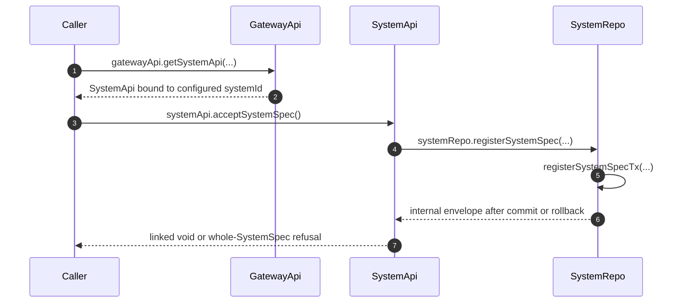
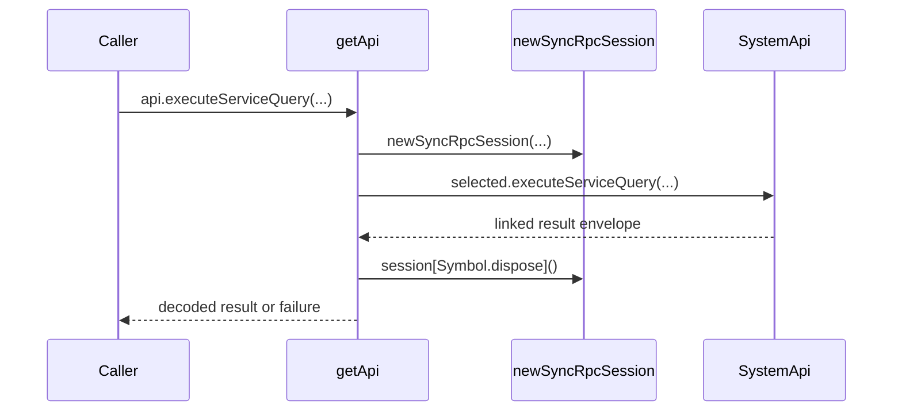

# System API

SystemApi is an administration capability bound to the configured systemId. GatewayApi grants it through the deployment secret-key policy; trusted native code constructs it from its existing System identity. It accepts the executing authored spec, executes aggregate/service commands through canonical admission, and inspects registered physical Repos. Its raw methods return native Promises; administrative execution returns the original retained `ICommandOutcome` directly.

Core's `getSystemApi()` acquires URL and redacted secret from Effect services and
selects the HTTP capability. `getNativeSystemApi(systemId)` acquires the same typed
`ISystemApi` interface from an existing trusted native System identity. Both use
`makeSystemApi`; callers invoke its concrete administrative methods without
supplying transport callbacks or decoding envelopes. Core owns the public
`ISystemGatewayRpc` and `ISystemApiRpc` wire contracts; System Worker implements
them. The typed interface retains the result type of a connection-free
`makeQueryDbVersion` selection. See the [layer and nested read example](../../docs/content/reference/sdk.md#administrative-owner-reads).

## Administrative aggregate and service reads

`ISystemApi` accepts a connection-free `QuerySelection<TResult>`. Its concrete
service and aggregate methods keep `TResult` and the mapper locally; the raw
capability receives only the exact release identity and
`{ modelName, mode, config, models }`, where each model selection contains its
name, version and exact visible column names. `makeSystemApi` owns preparation,
strict result decoding, compiler/layout checks and row mapping. There is no
exported administrative selection executor.

- [`makeQueryDbVersion.ts:146-163`](../../packages/core/src/models/make/makeQueryDbVersion.ts#L146-L163) — prepares model identities and visible column names without compiling schema documents.
- [`compileReadQuery.ts:374-386`](../../packages/core/src/models/reads/compileReadQuery.ts#L374-L386) — resolves native owner models and rejects a mismatched name, version or column set.

Both `AggregateVersionRepo` and `ServiceVersionRepo` read their declared models
synchronously under their execution permit. Reads observe current committed
materialization after normal activation; they do not execute admitted backlog,
reserve a row for a later command, or produce model changes.

Browser sessions expose selected resources and local queries. They have no
general remote service-query method. Named service callbacks and release query
registries do not exist. A SystemApi read uses the trusted capability's System
identity, independently of actor selection filters.

### Read acquisition triggers

1. HTTP callers acquire the configured capability through `getApi`, then construct the typed interface.
   - [`getSystemApi.ts:12-18`](../../packages/core/src/utils/getSystemApi/getSystemApi.ts#L12-L18) — reads the URL and secret services, selects the gateway's capability and calls `makeSystemApi`.
2. Native callers supply their existing trusted `systemId` and receive the same typed interface without HTTP or additional credentials.
   - [`getNativeSystemApi.ts:70-88`](../../packages/system-worker/src/getNativeSystemApi/getNativeSystemApi.ts#L70-L88) — constructs raw `SystemApi` and binds concrete linked methods into `makeSystemApi`.
   - [`ISystemApi.ts:1-4`](../../packages/core/src/systemApi/ISystemApi.ts#L1-L4) — derives the shared administrative type from that constructor.
3. The in-process harness exposes the same typed System-only Service command/read subset. Its separate `push` entrypoint accepts complete Actor/Agent inputs, validates their exact grants and claims, and uses Actor-selected reads and Actor guard context for Actor execution.
   - [`makeSystemHarness.ts:134-173`](../../packages/core/src/testing/systemHarness/makeSystemHarness.ts#L141-L180) — resolves the registered service, calls local `executeQuerySelection` and encodes failures without a wire round trip.
   - [`executeHarnessCommand.ts:34-98`](../../packages/core/src/testing/systemHarness/executeHarnessCommand.ts#L34-L98) — validates exact principal grants and decodes captured Actor claims.
   - [`executeHarnessCommand.ts:129-154`](../../packages/core/src/testing/systemHarness/executeHarnessCommand.ts#L129-L154) — supplies Aggregate Actor guard context and evaluates through Actor-selected reads.
   - [`executeHarnessCommand.ts:189-215`](../../packages/core/src/testing/systemHarness/executeHarnessCommand.ts#L189-L215) — supplies the corresponding Service Actor guard context and selected read database.

The native service read below shows the public typed method and the private
linked invocation. HTTP acquisition uses the same typed methods with `getApi`'s
decoded Effect transport; the raw `SystemApi` wire interface remains unchanged.

```mermaid
sequenceDiagram
  autonumber
  participant Caller
  participant systemApi as systemApi: ISystemApi
  participant invoke
  participant SystemApi
  participant executeServiceQuery
  participant ServiceVersionRepo
  Caller->>systemApi: systemApi.executeServiceQuery(...)
  systemApi->>systemApi: query.prepareRead()
  systemApi->>invoke: rpc.executeServiceQuery(...)
  invoke->>SystemApi: api.executeServiceQuery(...)
  SystemApi->>executeServiceQuery: executeSystemWorkerServiceQuery(...)
  executeServiceQuery->>ServiceVersionRepo: repo.executeServiceQuery(...)
  ServiceVersionRepo-->>executeServiceQuery: committed rows, compilerVersion, layout
  executeServiceQuery-->>SystemApi: decoded owner result
  SystemApi-->>invoke: linked result envelope
  invoke-->>systemApi: decoded read result; trace link retained
  systemApi->>systemApi: strict result and compiler/layout identity
  systemApi->>systemApi: read.mapRows(...)
  systemApi-->>Caller: mapped TResult or encoded failure
```

## Annotated workflow steps

1. Call the typed service method with a local selection and exact service identity.
   - [`makeSystemApi.ts:34-41`](../../packages/core/src/utils/getSystemApi/makeSystemApi.ts#L34-L41) — accepts `QuerySelection<TResult>` beside service name/version.
2. Prepare the declarative read while keeping the local result mapper.
   - [`makeSystemApi.ts:43-47`](../../packages/core/src/utils/getSystemApi/makeSystemApi.ts#L43-L47) — calls `query.prepareRead()` and retains service-specific preparation failures.
3. Invoke the acquired Effect transport with only the service identity and prepared descriptor.
   - [`makeSystemApi.ts:48-52`](../../packages/core/src/utils/getSystemApi/makeSystemApi.ts#L48-L52) — passes `read.request` to `rpc.executeServiceQuery` without a mapper or callback in the request.
4. Add current trace context and invoke the raw native capability.
   - [`getNativeSystemApi.ts:32-45`](../../packages/system-worker/src/getNativeSystemApi/getNativeSystemApi.ts#L32-L45) — obtains caller trace context and turns rejected native Promises into `rpc-invocation-failed`.
   - [`getNativeSystemApi.ts:82-85`](../../packages/system-worker/src/getNativeSystemApi/getNativeSystemApi.ts#L82-L85) — binds the service method to `api.executeServiceQuery({ args, traceContext })`.
5. Decode the request and bind the trusted System identity.
   - [`executeServiceQuery.ts:9-21`](../../packages/system-worker/src/SystemApi/executeServiceQuery/executeServiceQuery.ts#L9-L21) — strictly decodes `ServiceQuerySchema` and obtains `Initialized.systemId`.
6. Resolve the exact authored service and keyed materialization before calling its read method.
   - [`executeServiceQuery.ts:23-39`](../../packages/system-worker/src/executeServiceQuery/executeServiceQuery.ts#L23-L39) — checks service/release registration, resolves `ServiceVersionRepo` by its full key and sends declarative read facts.
7. Return committed positional rows and compiler evidence from declared models.
   - [`executeServiceQuery.ts:40-54`](../../packages/owner-release-worker/src/ServiceVersionRepo/executeServiceQuery/executeServiceQuery.ts#L40-L54) — compiles and synchronously collects rows under the Repo execution permit.
8. Decode the internal owner envelope before returning the owner result.
   - [`executeServiceQuery.ts:38-40`](../../packages/system-worker/src/executeServiceQuery/executeServiceQuery.ts#L38-L40) — consumes the Repo response through `readRpcEnvelope`.
9. Return through the raw capability's linked Success/Failure protocol.
   - [`executeServiceQuery.ts:16-25`](../../packages/system-worker/src/SystemApi/executeServiceQuery/executeServiceQuery.ts#L16-L25) — selects linked output and constructs its result branches.
10. Validate the linked envelope, retain its trace link and expose its result through the Effect transport.
    - [`getNativeSystemApi.ts:46-59`](../../packages/system-worker/src/getNativeSystemApi/getNativeSystemApi.ts#L46-L59) — rejects malformed envelopes, merges non-null links into an available collector and selects the result branch.
11. Strictly validate the returned read and compare compiler/layout identity.
    - [`makeSystemApi.ts:53-71`](../../packages/core/src/utils/getSystemApi/makeSystemApi.ts#L53-L71) — refuses malformed fields and `service-query-result-mismatch` before mapping.
    - [`makeSystemApi.ts:138-155`](../../packages/core/src/utils/getSystemApi/makeSystemApi.ts#L138-L155) — applies the corresponding aggregate result-schema and compiler/layout checks.
12. Map positional rows through the local selection.
    - [`makeSystemApi.ts:72-79`](../../packages/core/src/utils/getSystemApi/makeSystemApi.ts#L72-L79) — invokes `read.mapRows` and retains `service-query-result-invalid` on mapping failure.
    - [`makeSystemApi.ts:156-163`](../../packages/core/src/utils/getSystemApi/makeSystemApi.ts#L156-L163) — applies the aggregate selection's mapper with its concrete mapping-failure code.
13. Return the inferred result or encoded typed failure to the caller.
    - [`makeSystemApi.ts:72-87`](../../packages/core/src/utils/getSystemApi/makeSystemApi.ts#L72-L87) — returns mapped rows and encodes Zerospin failures while preserving other transport failures.

## Trigger

1. A caller acquires `gatewayApi.getSystemApi({ zerospinSecretKey })`; the deployment policy admits one configured system identity. Optional diagnostics do not require accepted definitions or activation of a separate durable diagnostics owner.
   - [`getSystemApi.ts:20-35`](../../packages/system-worker/src/GatewayApi/getSystemApi/getSystemApi.ts#L20-L35) — returns the configured system identity through the policy outcome callbacks.
2. The accepted capability calls a generated schema-backed RPC method.
   - [`makeRpcApi.ts:269-286`](../../packages/system-worker/src/makeRpcApi/makeRpcApi.ts#L269-L286) — captures invocation telemetry, reports its records and converts the final callback outcome.



## Annotated workflow steps

1. Request the administration capability through the deployment secret-key policy.
   - [`getSystemApi.ts:21-30`](../../packages/system-worker/src/GatewayApi/getSystemApi/getSystemApi.ts#L21-L30) — The supplied secret is checked against deployment policy before returning configured systemId.

2. Receive a capability whose instance retains the configured system identity.
   - [`getSystemApi.ts:33-34`](../../packages/system-worker/src/GatewayApi/getSystemApi/getSystemApi.ts#L33-L34) — The settled policy outcome constructs SystemApi with its admitted systemId or the terminal failure capability.

3. Ask to accept the executing bundle without supplying a different candidate or system identity.
   - [`acceptSystemSpec.ts:22-29`](../../packages/system-worker/src/SystemApi/acceptSystemSpec/acceptSystemSpec.ts#L22-L29) — The executing bundle spec is delegated to the configured SystemRepo.

4. Validate the supplied candidate and verify its content hash at the SystemRepo boundary.
   - [`registerSystemSpec.ts:14-44`](../../packages/system-worker/src/SystemRepo/registerSystemSpec/registerSystemSpec.ts#L14-L44) — strictly decodes the full snapshot and refuses a hash/content mismatch.

5. Accept the whole snapshot atomically, comparing immutable version facts with all retained snapshots.
   - [`registerSystemSpecTx.ts:54-104`](../../packages/system-worker/src/SystemRepo/registerSystemSpec/registerSystemSpecTx.ts#L54-L104) — inserts one complete snapshot only after every comparison succeeds.

6. Return the Repo outcome envelope after the whole-SystemSpec transaction commits or rolls back.
   - [`acceptSystemSpec.ts:27-29`](../../packages/system-worker/src/SystemApi/acceptSystemSpec/acceptSystemSpec.ts#L27-L29) — consumes the internal Repo envelope through readRpcEnvelope.
7. Return linked void or the whole-SystemSpec refusal through the capability callback.
   - [`acceptSystemSpec.ts:31-34`](../../packages/system-worker/src/SystemApi/acceptSystemSpec/acceptSystemSpec.ts#L31-L34) — constructs the public success/failure outcome from the settled domain result.

## Whole-SystemSpec acceptance and hash gates

SystemRepo retains complete accepted SystemSpecs in `acceptedSystemSpecs`, keyed by their canonical SHA-256 hash. It validates the supplied candidate and recomputes its content identity before acceptance. The candidate may originate from a different Cloudflare Worker version than SystemRepo is executing. Comparing immutable model, Contract, release, Actor and Agent facts against every retained snapshot is internal work in one acceptance transaction; the whole snapshot is inserted only after all comparisons succeed. Equal reacceptance writes nothing. Omission does not erase earlier snapshots or permit a version to be redefined later.

- [`registerSystemSpec.ts:14-44`](../../packages/system-worker/src/SystemRepo/registerSystemSpec/registerSystemSpec.ts#L14-L44) — validates the supplied candidate and its content hash before entering acceptance.
- [`registerSystemSpecTx.ts:54-104`](../../packages/system-worker/src/SystemRepo/registerSystemSpec/registerSystemSpecTx.ts#L54-L104) — derives temporary immutable-fact keys, compares all retained snapshots and stores one successful whole snapshot atomically.
- [`systemRepoDbConfig.ts:8-20`](../../packages/system-worker/src/SystemRepo/systemRepoDbConfig.ts#L8-L20) — declares the unique hash and complete typed SystemSpec row.

`makeSystem` validates native declaration relationships and finalizes every reachable
Contract lineage. `makeSystemSpec` compiles complete definitions once per owner in
`modelVersions`, `contractVersions`, `actorVersions` and `agentVersions`. It
collects models from release registries, Agent databases and all reachable Contract
reads and mutations, retaining historical source, intermediate and descendant
versions. Releases bind exact model, Contract, Actor and Agent versions; Contract
and Agent model maps bind versions, and mutation metadata uses
`{ modelName, version }`. Actor exposed-model projections remain inline because a
limited view may differ from its canonical model. Conflicting immutable identities
are refused during compilation. RPC/storage decoding validates identities,
references and release grants.

The returned JSON carries its content hash and is not frozen. Hashing includes
complete normalized portable facts, including projections and explicit grants;
callback bodies and executable codec transformations remain outside that identity.
Native declaration APIs, operation execution and browser session locks are unchanged.

- [`makeSystem.ts:102-123`](../../packages/core/src/system/make/makeSystem/makeSystem.ts#L102-L123) — validates declarations and composition before finalizing reachable Contract lineages.
- [`makeSystemSpec.ts:29-134`](../../packages/core/src/system/make/makeSystemSpec.ts#L29-L134) — rejects conflicting owner-local facts and gathers models, Agents and reachable Contract versions.
- [`makeSystemSpec.ts:138-201`](../../packages/core/src/system/make/makeSystemSpec.ts#L138-L201) — retains canonical selections and all release bindings beside owner-local registries, then attaches the hash.
- [`makeReleaseSpecs.ts:34-102`](../../packages/core/src/declaration/makeReleaseSpecs.ts#L34-L102) — projects release and Agent maps as exact numeric bindings.
- [`makeContractSpec.ts:10-42`](../../packages/core/src/declaration/makeContractSpec.ts#L10-L42) — projects Contract schema facts, version-bound reads and operation metadata.
- [`makeActorSpecs.ts:40-64`](../../packages/core/src/declaration/makeActorSpecs.ts#L40-L64) — retains complete exposed-model projections and authored selection facts inside each Actor version.
- [`SystemSpecSchema.ts:113-375`](../../packages/core/src/system/SystemSpecSchema.ts#L113-L375) — validates registry identity and owner-bound references, projections and grants.
- [`hashSystemSpec.ts:41-46`](../../packages/core/src/system/hashSystemSpec.ts#L41-L46) — canonically hashes typed portable content excluding its hash field.
- [`registerSystemSpec.ts:14-44`](../../packages/system-worker/src/SystemRepo/registerSystemSpec/registerSystemSpec.ts#L14-L44) — decodes supplied metadata before verifying its hash and entering acceptance.

Child constructors pass the hash derived from their configured executable System through ordinary registration, before local SQL, migration, bootstrap or activation. SystemRepo requires hash membership before writing physical Repo metadata. AggregateChain separately awaits `registerAggregate` during `onRepoStartup`, after durable local initialization and before recovery holds or queue wakeups. SystemRepo retains its self-registration exemption, allowing initial acceptance; standalone Repos keep their independent lifecycle. A hash is a content identifier, not an authorization token or proof that an arbitrary caller supplied its actual compiled declarations.

- [`makeDORepo.ts:270-280`](../../packages/system-worker/src/makeDORepo/makeDORepo.ts#L270-L280) — derives the configured SystemSpec hash and awaits registration before child schema initialization.
- [`registerRepo.ts:27-49`](../../packages/system-worker/src/SystemRepo/registerRepo/registerRepo.ts#L27-L49) — requires the accepted hash before the physical metadata upsert, without writing Aggregate membership.
- [`requireAcceptedSystemSpec.ts:9-32`](../../packages/system-worker/src/SystemRepo/requireAcceptedSystemSpec.ts#L9-L32) — validates a hash and reads accepted snapshot membership without comparing components.
- [`AggregateChain.ts:375-383`](../../packages/system-worker/src/AggregateChain/AggregateChain.ts#L377-L385) — awaits the separate Aggregate membership RPC before later activation work.
- [`registerAggregate.ts:8-19`](../../packages/system-worker/src/SystemRepo/registerAggregate/registerAggregate.ts#L8-L19) — idempotently inserts the Aggregate name/ID pair in its own synchronous transaction.

Physical metadata may exist before Aggregate membership. Discovery omits that identity and Agent selection returns `agent-aggregate-not-registered`. A membership refusal prevents activation completion without undoing physical registration; the next addressed activation retries. Membership can survive a later activation failure, so neither catalogue proves completed activation. The detailed ordering is shown in [Accepted SystemSpec hash gates](./AuthoredSystem.md#accepted-systemspec-hash-gates).

- [`resolveRegisteredAggregateAgentSelection.ts:32-42`](../../packages/system-worker/src/SystemApi/openAggregateAgentSession/resolveRegisteredAggregateAgentSelection.ts#L32-L42) — requires catalogue membership before returning the Agent selection.
- [`AggregateChain.ts:375-398`](../../packages/system-worker/src/AggregateChain/AggregateChain.ts#L377-L400) — propagates membership refusal before existing recovery holds, enrollment and queue wakeups.

Ticket issuance separately checks SystemRepo's own executing SystemSpec hash locally, after validating the current session authority and before generating/retaining a secret. It never substitutes the submitted candidate's hash for that local check. Spending a ticket retains its expiry, family and one-use guarantees. There is no acceptance comparison or hash RPC per replayed command; recorded payload, authority, history and operation decoding remain enforced.

- [`createSessionWebSocketTicket.ts:44-75`](../../packages/system-worker/src/SystemRepo/sessionWebSocketTickets/createSessionWebSocketTicket.ts#L44-L75) — retains current admission validation and requires its own configured snapshot's accepted hash before creating a ticket.
- [`consumeSessionWebSocketTicket.ts:30-60`](../../packages/system-worker/src/SystemRepo/sessionWebSocketTickets/consumeSessionWebSocketTicket.ts#L30-L60) — spends the retained ticket with its existing expiry and family checks.

Owner-local definition registries and numeric release bindings change `SystemRepo.acceptedSystemSpecs.spec` and its content hash. Expanded old-format snapshots are invalid; no alternate decoder is selected. This fixed-format cutover requires separately authorized empty affected acceptance storage; no compatibility reader, translation migration or automatic reset exists. Package/consumer reconciliation remains separate.

## Administrative command execution

The typed administrative methods are `api.executeServiceCommand(serviceRelease, { contractName, payload })` and `api.executeAggregateCommand(aggregateRelease, { aggregateId, contractName, payload })`. Names and payloads infer only from `release.system`. Preparation freezes ID-less encoded input. Strict direct RPC schemas reject caller IDs. Every Effect execution invokes explicit fresh System admission in AggregateChain or ServiceChain: validate current support/payload, allocate the shared logical position, derive the canonical ID, retain the admitted command and advance the position in one synchronous transaction. Recorded System commands keep their separate retained-ID recovery path.

The raw RPC methods receive `{ command }`; the encoded command carries the exact owner version, while the capability retains systemId. They require the System branch and return the owning Chain's original `ICommandOutcome`. Success remains encoded JSON for caller-side decoding. Preparation/transport failures use the Effect/RPC channel, separately from canonical business Failure in `outcome.result`.

- [`makeSystemApi.ts:89-120`](../../packages/core/src/utils/getSystemApi/makeSystemApi.ts#L89-L120) — prepares each command before constructing the reusable transport Effect.
- [`prepareSystemAggregateCommand.ts:24-79`](../../packages/core/src/utils/getSystemApi/prepareSystemAggregateCommand.ts#L21-L75) — validates the Aggregate release's exact System grant, nonempty Aggregate ID and payload before freezing the encoded command.
- [`prepareSystemServiceCommand.ts:23-76`](../../packages/core/src/utils/getSystemApi/prepareSystemServiceCommand.ts#L20-L72) — applies the corresponding Service preparation and exact System-grant check.

Trusted ingress binds Actor claims/session capabilities and produces permitted Agent commands. Canonical admission validates a new command against the exact Actor/Agent identity, version and contract grant, or the owner release's explicit `system` grant, before checking submitted-version payload and producer structure; non-Actor ordinary grants require claims-free contracts; VersionRepos retain Actor-aware execution and guards. Actor commands require a complete nonempty Node/session identity and positive safe-integer push position. External commands require the exact owner `external` registration and are accepted only by the owning pending-work observation path and carry their immediate parent command ID without Actor claims. Node producers validate independent progress/bindings; recorded non-Node commands recover exact retained input before fresh checks. Direct System invocations always perform fresh admission and allocate new identities. Admitted-command recovery does not make a removed historical release executable: a pending original still needs its retained VersionRepo and preserves that execution path’s framework failures.

Service execution validates one matching admitted command and waits on its retained `serviceVersion`/`serviceIndex`. Aggregate execution uses the retained admitted command and `aggregateIndex`. Both then read and return the retained `ICommandOutcome` directly. Admission survives a later await transport failure, but repeating a direct System invocation allocates another command. Only authored business behavior can make those attempts converge. Execution does not wait for later external work.

- [`executeAggregateCommand.ts:27-37`](../../packages/system-worker/src/SystemApi/executeAggregateCommand/executeAggregateCommand.ts#L26-L33) — refuses non-System aggregate input before delegating through canonical admission.
- [`executeServiceCommand.ts:27-33`](../../packages/system-worker/src/SystemApi/executeServiceCommand/executeServiceCommand.ts#L26-L29) — applies the same System-only check before direct Service execution.
- [`CommandSchema.ts:38-60`](../../packages/core/src/contracts/CommandSchema.ts#L38-L60) — requires the complete Actor Node tuple and defines ordinary Agent/System envelopes without Actor metadata.
- [`CommandSchema.ts:62-67`](../../packages/core/src/contracts/CommandSchema.ts#L62-L67) — requires a non-null observation and immediate `originCommandId` only on the external command branch.
- [`executeDirectServiceCommand.ts:23-47`](../../packages/system-worker/src/executeDirectServiceCommand/executeDirectServiceCommand.ts#L21-L41) — validates the single admitted command’s identity and `serviceIndex` before reading its retained outcome.

## Registered Repo inspection

The shared RepoTypeSchema names seventeen concrete durable kinds. `getRepoRegistrations({ repoType })` returns that kind's explicit registrations; SystemRepo exposes its intrinsic singleton. `getRepoTableRows({ repoType, repoName, tableName })` requires an exact registration and resolves the physical Repo within capability-bound systemId. The concrete Repo checks the table name. Callers cannot select another system or run arbitrary SQL. SystemLogRepo is removed from the supported kinds and physical resolution; no admission-audit table or replacement inspection API remains.

- [`getRepoTableRows.ts:32-57`](../../packages/system-worker/src/SystemApi/getRepoTableRows/getRepoTableRows.ts#L32-L57) — The capability-bound system identity limits lookup to a registered physical Repo and its table inspection API.
- [`RepoTypeSchema.ts:4-22`](../../packages/core/src/system/RepoTypeSchema.ts#L4-L22) — names seventeen current concrete Repo kinds, including both unversioned Agent Node Repos and both Agent view/Chain families.
- [`resolveRegisteredRepo.ts:39-68`](../../packages/system-worker/src/SystemApi/getRepoTableRows/utils/resolveRegisteredRepo.ts#L39-L68) — binds inspection to capability-owned System ID and resolves unversioned Agent Node identities explicitly.
- [`resolveRegisteredRepo.ts`](../../packages/system-worker/src/SystemApi/getRepoTableRows/utils/resolveRegisteredRepo.ts) — resolves supported registered kinds through their exact physical-name codecs and the capability-bound system identity.

`openAggregateAgentSession` and `openServiceAgentSession` are separate public
methods. Requests carry exact owner name/version, Agent name/version and observer
Node ID; Aggregate requests also carry Aggregate ID. Resolution reads the named
Agent from the exact enclosing release without consulting automation selection.
Aggregate opening additionally requires registered instance membership. The exact
Agent projection supplies a coherent snapshot, then SystemRepo requires the full
enclosing release and issues a single-use, exactly bound observation ticket.

Browser sessions receive explicit owner context beside their Agent declaration.
Reconnect validates the same context and resumes retained progress. Selecting a
different automation release never retargets or invalidates a declared observer.
Ticket spending retains the original stored admission without a new spec check.

- [`openAggregateAgentSession.ts:12-60`](../../packages/system-worker/src/SystemApi/openAggregateAgentSession/openAggregateAgentSession.ts#L12-L60) — snapshots the exact Aggregate binding before requesting its observation ticket.
- [`openServiceAgentSession.ts:12-54`](../../packages/system-worker/src/SystemApi/openServiceAgentSession/openServiceAgentSession.ts#L12-L54) — performs the explicit Service observation path.
- [`AggregateAgentNodeSynchronization.ts:1-76`](../../packages/browser/src/AggregateAgentNode/AggregateAgentNodeSynchronization.ts#L1-L76) — passes explicit owner identity through bootstrap and validates resumed Node identity.
- [`ServiceAgentNodeSynchronization.ts:1-75`](../../packages/browser/src/ServiceAgentNode/ServiceAgentNodeSynchronization.ts#L1-L75) — carries the corresponding Service identity and checkpoint.

## Deployment and observation

`acceptSystemSpec()` accepts the executing bundle and returns void. `getExecutingWorkerVersion()` observes the addressed SystemRepo's environment metadata independently; it returns an ID or null. CLI promotion waits for that observation before initialization. Optional diagnostic export has no accepted-SystemSpec or child-storage prerequisite, so bootstrap uses the same capture/reporting path.

Versionless admission Chains can recover retained commands without a current release. Version-owned materializers, history Chains and selected projection Repos/Chains still require the authored model definitions for their exact version when activated. Portable specs do not reconstruct executable declarations; no fallback release exists.

## Results and diagnostics

Internal RPC uses `{ result, telemetry }`; external SystemApi responses use `{ result, link }`. Each invocation captures its complete domain Exit before wire conversion, offers only source-owned records to optional OTLP delivery, and then runs exactly one outcome callback. Imported remote history remains available for local inspection without being re-exported. Diagnostic failure preserves the settled domain result and complete Cause. A valid actual method root and valid caller context establish a causal link independently of hosted delivery; malformed context is inert. A terminal failure capability returns its retained refusal without starting new domain work.

Effect owns function spans and failure stacks. Production and ordinary tests do
not automatically snapshot function arguments or results. Diagnostic tests
(`--mode profile`) select the bounded argument/result/exit annotator. Root
argument snapshots then redact the raw transport request before schema decoding;
the boundary unwraps it for the existing validation and domain program.
Sensitive named properties and the exact returned WebSocket `ticket` field are
masked. API key admission and wire inputs stay unchanged, and `ticketHash`
remains available as nonsecret diagnostic metadata.

- [`makeRpcApi.ts:272-274`](../../packages/system-worker/src/makeRpcApi/makeRpcApi.ts#L272-L274) — passes a Redacted request into the root capture instead of snapshotting raw authentication inputs.
- [`annotateFunctionSpan.ts:174-180`](../../packages/logger/src/annotateFunctionSpan.ts#L174-L180) — redacts key/secret/credential properties and exact ticket fields before reading their values.

Incoming Repo methods also report correlation from their actual owning root.
Internal envelopes preserve that originating framework reference during outer
SystemApi encoding; they do not fabricate an internal RPC caller context.

- [`runWorkerInvocation.ts:46-55`](../../packages/system-worker/src/runWorkerInvocation/runWorkerInvocation.ts#L46-L55) — gives the Repo outcome to reportRpcTelemetry without adding a public method name or caller request.
- [`reportRpcTelemetry.ts:17-25`](../../packages/system-worker/src/reportRpcTelemetry/reportRpcTelemetry.ts#L17-L25) — chooses an own root and omits the causal edge when no public method context exists.

Direct aggregate and service execution return the original `ICommandOutcome` retained by AggregateChain or ServiceChain: `{ result: Success | Failure, finalizedAt }`. The result is `{ _tag: 'Success', success }` or `{ _tag: 'Failure', failure }`; `finalizedAt` sits outside both branches. Each direct call awaits its own allocated position; it never looks up an earlier invocation by caller-selected ID. Recorded authorization commands retain their distinct recovery path. Pending originals progress through their retained release and delivery path before the Chain is reread. Admission, history and delivery continue to carry admitted commands, `aggregateIndex`/`serviceIndex` and session coordinates. `makeSystemApi` and the native adapter forward the same outcome; aggregate authorization’s injected `executeCommand` also returns it directly. Success remains encoded JSON, decoded with the ordinary contract codec and submitted command name/version when a caller needs a typed business value. Method refusal stays on the Effect/RPC failure channel; a finalized business rejection remains in `outcome.result`. Selected browser sessions expose private completion only to the historical session/producer identity; source payload and claims are never public replay data.

- [`executeAggregateCommand.ts:54-78`](../../packages/system-worker/src/AggregateChain/executeAggregateCommand/executeAggregateCommand.ts#L54-L78) — decodes the retained original outcome immediately or after awaiting its original AggregateVersionRepo.
- [`executeDirectServiceCommand.ts:39-65`](../../packages/system-worker/src/executeDirectServiceCommand/executeDirectServiceCommand.ts#L33-L59) — reads ServiceChain history and decodes the retained outcome immediately or after awaiting its original ServiceVersionRepo.
- [`ISystemApiRpc.ts:34-43`](../../packages/core/src/systemApi/ISystemApiRpc.ts#L34-L43) — declares `ICommandOutcome` as both public execution methods’ linked success value.
- [`types.ts:27-29`](../../packages/core/src/aggregateActor/types.ts#L27-L29) — gives aggregate authorization’s `executeCommand` the same direct outcome return type.
- [`makeSystemApi.ts:89-120`](../../packages/core/src/utils/getSystemApi/makeSystemApi.ts#L89-L120) — captures prepared Aggregate/Service envelopes before transport and forwards their outcomes without a result projection.
- [`getNativeSystemApi.ts:90-97`](../../packages/system-worker/src/getNativeSystemApi/getNativeSystemApi.ts#L90-L97) — binds both native execution methods through the shared linked invocation.
- [`CommandOutcomeSchema.ts:5-16`](../../packages/core/src/contracts/CommandOutcomeSchema.ts#L5-L16) — keeps first finalization time beside the encoded command result or public command failure.
- [`makeRpcApi.ts:272-286`](../../packages/system-worker/src/makeRpcApi/makeRpcApi.ts#L272-L286) — captures the traced execution, reports its records and then invokes the single outcome callback.
- [`makeRpcTraceLink.ts:16-43`](../../packages/system-worker/src/makeRpcApi/makeRpcTraceLink.ts#L16-L43) — admits a causal edge only for an actual method root and valid caller context.
- [`TelemetryCollector.ts:47-61`](../../packages/logger/src/TelemetryCollector.ts#L47-L61) — remote merge affects the inspection snapshot, while flushOwn drains only source records.

Configured, sampled framework failures can carry `extra.backendTrace = { traceId, spanId }`. These are raw nonzero OTLP identifiers obtained from the actual owning root by removing only local `trc_`/`spn_` prefixes. The encoded failure is copied, scoped business failures keep their declared extras, and an existing valid originating reference survives propagation. The reference makes no delivery, persistence or indexing assertion.

- [`reportRpcTelemetry.ts:39-62`](../../packages/system-worker/src/reportRpcTelemetry/reportRpcTelemetry.ts#L39-L62) — preserves business failures and valid origins while adding a new reference to a copied encoded framework failure.
- [`WorkerTelemetryLive.ts:62-81`](../../packages/system-worker/src/repoServices/WorkerTelemetryLive.ts#L62-L81) — constructs correlation from the actual source root and returns it without a persistence acknowledgment.

`getBackendTrace` reads a valid reference from an unscoped framework failure. `ZerospinErrorPage` displays its trace and span identifiers. Studio trace pages and provider links are deferred; SystemApi exposes no provider query or backend-error retrieval method.

- [`getBackendTrace.ts:13-18`](../../packages/error/src/getBackendTrace.ts#L13-L18) — excludes scoped business failures and returns only a schema-valid reference.
- [`ErrorPage.tsx:276-280`](../../packages/error-boundary/src/ErrorPage.tsx#L276-L280) — displays the present trace and span identifiers without constructing a navigation URL.
- [`SystemApi.ts:23-39`](../../packages/system-worker/src/SystemApi/SystemApi.ts#L23-L39) — exposes authored administration and registered Repo inspection without a backend-error retrieval method.

AggregateApi and ServiceApi perform admission directly through exact release/Actor resolution, authentication, full claims validation and canonical Actor path validation. The permanent local admission audit guarantee is retired under [ADR 017](../adrs/017-admission-without-durable-audit.md); optional, sampled telemetry provides diagnostics without an equivalent audit-retention guarantee.

- [`authenticateAggregate.ts:30-63`](../../packages/system-worker/src/AggregateApi/authenticate/authenticateAggregate/authenticateAggregate.ts#L30-L63) — resolves exact Aggregate/Actor, authenticates full claims and returns canonical `actorPath` without an audit call.
- [`admitService.ts:21-46`](../../packages/system-worker/src/ServiceApi/admit/admitService/admitService.ts#L21-L46) — resolves exact Service/Actor, applies its policy and retains full encoded claims plus canonical `actorPath`.

[Plan 222](../archive/plans/222-plan-remove-system-log-repo-and-admission-audit.md) records the removal of the audit owner and its consumers. Authentication, claims validation, session/resource authorization and existing optional telemetry handling remain. Scoped verification completed on 2026-10-23: all 101 System Worker tests pass, including actual seventeen-kind dev/production configuration generation and representative native/PartyServer automatic registration. Public Aggregate/Service admission and later authorization preserve original results despite diagnostic delivery defects. This proves no deployed activation or exhaustive activation of every kind. Plan 143 retains its separate hosted-provider arrival/indexing obligation, and no provider delivery is inferred from local capture or source reconciliation.

See [authored definitions](./AuthoredSystem.md), [aggregate execution](./server/executeAggregateCommand.md), [service admission](./server/admitServiceCommand.md) and [service result ownership](./server/serviceExecution.md).

## Lazy HTTP capability invocation

`getApi(endpoint)(select)` returns an Effect-facing API without opening transport. Merely constructing a method Effect remains inert. Each execution opens a fresh Cap'n Web HTTP batch, selects the capability synchronously, invokes one final method with caller trace context and arguments, decodes its linked envelope and disposes the batch through an internal scope. A body-less Request can provide headers; direct identity/credentials must be acquired before selection. Credentials captured by the selector remain the caller's responsibility to refresh. Concurrent/reexecuted calls use distinct batches; one selected capability chain and final invocation pipeline in one request. No automatic retry occurs. Interruption closes the local batch and establishes no cancellation of remote work.

- [`getApi.ts:39-75`](../../packages/core/src/utils/getApi/getApi.ts#L39-L75) — declares lazy acquisition and returns a proxy whose method creates a deferred invocation Effect.
- [`getApi.ts:86-103`](../../packages/core/src/utils/getApi/getApi.ts#L86-L103) — opens a scoped batch, selects its capability and invokes the named method with trace context and args.



## Annotated workflow steps

1. Execute the previously constructed method Effect; proxy construction itself performs no request.
   - [`getApi.ts:66-76`](../../packages/core/src/utils/getApi/getApi.ts#L66-L76) — creates a deferred Effect per named method and obtains trace context on execution.
2. Open a fresh transport batch and select the capability with no asynchronous selector work.
   - [`getApi.ts:86-96`](../../packages/core/src/utils/getApi/getApi.ts#L86-L96) — registers scoped disposal and calls the captured selector synchronously.
3. Invoke the selected raw method with current trace context and its argument tuple.
   - [`getApi.ts:97-103`](../../packages/core/src/utils/getApi/getApi.ts#L97-L103) — performs the final capability invocation inside the new batch.
4. Decode linked Success/Failure and preserve a returned trace link in the available collector.
   - [`getApi.ts:127-156`](../../packages/core/src/utils/getApi/getApi.ts#L127-L156) — validates envelope structure and consumes its domain result after merging an optional link.
5. Dispose the local batch on every exit, including interruption.
   - [`getApi.ts:86-92`](../../packages/core/src/utils/getApi/getApi.ts#L86-L92) — owns the session finalizer in an Effect scope.
6. Return the decoded value or encode the existing Zerospin failure without retry.
   - [`getApi.ts:157-164`](../../packages/core/src/utils/getApi/getApi.ts#L157-L164) — preserves failure identity and closes the invocation scope.

Selection/acquisition failures use `rpc-selection-failed`; malformed linked envelopes use `rpc-invalid-response`. Recognized fetch-network TypeErrors become `rpc-invocation-failed` with an unknown remote outcome; other thrown causes retain their failure/defect behavior. Diagnostic metadata names the actual method and endpoint origin/path without credentials/query/fragment, excluding request arguments. Trace-link validity and optional hosted export do not promise provider persistence/indexing. Low-level `newSyncRpcSession` remains for callers explicitly owning a batch; it is not a shared implicit transport lifecycle.

- [`getApi.ts:50-57`](../../packages/core/src/utils/getApi/getApi.ts#L50-L57) — strips endpoint credentials/query/fragment from diagnostic metadata.
- [`getApi.ts:104-140`](../../packages/core/src/utils/getApi/getApi.ts#L104-L140) — distinguishes recognized network rejection from malformed linked-envelope response.

## Single-use session tickets

SystemRepo retains a ticket's hash, route family, exact four-branch admission and thirty-second expiry. Actor admission retains complete claims/path and its declaration lock; Agent admission requires a nonempty observer Node and exact Agent lock/version. Issuance validates the admission and its own executing accepted SystemSpec before generating the secret. Expiry cleanup/insertion share one synchronous transaction. A matching route atomically deletes and returns the row **before** retained decoding or expiry checks; wrong-family requests cannot spend it. Invalid retained data, expiry, forwarding failure or socket upgrade failure do not restore spent credentials.

- [`SessionAdmissionSchema.ts:28-68`](../../packages/system-worker/src/SystemRepo/sessionWebSocketTickets/SessionAdmissionSchema.ts#L28-L68) — declares exact Aggregate/Service Actor/Agent admission branches.
- [`createSessionWebSocketTicket.ts:20-75`](../../packages/system-worker/src/SystemRepo/sessionWebSocketTickets/createSessionWebSocketTicket.ts#L20-L75) — commits expiry cleanup and hash retention only after strict admission/accepted-hash validation.
- [`consumeSessionWebSocketTicket.ts:30-60`](../../packages/system-worker/src/SystemRepo/sessionWebSocketTickets/consumeSessionWebSocketTicket.ts#L30-L60) — spends only the matching family before validating the returned row and deadline.

Forwarding derives only the retained exact owner, strips ticket parameters and caller-supplied internal headers, and synthesizes trusted admission headers. Aggregate Actor forwarding retains the unchanged declaration lock and sends actual `claims` through `x-zerospin-claims`; `onConnect` validates that lock against its bound Actor key. Aggregate Agent forwarding separately retains its `AgentOriginSchema` identity in `x-zerospin-origin`. There is no runtime Actor Origin value or combined session-origin union. Spending proves credential consumption, independently of socket installation, command admission, execution commit or `outcome` retention. Later issuance reclaims expired unused tickets; no ticket alarm is needed. [SelectedViews](./server/SelectedViews.md#connections-replay-and-disposal) owns receiving connection authority/replay/disposal, and [RepoLifecycle](./server/RepoLifecycle.md) owns registration and activation.

- [`forwardSessionSocket.ts:17-144`](../../packages/system-worker/src/SystemRepo/handleFetch/forwardSessionSocket.ts#L17-L144) — derives each exact Chain from spent admission and replaces untrusted routing/authority headers.

The [pre-consolidation SystemRepo report](https://github.com/morgs32/zerospin/blob/79c1824b1a0353f770211851c0bfe1cc54d0ba46/packages/system-worker/src/SystemRepo/README.md#session-websocket-tickets) preserves dated Plan 221 issue/spend/forwarding evidence and the limits on branches whose finite responses proved routing rather than socket lifecycle. The [pre-consolidation utils explanation](https://github.com/morgs32/zerospin/blob/79c1824b1a0353f770211851c0bfe1cc54d0ba46/packages/core/src/utils/README.md) preserves the earlier API/diagnostic context; its retired Studio trace-route statement is not current API documentation.
