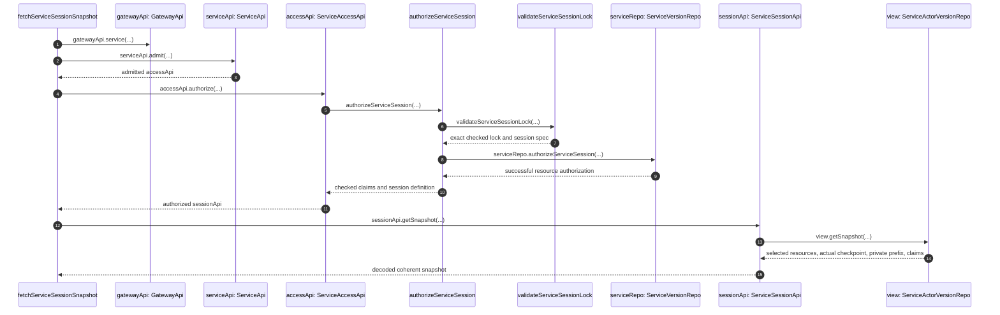

# Session claims and admission

Claims are the full admitted object. Retained provenance and wire identity preserve encoded claims; contract and selection execution use decoded values. Actor identity is the subset selected by `actorPath`; it identifies a partition within its owner scope. Actor resolvers keep decoded `selectionBindings` for SQL and canonical `encodedIdentity` for private ownership checks. Extra claims can preserve that partition while changing browser identity. Credentials belong to fresh authentication requests; snapshots, commands, tickets and durable Node identity retain admitted claims.

Aggregate actors declare credentials authentication. Admission validates the requested aggregate ID and credentials, authenticates, validates returned claims, and requires their aggregate ID to match. Service actors select direct claims or credentials authentication through their authored policy. Both paths directly resolve exact release/Actor, retain complete encoded claims and derive a reversible canonical Actor path before returning access. No durable audit write gates admission. Actor authorization is a separate owner-local state decision; refusal withholds the session capability.

- [`authenticateAggregate.ts:30-63`](../../../packages/system-worker/src/AggregateApi/authenticate/authenticateAggregate/authenticateAggregate.ts#L30-L63) — resolves exact Aggregate/Actor, authenticates claims and returns their full encoding with canonical path.
- [`admitService.ts:21-46`](../../../packages/system-worker/src/ServiceApi/admit/admitService/admitService.ts#L21-L46) — resolves exact Service/Actor and directly composes authentication, full claims and canonical path.
- [`authenticateAggregateClaims.ts:65-89`](../../../packages/system-worker/src/AggregateApi/authenticate/authenticateAggregate/utils/authenticateAggregateClaims.ts#L65-L89) — requires claims to match the requested Aggregate ID before encoding all claims.
- [`authenticateServiceClaims.ts:33-74`](../../../packages/system-worker/src/ServiceApi/admit/admitService/utils/authenticateServiceClaims.ts#L33-L74) — preserves direct-claims versus credentials policy and strictly validates/encodes the full result.

[ADR 017](../../adrs/017-admission-without-durable-audit.md) retires the former audit gate without treating optional diagnostics as equivalent durable history. [Plan 222](../../archive/plans/222-plan-remove-system-log-repo-and-admission-audit.md) records scoped verification completed on 2026-10-23: actual public Aggregate/Service admission, authorization and snapshots preserve complete claims and canonical paths while diagnostic delivery defects. The public wire error omits authored Cause detail, which remains in local capture. These Workerd invocations do not establish network RPC transport. Hosted-provider and browser lifecycle proof retain their separate scope.

Session locks contain the session name, exact Actor or Agent name/version, and selected model and ordinary contract names/versions. Owner coordinates travel beside the lock. Locks contain no schema shapes, indexes or claims codecs; the addressed owner release resolves the selected native declarations before comparison. Aggregate mapped bindings lock the public original, and external commands remain server-owned. Authors must advance declaration versions when changing shape or behavior: reusing the same identities no longer produces a different lock merely because the schema changed.

- [`makeAggregateSessionLock.ts:15-30`](../../../packages/core/src/aggregateSession/make/makeAggregateSessionLock.ts#L15-L30) — projects the Aggregate session name, Actor/Agent identity and selected members.
- [`makeServiceSessionLock.ts:10-15`](../../../packages/core/src/serviceSession/make/makeServiceSessionLock.ts#L10-L15) — projects the corresponding Service Actor identity and selected members.
- [`projectSessionFacts.ts:7-22`](../../../packages/core/src/system/project/projectSessionFacts.ts#L7-L22) — retains only model/contract names and versions from the native declarations.
- [`validateAggregateSessionLock.ts:33-59`](../../../packages/system-worker/src/AggregateVersionRepo/authorizeAggregateSession/validateAggregateSessionLock.ts#L33-L59) — resolves the exact Actor and selected members before comparing its canonical lock.
- [`validateServiceSessionLock.ts:52-75`](../../../packages/system-worker/src/ServiceAccessApi/authorize/authorizeServiceSession/validateServiceSessionLock/validateServiceSessionLock.ts#L52-L75) — resolves the Service Actor and selected members before comparing its canonical lock.

Aggregate Actor snapshots expose flat `actorName`, `actorVersion` and full encoded `claims`. `aggregateNodeNetwork` checks the response Actor release against the requested lock; Node authentication uses those actual claims. Requests between the session API and projection/history Repos carry flat caller Actor fields so each receiving Repo can compare them with its bound key before reading resources or private completion history. Local completion comparisons then use full claims, session name and Node ID within that validated Actor projection. The initialized Actor session reads Actor name/version from its immutable definition and retains decoded `claims` and detached `encodedClaims` separately. Actor snapshots and Actor execution do not retain an origin object. The declaration-shaped `aggregateSessionLock.origin` still identifies the selected Actor or Agent declaration; it does not carry runtime Actor claims.

- [`aggregateNodeNetwork.ts:30-40`](../../../packages/browser/src/AggregateNode/aggregateNodeNetwork.ts#L30-L40) — compares flat snapshot Actor name/version and session/aggregate release with the requested lock.
- [`getSnapshot.ts:46-95`](../../../packages/system-worker/src/aggregateProjection/getSnapshot/getSnapshot.ts#L46-L95) — rejects mismatched caller Actor/aggregate identity and claims outside the bound projection before capture.
- [`AggregateActorCommandSchema.ts:40-53`](../../../packages/core/src/aggregateSession/AggregateActorCommandSchema/AggregateActorCommandSchema.ts#L40-L53) — defines Actor snapshots with required flat Actor name/version, actual encoded claims and private resolution prefix.

Aggregate Agent snapshots retain their Agent origin and public checkpoint while omitting Actor name/version, actual claims and private resolution progress.

- [`AggregateAgentSessionSnapshotSchema.ts:7-15`](../../../packages/core/src/agent/AggregateAgentSessionSnapshotSchema.ts#L7-L15) — removes Actor-only snapshot fields and retains `AgentOriginSchema`.

Agent snapshots use the separate `AggregateAgentSessionSnapshotSchema`: their `origin` contains only Agent name/version and they omit Actor name/version, Actor claims and private `resolvedThrough`. `ActorOriginSchema` and `AggregateSessionOriginSchema` are removed; `AgentOriginSchema` remains for Agent snapshot and trusted-header identity.

- [`makeInitializedAggregateSession.ts:16-30`](../../../packages/core/src/aggregateSession/makeInitializedAggregateSession.ts#L16-L30) — defines initialized Actor identity through its session definition, decoded claims and encoded claims without an Actor origin field.
- [`AggregateActorCommandSchema.ts:40-53`](../../../packages/core/src/aggregateSession/AggregateActorCommandSchema/AggregateActorCommandSchema.ts#L40-L53) — declares flat Actor snapshot fields with the owning Aggregate/session context.
- [`AggregateAgentSessionSnapshotSchema.ts:7-18`](../../../packages/core/src/agent/AggregateAgentSessionSnapshotSchema.ts#L7-L18) — explicitly omits Actor fields/private progress and adds the Agent-specific origin.

## Trigger

1. The page connects using the known declaration/backend scope, plus requested aggregate ID for Aggregate sessions. Its admission provider remains on the page.
   - [`aggregateNodeRequest.ts:16-19`](../../../packages/browser/src/AggregateNode/aggregateNodeRequest.ts#L16-L19) — hashes the complete Aggregate request and requested aggregate ID without credentials or verified claims.
   - [`serviceNodeRequest.ts:16-18`](../../../packages/browser/src/ServiceNode/serviceNodeRequest.ts#L16-L18) — hashes the complete Service request for host routing.
2. The SharedWorker validates its registered declaration/lock and independently invokes this incoming attachment's admission callback. Backend admission and session authorization retain their existing exact release and Actor gates.
   - [`makeAggregateSharedWorker.ts:146-165`](../../../packages/browser/src/AggregateNode/makeAggregateSharedWorker.ts#L146-L165) — checks declaration/routing scope before discovery and credential acquisition.
   - [`makeServiceSharedWorker.ts:156-175`](../../../packages/browser/src/ServiceNode/makeServiceSharedWorker.ts#L156-L175) — performs the corresponding Service request validation before discovery.
3. The returned backend session capability captures an authenticated snapshot. The SharedWorker uses its complete verified identity to select a Node, retaining the proof for initial attachment.
   - [`resolveAggregateNode.ts:61-88`](../../../packages/browser/src/AggregateNode/resolveAggregateNode.ts#L61-L88) — checks selection/claims and retains the verified identity, environment and baseline.
   - [`resolveServiceNode.ts:50-70`](../../../packages/browser/src/ServiceNode/resolveServiceNode.ts#L50-L70) — retains the corresponding Service snapshot proof and admission value.

The service sequence shows the release, actor and session gates. Aggregate access
delegates authorization to its exact AggregateVersionRepo and requests the parallel
AggregateActorVersionRepo snapshot, which verifies exact publication and bounded
private history in its separate Chain. VersionRepos have already committed their
fixed finalized prefix during activation. Ordinary authorization and snapshots read
current committed materialization without forcing admitted commands to execute or
requesting source-tip replay. Authored explicit commands retain their normal
command-result workflow.

## Annotated workflow steps

1. Select the exact service release through the gateway.
   - [`fetchServiceSessionSnapshot.ts:50-57`](../../../packages/browser/src/fetchServiceSessionSnapshot.ts#L50-L57) — The gateway binding includes publishable key, system, service name and exact version.

2. Submit the policy request with the lock’s actor identity.
   - [`fetchServiceSessionSnapshot.ts:58-62`](../../../packages/browser/src/fetchServiceSessionSnapshot.ts#L58-L62) — Admission adds exact actorName and actorVersion to the provider request.

3. Return an access capability only after admitted claims are established.
   - [`admit.ts:31-55`](../../../packages/system-worker/src/ServiceApi/admit/admit.ts#L31-L55) — admitService resolves admission before onSuccess constructs ServiceAccessApi with retained owner/actor binding.

4. Authorize the named session and its complete lock.
   - [`fetchServiceSessionSnapshot.ts:63-66`](../../../packages/browser/src/fetchServiceSessionSnapshot.ts#L63-L66) — The access capability receives sessionName and serviceSessionLock.

5. Bind authorization to the admitted actor and full claims.
   - [`authorize.ts:41-60`](../../../packages/system-worker/src/ServiceAccessApi/authorize/authorize.ts#L41-L60) — Lock actor mismatch refuses access; the domain procedure receives admitted claims and exact owner release.

6. Select canonical declarations and validate the whole lock.
   - [`authorizeServiceSession.ts:39-45`](../../../packages/system-worker/src/ServiceAccessApi/authorize/authorizeServiceSession/authorizeServiceSession.ts#L39-L45) — The supported-lock procedure runs before owner-local authorization.

7. Return the canonical expected session definition after one acceptance comparison.
   - [`validateServiceSessionLock.ts:62-96`](../../../packages/system-worker/src/ServiceAccessApi/authorize/authorizeServiceSession/validateServiceSessionLock/validateServiceSessionLock.ts#L62-L96) — The shared session projection constructs expected facts; requireSupportedSessionLock compares them and returns the expected lock, spec and actor.

8. Run state authorization on the exact materializing owner.
   - [`authorizeServiceSession.ts:47-60`](../../../packages/system-worker/src/ServiceAccessApi/authorize/authorizeServiceSession/authorizeServiceSession.ts#L47-L60) — ServiceVersionRepos selects the exact service release and receives the actor, session and admitted claims.

9. Consume the owner’s completed authorization envelope.
   - [`authorizeServiceSession.ts:51-61`](../../../packages/system-worker/src/ServiceAccessApi/authorize/authorizeServiceSession/authorizeServiceSession.ts#L51-L61) — Effect.promise and readRpcEnvelope propagate authorization refusal before capability publication.

10. Return the checked definition and admitted claims.
    - [`authorizeServiceSession.ts:63-68`](../../../packages/system-worker/src/ServiceAccessApi/authorize/authorizeServiceSession/authorizeServiceSession.ts#L63-L68) — The domain return carries canonical lock and spec with the full claims.

11. Construct the authorized session capability.
    - [`authorize.ts:61-74`](../../../packages/system-worker/src/ServiceAccessApi/authorize/authorize.ts#L61-L74) — The retained capability state includes system/owner release, actor path, session, claims and checked lock.

12. Request its authenticated snapshot.
    - [`fetchServiceSessionSnapshot.ts:68`](../../../packages/browser/src/fetchServiceSessionSnapshot.ts#L68) — Snapshot requests include nullable Node identity for private-prefix capture.

13. Delegate snapshot capture to the sole selected owner.
    - [`getSnapshot.ts:29-47`](../../../packages/system-worker/src/ServiceSessionApi/getSnapshot/getSnapshot.ts#L29-L47) — The key includes actor name/version/path; view.getSnapshot receives the admitted lock, full claims, session and Node.

14. Return the current committed graph and actual checkpoint together.
    - [`captureServiceSnapshot.ts:83-141`](../../../packages/system-worker/src/serviceProjection/captureServiceSnapshot.ts#L83-L141) — captures local selected resources/checkpoint N, publishes through N, verifies the separate Chain's exact index/hash and recovers private completion through N while preserving encoded claims without progress RPCs.

15. Decode the owner snapshot at the RPC boundary.
    - [`getSnapshot.ts:48-59`](../../../packages/system-worker/src/ServiceSessionApi/getSnapshot/getSnapshot.ts#L48-L59) — Schema.toType validates the native snapshot once and the public method returns its Success envelope.

## Complete identity and lock acceptance

- [`resolveServiceActorView.ts:25-65`](../../../packages/system-worker/src/serviceProjection/resolveServiceActorView.ts#L25-L65) — Actor-path decoding supplies decoded query bindings; re-encoding supplies canonical private partition fields.
- [`captureServiceSnapshot.ts:59-85`](../../../packages/system-worker/src/serviceProjection/captureServiceSnapshot.ts#L59-L85) — compares encoded identity fields and validates the full claims codec while preserving original encoded claims.

`requireSupportedSessionLock` makes one whole-lock structural comparison. Only after it fails does a diagnostic walk identify the first differing field. Model/contract availability selection remains a separate step: unsupported names or versions cannot masquerade as a changed definition. Service selection accepts current public declarations from the exact actor; aggregate selection preserves its explicit historical contract availability rules.

`validateAggregateSessionLock` returns the canonical projected session definition with the already validated Actor `origin` branch retained in its lock after whole-lock equality succeeds.

- [`validateAggregateSessionLock.ts:79-88`](../../../packages/system-worker/src/AggregateVersionRepo/authorizeAggregateSession/validateAggregateSessionLock.ts#L79-L88) — retains canonical session fields and the validated Actor lock origin in the returned session spec.

A live browser instance retains a detached copy of its first verified full claims across disposal and reinitialization. Later proof must match before capability publication. Changed full claims require a new instance, even if actorPath still selects the same partition. The complete owner, actor, session, lock and claims participate in Node identity; credentials and incidental compiled Worker versions do not replace that identity.

The Service tab replica derives service, Actor and session names from its bound
release, and command claims from its frozen full admitted identity. Its command
rows therefore omit those repeated fields. ServiceNode's ten-column command rows
also omit those fixed SQL copies and source contractVersion. Its immutable bound
definition and exact selected contract reconstruct complete names, full encoded
claims and source version for original protocol input, retry, recovery and dispatch.
New-original admission checks own registry membership, canonical command name and
exact incoming version before writes; full identity changes are rejected. Exact
retry compares all reconstructed input before current readiness/blocked/allocation
guards. ServiceNode has one complete-claims storage binding, with no standalone
Aggregate different-claims exception. Coherent view replacement, uncovered-local replay
and pending-command handoff use the same privately retained encoded claims.
Staging and validation decode fresh claims from that binding, and handoff retains
access to it while the public initialized capability is withdrawn. Mutable UI
state and a newly invoked credentials provider cannot supply command identity.

- [`makeServiceReplicaReceiver.ts`](../../../packages/browser/src/sessionReplica/makeServiceReplicaReceiver.ts) — freezes full encoded claims and passes them into coherent view installation.
- [`installServiceNodeView.ts`](../../../packages/core/src/serviceSession/installServiceNodeView.ts) — validates identity and compact coverage before replacing resources and replaying uncovered local input.
- [`acceptServiceOriginalTx.ts`](../../../packages/core/src/ServiceNode/acceptServiceOriginalTx.ts) — validates complete bound identity and exact selected original name/version before new writes.

- [`requireSupportedSessionLock.ts:39-49`](../../../packages/system-worker/src/sessionLockValidation/requireSupportedSessionLock.ts#L39-L49) — Acceptance uses one isEqual; a mismatch yields only the first-difference refusal.
- [`sessionKey.ts`](../../../packages/core/src/Node/sessionKey.ts) — Canonical hashing binds complete supplied identity.
- [`makeConnectedAggregateSession.ts`](../../../packages/browser/src/makeConnectedAggregateSession.ts) — The concrete aggregate instance retains its first verified full claims.
- [`makeConnectedServiceSession.ts:120-157`](../../../packages/browser/src/makeConnectedServiceSession.ts#L120-L157) — The service instance retains the same assertion across disposable lifetimes.

## Connected routing and authenticated storage

A connected `routingKey` selects a SharedWorker host for one exact declaration/backend request; Aggregate routing also includes the requested aggregate ID. This unverified routing fact grants no access to an identity's Node. After its own snapshot proof, each attachment joins an owner keyed by the complete authenticated `sessionKey`. Distinct full claims retain separate SQLite databases, pending commands, synchronization, diagnostics and sign-out state inside that host. Connected database and exclusive-lease names still contain the compiled `sharedWorkerVersion`; this is not cross-build persistence.

- [`sharedWorkerNames.ts:7-27`](../../../packages/browser/src/sharedWorkerNames.ts#L7-L27) — constructs connected host names from routing keys while Standalone keeps its session-key name.
- [`makeAggregateSharedWorker.ts:166-185`](../../../packages/browser/src/AggregateNode/makeAggregateSharedWorker.ts#L166-L185) — derives the authenticated key, checks revocation and reserves only that identity entry.
- [`nodeStorageNamespaces.ts:3-8`](../../../packages/browser/src/Node/nodeStorageNamespaces.ts#L3-L8) — constructs version-specific database names from authenticated session keys, independently of host routing.

Normal attachment consumes the host's own verified snapshot instead of asking a registered provider to authenticate again. `makeNodeAuthentication` still races proven providers for future reconnects; that shared provider mechanism cannot establish an incoming attachment's initial authority. Fresh storage installs the baseline once. Retained storage keeps its Node ID, original commands and checkpoint; recovery still requests a producer-specific snapshot when it needs the private completion prefix.

- [`makeAggregateWorkerRuntime.ts:824-847`](../../../packages/browser/src/AggregateNode/makeAggregateWorkerRuntime.ts#L824-L847) — registers a proved attachment's provider and selects its initial proof unless recovery invalidated it.
- [`makeServiceWorkerRuntime.ts:719-742`](../../../packages/browser/src/ServiceNode/makeServiceWorkerRuntime.ts#L719-L742) — preserves Service's corresponding reconnect provider and initial-proof distinction.
- [`makeAggregateWorkerRuntime.ts:223-253`](../../../packages/browser/src/AggregateNode/makeAggregateWorkerRuntime.ts#L223-L253) — recovery requests a snapshot for its explicit nullable Node ID and validates its identity/checkpoint/private prefix.
- [`makeServiceWorkerRuntime.ts:168-197`](../../../packages/browser/src/ServiceNode/makeServiceWorkerRuntime.ts#L168-L197) — validates the Service recovery snapshot with the retained producer's private completion prefix.

## Offline resolution and recovery

Offline resolution requires an explicitly offline browser or classified backend network unavailability, explicit expected full claims, the exact authored definition, and one eligible discovery match. An explicitly offline browser resolves its remembered identity before requesting credentials; losing connectivity during credential acquisition takes the same local branch. Provider errors while apparently online and business refusals do not establish server unavailability. A credential deadline may reopen only the same eligible local identity; it does not classify the backend as unreachable or grant synchronization authority. Remembered identity permits local recovery without creating a new partition; subsequent online synchronization still requires fresh server proof. Sign-out closes only the matching identity's join gate before awaiting cleanup, stops its synchronization and invalidates its discovery eligibility. The runtime clears Node authentication, attempts bounded signed-out delivery to its published capabilities, then detaches them. Unresolved discovery must recheck its original revision after the gate drains and before storage access or publication. Other identities remain usable; retained commands are preserved.

- [`resolveServiceNode.ts:25-73`](../../../packages/browser/src/ServiceNode/resolveServiceNode.ts#L25-L73) — requires exact expected claims and one eligible remembered Service identity; it never creates online authority.
- [`resolveAggregateNode.ts:25-81`](../../../packages/browser/src/AggregateNode/resolveAggregateNode.ts#L25-L81) — requires the matching Aggregate identity and additionally preserves its selected aggregate ID.
- [`makeServiceSharedWorker.ts:49-79`](../../../packages/browser/src/ServiceNode/makeServiceSharedWorker.ts#L49-L79) — sets the identity closing gate before revocation and retains it through runtime/storage/lease drainage.
- [`makeServiceWorkerRuntime.ts:872-885`](../../../packages/browser/src/ServiceNode/makeServiceWorkerRuntime.ts#L872-L885) — advances the generation, invalidates eligibility, clears authentication and notifies subscribers before detachment.
- [`ServiceBrowserSessionApi.ts:141-153`](../../../packages/browser/src/ServiceNode/ServiceBrowserSessionApi.ts#L141-L153) — bounds each subscriber's signed-out acknowledgement to one second.

While explicitly offline, AggregateNodeSynchronization and ServiceNodeSynchronization keep local state available, close any old socket, and schedule a later retry without acquiring credentials. Their push loops refuse delivery while offline. Credential deadlines and unavailable providers also keep synchronization nonterminal while fresh authentication cannot complete. On reconnect, the existing authentication and snapshot/ticket checks precede an open command socket; explicit refusals retain their existing rejection behavior.

- [`AggregateNodeSynchronization.ts:156-161`](../../../packages/browser/src/AggregateNode/AggregateNodeSynchronization.ts#L156-L161) — closes the old socket, publishes offline synchronization and schedules retry without calling a credential provider.
- [`ServiceNodeSynchronization.ts:142-147`](../../../packages/browser/src/ServiceNode/ServiceNodeSynchronization.ts#L142-L147) — closes the old socket, publishes offline synchronization and schedules retry without calling a credential provider.

Cold server activation reconstructs selection fields from the canonical partition path. Full claims remain retained completion/authorization identity. Fixed schema changes require empty server and browser storage. See [session WebSocket](./SessionWebSocket.md) for tickets, replay and connection phases.

## Authentication deadlines and publication fences

`makeNodeAuthentication` bounds each attached credentials provider independently to five seconds. The timer stops when credentials arrive; verification has its own deadline. An expired provider remains tracked until its Promise settles, so another round cannot duplicate it and its late credentials cannot start verification. One frozen provider cannot hide another provider's successful verification or a concrete backend refusal. Matching verification still compares the complete identity and generation before binding a capability.

- [`makeNodeAuthentication.ts:32-42`](../../../packages/browser/src/Node/makeNodeAuthentication.ts#L32-L42) — owns provider/pending maps and defaults the independent credentials timer to 5,000 ms.
- [`makeNodeAuthentication.ts:92-132`](../../../packages/browser/src/Node/makeNodeAuthentication.ts#L92-L132) — retains outstanding providers, expires credentials acquisition and refuses late verification.
- [`makeNodeAuthentication.ts:134-166`](../../../packages/browser/src/Node/makeNodeAuthentication.ts#L134-L166) — compares full verified identity and generation before selecting a successful provider.

Local discovery/snapshot preparation and backend network work have separate ownership. `runNodeNetwork` bounds the snapshot/ticket RPC to ten seconds and reports sanitized endpoint, operation and timeout diagnostics. `NodeErrors` distinguishes credentials timeout, local preparation timeout, backend timeout/unreachable and absence of a usable provider. These typed diagnostics contain no credentials or query values. Classified network unavailability can permit offline resolution with exact expected full claims; an authored rejection or malformed proof cannot.

- [`runNodeNetwork.ts:19-59`](../../../packages/browser/src/Node/runNodeNetwork.ts#L19-L59) — classifies network failures and applies the backend RPC deadline with sanitized endpoint/operation metadata.
- [`NodeErrors.ts:27-58`](../../../packages/browser/src/Node/NodeErrors.ts#L27-L58) — declares typed public diagnostics for the separate availability failures.

The tab's connected-worker startup deadline ends after host readiness and artifact/version validation. Identity-specific namespace acquisition occurs later during attachment with a separate fifteen-second local-preparation bound. Credential and backend verification retain their separate deadlines, preserving `node-subscription-timeout` instead of racing it against a generic startup failure. A fresh explicit `initialize({ retryConnection: true })` requests one eligible transport retry only after authentication; ordinary attach/resume cannot clear blocked persistence, projection, checkpoint, sign-out or admission state.

- [`makeConnectedAggregateConnection.ts:283-311`](../../../packages/browser/src/AggregateNode/makeConnectedAggregateConnection.ts#L283-L311) — ends host handshake timing after executable validation and sends unverified attachment inputs with the first-attachment retry option.
- [`makeAggregateSharedWorker.ts:186-207`](../../../packages/browser/src/AggregateNode/makeAggregateSharedWorker.ts#L186-L207) — bounds identity namespace acquisition and reports `node-local-preparation-timeout`.
- [`makeServiceSharedWorker.ts:196-220`](../../../packages/browser/src/ServiceNode/makeServiceSharedWorker.ts#L196-L220) — independently bounds Service namespace ownership under attachment cancellation.

See [Node view installation](./PushSequence.md#installing-a-captured-node-view) for same-row final resolution and checkpoint ownership, and [selected views](../server/SelectedViews.md) for private captured-prefix authority. Session identity and ticket capability checks do not themselves establish Chain admission, execution commit or retained `outcome`.
