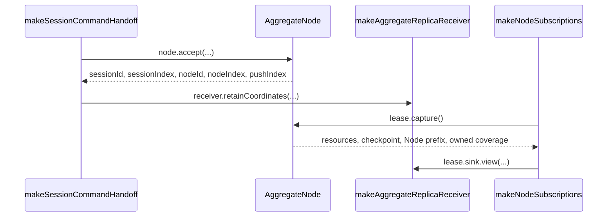

# Original handoff, admission and coherent publication

Local staging, Node retention, AggregateChain/ServiceChain admission, execution commit and final exposure are distinct facts. A retention reply stops handoff. Installing a covering Node view transfers optimistic ownership to the captured graph.

## Trigger

1. `makeSessionCommandHandoff` observes committed local originals and submits full recovery input through the current attachment.
   - [`makeSessionCommandHandoff.ts:232-279`](../../../packages/browser/src/outbox/makeSessionCommandHandoff.ts#L232-L279) — observes pending commands and schedules the handoff pump.

## Annotated workflow steps

1. Compare an exact original retry before current readiness and allocation checks; otherwise retain one new original and publish.
   - [`acceptAggregateOriginalTx.ts:56-117`](../../../packages/core/src/AggregateNode/acceptAggregateOriginalTx.ts#L56-L117) — compares reconstructed immutable input before checking availability, identity, release membership and new positions.
   - [`acceptServiceOriginalTx.ts:53-105`](../../../packages/core/src/ServiceNode/acceptServiceOriginalTx.ts#L53-L105) — performs the Service retry and exact-bound-contract checks.
2. Return Session-correlated Node allocation coordinates and wake publication even on an exact retry.
   - [`AggregateNode.ts:533-555`](../../../packages/core/src/AggregateNode/AggregateNode.ts#L533-L555) — publishes after the gated retention transaction and returns its minimal coordinates.
   - [`ServiceNode.ts:476-495`](../../../packages/core/src/ServiceNode/ServiceNode.ts#L476-L495) — retains and publishes through the corresponding Service gate.
3. Enrich the existing local row without removing its overlay.
   - [`makeAggregateReplicaReceiver.ts:87-110`](../../../packages/browser/src/sessionReplica/makeAggregateReplicaReceiver.ts#L87-L110) — records nullable original coordinates without replacing resources or inverses.
   - [`makeServiceReplicaReceiver.ts:105-140`](../../../packages/browser/src/sessionReplica/makeServiceReplicaReceiver.ts#L105-L140) — records Service original retention against the current attachment.
4. Sample the attachment's current interests inside the Node SQL gate.
   - [`AggregateNode.ts:517-530`](../../../packages/core/src/AggregateNode/AggregateNode.ts#L517-L530) — registers a capture closure that reads current requests inside the Node transaction.
   - [`ServiceNode.ts:460-473`](../../../packages/core/src/ServiceNode/ServiceNode.ts#L460-L473) — binds Service capture to the same gated boundary.
5. Return one coherent optimistic graph and its exact coverage.
   - [`AggregateNode.ts:321-353`](../../../packages/core/src/AggregateNode/AggregateNode.ts#L321-L353) — captures metadata, Node maxima, private progress, resources and command coverage together.
   - [`ServiceNode.ts:273-305`](../../../packages/core/src/ServiceNode/ServiceNode.ts#L273-L305) — captures the Service graph with `serviceIndex` and its Node prefix.
6. Deliver outside SQLite, then acknowledge the installed view.
   - [`makeNodeSubscriptions.ts:39-65`](../../../packages/core/src/Node/makeNodeSubscriptions.ts#L39-L65) — completes capture before invoking `sink.view`, with retirement and publication-epoch fences.
   - [`makeAggregateReplicaReceiver.ts:209-244`](../../../packages/browser/src/sessionReplica/makeAggregateReplicaReceiver.ts#L209-L244) — runs installation before publishing the current initialized capability.

## Immutable Node history and derived resources

AggregateNode and ServiceNode retain authoritative model rows, immutable original/final command rows and singleton metadata. Originals alone allocate `pushIndex`; original and final rows append under separate `nodeIndex` positions with the same canonical `id`. Retried input cannot replace history. AggregateNode retains each original's full claims because standalone originals may have different valid claims; ServiceNode reconstructs claims from its one immutable complete-claims binding.

- [`aggregateNodeTables.ts:17-57`](../../../packages/core/src/AggregateNode/aggregateNodeTables.ts#L17-L57) — separates original/final indexes and retains Aggregate claims, staging input, failure and selected final delta.
- [`serviceNodeTables.ts:15-50`](../../../packages/core/src/ServiceNode/serviceNodeTables.ts#L15-L50) — retains Service history and `serviceIndex` without repeating its immutable bound claims.

`admittedThroughPushIndex` records AggregateChain/ServiceChain admission progress. `outcomeIndex` is the contiguous original producer prefix with same-ID retained finals and stops at the first gap. Neither is the public `aggregateIndex`/`serviceIndex` checkpoint; `afterNodeIndex` belongs to the replica's installed Node prefix.

- [`readAggregateNodeOutcomeIndex.ts:8-27`](../../../packages/core/src/AggregateNode/readAggregateNodeOutcomeIndex.ts#L8-L27) — scans original push positions and stops on the first missing or unresolved position.
- [`readServiceNodeOutcomeIndex.ts:8-27`](../../../packages/core/src/ServiceNode/readServiceNodeOutcomeIndex.ts#L8-L27) — computes the corresponding contiguous Service completion prefix.

The memory-only optimistic graph combines the authoritative baseline with unresolved Node originals in `nodeIndex` order. Its cache key includes Node generation, captured prefix and authoritative checkpoint. Replay uses original staging time and preserves operation order; an expected refusal contributes no speculative changes while its original remains pending. A defect withholds the derived view without undoing a previously committed authoritative final. Restart reconstructs from durable input.

- [`AggregateNode.ts:465-513`](../../../packages/core/src/AggregateNode/AggregateNode.ts#L465-L513) — reads unresolved originals, caches projected resources and records projection failure separately.
- [`ServiceNode.ts:412-456`](../../../packages/core/src/ServiceNode/ServiceNode.ts#L412-L456) — constructs the Service projection from retained originals and `serviceIndex`/hash.
- [`replayOptimisticCommandTx.ts:31-79`](../../../packages/core/src/sessionExecution/replayOptimisticCommandTx.ts#L31-L77) — validates result/operations inside a savepoint and recognizes only specific expected refusals after rollback.

## Installing a captured Node view

Both installers own one synchronous transaction. Aggregate installation additionally binds the local `sessionId`; Service identity comes from its frozen definition and admitted capability. Both validate checkpoint completeness, safe Node coordinates, monotonic public/Node positions, exact owned-command coverage and same-ID final resolutions before replacing any resources.

1. Validate the bound identity, existing singleton metadata, generation, coverage and final position/failure consistency.
2. Validate every complete model envelope, replace resource rows and clear obsolete local inverses.
3. Enrich existing own command rows with Node coordinates and compact final resolutions, preserving original payload and `stagingOutcome: { result, completedAt }`; replace the captured metadata.
4. Replay unresolved own originals with no Node position or a position beyond `afterNodeIndex`, in `sessionIndex` order, rebuilding only their current inverses. Covered input is already in the captured graph and is not replayed locally.

- [`installAggregateNodeView.ts:60-161`](../../../packages/core/src/aggregateSession/installAggregateNodeView.ts#L60-L161) — validates Aggregate identity, singleton session ID, monotonic checkpoints, exact coverage and compact resolutions before replacement.
- [`installAggregateNodeView.ts:162-215`](../../../packages/core/src/aggregateSession/installAggregateNodeView.ts#L162-L215) — validates resources, replaces graph/inverses, enriches existing rows, writes metadata and replays uncovered input atomically.
- [`installServiceNodeView.ts:51-149`](../../../packages/core/src/serviceSession/installServiceNodeView.ts#L51-L149) — validates the Service definition, `serviceIndex`/hash, Node coverage and compact resolutions.
- [`installServiceNodeView.ts:150-201`](../../../packages/core/src/serviceSession/installServiceNodeView.ts#L150-L201) — replaces the Service graph, updates existing own rows and metadata, then runs local replay.
- [`replayLocalAggregateCommandsTx.ts:39-84`](../../../packages/core/src/aggregateSession/replayLocalAggregateCommandsTx.ts#L39-L84) — selects uncovered unresolved Aggregate originals in local order and preserves `completedAt`.
- [`replayLocalServiceCommandsTx.ts:36-81`](../../../packages/core/src/serviceSession/replayLocalServiceCommandsTx.ts#L36-L81) — applies the same coverage predicate with Service claims and contracts.

When a capture includes A and a concurrent local B arrives after that capture, replacement installs A's graph and replays B once. The [sessions handbook](../../../docs/content/handbook/sessions-and-synchronization.md) explains this reader-visible behavior. Installer failure rolls back replacement. `inverseOperations: null` means no currently applied local overlay; an empty array records a successful no-op replay.

A compact same-ID final position resolves the local command even with an empty selected delta and null private failure. Failure nullability does not establish canonical Success. The full `outcome: { result: Success | Failure, finalizedAt }` remains in the owning Chain history. Origin-specific failure notification follows the local commit.

- [`aggregateSessionRepoDbConfig.ts:9-57`](../../../packages/core/src/aggregateSession/aggregateSessionRepoDbConfig.ts#L9-L57) — retains one row per own canonical command and Aggregate replica metadata.
- [`serviceSessionRepoTables.ts:9-57`](../../../packages/core/src/serviceSession/serviceSessionRepoTables.ts#L9-L57) — retains Service own commands and the three-field installed checkpoint.

## Retry, replacement and close

A lost retention reply recovers by comparing the full original plus any known Node coordinates. A conflicting original or missing known original fails before replacement; coalescing retains unresolved attachment interests. No shared pending commands or final deltas are imported into a replica's own command table.

- [`AggregateNode.ts:378-455`](../../../packages/core/src/AggregateNode/AggregateNode.ts#L378-L455) — checks complete recovery input and known coordinates before returning owned coverage and optional same-ID resolution.
- [`ServiceNode.ts:330-402`](../../../packages/core/src/ServiceNode/ServiceNode.ts#L330-L402) — validates Service ownership, original equality and matching final evidence.

Explicit connection retry only clears eligible closed/timed-out transport state after the old attempt stops and drains. It preserves Node identity, retained history, resources and checkpoint. Persistence, projection, authentication, sign-out, admission and checkpoint failures remain blocked.

- [`AggregateNode.ts:909-939`](../../../packages/core/src/AggregateNode/AggregateNode.ts#L909-L939) — permits only classified transport failures with usable local state.
- [`ServiceNode.ts:757-787`](../../../packages/core/src/ServiceNode/ServiceNode.ts#L757-L787) — rechecks the corresponding Service transport retry conditions.

Existing authorized replacement pauses publication and obtains each live attachment's acknowledgement outside SQL before replacing durable state and rotating Node identity. Unsupported or unresponsive attachments prevent deletion. Close prevents new SQL, retires remote waits, drains local publication and admitted SQL, and closes derived resources before the storage owner releases its namespace.

- [`makeNodeSubscriptions.ts:100-163`](../../../packages/core/src/Node/makeNodeSubscriptions.ts#L100-L163) — fences publication during reset and requires each active attachment's bounded reset acknowledgement.
- [`AggregateNode.ts:147-164`](../../../packages/core/src/AggregateNode/AggregateNode.ts#L147-L164) — fences and drains Aggregate work before closing optimism.
- [`ServiceNode.ts:143-160`](../../../packages/core/src/ServiceNode/ServiceNode.ts#L143-L160) — preserves the Service close ordering.

[SessionWebSocket](./SessionWebSocket.md) owns authoritative incoming replay and public Agent observation. [SelectedViews](../server/SelectedViews.md) owns selected publication; [AgentExecution](../server/AgentExecution.md) owns automatic Agent commands. This documentation migration does not establish the runtime acceptance recorded separately by Plans 234 and 236.

## Submission identity and admission recovery

Handoff and snapshot coverage use `(sessionId, sessionIndex)`. Each Session row stores all three nullable Node coordinates together; canonical ID is derived from `(nodeId, pushIndex)`. Recording them stops retries but retains local inverses and optimism until the covering view installs. Node replacement requires the existing explicit reset fence. Original Node rows reconstruct their IDs, while final rows retain canonical IDs.

- [`acceptAggregateOriginalTx.ts`](../../../packages/core/src/AggregateNode/acceptAggregateOriginalTx.ts) — compares immutable submission input before allocation and returns the original assignment on retry.
- [`installAggregateNodeView.ts`](../../../packages/core/src/aggregateSession/installAggregateNodeView.ts) — validates coverage, preserves Session allocation progress, and replays uncovered overlays atomically.

A Node reconciles `expectedPushIndex - 1` only monotonically within locally issued positions and the current socket lifetime. Admission acknowledgements carry canonical ID and push position without `admissionIndex`. Progress does not resolve a command's outcome or justify another assignment.

- [`AggregateNode.ts`](../../../packages/core/src/AggregateNode/AggregateNode.ts) — rejects impossible progress and preserves original/final tracking.
