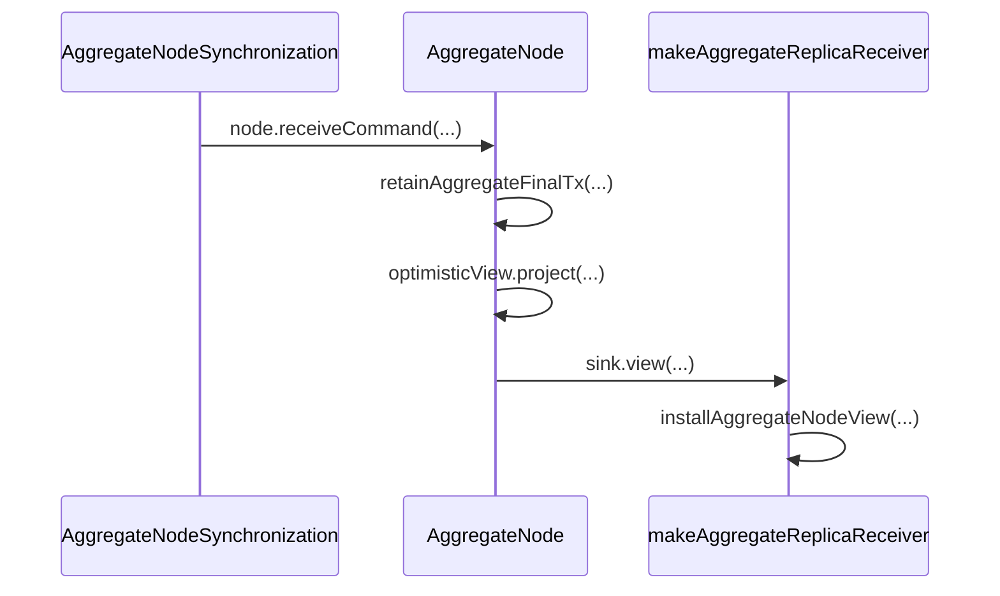
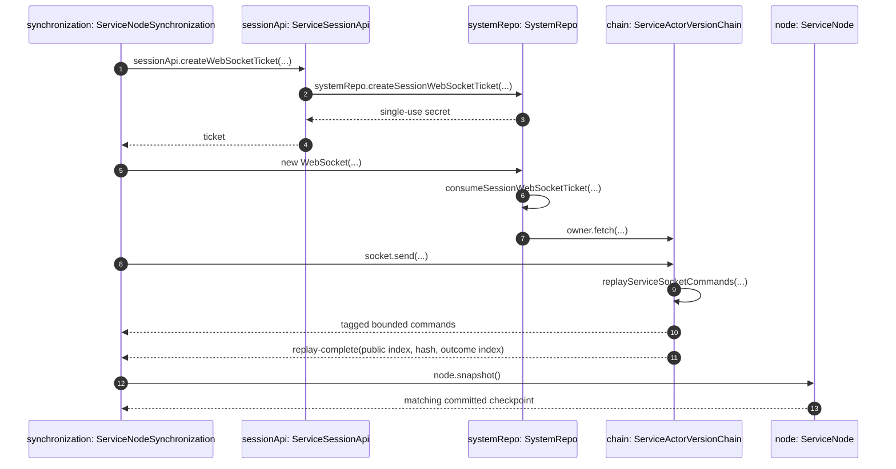
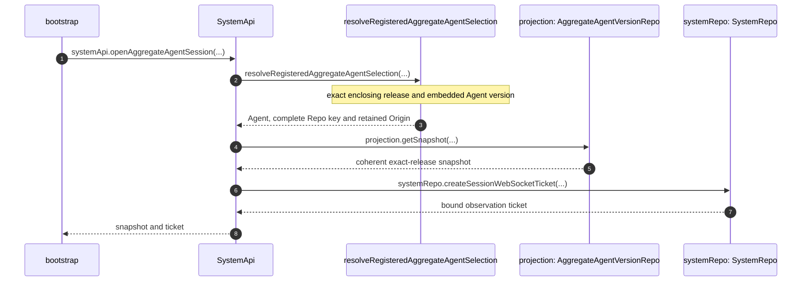

# Browser session startup and synchronization

AggregateNode and ServiceNode retain authoritative resources, immutable original/final history, independent producer admission progress and one derived optimistic graph. Each attached replica retains only its own local submissions and their known Node allocation. Initial attachment and reconnect both install coherent Node views; backend socket replay still carries selected exposed commands to the Node.

## Trigger

1. Register the same pure session definition used by the tab and an independent worker projection layer.
   - [`makeSharedWorker.ts`](../../../packages/browser/src/makeSharedWorker.ts) — registers one session definition and selects its runtime from the worker name.
2. Connect to the request-routed SharedWorker, validate the executable, and independently authenticate the attachment there. Its verified full identity selects the Node; subscribe with that session's pending Node commands.
   - [`makeConnectedAggregateConnection.ts`](../../../packages/browser/src/AggregateNode/makeConnectedAggregateConnection.ts) — fences the worker and attachment before subscription.
   - [`makeConnectedServiceConnection.ts`](../../../packages/browser/src/ServiceNode/makeConnectedServiceConnection.ts) — binds the Service identity and pending Node commands directly, preserving their known allocation.

## Annotated workflow steps

1. Deliver a selected exposed command through the current socket attempt.
   - [`AggregateNodeSynchronization.ts:411-420`](../../../packages/browser/src/AggregateNode/AggregateNodeSynchronization.ts#L411-L420) — waits for node.receiveCommand under the current attempt fence.
2. Commit final evidence, authoritative resources and public checkpoint together.
   - [`AggregateNode.ts:710-726`](../../../packages/core/src/AggregateNode/AggregateNode.ts#L710-L726) — runs final retention in the Node gate's transaction and requests publication after commitment.
   - [`retainAggregateFinalTx.ts:55-140`](../../../packages/core/src/AggregateNode/retainAggregateFinalTx.ts#L55-L140) — checks exact final equality and commits final history, selected resources and checkpoint/admission progress.
3. Reconstruct shared pending optimism after the durable commit.
   - [`AggregateNode.ts:487-515`](../../../packages/core/src/AggregateNode/AggregateNode.ts#L487-L515) — caches the derived graph by nodeId, Node prefix and authoritative checkpoint; a reconstruction failure withholds that capture.
4. Publish the graph with captured prefix, exact owned-input coverage and compact final resolutions outside SQL.
   - [`makeNodeSubscriptions.ts:34-78`](../../../packages/core/src/Node/makeNodeSubscriptions.ts#L34-L78) — coalesces captures, fences retired/reset leases and awaits sink acknowledgement after capture returns.
5. Install resources, resolve existing local rows and replay only uncovered own originals in one synchronous transaction.
   - [`installAggregateNodeView.ts:61-166`](../../../packages/core/src/aggregateSession/installAggregateNodeView.ts#L61-L166) — validates identity, captured prefix, local coverage and final resolution before resource replacement.
   - [`installAggregateNodeView.ts:168-224`](../../../packages/core/src/aggregateSession/installAggregateNodeView.ts#L168-L224) — updates the same local sessionIndex row, including empty delta/null failure, then commits metadata and local-only replay.
   - [`installServiceNodeView.ts:170-217`](../../../packages/core/src/serviceSession/installServiceNodeView.ts#L170-L217) — preserves the corresponding Service serviceIndex checkpoint and local-only replay.

Admission advances admittedThroughPushIndex independently. Public aggregateIndex/serviceIndex plus dispositionChainHash identify authoritative resources; outcomeIndex proves contiguous private final exposure; nodeIndex labels the installed optimistic prefix. Retention returns sessionId/sessionIndex/nodeId/nodeIndex/pushIndex; canonical ID derives from that allocation, which alone does not remove an overlay. Exact input recovery rejects conflicting input or missing known retention. Existing current-attempt, identity, private failure and replacement fences remain. [Plan 234](../../archive/plans/234-plan-node-owned-optimistic-views-and-session-replicas.md) records the current runtime verification independently of this workflow description.

- [`NodeCommandCoverage.ts:6-29`](../../../packages/core/src/Node/NodeCommandCoverage.ts#L6-L29) — defines local submission correlation and the all-null/all-known Node allocation.

## Initial snapshot proof and reconnect

The connected page opens its known request-scoped host without making a snapshot request. The host authenticates each incoming attachment using its own callback and retains the resulting snapshot proof. The selected identity runtime passes that proof into synchronization, so normal first startup uses one authenticated snapshot followed by the existing ticket request. Aggregate ticket creation obtains credentials again; Service reuses the verified admission value. Joining an already-live identity still requires the incoming attachment's own proof, but does not require another live socket. Request-count assertions are recorded separately from recovery in [Plan 284](../../archive/plans/284-plan-worker-owned-connected-session-discovery.md); this workflow does not establish a latency benchmark.

- [`resolveAggregateNode.ts:61-88`](../../../packages/browser/src/AggregateNode/resolveAggregateNode.ts#L61-L88) — retains the initial snapshot baseline/environment and producing callback after exact selection/claims verification.
- [`makeAggregateWorkerRuntime.ts:832-844`](../../../packages/browser/src/AggregateNode/makeAggregateWorkerRuntime.ts#L832-L844) — reuses the host-produced proof unless recovery invalidated that initial preparation.
- [`AggregateNodeSynchronization.ts:313-341`](../../../packages/browser/src/AggregateNode/AggregateNodeSynchronization.ts#L313-L341) — accepts supplied proof, reads retained producer metadata and obtains fresh Aggregate ticket credentials.
- [`ServiceNodeSynchronization.ts:273-301`](../../../packages/browser/src/ServiceNode/ServiceNodeSynchronization.ts#L273-L301) — accepts supplied proof and creates the Service ticket from its retained admission value.

Retained Nodes keep their producer ID, pending commands, public checkpoint and `outcomeIndex` when attaching. Reconnect authenticates through proven providers and resumes those retained cursors. Recovery remains separate: it requires a fresh producer-specific snapshot for the private completion prefix and can perform additional verification. A reused `snapshot(null)` cannot replace that recovery proof or overwrite a retained baseline.

- [`makeAggregateWorkerRuntime.ts:892-901`](../../../packages/browser/src/AggregateNode/makeAggregateWorkerRuntime.ts#L892-L901) — installs the initial snapshot only when retained metadata has no Aggregate checkpoint.
- [`makeAggregateWorkerRuntime.ts:223-252`](../../../packages/browser/src/AggregateNode/makeAggregateWorkerRuntime.ts#L223-L252) — obtains and validates recovery snapshots for an explicit nullable Node ID.
- [`makeServiceWorkerRuntime.ts:168-196`](../../../packages/browser/src/ServiceNode/makeServiceWorkerRuntime.ts#L168-L196) — retains Service's independent producer-specific recovery snapshot path.

Sign-out fences only that identity's acquisition entry and invalidates discovery before retirement completes. Published APIs attempt signed-out delivery before detachment with bounded subscriber acknowledgement. The page latches sign-out and does not start new discovery on focus/pageshow; its namespace watcher uses authenticated storage identity rather than the host routing name.

- [`makeAggregateSharedWorker.ts:49-78`](../../../packages/browser/src/AggregateNode/makeAggregateSharedWorker.ts#L49-L78) — reserves the closing gate before revocation and retains namespace exclusion through ordered cleanup.
- [`makeAggregateWorkerRuntime.ts:995-1011`](../../../packages/browser/src/AggregateNode/makeAggregateWorkerRuntime.ts#L995-L1011) — invalidates offline eligibility, clears authentication and awaits bounded API notifications before detaching.
- [`AggregateBrowserSessionApi.ts:199-212`](../../../packages/browser/src/AggregateNode/AggregateBrowserSessionApi.ts#L199-L212) — caps one signed-out acknowledgement wait at one second.
- [`makeConnectedAggregateConnection.ts:397-409`](../../../packages/browser/src/AggregateNode/makeConnectedAggregateConnection.ts#L397-L409) — watches the authenticated database namespace selected from the delivered identity.

## Ticket issue, spend and strict resume

The returned ticket is a random secret; SystemRepo retains four required columns:
`ticketHash`, `sessionFamily`, typed `admission` and a thirty-second `expiresAt`.
Aggregate Actor, Aggregate Agent, Service Actor and Service Agent admissions share
this ticket owner. Each retains its exact owner coordinates and complete selected
session lock. Aggregate principal names/versions come only from the Actor- or
Agent-narrowed `aggregateSessionLock.origin`; Service principal names/versions
come only from `serviceSessionLock` or `serviceAgentSessionLock`. Actual Actor
claims appear once at the ticket's top level. Agent admissions contain no Actor
claims or duplicate principal identity.

Ticket-local lock schemas correlate each Aggregate admission family with its exact
Actor or Agent identity branch and require nonempty session/Actor names. Agent
`nodeId` is a nonempty public observer ticket/resume identity rather than a command
producer. Its lock retains the independent `agentVersion`; the selected Agent
declaration is resolved within the exact enclosing Aggregate or Service release. Actor `nodeId` remains
nullable at ticket issuance, before Node resume, while admitted Actor commands
still require their complete producer tuple.

- [`systemRepoDbConfig.ts:19-27`](../../../packages/system-worker/src/SystemRepo/systemRepoDbConfig.ts#L19-L27) — declares the four required ticket fields and unique hash.
- [`SessionAdmissionSchema.ts:12-24`](../../../packages/system-worker/src/SystemRepo/sessionWebSocketTickets/SessionAdmissionSchema.ts#L12-L24) — specializes the Aggregate lock to one exact Actor or Agent identity branch.
- [`SessionAdmissionSchema.ts:27-63`](../../../packages/system-worker/src/SystemRepo/sessionWebSocketTickets/SessionAdmissionSchema.ts#L27-L63) — defines four exact admission branches, derives principal identity from the selected lock and retains actual Actor claims once.

`createSessionWebSocketTicket` accepts an `ISessionAdmission` tuple, strictly
decodes it and validates the full authored lock, claims and canonical Actor path
before generating the secret or its hash. Expiry cleanup and insertion share
one synchronous transaction. Ticket issuance validates already bound authority;
credential authentication belongs to the upstream Actor admission capability.

- [`validateSessionAdmission.ts:19-47`](../../../packages/system-worker/src/SystemRepo/sessionWebSocketTickets/validateSessionAdmission.ts#L19-L47) — resolves an exact Agent release, requires exact enclosing release membership and compares the full authored session lock before ticket generation.
- [`validateServiceAgentSessionLock.ts:9-48`](../../../packages/system-worker/src/serviceAgent/validateServiceAgentSessionLock.ts#L9-L48) — checks exact Service release membership, Agent version, session and full lock.
- [`validateSessionAdmission.ts:15-87`](../../../packages/system-worker/src/SystemRepo/sessionWebSocketTickets/validateSessionAdmission.ts#L15-L87) — validates Actor locks, claims and canonical path/instance agreement separately.
- [`createSessionWebSocketTicket.ts:20-74`](../../../packages/system-worker/src/SystemRepo/sessionWebSocketTickets/createSessionWebSocketTicket.ts#L20-L74) — accepts typed admission, strictly decodes it before random generation and retains only the secret hash after atomic expiry cleanup/insertion.

Route-family matching spends exactly one row before retained-admission decoding
or expiry checks; wrong-family requests cannot spend it. Expiry, corrupt admission,
forwarding failure and failed upgrade leave it consumed. Forwarding derives the
selected owner and trusted headers directly from admission and replaces all client
`x-zerospin-*` headers. An already-issued Agent ticket routes to its stored release;
the addressed Agent Chain validates that exact owner/Agent/session binding when the observer connects or next sends/resumes. Ticket spend proves no socket installation, command
admission, execution commit or retained `outcome`. [Plan 221](../../archive/plans/221-plan-session-ticket-admission-cleanup.md)
records completed local SQL/HTTP verification on 2026-10-23, including an actual
configured Service credential-to-socket/resume journey. Other families’ captured
finite responses prove exact forwarding and spend, not their socket lifecycles.
That Plan 221 run passed 98 System Worker tests across 25 files. Browser startup
and real provider integration retain separate verification ownership. Current
public Agent socket lifecycle has independent verification under Plans 211 and 212.

- [`consumeSessionWebSocketTicket.ts:30-59`](../../../packages/system-worker/src/SystemRepo/sessionWebSocketTickets/consumeSessionWebSocketTicket.ts#L30-L59) — filters DELETE RETURNING by hash/family, then decodes the spent row and checks its family and deadline.
- [`forwardSessionSocket.ts:17-25`](../../../packages/system-worker/src/SystemRepo/handleFetch/forwardSessionSocket.ts#L17-L25) — removes the complete query and every incoming trusted-prefix header.
- [`forwardSessionSocket.ts:27-46`](../../../packages/system-worker/src/SystemRepo/handleFetch/forwardSessionSocket.ts#L27-L46) — derives the Service Agent Chain key and trusted Origin header from the retained Agent lock and exact Service release.
- [`forwardSessionSocket.ts:99-138`](../../../packages/system-worker/src/SystemRepo/handleFetch/forwardSessionSocket.ts#L99-L138) — derives the Aggregate Actor/Agent Chain key from the retained lock and forwards Actor claims or the separate Agent origin in its family-specific trusted header.

ServiceActorVersionChain stores exact admitted contract/model name selections in
its three-column `connectionLocks` row and compact `awaiting-resume`, `replaying`
or `live` attachment state. It resolves those capabilities through its exact bound
Service release. Attachment claims retain their encoded representation after
authored-codec validation, so ordinary command authority and historical private
ownership compare the same provenance. Every message validates the attachment and
capabilities, then decodes one strict tagged protocol union. Resume binds its
producer and exact public/hash/private checkpoint. Bounded captured replay yields
between pages and reads immutable history from local rows or Archives. After
Archive awaits, replay revalidates the retained capability row and attachment
before changing phase or sending commands. The final logical-head recheck,
completion and live marker execute in one synchronous turn. Live publication is isolated per connection after
ServiceActorVersionChain commits the projected history received from
ServiceActorVersionRepo.

## Annotated workflow steps

1. Request a ticket through the freshly authorized session capability.
   - [`ServiceNodeSynchronization.ts:258-279`](../../../packages/browser/src/ServiceNode/ServiceNodeSynchronization.ts#L258-L279) — binds verified admission and obtains its ticket before opening the socket.

2. Issue one canonical service admission only after exact selected-owner registration.
   - [`createWebSocketTicket.ts:68-127`](../../../packages/system-worker/src/ServiceSessionApi/createWebSocketTicket/createWebSocketTicket.ts#L68-L127) — requires the exact registered Service Actor Chain before issuing its full lock, claims, owner/path and nullable Node admission.

3. Retain only a random-secret hash with canonical admission and expiry.
   - [`createSessionWebSocketTicket.ts:44-74`](../../../packages/system-worker/src/SystemRepo/sessionWebSocketTickets/createSessionWebSocketTicket.ts#L44-L74) — validates admission before random bytes/hash generation and returns the secret only after ticket retention.

4. Return the ticket through the authorized capability.
   - [`createWebSocketTicket.ts:127-135`](../../../packages/system-worker/src/ServiceSessionApi/createWebSocketTicket/createWebSocketTicket.ts#L127-L135) — decodes the issuance envelope and returns the ticket Success result.

5. Open only the matching ticket route.
   - [`ServiceNodeSynchronization.ts:307-313`](../../../packages/browser/src/ServiceNode/ServiceNodeSynchronization.ts#L307-L313) — constructs the Service WebSocket route with the ticket as its only query parameter.
   - [`handleFetch.ts:25-51`](../../../packages/system-worker/src/SystemRepo/handleFetch/handleFetch.ts#L25-L51) — rejects invalid method/path, upgrade or ticket query before consumption.

6. Spend the matching-family ticket before decoding or forwarding.
   - [`handleFetch.ts:52-71`](../../../packages/system-worker/src/SystemRepo/handleFetch/handleFetch.ts#L52-L71) — selects the Service family and maps consumption refusal before forwarding.
   - [`consumeSessionWebSocketTicket.ts:30-59`](../../../packages/system-worker/src/SystemRepo/sessionWebSocketTickets/consumeSessionWebSocketTicket.ts#L30-L59) — deletes one matching row before validating its retained admission, family and expiry.

7. Forward trusted admission to its exact selected owner.
   - [`forwardSessionSocket.ts:17-25`](../../../packages/system-worker/src/SystemRepo/handleFetch/forwardSessionSocket.ts#L17-L25) — strips the credential query and caller trusted-prefix headers.
   - [`forwardSessionSocket.ts:58-89`](../../../packages/system-worker/src/SystemRepo/handleFetch/forwardSessionSocket.ts#L58-L89) — derives the Service Actor Chain key and full trusted headers from the spent admission.
   - [`forwardSessionSocket.ts:139-154`](../../../packages/system-worker/src/SystemRepo/handleFetch/forwardSessionSocket.ts#L139-L154) — calls owner.fetch outside SQL and returns a failure response if forwarding fails.

8. Send the tagged public and private resume checkpoints.
   - [`ServiceNodeSynchronization.ts:386-399`](../../../packages/browser/src/ServiceNode/ServiceNodeSynchronization.ts#L386-L399) — sends Node identity, outcomeIndex, serviceIndex and dispositionChainHash after socket open.

9. Enter replay only from the awaiting-resume phase.
   - [`onMessage.ts:25-56`](../../../packages/system-worker/src/ServiceActorVersionChain/onMessage/onMessage.ts#L25-L56) — revalidates attachment/capabilities and dispatches strict resume only from awaiting-resume.

10. Deliver bounded historical private and public segments from local rows or Archives; revalidate retained authority after awaits.
    - [`replayServiceSocketCommands.ts:100-174`](../../../packages/system-worker/src/ServiceActorVersionChain/onMessage/replayServiceSocketCommands.ts#L100-L174) — replays complete bounded public/private history and checks retained authority after Archive awaits.

11. Join replay to live after public/private coverage, with no await between the final logical-head/authority check, completion and live marker.
    - [`replayServiceSocketCommands.ts:175-200`](../../../packages/system-worker/src/ServiceActorVersionChain/onMessage/replayServiceSocketCommands.ts#L175-L200) — rechecks current authority and the logical head before replay-complete and live installation in one synchronous turn.

12. Read Node metadata after ordered command retention.
    - [`ServiceNodeSynchronization.ts:399-420`](../../../packages/browser/src/ServiceNode/ServiceNodeSynchronization.ts#L399-L420) — serializes message handling and awaits each command retention.
    - [`ServiceNodeSynchronization.ts:534-535`](../../../packages/browser/src/ServiceNode/ServiceNodeSynchronization.ts#L534-L535) — snapshots the Node when replay-complete reaches that queue.

13. Accept completion only when all committed cursors match.
    - [`ServiceNodeSynchronization.ts:534-547`](../../../packages/browser/src/ServiceNode/ServiceNodeSynchronization.ts#L534-L547) — requires matching public index/hash/private prefix before synchronization becomes online.

Commands are accepted only in live phase. A synchronous claim permits one ordinary admission at a time; complete command authority binds actor version, full claims, session, Node and admitted contract. The admitted command must exactly equal immutable submitted input before admission acknowledgement. Closing invalidates late replies and deletes the connection lock. Admission acknowledgement and transport reconnect do not establish an execution `outcome`.

The Aggregate Actor protocol uses its bound Actor projection key and full admitted connection claims, with an Aggregate cursor, independent private prefix and hash-completion proof. Actor socket forwarding carries the selected lock and `x-zerospin-claims`; the receiving Chain validates lock Actor name/version against its bound key. Agent observation uses public selected-history checkpoints.

- [`onConnect.ts:43-64`](../../../packages/system-worker/src/aggregateSessionChain/onConnect/onConnect.ts#L43-L64) — checks the selected lock against the bound Actor key and decodes the trusted claims header.
- [`admitAggregateSessionCommand.ts:34-51`](../../../packages/system-worker/src/aggregateSessionChain/onMessage/admitAggregateSessionCommand.ts#L34-L51) — binds the submitted command to the Actor key, full connection claims, session and Node before admission.

Actor connection state stores full admitted `claims` under its bound Actor projection key. Agent connection state carries the separate public observer binding, without Actor claims or a runtime origin union. `readAggregateConnectionCapabilities` selects the correct state schema from the bound projection key before any message handling. Private Node replay validates caller Actor name/version against that key before comparing full claims, session name and Node ID; Agent replay cannot request Actor private completion.

Actor history activation remains available when its authored release is removed,
but retained socket capabilities do not outlive current authored authority.
Aggregate capability reads resolve the exact release, Actor/path, full claims and
selected ordinary contracts/models before disclosure, including after hibernation
or an Archive await. Service retains its corresponding current-release checks.
SystemRepo's existing admission validation remains responsible for newly forwarded
connections.

- [`connectionState.ts:5-54`](../../../packages/system-worker/src/aggregateSessionChain/connectionState.ts#L5-L54) — defines separate Actor and Agent attachment state schemas, retaining actual claims only for Actor connections.
- [`readAggregateConnectionCapabilities.ts:27-138`](../../../packages/system-worker/src/aggregateSessionChain/readAggregateConnectionCapabilities.ts#L27-L138) — selects the attachment schema and checks current Actor declaration/identity authority before using retained selections.
- [`getBrowserCommands.ts:95-110`](../../../packages/system-worker/src/aggregateSessionChain/getBrowserCommands/getBrowserCommands.ts#L95-L110) — rejects mismatched Actor caller fields and forbids private Node recovery through an Agent projection.

Arrays, untagged fallback messages, old cursor fields and external responses on ordinary push are rejected.

## Public Agent observation

Independent Agent releases declare their selected views, grants and callbacks,
and bind one exact Aggregate/Service release. The Agent release is its own
session definition; System assembly validates that owner binding. Separate
`openAggregateAgentSession` and `openServiceAgentSession` requests name the exact
owner release, Agent version and observer Node ID. Aggregate requests also carry
Aggregate ID and require registered instance membership.

Observation is independent of `aggregateAgents` and `serviceAgents`.
Every declared Agent projection may materialize and serve observers. AggregateAgentNodeRepo and ServiceAgentNodeRepo alone follow those explicit selection maps and produce commands. Removing
or changing a Node selection does not retarget or invalidate a declared observer.

Browser factories receive explicit owner name/version beside `agentRelease` and
acquire one transient Node and scoped connection. Reconnect validates exact owner,
Agent, capabilities and Node identity, then resumes the retained checkpoint. A
snapshot for another binding cannot replace the baseline. Disposal fences every
reader. Studio's declaration board does not create live observation Sessions.

- [`AggregateAgentNode.ts:142-162`](../../../packages/core/src/AggregateAgentNode/AggregateAgentNode.ts#L142-L162) — validates complete snapshot binding against the Node's explicit context and Agent version.
- [`ServiceAgentNode.ts:135-153`](../../../packages/core/src/ServiceAgentNode/ServiceAgentNode.ts#L135-L153) — provides the corresponding exact Service snapshot checks.

## Annotated workflow steps

1. Bootstrap supplies complete owner and Agent identity to the explicit Aggregate method.
   - [`AggregateAgentNodeSynchronization.ts:1-76`](../../../packages/browser/src/AggregateAgentNode/AggregateAgentNodeSynchronization.ts#L1-L76) — passes enclosing name/version, Agent name/version, Aggregate ID and observer Node ID to application bootstrap.
2. Resolve the exact enclosing release and verify Aggregate instance membership.
   - [`resolveRegisteredAggregateAgentSelection.ts:10-58`](../../../packages/system-worker/src/SystemApi/openAggregateAgentSession/resolveRegisteredAggregateAgentSelection.ts#L10-L58) — rejects missing/mismatched declarations or unregistered Aggregate instances independently of automation selection.
3. Return the canonical Agent, complete physical identity and original Agent Origin.
   - [`resolveRegisteredAggregateAgentSelection.ts:10-58`](../../../packages/system-worker/src/SystemApi/openAggregateAgentSession/resolveRegisteredAggregateAgentSelection.ts#L10-L58) — derives the complete Repo key from the named enclosing release and Agent.
4. Read the exact declared projection.
   - [`openAggregateAgentSession.ts:24-41`](../../../packages/system-worker/src/SystemApi/openAggregateAgentSession/openAggregateAgentSession.ts#L24-L41) — retains the resolver’s exact Agent origin in the lock and requests the bound projection snapshot with that same origin.
5. Decode the coherent snapshot before requesting a ticket.
   - [`openAggregateAgentSession.ts:12-60`](../../../packages/system-worker/src/SystemApi/openAggregateAgentSession/openAggregateAgentSession.ts#L12-L60) — propagates snapshot refusal before ticket issuance.
6. Validate exact declared admission capabilities and require acceptance of the whole SystemSpec before issuing a secret.
   - [`createSessionWebSocketTicket.ts:60-62`](../../../packages/system-worker/src/SystemRepo/sessionWebSocketTickets/createSessionWebSocketTicket.ts#L60-L62) — validates the typed admission, then requires the current whole SystemSpec hash before generating a ticket.
7. Return the single-use ticket bound to the complete retained admission.
   - [`createSessionWebSocketTicket.ts:44-74`](../../../packages/system-worker/src/SystemRepo/sessionWebSocketTickets/createSessionWebSocketTicket.ts#L44-L74) — retains only the hashed secret and exact typed admission.
8. Return the family's snapshot and ticket without a family-dispatch envelope.
   - [`openAggregateAgentSession.ts:12-60`](../../../packages/system-worker/src/SystemApi/openAggregateAgentSession/openAggregateAgentSession.ts#L12-L60) — returns the explicit Aggregate result.
   - [`openServiceAgentSession.ts:12-54`](../../../packages/system-worker/src/SystemApi/openServiceAgentSession/openServiceAgentSession.ts#L12-L54) — returns its separate Service result and requires no Aggregate ID.

Spending a ticket uses its stored admission without a fresh whole-SystemSpec comparison.
Live connect/resume/message still require exact declared capabilities; Node
selection is never used as an observation permission check.

## Lifetime and failure boundaries

One attempt owns listeners, handshake timeout, socket, cancellation and ordered delivery work. Stop first invalidates admission/reconnect work, cancels owned waits and drains tracked callbacks. Final capability publication rechecks lifetime identity; stale work cannot restore readiness. The replica receiver commits coherent view/local resolution changes before publication and preserves telemetry in its store updater. Subscription failure withdraws readiness; offline availability can retain local staging when the Node is still usable.

Fixed schemas require empty storage for the corresponding server owners, browser Nodes and tab journals. This cutover does not preserve deprecated rows or wire fields. See [claims and admission](./Identity.md), [bootstrap](./bootstrapBrowserSession.md).

## Observer materialization and reader lifetime

AggregateAgentNode and ServiceAgentNode retain selected model tables and singleton checkpoint metadata in transient memory SQLite. They keep no original command journal, shared optimistic replay or wake attempts. Initial snapshot installation validates exact owner/Agent binding and rejects duplicate resources; each contiguous selected history page commits resources and `aggregateIndex`/`serviceIndex` plus `dispositionChainHash` in one synchronous transaction. Covered replay is inert, equal-index hash conflict fails, and an index gap terminates observation.

- [`AggregateAgentNode.ts:142-223`](../../../packages/core/src/AggregateAgentNode/AggregateAgentNode.ts#L142-L223) — validates Aggregate owner/instance/Agent binding and atomically installs initial resources or contiguous command pages.
- [`ServiceAgentNode.ts:135-214`](../../../packages/core/src/ServiceAgentNode/ServiceAgentNode.ts#L135-L214) — performs the Service-specific binding, snapshot and `serviceIndex` checks.

Reconciliation withdraws the old view before its transaction and publishes a new guarded reader afterward. `readSelection(selection, identity)` accepts only the exact declared selection and exposes no database. Epoch changes, terminal revocation and disposal invalidate captured readers. Allowed offline retry keeps the selected graph available while connection state marks it stale. Reconnect retains the Node/checkpoint and only resumes observation; a fresh bootstrap must match its established binding.

- [`AggregateAgentNode.ts:267-335`](../../../packages/core/src/AggregateAgentNode/AggregateAgentNode.ts#L267-L335) — fences old readers around synchronous materialization and validates declared read capability/identity.
- [`ServiceAgentNode.ts:258-326`](../../../packages/core/src/ServiceAgentNode/ServiceAgentNode.ts#L258-L326) — publishes Service views with independent epoch and selection checks.
- [`synchronizeAgentNode.ts:35-94`](../../../packages/browser/src/agentNodeBrowser/synchronizeAgentNode.ts#L35-L94) — classifies offline retries and retires each scoped socket before the next attempt.

The Session shell publishes `ready` once after first usable replay. Node `view`/`connection` describe current availability separately. Terminal reporting revokes reads synchronously; explicit disposal joins transport before releasing memory SQLite. Observation does not submit commands or schedule timers. [AgentExecution](../server/AgentExecution.md) owns durable wake attempts, frozen command delivery and release rebinding, independently of observer open/reconnect/dispose.

- [`bootstrapAggregateAgentSession.ts:25-44`](../../../packages/browser/src/bootstrapAggregateAgentSession.ts#L25-L44) — publishes once-only Aggregate readiness after synchronization and current-lifetime checks.
- [`bootstrapServiceAgentSession.ts:25-44`](../../../packages/browser/src/bootstrapServiceAgentSession.ts#L25-L44) — performs the separate Service observer readiness transition.
- [`makeAgentSessionHost.ts:75-113`](../../../packages/browser/src/agentNodeBrowser/makeAgentSessionHost.ts#L75-L113) — revokes current Node capabilities on terminal failure and owns explicit observer disposal.
