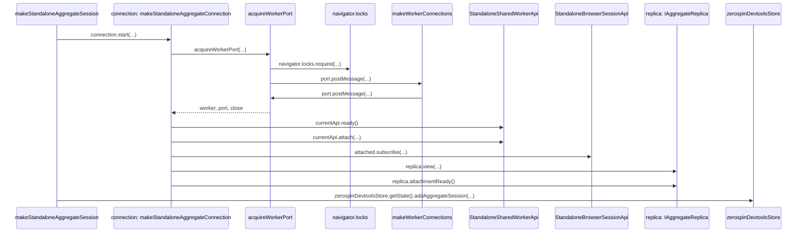
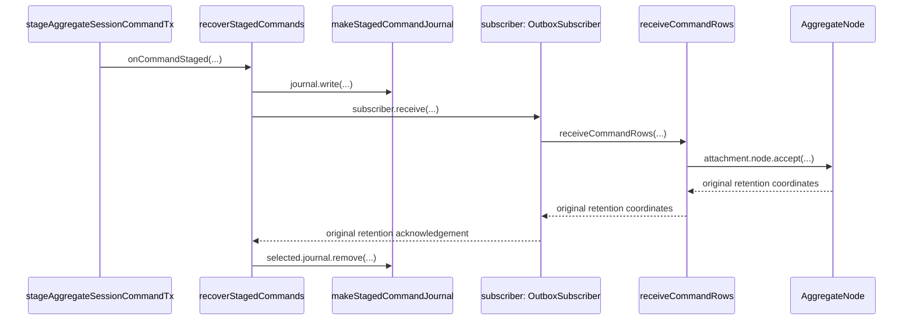
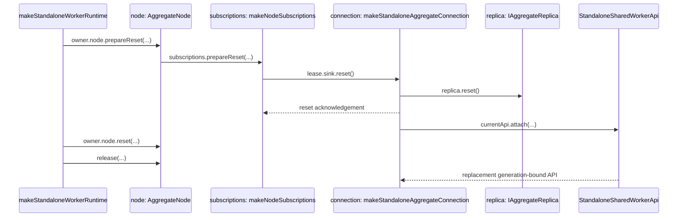

# Standalone SharedWorker execution and derived views

Standalone keeps one local authoritative AggregateNode per live client group and synchronous per-tab staging. A reusable SharedWorker host acquires the group's owner lazily and closes it when the last client leaves. It shares the coherent view/local overlay interface with connected Aggregate sessions while retaining local authoritative execution and original invocation claims.

## Trigger

1. Construct a cold Standalone session with its pure definition, worker URL and
   application layer as separate inputs.
   - [`makeStandaloneAggregateSession.ts:73-84`](../../../packages/browser/src/makeStandaloneAggregateSession.ts#L73-L84) — checks the Standalone system and worker URL, then captures fixed initialization inputs without opening storage.
2. Resolve the backup path and complete session-lock partition, construct the
   concrete local connection, then acquire the complete Aggregate replica.
   - [`makeStandaloneAggregateSession.ts:117-168`](../../../packages/browser/src/makeStandaloneAggregateSession.ts#L117-L168) — derives the storage key and attachment, constructs the cold connection, opens the replica and starts it.
   - [`standaloneIdentity.ts:40-56`](../../../packages/browser/src/StandaloneNode/standaloneIdentity.ts#L40-L56) — hashes authored scope, path and the complete `aggregateSessionLock`.

## Annotated workflow steps

1. Start with the already-complete replica and register local connection cleanup
   before creating transport resources.
   - [`makeStandaloneAggregateConnection.ts:254-274`](../../../packages/browser/src/StandaloneNode/makeStandaloneAggregateConnection.ts#L254-L274) — installs its scoped finalizer and abort listener before starting the worker deadline.
2. Acquire the common client transport with the Standalone worker name and opening
   cancellation signal.
   - [`makeStandaloneAggregateConnection.ts:275-285`](../../../packages/browser/src/StandaloneNode/makeStandaloneAggregateConnection.ts#L275-L285) — acquires the port and rejects a retired acquisition.
3. Hold a unique document-owned client lock before worker construction.
   - [`acquireWorkerPort.ts:91-101`](../../../packages/browser/src/Node/acquireWorkerPort.ts#L91-L101) — retains document liveness before resolving port acquisition.
4. Send the raw client bootstrap before starting CapnWeb.
   - [`acquireWorkerPort.ts:103-110`](../../../packages/browser/src/Node/acquireWorkerPort.ts#L103-L110) — constructs the named worker, starts its port and sends the validated-protocol client ID.
5. Watch the validated client's lifetime and install the owner's RPC handler
   before accepting its bootstrap.
   - [`makeWorkerConnections.ts:158-210`](../../../packages/browser/src/Node/makeWorkerConnections.ts#L158-L210) — watches client loss, waits for prior closure and installs owner/RPC before acceptance.
6. Return the accepted port and idempotent local release.
   - [`acquireWorkerPort.ts:111-114`](../../../packages/browser/src/Node/acquireWorkerPort.ts#L111-L114) — removes the raw bootstrap receiver before returning the accepted transport.
7. Await physical namespace ownership, then check executable artifact/version.
   - [`makeStandaloneAggregateConnection.ts:294-309`](../../../packages/browser/src/StandaloneNode/makeStandaloneAggregateConnection.ts#L294-L309) — validates worker readiness before watching namespace ownership loss.
8. Attach against the registered definition, captured claims, path and storage key.
   - [`makeStandaloneAggregateConnection.ts:121-129`](../../../packages/browser/src/StandaloneNode/makeStandaloneAggregateConnection.ts#L121-L129) — invokes the local attachment RPC with cancellation.
   - [`makeStandaloneWorkerRuntime.ts:140-164`](../../../packages/browser/src/StandaloneNode/makeStandaloneWorkerRuntime.ts#L140-L164) — validates claims and rejects a mismatched independently derived partition key.
9. Subscribe with the replica's pending commands directly.
   - [`makeStandaloneAggregateConnection.ts:310-314`](../../../packages/browser/src/StandaloneNode/makeStandaloneAggregateConnection.ts#L310-L314) — supplies pending commands for normal cold attachment; reset reacquisition passes an empty list instead.
   - [`makeStandaloneAggregateConnection.ts:200-209`](../../../packages/browser/src/StandaloneNode/makeStandaloneAggregateConnection.ts#L200-L209) — subscribes using the supplied pending-command list and waits for subscription completion or retirement.
10. Install only a view from the current local Node generation.
    - [`makeStandaloneAggregateConnection.ts:167-190`](../../../packages/browser/src/StandaloneNode/makeStandaloneAggregateConnection.ts#L167-L190) — fences callbacks after disposal/breakage and rejects an unexpected Node generation.
11. Enable handoff after subscription readiness.
    - [`makeStandaloneAggregateConnection.ts:210-216`](../../../packages/browser/src/StandaloneNode/makeStandaloneAggregateConnection.ts#L210-L216) — marks attachment availability and wakes the replica's pending handoff.
12. Register pause/read/manual controls only after the connection is ready.
    - [`makeStandaloneAggregateSession.ts:168-183`](../../../packages/browser/src/makeStandaloneAggregateSession.ts#L168-L183) — exposes the connection controls through lifetime-owned execution and encoded RPC outcomes in the Devtools entry.

The Standalone connection requires only local attachment inputs. Its browser
attachment exposes subscription, staged-command retention, local pause/manual
execution controls and disposal. Backend admission and authentication are absent.
The controls use the attachment's bound Node generation.

- [`StandaloneBrowserSessionApi.ts:194-202`](../../../packages/browser/src/StandaloneNode/StandaloneBrowserSessionApi.ts#L194-L202) — includes the three local controls in the exposed session capability.

## Authoritative execution and derived views

The owner reuses one authoritative ManagedRuntime for derived replay. Each subscription retains the attachment's claims and current interests. Accepted originals execute through the authoritative Node transaction; view installation resolves covered own rows and replays only uncovered local originals.

- [`makeStandaloneWorkerRuntime.ts:203-251`](../../../packages/browser/src/StandaloneNode/makeStandaloneWorkerRuntime.ts#L203-L251) — acquires storage, one application runtime, its optimistic view and the authoritative Node.
- [`subscribe.ts:54-74`](../../../packages/browser/src/StandaloneNode/subscribe/subscribe.ts#L54-L74) — Subscribes to the Node and supplies retained attachment claims on each delivered identity.
- [`drainStandaloneCommands.ts:27-45`](../../../packages/core/src/StandaloneNode/drainStandaloneCommands.ts#L27-L45) — drains through `executeStandaloneNext`, stopping after one appended final for a manual invocation.
- [`AggregateNode.ts:480-512`](../../../packages/core/src/AggregateNode/AggregateNode.ts#L480-L512) — Projects unresolved originals over the committed baseline.
- [`installAggregateNodeView.ts:88-121`](../../../packages/core/src/aggregateSession/installAggregateNodeView.ts#L88-L121) — validates command coverage against existing local submission rows and retained Node coordinates.

## Staged-command journal and original claims

Standalone uses the same pending staged-command journal as connected Aggregate
sessions. `makeStandaloneAggregateConnection.journalIdentityKey` returns the
already-derived `standaloneStorageKey`; incidental claims values do not add a
partition or another hash. The validated snapshot binds that key to its original
`nodeId` before the replica becomes stageable.

- [`makeStandaloneAggregateConnection.ts:229-251`](../../../packages/browser/src/StandaloneNode/makeStandaloneAggregateConnection.ts#L229-L251) — exposes the existing key and acquires a staged-command subscriber only for the current Node incarnation.
- [`openAggregateSessionReplica.ts:107-139`](../../../packages/browser/src/sessionReplica/openAggregateSessionReplica.ts#L107-L139) — enables the shared Aggregate journal and recovery from the concrete connection's identity key.

A committed stage attempts its per-command localStorage write before committed
table observers run and before staging returns. Recovery keeps the complete
original encoded command, including claims, payload, `sessionId`, `sessionIndex`
and `stagingOutcome`. A later attachment to the same storage owner may deliver an
original with different valid non-path claims. It does not substitute its own
claims or stage the original again.

## Annotated workflow steps

1. Invoke the captured staging callback after successful SQL COMMIT and before
   table-observer publication.
   - [`stageAggregateSessionCommandTx.ts:49-57`](../../../packages/core/src/aggregateSession/stageCommand/stageAggregateSessionCommandTx/stageAggregateSessionCommandTx.ts#L49-L57) — supplies the captured encoded original through `makeTx`'s commit callback.
   - [`SqliteSession.ts:119-136`](../../../packages/core/src/drizzle/SqliteSession.ts#L119-L136) — invokes the isolated commit callback before finishing transaction observation.
2. Attempt the synchronous journal write under the original Node scope.
   - [`recoverStagedCommands.ts:86-95`](../../../packages/browser/src/stagedCommandJournal/recoverStagedCommands.ts#L86-L95) — binds the storage key and original `nodeId` into the callback's journal.
3. Deliver a journaled old-session original through the ordinary subscriber.
   - [`recoverStagedCommands.ts:173-209`](../../../packages/browser/src/stagedCommandJournal/recoverStagedCommands.ts#L173-L209) — orders old-session originals and registers their complete coordinates before delivery.
4. Receive the command page under the attachment lifetime guard.
   - [`StandaloneBrowserSessionApi.ts:64-76`](../../../packages/browser/src/StandaloneNode/StandaloneBrowserSessionApi.ts#L64-L76) — registers offered interests and forwards complete original commands to local reception.
5. Offer each nonempty page's original through the transactional Node gate.
   - [`receiveCommandRows.ts:11-20`](../../../packages/browser/src/StandaloneNode/receiveCommandRows.ts#L11-L20) — checks attachment lifetime, returns immediately for an empty page, and passes the bound `nodeId` into each `accept` call.
6. Return the original's retained allocation after exact retry or new retention.
   - [`acceptAggregateOriginalTx.ts:33-66`](../../../packages/core/src/AggregateNode/acceptAggregateOriginalTx.ts#L33-L66) — checks the expected Node incarnation before recovering an exact original's allocation.
   - [`acceptAggregateOriginalTx.ts:111-127`](../../../packages/core/src/AggregateNode/acceptAggregateOriginalTx.ts#L111-L127) — retains a new complete original and returns its allocated Node coordinates.
7. Return original retention coordinates after scheduling the existing drain.
   - [`receiveCommandRows.ts:17-21`](../../../packages/browser/src/StandaloneNode/receiveCommandRows.ts#L17-L21) — awaits original retention, requests drainage without awaiting authoritative execution, then returns the records.
8. Return the validated retention acknowledgement through the existing subscriber.
   - [`StandaloneBrowserSessionApi.ts:69-76`](../../../packages/browser/src/StandaloneNode/StandaloneBrowserSessionApi.ts#L69-L76) — records retained interests and returns the original retention coordinates.
   - [`makeOutboxSubscriber.ts:45-56`](../../../packages/browser/src/outbox/makeOutboxSubscriber.ts#L45-L56) — checks the attachment around reception and wraps its retention response in the existing RPC envelope.
9. Retire the pending delivery entry after validated original retention.
   - [`recoverStagedCommands.ts:96-120`](../../../packages/browser/src/stagedCommandJournal/recoverStagedCommands.ts#L96-L120) — records the known canonical allocation, attempts journal deletion and removes pending delivery work while keeping unresolved interests.

`makeStandaloneWorkerRuntime` validates original claims with the authored schema
and checks their decoded `aggregateId` against `command.aggregateId`.
`acceptAggregateOriginalTx` separately checks that command Aggregate ID against
the Node owner, plus the Aggregate/Actor/session tuple and registered contract
version. Original claims are not compared with the recovering attachment's
complete claims. The existing executor decodes `command.claims` and uses those
captured claims for authoritative evaluation.

- [`makeStandaloneWorkerRuntime.ts:239-250`](../../../packages/browser/src/StandaloneNode/makeStandaloneWorkerRuntime.ts#L239-L250) — validates the original's claims and rejects a conflicting claim Aggregate ID.
- [`acceptAggregateOriginalTx.ts:73-99`](../../../packages/core/src/AggregateNode/acceptAggregateOriginalTx.ts#L73-L99) — validates the original and checks its ownership tuple and registered contract version before allocation.
- [`executeStandaloneCommand.ts:64-76`](../../../packages/core/src/StandaloneNode/executeStandaloneCommand.ts#L64-L76) — prepares the authoritative invocation with the original command's decoded claims.

The page journal is pending delivery state, not a second authoritative command
history. Cleanup proves durable original retention; it does not wait for local
authoritative execution or final retention. Empty pages request no drain, even
through a subscriber bound to an earlier Node incarnation. Reset retires current
recovery and rotates `nodeId`, leaving old journal entries inert. Any localStorage
failure preserves ordinary staging and handoff.

- [`receiveCommandRows.ts:11-21`](../../../packages/browser/src/StandaloneNode/receiveCommandRows.ts#L11-L21) — returns before acceptance and drainage for empty pages and retains nonempty originals before returning.
- [`makeAggregateReplicaReceiver.ts:165-176`](../../../packages/browser/src/sessionReplica/makeAggregateReplicaReceiver.ts#L165-L176) — resets handoff and recovery while retiring the old replica's pending work.

## Pause and manual execution

`getPushPaused`, `setPushPaused` and `pushNow` are local authoritative controls
registered on the Devtools entry after initialization. The connection refuses
control calls after disposal, breakage or before attachment readiness. Reading
pause checks the current bound `nodeId`; changing it also passes that ID into
`AggregateNode.setPushPaused`, which checks the generation and writes pause in
the same Node transaction. Clearing pause requests an automatic drain.

- [`makeStandaloneAggregateConnection.ts:335-363`](../../../packages/browser/src/StandaloneNode/makeStandaloneAggregateConnection.ts#L335-L363) — forwards controls only through a verified, live attachment and restores declared RPC errors.
- [`StandaloneBrowserSessionApi.ts:118-167`](../../../packages/browser/src/StandaloneNode/StandaloneBrowserSessionApi.ts#L118-L167) — checks the bound generation, decodes pause input and requests drainage after unpausing.
- [`AggregateNode.ts:584-600`](../../../packages/core/src/AggregateNode/AggregateNode.ts#L584-L600) — validates the expected generation and commits pause under the Node gate and transaction before publishing state.

Automatic execution checks durable `pushPaused` inside `AggregateNode.executeNext`
before selecting an original. A paused Node keeps accepting originals and
publishing their optimistic view, but automatic draining appends no final.
`pushNow` passes the attachment's `boundNodeId` to the existing owner's managed
runtime and executes at most one original with `manual: true`. It returns
`pushed` or `empty` without changing pause. The Node transaction rechecks the
expected generation before bypassing pause, so a control retained across reset
cannot execute a command in the replacement generation.

- [`StandaloneBrowserSessionApi.ts:170-176`](../../../packages/browser/src/StandaloneNode/StandaloneBrowserSessionApi.ts#L170-L176) — passes the attachment's bound Node ID into the manual execution program after checking currentness.
- [`makeStandaloneWorkerRuntime.ts:113-128`](../../../packages/browser/src/StandaloneNode/makeStandaloneWorkerRuntime.ts#L113-L128) — rejects a stopped or missing owner, runs one manual execution and maps its result to `pushed` or `empty`.
- [`makeStandaloneWorkerRuntime.ts:307-318`](../../../packages/browser/src/StandaloneNode/makeStandaloneWorkerRuntime.ts#L307-L318) — runs automatic and manual authoritative execution in the same owning ManagedRuntime.
- [`AggregateNode.ts:744-795`](../../../packages/core/src/AggregateNode/AggregateNode.ts#L744-L795) — checks the generation and automatic pause in the execution transaction, then selects one original, retains its final and publishes committed output.

## Resetting a live generation

An explicit reset first withdraws every live replica's readiness and retires its
old handoff and pending interests. `makeStandaloneWorkerRuntime` waits for those
acknowledgements outside the Node SQL gate before `AggregateNode.reset` replaces
resources/history and rotates `nodeId`, preserving `pushPaused`. A peer obtains
a new generation-bound API on its existing MessagePort. It does not treat the
announced replacement as an unexpected `node-epoch-changed` delivery.

## Annotated workflow steps

1. Prepare the live reset before entering resource/history replacement.
   - [`makeStandaloneWorkerRuntime.ts:341-348`](../../../packages/browser/src/StandaloneNode/makeStandaloneWorkerRuntime.ts#L341-L348) — obtains reset acknowledgement before replacing the baseline and releases publication in `finally`.
2. Pause publication and await live attachments outside the SQL gate.
   - [`AggregateNode.ts:798-818`](../../../packages/core/src/AggregateNode/AggregateNode.ts#L798-L818) — delegates acknowledgement to subscriptions before returning an idempotent publication release.
3. Require reset support and bounded acknowledgement from each live subscription.
   - [`makeNodeSubscriptions.ts:100-159`](../../../packages/core/src/Node/makeNodeSubscriptions.ts#L100-L159) — retires prior delivery epochs, invokes each reset callback and rejects unsupported, timed-out or aborted preparation.
4. Withdraw readiness and retire the old generation's local work.
   - [`makeAggregateReplicaReceiver.ts:165-187`](../../../packages/browser/src/sessionReplica/makeAggregateReplicaReceiver.ts#L165-L187) — marks pending work for discard, resets handoff, clears originating-command interests and publishes unavailable readiness.
5. Acknowledge after local retirement without awaiting replacement attachment.
   - [`makeStandaloneAggregateConnection.ts:136-166`](../../../packages/browser/src/StandaloneNode/makeStandaloneAggregateConnection.ts#L136-L166) — retires the callback, disables handoff and queues reacquisition without awaiting the runtime's still-owned attachment serial.
6. Queue a fresh attachment on the existing port with reset disabled.
   - [`makeStandaloneAggregateConnection.ts:151-165`](../../../packages/browser/src/StandaloneNode/makeStandaloneAggregateConnection.ts#L151-L165) — reuses `currentApi` for reacquisition rather than opening another SharedWorker client.
7. Replace the current partition atomically while retaining its pause setting.
   - [`AggregateNode.ts:821-827`](../../../packages/core/src/AggregateNode/AggregateNode.ts#L821-L827) — restricts standalone reset and delegates baseline replacement with connected-reset behavior disabled.
   - [`AggregateNode.ts:872-897`](../../../packages/core/src/AggregateNode/AggregateNode.ts#L872-L897) — rotates Node identity, clears history/resources and installs the baseline in one transaction without clearing standalone pause.
8. Resume publication after replacement and always release reset preparation.
   - [`makeStandaloneWorkerRuntime.ts:341-348`](../../../packages/browser/src/StandaloneNode/makeStandaloneWorkerRuntime.ts#L341-L348) — publishes the replacement on success and releases preparation after failure as well.
9. Bind the replacement API, then use the normal subscription/readiness path.
   - [`makeStandaloneAggregateConnection.ts:116-135`](../../../packages/browser/src/StandaloneNode/makeStandaloneAggregateConnection.ts#L116-L135) — captures the returned capability and checks connection/current-API identity before using it.
   - [`makeStandaloneAggregateConnection.ts:192-227`](../../../packages/browser/src/StandaloneNode/makeStandaloneAggregateConnection.ts#L192-L227) — replaces prior capability/callback ownership and restores handoff only for the current completed subscription.

Each callback captures its API and an active flag. Retired view/state deliveries
cannot install a generation or publish readiness after reset. Reacquisition is
queued without being awaited by the reset callback: awaiting it there would
deadlock the runtime's serialized attachment while it waits for that same reset
acknowledgement. Replacement subscription does not advertise old pending rows.

- [`makeStandaloneAggregateConnection.ts:130-227`](../../../packages/browser/src/StandaloneNode/makeStandaloneAggregateConnection.ts#L130-L227) — fences callback delivery, subscription completion and replacement capability ownership.

The subscription also checks its immutable `boundNodeId` before forwarding each
state or view. A capability acquired just before a concurrent reset cannot
certify the replacement generation by receiving its first view. A stale
subscription enters the same reset/reacquisition path; stale controls still
refuse. After a fresh capability's coherent view is installed, the connector
certifies readiness through `replica.attachmentReady()`. The receiver publishes
the prepared replacement only for its current lifetime with available local
state, no blocked work and present checkpoint/progress fields. Standalone
authority needs no remote replay-complete signal or fabricated online state.

- [`subscribe.ts:49-85`](../../../packages/browser/src/StandaloneNode/subscribe/subscribe.ts#L49-L85) — captures the attachment's generation, clears reset interests and rejects state/view forwarding from another generation.
- [`makeStandaloneAggregateConnection.ts:200-227`](../../../packages/browser/src/StandaloneNode/makeStandaloneAggregateConnection.ts#L200-L227) — certifies only a current subscription and reacquires when subscription reports a stale capability.
- [`makeAggregateReplicaReceiver.ts:386-424`](../../../packages/browser/src/sessionReplica/makeAggregateReplicaReceiver.ts#L386-L424) — publishes the prepared replacement with present checkpoint/progress fields after lifetime and local readiness checks, then refreshes handoff.

## Ownership and recovery

Storage identity includes aggregate/Actor versions, sessionName, generated backup path and the complete canonical `aggregateSessionLock`. The key and sharedWorkerVersion select the SharedWorker name; `/zerospin/standalone/${key}` selects the SQLite namespace and exclusive namespace lease independently of that version. Incidental claims values outside the generated path and runtime/build identity do not select storage. Different builds sharing the same namespace serialize ownership; different session-lock partitions initialize independently. Each original keeps its own valid full claims; replay never substitutes the current attachment's claims. Explicit reset validates the current partition's owner, atomically reseeds and rotates generation while preserving pause preference; it does not transfer data between session locks.

- [`standaloneIdentity.ts:40-56`](../../../packages/browser/src/StandaloneNode/standaloneIdentity.ts#L40-L56) — Hashes authored scope, path and canonical lock without incidental claims values or runtime/build fields.
- [`makeStandaloneSharedWorker.ts:18-34`](../../../packages/browser/src/StandaloneNode/makeStandaloneSharedWorker.ts#L18-L34) — derives the stable namespace from the key and acquires its lease/runtime lazily inside the owner factory.

First adoption changes every prior standalone key and seeds a fresh partition from configured resources. Legacy databases remain untouched without lookup, migration, deletion or fallback. Thereafter the same scope, path and lock reopen the same partition; a changed lock selects separate storage, and returning to an earlier lock reopens that partition without merging data.

Each valid raw-bootstrapped connection has a document-owned Web Lock held before worker construction. The host watches that lock before acquiring an owner or starting RPC; document loss therefore detaches the client even without a cooperative close frame. Hidden, frozen and cached documents stay clients while the browser retains their locks. The client lock supplies liveness; the separate namespace lease supplies storage exclusion.

- [`makeWorkerConnections.ts:167-175`](../../../packages/browser/src/Node/makeWorkerConnections.ts#L167-L175) — Queues the exclusive watcher for the client's already-held lock and detaches on acquisition or failure.
- [`makeNodeNamespaceLease.ts:11-19`](../../../packages/browser/src/Node/makeNodeNamespaceLease.ts#L11-L19) — Holds the separate exclusive namespace lock until its release Promise settles.

Disposing one facade releases its local capabilities and client lock. Other clients remain usable. The last client's departure fences the owner, cancels startup and remote waits, drains accepted execution/SQL, closes projection/storage and releases namespace ownership last. An arriving client waits for complete cleanup before a fresh owner reopens the same retained database. A cleanup failure attempts independent releases, retains namespace exclusion and rejects replacement acquisition. The host's `connect` listener survives successful idle cleanup. `session.dispose()` establishes local cleanup without acknowledging shared-owner drainage or remote finalization.

- [`makeStandaloneAggregateConnection.ts:365-390`](../../../packages/browser/src/StandaloneNode/makeStandaloneAggregateConnection.ts#L365-L390) — fences local use, releases connection resources and awaits local opening without a shared-owner close RPC.
- [`makeWorkerConnections.ts:81-120`](../../../packages/browser/src/Node/makeWorkerConnections.ts#L81-L120) — Removes one port idempotently and closes its owner only when its port set becomes empty.
- [`makeWorkerConnections.ts:31-63`](../../../packages/browser/src/Node/makeWorkerConnections.ts#L31-L63) — Latches owner closure and retains the first close failure while rejecting queued bootstrap clients.
- [`makeStandaloneSharedWorker.ts:44-51`](../../../packages/browser/src/StandaloneNode/makeStandaloneSharedWorker.ts#L44-L51) — cancels namespace opening, stops execution and closes owner storage before namespace release.
- [`closeNodeStorageOwner.ts:12-29`](../../../packages/browser/src/Node/closeNodeStorageOwner.ts#L12-L29) — Attempts prerequisite releases in order and reaches namespace release only on success.

Partial startup retains its original failure after attempting cleanup. A secondary cleanup failure joins owner closure so uncertain partial resources cannot release namespace exclusion.

- [`makeStandaloneWorkerRuntime.ts:323-331`](../../../packages/browser/src/StandaloneNode/makeStandaloneWorkerRuntime.ts#L323-L331) — records secondary cleanup failure while rethrowing the original initialization error.
- [`makeStandaloneWorkerRuntime.ts:375-380`](../../../packages/browser/src/StandaloneNode/makeStandaloneWorkerRuntime.ts#L375-L380) — joins retained partial cleanup failure before reporting storage closure.

Standalone `ready()` awaits the physical namespace lease before reporting version/artifact identity. Only then does the connector watch that namespace for ownership loss. Existing old worker code cannot gain cleanup retroactively; its owner must release before same-namespace adoption. No storage key, seed, row or reset authority changes in this cleanup.

- [`ready.ts:12-20`](../../../packages/browser/src/StandaloneNode/ready/ready.ts#L12-L20) — Waits for namespace ownership before reporting the runtime version/artifact URL.
- [`makeStandaloneAggregateConnection.ts:302-309`](../../../packages/browser/src/StandaloneNode/makeStandaloneAggregateConnection.ts#L302-L309) — watches `/zerospin/standalone/${key}:lifetime` after successful readiness.

Optimistic replay cannot create an authoritative final or advance its checkpoint. Automatic authoritative draining and exclusion of external async work remain. Browser/process termination may interrupt drainage; recovery relies on already committed durable state. Changed fixed Node schemas require empty affected storage; Native's local replica schema is independent.

Plan 234's earlier 2026-10-27 authorized temporary browser fixture reproduced the missing controls
before the first repair: `getPushPaused`, `setPushPaused` and `pushNow` were
undefined on its Devtools entry. Actual Chromium verified the repaired public
control wiring with the authored
`createGame` program. Two sessions with different valid claims share the
permitted owner; pause retains an original without an authoritative row/final.
After worker exit, physical IndexedDB and cold reopen preserve the pause and
original. A different session's manual push executes that original with its
captured originating claims, retains exactly one final and leaves pause set.
A further manual push reports empty. Disposal refuses a retired control and
leaves another attached session usable. A subsequently authorized public reset
preserved the caller's pause preference but caused the other live session to
fail with `node-epoch-changed`.

After the acknowledged-reset repair, two permitted sessions share a paused Node
at checkpoint zero. The peer stages a valid `createGame` original, and both
replicas show its optimistic row. Calling the other session's public `reset()`
rotates the durable ID to `node_v8yWZ9fcSi01FrpVH8ySE`. The caller gets a new
Session ID; the peer keeps its Session ID and withdraws readiness before
installing and certifying the replacement. Both finish initialized at checkpoint
and push index zero with pause preserved and empty commands/resources. The peer's
pause control succeeds; the caller's retired control refuses. Physical reads in
the same authorized `/zerospin/standalone/812698ea657639dde2bccaedce2983bca29e1985ab5d1d0d15a3414a32706ad8`
namespace confirm that new ID, checkpoint zero, `pushPaused: 1` and empty history
and resources.

Cold reopen retains the new identity and pause. Unpausing and staging one fresh
`createGame` executes automatically to checkpoint one. Physical storage contains
only that fresh original/final pair and its game row, with none of the discarded
peer command's payload. That source snapshot passed thirty-seven Node/Browser cases
across ten files and twenty-three scoped quality tasks. The cases include the
controlled transaction-level pause/manual checks and receiving-replica reset
readiness checks; the actual host observations establish the public local
authority, persistence and live-peer reset journey above. Twenty-four assertions
over the consolidated captured host records pass. The current final checks and
separate Native/Swift evidence are retained in Plan 234.

- [Plan 234 actual host verification](../../archive/plans/234-plan-node-owned-optimistic-views-and-session-replicas.md#actual-sharedworker-and-indexeddb-verification--2026-10-27) — records the authorized temporary fixture/storage, before/after failures and captured physical/browser evidence.

## Declaration, cancellation and replay boundaries

The standalone tab and its authored worker import one pure Aggregate session definition. The worker supplies its own execution layer; tab application services are not transferred across the port. `makeSharedWorker` selects one session from its validated worker name. Scope, generated backup path and complete canonical lock select persistent identity; build identity remains an attachment fence.

- [`makeSharedWorker.ts:22-57`](../../../packages/browser/src/makeSharedWorker.ts#L22-L57) — keeps the registered definition/layer separate from the selected host family.
- [`makeStandaloneWorkerRuntime.ts:334-353`](../../../packages/browser/src/StandaloneNode/makeStandaloneWorkerRuntime.ts#L334-L353) — checks the retained aggregate ID and definition hash before returning an attachment bound to the current Node ID.

Standalone `executeNext` carries cancellation across the native Promise bridge into authored Effects. Close cancels and joins that application execution before waiting for the Node SQL gate, avoiding a deadlock with an execution that owns the gate. Committed authoritative command output follows ordinary Node publication and [atomic captured-view installation](./PushSequence.md#installing-a-captured-node-view); optimistic replay never advances the authoritative checkpoint.

- [`drainStandaloneCommands.ts:27-45`](../../../packages/core/src/StandaloneNode/drainStandaloneCommands.ts#L27-L45) — delegates canonical local execution to `executeStandaloneNext` and limits a manual invocation to one original.
- [`makeStandaloneWorkerRuntime.ts:295-318`](../../../packages/browser/src/StandaloneNode/makeStandaloneWorkerRuntime.ts#L295-L318) — joins authoritative execution and disposal through the owning application runtime.

Seed installation is initialization authority, not query-driven repair. After seed, model changes come from command execution/replay. An explicit existing standalone reset reuses captured claims/seed resources and rotates the current partition generation; a disposal epoch fence prevents cleanup from launching a replacement bootstrap. Fixed schema mismatch requires empty affected storage, with no translation or compatibility path. The control/reset repair preserves that policy.

- [`makeStandaloneWorkerRuntime.ts:363-380`](../../../packages/browser/src/StandaloneNode/makeStandaloneWorkerRuntime.ts#L363-L380) — cancels/joins execution before closing Node state and joining partial-startup cleanup.

- [`executeStandaloneNext.ts:54-83`](../../../packages/core/src/StandaloneNode/executeStandaloneNext.ts#L54-L83) — carries cancellation into authored Effects across the native Promise callback, forwards manual/generation checks and retains the original execution Cause.
