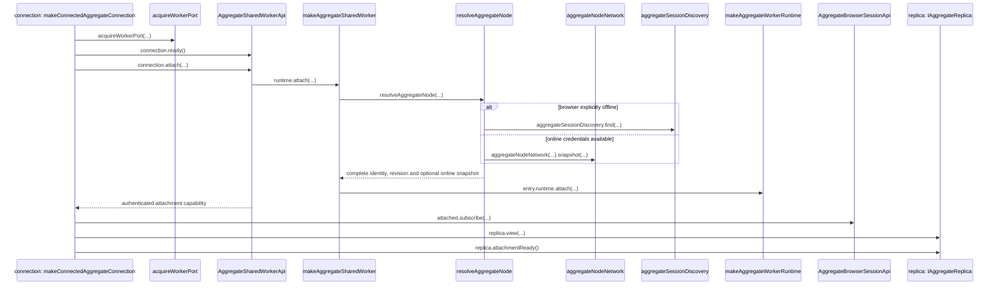

# Executable Node attachment and session bootstrap

The application worker and tab import one pure checked session definition. Each connected SharedWorker host resolves online proof or an eligible previously verified offline identity independently and lazily acquires an isolated durable Node owner per complete identity. Each Node holds durable command history and its derived optimistic graph; the tab owns immediate local staging. The host retains its connection listener across owner cleanup. Initial attachment and reconnect use the same coherent view installer.

## Trigger

1. Construct a cold connected session with its pure definition, application layer,
   credentials and worker URL as separate inputs. Initialization constructs the
   concrete connection before opening the complete replica.
   - [`makeConnectedAggregateSession.ts:197-243`](../../../packages/browser/src/makeConnectedAggregateSession.ts#L197-L243) — constructs the connection, acquires the replica with that connection, then starts it with the replica's receiving methods.
   - [`makeConnectedServiceSession.ts:120-157`](../../../packages/browser/src/makeConnectedServiceSession.ts#L120-L157) — composes the corresponding Service connection and replica.
2. Register the same pure definition and an independent projection layer in its
   authored worker entry.
   - [`makeSharedWorker.ts:22-66`](../../../packages/browser/src/makeSharedWorker.ts#L22-L66) — checks the worker family against the single registered definition and selects its connected routing host or Standalone runtime.



## Annotated workflow steps

1. Open the module SharedWorker using a routing key derived from the complete request and requested aggregate ID, after acquiring document liveness.
   - [`aggregateNodeRequest.ts:16-19`](../../../packages/browser/src/AggregateNode/aggregateNodeRequest.ts#L16-L19) — hashes the complete request together with the requested aggregate ID.
   - [`makeConnectedAggregateConnection.ts:217-231`](../../../packages/browser/src/AggregateNode/makeConnectedAggregateConnection.ts#L217-L231) — derives the routing key and constructs its SharedWorker name without authentication.
2. Validate artifact/version readiness independently of authenticated storage ownership.
   - [`makeConnectedAggregateConnection.ts:324-344`](../../../packages/browser/src/AggregateNode/makeConnectedAggregateConnection.ts#L324-L344) — checks the executable artifact and compiled version, then ends the handshake deadline before attachment.
   - [`makeAggregateSharedWorker.ts:262-266`](../../../packages/browser/src/AggregateNode/makeAggregateSharedWorker.ts#L262-L266) — returns build identity without acquiring a Node database lease.
3. Send unverified request/selection inputs, optional expected claims and the page's admission and tab-journal callbacks.
   - [`makeConnectedAggregateConnection.ts:350-390`](../../../packages/browser/src/AggregateNode/makeConnectedAggregateConnection.ts#L350-L390) — constructs the request attachment without page-verified claims, discovery revision or online status.
4. Delegate this port's attachment under its cancellation lifetime.
   - [`AggregateSharedWorkerApi.ts:63-85`](../../../packages/browser/src/AggregateNode/AggregateSharedWorkerApi.ts#L63-L85) — decodes attachment input and supplies the port lifetime to its attachment procedure.
   - [`attach.ts:82-92`](../../../packages/browser/src/AggregateNode/attach/attach.ts#L82-L92) — invokes the retained host with that attachment's credential callback and cancellation signal.
5. Check the exact declaration, lock and routing key before reading the discovery revision or asking for credentials.
   - [`makeAggregateSharedWorker.ts:148-161`](../../../packages/browser/src/AggregateNode/makeAggregateSharedWorker.ts#L148-L161) — validates the registered request, rejects routing mismatch and starts host-owned discovery.
   - [`makeServiceSharedWorker.ts:165-178`](../../../packages/browser/src/ServiceNode/makeServiceSharedWorker.ts#L165-L178) — performs the explicit Service declaration/routing checks and discovery call.
6. When the browser is explicitly offline, resolve one eligible previously verified identity using exact expected claims; do not request online credentials.
   - [`resolveAggregateNode.ts:25-81`](../../../packages/browser/src/AggregateNode/resolveAggregateNode.ts#L25-L81) — validates expected claims, finds the remembered identity and preserves aggregate selection.
   - [`resolveServiceNode.ts:25-73`](../../../packages/browser/src/ServiceNode/resolveServiceNode.ts#L25-L73) — finds the eligible Service identity and returns an offline resolution.
7. While online, obtain only this attachment's credentials and request its authenticated snapshot with no producer ID.
   - [`resolveAggregateNode.ts:100-160`](../../../packages/browser/src/AggregateNode/resolveAggregateNode.ts#L100-L160) — bounds credential acquisition, checks the requested aggregate ID and verifies snapshot claims.
   - [`resolveServiceNode.ts:76-128`](../../../packages/browser/src/ServiceNode/resolveServiceNode.ts#L76-L128) — bounds the Service callback and checks expected claims after the snapshot response.
8. Return complete identity and revision, including reusable snapshot proof only for the online branch. Classified backend unavailability may instead resolve the remembered identity.
   - [`resolveAggregateNode.ts:161-172`](../../../packages/browser/src/AggregateNode/resolveAggregateNode.ts#L161-L172) — retains the baseline/environment and producing admission callback in the online resolution.
   - [`resolveServiceNode.ts:129-140`](../../../packages/browser/src/ServiceNode/resolveServiceNode.ts#L129-L140) — retains Service's verified admission for later ticket reuse.
9. Join or acquire the authenticated identity's owner and consume the initial proof without another normal snapshot request.
   - [`makeAggregateSharedWorker.ts:167-230`](../../../packages/browser/src/AggregateNode/makeAggregateSharedWorker.ts#L167-L230) — checks revocation, joins the identity entry, waits for its namespace and passes the resolution into its runtime.
   - [`makeAggregateWorkerRuntime.ts:828-895`](../../../packages/browser/src/AggregateNode/makeAggregateWorkerRuntime.ts#L828-L895) — uses the initial proof unless recovery invalidated it and installs a baseline only when no checkpoint exists.
10. Publish only the identity-specific attachment capability after preparation and synchronization.
    - [`makeAggregateSharedWorker.ts:219-246`](../../../packages/browser/src/AggregateNode/makeAggregateSharedWorker.ts#L219-L246) — rechecks revision/lifetime and retains the identity entry through the returned attachment's disposal.

11. Subscribe with this session's complete pending commands and known producer allocations.
    - [`makeConnectedAggregateConnection.ts:578-585`](../../../packages/browser/src/AggregateNode/makeConnectedAggregateConnection.ts#L578-L585) — supplies pending commands to the attachment and awaits its first delivered view.
12. Validate the delivered identity, pin its authenticated key before journal binding, and reject stale delivery generations.
    - [`makeConnectedAggregateConnection.ts:425-492`](../../../packages/browser/src/AggregateNode/makeConnectedAggregateConnection.ts#L425-L492) — reconstructs the expected identity, checks claims, pins `selectedKey` and watches its actual database namespace before replica installation.
13. Enable staged-command handoff only after subscription readiness.
    - [`makeConnectedAggregateConnection.ts:585-590`](../../../packages/browser/src/AggregateNode/makeConnectedAggregateConnection.ts#L585-L590) — enables attachment access and invokes the replica readiness callback.

## Opening a connected Node database

The first attachment resolves the authenticated identity and takes its exclusive
lease. Different worker builds for the same identity wait for that lease. Family
discovery selects the database for the verified history. The host opens it with
`openWaSqliteNodeStorage` and constructs the AggregateNode or ServiceNode.
[Aggregate discovery](../../../packages/browser/src/AggregateNode/aggregateSessionDiscovery.ts) · [wa-sqlite opener](../../../packages/browser/src/Node/openWaSqliteNodeStorage.ts)

1. **Open the command tables.** The Node checks the binding, migration history
   and durable schema. Each missing SQL change commits with its ledger entry.
   Final schema validation runs inside the final step's transaction. A previous
   worker encountering a newer schema refuses it. A paused producer retains
   its pause. [Aggregate database](../../../packages/core/src/AggregateNode/aggregateNodeDatabase.ts) · [Service database](../../../packages/core/src/ServiceNode/serviceNodeDatabase.ts)
2. **Recover saved moves.** A compatible original in the matching producer's
   tab journal can be the only copy. The original session coordinates let the
   Node retain it once even if the first acknowledgement was lost. Shipped
   Aggregate formats that carry upload or predecessor requirements need a
   compatibility check before adopting their data. [Journal recovery](../../../packages/browser/src/stagedCommandJournal/recoverStagedCommands.ts)
3. **Open the planner view.** Check the selected read tables against their
   definitions and row-producing logic. Rebuild affected tables from the
   confirmed baseline and contiguous deltas, then project uncovered originals.
   When that baseline is insufficient the view needs an authenticated snapshot.
   [Read-table rebuild](../../../packages/core/src/Node/rebuildConnectedReadTables.ts)
4. **Deliver on reconnect.** Ordinary synchronization resumes from the saved
   producer positions, subject to the user's push pause. The original ID
   identifies the same execution when the server admitted it before a reply
   was lost. [Aggregate command lifecycle](./AggregateCommandLifecycle.md)

To rename the persisted command payload column, change the SQL column name in
[`aggregateNodeTables.ts`](../../../packages/core/src/AggregateNode/aggregateNodeTables.ts)
and append this step to `migrations` in
[`aggregateNodeDatabase.ts`](../../../packages/core/src/AggregateNode/aggregateNodeDatabase.ts).
The TypeScript property can remain `payload`. Keep the published baseline
declaration intact so previously released files still validate.

```ts
{ id: 1, name: 'rename-command-payload', sql: ['ALTER TABLE commands RENAME COLUMN payload TO encodedPayload'] }
```

## Definition validation and view installation

The application owner selects exactly one session definition and compares its complete public lock. Node snapshot capture samples current interests inside the same SQL gate. The receiver installs resources and own command coverage before publishing an initialized capability.

- [`nodeExecution.ts:62-97`](../../../packages/browser/src/Node/nodeExecution.ts#L62-L97) — validates the exact Aggregate request/lock before execution and separately checks the verified Actor release.
- [`AggregateNode.ts:701-712`](../../../packages/core/src/AggregateNode/AggregateNode.ts#L701-L712) — Captures requested interests inside the Node gate and transaction while registering the subscription.
- [`makeAggregateReplicaReceiver.ts:244-305`](../../../packages/browser/src/sessionReplica/makeAggregateReplicaReceiver.ts#L244-L305) — Installs the coherent view before constructing and conditionally publishing the initialized capability.

Both receiving replicas compare the exact owner/Actor/session identity and decode
claims through the authored definition before comparing expected admitted claims.
Only a matching view reaches the synchronous installer. The receiver retains its
bound identity for later deliveries; a changed definition hash cannot silently
replace that identity. Retired view/state/reset callbacks return before touching
the replica or publishing capability. This receiver boundary complements the
connector's independent attachment and worker-artifact checks.

- [`makeAggregateReplicaReceiver.ts:189-244`](../../../packages/browser/src/sessionReplica/makeAggregateReplicaReceiver.ts#L189-L244) — checks lifetime, Aggregate/Actor/session identity and admitted claims before invoking the coherent-view installer.
- [`makeServiceReplicaReceiver.ts:179-241`](../../../packages/browser/src/sessionReplica/makeServiceReplicaReceiver.ts#L179-L241) — enforces the corresponding Service identity/claims sequence before installation and retains the bound identity.

Local staging records an originating sessionId/sessionIndex marker.
retainOriginatingCommand consumes that marker once when Node allocation becomes
known, replacing it with the canonical command ID and name. Handoff retries and
later coherent views cannot recreate consumed notification eligibility.
makeSessionFailureObserver reports only a matching current origin: it recognizes
the failure, deletes that canonical marker and then notifies, so a synchronous
listener cannot report the same failure twice. A successful final also consumes
the marker. This transient notification state proves neither admission nor
execution; the admitted command, retained final and outcome keep their independent
ownership.

- [`openAggregateSessionReplica.ts:129-133`](../../../packages/browser/src/sessionReplica/openAggregateSessionReplica.ts#L129-L133) — records the originating local submission when handoff first observes it.
- [`retainOriginatingCommand.ts:5-21`](../../../packages/browser/src/Node/retainOriginatingCommand.ts#L5-L21) — consumes the local submission marker before installing canonical notification eligibility.
- [`makeSessionFailureObserver.ts:25-60`](../../../packages/browser/src/Node/makeSessionFailureObserver.ts#L25-L60) — recognizes the current originating command, removes its marker before failure publication and consumes successful finals.

## Recovery of journaled staged commands

Outside upgrade preflight, ordinary connected replicas obtain their complete
authenticated identity key from the validated delivered Node view before journal binding. Standalone supplies its existing `standaloneStorageKey`, which includes
the authored scope, generated path and complete session lock without incidental
claims values. Both use the shared Aggregate replica journal and bind it to the
validated snapshot's original `nodeId` before publishing staging readiness. A fresh Session keeps its fresh `sessionId`. Recovery reads
matching old-session journal entries and delivers each complete original in
ascending `sessionIndex` within its original session; it never invokes public
staging or imports old commands into the new session's command table.

- [`recoverStagedCommands.ts:86-95`](../../../packages/browser/src/stagedCommandJournal/recoverStagedCommands.ts#L86-L95) — binds the per-identity/per-Node journal and captures its original incarnation in the staging callback.
- [`makeStandaloneAggregateConnection.ts:229-251`](../../../packages/browser/src/StandaloneNode/makeStandaloneAggregateConnection.ts#L229-L251) — exposes the existing Standalone storage key and fences subscriber acquisition to its current Node incarnation.
- [`recoverStagedCommands.ts:173-208`](../../../packages/browser/src/stagedCommandJournal/recoverStagedCommands.ts#L173-L208) — scans old-session entries, orders them, and registers each command before subscriber delivery.
- [`makeSessionCommandHandoff.ts:210-218`](../../../packages/browser/src/outbox/makeSessionCommandHandoff.ts#L210-L218) — drains recovery before current-session handoff once its attachment is available.

Recovery uses the existing staged-command subscriber and Node retention gate.
Those commands become attachment interests, and a Node snapshot can include their
coverage before the retention reply arrives. Browser receivers validate and
partition that coverage by full `{ sessionId, sessionIndex }`, keeping old-session
allocation and resolution separate from current-session row installation. Unknown
foreign-session coverage still rejects. Allocation must agree with the original
Node incarnation and captured view; final resolution must agree with its canonical
ID and `aggregateIndex` or `serviceIndex` checkpoint. Cleanup and failure
observation occur after successful installation, with registration retained for
repeated coverage during that attachment's lifetime.

- [`makeAggregateReplicaReceiver.ts:244-259`](../../../packages/browser/src/sessionReplica/makeAggregateReplicaReceiver.ts#L244-L259) — passes only the current-session coverage partition to the unchanged Aggregate installer.
- [`makeServiceReplicaReceiver.ts:248-264`](../../../packages/browser/src/sessionReplica/makeServiceReplicaReceiver.ts#L248-L264) — applies the same partition before Service installation and recovery commit.
- [`makeRecoveredCommandCoverage.ts:85-160`](../../../packages/browser/src/stagedCommandJournal/makeRecoveredCommandCoverage.ts#L85-L160) — validates registered recovered interests and separates validation from committing their retained facts.

A validated retention acknowledgement or installed coverage removes the matching
journal entry. This proves durable `AggregateNode` or `ServiceNode` retention,
independently of server admission, execution commit and retained `outcome`.
Deletion failure leaves an exact retry for a later initialization rather than
stalling the current delivery worklist. Sign-out, disposal and Node replacement
fence recovery. Entries belonging to another identity, definition or `nodeId`
remain inert. Ordinary recovery does not reset or migrate storage. During connected initialization the Node can recover the same originals locally, including while offline. [Opening a connected Node database](#opening-a-connected-node-database).

- [`recoverStagedCommands.ts:96-121`](../../../packages/browser/src/stagedCommandJournal/recoverStagedCommands.ts#L96-L121) — retires acknowledged recovery work and attempts per-entry cleanup through the original journal scope.
- [`recoverStagedCommands.ts:211-262`](../../../packages/browser/src/stagedCommandJournal/recoverStagedCommands.ts#L211-L262) — checks attachment currency before acquiring the subscriber and accepting its retention response.
- [`makeStagedCommandJournal.ts:53-80`](../../../packages/browser/src/stagedCommandJournal/makeStagedCommandJournal.ts#L53-L80) — keeps ordinary recovery scanning and per-entry decoding best effort.
- [`makeStagedCommandJournal.ts:116-122`](../../../packages/browser/src/stagedCommandJournal/makeStagedCommandJournal.ts#L116-L122) — contains acknowledged-key deletion failure without changing live handoff.

For Standalone, a later attachment may recover an original with different valid
non-path claims in the same storage partition. Reception preserves the original
claims instead of comparing their complete value with the new attachment.
The original's decoded `claims.aggregateId` must equal `command.aggregateId`, and
Node retention checks that ID against the storage owner. Authoritative local
execution uses the captured original claims. Original retention permits journal
cleanup before that execution; an empty page neither accepts commands nor requests
drainage. Reset's Node-incarnation fence remains independent of claims changes.

- [`makeStandaloneWorkerRuntime.ts:239-250`](../../../packages/browser/src/StandaloneNode/makeStandaloneWorkerRuntime.ts#L239-L250) — validates original claims and their explicit Aggregate ID ownership fact.
- [`receiveCommandRows.ts:11-21`](../../../packages/browser/src/StandaloneNode/receiveCommandRows.ts#L11-L21) — returns immediately for empty pages and passes the bound Node ID into each nonempty original's retention.
- [`executeStandaloneCommand.ts:64-76`](../../../packages/core/src/StandaloneNode/executeStandaloneCommand.ts#L64-L76) — evaluates the original through its captured claims rather than the current attachment's claims.

## Ownership and recovery

Service uses openServiceNodeExecution and installServiceNodeView with serviceIndex. Connected full identity separates Nodes; standalone partitions storage by authored scope, generated path and complete canonical session lock while retaining each original's claims. The tab and worker independently derive that key, so mismatched definitions cannot attach to a partition. A changed lock initializes separate seeded storage without waiting for the old namespace's owner; same-namespace builds still serialize ownership. Native supplies the same Aggregate session definition and a host SQLite memory connection. `makeAggregateAgentSession` and `makeServiceAgentSession` instead acquire one transient main-thread Agent Node and memory SQLite connection. Their Session stores expose lifecycle, telemetry and the current Node. Each Agent bootstrap awaits first usable replay, checks cancellation/current Node/terminal failure, then publishes Session `ready` once. Session `ready` describes initialized lifecycle; the Node's `view` and `connection` describe current observation availability. Reconnect keeps the Node, validates refreshed bootstrap identity and resumes its checkpoint rather than reinstalling a snapshot.

- [`standaloneIdentity.ts:40-56`](../../../packages/browser/src/StandaloneNode/standaloneIdentity.ts#L40-L56) — Includes the complete canonical lock with authored scope/path and excludes incidental claims values and runtime/build identity.
- [`makeStandaloneWorkerRuntime.ts:144-164`](../../../packages/browser/src/StandaloneNode/makeStandaloneWorkerRuntime.ts#L144-L164) — Validates claims, reconstructs the path and rejects an independently derived key mismatch before acquiring namespace ownership.

- [`bootstrapAggregateAgentSession.ts:25-44`](../../../packages/browser/src/bootstrapAggregateAgentSession.ts#L25-L44) — publishes the current Aggregate Agent Node, awaits synchronization and guards the once-only ready publication.
- [`bootstrapServiceAgentSession.ts:25-44`](../../../packages/browser/src/bootstrapServiceAgentSession.ts#L25-L44) — performs the corresponding Service Agent initialization without an Aggregate ID.
- [`makeAgentSessionHost.ts:75-113`](../../../packages/browser/src/agentNodeBrowser/makeAgentSessionHost.ts#L75-L113) — revokes resources on terminal failure and owns lifecycle/execution without duplicating Node readiness.

Agent composition receives the registered `nodeDefinition`, bootstrap and
optional application `layer`. Definition queries derive visible rows.
The browser Node atomically materializes selected resources/checkpoints; it has
no originating command journal, optimistic replay or behavior timer. The System
discovers explicitly selected Agent releases from `system.aggregateAgents` and `system.serviceAgents`.

- [makeAggregateAgentSession](../../../packages/browser/src/makeAggregateAgentSession.ts) — binds the exact Aggregate definition to an observer lifetime.
- [AggregateAgentNodeSynchronization](../../../packages/browser/src/AggregateAgentNode/AggregateAgentNodeSynchronization.ts) — validates bootstrap identity and resumes the established checkpoint.

Aggregate, Service and Standalone connectors hold a unique document-owned Web Lock before worker construction and complete a raw bootstrap before CapnWeb starts. The host validates the client and watches release of that lock. Connected attachment independently discovers an authenticated identity before acquiring its Node owner; Standalone retains one owner per live client group. The client lock detects document loss independently of the worker's namespace exclusion. Hidden, frozen and cached documents remain clients while their locks survive; visibility alone does not detach them.

- [`acquireWorkerPort.ts:84-108`](../../../packages/browser/src/Node/acquireWorkerPort.ts#L84-L108) — Holds the client lock across raw bootstrap and returns only an accepted port.
- [`makeWorkerConnections.ts:167-187`](../../../packages/browser/src/Node/makeWorkerConnections.ts#L167-L187) — Watches the client lock before checking closure/liveness and creating an owner.

For connected sessions, the last pending or published reference to an authenticated identity starts that owner's cleanup. A same-identity join waits for drainage; another identity can acquire independently. Each identity's failed cleanup retains its namespace exclusion without blocking unrelated identities. Raw last-client departure separately closes the connection group and cancels unresolved discovery. Explicit facade disposal establishes local cleanup without acknowledging shared Node/SQLite/VFS drainage or backend command finalization.

- [`makeAggregateSharedWorker.ts:49-98`](../../../packages/browser/src/AggregateNode/makeAggregateSharedWorker.ts#L49-L98) — fences identity retirement before reentrant reference release and retains a cleanup failure on that identity.
- [`makeServiceSharedWorker.ts:49-84`](../../../packages/browser/src/ServiceNode/makeServiceSharedWorker.ts#L49-L84) — retains Service retirement's closing promise, removes only a successfully drained entry and retires after its final reference.
- [`makeWorkerConnections.ts:81-120`](../../../packages/browser/src/Node/makeWorkerConnections.ts#L81-L120) — removes raw clients and starts connection-group closure on the last departure.
- [`closeNodeStorageOwner.ts:12-29`](../../../packages/browser/src/Node/closeNodeStorageOwner.ts#L12-L29) — attempts prerequisite cleanup phases and releases namespace ownership only after their success.

Connected host names contain the compiled executable version and request `routingKey`; their database and exclusive-lease namespaces use the complete authenticated `sessionKey` independently of that executable version. Sign-out closes the matching identity's acquisition gate before awaits, invalidates its discovery eligibility, attempts signed-out delivery to live subscribers with a one-second bound, then revokes attachments and drains that owner. Revision rechecks reject snapshots started before invalidation. A signed-out facade cannot use focus/pageshow to rediscover its identity; new attachments authenticate separately.

- [`nodeStorageNamespaces.ts:2-6`](../../../packages/browser/src/Node/nodeStorageNamespaces.ts#L2-L6) — constructs stable connected database and lease namespaces from the authenticated key.
- [`makeAggregateWorkerRuntime.ts:1015-1029`](../../../packages/browser/src/AggregateNode/makeAggregateWorkerRuntime.ts#L1015-L1029) — runs identity-gated revocation, invalidates eligibility and notifies published attachments before detachment.
- [`AggregateBrowserSessionApi.ts:199-212`](../../../packages/browser/src/AggregateNode/AggregateBrowserSessionApi.ts#L199-L212) — bounds each signed-out notification acknowledgement to one second.
- [`makeConnectedAggregateConnection.ts:695-704`](../../../packages/browser/src/AggregateNode/makeConnectedAggregateConnection.ts#L695-L704) — returns from browser resume when the connection is signed out or has lost its namespace.

Standalone readiness now awaits its physical namespace lease before reporting build identity, and the connector watches that namespace for ownership loss. Connected families install their namespace watchers only after the delivered view establishes the authenticated storage key. Derived optimism reconstructs on startup from durable authoritative resources and pending originals. Fixed schemas retain independently owned guards. Connected browser Nodes use the scoped upgrade lifecycle above; other changed fixed Node and Native replica schemas require empty affected storage unless a supported upgrade path is explicitly approved. Close/drain releases the derived graph before durable storage ownership.

- [`ready.ts:12-20`](../../../packages/browser/src/StandaloneNode/ready/ready.ts#L12-L20) — Waits for standalone namespace acquisition before exposing build identity.
- [`makeStandaloneAggregateConnection.ts:302-309`](../../../packages/browser/src/StandaloneNode/makeStandaloneAggregateConnection.ts#L302-L309) — Observes the stable physical namespace rather than the build-qualified worker name.

Plan 234 records these written changes. Headless receiver and shared cleanup
checks have the bounded evidence below. Actual connected Aggregate host checks
now establish sharing, physical storage reopen, namespace exclusion and actual
DEV generation replacement. Service adds sharing, reopen, disposal, live selected
publication and DEV replacement. Standalone adds pause/manual execution, retained
claims, cold reopen and acknowledged reset with usable peers. Current Service
pending-command checks prove its public local overlay, actual worker coverage,
peer shared optimism and disposal of replaced replica storage in the bounded
offline fixture. Native separately passes public Swift Session checks in macOS
JavaScriptCore with real SQLite. Plan 234 retains those exact evidence boundaries.

## Pure declarations and lifetime execution

`makeAggregateSessionDefinition` and `makeServiceSessionDefinition` describe immutable domain identity, claims, model and contract availability. They own no live database or runtime. The tab and its one authored worker entry import the same defining declaration; `makeSharedWorker` registers that one definition and independent projection layer. Application constructors keep `definition`, `layer` and transport inputs separate. Artifact/version and complete lock checks finish before attachment publication.

- [`makeSharedWorker.ts:22-66`](../../../packages/browser/src/makeSharedWorker.ts#L22-L66) — selects one Aggregate, Service or Standalone owner from the checked worker name and single supplied definition.
- [`nodeExecution.ts:88-149`](../../../packages/browser/src/Node/nodeExecution.ts#L88-L149) — checks exact family/session lock before returning executable projection dependencies.

`makeSessionLifetimeExecution` owns native Effect roots. General `runSync`/`runPromise` lazily use the current application runtime; domain readiness preflight runs before acquiring application services. A captured execution resolves the current disposable lifetime, while each admitted root stays pinned to the lifetime that enrolled it. `runSync` suspension enrolls, interrupts and flushes the suspended root; asynchronous cleanup must settle before database resources close. `runPromise` awaits the native Exit and preserves its complete Cause.

- [`makeSessionLifetimeExecution.ts:34-84`](../../../packages/browser/src/sessionLifecycle/makeSessionLifetimeExecution.ts#L34-L84) — enrolls roots in `workScope`, combines cancellation signals and observes complete Exits.
- [`makeSessionLifetimeExecution.ts:86-124`](../../../packages/browser/src/sessionLifecycle/makeSessionLifetimeExecution.ts#L86-L124) — handles suspended synchronous roots and propagates asynchronous completion through the native Exit.
- [`runSessionPreflight.ts:1-16`](../../../packages/core/src/sessionExecution/runSessionPreflight.ts#L1-L16) — runs readiness/lifecycle checks synchronously and reports the completed failure Cause without runtime acquisition.

Shutdown first fences publication and aborts the lifetime, then interrupts
initialization, closes enrolled work, releases sequentially scoped resources and
disposes the application runtime. Connection startup enrolls its finalizer after
replica acquisition, so connection cleanup precedes subscriptions and handoff,
which precede SQLite closure. Transport generation/epoch checks independently
fence late native Promise callbacks. Facade disposal proves local cleanup;
SharedWorker Node storage drainage follows its separate last-client lifetime.

- [`SessionLifetime.ts:59-87`](../../../packages/browser/src/sessionLifecycle/SessionLifetime.ts#L59-L87) — joins initialization and execution work, closes the resource Scope and runtime, and fences synchronous disposal before deferred cleanup.
- [`makeConnectedAggregateConnection.ts:817-827`](../../../packages/browser/src/AggregateNode/makeConnectedAggregateConnection.ts#L817-L827) — registers connection cleanup before startup side effects.
- [`openAggregateSessionReplica.ts:174-200`](../../../packages/browser/src/sessionReplica/openAggregateSessionReplica.ts#L174-L200) — owns the SQLite change subscription and its finalizer within the replica acquisition Scope.

Escaping defects reach `reportSessionDefects` with their unsquashed Cause. Pure typed failures, recovered defects and interruption alone do not automatically become terminal Session failure. Command refusals and recovery notices about possible local-work loss publish fresh nonterminal failure occurrences. Session-origin failure retires execution/publication before atomically setting failed state and withdrawing the initialized capability; the first terminal error remains pinned through cleanup.

- [`reportSessionDefects.ts:1-14`](../../../packages/core/src/sessionExecution/reportSessionDefects.ts#L1-L14) — reports escaping defects without changing the original Exit/Cause.
- [`makeSessionFailureReporter.ts:23-62`](../../../packages/core/src/sessionFailure/makeSessionFailureReporter.ts#L23-L62) — normalizes a fresh occurrence, publishes command/recovery reports without changing lifecycle status and revokes before terminal session publication.

The stable `makeSessionLifecycle` facade selects successive disposable lifetimes.
Each lifetime owns one lazy application runtime, one cancellation signal, a
parallel work Scope and a sequential resource Scope. Initialization reserves its
completion synchronously and resolves only after successful setup while still
active. Returning from initialization leaves the resource Scope open for live
replication.

- [`SessionLifetime.ts:22-27`](../../../packages/browser/src/sessionLifecycle/SessionLifetime.ts#L22-L27) — creates the lifetime's cancellation controller, work/resource Scopes and shared closed completion.
- [`SessionLifetime.ts:111-151`](../../../packages/browser/src/sessionLifecycle/SessionLifetime.ts#L111-L151) — reserves initialization, launches it through the existing execution adapter and captures startup failure before observer-driven retirement.

Duplicate initialization throws synchronously. Disposal fences immediately,
rejects pending initialization and returns the same complete-shutdown promise.
A microtask allows reentrant launch stacks to finish enrolling roots before
cleanup joins them. Cleanup attempts every phase and retains its first failure.
Retirement preserves a terminal startup failure while its publication completes.
Replacement waits for successful previous cleanup; cancellation, terminal failure
or failed cleanup prevents the queued lifetime from starting.

- [`SessionLifetime.ts:59-87`](../../../packages/browser/src/sessionLifecycle/SessionLifetime.ts#L59-L87) — defers joined cleanup, fences once and preserves the original startup failure.
- [`SessionLifetime.ts:153-156`](../../../packages/browser/src/sessionLifecycle/SessionLifetime.ts#L153-L156) — explicit disposal rejects pending initialization and returns `closed.promise`.
- [`makeSessionLifecycle.ts:136-169`](../../../packages/browser/src/makeSessionLifecycle.ts#L136-L169) — waits for successful prior closure and rechecks the queued request and terminal state before replacement.

Store subscriptions observe fresh occurrences without replaying old failures. Notification listeners require nonnull failure, reference inequality with `previous.failure` and status other than failed, and dispose their subscription with the owner. Keep them mounted through initialization and recovery so startup recovery notices reach existing handlers. Observer exceptions are isolated so later listeners/cleanup continue; React owners render terminal failure through their required `renderError` boundary.

- [`isolateSessionStoreObservers.ts:4-16`](../../../packages/core/src/sessionFailure/isolateSessionStoreObservers.ts#L4-L16) — logs each observer's exception inside its own subscription callback.

## One Node command through handoff and recovery

The session reconstructs `IAggregateNodeCommand` or `IServiceNodeCommand` directly
from its local submission row and bound definition. `id`, `nodeId`, `nodeIndex`
and `pushIndex` are flat fields: all are null while allocation is unknown, and
all are present once the Node allocation is known. Unknown allocation does not
prove the Node has not retained the input. The retention acknowledgement preserves
`{ sessionId, sessionIndex, nodeId, nodeIndex, pushIndex }`; those producer
coordinates determine the canonical ID. Recovery submits the same commands
directly, without a request envelope or a second recovery-command category.

- [`AggregateNodeCommandSchema.ts:13-44`](../../../packages/core/src/AggregateNode/AggregateNodeCommandSchema.ts#L13-L44) — derives immutable Actor content and validates the command's allocation alternatives and derived canonical ID.
- [`NodeCommandCoverage.ts:6-31`](../../../packages/core/src/Node/NodeCommandCoverage.ts#L6-L31) — declares the retention acknowledgement and flat unknown/known allocation alternatives.
- [`assertSameNodeCommand.ts:7-41`](../../../packages/core/src/Node/assertSameNodeCommand.ts#L7-L41) — compares immutable command content and any allocation known to both holders.

## Startup diagnostics and proof boundaries

Connected Aggregate diagnostics are opt-in. Native spans and annotated logs cover initialization, replica opening, discovery, handshake, attachment and delivery; `startupId` correlates realms and `durationMs` belongs to the producing realm. Reused Nodes report reuse rather than fabricated cold phases. Optional attachment callbacks deliver completed worker telemetry even before model subscription; delivery failure cannot change attachment success/failure. Disabled diagnostics create no timing callback traffic. Timing annotations contain no tokens, claims, model rows or payloads.

- [`makeConnectedAggregateSession.ts:197-243`](../../../packages/browser/src/makeConnectedAggregateSession.ts#L197-L243) — prepares startup tracing and validates imported worker telemetry without allowing malformed diagnostics to fail the Session.
- [`openAggregateSessionReplica.ts:60-86`](../../../packages/browser/src/sessionReplica/openAggregateSessionReplica.ts#L60-L86) — instruments replica opening only when diagnostics are supplied.

DevTools registration captures the lifetime Session ID before bootstrap and retains telemetry for a failed instance while its error view remains mounted. Disposal/replacement removes that registration. Effect log-span elapsed values use log timestamps; explicit elapsed measurements use `Effect.timed` or realm-local `performance.now()`.

The historical [Plan 249](../../archive/plans/249-plan-aggregate-agent-backend-node.md) checks used trusted bootstrap and disposable SQLite/WebSocket seams. They do not prove production authentication or mounted Studio behavior. Those historical checks did not independently verify Plan 234's browser/SharedWorker/Native requirements.

The earlier 2026-10-27 Plan 234 follow-up passed thirty-six headless Node/Browser
scenarios across ten files. Four new cases use actual receivers, session lifetime
signals and test-owned SQLite for claims/definition refusal, originating-failure
redelivery and retired callback fences, plus controlled cleanup capabilities for
storage-drain/namespace ordering. Those receiver fixtures had empty model graphs
and constructed coherent views. They proved no authenticated bootstrap, actual
Node handoff retry, bootstrap-owned database closure, replacement host,
SharedWorker/IndexedDB/WebLocks or Swift runtime journey. Browser/Native typing,
lint and Native bundle generation were separate compiler/build evidence. Plan 234
records the subsequent actual host checks and final verification results.

- [Plan 234 current verification](../../archive/plans/234-plan-node-owned-optimistic-views-and-session-replicas.md#browser-replica-boundaries-and-owned-cleanup--2026-10-27) — records the initial duplicate-notification failures, repair and bounded passing receiver checks.

Historical Plan 234 Chromium 156 checks ran the existing Tic-tac-toe definition
and emitted SharedWorker against an isolated local backend. Two replicas shared
one Node ID and SharedWorker; canonical `createGame` execution reached both replicas.
At that baseline, last-client departure released the namespace lock and terminated the SharedWorker,
while IndexedDB retains originals, finals, checkpoint and authoritative rows.
A new worker restores the same Node generation. A paused original reconstructs
optimism after both graceful departure and forced worker termination, then
reaches one canonical final on resume. Worker incarnation and durable `nodeId`
are therefore separately observed identities. An alternate script URL creates
another realm in this host but waits on the same exclusive namespace lease;
disposing the pending facade cancels that lease request. Those initial checks did
not exercise `assertWorkerArtifact` rejection or prove program-body equivalence.
Later production-build checks use two emitted script URLs with the same session
definition/runtime: the second is excluded while the first owns the namespace,
and a fresh retry after drainage preserves the Node ID and paused original.

After the maintainer authorizes resetting only those disposable stores, replacing
the local backend triggers actual DEV checkpoint recovery. Both live replicas
withdraw readiness, discard the paused original and install a new Node ID at
checkpoint zero in the same namespace. Physical rows confirm the replacement;
a fresh command executes under the new generation. Shopping's unchanged catalog
worker separately proves two authenticated Service sessions sharing one Node,
surviving one session's disposal, releasing the last client's storage lease,
reopening the same physical IndexedDB checkpoint, and retaining a further
canonical selected command at `serviceIndex: 13`. Authentication uses a fresh
local signing key. An authorized isolated Shopping reset also proves Service
generation replacement at checkpoint zero. These checks do not prove live
provider login or issuance.

The authorized Standalone fixture exposes two repaired omissions: missing
pause/manual control wiring and missing live-peer reset/rebinding. Real Chromium
then proves retained original claims, physical paused-original recovery, one
manual command without unpausing, and acknowledged reset with both peers usable.
The replacement view discards old pending rows before execution resumes. Shared
Aggregate receiver `attachmentReady` publishes its prepared database after the
connector certifies local readiness; connected replacement still waits for
actual online replay. Standalone remains offline while locally authoritative.

- [`makeAggregateReplicaReceiver.ts:386-424`](../../../packages/browser/src/sessionReplica/makeAggregateReplicaReceiver.ts#L386-L424) — certifies the prepared replacement view only for its current lifetime and usable committed progress, then wakes handoff.

- [Plan 234 actual host verification](../../archive/plans/234-plan-node-owned-optimistic-views-and-session-replicas.md#actual-sharedworker-and-indexeddb-verification--2026-10-27) — records physical observations, reset authorization and addressed findings; its consolidated closure records the later Service pending-command and Native evidence.

## Connected session recovery

`makeAggregateWorkerRuntime` and `makeServiceWorkerRuntime` own bounded recovery
before terminal publication. Retained-state failures and unexpected connected
startup/synchronization failures are eligible in both production and development.
Authentication failure, ordinary network interruption and command refusal do not
authorize replacing storage. Frontend mode and remembered offline admission are
not proof for destructive recovery; the current backend must supply a fresh
validated authenticated snapshot.

- [`shouldResetConnectedNode.ts`](../../../packages/browser/src/Node/shouldResetConnectedNode.ts) — classifies connected recovery eligibility and excludes an exhausted attempt.
- [`makeAggregateWorkerRuntime.ts`](../../../packages/browser/src/AggregateNode/makeAggregateWorkerRuntime.ts) and [`makeServiceWorkerRuntime.ts`](../../../packages/browser/src/ServiceNode/makeServiceWorkerRuntime.ts) — own authenticated proof, recovery sequencing, synchronization replacement and terminal fallback.

For the local CLI's development Worker, the browser establishes a producer row
at position zero before installing a fresh baseline. On attachment and reconnect,
it verifies the retained Node's exact producer binding before sending commands.
A missing row selects fresh-Node recovery after a validated authenticated
baseline; the tab clears the old Node's staged journal and pending replica work.
Chain admission also refuses a missing local producer, including a stale socket
that raced the check. Existing local Nodes without a row are replaced on first
adoption. The CLI's local binding and a loopback endpoint constrain this behavior;
a remote dev environment label alone cannot authorize it. Native Nodes do not
automatically discard storage on a missing binding.

The first path reads the retained producer identity independently of derived
resources, obtains that producer's authenticated snapshot and validates the
complete original-command stream. `AggregateNode.repairConnectedBaseline` and
`ServiceNode.repairConnectedBaseline` retain producer identity, original
allocations, payloads and claims. They replace resources/checkpoints and derived
completion evidence transactionally. Existing WebSocket replay supplies historical
private completions and reconciles admitted progress before more originals are
submitted. A retained canonical command identity is never restaged as new work.

- [`AggregateNode.ts`](../../../packages/core/src/AggregateNode/AggregateNode.ts) and [`ServiceNode.ts`](../../../packages/core/src/ServiceNode/ServiceNode.ts) — validate current retained identity/originals and install preserving or fresh-producer baselines.
- [`retainAggregateFinalTx.ts`](../../../packages/core/src/AggregateNode/retainAggregateFinalTx.ts) and [`retainServiceFinalTx.ts`](../../../packages/core/src/ServiceNode/retainServiceFinalTx.ts) — retain historical completion evidence without applying an already-covered resource delta again.

During local development, authenticated snapshots carry the System history
selected by the CLI. Before opening SQLite, discovery compares that history with
its independently recorded location. Only an explicit clean linking the two
histories permits a fresh namespace. Old journals keep their old Node ID. A live
owner checks the history before reconnecting, closes the retired Node and SQLite
connection under its lease, and opens a fresh Node. Attached tabs reattach to it. The destination validates the expected history before registering
a producer. An interrupted startup reopens the selected file. An ordinary restart,
unknown history or missing producer preserves stored work.

- [History selection](../../../packages/browser/src/Node/selectDevelopmentStorage.ts) and [SQLite namespace handling](../../../packages/browser/src/Node/openWaSqliteNodeStorage.ts).

Both paths pause publication and require every live attachment's reset
acknowledgement within 15 seconds. Acknowledgement withdraws readiness and retires
handoff. Preserving repair keeps pending replica work; fresh-producer replacement
may discard it. Delivery generations are independent of producer identity, so a
repaired producer can keep its command IDs without accepting a retired view.
Replay completes before replacement projections become usable.

- [`makeNodeSubscriptions.ts`](../../../packages/core/src/Node/makeNodeSubscriptions.ts) — pauses publication and bounds live reset acknowledgement without holding the Node SQL gate across tab RPC.
- [`makeConnectedAggregateConnection.ts`](../../../packages/browser/src/AggregateNode/makeConnectedAggregateConnection.ts) and [`makeConnectedServiceConnection.ts`](../../../packages/browser/src/ServiceNode/makeConnectedServiceConnection.ts) — fence retired tab delivery and signal a new session attempt once per owning connection lifetime.

A new session lifetime sends internal `newSessionAttempt` on its first attachment.
The SharedWorker handles it on request receipt, joining an in-flight recovery
without replenishing its allowance after waiting. Reload or explicit Retry can
therefore rearm recovery even while another tab retains the runtime. Ordinary
focus/online/resume reconnects and recovery success do not rearm it. Exhausted
recovery publishes the terminal failure through existing handling; the failed
facade stays failed and `renderError(error, retry)` constructs another owner.
`retryConnection` retains its separate closed/timed-out transport meaning.

Successful preservation emits no user notice. A fallback that may lose or leave
local work unconfirmed reports nonterminal `origin: 'recovery'` through the existing
session failure store only after usability is restored. Application notification
observers stay mounted through initialization/recovery to receive that occurrence;
subscription semantics do not replay old failures. Diagnostics record every
attempt, original error, path and outcome. No public connected reset API or
recovery-specific UI callback is added. Standalone, Native and backend storage
retain their separate ownership and policies.

Startup telemetry flushes each produced worker batch once to enabled observers; one observer cannot drain another's records. Teardown permits at most one second of queued diagnostics in the background. The exact phases include `session.initialize`, `session.replica.open`, `session.node.discovery`, `session.worker.handshake`, `session.node.attachment`, `session.replica.delivery` and `session.replica.ready`. A failed lifetime keeps telemetry until explicit disposal/replacement; database/push capabilities remain unavailable until usable initialization.
