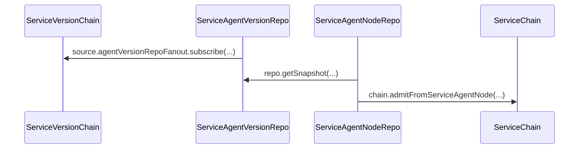

# Agent selected rows and pending wakes

An independent Agent release binds one Aggregate or Service release and serves as its own session definition. System assembly validates its selected models and claims-free ordinary contract grants. A browser session can observe the same selected view. The active Agent Node Repo runs the automation under the Agent’s identity.

## Annotated workflow steps

1. The Agent projection subscribes to evaluated history on the exact bound Service release.
   - [`evaluatedCommandsFanoutSubscriber.ts:54–84`](../../../packages/system-worker/src/serviceAgentProjection/evaluatedCommandsFanoutSubscriber.ts#L54-L84) — resolves `ServiceVersionChains` using the source key and selects its Agent fanout capability.
2. The active Agent Node reads a snapshot from the versioned projection.
   - [`ServiceAgentNodeRepo.ts:99–118`](../../../packages/agent-worker/src/ServiceAgentNodeRepo.ts#L99-L118) — reads the snapshot through the projection Repo binding.
3. The active Node delivers a recorded wake command to the root Chain.
   - [`ServiceAgentNodeRepo.ts:186–208`](../../../packages/agent-worker/src/ServiceAgentNodeRepo.ts#L186-L208) — submits the command with its recorded producer generation and index.

## Worker placement

For a fresh self-hosted System, AgentWorker owns the Agent Node Repos,
versioned Agent projection Repos, and Agent VersionChains and sockets.
An Agent projection consumes evaluated history from the exact owner release.
An Agent Node uses the projection snapshot and the Agent VersionChain’s selected
deltas, then submits wake commands through the matching root Chain.

The CLI provisions AgentWorker’s namespaces before publishing the first owner
releases and stages the executable with their service bindings. Compatible
redeploys reuse the same Agent namespace IDs. System initialization verifies the
active installation for each Agent Node after AgentWorker activation.

- [AgentWorker entrypoint](../../../packages/agent-worker/src/AgentWorker.ts)
- [Deployment placement and namespace checks](../../../packages/cli/src/deploy/utils/prepareAgentWorker.ts)

## Projection and installation

AggregateAgentVersionRepo and ServiceAgentVersionRepo materialize owner history and evaluate the release’s selections, following the Actor projection pattern. Their VersionChains publish ordered selected changes with the corresponding checkpoint. The owner’s evaluated command contains the result of owner execution independently of which Agents are declared.

The Agent declaration uses structured conditions over declared models and fields.
Relation predicates evaluate against the related model’s selected rows.
Compilation checks the dependency graph and rejects cycles and `where.RAW`.

AggregateAgentNodeRepo and ServiceAgentNodeRepo each own a stable, migratable Durable Object. During installation the Node obtains selected resources and their checkpoint from the projection. It loads its selected tables, evaluates each wake rule on its selected rows, and commits the view, pending deadlines and checkpoint together. Subscription catches up from this checkpoint before the Node processes due wakes. Historical changes used to build the projection do not invoke authored wake programs.

## Updating deadlines

Each entry in `wakeRules` names a selection. For each confirmed row in that selection, `wakeAt({ row, db })` returns an absolute millisecond deadline or `null`. Its synchronous queries can read other selected rows. For example, a change to one purchase item can change the deadline for its purchase.

On a nonempty selected delta, the Node computes deadlines against the complete confirmed view before and after applying all changes. It compares them by rule and resource. A changed timestamp schedules the occurrence. A transition to null or removal cancels it. Equal deadlines preserve the pending or consumed state. A later transition from null to the same timestamp schedules a new occurrence. The delta, checkpoint and deadline changes commit together.

## Firing a wake

After catching up, the Node scans due wakes. Inside each wake transaction it deletes the exact pending `(ruleName, resourceId, at)` entry. A successful deletion invokes `onWake.program({ resourceId, at, db, stageCommand })`. The author can read the optimistic selected view even when a preceding staged command has hidden the resource.

`yield* stageCommand(ref, payload)` evaluates the granted contract locally and returns its typed result. Local model changes become visible to the next query or stage. The addressed owner executes the command authoritatively and dispatches its external effects. A refused stage leaves earlier successful stages intact if the author catches the failure. When a failure escapes the program, its stages roll back before `onFailure` starts. An unhandled failure restores the pending wake and rolls back the transaction.

A successful callback commits wake consumption, the original command inputs for optimistic replay and the frozen outbox entries together. Admission acknowledgment removes the delivery. Confirmed selected history removes the optimistic input by command ID, even on an empty delta or owner refusal. Pending inputs replay in producer order against the current confirmed view. These acknowledgments can arrive in either order.

For example, an AggregateAgentNodeRepo installs snapshot 40 with a due wake.
The owner VersionChain then publishes evaluated command 41, which clears the
deadline. The Agent VersionChain can still be at 40. Before checking due
wakes, the Node calls `AggregateAgentVersionRepo.synchronizeSelectedHistory()`
to materialize the owner history and publish the selected delta. On the first
pass, `subscribe(through)` applies that delta and enrolls from the committed
checkpoint. The cancellation removes the pending wake before the Node checks
it. Commands published beyond the captured position can still race with the
wake.

WakeRegistry schedules one physical alarm from pending work. Recording a command, durable admission by the owner Chain and execution by the addressed owner release are separate steps. Commands should validate occurrence identity and eligibility at execution time when stale or repeated invocations matter.

## Initialization and replacement

The Agent registry’s `active` entry selects an exact Agent release. On initialization,
`AggregateAgentNodeRepo` compares the selected `agentVersion` and `aggregateVersion`
with its retained binding. `ServiceAgentNodeRepo` compares `agentVersion` and
`serviceVersion`. A match resumes the same generation, wakes, staged inputs and deliveries. Existing deliveries from before optimistic staging keep their original IDs and producer positions and drain without creating optimistic inputs.
To change behavior, declare and select a new release.

Changing the binding, removing an Agent, or re-adding it starts a fresh generation.
The Agent Node Repo clears retired materialization, pending wakes, producer
position, and outstanding command deliveries without draining. The owner Chain
fences producer generations and retains previously admitted commands.
Initialization failure pauses the installation until explicit dev/deploy retry
or replacement. A retry captures a fresh snapshot.

`validateAgentReleases` resolves each typed command reference against the exact
owner release and checks its name, version and eligibility as a claims-free
ordinary command. It verifies projected reads and exact mutation models against the Agent’s declared view. Local staging uses that same owner contract and model graph.

A fresh installation derives wakes solely from selected state. Business obligations that must survive replacement belong in the owner models. For example, a reminder request records its due time and pending occurrence as part of the requesting command. Cancellation or fulfillment updates that occurrence.

- [Node execution and installation](../../../packages/agent-worker/src/runtime/makeAgentNodeRuntime.ts)
- [Fanout subscription and catchup](../../../packages/system-worker/src/makeFanoutSubscriber/subscribe.ts)
- [Physical alarm scheduling](../../../packages/system-worker/src/makeWakeRegistry/makeWakeRegistry.ts)
