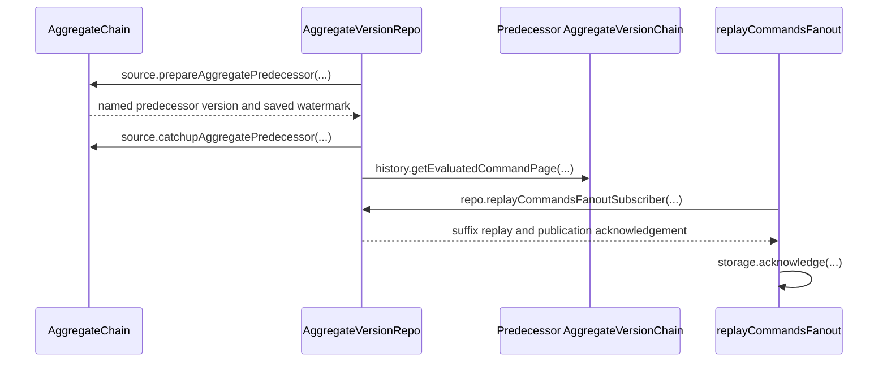
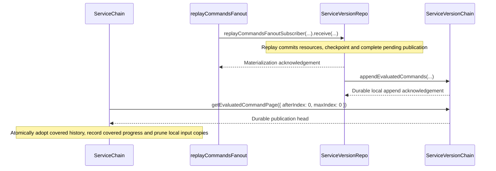

`AggregateChain` and `ServiceChain` retain their local admitted-command suffixes.
Aggregate release enrollment fixes the predecessor prefix and the start of ongoing
replay. Service history adoption follows the configured canonical release.

## Trigger

1. `makeSystem` validates Aggregate predecessors and Service canonical selection.
   - [`validateReleaseRegistries.ts:21-74`](../../../packages/core/src/system/make/makeSystem/validateReleaseRegistries.ts#L21-L74) — requires a registered earlier predecessor for each Aggregate child and a registered canonical release for each Service.
2. `AggregateChain` enrolls newly listed releases when it activates for the deployment.
   - [`onRepoStartup.ts:18-56`](../../../packages/system-worker/src/AggregateChain/onRepoStartup/onRepoStartup.ts#L18-L56) — captures the admitted position and inserts new replay subscribers in one transaction.
3. `ServiceChain` reads the configured canonical release's publication under recovery.
   - [`ServiceChain.ts`](../../../packages/system-worker/src/ServiceChain/ServiceChain.ts) — reads the ServiceVersionChain publication head for the stable System's current selection.

## Aggregate predecessor and replay

## Annotated workflow steps

1. The child asks `AggregateChain` for its saved deployment watermark.
   - [`initializeAggregatePredecessor.ts:38-50`](../../../packages/owner-release-worker/src/AggregateVersionRepo/initializeAggregatePredecessor.ts#L38-L50) — begins initialization with the child's saved point and resumes pending publication before reading more history.
2. `AggregateChain` returns the named predecessor and the admitted position captured at enrollment.
   - [`AggregateChain.ts:638-685`](../../../packages/system-worker/src/AggregateChain/AggregateChain.ts#L638-L685) — resolves the authored predecessor and reads its child's `initializationThroughIndex`.
3. `AggregateChain` wakes original delivery when needed, waits for finalization through the watermark, then brings the named predecessor through that position.
   - [`AggregateChain.ts:689-761`](../../../packages/system-worker/src/AggregateChain/AggregateChain.ts#L689-L761) — bounds original finalization and predecessor catch-up to the stored position.
4. The child reads the named predecessor through that inclusive bound, restores or evaluates the prefix, and publishes its own history.
   - [`initializeAggregatePredecessor.ts:52-96`](../../../packages/owner-release-worker/src/AggregateVersionRepo/initializeAggregatePredecessor.ts#L52-L96) — bounds the page reads, restores branch evaluations, and evaluates rebuild inputs.
5. The source queue opens the receiving capability for commands after the saved watermark.
   - [`makeFanoutQueueStorage.ts:158-180`](../../../packages/system-worker/src/makeFanoutQueue/makeFanoutQueueStorage.ts#L158-L180) — schedules delivery after the greater of the initialization position and the acknowledged position.
6. `AggregateVersionRepo` acknowledges suffix replay after its VersionChain publication completes.
   - [`AggregateVersionRepo.ts:286-319`](../../../packages/owner-release-worker/src/AggregateVersionRepo/AggregateVersionRepo.ts#L286-L319) — drains publication through the last replayed position before returning success.
7. The queue advances the actual replay acknowledgement and `AggregateChain` compacts in the same transaction.
   - [`compactAggregateHistory.ts:8-53`](../../../packages/system-worker/src/AggregateChain/compactAggregateHistory.ts#L8-L53) — bounds deletion by finalization, the releases owed each command, and actual publication coverage.

## Service canonical history adoption

## Annotated workflow steps

1. The source queue acquires the pinned ServiceVersionRepo's source-bound capability and delivers the admitted commands.
   - [`makeFanoutQueue.ts:307-319`](../../../packages/system-worker/src/makeFanoutQueue/makeFanoutQueue.ts#L307-L319) — acquires the Repo, calls its subscriber accessor and decodes the receive acknowledgement.
2. Each ServiceVersionRepo acknowledges its materialization and delivers complete pending publication to its ServiceVersionChain.
   - [`ServiceVersionRepo.ts`](../../../packages/owner-release-worker/src/ServiceVersionRepo/ServiceVersionRepo.ts) — provides the materialization cursor and independently drains the publication outbox to the matching ServiceVersionChain.
3. ServiceVersionChain acknowledges its durable local append before asynchronous Archive delivery completes.
   - [`ServiceVersionChain.ts:544-611`](../../../packages/system-worker/src/ServiceVersionChain/ServiceVersionChain.ts#L544-L611) — validates old publications, commits the new suffix and wakes Archive/projection delivery.
4. ServiceChain reads the actual publication head for the canonical release selected in the stable System configuration.
   - [`ServiceChain.ts`](../../../packages/system-worker/src/ServiceChain/ServiceChain.ts) — polls the selected ServiceVersionChain until publication covers the finalized position.
   - [`ServiceVersionChain.ts:495-506`](../../../packages/system-worker/src/ServiceVersionChain/ServiceVersionChain.ts#L495-L506) — reads the published head without fetching rows when the caller requests a zero-length page.
5. ServiceChain records the selected release, published boundary and covered acknowledgement together with pruning in a synchronous transaction.
   - [`adoptCanonicalServiceHistory.ts`](../../../packages/system-worker/src/ServiceChain/adoptCanonicalServiceHistory.ts) — keeps the previous adopted prefix until the candidate covers it, clamps adoption to finalized progress and deletes covered local rows.

## Publication proof and configuration changes

`AggregateChain` reads compacted admitted inputs from a retained
`AggregateVersionChain` with an actual replay acknowledgement that covers the
requested position. The read preserves the admitted input and `finalizedAt`.
Each evaluating release owns its own outcome. Direct execution asks its
addressed `AggregateVersionRepo` for the result. The named predecessor provides
initialization history through the deployment watermark.

- [`readAggregateCommand.ts:24-55`](../../../packages/system-worker/src/AggregateChain/readAggregateCommand.ts#L24-L55) — resolves a compacted position through a VersionChain with durable acknowledgement coverage and reads newer positions locally.
- [`executeDirectSystemAggregateCommand.ts:37-50`](../../../packages/system-worker/src/executeDirectSystemAggregateCommand/executeDirectSystemAggregateCommand.ts#L37-L50) — awaits the addressed AggregateVersionRepo's evaluated result.

`ServiceChain` retains the previously adopted canonical prefix while a newly
selected canonical release publishes through the old boundary. The complete
Service publication can be read after the local append and before Archive
relocation.

- [`adoptCanonicalServiceHistory.ts:16-43`](../../../packages/system-worker/src/ServiceChain/adoptCanonicalServiceHistory.ts#L16-L43) — refuses a lower replacement boundary and stores the adopted release and position.
- [`readServiceCommand.ts:14-61`](../../../packages/system-worker/src/ServiceChain/readServiceCommand.ts#L14-L61) — reads the adopted prefix through its saved release and the newer suffix locally.
- [`executeDirectServiceCommand.ts:34-46`](../../../packages/system-worker/src/executeDirectServiceCommand/executeDirectServiceCommand.ts#L34-L46) — returns the addressed ServiceVersionRepo's evaluated outcome.

## Admission capacity and browser retries

A genuinely new admission must fit the 64-command local suffix inside its
admission transaction. Capacity refusal is retryable; it advances neither command
nor producer progress. Covered producer retries remain acknowledgements at capacity.
Browser AggregateNodeSynchronization and ServiceNodeSynchronization map this
capacity signal to `node-admission-uncertain`, preserving their journal and retry
path rather than treating capacity as rejected command authority. Existing Node
wire messages carry the signal unchanged. Aggregate authorization preserves this
capacity failure only when it came from the actual delegated direct command;
authored authorization refusals retain their normal classification.

- [`appendAggregateCommand.ts:16-30`](../../../packages/system-worker/src/AggregateChain/admitAggregateCommands/appendAggregateCommand.ts#L16-L30) — checks new Aggregate suffix capacity before advancing admission position.
- [`appendServiceCommand.ts:16-30`](../../../packages/system-worker/src/ServiceChain/admitServiceCommands/appendServiceCommand.ts#L16-L30) — refuses new Service commands at the unadopted-suffix bound.
- [`isNodeAdmissionBackpressure.ts:3-12`](../../../packages/browser/src/Node/isNodeAdmissionBackpressure.ts#L3-L12) — recognizes only the two admission-capacity codes with explicit retryable metadata.
- [`AggregateNodeSynchronization.ts:545-556`](../../../packages/browser/src/AggregateNode/AggregateNodeSynchronization.ts#L545-L556) — routes capacity failure through existing uncertain-admission recovery.
- [`ServiceNodeSynchronization.ts:444-453`](../../../packages/browser/src/ServiceNode/ServiceNodeSynchronization.ts#L444-L453) — preserves the equivalent Service Node retry path.

- [`authorizeAggregateSession.ts:167-210`](../../../packages/owner-release-worker/src/AggregateVersionRepo/authorizeAggregateSession/authorizeAggregateSession.ts#L167-L210) — records actual delegated admission-capacity failures and preserves only those failure identities through authorization classification.

## Retry responsibility after local input deletion

Recorded System delivery uses separate AggregateChain and ServiceChain producer
identities plus ordered `(sourceIndex, operationIndex)` checkpoints. Duplicate
positions acknowledge the retained producer position before fresh command checks.
Agent Node Repos allocate a durable dense `producerIndex` with each frozen command;
its counter survives an empty outbox and selected release changes. The receiving
Chain advances that Agent checkpoint with command admission. Direct System calls
allocate a fresh command identity; they do not provide arbitrary lifetime ID lookup.

- [`admitRecordedServiceCommandTx.ts:82-130`](../../../packages/system-worker/src/ServiceChain/admitRecordedServiceCommandTx.ts#L82-L130) — admits fresh Aggregate source positions and stores their checkpoint atomically.
- [`admitRecordedAggregateCommandTx.ts:64-108`](../../../packages/system-worker/src/AggregateChain/admitRecordedAggregateCommandTx.ts#L64-L108) — acknowledges covered Aggregate source positions before admission and advances progress with fresh input.
- [`allocateAgentProducerIndex.ts:6-21`](../../../packages/agent-worker/src/runtime/allocateAgentProducerIndex.ts#L6-L21) — increments the durable producer counter without deriving it from pending rows.
- [`admitServiceAgentCommandTx.ts:68-92`](../../../packages/system-worker/src/ServiceChain/admitServiceAgentCommandTx.ts#L68-L92) — checks dense Agent progress and commits it with fresh admission.
- [`admitAggregateAgentCommandTx.ts:41-70`](../../../packages/system-worker/src/AggregateChain/admitAggregateAgentCommandTx.ts#L41-L70) — commits Agent admission and its producer checkpoint together.

An external request's first observation is retained on its existing pending row
before completion admission. If admission is backpressured, retry uses the stored
observation without reinvoking request code. Successful admission deletes that row
atomically with the external command append. A late callback finds no pending
row and cannot reconstruct or overwrite settled work.

- [`recordExternalOutcomeAndAdmitCommandTx.ts:21-95`](../../../packages/system-worker/src/ServiceChain/recordExternalOutcomeAndAdmitCommandTx.ts#L21-L95) — retains first observation separately, then appends from retained pending authority and deletes it transactionally.
- [`recordExternalOutcomeAndAdmitCommandTx.ts:21-109`](../../../packages/system-worker/src/AggregateChain/recordExternalOutcomeAndAdmitCommandTx.ts#L21-L109) — preserves the first Aggregate observation across append failure and treats missing pending work as settled.

No storage reset or deployed cutover follows from these source changes. Fixed-schema
rollout requires separately authorized empty affected storage, including
SystemRepo's `acceptedSystemSpecs`. Its complete stored `spec` JSON is decoded by
SystemSpecSchema. Aggregate entries use `releases` and Service entries retain
their canonical selector. Previously accepted Aggregate specs with `canonical`
are incompatible. Acceptance still compares and retains whole SystemSpecs, without a
legacy decoder or metadata translation.

- [`systemRepoDbConfig.ts:10-17`](../../../packages/system-worker/src/SystemRepo/systemRepoDbConfig.ts#L10-L17) — stores complete accepted snapshot JSON using SystemSpecSchema as its row codec.

Implementation and
verification status remain in [Plan 277](../../archive/plans/277-plan-canonical-chain-history-handoff.md).
