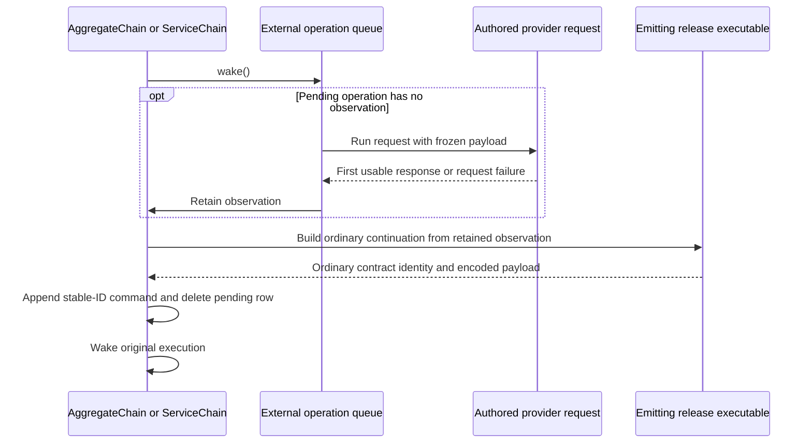

# Delivery and recovery

Admission Chains retain original outcomes and pending outgoing work; VersionChains and selected Chains retain immutable history. A pending-delivery acknowledgement deletes that delivery row. A retained-history acknowledgement advances the subscriber cursor and preserves history. Resource owners retain checkpoints and complete pending delivery, without a second retained command journal.

## Trigger

1. AggregateChain or ServiceChain commits the first original outcome and frozen outgoing work, then wakes the appropriate delivery/recovery queues.
   - [`recordOriginalCommandOutcomeTx.ts:49-143`](../../../packages/system-worker/src/AggregateChain/recordOriginalCommandOutcomeTx.ts#L49-L143) — compares original input/outcome, requires finalized predecessor order and atomically retains complete command/external delivery.
   - [`recordOriginalCommandOutcomeTx.ts:49-140`](../../../packages/system-worker/src/ServiceChain/recordOriginalCommandOutcomeTx.ts#L49-L140) — owns the separate Service original-outcome/pending-work transaction.



## Annotated workflow steps

1. Arm recovery and reserve pending external command IDs through their background requests and settlement.
   - [External operation queue](../../../packages/system-worker/src/externalOperations/makeExternalOperationQueue.ts)
2. The Chain resolves the emitting release's request declaration and runs the request with its existing runtime bindings. Its response codec and timeout determine whether the observation contains a usable response or request failure.
   - [Owner operation routing](../../../packages/system-worker/src/ownerOperations/runOwnerOperation.ts) · [External request](../../../packages/system-worker/src/externalOperations/runExternalOperation.ts)
3. The Chain retains the first observation before calling the emitting release's branch builder. The builder selects an ordinary continuation contract and encodes its authored payload. A failed builder or invalid encoded payload also records the selected contract and failure on pending work. Recovery reuses the retained observation and any recorded mapper failure.
   - [External continuation builder](../../../packages/core/src/contracts/externalExecution/buildExternalContinuation.ts)
4. The Chain appends the ordinary command under the original owner release and stable ID and deletes pending work in the same transaction. The Chain treats a missing pending row as settled.
   - [Aggregate settlement](../../../packages/system-worker/src/AggregateChain/recordExternalOutcomeAndAdmitCommandTx.ts) · [Service settlement](../../../packages/system-worker/src/ServiceChain/recordExternalOutcomeAndAdmitCommandTx.ts)
5. Original delivery runs the command's guard and program in the addressed VersionRepo. Replay uses the receiving release's ordinary contract rules for encoded payloads. A SQL NULL payload finalizes with the recorded mapper failure and zero operations. Original execution and replay advance the materialization and publication positions without resolving the contract or running its adapter, guard, or program.
   - [Aggregate invocation resolution](../../../packages/system-worker/src/AggregateVersionRepo/utils/resolveAggregateExecution.ts) · [Service invocation resolution](../../../packages/owner-release-worker/src/ServiceVersionRepo/utils/resolveServiceExecution.ts)

## Frozen work, observations and uncertainty

Only original execution freezes outgoing IDs and exact portable input. Parallel replay drops command/external descriptions before preparation or ID allocation; retained-output restoration republishes the identical complete evaluated command while applying model members only. VersionChain history retains sparse authored `operationIndex` and the complete parent command. Neither replay, history reads nor projection starts external requests.

- [`prepareAggregateOutput.ts:25-58`](../../../packages/system-worker/src/AggregateVersionRepo/utils/prepareAggregateOutput.ts#L25-L58) — filters outgoing descriptions during fresh replay and prepares frozen original output.
- [`prepareServiceOutput.ts:25-54`](../../../packages/owner-release-worker/src/ServiceVersionRepo/utils/prepareServiceOutput.ts#L25-L54) — preserves sparse model indexes while omitting replay command/external preparation.

An external pending row stores six invocation fields: unique `externalCommandId`, exact `externalContractName`/`externalContractVersion`, frozen JSON `payload`, immediate `originCommandId` and original `aggregateVersion` or `serviceVersion`. Settlement adds the first observation and any mapper failure to the same row before admission. The row copies no Actor/Agent authority, claims, Node coordinates, initiating index or authored operation position. The parent evaluated command supplies repeated context at first original-outcome retention. An equal retained `outcome`, including `finalizedAt`, returns before pending insertion and cannot recreate settled work. Complete evaluated-output equality belongs to VersionChain history.

- [`aggregateChainDbConfig.ts:67-80`](../../../packages/system-worker/src/AggregateChain/aggregateChainDbConfig.ts#L67-L80) — defines the frozen Aggregate pending request row.
- [`serviceChainDbConfig.ts:64-77`](../../../packages/system-worker/src/ServiceChain/serviceChainDbConfig.ts#L64-L77) — defines the independent Service pending request row.

The admitted continuation has `kind: 'system'`, its frozen child ID and the
chosen ordinary contract's name and version. Its payload is the authored
encoded input or SQL NULL when payload construction failed. The pending row's lineage and
provider observation support settlement. The ordinary command owns its own
`outcome`, and its payload can evolve through ordinary version adapters.

Authors own retry classification, attempt bounds/delays and provider idempotency inside `request`. Its timeout covers the whole authored Effect and finalizers settle before recording. Request failure, invalid response or timeout produces a terminal external Failure; declaration-resolution, malformed frozen payload and storage failure preserve infrastructure retry responsibility. Response and pending-row codecs run synchronously without application services; suspension is rejected. Process loss before observation commit can repeat a remote effect, including when no usable response was obtained. Historical implementations must remain available while pending work needs them. A reservation prevents overlap for one ID in the current instance through request finalizers, recording and recovery reconciliation; it is not an exactly-once provider guarantee.

- [`makeExternalOperationQueue.ts:95-121`](../../../packages/system-worker/src/externalOperations/makeExternalOperationQueue.ts#L95-L121) — reconciles pending recovery after requests and settlement.
- [`syncCodec.ts:6-44`](../../../packages/shapes/src/utils/syncCodec.ts#L6-L44) — interrupts suspended codecs and preserves their synchronous failure meaning; asynchronous cleanup can outlive the call.

## Ordinary command delivery

Recorded command operations freeze ordinary System commands after successful
original execution. The destination Chain deduplicates uncertain delivery by
command ID. The source Chain stores the destination's first finalized execution
`outcome` on its `commandOperationOutbox` row before asking the pinned emitting
release to build the selected ordinary continuation. Recovery uses that outcome
without repeating destination delivery. A mapper failure stays on the pending
row before admission of the SQL NULL payload child. The source Chain commits
continuation admission and row deletion in one transaction. An omitted branch
consumes the row without a child. Authors choose the business facts to retain in
the continuation payload.

An explicit terminal admission refusal produces a structured error log with the
source operation position, destination command identity and refusal code before
the source Chain consumes the row. Transport errors, lost replies and admission
capacity leave the row retryable.

- [Command delivery queue](../../../packages/system-worker/src/commandOperations/makeCommandDeliveryQueue.ts)
- [Command continuation builder](../../../packages/core/src/contracts/buildCommandContinuation.ts)

Original command preparation requires the destination release's exact claims-free ordinary `system` grant before allocating and freezing destination input. A claims-free Actor or Agent grant alone does not authorize this path.

- [`prepareCommandOperation.ts:27-40`](../../../packages/core/src/contracts/prepareCommandOperation.ts#L27-L40) — requires the exact registered owner definition and System-granted ordinary contract before preparation.

## Fanout catch-up and enrollment

`makeFanoutQueue` binds one typed owner `readPage`, structured subscriber identity columns, acknowledgement column, key conversions, exact owner key and required runtime/invocation/RPC-encoding policies. It does not discover history, merge journals or maintain a second payload copy. Queue RPCs validate safe nonnegative cursors before acquiring history or recovery; enrollment also validates the full source-qualified identity and rejects progress beyond the retained tip. Domain validation stays with the receiver. Zero denotes no acknowledged occurrence; the reported page tip is not an acknowledgement.

- [`makeFanoutQueue.ts:123-209`](../../../packages/system-worker/src/makeFanoutQueue/makeFanoutQueue.ts#L123-L209) — declares explicit source/history/subscriber bindings and injected execution policies.
- [`makeFanoutQueue.ts:399-476`](../../../packages/system-worker/src/makeFanoutQueue/makeFanoutQueue.ts#L399-L476) — decodes page/enrollment boundaries before source reads and retained membership changes.

Subscriber `catchup(index?)` fixes its inclusive boundary from the explicit index or first observed source tip, applies complete pages through the normal receiver and rereads durable progress. Later production cannot extend the pass. Subscriber `subscribe(index?)` completes catch-up, rereads committed progress and then invokes source enrollment. Source `queue.subscribe` atomically inserts/advances membership and schedules delivery; it returns after enrollment without waiting for recipients. Retained history covers commands appended between catch-up and enrollment. Failed catch-up never enrolls. Reconstruction resumes committed progress. VersionRepo activation uses `.catchup()` and keeps source-authored release enrollment; selected projections `.subscribe()` before readiness. Actor projections first drain existing pending publication through their captured materialization head so a full 64-position outbox cannot block its own catch-up recovery. No execution permit or SQL transaction spans remote delivery, catch-up or enrollment.

- [`runFanoutCatchup.ts:34-96`](../../../packages/system-worker/src/makeFanoutSubscriber/runFanoutCatchup.ts#L34-L96) — fixes the boundary, rereads committed cursor after in-flight requests and fails absent/nonadvancing history.
- [`subscribe.ts:32-57`](../../../packages/system-worker/src/makeFanoutSubscriber/subscribe.ts#L32-L57) — enrolls only after successful catch-up and disposes the source capability.

Enrollment **cannot** wait for the drain semaphore: a drain can await a cold receiver's subscriber accessor while that receiver's activation is subscribing back to the same source. The cycle is explicit below; enrollment's local upsert must remain independent of delivery serialization.

```mermaid
sequenceDiagram
  participant makeFanoutQueue
  participant AggregateActorVersionRepo
  participant makeFanoutSubscriber
  makeFanoutQueue->>AggregateActorVersionRepo: repo.actorVersionChainFanoutSubscriber(...)
  AggregateActorVersionRepo->>makeFanoutSubscriber: subscriber.subscribe()
  makeFanoutSubscriber->>makeFanoutQueue: queue.getPage(...)
  makeFanoutQueue-->>makeFanoutSubscriber: retained suffix through captured tip
  makeFanoutSubscriber->>makeFanoutQueue: queue.subscribe(...)
  makeFanoutQueue-->>makeFanoutSubscriber: durable enrollment; drain scheduled
  makeFanoutSubscriber-->>AggregateActorVersionRepo: activation subscription complete
  AggregateActorVersionRepo-->>makeFanoutQueue: source-bound subscriber capability
```

## Annotated workflow steps

1. A serialized drain acquires the exact receiving accessor; the cold receiver must finish activation before replying.
   - [`makeFanoutQueue.ts:291-312`](../../../packages/system-worker/src/makeFanoutQueue/makeFanoutQueue.ts#L291-L312) — resolves the exact Repo, acquires the accessor and waits for receiver commitment before advancing acknowledgement.
2. Actor projection activation drains its captured existing pending publication, then awaits subscriber catch-up/enrollment.
   - [`AggregateActorVersionRepo.ts:71-95`](../../../packages/system-worker/src/AggregateActorVersionRepo/AggregateActorVersionRepo.ts#L71-L95) — completes pending Aggregate delivery before starting source subscription.
3. Catch-up requests retained history without owning a source drain permit.
   - [`runFanoutCatchup.ts:44-57`](../../../packages/system-worker/src/makeFanoutSubscriber/runFanoutCatchup.ts#L44-L57) — issues bounded `getPage` from the durable local cursor.
4. The page carries complete rows and whole retained tip; the first tip fixes catch-up's boundary.
   - [`runFanoutCatchup.ts:58-77`](../../../packages/system-worker/src/makeFanoutSubscriber/runFanoutCatchup.ts#L58-L77) — validates the tip and requires history if the current cursor has not reached that boundary.
5. After catch-up commits, enroll its reread durable cursor.
   - [`subscribe.ts:38-55`](../../../packages/system-worker/src/makeFanoutSubscriber/subscribe.ts#L38-L55) — reads the committed cursor and calls source `subscribe` with exact key fields.
6. Source enrollment holds a producer lease around source-tip validation/local upsert and explicitly wakes on every exit, without taking the delivery semaphore.
   - [`makeFanoutQueue.ts:442-493`](../../../packages/system-worker/src/makeFanoutQueue/makeFanoutQueue.ts#L442-L493) — performs independent membership insertion and schedules the retained gap after enrollment.
7. Successful subscription lets receiver activation finish.
   - [`makeFanoutSubscriber.ts:185-210`](../../../packages/system-worker/src/makeFanoutSubscriber/makeFanoutSubscriber.ts#L185-L210) — awaits `subscribeFanout` through its RPC encoder.
8. The original drain may now obtain the capability and deliver its immutable page, even if catch-up already committed it.
   - [`makeFanoutQueue.ts:295-312`](../../../packages/system-worker/src/makeFanoutQueue/makeFanoutQueue.ts#L295-L312) — waits for the capability and advances source acknowledgement only after successful receipt.

## Independent failures and durable recovery

A drain captures one finite source tip; every subscriber receives its own immutable suffix through that boundary. SQL excludes in-flight/failed structured identities before the bounded concurrency limit. One recipient's typed failure or defect leaves its source cursor unchanged and does not cancel healthy recipients; it is excluded only for that drain. Missing history fails the attempt and retains recovery. Monotonic acknowledgement/enrollment cannot rewind a newer committed cursor. A receiver commit followed by reply loss may redeliver identical history; resource owners recognize committed positions. No persisted suspension/manual resume state is needed.

- [`runFanoutDeliveries.ts:24-63`](../../../packages/system-worker/src/makeFanoutQueue/runFanoutDeliveries.ts#L24-L63) — fixes one boundary, tracks independent recipients and combines Causes after each completes.
- [`makeFanoutQueueStorage.ts:151-211`](../../../packages/system-worker/src/makeFanoutQueue/makeFanoutQueueStorage.ts#L151-L211) — performs monotonic acknowledgement/enrollment and bounded structured identity selection.

`producerLease` arms durable recovery before output/membership can commit. Lease cleanup updates producer count/revision only; the producer explicitly runs `wake()` on every exit, preserving its result or Cause. A drain releases recovery only after recoverable work settles with no active producer and unchanged revision. This prevents an older empty pass clearing a newly produced suffix's alarm. `wake()` schedules queue-owned background work; `drain()` awaits an owned bounded attempt. Interrupting that await does not cancel queue-owned delivery; alarm dispatch directly awaits registered drains. Construction registers lazy Effects without I/O. Each concrete Repo invokes the shared runtime/invocation policy once; factories create neither application config nor a replacement runtime.

- [`makeFanoutQueue.ts:321-397`](../../../packages/system-worker/src/makeFanoutQueue/makeFanoutQueue.ts#L321-L397) — protects producer revisions and durable alarms, registers the internal drain and exposes independently owned wake/drain execution.

RecoveryRegistry keeps in-memory names requiring recovery and one durable one-second wake-up. Every hold rereads/rearms the alarm and preserves an earlier one. Releasing one queue cannot remove another queue's hold. Each alarm runs every registered procedure against durable state after reconstruction, captures independent exits and combines failures. Pending external work uses the same registry but schedules requests independently. Original delivery retains recovery through outcome/pending retention and completion hooks, including empty drains after a commit-before-hook interruption. Agent business deadlines use [WakeRegistry](./AgentExecution.md#rebinding-removal-and-recovery) instead.

- [`makeRecoveryRegistry.ts:26-81`](../../../packages/system-worker/src/makeRecoveryRegistry/makeRecoveryRegistry.ts#L26-L81) — reconciles one durable alarm and settles all registered operations independently.
- [`makeOutboxQueue.ts:330-342`](../../../packages/system-worker/src/makeOutboxQueue/makeOutboxQueue.ts#L330-L342) — invokes completion recovery even if the original queue is already empty.

## Historical evidence

[Plan 213](../../archive/plans/213-plan-aggregate-external-operation-outbox.md), [219](../../archive/plans/219-plan-service-external-operation-outbox.md) and [196](../../archive/plans/196-plan-service-chain-original-operations-and-external-work.md) retain dated request/settlement/continuation evidence. [Plans 215](../../archive/plans/215-plan-service-commands-backed-actor-fanout.md) and [216](../../archive/plans/216-plan-service-actor-subscriber-identity.md) retain real queue/projection, fixed-tip, enrollment-gap, independent-recipient and lost-reply reconstruction evidence. Exact earlier counts and fixture boundaries remain in the [pre-consolidation external report](https://github.com/morgs32/zerospin/blob/79c1824b1a0353f770211851c0bfe1cc54d0ba46/packages/system-worker/src/externalOperations/README.md) and [fanout report](https://github.com/morgs32/zerospin/blob/79c1824b1a0353f770211851c0bfe1cc54d0ba46/packages/system-worker/src/makeFanoutQueue/README.md#verified-service-fanout-seam). Fixture providers, trusted source paths and explicit activation/native-alarm controls do not prove provider networking, authenticated browser behavior, production redeployment acceptance or deployed timing. This migration executes none of those runtime scenarios.

## Actor Archive delivery

Actor Chains have one logical Archive subscriber across every physical range.
Their source-owned directory routes rollover; allocating a successor does not
advance archival acknowledgement. The queue's existing synchronous acknowledgement
callback advances its cursor and removes covered local resolution children and
public parents in the same transaction. The Node protocol and private completion
retention are independent of that physical relocation.

- [`AggregateActorHistory.ts:269-329`](../../../packages/system-worker/src/AggregateActorVersionChain/AggregateActorHistory.ts#L269-L329) — routes complete Aggregate publication pages across physical ranges and records successors after definite capacity failure.
- [`ServiceActorHistory.ts:225-287`](../../../packages/system-worker/src/ServiceActorVersionChain/ServiceActorHistory.ts#L225-L287) — finishes every offered Service publication portion before fanout acknowledgement.

The earlier AAVC/SAVC publication reply to AAVR/SAVR proves logical position coverage. It
does not compare retry bytes against an old Archive: the bound producer's durable
outbox owns publication immutability. Covered retries can settle without that
Archive, while physical Archive append still verifies complete public/private
equality. Both the Actor Repo's pending outbox and the Actor Chain's unarchived
suffix have independent 64-position bounds, so a blocked Archive cannot move an
unbounded pending publication backlog into the resource owner.

Actor receive orchestration recovers its specific pending-capacity refusal by
draining prior committed output through a captured materialization head and
retrying that same page once. The SQL refusal remains mutation-free. Draining
failure preserves the original capacity refusal; a second refusal is left to
ordinary source recovery. This also prevents healthy multi-page constructor
catch-up from failing just because the first page's background publisher has not
finished yet. Successful first-attempt pages do not await their own publication.

- [`AggregateActorHistory.ts:547-622`](../../../packages/system-worker/src/AggregateActorVersionChain/AggregateActorHistory.ts#L547-L622) — derives publication coverage from the current local head and inserts only the new suffix.
- [`ServiceActorHistory.ts:399-437`](../../../packages/system-worker/src/ServiceActorVersionChain/ServiceActorHistory.ts#L399-L437) — preserves the same Service publication coverage contract.
