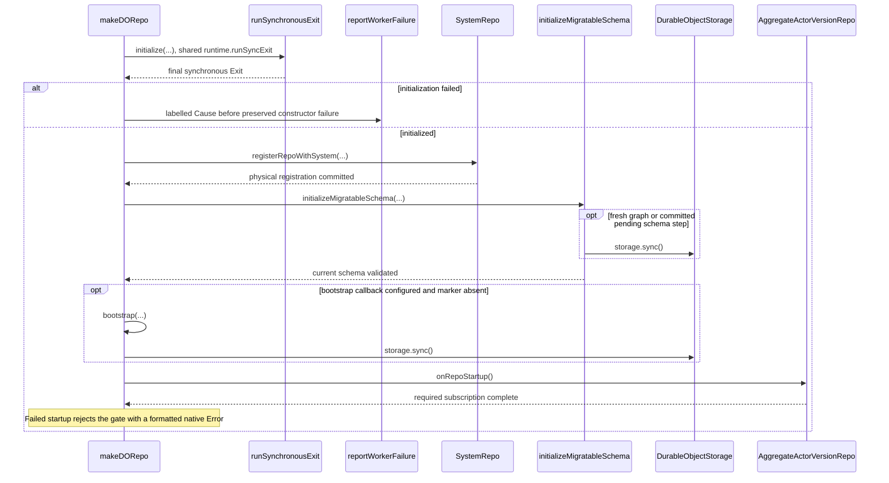

# Repo construction, activation and storage lifecycle

`makeMigratableDORepo` uses `makeDORepo`, which binds an explicit Durable Object base class, physical name/key, namespace, database declaration, shared managed runtime and required invocation/RPC-encoding policies. It owns registration, schema initialization, optional bootstrap and activation order. Concrete Repos own subscriptions and alarm registries; construction alone grants no authorization or resource readiness.

`AggregateAgentNodeRepo` and `ServiceAgentNodeRepo` open their operational tables using `makeMigratableDORepo`. Activation validates the stored model table definitions alongside those tables. The Agent installation transaction replaces its model tables and pending work. [Schema activation](../../../packages/system-worker/src/makeMigratableDORepo/initializeMigratableSchema.ts) · [Table replacement](../../../packages/system-worker/src/agentNodeRepo/agentMaterializedTables.ts)

## Trigger

1. A Repo lookup computes the physical name and returns a namespace stub. Addressing that stub causes receiver construction; lookup itself does not initialize storage or authenticate the caller.
   - [`makeDORepo.ts:217-230`](../../../packages/system-worker/src/makeDORepo/makeDORepo.ts#L217-L230) — static `getRepo` derives the exact name and calls the selected namespace's `getByName` lazily.

## Annotated workflow steps

1. Resolve physical identity and the owner database through the existing synchronous completion policy.
   - [`makeDORepo.ts:246-249`](../../../packages/system-worker/src/makeDORepo/makeDORepo.ts#L246-L249) — invokes `runSynchronousExit` using the supplied managed runtime's `runSyncExit`.
2. Obtain the final synchronous Exit, including independent cleanup failures after a suspension.
   - [`runSynchronousExit.ts:18-75`](../../../packages/shapes/src/runSynchronousExit.ts#L18-L75) — flushes synchronous continuations, interrupts suspensions and combines retained cleanup reasons.
3. For failed initialization, report the final Cause before preserving the constructor failure; reporting never opens the startup gate or replaces the error.
   - [`makeDORepo.ts:250-256`](../../../packages/system-worker/src/makeDORepo/makeDORepo.ts#L250-L256) — reports the failed Exit with its namespace label, then uses `Effect.runSync(exit)` for the original throw/value behavior.
   - [`reportWorkerFailure.ts:4-16`](../../../packages/system-worker/src/reportWorkerFailure/reportWorkerFailure.ts#L4-L16) — skips pure interruption, formats one labelled string and contains diagnostic failures.

4. After synchronous identity/database binding and derived field initialization, require the child's complete compiled SystemSpec hash before touching child SQL.
   - [`makeDORepo.ts:264-280`](../../../packages/system-worker/src/makeDORepo/makeDORepo.ts#L264-L280) — defers gated startup until derived fields exist, then registers the child first.
5. Commit physical Repo metadata only when that whole SystemSpec was accepted earlier.
   - [`registerRepo.ts:33-51`](../../../packages/system-worker/src/SystemRepo/registerRepo/registerRepo.ts#L33-L51) — reads permanent accepted-hash membership before the physical metadata transaction.
6. Enable foreign keys, validate retained migration history and provision or validate the current schema.
   - [`makeDORepo.ts:283-287`](../../../packages/system-worker/src/makeDORepo/makeDORepo.ts#L283-L287) — reads bootstrap state and enters schema initialization before bootstrap or owner activation.
7. Confirm fresh provisioning and each committed schema step before fallible later construction work.
   - [`initializeMigratableSchema.ts:34-44`](../../../packages/system-worker/src/makeMigratableDORepo/initializeMigratableSchema.ts#L34-L44) — maps `storage.sync()` failure to a durability error.
   - [`initializeMigratableSchema.ts:89-108`](../../../packages/system-worker/src/makeMigratableDORepo/initializeMigratableSchema.ts#L89-L108) — confirms fresh graph provisioning or each pending migration before continuing.
8. Return only after the current physical graph/history has been validated.
   - [`initializeMigratableSchema.ts:102-108`](../../../packages/system-worker/src/makeMigratableDORepo/initializeMigratableSchema.ts#L102-L108) — validates the ledger prefix and current graph without silently repairing mismatches.
9. If configured and not already successful, run bootstrap and retain `_isBootstrapped` only after callback success.
   - [`makeDORepo.ts:289-291`](../../../packages/system-worker/src/makeDORepo/makeDORepo.ts#L289-L291) — invokes the nullable bootstrap and then writes its marker.
10. Confirm bootstrap writes before entering fallible owner activation.
    - [`makeDORepo.ts:292-304`](../../../packages/system-worker/src/makeDORepo/makeDORepo.ts#L292-L304) — awaits durability, then the concrete `onRepoStartup` Effect.

11. Await the concrete Repo's required local catch-up/subscription before opening the constructor concurrency gate.
    - [`AggregateActorVersionRepo.ts:65-74`](../../../packages/system-worker/src/AggregateActorVersionRepo/AggregateActorVersionRepo.ts#L65-L74) — awaits its source subscription, independently scheduling pending publication.

12. Complete startup through the same supplied runtime/invocation policy; reject the native activation gate with a formatted `Error` if startup fails.
    - [`makeDORepo.ts:306-323`](../../../packages/system-worker/src/makeDORepo/makeDORepo.ts#L306-L323) — captures the complete startup Exit and formats a failed Cause as a native `Error` before rejecting `blockConcurrencyWhile`. Internal typed failures and resolved RPC envelopes are unchanged.

Synchronous identity/database construction remains available before derived fields initialize. The same internal reporter handles escaping failures from asynchronous invocation and RPC execution; it does not require optional OTLP export or turn resolved business `Failure` results into crash logs. No request or payload snapshot is added. Each reporting seam may observe a propagated failure; no process-wide exactly-once logging guarantee is made.

- [`makeDORepo.ts:256-261`](../../../packages/system-worker/src/makeDORepo/makeDORepo.ts#L256-L261) — assigns the successful synchronous result before scheduling gated startup.
- [`runWorkerInvocation.ts:26-43`](../../../packages/system-worker/src/runWorkerInvocation/runWorkerInvocation.ts#L26-L43) — observes the provided invocation's escaping Cause inside its existing mask, retaining cleanup defects before pending interruption resumes.
- [`runWorkerInvocation.ts:54-69`](../../../packages/system-worker/src/runWorkerInvocation/runWorkerInvocation.ts#L54-L69) — reports failures escaping the internal RPC encoder inside its existing mask; resolved encoded refusals remain quiet.

## Identity, composition and accepted SystemSpecs

Production classes supply `repoType` and `system` together. The factory derives each child's actual complete compiled SystemSpec; SystemRepo exempts itself so initial acceptance can occur. Standalone compositions omit the pair, supply their own namespace declaration and still provide runtime/invocation/encoding policies. The generic factory imports no application config or replacement runtime. Database/name config stays independent of executable deployment configuration. Optional abbreviations default to null; a nonnull prefix changes physical identity and must be understood as addressing another Durable Object.

- [`makeDORepo.ts:108-133`](../../../packages/system-worker/src/makeDORepo/makeDORepo.ts#L108-L133) — types the paired System registration options and standalone omission.
- [`makeMigratableDORepoConfig.ts:60-90`](../../../packages/system-worker/src/makeMigratableDORepo/makeMigratableDORepoConfig.ts#L60-L90) — normalizes optional bootstrap/abbreviation and constructs exact physical-name parsing.

The **whole SystemSpec is accepted or rejected**. `registerSystemSpec` validates portable candidate content and recomputes its hash; its candidate may come from a different executing Cloudflare Worker version. One synchronous transaction compares immutable version facts against all retained snapshots and inserts the entire successful `{ hash, spec }`. Equal acceptance writes nothing; conflict retains no partial facts. Omitted versions remain protected by older permanent snapshots. Registration and ticket issuance check membership, not structural acceptance. Executable callbacks, codec transforms and SQL schemas are outside that metadata hash. See [SystemApi](../SystemApi.md#whole-systemspec-acceptance-and-hash-gates) and [AuthoredSystem](../AuthoredSystem.md#accepted-systemspec-hash-gates).

- [`registerSystemSpec.ts:17-43`](../../../packages/system-worker/src/SystemRepo/registerSystemSpec/registerSystemSpec.ts#L17-L43) — strictly decodes the supplied candidate and verifies content/hash correspondence.
- [`registerSystemSpecTx.ts:71-122`](../../../packages/system-worker/src/SystemRepo/registerSystemSpec/registerSystemSpecTx.ts#L71-L122) — compares all retained immutable facts before inserting one whole snapshot.

Physical registration can survive later schema/bootstrap/activation failure and is not proof of readiness. AggregateChain separately registers its Aggregate name/ID during owner activation, before recovery wakes. A failed membership insert leaves physical metadata and initialized storage; the next activation retries it. Catalogue membership can also precede later activation failure. Discovery reads do not repair either catalogue or materialized resources. Agent initialization retains its own recovery ownership.

- [`registerAggregate.ts:13-19`](../../../packages/system-worker/src/SystemRepo/registerAggregate/registerAggregate.ts#L13-L19) — inserts idempotent Aggregate membership independently of physical Repo metadata.
- [`onRepoStartup.ts:18-40`](../../../packages/system-worker/src/AggregateChain/onRepoStartup/onRepoStartup.ts#L18-L40) — registers the Aggregate before recovery holds and authored release enrollment.

## Current schema mechanisms and hard cutovers

The factory still supports an immutable ordered SQL migration declaration and two-column `applied_migrations` ledger (`migrationId`, `definitionChecksum`). Baseline is zero; positive authored IDs are safe, strictly increasing and may have gaps. SHA-256 covers the exact `[id, name, sqlStatements]` tuple. Retained history must be an exact supported prefix. Fresh storage provisions the current graph and stamps represented history without replaying historical DDL. A pending step atomically executes SQL, stamps and validates the ledger; the final step also validates the complete physical graph before commitment. `storage.sync()` confirms each step, so earlier confirmed steps survive a later failure.

- [`migrationHistory.ts:15-49`](../../../packages/system-worker/src/makeMigratableDORepo/migrationHistory.ts#L15-L49) — validates IDs/names and hashes exact immutable migration tuples.
- [`migrationHistory.ts:60-81`](../../../packages/system-worker/src/makeMigratableDORepo/migrationHistory.ts#L60-L81) — requires stored history to be a complete prefix of supported declarations.
- [`provisionMigratableSchemaTx.ts:19-25`](../../../packages/system-worker/src/makeMigratableDORepo/provisionMigratableSchemaTx.ts#L19-L25) — provisions the current graph and stamps history without executing old SQL.
- [`applyMigratableDORepoMigrationTx.ts:24-42`](../../../packages/system-worker/src/makeMigratableDORepo/applyMigratableDORepoMigrationTx.ts#L24-L42) — applies/stamps/validates one step in one synchronous transaction.

These existing generic mechanisms do not override the repository's pre-release policy: changed fixed schemas require empty affected storage, explicitly authorized resets and no translation/adoption compatibility. This documentation migration adds no SQL migration and performs no reset. Unstamped retained application storage, including a view-only graph, fails with `migratable-do-repo-storage-reset-required`; it is not adopted. Physical validation compares columns/defaults/keys/foreign keys/indexes and supported partial predicates; mismatches fail without schema repair. Contract payload lineage adapters remain a different concern.

- [`initializeMigratableSchema.ts:65-101`](../../../packages/system-worker/src/makeMigratableDORepo/initializeMigratableSchema.ts#L65-L101) — rejects reserved schema names and unstamped retained objects before current-graph provisioning.

## Subscriptions, failure and reconstruction

Every incoming event, including `awaitStartup()` and alarm delivery, waits for constructor startup. Successful bootstrap skips only bootstrap on reconstruction; identity, accepted-hash registration, schema validation and owner activation run again. A bootstrap failure retries bootstrap; a later activation failure does not undo already confirmed bootstrap. Typed subscription or transport failure keeps readiness closed rather than reporting success and deferring the required subscription to an alarm. Catch-up resumes committed cursors after partial progress. Remote paging/enrollment must not hold execution permits or SQL transactions needed by local receipt; source enrollment cannot take the drain semaphore, as [DeliveryAndRecovery](./DeliveryAndRecovery.md#fanout-catch-up-and-enrollment) explains.

- [`makeDORepo.ts:264-323`](../../../packages/system-worker/src/makeDORepo/makeDORepo.ts#L264-L323) — preserves exact registration/schema/bootstrap/activation sequencing under the constructor gate.
- [`awaitStartup.ts:3-5`](../../../packages/system-worker/src/makeDORepo/awaitStartup/awaitStartup.ts#L3-L5) — readiness itself has no repair work after that gate.

VersionRepo activation catches up one captured finalized prefix and leaves original release enrollment with its admission Chain. A local checkpoint may exceed that prefix after an original reply was lost; it is preserved. Selected projection activation catches up then enrolls. Ordinary queries, snapshots and authorization read committed local materialization; none repairs rows or executes an admitted backlog. Explicit command-result/predecessor waits retain their own bounded workflow. Cloudflare's constructor concurrency limit is a platform bound, not a promise that arbitrarily large catch-up will complete in one activation.

- [`catchupMaterialization.ts:14-17`](../../../packages/owner-release-worker/src/AggregateVersionRepo/catchupMaterialization/catchupMaterialization.ts#L14-L17) — calls the existing source-bound catch-up without new enrollment.
- [`catchupMaterialization.ts:13-16`](../../../packages/owner-release-worker/src/ServiceVersionRepo/catchupMaterialization/catchupMaterialization.ts#L13-L16) — retains the separate Service finalized-prefix path.

## Explicit alarm ownership

Recovery-owning Repos construct RecoveryRegistry before queues; automatic Agent Node Repos construct WakeRegistry before their runtime. Registration is inert, and concrete native-compatible `onAlarm(): Promise<void>` enters the configured runtime/invocation once. The base factory creates neither registry and defaults `onAlarm` to no work. Its `alarm` delegates to an inherited initialized base alarm (PartyServer) when present, otherwise directly to the concrete hook; it never dispatches both. Queue registrations do not create nested runtimes/invocations. [DeliveryAndRecovery](./DeliveryAndRecovery.md#independent-failures-and-durable-recovery) owns producer recovery and [AgentExecution](./AgentExecution.md#rebinding-removal-and-recovery) owns business deadlines.

- [`makeDORepo.ts:339-346`](../../../packages/system-worker/src/makeDORepo/makeDORepo.ts#L339-L346) — selects inherited native alarm versus direct `onAlarm` dispatch.

The [pre-consolidation lifecycle README](https://github.com/morgs32/zerospin/blob/79c1824b1a0353f770211851c0bfe1cc54d0ba46/packages/system-worker/src/makeMigratableDORepo/README.md) preserves historical mechanics and context. Its blanket instruction to append a migration for framework table changes is superseded by current pre-release hard-cutover policy; it is not carried forward as a project requirement.
