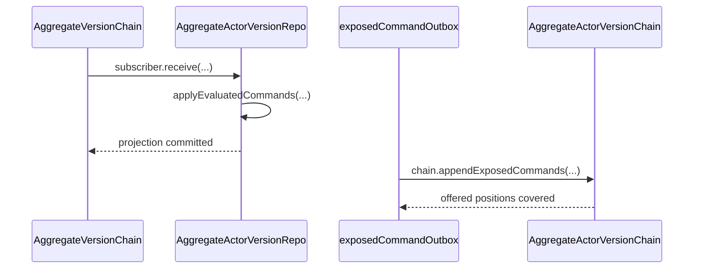

# Selected resources, history and session delivery

AggregateActorVersionRepo, AggregateAgentVersionRepo, ServiceActorVersionRepo and ServiceAgentVersionRepo materialize selected resource views. Their matching Chains retain selected history and serve sockets. A projection acknowledgement, selected-history acknowledgement and browser replay completion prove different operations.

## Trigger

1. Actor projection activation drains existing pending publication through its captured materialization head before catch-up and enrollment. Agent activation retains its existing subscription workflow.
   - [`AggregateActorVersionRepo.ts:69-96`](../../../packages/system-worker/src/AggregateActorVersionRepo/AggregateActorVersionRepo.ts#L69-L96) — drains already-committed Actor publication before subscribing and wakes recovery on every exit.
   - [`AggregateAgentVersionRepo.ts:62-75`](../../../packages/system-worker/src/AggregateAgentVersionRepo/AggregateAgentVersionRepo.ts#L62-L75) — keeps the Agent subscription-first workflow and schedules pending publication on exit.
   - [`ServiceActorVersionRepo.ts:65-94`](../../../packages/system-worker/src/ServiceActorVersionRepo/ServiceActorVersionRepo.ts#L65-L94) — publishes the captured pending Service Actor prefix before catch-up can encounter a full outbox.
   - [`ServiceAgentVersionRepo.ts:60-73`](../../../packages/system-worker/src/ServiceAgentVersionRepo/ServiceAgentVersionRepo.ts#L60-L73) — binds the Service Agent subscriber rather than Actor identity or private completion.

## Annotated workflow steps

1. Deliver complete evaluated commands from immutable release history to the exact projection identity.
   - [`AggregateVersionChain.ts:115-155`](../../../packages/system-worker/src/AggregateVersionChain/AggregateVersionChain.ts#L115-L155) — validates Actor version against the bound release and reconstructs the receiving key from Actor name/path.
2. Check fresh Actor publication capacity, then commit resources, selected output and checkpoint in one synchronous page transaction.
   - [`applyEvaluatedCommandsTx.ts:38-105`](../../../packages/system-worker/src/aggregateProjection/applyEvaluatedCommands/applyEvaluatedCommandsTx.ts#L38-L105) — validates each evaluated command, replays new contiguous Actor positions and computes selected output.
   - [`applyEvaluatedCommandsTx.ts:101-146`](../../../packages/system-worker/src/aggregateProjection/applyEvaluatedCommands/applyEvaluatedCommandsTx.ts#L101-L146) — inserts the selected delta and private resolution, then updates `materializationHead` within the same transaction.
3. Return after projection commitment, independently of selected-history delivery.
   - [`AggregateActorVersionRepo.ts:109-159`](../../../packages/system-worker/src/AggregateActorVersionRepo/AggregateActorVersionRepo.ts#L109-L159) — holds publication recovery around the resource transaction and schedules outgoing delivery on every exit.
4. Publish the complete frozen message outside SQL to its matching Chain.
   - [`makeExposedCommandOutbox.ts:89-104`](../../../packages/system-worker/src/aggregateProjection/makeExposedCommandOutbox.ts#L89-L104) — selects the exact Actor or Agent Chain and calls `appendExposedCommands` with the source key.
5. Acknowledge once the logical head covers every offered position; commit only the fresh contiguous suffix and preserve the first public/private pair at covered positions.
   - [`AggregateActorHistory.ts:547-622`](../../../packages/system-worker/src/AggregateActorVersionChain/AggregateActorHistory.ts#L547-L622) — validates source/order, ignores covered positions without Archive reads and atomically commits the fresh suffix with its logical head.

## Identity, selection and transaction ownership

Aggregate Actor view identity is `{ systemId, aggregateName, aggregateId, aggregateVersion, actorName, actorVersion, actorPath }`. Service Actor identity omits the Aggregate instance and instead binds `{ systemId, serviceName, serviceVersion, actorName, actorVersion, actorPath }`. Session name, full claims and Node producer identify private completion and connections; they do not create another resource owner. Actor path decoding yields SQL `selectionBindings`; its canonical re-encoding yields `encodedIdentity` for partition checks. Neither replaces full encoded claims.

- [`resolveAggregateProjectionView.ts:13-70`](../../../packages/system-worker/src/aggregateProjection/resolveAggregateProjectionView.ts#L13-L70) — declares both Aggregate keys and resolves exact release-selected exposure and captured selections.
- [`resolveServiceActorView.ts:9-71`](../../../packages/system-worker/src/serviceProjection/resolveServiceActorView.ts#L9-L71) — decodes the route, constructs selection bindings and refuses a noncanonical path.

Agent view identities retain both enclosing owner version and `agentVersion`: Aggregate adds `aggregateId`; Service has no Aggregate instance. Agent selection and readable models come from that exact registered Agent release. Automation selection is separate from declaring an observable Agent.

- [`resolveAggregateProjectionView.ts:24-56`](../../../packages/system-worker/src/aggregateProjection/resolveAggregateProjectionView.ts#L24-L56) — retains `agentVersion` and resolves Agent models/selections independently of Actor claims.
- [`resolveServiceAgentView.ts:9-36`](../../../packages/system-worker/src/serviceAgentProjection/resolveServiceAgentView.ts#L9-L36) — validates the full Agent key and resolves its exact Service owner.

Each Actor projection stores authored rows plus framework row fields, a singleton checkpoint (`aggregateIndex` or `serviceIndex`, `dispositionChainHash`) and complete pending publication. Full canonical release resources support relational and `where.RAW` selection dependencies that cannot be enumerated safely. Only selected envelopes cross the snapshot/delta boundary. Actor projection validates complete evaluated commands, skips committed positions after validation, preserves sparse authored model-operation indexes and applies model mutations at the parent's `outcome.finalizedAt`. It evaluates no command program and dispatches no outgoing operation. Failure and empty selected deltas still produce one history position.

- [`applyServiceProjectionCommandsTx.ts:48-128`](../../../packages/system-worker/src/serviceProjection/applyServiceProjectionCommandsTx.ts#L48-L126) — validates contiguous Service output/hash, applies model members, computes selected changes and advances the checkpoint in its caller transaction.
- [`applyEvaluatedCommandsTx.ts:61-102`](../../../packages/system-worker/src/serviceProjection/applyEvaluatedCommandsTx.ts#L61-L102) — binds Service Actor selection and complete private publication to that transaction.
- [`applyEvaluatedCommands.ts:15`](../../../packages/system-worker/src/serviceAgentProjection/applyEvaluatedCommands.ts#L15) — replays model operations and queues selected changes with the Service Agent projection checkpoint.

AggregateAgentVersionRepo and ServiceAgentVersionRepo materialize owner history and compute the selected delta for their Agent. Agent Nodes install a selected snapshot and subscribe from its checkpoint.

Each Actor or Agent materializer permits 64 pending publications. Its synchronous projection transaction counts genuinely new positions against the current outbox before changing resources, progress or publication rows. Capacity refusal retains the previous committed state and source fanout retries; repeated materialized positions consume no new capacity. This bound covers empty deltas and failed-command publications as well.

On that specific capacity refusal, the Actor Repo may drain prior pending
publication through its captured committed head outside SQL and retry the same
offered page once. Failed delivery preserves the original capacity refusal, and a
second capacity race returns to source recovery. This lets startup catch-up span
more than one page while preserving its fixed source boundary; a successful fresh
page still acknowledges without awaiting its own publication.

- [Shared projection page recovery](../../../packages/system-worker/src/projection/receiveProjectionPage.ts) drains committed publication on capacity refusal, then retries the offered page.
- [Aggregate projection transaction](../../../packages/system-worker/src/aggregateProjection/applyEvaluatedCommands/applyEvaluatedCommandsTx.ts) and [Service projection transaction](../../../packages/system-worker/src/serviceProjection/applyServiceProjectionCommandsTx.ts) both enforce the limit before applying fresh positions.

## Immutable history and acknowledgement

Selected Actor public history has five fields: canonical admitted command `id`, command name, selected `delta`, family position and `dispositionChainHash`. Complete admitted input and canonical `outcome: { result: Success | Failure, finalizedAt }` remain in VersionChain history. Actor publication additionally carries nullable `commandResolution: { nodeId, pushIndex, sessionName, claims, failure }`; its retained child contains required Node, push index, session and full original encoded claims plus nullable public failure. Actor name/version come from the bound projection key. `applyEvaluatedCommandsTx` passes this same complete nullable resolution through pending publication, retained history and live broadcast, without rebuilding a nested Actor identity. Public insertion seals that child or its absence. A covered retry cannot add or replace it. Agent history carries the public selected transition and its checkpoint.

- [`applyEvaluatedCommandsTx.ts:107-141`](../../../packages/system-worker/src/aggregateProjection/applyEvaluatedCommands/applyEvaluatedCommandsTx.ts#L107-L141) — constructs and passes one complete nullable resolution without rebuilding Actor identity.
- [`applyEvaluatedCommandsTx.ts:101-146`](../../../packages/system-worker/src/aggregateProjection/applyEvaluatedCommands/applyEvaluatedCommandsTx.ts#L101-L146) — retains that resolution with selected output and checkpoint in the resource transaction.
- [`AggregateActorHistory.ts:547-622`](../../../packages/system-worker/src/AggregateActorVersionChain/AggregateActorHistory.ts#L547-L622) — returns complete newly committed public/private publications for post-commit live broadcast.
- [`ServiceActorHistory.ts:399-437`](../../../packages/system-worker/src/ServiceActorVersionChain/ServiceActorHistory.ts#L399-L437) — validates Service publication and commits only fresh positions before returning broadcasts.
- [`serviceAgentVersionChainDbConfig.ts:6-13`](../../../packages/system-worker/src/ServiceAgentVersionChain/serviceAgentVersionChainDbConfig.ts#L6-L13) — retains public Agent history and Node delivery acknowledgement only.

A selected Chain publication acknowledgement permits deletion of its projection Repo's pending delivery. Actor Archive acknowledgement separately permits relocating covered local public/private copies while preserving complete logical history. A lost acknowledgement repeats the frozen message rather than recomputing a delta from newer resources. VersionChain subscriber acknowledgement advances only the source subscriber cursor; it may lag a committed projection after a lost reply. Actor subscribers store name/path plus acknowledgement and derive Actor version from the bound release. Agent subscribers retain name/version plus acknowledgement. Catch-up/enrollment and independent retry are detailed in [Delivery and recovery](./DeliveryAndRecovery.md#fanout-catch-up-and-enrollment).

Actor publication acknowledgement proves position coverage, not equality with retry bytes. AAVR/SAVR freezes one immutable publication per contiguous position alongside resource changes; AAVC/SAVC trusts that bound producer and uses its durable logical head for covered retries. Structurally valid changed retries are ignored without insertion, broadcast or an Archive lookup. Physical Archive append still compares complete pairs exactly. Source binding, fixed-shape validation and fresh-position continuity remain required.

- [`AggregateActorHistory.ts:547-622`](../../../packages/system-worker/src/AggregateActorVersionChain/AggregateActorHistory.ts#L547-L622) — acknowledges covered Aggregate positions from the local head while committing only new publications.
- [`ServiceActorHistory.ts:399-437`](../../../packages/system-worker/src/ServiceActorVersionChain/ServiceActorHistory.ts#L399-L437) — applies the same coverage contract to the complete offered Service range.

- [`AggregateVersionChain.ts:121-145`](../../../packages/system-worker/src/AggregateVersionChain/AggregateVersionChain.ts#L121-L145) — stores Actor name/path and checks release-derived version before membership changes.
- [`AggregateVersionChain.ts:197-215`](../../../packages/system-worker/src/AggregateVersionChain/AggregateVersionChain.ts#L197-L215) — retains Agent name/version identity and available release bindings.
- [`ServiceVersionChain.ts:120-145`](../../../packages/system-worker/src/ServiceVersionChain/ServiceVersionChain.ts#L120-L145) — validates Service Actor versions before dropping the supplied version from stored subscriber identity.
- [`ServiceVersionChain.ts:172-225`](../../../packages/system-worker/src/ServiceVersionChain/ServiceVersionChain.ts#L172-L225) — refuses unavailable/mismatching Service Agent versions and retains complete name/version membership.

Actor Chains retain a durable logical head and route historical checkpoints,
public replay and private completions through their local suffix or SQL Archives.
Capturing the archived prefix and local suffix before remote reads prevents
concurrent relocation from omitting or double-counting resolutions. Private
completion remains permanently recoverable; Node progress does not authorize
deleting Archive history.

Their fixed history schemas initialize independently of current authored declarations. Retained public/private reads and Archive recovery remain available after the evaluating release is removed from the registry. Resource materialization still requires its authored release, while current connection authority is checked separately before socket disclosure.

- [`aggregateActorVersionChainMigratableDORepoConfig.ts:7-12`](../../../packages/system-worker/src/AggregateActorVersionChain/aggregateActorVersionChainMigratableDORepoConfig.ts#L7-L12) — supplies the fixed Aggregate Actor history database without an authored view resolver.
- [`serviceActorVersionChainMigratableDORepoConfig.ts:5-10`](../../../packages/system-worker/src/ServiceActorVersionChain/serviceActorVersionChainMigratableDORepoConfig.ts#L5-L10) — supplies the fixed Service Actor history database independently of the current release registry.

- [`AggregateActorHistory.ts:382-480`](../../../packages/system-worker/src/AggregateActorVersionChain/AggregateActorHistory.ts#L382-L480) — captures local publications before querying immutable Archive ranges and applies row/byte bounds.
- [`ServiceActorHistory.ts:438-515`](../../../packages/system-worker/src/ServiceActorVersionChain/ServiceActorHistory.ts#L438-L515) — captures local resolution progress before awaiting bounded Archive summaries.

## Captured snapshots and private progress

Aggregate Actor snapshot requests and responses carry `actorName`, `actorVersion` and full actual `claims` directly. Aggregate Agent snapshot requests use the separate `IAggregateAgentProjectionSnapshotRequest` with `origin: IAgentOrigin`, and public Agent responses retain that Agent identity. Neither route constructs a combined Actor/Agent session-origin value.

- [`types.ts:28-46`](../../../packages/system-worker/src/aggregateProjection/types.ts#L28-L46) — declares separate Actor and Agent snapshot requests.
- [`getSnapshot.ts:41-248`](../../../packages/system-worker/src/aggregateProjection/getSnapshot/getSnapshot.ts#L41-L248) — returns direct Actor fields/private prefix or the separate Agent Origin/public snapshot.

Snapshot procedures read current committed projection state; they do not force VersionRepo execution or source-tip replay. Aggregate snapshots use `readSelectedResourcesAndCheckpoint` to read selected resources and checkpoint N synchronously. Service snapshots use a synchronous read transaction. Pending publication drains through N after the local read, then the Chain verifies exactly N’s retained hash. A newer publication cannot relabel captured resources. Zero is a valid checkpoint. Actor capture additionally reads its entitled private prefix bounded by N; Agent capture returns public resources/checkpoint only.

- [`getSnapshot.ts:88-167`](../../../packages/system-worker/src/aggregateProjection/getSnapshot/getSnapshot.ts#L88-L167) — captures Aggregate resources, publishes through the captured position, checks its hash and reads the Actor prefix only through that position.
- [`getSnapshot.ts:198-248`](../../../packages/system-worker/src/aggregateProjection/getSnapshot/getSnapshot.ts#L198-L248) — Agent capture returns the public snapshot without a private-prefix read.
- [`captureServiceSnapshot.ts:95-145`](../../../packages/system-worker/src/serviceProjection/captureServiceSnapshot.ts#L95-L145) — captures Service resources under the admitted model selection, verifies exact publication and requests the bounded private prefix.
- [`captureServiceAgentSnapshot.ts:71-105`](../../../packages/system-worker/src/serviceAgentProjection/captureServiceAgentSnapshot.ts#L71-L105) — captures and verifies the Service Agent public snapshot with no private completion.

Aggregate private progress first requires the requested Actor name/version to match the bound projection key, then compares every bounded Node resolution with the exact session and full actual claims and requires consecutive pushes from one. An Agent projection cannot request private Node recovery. Service's scalar reader checks the bound Actor name/version, nonnegative safe cursors and full structural claims/session equality across **all** bounded Node rows, including those before the requested offset. Positive validated pushes satisfy `COUNT(*) = COUNT(DISTINCT pushIndex) = MAX(pushIndex)`. Null Node permits only offset zero; an unknown Node resolves through zero at offset zero; an offset beyond the proved prefix fails. Public payload decoding and selected-model filtering belong to actual replay readers, not this scalar proof.

- [`AggregateActorHistory.ts:481-546`](../../../packages/system-worker/src/AggregateActorVersionChain/AggregateActorHistory.ts#L481-L546) — validates the bound Actor and all local/archived resolution fragments through the captured Aggregate bound.
- [`ServiceActorHistory.ts:438-515`](../../../packages/system-worker/src/ServiceActorVersionChain/ServiceActorHistory.ts#L438-L515) — validates all bounded Service resolution fragments, historical ownership and contiguous private progress.

## Connections, replay and disposal

Actor Chains retain compact `connectionLocks` (`connectionId`, `contractVersions`, `modelNames`) after full lock admission. Aggregate Actor attachments retain full actual claims, Aggregate/session identity, issued/resumed Node and phase; Actor name/version come from the bound projection key. Aggregate Agent attachments use their separate claim-free observer schema, with Agent name/version supplied by the bound key. The declaration lock retains its existing Actor/Agent discriminator; runtime Actor identity does not use an `origin` object. Service attachments retain their explicit authenticated identity. Both Actor capability readers require their exact current release and Actor/path, full claims and available selected models/ordinary contracts. Unavailable declarations fail closed for retained or hibernated sockets without blocking pure history reads. Empty selections grant nothing. Agent capabilities derive from exact registered declarations plus trusted attachment state, without a SQL capability table or browser submission authority.

- [`readAggregateConnectionCapabilities.ts:30-138`](../../../packages/system-worker/src/aggregateSessionChain/readAggregateConnectionCapabilities.ts#L30-L138) — separates retained Actor selections from Agent-derived capabilities and validates observer Node binding.
- [`readServiceConnectionCapabilities.ts:29-133`](../../../packages/system-worker/src/ServiceActorVersionChain/readServiceConnectionCapabilities.ts#L29-L133) — checks Service identity/claims, selected model closure and exact ordinary contract versions.
- [`connection.ts:44-74`](../../../packages/system-worker/src/ServiceAgentVersionChain/connection.ts#L44-L74) — reconstructs Service Agent capability from exact owner/Agent/session and resumed Node attachment.

`SystemRepo.forwardSessionSocket` forwards the unchanged Aggregate declaration lock and actual Actor `x-zerospin-claims`; Agent forwarding keeps `x-zerospin-origin` for its Agent identity. `onConnect` validates the Actor lock against the bound Actor name/version before retaining claims in its Actor attachment. Runtime capability reads select the separate Actor or Agent schema from the bound projection key.

- [`forwardSessionSocket.ts:120-138`](../../../packages/system-worker/src/SystemRepo/handleFetch/forwardSessionSocket.ts#L120-L138) — sends actual Actor claims separately from the unchanged lock and keeps the separate Agent Origin header.
- [`onConnect.ts:44-104`](../../../packages/system-worker/src/aggregateSessionChain/onConnect/onConnect.ts#L44-L104) — validates the bound Actor lock or exact Agent Origin/lock and installs only actual Actor claims in the attachment.
- [`connectionState.ts:10-47`](../../../packages/system-worker/src/aggregateSessionChain/connectionState.ts#L10-L47) — keeps Actor claims and claim-free Agent observer phases in separate schemas.

Actor ingress validates unchanged complete command identity, claims, session, Node/push tuple and selected contract version before ordinary admission; it cannot introduce an external command. Public and private replay use independent cursors on retained history. Replay fetches immutable bounded pages asynchronously and revalidates retained authority after awaits. The final logical-head check, checkpoint/private completion and transition to live share one synchronous turn. Live delivery exposes private failure only to the exact entitled Actor/Node/session/full claims; another recipient receives null. A canonical matching command ID settles optimism even when the selected delta is empty or failure is null. The receiving Node workflow is [SessionWebSocket](../browser/SessionWebSocket.md).

- [`admitAggregateSessionCommand.ts:23-79`](../../../packages/system-worker/src/aggregateSessionChain/onMessage/admitAggregateSessionCommand.ts#L23-L79) — checks the complete Actor command against the authenticated capability and validates returned admission before releasing its pending claim.
- [`admitServiceSocketCommand.ts:19-88`](../../../packages/system-worker/src/ServiceActorVersionChain/onMessage/admitServiceSocketCommand.ts#L19-L88) — validates Service owner, selected contract, full claims and producer before unchanged admission.
- [`replayAggregateSocketCommands.ts:248-290`](../../../packages/system-worker/src/aggregateSessionChain/onMessage/replayAggregateSocketCommands.ts#L248-L290) — checks retained authority and current logical head before replay-complete and live installation, without an intervening Archive await.

Socket failure follows retained-history commitment and cannot undo it. Disposal reclaims Actor capability rows even if close fails; Service disposal independently attempts fencing, notice, close and deletion. Agent disposal fences attachment authority before close, so late replay cannot restore it. Activation completes socket enumeration before deleting only absent Actor rows in a transaction; enumeration failure deletes nothing, and surviving hibernated/replaying sockets keep capabilities. Cleanup never removes history.

- [`disposeConnection.ts:16-37`](../../../packages/system-worker/src/aggregateSessionChain/disposeConnection.ts#L16-L37) — fences Actor/Agent attachments and attempts Actor SQL capability deletion even if close fails.
- [`disposeConnection.ts:17-35`](../../../packages/system-worker/src/ServiceActorVersionChain/disposeConnection.ts#L17-L35) — independently attempts every teardown action through nested `finally` blocks.
- [`reconcileConnectionLocks.ts:17-27`](../../../packages/system-worker/src/aggregateSessionChain/reconcileConnectionLocks.ts#L17-L27) — collects surviving socket IDs before pruning absent rows.

## Historical evidence

The final pre-deletion [projection clarification](https://github.com/morgs32/zerospin/blob/7b44d48e68e3637bc075ca5d249305d5e64d2aaa/packages/system-worker/src/aggregateProjection/README.md) and [connection clarification](https://github.com/morgs32/zerospin/blob/7b44d48e68e3637bc075ca5d249305d5e64d2aaa/packages/system-worker/src/aggregateSessionChain/README.md) from Plan 272 are incorporated above: bound Actor identity, full actual claims and one complete nullable command resolution remain distinct responsibilities.

The dated reports in [Plans 211/212](../../archive/plans/211-plan-agent-exposed-command-history.md), [214](../../archive/plans/214-plan-service-ordered-operations-and-finalized-at.md), [216](../../archive/plans/216-plan-service-actor-subscriber-identity.md), [217](../../archive/plans/217-plan-service-direct-resolution-prefix-read.md) and [218](../../archive/plans/218-plan-service-connection-capabilities-and-disposal.md) retain their original scopes. The [pre-consolidation Service projection report](https://github.com/morgs32/zerospin/blob/79c1824b1a0353f770211851c0bfe1cc54d0ba46/packages/system-worker/src/serviceProjection/README.md) preserves detailed fixture/results/limitations; the [Agent history report](https://github.com/morgs32/zerospin/blob/79c1824b1a0353f770211851c0bfe1cc54d0ba46/packages/system-worker/src/aggregateSessionChain/README.md#replay-disposal-and-recovery) preserves the 2026-10-23 observer evidence. Trusted headers, disposable SQLite and explicit activation controls do not establish browser startup, authentication providers or deployed scheduling. This documentation migration establishes no fresh runtime acceptance and changes no fixed schema or storage.
