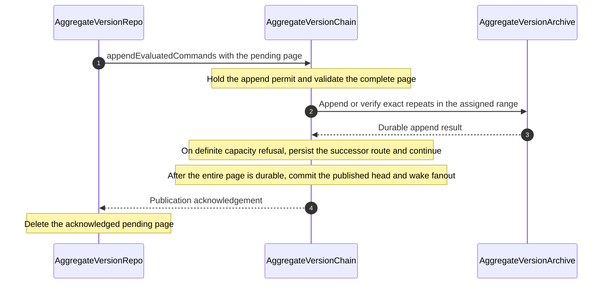
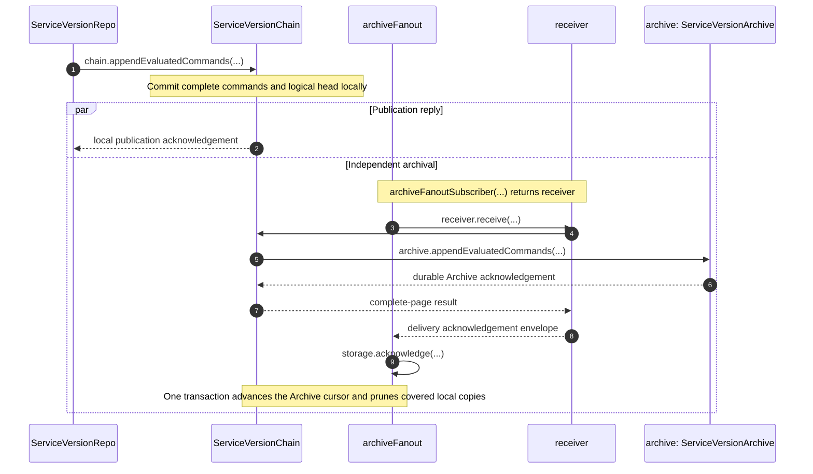

AggregateVersionArchive and ServiceVersionArchive retain complete evaluated
commands with their admitted input, original release, `outcome`, operations,
`dispositionChainHash` and global position. AggregateVersionChain routes reads and
writes through its Archive directory and owns the published head.
ServiceVersionChain publishes a local suffix and archives it independently.

[Canonical History Handoff](./CanonicalHistoryHandoff.md) governs when an
admission Chain can adopt a published prefix.

## Aggregate publication

## Annotated workflow steps

1. AggregateVersionRepo delivers its complete pending publication to the same-key AggregateVersionChain.
   - [`AggregateVersionRepo.ts:158-168`](../../../packages/owner-release-worker/src/AggregateVersionRepo/AggregateVersionRepo.ts#L158-L168) — sends the pending evaluated commands and awaits the append envelope.
2. AggregateVersionChain awaits an append result from each assigned AggregateVersionArchive range.
   - [`AggregateVersionChain.ts:338-355`](../../../packages/system-worker/src/AggregateVersionChain/AggregateVersionChain.ts#L338-L355) — routes the portion and captures a transport failure.
3. AggregateVersionArchive commits its contiguous suffix or verifies exact repeats.
   - [`AggregateVersionArchive.ts:59-111`](../../../packages/system-worker/src/AggregateVersionArchive/AggregateVersionArchive.ts#L59-L111) — validates the Archive identity and appends complete evaluated commands.
4. AggregateVersionChain acknowledges after the head transaction and wakes Actor and Agent fanout. AggregateVersionRepo can then delete the pending page.
   - [`AggregateVersionChain.ts:469-499`](../../../packages/system-worker/src/AggregateVersionChain/AggregateVersionChain.ts#L469-L499) — validates the contiguous fresh suffix, awaits all Archive writes and advances the head once.

If one range commits and a later write fails, AggregateVersionRepo retains the
whole page and AggregateVersionChain exposes the previous published head.
Retries verify already durable rows and resume through the recorded routes.
Point reads and fanout pages are capped at the published head.

- [`AggregateVersionChain.ts:281-335`](../../../packages/system-worker/src/AggregateVersionChain/AggregateVersionChain.ts#L281-L335) — caps point and page reads before invoking an Archive.
- [`AggregateVersionChain.ts:362-399`](../../../packages/system-worker/src/AggregateVersionChain/AggregateVersionChain.ts#L362-L399) — validates a capacity response, records a successor and leaves other failures to publication recovery.

## Service publication

## Trigger

1. ServiceVersionRepo delivers its complete pending publication to ServiceVersionChain.
   - [`ServiceVersionRepo.ts:128-138`](../../../packages/owner-release-worker/src/ServiceVersionRepo/ServiceVersionRepo.ts#L128-L138) — sends complete pending evaluated commands to the same-key VersionChain.
2. Publication and activation wake Archive delivery; the registered queue recovers interrupted or failed delivery.
   - [`makeFanoutQueue.ts:403-406`](../../../packages/system-worker/src/makeFanoutQueue/makeFanoutQueue.ts#L403-L406) — arms durable recovery and starts a background drain without awaiting it.
   - [`ServiceVersionChain.ts:330-357`](../../../packages/system-worker/src/ServiceVersionChain/ServiceVersionChain.ts#L330-L357) — initializes the persistent Archive subscriber and wakes its queue.

## Annotated workflow steps

1. ServiceVersionRepo publishes complete committed output to ServiceVersionChain.
   - [`ServiceVersionRepo.ts:128-138`](../../../packages/owner-release-worker/src/ServiceVersionRepo/ServiceVersionRepo.ts#L128-L138) — sends complete pending evaluated commands to the same-key VersionChain.
2. Publication returns after the local commit and scheduling archival; it does not await an Archive RPC. The two branches may complete in either order.
   - [`ServiceVersionChain.ts:544-650`](../../../packages/system-worker/src/ServiceVersionChain/ServiceVersionChain.ts#L544-L650) — compares retained output, commits the new suffix and wakes archival before returning.
   - [`makeFanoutQueue.ts:403-406`](../../../packages/system-worker/src/makeFanoutQueue/makeFanoutQueue.ts#L403-L406) — schedules delivery without awaiting an Archive acknowledgement.
3. Archive fanout obtains the returned subscriber receiver and invokes its receive method with the bounded page.
   - [`makeFanoutQueue.ts:306-320`](../../../packages/system-worker/src/makeFanoutQueue/makeFanoutQueue.ts#L306-L320) — obtains the subscriber receiver, calls receiver.receive and disposes it afterward.
4. The returned receiver's callback enters ServiceVersionChain's source-owned delivery procedure.
   - [`ServiceVersionChain.ts:313-325`](../../../packages/system-worker/src/ServiceVersionChain/ServiceVersionChain.ts#L313-L325) — returns an inline receive callback that runs #deliverArchivePage through the configured runtime and RPC envelope wrapper.
5. ServiceVersionChain routes each portion to its assigned physical Archive without changing command positions or output.
   - [`ServiceVersionChain.ts:403-413`](../../../packages/system-worker/src/ServiceVersionChain/ServiceVersionChain.ts#L403-L413) — resolves the current range and invokes its Archive append method.
6. The Archive atomically appends its contiguous new suffix or compares exact complete output at existing positions before acknowledging.
   - [`ServiceVersionArchive.ts:70-152`](../../../packages/system-worker/src/ServiceVersionArchive/ServiceVersionArchive.ts#L70-L152) — commits a contiguous physical suffix or verifies exact retained output.
7. The delivery procedure finishes only after every portion has been retained. Partial delivery and lost replies leave source acknowledgement unchanged.
   - [`ServiceVersionChain.ts:452-456`](../../../packages/system-worker/src/ServiceVersionChain/ServiceVersionChain.ts#L452-L456) — propagates failed portions and returns only after every offered row was acknowledged.
8. The returned receiver resolves its delivery acknowledgement envelope to the fanout queue.
   - [`ServiceVersionChain.ts:313-325`](../../../packages/system-worker/src/ServiceVersionChain/ServiceVersionChain.ts#L313-L325) — returns the configured runtime Promise after wrapping the delivery procedure's outcome in the worker RPC envelope.
9. Fanout acknowledgement advances the source's single Archive cursor and deletes covered local copies in the same synchronous transaction. Logical history remains retained in Archives.
   - [`makeFanoutQueueStorage.ts:179-188`](../../../packages/system-worker/src/makeFanoutQueue/makeFanoutQueueStorage.ts#L179-L188) — updates the monotonic cursor and invokes the source callback in one transaction.
   - [`ServiceVersionChain.ts:264-325`](../../../packages/system-worker/src/ServiceVersionChain/ServiceVersionChain.ts#L264-L325) — configures the singleton Archive subscriber and deletes only its acknowledged local prefix.

## Physical ranges and rollover

Each physical Archive key contains its complete source identity, evaluating
release and first domain position. The command's own `aggregateVersion` or
`serviceVersion` remains its original admission release. The next directory start
bounds the preceding range; the greatest start identifies the newest Archive.

- [`aggregateVersionArchiveName.ts:1-24`](../../../packages/system-worker/src/AggregateVersionArchive/aggregateVersionArchiveName.ts#L1-L24) — binds the Archive name to the source identity, evaluating release and first domain position.
- [`serviceVersionArchiveName.ts:1-22`](../../../packages/system-worker/src/ServiceVersionArchive/serviceVersionArchiveName.ts#L1-L22) — binds the Archive name to the source identity, evaluating release and first domain position.
- [`ServiceVersionChain.ts:368-396`](../../../packages/system-worker/src/ServiceVersionChain/ServiceVersionChain.ts#L368-L396) — derives the physical range bounds from ordered directory starts.

Only a definite native `SQLITE_FULL`, including a Drizzle-wrapped cause, opens a
successor. The source records its start immediately after the old Archive's durable
head in a synchronous transaction, then routes the unacknowledged page across both
ranges. After a lost acknowledgement, the old Archive may be ahead of the source
cursor; its existing rows are compared again before delivery reaches the successor.
Other failures retry the existing Archive. An empty Archive that cannot accept its
first batch returns failure rather than repeatedly allocating a successor.

- [`ServiceVersionArchive.ts:34-41`](../../../packages/system-worker/src/ServiceVersionArchive/ServiceVersionArchive.ts#L34-L41) — recognizes native storage-full causes through error wrappers.
- [`ServiceVersionChain.ts:397-457`](../../../packages/system-worker/src/ServiceVersionChain/ServiceVersionChain.ts#L397-L457) — records the successor at the reported durable head plus one and continues range-aware delivery.

Obtaining the new named Repo reference does not initialize it. The first append
activates it through the standard constructor gate. The source needs no explicit
creation RPC or `blockConcurrencyWhile` for its synchronous directory update;
receiving Repo initialization still uses the ordinary constructor gate.

- [`makeDORepo.ts:217-230`](../../../packages/system-worker/src/makeDORepo/makeDORepo.ts#L217-L230) — returns the named namespace reference without a readiness call.
- [`makeDORepo.ts:264-305`](../../../packages/system-worker/src/makeDORepo/makeDORepo.ts#L264-L305) — gates registration, schema initialization and activation in the receiving Repo.

## Service backlog and retained reads

The ServiceVersionChain logical head supplies the fanout tip after local pruning. One logical
Archive subscriber cursor records the archived prefix; rollover changes physical
routing, never subscriber membership.

- [`serviceVersionChainDbConfig.ts:1-63`](../../../packages/system-worker/src/ServiceVersionChain/serviceVersionChainDbConfig.ts#L1-L63) — separates the logical head, Archive directory and Archive acknowledgement from projection progress.

The initial source limit is 64 unarchived new commands, matching the publisher's
page size. Oversized new batches fail explicitly. A temporarily full backlog
rejects before mutation, leaving the VersionRepo publication pending. Exact retries
remain valid at the cap and compare the complete command at its known domain
position through local or archived history. ServiceVersionChain trusts the committed publication from its bound ServiceVersionRepo.

- [`appendEvaluatedCommandsTx.ts:62-72`](../../../packages/system-worker/src/ServiceVersionChain/appendEvaluatedCommandsTx.ts#L62-L72) — counts new positions against the durable head and Archive cursor before inserts.
- [`ServiceVersionChain.ts:544-650`](../../../packages/system-worker/src/ServiceVersionChain/ServiceVersionChain.ts#L544-L650) — compares complete old-position publications before inserting their genuinely new suffix.

Archive delivery and read pages contain at most 64 rows and use a 1 MiB encoded
budget, allowing one larger valid command so a page can progress. Readers load rows
incrementally. Slow and newly enrolled Actor/Agent subscribers read the same
logical history after local pruning. Their acknowledgements advance their own
cursors, without deleting retained history. Point reads and checkpoints preserve
complete output; unavailable or missing retained ranges fail instead of appearing
empty. Metadata-only requests read the source head without an Archive RPC.

- [`readServiceCommandPage.ts:28-63`](../../../packages/system-worker/src/ServiceVersionChain/readServiceCommandPage.ts#L28-L63) — builds byte- and row-bounded pages incrementally.
- [`ServiceVersionChain.ts:492-543`](../../../packages/system-worker/src/ServiceVersionChain/ServiceVersionChain.ts#L492-L543) — routes archived-prefix pages to the selected physical range and preserves the logical source tip.

- [`ServiceVersionChain.ts:676-716`](../../../packages/system-worker/src/ServiceVersionChain/ServiceVersionChain.ts#L676-L716) — recovers historical checkpoints from the same archive-backed evaluated-command reader.

ServiceVersionChain and ServiceVersionArchive decode complete SQL rows through the owning Repo's `dbConfig.tables.commands` codec.

- [`readServiceCommandPage.ts:17-25`](../../../packages/system-worker/src/ServiceVersionChain/readServiceCommandPage.ts#L17-L25) — decodes through the caller-provided Service history table before domain validation.

## Recovery after activation

ServiceVersionChain activation holds Actor and Agent fanout recovery before waking Archive delivery.
A caught-up Archive drain therefore cannot remove the shared recovery alarm while
projection subscribers still have pending history. Each queue releases only its
own hold; the registry removes the alarm only after no named holds remain.

- [`ServiceVersionChain.ts:330-357`](../../../packages/system-worker/src/ServiceVersionChain/ServiceVersionChain.ts#L330-L357) — arms both projection recovery holds before waking the Archive queue.
- [`makeRecoveryRegistry.ts:28-41`](../../../packages/system-worker/src/makeRecoveryRegistry/makeRecoveryRegistry.ts#L28-L41) — deletes the shared alarm only when the recovery-hold set is empty.

## Actor exposed-command Archives

AggregateActorVersionChain and ServiceActorVersionChain use the same local
publication commit and independent archival workflow. Their physical Archives are
AggregateActorVersionArchive and ServiceActorVersionArchive, keyed by the complete
Actor projection identity plus its first domain index. They retain the five public
exposed-command fields and the exact optional private resolution. The public
parent and resolution child commit together; physical Archive retries compare
both or the child's absence. Connection locks and sockets remain in the Actor
Chain.

- [`AggregateActorVersionArchive.ts:71-126`](../../../packages/system-worker/src/AggregateActorVersionArchive/AggregateActorVersionArchive.ts#L71-L126) — parses complete append RPC props, verifies the bound source and atomically appends Aggregate public/private publications with exact retry comparison.
- [`ServiceActorVersionArchive.ts:86-189`](../../../packages/system-worker/src/ServiceActorVersionArchive/ServiceActorVersionArchive.ts#L86-L189) — validates and atomically appends complete Service public/private publications, comparing exact retries.

AAVC/SAVC publication acknowledgement proves that the complete offered range is
covered by its durable logical head. Each bound AAVR/SAVR producer freezes its
publication with resource changes. Covered positions are ignored after structural
validation even if the retry bytes differ, without reading an old Archive or
broadcasting again. Only the fresh contiguous suffix is inserted. This permits
settling a lost publication reply after relocation even when that old Archive is
unavailable; replay and private recovery retain their Archive dependencies.

- [`AggregateActorHistory.ts:547-622`](../../../packages/system-worker/src/AggregateActorVersionChain/AggregateActorHistory.ts#L547-L622) — validates the bound producer and ordered publication, then commits fresh positions against the current logical head.
- [`ServiceActorHistory.ts:399-437`](../../../packages/system-worker/src/ServiceActorVersionChain/ServiceActorHistory.ts#L399-L437) — acknowledges covered Service positions and returns broadcasts only for newly committed publications.

Each Actor Repo's pending publication outbox is bounded at 64 positions separately
from its Actor Chain's 64-position unarchived suffix. Projection transactions
refuse insufficient fresh capacity before changing resources, progress or pending
output; repeats consume no new capacity. Activation first drains already-committed
pending publication through its captured materialization head, then catches up
and enrolls. Source fanout acknowledgement still proves materialization plus
complete pending publication rather than physical archival.

- [`applyEvaluatedCommandsTx.ts:38-78`](../../../packages/system-worker/src/aggregateProjection/applyEvaluatedCommands/applyEvaluatedCommandsTx.ts#L38-L78) — bounds new Aggregate Actor pending output in the resource transaction.
- [`applyEvaluatedCommandsTx.ts:27-64`](../../../packages/system-worker/src/serviceProjection/applyEvaluatedCommandsTx.ts#L27-L64) — bounds new Service Actor pending output before model application.
- [`AggregateActorVersionRepo.ts:69-96`](../../../packages/system-worker/src/AggregateActorVersionRepo/AggregateActorVersionRepo.ts#L69-L96) — drains the captured pending Aggregate publication before activation catch-up.
- [`ServiceActorVersionRepo.ts:65-94`](../../../packages/system-worker/src/ServiceActorVersionRepo/ServiceActorVersionRepo.ts#L65-L94) — drains the captured pending Service publication before subscription.

Archive acknowledgement deletes only covered local child/parent copies. Complete
public and private history stays permanently recoverable, independently of Node
acknowledgements. Actor archival changes neither the browser protocol nor initial
snapshot installation. Agent history remains outside this milestone.

- [`AggregateActorHistory.ts:150-157`](../../../packages/system-worker/src/AggregateActorVersionChain/AggregateActorHistory.ts#L150-L157) — deletes covered local Aggregate resolution children and public parents inside fanout acknowledgement.
- [`ServiceActorHistory.ts:106-113`](../../../packages/system-worker/src/ServiceActorVersionChain/ServiceActorHistory.ts#L106-L113) — deletes covered local Service resolution children and public parents inside fanout acknowledgement.

Private prefix readers snapshot the archived prefix and local suffix before
awaiting Archive summaries. Each nonempty fragment proves a contiguous push
interval and exact historical session/full-claims ownership; adjacent fragments
must join from push 1. Scalar summaries do not decode public deltas. Reads visit
Archive ranges sequentially, so latency grows with the number of relevant ranges.
Failure of any required Archive fails the read.

Covered public positions cannot disappear as an empty successful tail. Aggregate
local capture reports a typed missing-history failure, while scans for private
completions may legitimately find no matching rows when no public positions
remain unread.

- [`aggregateActorHistoryStorage.ts:86-140`](../../../packages/system-worker/src/AggregateActorVersionChain/aggregateActorHistoryStorage.ts#L86-L140) — distinguishes a missing covered public tail from an empty filtered private range.

- [`AggregateActorHistory.ts:481-546`](../../../packages/system-worker/src/AggregateActorVersionChain/AggregateActorHistory.ts#L481-L546) — combines captured local and archived resolution summaries while validating identity and contiguous push intervals.
- [`ServiceActorHistory.ts:438-515`](../../../packages/system-worker/src/ServiceActorVersionChain/ServiceActorHistory.ts#L438-L515) — validates all bounded historical owner fragments and rejects gaps or impossible private offsets.

Actor Chain history/schema activation and Archive recovery require no current
authored release declaration. Retained history remains readable after release
deregistration. New connection admission and retained-socket capability validation
still require current authored authority; resource materialization and pending
authored execution retain their separate exact-code requirements.

- [`aggregateActorVersionChainMigratableDORepoConfig.ts:7-12`](../../../packages/system-worker/src/AggregateActorVersionChain/aggregateActorVersionChainMigratableDORepoConfig.ts#L7-L12) — initializes the fixed Aggregate Actor history schema directly.
- [`serviceActorVersionChainMigratableDORepoConfig.ts:5-10`](../../../packages/system-worker/src/ServiceActorVersionChain/serviceActorVersionChainMigratableDORepoConfig.ts#L5-L10) — initializes the fixed Service Actor history schema without resolving the Actor declaration.
