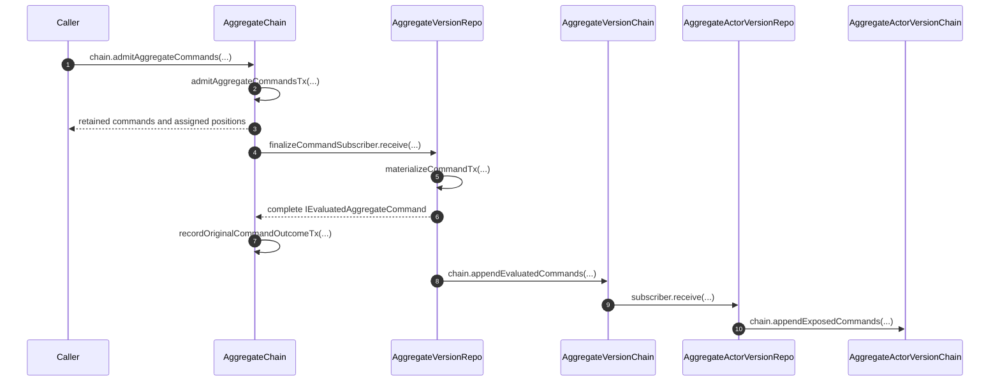

AggregateChain owns admitted input, nullable original outcome and complete pending
external requests. It stores no original evaluated-command history or dispositionChainHash. AggregateVersionRepo evaluates commands and commits resources
plus a single complete VersionChain publication. AggregateVersionArchive retains all
model and external operations. Actor projection Repos apply model operations only.

## Trigger

1. Ordinary session or administrative input reaches the bound AggregateChain.
   - [`admitAggregateCommands.ts:1-28`](../../../packages/system-worker/src/AggregateChain/admitAggregateCommands/admitAggregateCommands.ts#L1-L28) — decodes the ordinary input page before local admission.
2. Direct execution uses that same admission order and requested command result.
   - [`AggregateChain.admitDirectSystemCommand`](../../../packages/system-worker/src/AggregateChain/AggregateChain.ts#L902) admits the ordinary command at the next position. [`AggregateVersionRepo.awaitCommandResult`](../../../packages/owner-release-worker/src/AggregateVersionRepo/AggregateVersionRepo.ts) recovers the requested result from the addressed release.

## Annotated workflow steps

1. Decode ordinary input at the admission boundary.
   - [`admitAggregateCommands.ts:1-28`](../../../packages/system-worker/src/AggregateChain/admitAggregateCommands/admitAggregateCommands.ts#L1-L28) — validates the complete page before its transaction.
2. Carry decoded Actor input into one synchronous transaction, checking the Node producer checkpoint independently of history before fresh grant, claims and payload validation. Append the admitted command and update only `commandProgress.admittedThroughIndex` in that transaction. Recorded System and Agent commands use their explicit admission methods; Actor-aware execution and guards remain in AggregateVersionRepo.
   - [`admitAggregateCommandsTx.ts:23-31`](../../../packages/system-worker/src/AggregateChain/admitAggregateCommands/admitAggregateCommandsTx.ts#L23-L31) — validates producer continuation and current support, then appends each Actor command inside the batch transaction.
   - [`validateNewAggregateCommand.ts:26-71`](../../../packages/system-worker/src/AggregateChain/admitAggregateCommands/validateNewAggregateCommand.ts#L26-L71) — resolves the exact Actor/Agent/System grant, requires the registered contract version, validates Actor claims and Aggregate identity, and validates submitted payload.
   - [`admitAggregateSessionCommand.ts:36-61`](../../../packages/system-worker/src/aggregateSessionChain/onMessage/admitAggregateSessionCommand.ts#L36-L61) — binds the flat admitted Actor fields, owner/Node/session identity and exact permitted contract version at ingress.
3. Return complete admitted commands after atomically storing their input and advancing `commandProgress.admittedThroughIndex`; this does not establish command execution.
   - [`appendAggregateCommand.ts:40-58`](../../../packages/system-worker/src/AggregateChain/admitAggregateCommands/appendAggregateCommand.ts#L40-L58) — inserts the admitted command with null outcome and updates only admittedThroughIndex in the same transaction.
4. Send the oldest admitted command with null outcome to its retained release.
   - [`AggregateChain.ts:156-173`](../../../packages/system-worker/src/AggregateChain/AggregateChain.ts#L158-L175) — constructs the original subscriber from the retained command's aggregate release.
   - [`AggregateChain.ts:299-305`](../../../packages/system-worker/src/AggregateChain/AggregateChain.ts#L301-L307) — holds original-delivery recovery around synchronous admission.
5. Evaluate and commit resources/refusal, checkpoint and the complete VersionChain publication.
   - [`materializeCommandTx.ts:1-44`](../../../packages/system-worker/src/AggregateVersionRepo/materializeCommandTx.ts#L1-L44) — executes one command transactionally and retains its complete model/external output.
6. Return that same complete committed evaluated command through the original RPC.
   - [`finalizeCommandRows.ts:1-28`](../../../packages/owner-release-worker/src/AggregateVersionRepo/finalizeCommand/finalizeCommandRows.ts#L1-L28) — returns full output rather than reducing the reply to outcome-only data.
7. Validate the bound evaluated command and atomically retain `commands.outcome`, advance `commandProgress.finalizedThroughIndex` and retain complete pending command deliveries and external requests.
   - [`recordOriginalCommandOutcomeTx.ts:45-144`](../../../packages/system-worker/src/AggregateChain/recordOriginalCommandOutcomeTx.ts#L45-L144) — validates admitted identity and predecessor, stores outcome and finalizedThroughIndex, and inserts complete pending deliveries; identical retained outcomes return before another write.
8. Independently publish complete model/external output into immutable version history and fanout.
   - [`AggregateVersionChain.ts:469-499`](../../../packages/system-worker/src/AggregateVersionChain/AggregateVersionChain.ts#L469-L499) — awaits the Archive append and advances the published head before waking Actor and Agent fanout.
9. Deliver release-local output to the projection Repo; external descriptions are never executed there. Aggregate actor/agent projection Repos commit resources, selected deltas, complete pending publication and `materializationHead` together.
   - [`AggregateVersionChain.ts:112-137`](../../../packages/system-worker/src/AggregateVersionChain/AggregateVersionChain.ts#L112-L137) — stores the actor name/path pair separately from acknowledgement, validates incoming actorVersion and derives it from the bound immutable Aggregate release for complete recipient keys.
   - [`AggregateVersionChain.ts:299-335`](../../../packages/system-worker/src/AggregateVersionChain/AggregateVersionChain.ts#L299-L335) — reads retained evaluated commands in bounded aggregateIndex order for delivery and catch-up.
   - [`aggregateProjectionDbConfig.ts:8-15`](../../../packages/system-worker/src/aggregateProjection/aggregateProjectionDbConfig.ts#L8-L15) — declares the projection materialization head as `singletonId`, `aggregateIndex` and `dispositionChainHash`.
   - [`applyEvaluatedCommandsTx.ts:101-146`](../../../packages/system-worker/src/aggregateProjection/applyEvaluatedCommands/applyEvaluatedCommandsTx.ts#L101-L146) — retains complete selected publication and advances singleton materializationHead slot 1 in the resource transaction.
10. Atomically retain each public exposed command and its optional private resolution in AggregateActorVersionChain, then acknowledge the one complete publication before broadcast/reconnect.
    - [`appendExposedCommands.ts:70-105`](../../../packages/system-worker/src/aggregateSessionChain/appendExposedCommands.ts#L70-L105) — compares joined resolution-or-null on retry and inserts both Actor relations in the same transaction; insertion seals resolution absence as well as presence.
    - [`aggregateSessionChainDbConfig.ts:11-54`](../../../packages/system-worker/src/aggregateSessionChain/aggregateSessionChainDbConfig.ts#L11-L54) — gives `commandResolutions` its parent position, required producer/session/full-claims fields, nullable failure and unique Node/push association.

AggregateActorVersionRepo publishes `exposedCommandOutbox` with five public fields
and nullable `commandResolution`. Private recovery reads the Actor Chain's local
resolution relation bounded by the captured aggregate position. One browser command
stream still carries selected deltas and recipient-filtered nullable failure;
there is no independent resolution delivery or AggregateVersionChain private lookup.
AggregateAgentVersionRepo publishes a complete five-field public command in
`exposedCommandOutbox`: `aggregateIndex`, canonical `id`, `commandName`, selected
`delta` and `dispositionChainHash`. Resources, checkpoint and this pending row
commit together. AggregateAgentVersionChain retains that same immutable public
command; it has no private `commandResolutions`. Equal retries acknowledge the
retained command without rewriting it, while conflicting retries or a gap refuse
the entire append transaction. Publication acknowledgement deletes only the
projection's pending row. The Chain's fixed Node Repo acknowledgement advances
without deleting retained public history.

- [`aggregateProjectionDbConfig.ts:32-43`](../../../packages/system-worker/src/aggregateProjection/aggregateProjectionDbConfig.ts#L32-L43) — composes the Agent pending row from the five public command fields and declares its materialization checkpoint.
- [`decodeAgentOutboxPublication.ts:8-20`](../../../packages/system-worker/src/aggregateProjection/decodeAgentOutboxPublication.ts#L8-L20) — decodes the complete frozen public publication without private resolution reconstruction.
- [`aggregateSessionChainDbConfig.ts:60-67`](../../../packages/system-worker/src/aggregateSessionChain/aggregateSessionChainDbConfig.ts#L60-L67) — gives the Agent Chain only public history and its fixed Node Repo acknowledgement.
- [`appendExposedCommands.ts:40-118`](../../../packages/system-worker/src/aggregateSessionChain/appendExposedCommands.ts#L40-L118) — validates the exact source key, compares retained input and enforces contiguous public insertion in one transaction.
- [`aggregateExposedCommandsTable.ts:10-19`](../../../packages/core/src/aggregateSession/aggregateExposedCommandsTable.ts#L10-L19) — declares the public Aggregate command fields independently of Actor private resolution.

AggregateAgentVersionChain derives observer capabilities from its exact
Agent version declared in the Chain's bound Aggregate release. Initial admission
requires equality with the full authored lock. Each message and broadcast validates
the claim-free observer attachment's Aggregate owner, declared session and issued/resumed Node
identity against its bound Agent key. Initial admission alone decodes the separate Agent Origin header. The common capability helper includes lock contract facts; those facts
grant no Agent browser command submission. Agent sockets only resume public
observation, with no private completion cursor or SQL `connectionLocks` copy.
Broadcast uses configured `System` synchronously. Failure disposal first attempts
to clear attachment authority and always attempts closure; socket failures do not
reject a retained publication. Actor SQL capabilities and private recovery retain
their separate responsibilities.

- [`resolveAgentSessionContext.ts:11-33`](../../../packages/system-worker/src/aggregateSessionChain/resolveAgentSessionContext.ts#L11-L33) — requires the registered Agent's exact Aggregate owner pin and restores its session and Agent Origin.
- [`readAggregateConnectionCapabilities.ts:26-70`](../../../packages/system-worker/src/aggregateSessionChain/readAggregateConnectionCapabilities.ts#L26-L70) — validates owner and phase-specific attachment identity, retaining Actor SQL reads and deriving Agent lock capabilities.
- [`disposeConnection.ts:17-25`](../../../packages/system-worker/src/aggregateSessionChain/disposeConnection.ts#L17-L25) — attempts Agent attachment invalidation before closure, with no Agent SQL deletion.
- [`AggregateSessionChain.ts:61-130`](../../../packages/system-worker/src/aggregateSessionChain/AggregateSessionChain.ts#L61-L130) — provides configured System during guarded capability reads and isolates per-observer broadcast/disposal failures.

[Plan 211](../../archive/plans/211-plan-agent-exposed-command-history.md) and
[Plan 212](../../archive/plans/212-plan-agent-derived-connection-capabilities.md) track the
current public-history and observer verification. Their earlier Agent private
history, producer identity and independent Agent version requirements are
superseded. Current verification passes 107 System Worker tests across 25 files, including six new Agent publication/observer cases with trusted forwarded headers and disposable SQLite. No production source or schema changed.

## External work and recovery

AggregateChain invokes the provider after the original `commands.outcome` and
pending request commit. It records the first observation as `externalOutcome`
on the pending row. The emitting `OwnerReleaseWorker` maps the frozen input
and observation to an ordinary System command. If mapping or encoding fails,
AggregateChain retains `continuationFailure` on the pending row before admission.
The ordinary command keeps the pending `externalCommandId` and emitting
`aggregateVersion`. In one transaction AggregateChain admits that command at
the next position and deletes the pending row. A construction failure uses SQL
`NULL` as its payload and carries the retained public failure. Later execution
and `outcome` retention are separate steps.

- [`recordExternalOutcomeAndAdmitCommandTx.ts:27-45`](../../../packages/system-worker/src/AggregateChain/recordExternalOutcomeAndAdmitCommandTx.ts#L27-L45) — records the first observation and returns the existing value on retry.
- [`recordExternalOutcomeAndAdmitCommandTx.ts:75-99`](../../../packages/system-worker/src/AggregateChain/recordExternalOutcomeAndAdmitCommandTx.ts#L75-L99) — skips an already recorded mapper failure and persists a new construction failure before admission.
- [`recordExternalOutcomeAndAdmitCommandTx.ts:47-61`](../../../packages/system-worker/src/AggregateChain/recordExternalOutcomeAndAdmitCommandTx.ts#L47-L61) — appends the selected ordinary command and deletes the pending row atomically.
- [`resolveWorkContract.ts:9-30`](../../../packages/system-worker/src/externalOperations/resolveWorkContract.ts#L9-L30) — matches the frozen emitting release's exact external contract registration and version.

Lost original replies recover complete pending VersionChain publication or immutable
VersionChain history after publication deletion. Both contain the same frozen external
IDs and descriptions. There is no second admission-Chain output queue or reverse
confirmation RPC. Missing/unavailable history fails without reevaluation. Replay
exposes only the finalized input prefix and never schedules requests. Activation
retains bounded catch-up and checkpoint-ahead startup after a lost reply. Selected
snapshots, exact private completion and client frames keep their existing boundaries.

- [`readEvaluatedCommand.ts:7-15`](../../../packages/owner-release-worker/src/AggregateVersionRepo/readEvaluatedCommand/readEvaluatedCommand.ts#L7-L15) — requires the complete retained evaluation returned by findEvaluatedCommand and refuses missing committed output.

The outcome-retention simplification changes only AggregateChain's fixed schema and
requires empty AggregateChain storage; no reset or compatibility path is supplied.
Completed [Plan 214](../../archive/plans/214-plan-service-ordered-operations-and-finalized-at.md)
applies ServiceChain commands.outcome and the ordered operation union; completed
[Plan 219](../../archive/plans/219-plan-service-external-operation-outbox.md)
records its separate six-field pending external invocation model. Their Service
verification remains independent of the Agent observer proof above.

The materializationHead naming cutover also requires empty AggregateVersionRepo,
AggregateActorVersionRepo and AggregateAgentVersionRepo storage. The ServiceVersionRepo
and ServiceActorVersionRepo heads use the same name with serviceIndex and also require
empty storage. No reset or migration is supplied; historical Chain checkpoint readers
and public wire values are unchanged.

The complete Aggregate value is `IEvaluatedAggregateCommand`, with canonical `id`, full
admitted input, `outcome: { result: Success | Failure, finalizedAt }`, ordered
operations and `dispositionChainHash`. AggregateChain keeps only its original
outcome and complete pending requests. Model members derive association from
parent `id`; external pending work records `originCommandId: input.id` from that
immediate parent and its emitting release from the bound original execution.
A continuation that emits more work becomes the immediate parent of that work. Replay
preserves the admitted source release while producing release-local output.

- [`evaluatedAggregateCommand.ts:12-44`](../../../packages/system-worker/src/AggregateVersionChain/evaluatedAggregateCommand.ts#L12-L44) — defines full admitted input, outer outcome and the compact operation union.
- [`recordOriginalCommandOutcomeTx.ts:45-144`](../../../packages/system-worker/src/AggregateChain/recordOriginalCommandOutcomeTx.ts#L45-L144) — compares admitted input and original outcome, then retains finalization progress and complete pending deliveries together.

## Admission retention and focused workflows

AggregateChain is bound to `{ systemId, aggregateName, aggregateId }`. Its synchronous page admission verifies Node IDs and frozen producer checkpoints independently of history. Non-Node producers compare exact retained retries before current declaration validation. Fresh commands validate authority and payload before append. A later invalid page member rolls back all new admission in that page. Retained input/position is immutable; nullable original `outcome` is separate from admission equality. Flat row codecs store inactive provenance columns as SQL null and reconstruct absent logical fields, refusing contradictory variants. Actor producer positions remain unique by Node/push pair.

- [`admitAggregateCommandsTx.ts:24-52`](../../../packages/system-worker/src/AggregateChain/admitAggregateCommands/admitAggregateCommandsTx.ts#L24-L41) — validates Node producer progress or recovers exact retained non-Node commands before fresh append within the same transaction.
- [`evaluatedAggregateCommand.ts:106-165`](../../../packages/system-worker/src/AggregateVersionChain/evaluatedAggregateCommand.ts#L106-L165) — reconstructs canonical provenance branches and refuses contradictory inactive columns.

Admission, AggregateVersionRepo resource/output commitment, AggregateChain original outcome retention, destination admission acknowledgement and selected-history publication remain independent durable facts. Direct execution returns retained `ICommandOutcome` and waits for no later external work. Finalized-prefix replay preserves the admitted source release while each receiving release materializes its own evaluation; it starts no provider request. [executeAggregateCommand](./executeAggregateCommand.md) owns exact evaluation/history recovery, [SelectedViews](./SelectedViews.md) owns projection/session publication, and [DeliveryAndRecovery](./DeliveryAndRecovery.md) owns external observations, frozen command delivery and durable fanout. The [pre-consolidation AggregateChain report](https://github.com/morgs32/zerospin/blob/79c1824b1a0353f770211851c0bfe1cc54d0ba46/packages/system-worker/src/AggregateChain/README.md) preserves dated Plan 213 evidence and its fixture/provider/authentication limits.

## Aggregate command progress

AggregateChain stores `admittedThroughIndex`, `finalizedThroughIndex` and
`compactedThroughIndex` in singleton slot 1 of `commandProgress`. Activation
initializes each index to zero and preserves it on reconstruction. Admission
advances `admittedThroughIndex` with the new command and producer checkpoint.
Original outcome retention advances `finalizedThroughIndex` with the outcome
and pending work. Compaction advances `compactedThroughIndex` as it deletes the
finalized prefix covered by replay acknowledgements and durable publication.
A missing progress row fails with `aggregate-command-progress-missing`. The fixed
schema requires empty affected AggregateChain storage.

- [`aggregateChainDbConfig.ts:14-22`](../../../packages/system-worker/src/AggregateChain/aggregateChainDbConfig.ts#L14-L22) — declares the singleton and its three progress indexes.
- [`onRepoStartup.ts:26-39`](../../../packages/system-worker/src/AggregateChain/onRepoStartup/onRepoStartup.ts#L26-L39) — inserts slot 1 with all indexes at zero and preserves an existing row.
- [`appendAggregateCommand.ts:18-58`](../../../packages/system-worker/src/AggregateChain/admitAggregateCommands/appendAggregateCommand.ts#L18-L58) — checks progress, bounds the next index and advances admission with the new command.
- [`recordOriginalCommandOutcomeTx.ts:74-144`](../../../packages/system-worker/src/AggregateChain/recordOriginalCommandOutcomeTx.ts#L74-L144) — requires the immediate finalized predecessor and retains the outcome and pending work.
- [`compactAggregateHistory.ts:24-54`](../../../packages/system-worker/src/AggregateChain/compactAggregateHistory.ts#L24-L54) — uses confirmed publication and each owed replay position to bound deletion and update compacted progress.

## Independent admission checkpoints

Node admission no longer searches command history for producer continuity or exact-ID recovery. AggregateChain validates the derived ID and frozen producer binding, requires `lastPushIndex + 1`, checks fresh support/payload, and appends with its logical admission position in one synchronous transaction. Reused/skipped positions report `expectedPushIndex`. ServiceChain follows the same protocol. Ordinary ingress, recorded delivery and continuation admission share one logical position. Agent and recorded System admissions retain their producer recovery paths; producer progress proves no payload equality or execution outcome.

- [`validateAggregateNodeContinuation.ts`](../../../packages/system-worker/src/AggregateChain/admitAggregateCommands/validateAggregateNodeContinuation.ts) — checks the derived ID and durable frozen producer binding, then stages its next position inside admission.
- [`appendAggregateCommand.ts`](../../../packages/system-worker/src/AggregateChain/admitAggregateCommands/appendAggregateCommand.ts) — commits the command and logical admission position atomically.

## Direct System invocation

`AggregateChain.admitDirectSystemCommand` strictly decodes ID-less input and invokes `admitDirectSystemAggregateCommandTx` under the original-delivery lease. Its synchronous transaction validates scope/support/payload, derives `['system-aggregate', systemId, aggregateName, aggregateId, aggregateIndex]`, retains the admitted command and advances the logical position. Every invocation allocates anew; frozen recorded authorization and command-operation delivery retain their existing recovery path.

- [`admitDirectSystemAggregateCommandTx.ts`](../../../packages/system-worker/src/AggregateChain/admitDirectSystemAggregateCommandTx.ts) — owns fresh direct allocation and retention.
- [`executeDirectSystemAggregateCommand.ts`](../../../packages/system-worker/src/executeDirectSystemAggregateCommand/executeDirectSystemAggregateCommand.ts) — validates the allocation and awaits only its admitted position's original outcome.
