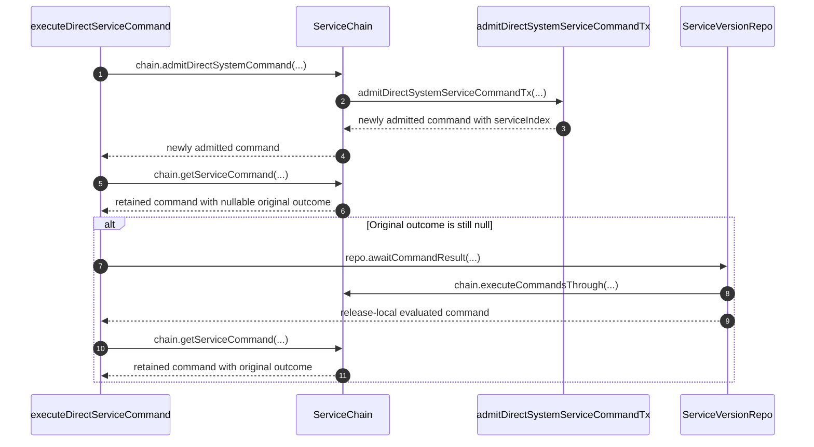

ServiceChain durably orders complete admitted commands. Admission assigns
`serviceIndex` and stores null `outcome`; command execution, original outcome
retention and selected publication follow through separate durable boundaries.
[Service execution](./serviceExecution.md) describes external requests and ordinary continuation execution.

## Trigger

1. Actor sessions, automatic Agents and administrative callers submit ordinary input to the ServiceChain bound to `serviceName`.
   - [`ServiceChain.ts:341-375`](../../../packages/system-worker/src/ServiceChain/ServiceChain.ts#L343-L377) — decodes the RPC page, holds original-delivery recovery and wakes execution after admission.
   - [`admitServiceCommands.ts:17-37`](../../../packages/system-worker/src/ServiceChain/admitServiceCommands/admitServiceCommands.ts#L17-L37) — strictly decodes the ordinary Actor/Agent/System page, checks the bound Service name and delegates one transaction.
2. Direct administrative execution uses explicit fresh System admission, then awaits that invocation's original outcome from ServiceChain.
   - [`executeDirectServiceCommand.ts:20-66`](../../../packages/system-worker/src/executeDirectServiceCommand/executeDirectServiceCommand.ts#L18-L60) — validates the admitted command, reads retained original progress and requests execution only while the outcome is absent.

## Annotated workflow steps

1. Submit ID-less direct System input to its named ServiceChain.
   - [`executeDirectServiceCommand.ts`](../../../packages/system-worker/src/executeDirectServiceCommand/executeDirectServiceCommand.ts) — acquires the Chain and invokes `admitDirectSystemCommand`.
2. Strictly decode and validate fresh admission in one synchronous transaction.
   - [`admitDirectSystemServiceCommandTx.ts`](../../../packages/system-worker/src/ServiceChain/admitDirectSystemServiceCommandTx.ts) — rejects caller IDs and checks bound Service identity, exact support/grant and payload.
3. Derive the canonical ID from the next logical position and retain it atomically.
   - [`admitDirectSystemServiceCommandTx.ts`](../../../packages/system-worker/src/ServiceChain/admitDirectSystemServiceCommandTx.ts) — constructs the System Service tuple before calling the shared append procedure.
4. Return the newly admitted command and its position; its original outcome may still be absent.
   - [`appendServiceCommand.ts`](../../../packages/system-worker/src/ServiceChain/admitServiceCommands/appendServiceCommand.ts) — commits complete input and logical admission progress with null `outcome`.
5. Read the exact command position from ServiceChain.
   - [`executeDirectServiceCommand.ts:39-43`](../../../packages/system-worker/src/executeDirectServiceCommand/executeDirectServiceCommand.ts#L33-L37) — reads the retained command position through `getServiceCommand`.
6. Return an existing original outcome immediately when present.
   - [`executeDirectServiceCommand.ts:43-47`](../../../packages/system-worker/src/executeDirectServiceCommand/executeDirectServiceCommand.ts#L37-L41) — decodes the non-null retained `outcome` with `CommandOutcomeSchema` without waiting for new work.
7. If the original outcome is absent, acquire its exact admitted release's ServiceVersionRepo.
   - [`executeDirectServiceCommand.ts:49-58`](../../../packages/system-worker/src/executeDirectServiceCommand/executeDirectServiceCommand.ts#L43-L52) — requests `awaitCommandResult` using the command's Service release and position.
8. Progress originals through that bounded position.
   - [`awaitCommandResult.ts:33-42`](../../../packages/owner-release-worker/src/ServiceVersionRepo/awaitCommandResult/awaitCommandResult.ts#L33-L42) — acquires the source ServiceChain and calls `executeCommandsThrough(serviceIndex)`.
9. Catch up the receiving release and recover its full evaluated command.
   - [`awaitCommandResult.ts:43-46`](../../../packages/owner-release-worker/src/ServiceVersionRepo/awaitCommandResult/awaitCommandResult.ts#L43-L46) — waits for bounded replay and reads the exact retained evaluation.
10. Read ServiceChain again after original progress; release-local evaluation is not substituted for the original command.
    - [`executeDirectServiceCommand.ts:59-61`](../../../packages/system-worker/src/executeDirectServiceCommand/executeDirectServiceCommand.ts#L53-L55) — validates a fresh `readRetainedCommand()` result rather than returning the VersionRepo result.
11. Decode a non-null original `outcome` from the final ServiceChain read.
    - [`executeDirectServiceCommand.ts:59-65`](../../../packages/system-worker/src/executeDirectServiceCommand/executeDirectServiceCommand.ts#L53-L59) — decodes the original outcome and reports pending original acknowledgement when it is absent or invalid.

## Authority and producer binding

Ordinary Service commands use scalar `kind: 'actor' | 'agent' | 'system'`.
Actor input keeps complete encoded claims and the exact Actor name/version.
Actor sessions bind their retained capabilities and complete identity; Agent Node
Repos freeze permitted commands and stamp their source Agent identity. ServiceChain
checks each new command against the exact Actor/Agent version and contract map, or
the owner release's explicit `system` grant, then requires the exact contract version. Runtime lineage is used for historical replay, not fresh admission. Non-Actor commands
omit `nodeId`, `sessionName`, `pushIndex` and Actor claims, and cannot use
claims-bearing contracts. Ordinary Actor producer submissions retain
nonempty Node/session identity, positive push positions and SQL pair uniqueness.
Non-Node retries compare retained input before consulting current declarations. Node submissions validate their derived ID, frozen producer binding and next push position using `nodeProducers`, independently of historical commands.

- [`CommandSchema.ts:38-60`](../../../packages/core/src/contracts/CommandSchema.ts#L38-L60) — separates the required Actor Node tuple from flat claims-free Agent/System variants.
- [`CommandSchema.ts:166-170`](../../../packages/core/src/contracts/CommandSchema.ts#L166-L170) — composes only ordinary Actor/Agent/System variants for ordinary Service ingress.
- [`validateNewServiceCommand.ts:16-29`](../../../packages/system-worker/src/ServiceChain/admitServiceCommands/validateNewServiceCommand.ts#L16-L29) — resolves the exact Actor/Agent/System grant, enforces claims-free non-Actor input and validates Actor claims beside submitted-version payload checks.
- [`admitServiceSocketCommand.ts:40-56`](../../../packages/system-worker/src/ServiceActorVersionChain/onMessage/admitServiceSocketCommand.ts#L40-L56) — binds Actor name/version, complete claims, owner, Node/session and selected contract version before forwarding to ServiceChain.
- [Agent callback interpreter](../../../packages/core/src/agent/runAgentWake.ts) — stages granted commands against selected data and freezes their inputs for durable delivery.
- [`ServiceAgentNodeRepo.ts:175-215`](../../../packages/agent-worker/src/ServiceAgentNodeRepo.ts#L175-L215) — stamps flat immutable Service/Agent identity without Actor/Node fields on frozen delivery before Chain admission.
- [`serviceChainDbConfig.ts:41-46`](../../../packages/system-worker/src/ServiceChain/serviceChainDbConfig.ts#L41-L46) — makes the non-null Node/push pair unique in retained admission history.

ServiceVersionRepo retains Actor-aware execution contract resolution, complete
claims interpretation and guards. Admission does not replace those execution
requirements or introduce asynchronous declaration lookup inside transactions.

- [`resolveServiceExecution.ts:45-76`](../../../packages/owner-release-worker/src/ServiceVersionRepo/utils/resolveServiceExecution.ts#L45-L76) — resolves the retained Actor, decodes claims, selects the execution contract and prepares its invocation.
- [`findServiceExecutionContract.ts`](../../../packages/system-worker/src/ServiceVersionRepo/utils/findServiceExecutionContract.ts) — looks up the addressed Service release’s Actor grant or ordinary contract.

## External continuation admission

ServiceChain retains the first `externalOutcome` on its pending request. The
exact emitting `OwnerReleaseWorker` maps the frozen input and recorded response
or failure to an ordinary continuation. ServiceChain appends that System command
with the pending request's `externalCommandId` and original `serviceVersion` at
the next `serviceIndex` and deletes the pending request in one synchronous
transaction. A mapping or encoding failure commits as `continuationFailure` on
the pending request before ServiceChain admits the command with a SQL `NULL`
payload and public failure.
An already-consumed pending request makes a late callback a no-op.

- [`admitServiceCommands.ts:17-29`](../../../packages/system-worker/src/ServiceChain/admitServiceCommands/admitServiceCommands.ts#L17-L29) — checks ordinary ingress and rejects excess fields.
- [`serviceChainDbConfig.ts`](../../../packages/system-worker/src/ServiceChain/serviceChainDbConfig.ts) — retains the frozen invocation, first observation and any construction failure on the pending request.
- [`recordExternalOutcomeAndAdmitCommandTx.ts:27-45`](../../../packages/system-worker/src/ServiceChain/recordExternalOutcomeAndAdmitCommandTx.ts#L27-L45) — records the first observation before running the mapper.
- [`recordExternalOutcomeAndAdmitCommandTx.ts:75-99`](../../../packages/system-worker/src/ServiceChain/recordExternalOutcomeAndAdmitCommandTx.ts#L75-L99) — retains a mapper or encoding failure on the pending row before admission.
- [`recordExternalOutcomeAndAdmitCommandTx.ts:47-61`](../../../packages/system-worker/src/ServiceChain/recordExternalOutcomeAndAdmitCommandTx.ts#L47-L61) — appends the ordinary System command and deletes pending work atomically.
- [`resolveWorkContract.ts:9-30`](../../../packages/system-worker/src/externalOperations/resolveWorkContract.ts#L9-L30) — requires the frozen emitting release’s exact `external` registration and contract version.

These workflows describe current source behavior. Authentication and ticket
transport retain their independent verification boundaries. Changed fixed schemas
require empty affected storage; the implementation supplies no automatic reset,
translation or compatibility path.

## Service retention and focused workflows

ServiceChain is bound to `{ systemId, serviceName }` and stores admitted input/`serviceIndex`, nullable first original `outcome` and complete pending deliveries. It owns no resource graph or retained evaluated-operation history/hash. One synchronous page transaction validates Node producer checkpoints or recognizes immutable non-Node retries before fresh authority checks; a later invalid member rolls back new admission for the whole page. Flat provenance row codecs use SQL null for inactive fields and reconstruct canonical variants with those fields absent. Node/push uniqueness and producer continuity remain separate constraints.

- [`admitServiceCommandsTx.ts:24-52`](../../../packages/system-worker/src/ServiceChain/admitServiceCommands/admitServiceCommandsTx.ts#L24-L41) — checks Node checkpoints or exact retained non-Node input before fresh validation and logical-position append.
- [`evaluatedServiceCommand.ts:114-174`](../../../packages/system-worker/src/ServiceVersionChain/evaluatedServiceCommand.ts#L114-L174) — restores concrete provenance branches while rejecting contradictory inactive columns.

The first original-outcome transaction compares complete immutable admitted input, requires finalized predecessor order, and freezes pending command/external work with `commands.outcome`. A repeated equal whole outcome returns before pending insertion; it cannot recreate settled delivery. ServiceVersionChain owns full evaluated-output equality. Direct Service execution returns retained `ICommandOutcome` after its independent command-specific wait, not an admitted-command wrapper, and waits for no later external work.

- [`recordOriginalCommandOutcomeTx.ts:49-140`](../../../packages/system-worker/src/ServiceChain/recordOriginalCommandOutcomeTx.ts#L49-L140) — commits original outcome with complete pending output and treats equal original retries as no-ops.
- [`executeDirectServiceCommand.ts:39-65`](../../../packages/system-worker/src/executeDirectServiceCommand/executeDirectServiceCommand.ts#L33-L59) — recovers the original retained outcome before or after the release-specific result wait.

[serviceExecution](./serviceExecution.md) owns exact evaluation/time/history recovery, [SelectedViews](./SelectedViews.md) owns Actor/Agent publication and privacy, and [DeliveryAndRecovery](./DeliveryAndRecovery.md) owns request settlement, command delivery and subscriber recovery. The [pre-consolidation ServiceChain report](https://github.com/morgs32/zerospin/blob/79c1824b1a0353f770211851c0bfe1cc54d0ba46/packages/system-worker/src/ServiceChain/README.md) preserves dated Plans 196/219 evidence without making those fixtures current acceptance.
