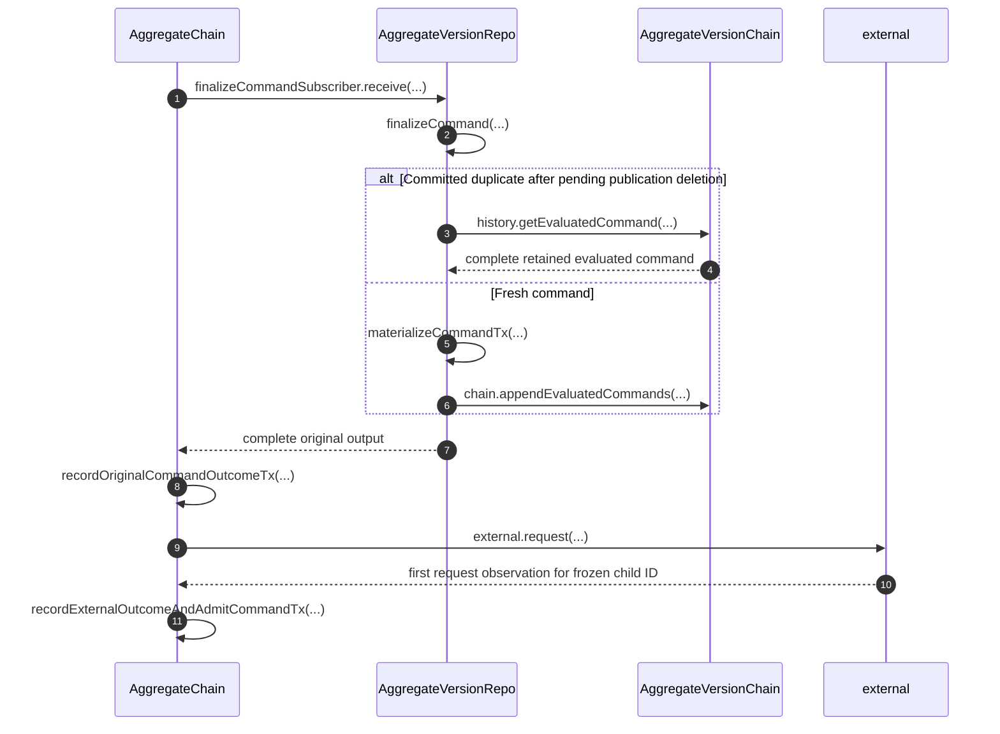

AggregateVersionRepo evaluates synchronous command guards/programs and applies model
operations. Its single complete VersionChain publication contains **all operations**:
model mutations and frozen external descriptions in one ordered `operations` union. The original finalization reply
returns this same full admitted `IEvaluatedAggregateCommand` to AggregateChain; only that admission Chain runs requests.

## Trigger

1. AggregateChain selects the oldest admitted command with null commands.outcome.
   - [`AggregateChain.ts:227-244`](../../../packages/system-worker/src/AggregateChain/AggregateChain.ts#L227-L244) — selects the retained aggregateVersion and acquires its finalizeCommandSubscriber capability.

## Annotated workflow steps

1. Deliver one admitted original through the bound receiving capability.
   - [`AggregateChain.ts:227-244`](../../../packages/system-worker/src/AggregateChain/AggregateChain.ts#L227-L244) — routes the selected pending original by its immutable release.
2. Check committed progress before declaration lookup; fresh execution catches up predecessors and rechecks under its permit.
   - [`finalizeCommand.ts:1-109`](../../../packages/owner-release-worker/src/AggregateVersionRepo/finalizeCommand/finalizeCommand.ts#L1-L109) — validates owner/input, reads the checkpoint and keeps recovery RPCs outside the execution permit.
3. A duplicate whose local publication is deleted requests its exact VersionChain history evaluated command.
   - [`readEvaluatedCommand.ts:7-15`](../../../packages/owner-release-worker/src/AggregateVersionRepo/readEvaluatedCommand/readEvaluatedCommand.ts#L7-L15) — requires the complete result from findEvaluatedCommand and refuses missing committed output.
4. Recover all model/external operations and timestamps without reevaluation.
   - [`evaluatedAggregateCommand.ts:13-43`](../../../packages/system-worker/src/AggregateVersionChain/evaluatedAggregateCommand.ts#L13-L43) — defines the full evaluated command used for publication, history and original replies.
5. Fresh execution commits resources/refusal, checkpoint and complete publication in one synchronous transaction.
   - [`retainEvaluatedCommandTx.ts:1-42`](../../../packages/system-worker/src/AggregateVersionRepo/utils/retainEvaluatedCommandTx.ts#L1-L42) — stores the full operation batch alongside checkpoint advancement in the resource transaction.
6. Publish that evaluated command independently of original RPC return.
   - [`AggregateVersionRepo.ts:1-373`](../../../packages/owner-release-worker/src/AggregateVersionRepo/AggregateVersionRepo.ts#L1-L373) — arms publication before production and schedules delivery without awaiting it in original return.
7. Return full committed output to the calling admission Chain.
   - [`finalizeCommandRows.ts:1-28`](../../../packages/owner-release-worker/src/AggregateVersionRepo/finalizeCommand/finalizeCommandRows.ts#L1-L28) — preserves the complete finalization result.
8. Set `commands.outcome`, advance only `commandProgress.finalizedThroughIndex` and retain complete pending command/external rows with the immediate producing command ID atomically before any invocation. Preserve `commandProgress.admittedThroughIndex`.
   - [`recordOriginalCommandOutcomeTx.ts:74-144`](../../../packages/system-worker/src/AggregateChain/recordOriginalCommandOutcomeTx.ts#L74-L144) — validates the immediate predecessor, retains outcome and finalization progress, then freezes complete pending deliveries without changing admission progress; equal outcomes return before these writes.
9. Execute the frozen request only from the admission Chain, outside SQL and permits.
   - [`makeExternalOperationQueue.ts:1-151`](../../../packages/system-worker/src/externalOperations/makeExternalOperationQueue.ts#L1-L151) — resolves exact frozen declarations and holds one live reservation through invocation/finalizers/recording.
10. Encode Success, terminal Failure or successful JSON null with its recording time.
    - [`makeExternalOperationQueue.ts:95-128`](../../../packages/system-worker/src/externalOperations/makeExternalOperationQueue.ts#L95-L128) — separates request/response failure from declaration/storage failure and records the observed branch.

11. Retain the first observation on pending work. The pinned emitting release uses its exact external declaration to build and encode the ordinary continuation. AggregateChain appends the stable-ID command and deletes pending work together. Admission backpressure preserves the observation for retry.
    - [Aggregate continuation admission](../../../packages/system-worker/src/AggregateChain/recordExternalOutcomeAndAdmitCommandTx.ts)
    - [External continuation builder](../../../packages/core/src/contracts/externalExecution/buildExternalContinuation.ts)

AggregateVersionRepo reads its current materializationHead before catch-up and fresh
evaluation. The head contains only singletonId, aggregateIndex and dispositionChainHash;
command identity is recovered from admitted commands and complete evaluated commands.

- [`readAggregateMaterializationHead.ts:9-24`](../../../packages/system-worker/src/AggregateVersionRepo/readAggregateMaterializationHead.ts#L9-L24) — reads singleton slot 1 or returns the aggregate genesis position/hash, with no commandId field.

## Compacted admitted history

`AggregateChain` keeps each finalized command until the listed releases that
receive that position from `AggregateChain` have acknowledged it and at least one
`AggregateVersionChain` proves durable publication. A release obtains positions
through its enrollment watermark from its named predecessor. Acknowledgement
and advancement of `commandProgress.compactedThroughIndex` commit together with
local deletion.

Compacted reads use the admitted input and its stable `outcome.finalizedAt` from
a VersionChain with a covering acknowledgement. The addressed
`AggregateVersionRepo` supplies the evaluated `outcome` for direct invocations.
The [history handoff workflow](./CanonicalHistoryHandoff.md) describes enrollment
and compaction.

- [`compactAggregateHistory.ts:14-54`](../../../packages/system-worker/src/AggregateChain/compactAggregateHistory.ts#L14-L54) — bounds deletion by finalization, durable publication and every listed release's replay obligation.
- [`readAggregateCommand.ts:30-57`](../../../packages/system-worker/src/AggregateChain/readAggregateCommand.ts#L30-L57) — reads a command at its original position from the compacted prefix or the local suffix.
- [`getPublishedAggregateHistory.ts:18-32`](../../../packages/system-worker/src/AggregateChain/getPublishedAggregateHistory.ts#L18-L32) — selects a VersionChain using its durable `acknowledgedAggregateIndex`.
- [`executeDirectSystemAggregateCommand.ts:37-50`](../../../packages/system-worker/src/executeDirectSystemAggregateCommand/executeDirectSystemAggregateCommand.ts#L37-L50) — returns the addressed AggregateVersionRepo's evaluated outcome.
- [`validateCommandIdentity.ts:39-62`](../../../packages/owner-release-worker/src/AggregateVersionRepo/validateCommandIdentity.ts#L39-L62) — compares decoded admitted fields and finalizedAt separately from release-local results.

## History, projections and failures

VersionChain history and complete fanout retain external descriptions for exact reply
recovery. Projection Repos apply model operations only and publish selected output;
they never evaluate external programs or transmit frozen descriptions to clients.
Replay retains its receiving release's outcome/model operations and drops external
emissions. Original output can differ from another release's output. AggregateChain
consumes the full reply transiently and retains no originalExecutions, model-operation history or dispositionChainHash. AVC retains complete evaluated command
equality; AggregateChain compares every immutable admitted field and its retained original outcome.

Public refusal rolls back business writes and has empty operation arrays. Infrastructure
failure commits no progress and retains the complete Cause. A missing historical
request implementation remains an explicit recovery failure; there is no latest-version
route, database-bearing external program or exactly-once provider guarantee.

History, publication and identity RPCs run outside SQL transactions.
AggregateVersionChain holds its append permit across Archive writes and the
published-head transaction.

`IEvaluatedAggregateCommand` preserves every admitted field with canonical `id`, including
payload, external observation, source contract/release, aggregate identity, full
scalar kind, applicable flat variant fields and position. Actor commands retain a
complete Node tuple; external commands retain only their immediate `originCommandId`
and observation, without Actor claims, Agent identity or Node fields. Its `aggregateVersion` stays the original
admission release; the bound AggregateVersionRepo/AggregateVersionChain identifies
the evaluating release. `outcome` is `{ result: Success | Failure, finalizedAt }`.
Source model writes and projection model writes use that one `outcome.finalizedAt`;
selected history retains no redundant clock column because selected deltas already
carry resulting resource timestamps. Neither result branch retains a
timestamp, and no separate Aggregate execution-start sample remains.

- [`evaluatedAggregateCommand.ts:13-43`](../../../packages/system-worker/src/AggregateVersionChain/evaluatedAggregateCommand.ts#L13-L43) — defines the complete admitted value and operations without repeated parent context.
- [`readAggregateCommandTx.ts:40-73`](../../../packages/system-worker/src/AggregateVersionRepo/utils/readAggregateCommandTx.ts#L40-L73) — checks contiguous progress and samples one finalization time inside materialization.
- [`makeEvaluatedAggregateCommand.ts:24-43`](../../../packages/system-worker/src/AggregateVersionRepo/utils/makeEvaluatedAggregateCommand.ts#L24-L43) — assembles the result and timestamp into the one complete evaluated command.
- [`prepareEvaluatedCommandForReplay.ts:45-73`](../../../packages/system-worker/src/aggregateProjection/applyEvaluatedCommands/prepareEvaluatedCommandForReplay.ts#L45-L73) — binds model mutations using the parent's outcome.finalizedAt.

## Exact execution interpretation and logical time

The executing Aggregate release selects `executionContract`; the submitted `contractVersion` identifies historical source interpretation independently of the original `aggregateVersion`. Ordinary Actor commands must belong to the executing release's Actor exposure. Ordinary payloads adapt only through that public contract's authored lineage.

- [`resolveAggregateExecution.ts:30-55`](../../../packages/system-worker/src/AggregateVersionRepo/utils/resolveAggregateExecution.ts#L30-L55) — resolves the supported source declaration and historical Actor claims before selecting the receiving release contract.
- [`resolveAggregateExecution.ts:99-124`](../../../packages/system-worker/src/AggregateVersionRepo/utils/resolveAggregateExecution.ts#L99-L124) — enforces ordinary lineage and prepares its decoded invocation.

An ordinary continuation uses the same contract lineage as other commands.
The source executable can apply a down adapter for the receiving release.
Replay consumes the admitted payload and produces no additional provider requests.

Historical Actor claims and prepared invocation claims retain their separate guard scopes. A receiving release that lacks an ordinary contract, Actor exposure or supported ordinary version lineage retains `aggregate-contract-unsupported` with no operations and advances replay after validating source declaration, recorded authority, payload. Source validation never calls the provider request. Missing source declarations, incompatible command kinds, invalid input and broken adapters still abort without an outcome/checkpoint. A supported command's business Failure remains an evaluated outcome.

- [`resolveAggregateExecution.ts:54-114`](../../../packages/system-worker/src/AggregateVersionRepo/utils/resolveAggregateExecution.ts#L54-L114) — validates ordinary authority and input before returning the receiving release's support refusal.
- [`executeAggregateCommandTx.ts:88-132`](../../../packages/system-worker/src/AggregateVersionRepo/utils/executeAggregateCommandTx.ts#L88-L132) — retains validated ordinary support refusals during replay; unresolved invocation and infrastructure Causes escape.
- [`evaluateAggregateCommand.ts:25-61`](../../../packages/system-worker/src/AggregateVersionRepo/utils/evaluateAggregateCommand.ts#L25-L61) — runs owner policy with historical Actor claims, evaluates the prepared invocation against Actor-visible or canonical rows, then encodes the result before model application.

Original materialization samples one `finalizedAt` after authority/input/progress checks. The business savepoint freezes Effect wall Clock at that time across adapters, guards and programs; elapsed monotonic timing/sleep remain live. Replay uses retained source time, and restoration uses immutable evaluated output without reevaluation. Model writes, retained Success/Failure and later selected projection writes use that same time. Infrastructure rollback retains no outcome or progress. Query/authentication/external-request wall time remains live.

- [`readAggregateCommandTx.ts:73-80`](../../../packages/system-worker/src/AggregateVersionRepo/utils/readAggregateCommandTx.ts#L73-L80) — samples Effect Clock for originals or reuses the admitted command's retained finalization time during replay.
- [`withCommandEvaluationClock.ts:9-20`](../../../packages/core/src/contracts/withCommandEvaluationClock.ts#L9-L20) — replaces wall time while delegating monotonic timing and sleep to the live Clock.

## Retained history and documentation ownership

AggregateVersionRepo owns resources, one minimal materialization checkpoint and
complete pending evaluated commands. AggregateVersionChain validates publication,
awaits Archive durability for the complete offered page and commits its published
head. AggregateVersionRepo deletes its pending commands after that acknowledgement.
Actor and Agent fanout reads the Archive through the published head and advances
its own subscriber cursors. [Version Chain Archives](./VersionChainArchives.md)
governs Archive routing, rollover and retries.

- [`validateEvaluatedCommandPublication.ts:21-93`](../../../packages/system-worker/src/AggregateVersionChain/validateEvaluatedCommandPublication.ts#L21-L93) — validates operation payloads and the contiguous fresh suffix.
- [`AggregateVersionChain.ts:449-499`](../../../packages/system-worker/src/AggregateVersionChain/AggregateVersionChain.ts#L449-L499) — validates exact repeats, awaits Archive durability and advances the published head.

At the same Aggregate identity and position, equal `dispositionChainHash` establishes equal ordered command IDs and Success/Failure decisions through that prefix. It establishes no equality of results, operations, resource graphs or finalization timestamps. AggregateChain retains no such hash.

- [`aggregateDispositionChainHash.ts:24-44`](../../../packages/system-worker/src/aggregateDispositionChainHash/aggregateDispositionChainHash.ts#L24-L44) — hashes previous prefix, position, command ID and result tag.

[SelectedViews](./SelectedViews.md) owns projection/privacy/capture detail, [DeliveryAndRecovery](./DeliveryAndRecovery.md) owns outgoing request/command delivery and subscriber recovery, and [RepoLifecycle](./RepoLifecycle.md) owns activation and schema gating. The [pre-consolidation AggregateVersionRepo report](https://github.com/morgs32/zerospin/blob/79c1824b1a0353f770211851c0bfe1cc54d0ba46/packages/system-worker/src/AggregateVersionRepo/README.md) preserves its original status and proof limits. This migration does not close Plans 234 or 236.
