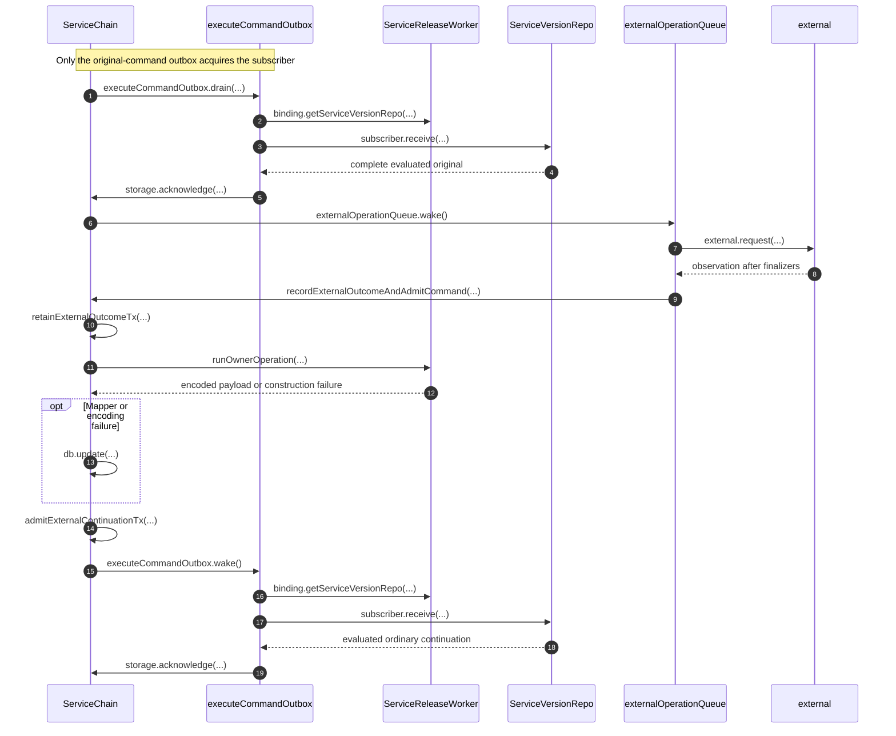

ServiceVersionRepo evaluates admitted commands and commits current resources,
`materializationHead` and one complete pending evaluated command together.
ServiceVersionChain retains that immutable evaluated history across local command rows and ServiceVersionArchive ranges. ServiceChain owns
the local admitted-input suffix, original finalization, complete pending command
deliveries and external requests. It reads its adopted canonical prefix through the saved ServiceVersionChain. In a split deployment the stable System Worker hosts ServiceChain, and each registered `ServiceReleaseWorker` hosts its ServiceVersionRepo, ServiceVersionChain and ServiceVersionArchive.
Only ServiceChain invokes external request code. Its original-command outbox is the sole sender to `ServiceVersionRepo.executeCommandSubscriber`. A continuation uses the shared Repo handle to call `awaitCommandResult`.

- [`types.ts:15-33`](../../../packages/system-worker/src/ServiceVersionRepo/types.ts#L15-L33) — declares the subscriber’s retry contract and the ordinary Repo interface separately.
- [`admitRecordedCommand.ts:127-139`](../../../packages/system-worker/src/commandOperations/admitRecordedCommand.ts#L127-L139) — waits for the destination release’s evaluated command at the admitted `serviceIndex` and checks its `id`.

## Trigger

1. Admission, explicit bounded execution or recovery drives ServiceChain's original-delivery queue.
   - [`ServiceChain.ts:555-569`](../../../packages/system-worker/src/ServiceChain/ServiceChain.ts#L555-L569) — delegates `executeCommandsThrough` to the original queue and a captured Service position.
   - [`ServiceChain.ts:611-618`](../../../packages/system-worker/src/ServiceChain/ServiceChain.ts#L611-L618) — wakes original delivery after ordinary admission.
   - [`ServiceChain.ts:843-845`](../../../packages/system-worker/src/ServiceChain/ServiceChain.ts#L843-L845) — resumes registered recovery when the alarm fires.
2. Select the oldest admitted command whose retained original `outcome` is null.
   - [`readPendingServiceCommand.ts:6-22`](../../../packages/system-worker/src/ServiceChain/readPendingServiceCommand.ts#L6-L22) — reads the earliest pending position, optionally bounded by the requested index.
   - [`ServiceChain.ts:291-300`](../../../packages/system-worker/src/ServiceChain/ServiceChain.ts#L291-L300) — reads one pending row and reconstructs its admitted command.

## Annotated workflow steps

1. Progress originals through the captured admitted checkpoint.
   - [`executeCommandsThrough.ts:19-33`](../../../packages/system-worker/src/ServiceChain/executeCommandsThrough/executeCommandsThrough.ts#L19-L33) — computes the bounded prefix and refuses an incomplete requested position after draining.
2. The outbox uses ServiceChain’s private receiver lookup for `{ systemId, serviceName, serviceVersion }`. ServiceChain supplies the first two fields and the admitted command supplies its release version.
   - [`ServiceChain.ts:150-170`](../../../packages/system-worker/src/ServiceChain/ServiceChain.ts#L150-L170) — captures the original-delivery bindings in the Chain constructor.
   - [`bindReleaseRepoNamespace.ts:57-76`](../../../packages/system-worker/src/ownerOperations/bindReleaseRepoNamespace.ts#L57-L76) — selects the matching colocated namespace or routes to the release Worker.
   - [`ServiceReleaseWorker.ts:183-190`](../../../packages/owner-release-worker/src/ServiceReleaseWorker.ts#L183-L190) — checks the release identity before returning its Repo stub.
3. Deliver the single pending command with `subscriber.receive([admittedCommand])`.
   - [`ServiceChain.ts:321-332`](../../../packages/system-worker/src/ServiceChain/ServiceChain.ts#L321-L332) — obtains `executeCommandSubscriber` from the selected receiver for the outbox.
   - [`makeOutboxDelivery.ts:246-254`](../../../packages/core/src/outbox/makeOutboxDelivery.ts#L246-L254) — calls `receive` on that subscriber with the pending rows.
   - [`executeCommand.ts:44-99`](../../../packages/owner-release-worker/src/ServiceVersionRepo/executeCommand/executeCommand.ts#L44-L99) — recovers committed retries and catches up predecessors outside the execution permit.
4. Return the complete original evaluation after materialization commits.
   - [`retainEvaluatedCommandTx.ts:16-39`](../../../packages/owner-release-worker/src/ServiceVersionRepo/utils/retainEvaluatedCommandTx.ts#L16-L39) — inserts pending publication and advances the materialization head in the resource transaction.
5. Acknowledge the reply with the original outcome and pending work.
   - [`recordOriginalCommandOutcomeTx.ts:49-139`](../../../packages/system-worker/src/ServiceChain/recordOriginalCommandOutcomeTx.ts#L49-L139) — checks identity and predecessor order before retaining the outcome and complete pending deliveries.
6. Wake the external request queue from the original-completion hook.
   - [`ServiceChain.ts:334-352`](../../../packages/system-worker/src/ServiceChain/ServiceChain.ts#L334-L352) — protects replay and command-delivery recovery while waking external work.
7. Resolve the emitting release's exact external declaration and invoke the request outside the transaction.
   - [`ServiceChain.ts:515-523`](../../../packages/system-worker/src/ServiceChain/ServiceChain.ts#L515-L523) — supplies the release from the recorded `serviceVersion`.
   - [`runExternalOperation.ts:21-48`](../../../packages/system-worker/src/externalOperations/runExternalOperation.ts#L21-L48) — resolves the declaration and decodes its frozen payload before execution.
8. Build the observation after request finalizers settle.
   - [`executeExternalRequest.ts:14-22`](../../../packages/core/src/contracts/externalExecution/executeExternalRequest.ts#L14-L22) — invokes the authored request under its timeout and encodes the usable response.
9. Hand the observation to ServiceChain for settlement.
   - [`makeExternalOperationQueue.ts:66-75`](../../../packages/system-worker/src/externalOperations/makeExternalOperationQueue.ts#L66-L75) — reuses the retained observation when available and reconciles recovery after settlement.
10. Retain the first `externalOutcome` on the pending request before mapping.
    - [`recordExternalOutcomeAndAdmitCommandTx.ts:27-45`](../../../packages/system-worker/src/ServiceChain/recordExternalOutcomeAndAdmitCommandTx.ts#L27-L45) — records the first observation and reads it back unchanged on retry.
11. Call the emitting release's `ServiceReleaseWorker` with the frozen request input and its retained observation.
    - [`ServiceChain.ts:498-509`](../../../packages/system-worker/src/ServiceChain/ServiceChain.ts#L498-L509) — builds the release-specific mapper call and supplies its reply schema.
12. Return the selected ordinary contract and either an encoded payload or a public construction failure.
    - [`OwnerReleaseWorker.ts:78-111`](../../../packages/owner-release-worker/src/OwnerReleaseWorker.ts#L78-L111) — the shared Worker implementation decodes the operation request, invokes the pinned continuation mapper and serializes the reply.
13. Persist a mapper or encoding failure as `continuationFailure` before attempting admission.
    - [`recordExternalOutcomeAndAdmitCommandTx.ts:75-99`](../../../packages/system-worker/src/ServiceChain/recordExternalOutcomeAndAdmitCommandTx.ts#L75-L99) — reuses an already recorded failure and writes a new failure while the request remains pending.
14. Admit the ordinary System command at the next position and delete the pending request in one transaction.
    - [`recordExternalOutcomeAndAdmitCommandTx.ts:47-61`](../../../packages/system-worker/src/ServiceChain/recordExternalOutcomeAndAdmitCommandTx.ts#L47-L61) — appends and deletes together, leaving both changes rolled back on failure.
15. Wake original execution for the continuation.
    - [`ServiceChain.ts:511-513`](../../../packages/system-worker/src/ServiceChain/ServiceChain.ts#L511-L513) — wakes the original outbox after the settlement attempt.
16. Resolve the continuation's emitting Service release and obtain its `ServiceVersionRepo`.
    - [`ServiceChain.ts:321-332`](../../../packages/system-worker/src/ServiceChain/ServiceChain.ts#L321-L332) — uses the same private lookup for the continuation’s admitted `serviceVersion`.
17. Deliver the ordinary continuation for original execution.
    - [`executeServiceOccurrence.ts:45-67`](../../../packages/owner-release-worker/src/ServiceVersionRepo/utils/executeServiceOccurrence.ts#L45-L67) — returns a construction failure before invocation lookup when the payload is SQL `NULL`.
18. Return the evaluated continuation with its own outcome and operations.
    - [`makeEvaluatedServiceCommand.ts:20-42`](../../../packages/owner-release-worker/src/ServiceVersionRepo/utils/makeEvaluatedServiceCommand.ts#L20-L42) — preserves admitted input and adds the release-local outcome and disposition hash.
19. Retain the continuation's original outcome in ServiceChain.
    - [`ServiceChain.ts:302-312`](../../../packages/system-worker/src/ServiceChain/ServiceChain.ts#L302-L312) — records each execution reply through `recordOriginalCommandOutcomeTx`.

## Complete output, time and publication

`IEvaluatedServiceCommand` retains the complete admitted input, canonical `id`,
original `serviceVersion`, `serviceIndex`, `outcome`, `dispositionChainHash` and one
ordered union of model, command and external operations. The evaluating release is
bound by the VersionRepo/VersionChain identity. `outcome` contains
`{ result: Success | Failure, finalizedAt }`; its tag is `outcome.result._tag`.
Sparse authored `operationIndex` values remain unchanged when replay omits outgoing
command/external emissions. Model members derive command identity from the parent;
external pending rows derive immediate `originCommandId` from the parent's own
`id` and retain the bound original emitting release. A continuation that emits more work supplies its own admitted command ID as `originCommandId`.

- [`evaluatedServiceCommand.ts:13-45`](../../../packages/system-worker/src/ServiceVersionChain/evaluatedServiceCommand.ts#L13-L45) — declares the three operation branches and the complete evaluated-command envelope.
- [`CommandOutcomeSchema.ts:5-17`](../../../packages/core/src/contracts/CommandOutcomeSchema.ts#L5-L17) — retains the tagged result separately from the shared outer finalization timestamp.
- [`prepareServiceOutput.ts:24-59`](../../../packages/owner-release-worker/src/ServiceVersionRepo/utils/prepareServiceOutput.ts#L24-L59) — preserves authored positions while dropping outgoing commands/external work before preparation during replay.
- [`readServiceOccurrenceTx.ts:49-68`](../../../packages/owner-release-worker/src/ServiceVersionRepo/utils/readServiceOccurrenceTx.ts#L49-L68) — samples Effect Clock for fresh originals or reuses retained `outcome.finalizedAt` during replay.
- [`executeServiceOccurrence.ts:48-78`](../../../packages/owner-release-worker/src/ServiceVersionRepo/utils/executeServiceOccurrence.ts#L48-L78) — freezes evaluation wall time across payload adaptation, guards, programs and application inside the business savepoint.

Publication is independent of the original RPC return. ServiceVersionRepo arms its
complete publication before execution, wakes it afterward, and deletes pending
publication only after ServiceVersionChain acknowledgement. ServiceVersionChain
compares full immutable retries using local rows or Archives; equal hashes alone cannot establish equal output. Its local commit acknowledges publication without waiting for archival. Archive delivery has one independent cursor; only its durable acknowledgement permits physical relocation of the covered local rows. Slow or new projection subscribers still read the complete logical history. [Version Chain Archives](./VersionChainArchives.md) owns those storage and recovery boundaries.
ServiceChain retains the original outcome rather than another operation history.
An exact repeated original outcome returns before pending insertion and therefore
cannot recreate settled requests.

- [`ServiceVersionRepo.ts:139-153`](../../../packages/owner-release-worker/src/ServiceVersionRepo/ServiceVersionRepo.ts#L139-L153) — delivers full pending evaluations to the same-key `appendEvaluatedCommands` RPC.
- [`ServiceVersionRepo.ts:166-186`](../../../packages/owner-release-worker/src/ServiceVersionRepo/ServiceVersionRepo.ts#L166-L186) — holds publication recovery before execution and schedules publication without awaiting acknowledgement in the original reply.
- [`ServiceVersionChain.ts:544-650`](../../../packages/system-worker/src/ServiceVersionChain/ServiceVersionChain.ts#L544-L650) — compares full retained evaluated output at old positions before inserting the new suffix.
- [`makeOutboxDelivery.ts:288-296`](../../../packages/core/src/outbox/makeOutboxDelivery.ts#L288-L296) — decodes a successful receiver envelope before invoking local acknowledgement.
- [`makeOutboxQueue.ts:225-237`](../../../packages/system-worker/src/makeOutboxQueue/makeOutboxQueue.ts#L225-L237) — deletes exactly the acknowledged publication page in one synchronous transaction.
- [`recordOriginalCommandOutcomeTx.ts:49-64`](../../../packages/system-worker/src/ServiceChain/recordOriginalCommandOutcomeTx.ts#L49-L64) — compares complete admitted input and exact retained outcome before any repeated work insertion.

## Canonical input handoff

ServiceChain reads the published head of the ServiceVersionChain selected by the
stable System's canonical configuration. A synchronous transaction records
covered replay progress, stores the adopted release and boundary, and deletes
covered local input. The previously adopted prefix remains readable until the
new selection publishes through it. Activation and original finalization arm
recovery until publication covers the finalized position.
[Canonical History Handoff](./CanonicalHistoryHandoff.md) owns replacement,
logical reads and producer checkpoint details.

- [`ServiceChain.ts`](../../../packages/system-worker/src/ServiceChain/ServiceChain.ts) — observes actual ServiceVersionChain publication without involving the pinned ServiceVersionRepo in canonical selection.
- [`adoptCanonicalServiceHistory.ts:17-40`](../../../packages/system-worker/src/ServiceChain/adoptCanonicalServiceHistory.ts#L17-L40) — replaces the readable prefix only at nondecreasing publication-proving progress and deletes covered local input.
- [`executeDirectServiceCommand.ts:34-46`](../../../packages/system-worker/src/executeDirectServiceCommand/executeDirectServiceCommand.ts#L34-L46) — returns the originating ServiceVersionRepo's own outcome, independently of the selected canonical historical result.

## Recovery and failure boundaries

If the reply is lost after `ServiceVersionRepo` commits, ServiceChain resends the same admitted command at the same `serviceIndex`. `ServiceVersionRepo` compares the delivered input with the committed command. This retry needs no pending-command readback from ServiceChain.

Committed originals recover their exact full evaluation from pending publication or
permanent logical ServiceVersionChain history, including its Archives, without reevaluating the authored program or
allocating replacement outgoing IDs. Missing/conflicting history fails. The replay
source exposes only contiguous admitted positions with retained original outcomes;
a VersionRepo checkpoint ahead of that source prefix does not authorize execution
of the command again.

- [`findEvaluatedCommand.ts:30-67`](../../../packages/owner-release-worker/src/ServiceVersionRepo/findEvaluatedCommand.ts#L30-L67) — selects pending output or exact history and validates its association with admitted input outside SQL/permits.
- [`readReplayCommandsPage.ts:22-70`](../../../packages/system-worker/src/ServiceChain/readReplayCommandsPage.ts#L22-L70) — bounds replay by the oldest command whose original outcome is still null.

Each `externalOperationOutbox` row retains `externalCommandId`,
`externalContractName`, `externalContractVersion`, frozen JSON `payload`,
the immediate `originCommandId` and emitting `serviceVersion`. Two nullable
fields record separate steps. ServiceChain stores the first `externalOutcome`
before calling the mapper. If mapping or encoding fails, ServiceChain retains
`continuationFailure` before attempting admission. Recovery resumes from the
values already retained. It can repeat an uncertain provider request if no
observation committed, and reuse a committed failure without rerunning the
mapper. The admitted ordinary command carries SQL `NULL` as its payload and
the public construction failure in that case. After admission and pending
deletion commit, the continuation follows normal original execution. An absent
pending row makes a late settlement callback a no-op.

- [`serviceChainDbConfig.ts:130-151`](../../../packages/system-worker/src/ServiceChain/serviceChainDbConfig.ts#L130-L151) — defines complete request identity, external ID uniqueness and the two nullable recovery fields.
- [`makeExternalOperationQueue.ts:66-98`](../../../packages/system-worker/src/externalOperations/makeExternalOperationQueue.ts#L66-L98) — skips already observed provider work and reserves each ID through the background settlement attempt.
- [`ServiceChain.ts:572-582`](../../../packages/system-worker/src/ServiceChain/ServiceChain.ts#L572-L582) — wakes request recovery on activation.

Public business Failure rolls back the business savepoint and retains an empty
operations union. An ordinary program refusal retains the valid encoded payload.
Replay of a SQL `NULL` construction failure advances with the retained failure,
original `outcome.finalizedAt`, and zero operations before resolving any contract.
A valid encoded command whose source Worker establishes provenance advances
with `service-contract-unsupported` if the receiving release lacks its contract.
An unavailable source binding or invalid source input keeps replay pending.

- [`replayCommand.ts:67-115`](../../../packages/owner-release-worker/src/ServiceVersionRepo/replayCommands/replayCommand.ts#L67-L115) obtains source preparation before the receiving Repo opens its transaction.
- [`resolveServiceExecution.ts`](../../../packages/owner-release-worker/src/ServiceVersionRepo/utils/resolveServiceExecution.ts) uses verified source input and ordinary receiving-release lineage.

## Projection boundary and verification

ServiceVersionChain delivers complete retained evaluations directly to exact Actor and Agent projection Repos. Their transaction applies only model output at the retained parent time and commits resources, checkpoint and complete selected publication atomically. Source acknowledgement may lag that commit after reply loss; it deletes no history. [SelectedViews](./SelectedViews.md) owns selected publication, captured snapshots, private Actor progress and public Agent observation. [DeliveryAndRecovery](./DeliveryAndRecovery.md) owns independent subscriber retry and catch-up/enrollment ordering.

- [`applyServiceProjectionCommandsTx.ts:78-120`](../../../packages/system-worker/src/serviceProjection/applyServiceProjectionCommandsTx.ts#L78-L120) — applies model mutations, selected publication and the checkpoint in the same caller transaction.

Completed Plans 214–219 and 256/257 record their bounded verification separately.
[Plan 196](../../archive/plans/196-plan-service-chain-original-operations-and-external-work.md)
records the completed connected execution-journey verification under Plan 151,
including receipt rollback, empty-drain recovery and external command recovery.
Its production-class Workerd evidence is separate from this source workflow. Authentication,
provider integration, deployed alarm timing and Agent observer/session guarantees
retain their own proof boundaries. Changed fixed schemas require empty affected
storage; no reset, translation or compatibility path is supplied.

## Exact Service execution interpretation

When the receiving bundle lacks the admitted source release, its
ServiceVersionRepo calls the stable ServiceChain with the command ID, position,
and receiving release. ServiceChain reads the finalized command and calls the
pinned source Worker for provenance and any source-side down adapter. The
receiving release supplies Actor exposure, resources, and the execution
contract. Ordinary payloads follow its public contract lineage.

- [`resolveServiceExecution.ts:29-108`](../../../packages/owner-release-worker/src/ServiceVersionRepo/utils/resolveServiceExecution.ts#L29-L108) — validates source contract kind and historical Actor claims before receiving release lookup.
- [`resolveServiceExecution.ts:134-148`](../../../packages/owner-release-worker/src/ServiceVersionRepo/utils/resolveServiceExecution.ts#L134-L148) — enforces ordinary lineage and Agent claims restrictions, then prepares the ordinary invocation.

External request declarations are resolved during settlement on the emitting
release. The admitted continuation follows ordinary command rules during Service
execution and replay. [Delivery and recovery](DeliveryAndRecovery.md)

Actor guards use historical decoded claims; contract guard/program use prepared invocation claims. Continuations use canonical owner reads with no Actor claims. A receiving release retains `service-contract-unsupported` for absent ordinary support only after source declaration, authority and input validation. Missing source provenance, invalid input, incompatible kinds and adapter failures abort without advancing the head; interpreted business Failure advances normally after savepoint rollback.

- [`resolveServiceExecution.ts:109-148`](../../../packages/owner-release-worker/src/ServiceVersionRepo/utils/resolveServiceExecution.ts#L109-L148) — validates ordinary source authority and input before emitting a receiving-release support refusal.
- [`executeServiceOccurrence.ts:99-150`](../../../packages/owner-release-worker/src/ServiceVersionRepo/utils/executeServiceOccurrence.ts#L99-L150) — retains validated support refusals or interpreted failures, while unsupported replay preparation and infrastructure Causes escape.
- [`evaluateServiceCommand.ts:21-55`](../../../packages/owner-release-worker/src/ServiceVersionRepo/utils/evaluateServiceCommand.ts#L21-L55) — preserves policy claims and Actor-visible query authority, then encodes the checked result before applying output.

ServiceVersionChain append retains full immutable evaluated-command equality, including every admitted provenance field and complete outcome/time. Equal disposition hashes cannot excuse changed operation bodies or timestamps. Append checks source identity, sparse operation order, exact model/contract bindings, unique outgoing IDs, empty Failure output and contiguous release-local hash before acknowledgement. Neither projection acknowledgement nor pending publication deletion deletes this history. The source `serviceVersion` remains original admission metadata; the bound VersionChain names the evaluating release.

- [`ServiceVersionChain.ts:544-650`](../../../packages/system-worker/src/ServiceVersionChain/ServiceVersionChain.ts#L544-L650) — compares the complete retained command at each old publication position through local or archived history.
- [`appendEvaluatedCommandsTx.ts:74-195`](../../../packages/system-worker/src/ServiceVersionChain/appendEvaluatedCommandsTx.ts#L74-L195) — validates operation output and the contiguous release-local hash before synchronous history insertion.

[SelectedViews](./SelectedViews.md) contains Service Actor versus Agent materialization, captured snapshots, private-prefix and connection recovery. [DeliveryAndRecovery](./DeliveryAndRecovery.md) contains original-only outgoing work, independent requests and fanout acknowledgements. [RepoLifecycle](./RepoLifecycle.md) contains activation, fixed-prefix catch-up and schema gating. Dated results remain in [Plan 214](../../archive/plans/214-plan-service-ordered-operations-and-finalized-at.md) and the [pre-consolidation ServiceVersionRepo report](https://github.com/morgs32/zerospin/blob/79c1824b1a0353f770211851c0bfe1cc54d0ba46/packages/system-worker/src/ServiceVersionRepo/README.md); no current runtime acceptance is inferred from this source review.
