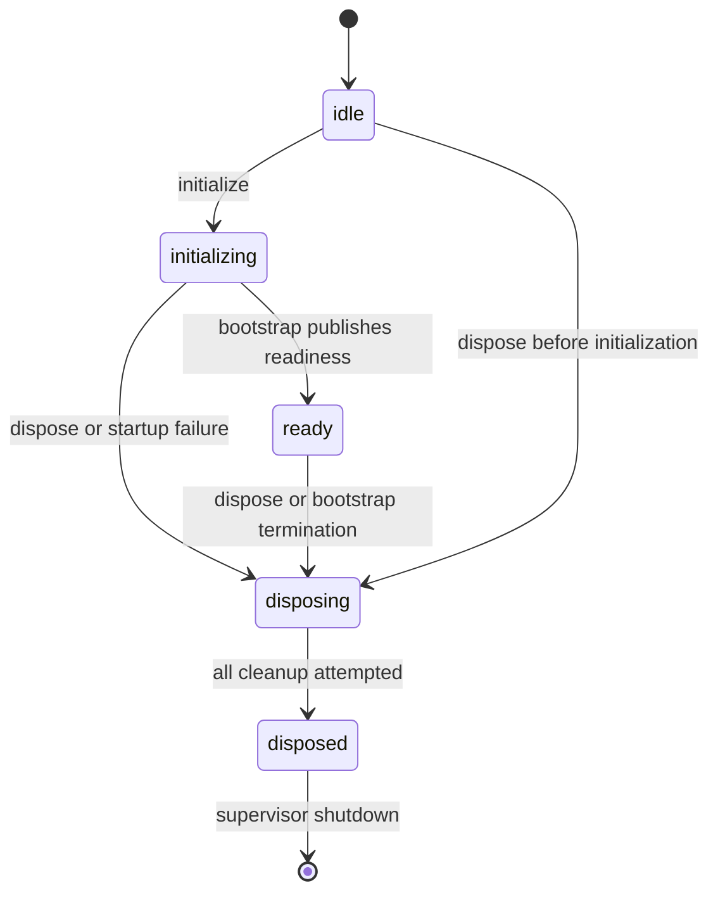

# Browser session lifecycle machine

Status: Complete — 2026-10-10. The dependency is the existing local `@zerospin/machine` package.

## Problem and scope

1. [makeSessionLifecycle](../../../packages/browser/src/makeSessionLifecycle.ts) represents lifecycle states indirectly with `active`, `runtimeDisposed`, nullable runtime/fiber fields, and cleanup promises. Aggregate, service, and standalone factories depend on the same ordering rules.
2. Replace this bookkeeping with a `@zerospin/machine` machine that owns initialization, readiness publication, cancellation, and disposal. Keep the stable browser session object and its existing public methods.
3. Include all three browser factories and their lifecycle documentation. Exclude authentication semantics, SharedWorker synchronization machines, persisted Node schemas, native lifecycle redesign, and unrelated working-tree changes.
4. Coordinate with [Plan 095](095-plan-owned-execution-and-program-runner-removal.md). It changes shared execution behavior; consume its current execution implementation without replacing its suspension handling or defect reporting.

## Current evidence and prerequisites

1. The local [machine package](../../../packages/machine/package.json) exposes `makeState`, `makeMachine`, and `makeActor`. Current `makeActor(machine, { runtime })` captures an application-owned runtime, starts once, serializes action transitions, and rejects obsolete activation handles with `StateInactive`. This supersedes older notes describing an Actor-owned application Layer.
2. Its transition implementation closes the previous activation Scope before publishing the next Handle. Bootstrap resources cannot live in the initializing activation Scope if they must survive readiness.
3. Actor readiness permits action execution; it does not establish browser-session readiness. The latter remains a separate initialization barrier.
4. Consume the local Zerospin machine package through a workspace dependency; do not vendor, publish, or link the sibling E Pluribus checkout for this change. The local package already declares Effect `^4.0.2`, matching Zerospin’s override. Verify shared runtime resolution and browser bundling rather than treating the sibling’s former release-candidate peer range as a blocker.
5. Naming reconciled during implementation: the requested plural name refers to the existing local `@zerospin/machine` package. Browser consumes that declaration directly; no package rename, duplicate package, or alias was introduced.
6. The browser README links three test files under `packages/browser/test/` that are absent in this checkout. There is no discovered existing lifecycle test suite. Do not cite those links as verification evidence or create test files, fixtures, runners, or configurations without explicit authorization.

## Ownership and interface

1. Retain `initialize(start): Promise<void>`, `dispose(): Promise<void>`, `runSync`, and `runPromise` on the existing facade. Keep callback-safe execution methods and stable session/store/failure-stream identity.
2. Each runtime lifetime has a `@zerospin/machine` Actor driven by a small supervisor runtime. The supervisor remains alive until application cleanup finishes; it must never run on the application runtime it disposes.
3. After a lifetime reaches disposed, stop and await its Actor owner Fiber, then dispose the supervisor runtime. A later initialization creates a fresh owner only after that shutdown finishes. A permanently disposed browser session must leave no parked Actor Fiber or acquired supervisor resources.
4. The facade retains only the current owner and its completed shutdown barrier. These are ownership references, not duplicate lifecycle flags. Machine state owns legal operations and transition ordering. Saved execution delegates resolve the current application runtime; bootstrap callbacks retain their exact lifetime's execution handle.
5. Keep initial lazy application-runtime acquisition: general execution before initialization may acquire services, and initialization reuses that runtime. Disposal before initialization must release those services. Do not eagerly reacquire application services after disposal.
6. Keep runtime resources in a private lifetime owner: application ManagedRuntime, independent lifetime Scope, AbortController, bootstrap Fiber, readiness Deferred, and cleanup result. Machine values carry only state tags and lifetime identity; avoid schema-decoding live runtimes, fibers, controllers, or callbacks.
7. Use native Effect promise operations without a custom promise-execution service. Retain application-layer runtime mismatch validation and current telemetry/failure layers.

## States and transitions



1. `idle` permits one initialization or disposal. `initialize` records the lifetime's startup request and commits `initializing` promptly; it must not hold the Actor action gate while waiting for bootstrap or readiness.
2. `initializing.onActivation` starts/supervises bootstrap using the independent lifetime Scope, then waits for its readiness result. Success returns `ready`; expected startup failure records the original error and returns `disposing`. Catch expected failures explicitly because machine activation failures otherwise become route-contract defects.
3. `dispose` is legal while initializing. Its transition interrupts activation-owned readiness waiting. The disposing activation cancels and cleans up the lifetime-owned bootstrap work. Do not make that bootstrap Fiber's completion depend on a machine action that cleanup itself is awaiting.
4. A readiness callback completes only its lifetime's Deferred. Cancellation wins when disposal has been admitted; a stale callback cannot publish readiness or access a replacement runtime. Resolve public initialization only after the machine has committed `ready`, not merely when bootstrap calls its callback.
5. Publish cancellation promptly when disposal is requested, including an initialization waiting for previous shutdown. Preserve `session-initialization-canceled` and reject duplicate initialization with `session-already-mounted`. Preserve the current synchronous duplicate-initialization throw; prove the facade's synchronous admission reservation before wiring asynchronous Actor dispatch. The reservation is one pending request slot, not a second lifecycle state model.
6. `ready.onActivation` supervises the still-running bootstrap Fiber. Initialization routines currently call `ready()` and then remain alive with `Effect.never`; do not treat readiness as Fiber completion. Unexpected termination must trigger cleanup rather than leave a falsely ready facade. Preserve the original failure and existing defect reporting.
7. Disposing withdraws session publication through the existing release callback, aborts bootstrap, interrupts and awaits its Fiber, closes its lifetime Scope, and disposes the application runtime. Attempt every cleanup phase despite failures. Retain the first cleanup failure for disposal while reporting each escaping cleanup defect once.
8. Transition to `disposed` even when cleanup fails, retaining its result. Repeated disposal shares the same result and performs no repeated releases. Failed initialization waits for cleanup and rejects with its original error; cleanup errors must not replace it. Later initialization waits for completion, but an earlier cleanup failure does not by itself prohibit a fresh lifetime, matching current behavior.
9. Interruption of the supervisor owner must run the same ordered lifetime cleanup as a finalizer. Register a single idempotent cleanup procedure before acquiring lifetime resources; emergency shutdown must not bypass cleanup or attempt to invoke an action on its own stopped Actor.

## Planned files

Legend: `+` create, `~` modify. The existing machine package is consumed, not recreated; package-name reconciliation may require a separately scoped correction to its declaration.

```text
zerospin/
├── packages/browser/
│   ├── package.json                                      ~
│   └── src/
│       ├── makeSessionLifecycle.ts                       ~
│       ├── sessionLifecycle/
│       │   ├── makeSessionLifecycleMachine.ts             +
│       │   ├── SessionLifetime.ts                         +
│       │   └── states/{idle,initializing,ready,disposing,disposed}.ts +
│       └── makeBrowserSession/
│           ├── createAggregateBrowserSession.ts          ~
│           ├── createServiceBrowserSession.ts            ~
│           ├── createStandaloneBrowserSession.ts         ~
│           └── README.md                                 ~
├── pnpm-lock.yaml                                        ~
└── wiki/
    ├── architecture/browser/bootstrapBrowserSession.md   ~
    ├── glossary.md                                       ~ after implementation
    └── plans/096-plan-browser-session-lifecycle-machine.md +
```

## Implementation sequence

1. Reconcile the requested `@zerospin/machine` name with the existing local package, then add the browser workspace dependency using the workspace-linking skill and package-manager commands. Use its `makeState`, `makeMachine`, and `makeActor` exports. Verify one Effect installation and inspect the resulting Nx dependency graph; no sibling dependency, subtree import, or new machine package is needed.
2. Implement the private lifetime owner and machine together. Use five direct State declarations and direct routes; do not retain the old state flags, add a generic lifecycle framework, or expose Actor handles to browser consumers.
3. Replace `makeSessionLifecycle` internals with the machine-backed facade. Establish synchronous initialization reservation, cancellation while waiting for shutdown, Actor/supervisor shutdown, and lifetime-pinned execution before migrating callers.
4. Adapt aggregate, service, and standalone startup/release hooks. Preserve credentials/claims retention, DevTools unregistering, standalone reset epoch fencing, early execution, and session-specific resource finalizers. Delete superseded lifecycle bookkeeping outright.
5. Verify ordered cleanup, failure propagation, and non-overlap through the existing browser-session interface. If the selected `@zerospin/machine` interface cannot express an invariant without duplicate state, stop and resolve that precise design issue rather than retaining the old machinery underneath the Actor.
6. Update browser README and lifecycle architecture text to the actual implementation, removing absent test links. Reconcile glossary terms only after implementation. Create an ADR only if the implemented choice is hard to reverse, surprising without context, and involves a real trade-off.
7. Complete required checks, record evidence and limitations, set Remaining work to None, and archive this plan with its filename preserved.

## Verification

1. Use the public session facade as the behavior seam. Required scenarios: initialization success; duplicate initialization; failure before readiness; disposal during startup and while waiting for earlier cleanup; late readiness; concurrent repeated disposal; reinitialization; pre-initialization application acquisition and disposal; bootstrap termination after readiness; every cleanup phase failing independently; standalone reset/disposal overlap; stale execution callbacks. Verify no old/new acquired application resources overlap and no Actor Fiber remains after disposal.
2. No new test artifacts are authorized. Use existing suites if discovered during implementation; otherwise exercise these scenarios with disposable commands outside repository files and report the lack of permanent regression coverage. Do not introduce a test/check runner or configuration.
3. Current browser Nx configuration provides `lib`, `ts`, and `lint`, with build dependencies. Run one scoped graph via `pnpm nx run-many -t lib ts lint -p @zerospin/browser` after confirming configuration remains current. Add the dependency's build/checks and actual affected consumers only where required. Preserve dependency scheduling and caching.
4. Verify package resolution and a browser bundle against one Effect installation. Run scoped formatting and `git diff --check` for changed files. Separate unrelated Plan 095/WIP failures from this change; do not claim whole-repository validation.

## Alternatives and rationale

1. Terminal session objects simplify ownership but change stable-instance remount/reset behavior. Retain stable session objects.
2. A hand-written attachment owner clarifies resource lifetime but leaves transition ordering implicit. Use `@zerospin/machine` for legal transitions and serialization, with an explicit private lifetime Scope for resources.
3. State labels layered over existing flags create competing authorities. Replace the old implementation rather than wrapping it.
4. One immortal supervisor avoids reconstruction but parks resources after disposal. Use a supervisor per lifetime and shut it down after application cleanup; a stable facade owns successive lifetimes.

## Implementation evidence

1. Added the local workspace machine dependency using pnpm. Added `es-toolkit` for the standalone factory's required record traversal.
2. Replaced the bookkeeping facade with five direct states, a private lifetime scope, and a supervisor per lifetime. Preserved synchronous admission, stable execution delegates, and lifetime-pinned bootstrap callbacks.
3. Disposable checks passed for startup failure, late readiness, duplicate initialization, cancellation during startup and earlier shutdown, shared repeated disposal, remounting, early application acquisition, cold disposal, independent cleanup phase failures, automatic cleanup after bootstrap termination, stale callbacks, and acquired-resource non-overlap.
4. Disposable ownership instrumentation confirmed Actor and owner fibers finish, supervisors are disposed, and emergency owner interruption releases application services. The actual standalone factory's reset/disposal overlap passed with its transport isolated in a temporary bundle.
5. No permanent regression coverage was created, as required by repository instructions. Existing unrelated machine and service-session work was preserved.

## Final verification

1. `pnpm nx run-many -t lib ts lint -p @zerospin/browser,@zerospin/machine` passed, including eight dependency tasks. Browser lint retains seven existing warnings in unrelated worker/Node files; the machine dependency retains its existing warnings. Scoped lint on all eleven changed/new TypeScript files reports zero warnings and errors. Nx Cloud reports an access error (401); local tasks succeeded.
2. A browser bundle of `makeBrowserSession` built successfully with one Effect input root. Browser and machine resolve the same Effect 4.0.2 module, and the Nx graph contains the browser-to-machine dependency.
3. Final disposable lifecycle scenarios passed, including simultaneous failures in release, bootstrap interruption, lifetime-scope closure, and application-runtime disposal. All cleanup phases ran and emitted each defect once; first cleanup failure and original startup error precedence were retained.
4. Ownership observation confirmed no parked Actor or owner Fiber after disposal, disposed supervisors, and emergency interruption cleanup. Standalone reset/disposal epoch fencing and shared concurrent reset were exercised through its actual factory with transport isolation.
5. Scoped formatting and `git diff --check` passed. Documentation and glossary describe the implemented ownership; absent lifecycle-test links were removed. No permanent regression suite was added, and no whole-repository validation is claimed.

## Remaining work

None.
