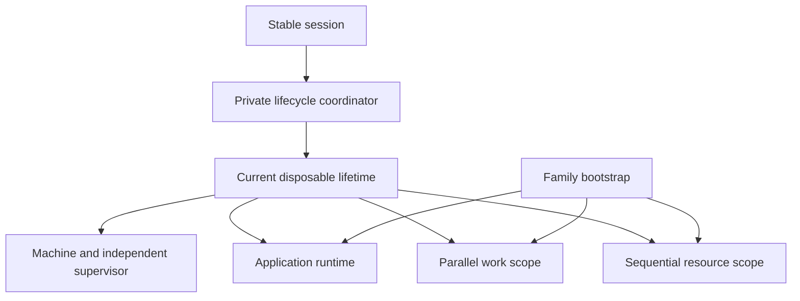

# One lifecycle architecture for every browser session

Status: Complete. Approved in chat on 2026-10-10; implementation, required verification, and documentation reconciliation completed on 2026-10-11.

## Architecture and scope

1. A session is a stable identity, store, failure stream, and public interface. A lifetime is one disposable acquisition of application services and family resources, including the work using them.
2. Share lifecycle ownership across aggregate, service, standalone, and Studio aggregate agent browser sessions. Keep agent connections, synchronization, optimistic command staging, and recovery in a transient main-thread bootstrap.
3. Keep public `initialize`, `dispose`, `runSync`, and `runPromise`; runtimes and Actor handles remain private. Replace superseded paths outright, with no compatibility, fixed-storage changes, Worker/backup acquisition, cast exceptions, or unrelated-WIP repair.
4. Bootstrap is a finite scoped Effect receiving `{ execution, signal }`. It returns when first usable. The lifetime independently owns its resource Scope across machine transitions; remove readiness callbacks and parked bootstrap Effects.



## Agreed behavior

1. Machine states are `idle → starting → active → closing → closed`. Startup failure and disposal from idle/starting/active enter closing. Active means successful initial setup and persists during agent reconnects; current usable capability remains independently published. Observe committed handles to settle initialization and terminal ownership.
2. One Actor and supervisor belong to each lifetime. Application services acquire lazily, including general execution before initialization. Initialization reuses that cold lifetime; disposal must release it even if never initialized. Remove unused lifetime UUID/state identity fields.
3. The coordinator retains currentLifetime, including its closing/closed instance, and one cancellable pending replacement. Reject duplicate initialization synchronously in all families, including agents. Cancel queued replacement immediately on disposal; replacement waits for full prior shutdown and checks request identity before installation. Earlier cleanup failure does not prohibit a later initialization.
4. Public execution selects the current lifetime once. Submitted work and bootstrap callbacks retain fixed lifetime execution. Combine caller and lifetime cancellation, preserve RunOptions, and enroll asynchronous roots in the work Scope using native runtime.runFork. Observe synchronous completion too; native onFiberStart skips it and runs after initial evaluation.
5. Preserve native runSyncExit, report-once escaping defects, typed failures, native exception behavior, and quiet pure interruption. Enroll escaped AsyncFiberError fibers before interrupt/dispatcher flush. Keep core execution types and failure/preflight utilities, moving implementation into the browser lifetime. Do not reintroduce AsyncLive.
6. Disposal synchronously fences execution, aborts cancellation, and withdraws the capability. Defer drainage to the next microtask for every cleanup entry so reentrant launch stacks finish enrolling. Interrupt/await bootstrap, drain work, close family resources, dispose application services, commit closed, stop/await Actor, and dispose supervisor.
7. Attempt every cleanup phase and share one memoized resource shutdown operation. Repeated public disposal joins one memoized result including the complete shutdown barrier; its explicit notification can also run after automatic startup shutdown. Observe root Exits because native fiber-scope drainage discards their failure results. Initialization retains original startup failure after full shutdown; explicit disposal cancels pending readiness promptly. Disposal retains first observed cleanup failure. Cleanup runs outside application work; owned callbacks/finalizers must not await their own owner's disposal.
8. Agent bootstrap owns lifetime-local SQLite, producer ID, connection generation, socket, controllers, timers, admission and push coordination, and command observers. First validated replay-complete publishes capability/live connection and completes bootstrap. Reconnect retains runtime/DB/producer ID/journal and withdraws/republishes capability without restarting lifecycle.
9. Preserve initial application-layer/SQLite/HTTP bootstrap failure as terminal; preserve asynchronous socket/replay retries before and after first live. Automatic startup failure preserves connection error; explicit disposal publishes disposed.
10. Register transport cancellation before asynchronous acquisition and attempt every stop operation. Acquire SQLite with interruption-safe acquireRelease; late clients close exactly once before replacement. Stop/await any native Promise work that could still access SQLite, since Effect-root drainage alone does not join opaque promises.
11. Preserve synchronous transactions, command retry identities/positions, admission-prefix bookkeeping, authoritative reconciliation, and correlated final failures. Admitted server work remains server-owned. Preserve authenticated identity, DevTools cleanup, and standalone reset cancellation/captured inputs.

## Planned hierarchy

Legend: `+` create, `~` modify, `-` delete.

```text
zerospin/
├── packages/browser/src/
│   ├── ~ makeSessionLifecycle.ts
│   ├── + bootstrapAggregateAgentSession.ts
│   ├── ~ bootstrapAggregateSession.ts
│   ├── ~ bootstrapServiceSession.ts
│   ├── sessionLifecycle/
│   │   ├── ~ SessionLifetime.ts
│   │   ├── ~ makeSessionLifecycleMachine.ts
│   │   ├── + makeSessionLifetimeExecution.ts
│   │   └── states/
│   │       ├── ~ idle.ts
│   │       ├── + {starting,active,closing,closed}.ts
│   │       └── - {initializing,ready,disposing,disposed}.ts
│   └── makeBrowserSession/
│       ├── ~ createAggregateBrowserSession.ts
│       ├── ~ createServiceBrowserSession.ts
│       ├── ~ createStandaloneBrowserSession.ts
│       ├── ~ createAggregateAgentBrowserSession.ts
│       └── ~ README.md
├── packages/browser/tsconfig.json (~ existing machine project reference)
├── packages/studio/src/AgentExplorer.tsx (~ observe reported disposal rejection)
├── packages/sdk/src/index.ts (~ obsolete export blocker, repair authorized on 2026-10-11)
├── packages/core/src/sessionExecution/
│   ├── - makeSessionExecution.ts
│   └── ~ README.md
└── wiki/
    ├── ~ architecture/browser/bootstrapBrowserSession.md
    ├── ~ architecture/browser/AggregateCommandLifecycle.md (execution source pointer)
    ├── ~ architecture/AuthoredSystem.md (execution source pointer)
    ├── ~ glossary.md
    └── + plans/100-plan-unified-browser-session-lifecycle.md
```

## Implementation and verification

1. Implement lifetime/execution/coordinator and machine together, keeping machine-package semantics unchanged; migrate finite ordinary-family bootstrap and agent bootstrap; remove obsolete execution implementation.
2. Review ownership, obviousness, cleanup/reporting, and protocol fences through independent agents. Fix in-scope issues in this chat.
3. Verify actual public facade with disposable inline commands: duplicate and queued admissions; cold execution/reuse/disposal; startup and late acquisition cancellation; first replay and retry; saved/public versus pinned execution; reentrant disposal; root/finalizer drain before DB closure; repeated/full cleanup and original errors; Actor/supervisor shutdown; no acquired-resource overlap; agent reconnection and uncertain command retry; Studio selection/React ownership/standalone reset races.
4. No new test files, fixtures, runners, or configurations are authorized. No permanent browser lifecycle/agent suite exists in this checkout. Use inline checks and existing relevant Actor suites; record coverage limitations.
5. Run one scoped Nx graph for applicable browser, machine, React, Studio, and SDK compilation/typecheck/lint tasks with dependency scheduling. Finish scoped formatting, diff checks, browser bundling and exhaustive superseded-path searches. Separate unrelated failures without broad repair.
6. Reconcile architecture docs, README, and glossary after implementation. Create an ADR only if the implemented choice is hard to reverse, surprising without context, and entails a real trade-off. Archive the completed plan after required verification, preserving filename and repairing relative links.

## Implemented result and verification evidence

1. All four factories delegate to the same five-state lifetime owner. Ordinary and agent setup is finite; the old state files and core execution maker are deleted. Browser execution owns native roots and observes complete Exits, including synchronous completions and suspended synchronous roots. The browser TypeScript configuration now references the already-declared machine dependency.
2. Private family notifications preserve capability withdrawal, automatic startup errors, and explicit agent `disposed` publication. One resource cleanup operation and complete owner shutdown barrier remain memoized. A separate memoized public disposal result is necessary when explicit publication follows an already-completed automatic shutdown. Studio observes reported disposal rejection during effect cleanup.
3. The two implementation agents and independent obviousness reviewer completed disposable Node 24 checks against current source and public `makeBrowserSession`. In-memory module resolution/capture hooks, real waSQLite, and an existing Studio fixture were used; no verification files, fixtures, runners, or configurations were created.
4. Admission/ownership checks passed for synchronous duplicates and prompt cancellation in all four public families; cold application-runtime reuse; queued replacement cancellation; resource non-overlap; saved versus pinned execution; repeated disposal promise identity; standalone reset/disposal overlap; and React owner cleanup/remount with stale cancellation fenced.
5. Execution/cleanup checks passed for native typed/defect propagation and isolated defect reporters; caller signal, hook and uninterruptible options; synchronous completion observation; suspended synchronous and reentrant execution drainage before resources; first cleanup-error identity; original startup-error identity; and independent resource, runtime, supervisor, Actor and owner failures. Captured Actor/owner/control fibers terminated and both runtimes released their contexts before complete shutdown resolved.
6. Agent checks passed for first validated replay, invalid initial replay retry, original application/HTTP failures, prompt cancellation during late SQLite acquisition and exactly one close, reentrant publication disposal, ignored late HTTP results, stale socket callbacks and queued push microtasks, reconnect retaining DB and producer identity, optimistic staging, uncertain retry retaining ID/payload/pushIndex, admitted prefix surviving reconnect without resend, and final originating failure correlation/optimism rollback. Socket and SQLite closure failures still attempt both phases; expected cancellation emits no synthetic defect.
7. The final scoped graph command was `pnpm nx run-many --targets=lib,ts,tsc:typecheck,lint --projects=@zerospin/browser,@zerospin/machine,@zerospin/react,@zerospin/studio,@zerospin/sdk --parallel=1 --skipSync --outputStyle=static`. All 36 dependency-scheduled tasks passed, including browser/SharedWorker compilation and bundling, SDK/React/Studio builds, applicable typechecks and lint. Serialization prevented the earlier build/lint race against browser dist. Browser and machine lint retain existing unrelated warnings. The existing machine test target passed from Nx cache: 18 files, 59 tests. Logs for this local run are in `/tmp/zerospin-lifecycle-approved-final-nx.log` and `/tmp/zerospin-lifecycle-actor.log`; these temporary logs are not permanent verification artifacts.
8. Nx sync checking found pre-existing missing references in the root and unrelated projects; the browser machine reference was corrected, and `--skipSync` preserved unrelated configuration. The obsolete SDK export of `IStagedAggregateCommand` from the deleted `StagedAggregateCommandSchema` initially blocked consumer checks. The user authorized the bounded repair on 2026-10-11; it was already removed in the concurrent working tree when verification resumed. No additional SDK edit was needed. The successful final graph confirms the blocker is resolved. Nx Cloud reports access code 401, while all local task results pass.
9. Source-grounded architecture diagrams, execution source pointers, factory/core READMEs and glossary were reconciled. No ADR was added: this private lifecycle cutover is reversible without a durable schema or trust-boundary change. Scoped formatting, diff checks and superseded-source searches pass. The final architecture audit repaired moved cleanup/protocol citations, verified current hashes and bounds for lifecycle/factory/bootstrap metadata, and checked all 341 local links in the two cross-cutting architecture pages. No inbound or relative Markdown links needed repair when archiving this plan.
10. Coverage limit: no permanent browser lifecycle/agent suite exists. Full React rendering, Studio UI, ordinary successful Worker bootstrap, real authenticated network remounts, and real WebSocket/Workerd integration were not exercised. Inline seams verify ownership and protocol behavior; the complete final graph verifies consumer compilation. These limits do not imply browser or network end-to-end coverage.

## Remaining work

None.
