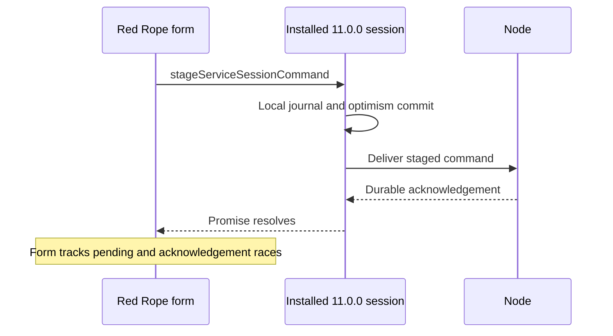
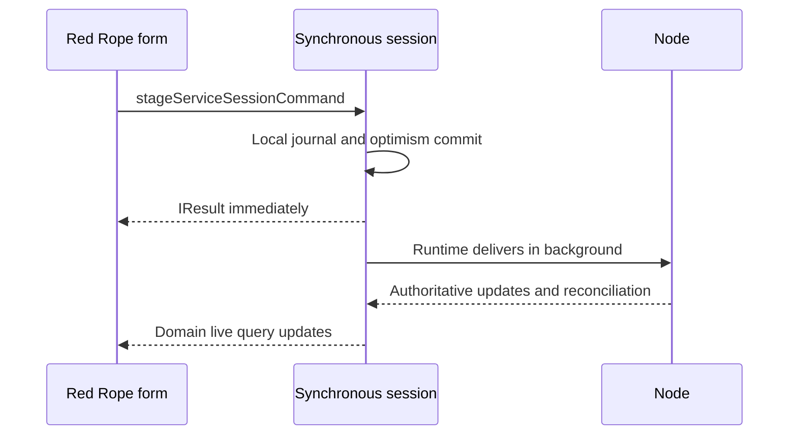

# Consume synchronous service staging

**Date:** 2026-10-15

**Status:** Complete; verified and archived.

**Owner:** Zerospin packages and Red Rope package consumers.

**Parent:** [160 — UI cleanup](160-plan-command-query-ui-cleanup.md). **Dependents:** [163 — Invitations](163-plan-redrope-invitations-sync-command.md), [164 — Partners](164-plan-redrope-partners-sync-command.md), [167 — Public partner intake](167-plan-redrope-public-partner-intake.md).

## Starting behavior and intended result

Current upstream `stageServiceSessionCommand` returns `IResult` synchronously after its local journal/optimism transaction. The background handoff owns delivery. At the start, Red Rope pinned 11.0.0 and its installed service implementation returned a Promise and waited for `execute.accept`.

Upstream package manifests and release documentation now identify 11.1.0; QRK already pins that version. Do not manufacture another framework release or bump every sibling merely to satisfy an outdated audit assumption. First verify whether the already published artifact contains the implemented synchronous API. [Upstream staging](../../../packages/core/src/serviceSession/stageServiceSessionCommand.ts), [existing release workflow](../../../README.md#local-package-releases), [package version](../../../packages/core/package.json), [Red Rope dependencies](../../../../redropeparking/apps/admin/package.json), [QRK dependencies](../../../../qrk.sh/apps/library/package.json).

## Before and after





## Pseudocode

```ts
// Existing upstream semantics, to verify in the consumed artifact:
const result = stageServiceSessionCommand({ session, contractName, payload });
if (result._tag === 'Failure') return;
// The command is locally staged. No worker receipt or server success is implied.

// Keep inside the runtime:
handoff.deliverRetainedCommands();
// Keep internal handoff.waitFor where native suspension already requires it.
```

## Implementation

1. Inspect the exact currently published 11.1.0 tarballs and installed consumer dependency graph. Confirm the public type and JavaScript both return the immediate local `IResult`; declarations alone are insufficient. Reuse the current registry and its retained artifacts.
2. If the release is already correct, perform only the required Red Rope consumer update. If it lacks the behavior, capture a clean source snapshot containing only the approved framework changes, complete existing scoped build/type/lint checks, and follow the repository's existing coordinated local-registry release workflow. Do not publish unrelated WIP or overwrite an existing package version.
3. Update Red Rope's exact linked framework package set, overrides where present, package skills and frozen lockfile coherently using its pinned package manager and existing registry. Keep Effect and consumer-owned SQL patches intact. Do not fabricate a version number in this plan.
4. Adapt actual breaking API callers required by that consumed release, including session terminal-error rendering if required. Keep unrelated application behavior out of the change. Red Rope's invitation/partner UI simplification remains owned by 163 and 164.
5. Follow Red Rope's current disposable-development-storage policy for an incompatible cutover during implementation. Use fresh isolated backend/browser storage for inspection; do not introduce compatibility schemas, consumer persistence waiters or silent automatic application migrations.
6. Update affected package-version guidance and submission documentation to state local staging semantics. Leave other consumers pinned if they do not need this prerequisite.

## Delete and preserve

1. Remove any remaining public service `accept` execution interface and browser/mock submission dependency only if absent from the artifact but still present in the selected producer source. This work was already implemented in [156](156-plan-command-query-checkout.md); do not redo it gratuitously.
2. Preserve shared internal handoff `waitFor`, background delivery, admission, execution, reconciliation and session failure ownership. Do not turn native suspension into a consumer workflow.
3. Add no async submission facade, compatibility alias, dual staging path, or component-level receipt watcher.

## Acceptance and verification

1. The actual installed service function returns a non-Promise result before Node acknowledgement; local model writes and command retention are atomic.
2. A local refusal leaves neither partial optimism nor a retained command. Consecutive accepted commands see previous optimistic writes without awaiting a render or acknowledgement.
3. Existing runtime delivery and authoritative confirmation/rejection reconcile that same command identity. Acknowledgement does not represent business completion.
4. Use permitted existing scoped Nx checks and existing framework seams. Red Rope's policy forbids new automated test suites/standalone runners; use its permitted build/type/lint and focused manual observation when implementing. Create no tests or verification runners.

## Implementation outcome

Artifact inspection found that both published 11.1.0 and 11.2.1 still exported an async JavaScript stager and Promise declaration awaiting `execute.accept`. The producer prepared a narrow coordinated release on clean compatible commit `41d6187899` in `/Users/morgs32/.codex/worktrees/sync-service-staging-release/zerospin`, without publishing primary-checkout WIP. Red Rope consumes the coherent package set and preserves Effect 4.0.2 and its existing system-worker SQL/replay patch. Initial 11.3.0 artifact adoption verified synchronous behavior. The final coordinated 11.3.2 release also corrects generated JSDoc and includes the checked browser assets; all 19 packages were published only after the clean build finished. Earlier registry artifacts remain unchanged. Red Rope consumes the final exact 11.3.2 set.

The compatible React API retains the existing Initializer and query-error result contract. Red Rope adds no unsupported modern `renderError` prop: affected query errors propagate to existing React/Next error ownership. Expected refusal events use one configured notification layer and one toaster per app.

## Verification

1. Red Rope installs exact 11.3.2 throughout its framework package set using pnpm 9.15.9. Frozen install passes. Installed JavaScript is synchronous and the declaration returns IResult with corrected local-staging documentation; sqlite.wasm and bundled SharedWorker assets are present. Bundled Intent submission guidance states synchronous staging.
2. Existing Nx production builds pass for web and admin, including TypeScript and prerendering. The existing web Storybook production build passes. No test suite, runner, fixture file or check configuration was created. Existing UI stories/supporting fixtures were adapted in place.
3. The existing backend development workflow, run against fresh temporary inspection storage through unchanged config/source links, reaches Ready on http://127.0.0.1:3432 with the system spec accepted. Existing repository storage was untouched. No real Clerk or Slack delivery was attempted.
4. Source review and independent authority/recovery review cover capability isolation, public model/contract selection, atomic adapter re-emission, stale-revision rejection, recorded request failure, immutable acceptance time, synchronous refusal and retry/edit access. The retained consumer system-worker patch was adapted to validateExternalOutcome and command.externalOutcome; payload-only external emission and commandOutcome callers match the consumed SDK.

## Remaining work

None.
