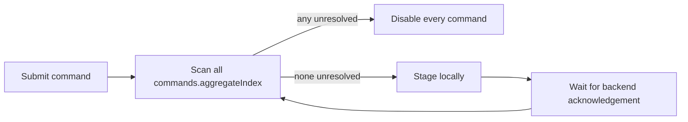
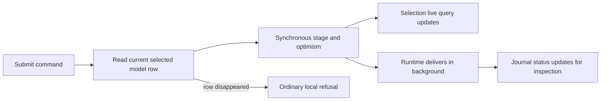

# Studio command submission without acknowledgement gates

**Date:** 2026-10-15

**Status:** Implemented and verified. No schema or new backend workflow was added.

**Owner:** Zerospin `packages/studio`.

**Parent:** [160 — UI cleanup](160-plan-command-query-ui-cleanup.md). **Evidence:** [audit](../../research/async-ui-command-query-audit.md#studio-agent-command-panel-one-pending-acknowledgement-blocks-every-command).

## Current behavior and intended result

`AgentPreview` derives a blanket pending flag from the command journal's nullable `aggregateIndex`. It disables the command panel and repeats the journal scan before staging another command. This prevents locally valid consecutive optimistic commands until backend acknowledgement.

Remove that control dependency. The user can synchronously stage a command against the latest selected model row. Keep the journal and per-command status as diagnostic output. [Current implementation](../../../packages/studio/src/AgentPreview.tsx), [synchronous agent staging](../../../packages/core/src/aggregateSession/stageCommand/stageAggregateSessionCommand.ts), [runtime delivery observer](../../../packages/browser/src/agentSession/connectAgentSession.ts).

## Before and after





## Pseudocode

```ts
const rows = useLiveQueryOnDb({ db, query: readSelectedRows });
const journal = useLiveQueryOnDb({ db, query: readJournalForDiagnostics });
const disabled = !sessionReady || selectedRowMissing || selectionReadFailed;

function submit(editable) {
  const initialized = session.store.getState().initialized;
  if (!initialized) throw sessionNotReady;
  const latest = readRows(
    selection,
    initialized.db,
    initialized.aggregateId,
  ).find(row => row.id === rowId);
  if (!latest) throw selectedRowMissing;

  // Keep current binding semantics. Re-read before every staging call.
  const payload = bindDeclaredFields(editable, binding, latest);
  const result = stageAggregateSessionCommand({
    session,
    contractName,
    payload,
  });
  if (result._tag === 'Failure') throw result.failure;
  setCommandId(result.success.id); // diagnostics only
}

renderSelection(rows.data);
renderDiagnosticJournal(journal.data);
```

`bindDeclaredFields` is descriptive pseudocode for existing inline binding logic, not a proposed utility. No new wrapper or abstraction is needed. The failure presentation should preserve the existing form integration and original structured failure wherever it accepts one.

## Implementation

1. Remove `hasPendingCommands`, its derived `pending` value, the `pending` term in `CommandPanel.disabled`, and the submit-time commands-table scan. Remove delivery-resolved wording from the disabled explanation.
2. Preserve readiness and missing-selection/row checks. Do not require connection-online status for an otherwise valid local command. An actual terminal session failure remains fenced by session execution.
3. Preserve the fresh selected-row read immediately before staging so bound values reflect earlier optimism even before React rerenders. Keep declared payload binding, validation and recognized contract refusals.
4. Keep the journal query and selected command ID solely for the existing Staged locally / Confirmed / Rejected display and inspector. A journal display failure must not become a hidden delivery gate; retain genuine diagnostic error presentation independently.
5. Update relevant existing Studio stories/docs if they describe serialized submission. Do not alter agent delivery, session worker lifetime or command reconciliation.

## Exactly what the query watches

The model selection query reads the currently selected agent model rows in its aggregate and drives the table and current-row availability. The separate journal query reads command status for diagnostics. Neither an unresolved journal entry nor a delayed acknowledgement decides command availability. Readiness and actual model/contract rules do.

## Acceptance and verification

1. With one locally staged command still awaiting acknowledgement, a second valid command can stage immediately and observe the first command's optimistic row state.
2. A command on another selected row is not blocked by an unrelated unresolved command. A row removed by previous optimism is refused on the fresh read.
3. Local refusal stages nothing, retains readable failure output and leaves the form available. Later confirmation/rejection updates the existing diagnostic status and model query without special component orchestration.
4. Delayed/offline transport does not add a UI gate. Terminal session failure still blocks actual execution through the existing session owner.
5. Run permitted existing Studio/core scoped Nx type/build/lint checks and use existing Storybook/agent verification seams for the scenarios above. Preserve story fixtures; create no test files, fixtures, runners or configuration.

## Outcome and verification

1. Removed the unresolved-command scan and submission barrier. Diagnostic journal errors remain visible without disabling commands. Readiness, selection errors and the fresh selected-row read still fence execution; the original structured refusal now reaches ShapeForm directly.
2. `pnpm nx run-many -t ts lint -p @zerospin/studio` passed, including the required Studio/dependency builds. Nx Cloud reported its existing access401 after local checks succeeded.
3. Scoped formatting and diff checks passed. Source review traced consecutive optimistic reads, removed-row refusal, offline availability and unchanged diagnostic reconciliation. No live provider/session scenario or new fixture/runner was introduced.

## Remaining work

None.
