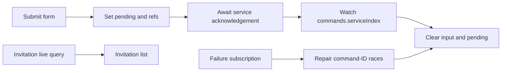

# Plan 163: Red Rope invitations through synchronous staging

**Date:** 2026-10-15  
**Status:** Complete; verified and archived  
**Owner repository:** `redropeparking`  
**Parent:** [Plan 160](160-plan-command-query-ui-cleanup.md)  
**Research:** [Async UI audit](../../research/async-ui-command-query-audit.md#red-rope-invitations-and-partners-acknowledgement-state-machines-in-forms)

## Current instance

[`Invitations.tsx`](../../../../redropeparking/apps/admin/app/Invitations.tsx) queries invitations but also awaits service submission, reads `commands.serviceIndex`, subscribes to failures, and repairs confirmation-before-command-ID races with refs. [`createInvitation`](../../../../redropeparking/apps/zerospin/src/contracts/createInvitation.ts) already validates and creates the invitation in one transaction. This is an ordinary write; there is no durable invitation-processing workflow to represent.

Red Rope's installed service staging API genuinely awaits acknowledgement. Complete and consume [Plan 161](161-plan-synchronous-staging-consumer-release.md) before deleting that await. This plan does not substitute an async wrapper for synchronous staging.

## Proposed behavior

Keep unsaved email input, native field validation and the existing invitation query. Stage `createInvitation` synchronously. Clear the field after local staging success. The query immediately renders the optimistic invitation. Later refusal removes rejected optimism and produces a centrally configured notification. Unexpected query/runtime failure uses the session's terminal error rendering.

Exact query remains `db.query.invitation.findMany({ orderBy: { emailAddress: 'asc' } })`. Its selected domain data is invitation rows, not the command journal. No schema changes and no new pending state are required.

## Before



## After

```mermaid
sequenceDiagram
  participant F as Invitation form
  participant S as Admin service session
  participant A as Authoritative admin service
  F->>S: createInvitation(id, emailAddress) — sync
  S->>S: Transaction: journal + optimistic invitation
  S-->>F: Local IResult
  F->>F: Clear input on success
  S-->>F: Invitation live query
  S->>A: Runtime delivers in background
  A-->>S: Confirmation or refusal and reconciliation
  S-->>F: Invitation live query; central refusal toast
```

## Proposed pseudocode

Existing APIs after the SDK prerequisite; illustrative UI code:

```tsx
const { data: invitations } = useLiveQuery({
  session,
  query: db =>
    db.query.invitation.findMany({ orderBy: { emailAddress: 'asc' } }),
});

function submit(event) {
  event.preventDefault();
  const result = stageServiceSessionCommand({
    session,
    contractName: 'createInvitation',
    payload: {
      id: makeServiceSessionModelId({ session, model: Invitation }),
      emailAddress,
    },
  });
  if (result._tag === 'Success') setEmailAddress('');
}
```

Backend ownership remains unchanged:

```ts
createInvitation.transaction(payload) {
  normalizeAndValidateEmail(payload.emailAddress);
  rejectDuplicateInvitation();
  createInvitationRow(payload.id, normalizedEmail);
}
// Session runtime owns delivery, rollback and notification events.
```

## Implementation steps

1. Consume the synchronous service release and session error/notification APIs from Plan 161.
2. Configure the admin session's notification callback and one root toaster if the shared release plan has not already done so. Keep expected stage/admission/execution refusals here, with terminal errors owned by the session boundary.
3. Replace `addInvitation` with a synchronous handler. Clear only on successful local staging; preserve input for immediate refusal.
4. Render the existing invitation query and remove transport-derived disabling/loading labels.
5. Update existing affected stories/documentation without adding tests or fixtures.

## Delete

Delete component `pending`, `commandId`, submission/error tracking used only for remote failures, `submitting`, `activeCommand`, `rejectedCommand`, the initialized-store subscription, `commands` query, `confirmed`, both command-tracking effects, per-component failure subscription, `await`/`try` Promise machinery, and query `result.error` rendering. Keep any useful immediate field validation; do not duplicate central refusal toasts locally.

## Acceptance checks and limits

- Review the handler and SDK source to establish that return occurs after the local transaction and before remote acknowledgement.
- Local success adds the queried row and clears input immediately; immediate invalid/duplicate input leaves the input available.
- Consecutive valid submissions do not wait for earlier acknowledgements. The command guard reads current transaction state, so duplicate submission cannot bypass optimistic uniqueness.
- Authoritative rejection removes its optimistic invitation and produces one central notification; the form never reads `commands`.
- Preserve invitation authorization and session terminal-error behavior.
- Follow Red Rope's `AGENTS.md`: no new tests, fixtures, standalone automated checks/runners, or deferred integration suite. Use source review and existing permitted application/story workflows; do not introduce new quality gates.

## Scope

Only this form and necessary central notification integration. Partners is [Plan 164](164-plan-redrope-partners-sync-command.md); invitation delivery/email product features are outside this change.

## Implementation outcome

The invitation form now synchronously stages createInvitation and clears input only on local success. Its existing sorted invitation query renders optimism. All component pending, command identity, journal, acknowledgement race and failure-subscription state is removed. The admin release owns central refusal notifications. Admin production build passed with synchronous 11.3.0; final 11.3.2 artifact verification and builds pass.

## Verification

1. Red Rope installs exact 11.3.2 throughout its framework package set using pnpm 9.15.9. Frozen install passes. Installed JavaScript is synchronous and the declaration returns IResult with corrected local-staging documentation; sqlite.wasm and bundled SharedWorker assets are present. Bundled Intent submission guidance states synchronous staging.
2. Existing Nx production builds pass for web and admin, including TypeScript and prerendering. The existing web Storybook production build passes. No test suite, runner, fixture file or check configuration was created. Existing UI stories/supporting fixtures were adapted in place.
3. The existing backend development workflow, run against fresh temporary inspection storage through unchanged config/source links, reaches Ready on http://127.0.0.1:3432 with the system spec accepted. Existing repository storage was untouched. No real Clerk or Slack delivery was attempted.
4. Source review and independent authority/recovery review cover capability isolation, public model/contract selection, atomic adapter re-emission, stale-revision rejection, recorded request failure, immutable acceptance time, synchronous refusal and retry/edit access. The retained consumer system-worker patch was adapted to validateExternalOutcome and command.externalOutcome; payload-only external emission and commandOutcome callers match the consumed SDK.

## Remaining work

None.
