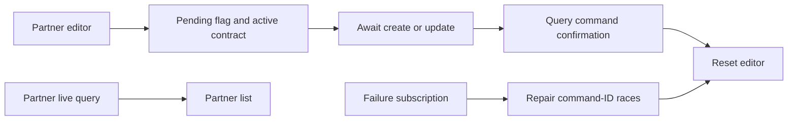

# Plan 164: Red Rope partner editing through synchronous staging

**Date:** 2026-10-15  
**Status:** Complete; verified and archived  
**Owner repository:** `redropeparking`  
**Parent:** [Plan 160](160-plan-command-query-ui-cleanup.md)  
**Research:** [Async UI audit](../../research/async-ui-command-query-audit.md#red-rope-invitations-and-partners-acknowledgement-state-machines-in-forms)

## Current instance

[`Partners.tsx`](../../../../redropeparking/apps/admin/app/partners/Partners.tsx) wraps `createPartner`/`updatePartner` in pending flags, active command/contract refs, a journal query and failure/confirmation effects. The underlying [`createPartner`](../../../../redropeparking/apps/zerospin/src/contracts/createPartner.ts) and [`updatePartner`](../../../../redropeparking/apps/zerospin/src/contracts/updatePartner.ts) perform ordinary row mutations. The admin service owns these rows; there is no asynchronous business completion to await.

The installed service API is async. Consume [Plan 161](161-plan-synchronous-staging-consumer-release.md) first. Central notification integration may be shared with [Plan 163](163-plan-redrope-invitations-sync-command.md); this plan must not install a second toaster or duplicate event handler.

## Proposed behavior

Retain unsaved form fields, `editingId`, local validation and the focus ref. Choose the existing create/update contract from `editingId` and synchronously stage one command. On local success, reset the editor immediately. The existing partner list shows session optimism, followed by authoritative reconciliation.

The exact query remains `db.query.partner.findMany({ orderBy: { name: 'asc' } })`. No new model, workflow status, subscription or command-journal selection is needed.

## Before



## After

```mermaid
sequenceDiagram
  participant F as Partner editor
  participant S as Admin service session
  participant A as Authoritative admin service
  F->>S: createPartner or updatePartner — sync
  S->>S: Transaction: journal + optimistic partner
  S-->>F: Local IResult
  F->>F: Reset editor on success
  S-->>F: Partner live query
  S->>A: Runtime delivery
  A-->>S: Authoritative changes or rejection
  S-->>F: Partner live query; central refusal notification
```

## Proposed pseudocode

Existing APIs after the SDK prerequisite; the abbreviated branches below preserve exact payload typing in implementation:

```tsx
const { data: partners } = useLiveQuery({
  session,
  query: db => db.query.partner.findMany({ orderBy: { name: 'asc' } }),
});

function save(event) {
  event.preventDefault();
  const fields = validateAndNormalizePartnerForm();
  if (fields === undefined) return; // immediate field feedback
  const result =
    editingId === null
      ? stageServiceSessionCommand({
          session,
          contractName: 'createPartner',
          payload: {
            id: makeServiceSessionModelId({ session, model: Partner }),
            ...fields,
          },
        })
      : stageServiceSessionCommand({
          session,
          contractName: 'updatePartner',
          payload: { id: editingId, ...fields },
        });
  if (result._tag === 'Success') resetEditor();
}
```

Backend behavior is unchanged:

```ts
createOrUpdatePartner.transaction(payload) {
  validatePartnerFieldsAndExistingIdentity();
  applyTheAuthoredPartnerMutation();
}
// Runtime delivery/reconciliation never blocks another valid form edit.
```

## Implementation steps

1. Consume Plan 161 and reuse the admin session notification layer.
2. Make `savePartner` synchronous with concrete create/update branches and one local result check.
3. Preserve required business name/email checks and editing/focus behavior. Clear input only after local success.
4. Remove command-confirmation-derived disabling and replace result error handling with the new session-owned error contract.
5. Update existing affected stories/documentation; add no tests or fixtures.

## Delete

Delete `pending`, `commandId`, `submitting`, `activeCommand`, `activeContract`, `rejectedCommand`, initialized-store subscription, `commands` query, `confirmed`, confirmation effect, component failure subscription and Promise/await machinery. Keep `nameInput` and the actual unsaved fields; those serve editing, not transport progress.

## Acceptance checks and limits

- Creating and editing update the queried partner immediately and reset the form before network acknowledgement.
- Immediate invalid input remains editable. An authoritative refusal rolls back the row and appears once through central notifications.
- A subsequent edit can stage while an earlier one awaits confirmation; current transaction state supplies optimistic sequencing.
- Existing admin authentication, contract guards, normalization and selected models remain intact.
- No component reads command IDs, `serviceIndex` or internal session store readiness.
- Follow Red Rope's no-tests/no-standalone-checks policy. Review source and use only existing permitted application/story workflows; add no runner, fixture, integration suite or new gate.

## Scope

Only admin partner creation/editing. Public anonymous partner intake has a different privilege boundary and is [Plan 167](167-plan-redrope-public-partner-intake.md).

## Implementation outcome

The partner editor now synchronously stages the concrete createPartner or updatePartner branch and resets on local success. Existing field validation, editing identity, focus and sorted partner query remain. Component command/pending/journal machinery is removed, and the shared admin notification layer presents expected refusals. Admin production build passed with synchronous 11.3.0; final 11.3.2 artifact verification and builds pass.

## Verification

1. Red Rope installs exact 11.3.2 throughout its framework package set using pnpm 9.15.9. Frozen install passes. Installed JavaScript is synchronous and the declaration returns IResult with corrected local-staging documentation; sqlite.wasm and bundled SharedWorker assets are present. Bundled Intent submission guidance states synchronous staging.
2. Existing Nx production builds pass for web and admin, including TypeScript and prerendering. The existing web Storybook production build passes. No test suite, runner, fixture file or check configuration was created. Existing UI stories/supporting fixtures were adapted in place.
3. The existing backend development workflow, run against fresh temporary inspection storage through unchanged config/source links, reaches Ready on http://127.0.0.1:3432 with the system spec accepted. Existing repository storage was untouched. No real Clerk or Slack delivery was attempted.
4. Source review and independent authority/recovery review cover capability isolation, public model/contract selection, atomic adapter re-emission, stale-revision rejection, recorded request failure, immutable acceptance time, synchronous refusal and retry/edit access. The retained consumer system-worker patch was adapted to validateExternalOutcome and command.externalOutcome; payload-only external emission and commandOutcome callers match the consumed SDK.

## Remaining work

None.
