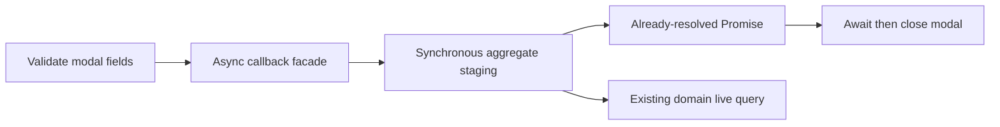
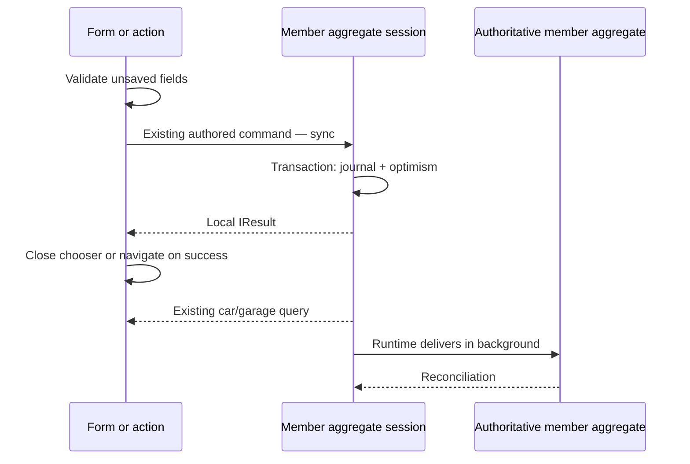

# Plan 165: Red Rope fleet forms use synchronous callbacks

**Date:** 2026-10-15  
**Status:** Complete; verified and archived  
**Owner repository:** `redropeparking`  
**Parent:** [Plan 160](160-plan-command-query-ui-cleanup.md)  
**Research:** [Async UI audit](../../research/async-ui-command-query-audit.md#red-rope-ordinary-vehicle-and-garage-forms)

## Current instances

These callbacks already perform synchronous aggregate staging but declare themselves `async`:

- [`FleetDashboard`](<../../../../redropeparking/apps/web/app/(user)/[username]/FleetDashboard.tsx>): `createGarage`, `createCar`.
- [`CarDetailPage`](<../../../../redropeparking/apps/web/app/(user)/[username]/car/[id]/CarDetailPage.tsx>): `updateCarDetails`, `moveCar`, `deleteCar`.
- [`GarageDetailPage`](<../../../../redropeparking/apps/web/app/(user)/[username]/garage/[id]/GarageDetailPage.tsx>): `updateGarage`, `moveCarHere`, `deleteGarage`.
- [`CarFormModal`](<../../../../redropeparking/apps/web/app/(user)/[username]/_components/CarFormModal.tsx>) and [`GarageFormModal`](<../../../../redropeparking/apps/web/app/(user)/[username]/_components/GarageFormModal.tsx>) require `onSubmit: (...) => Promise<void>` and await it before closing.

This is a shared callback-contract cleanup, not an acknowledgement state-machine migration. The aggregate API is already synchronous; it does not depend on the service staging release.

## Proposed behavior and boundaries

Make form callbacks `(...) => void`, call them directly, catch immediate refusal, then close. Preserve unsaved fields, boundary decoding/validation, exact license-plate comparison, ownership validation and Google Place selection. Retain the existing car/garage/metro live queries; no new query is needed and no query should inspect the command journal.

Remove delete busy flags that are set solely around synchronous staging. Close/delete-route navigation occurs after local success. A real navigation lifecycle indicator, if independently required, must remain owned by navigation rather than by command delivery.

`updateCarDetails` currently stages a details command followed by `moveCar` if assignment changed. Preserve those explicit command owners and their existing sequence. They remain two local transactions: this plan does not claim atomicity across both or hide them behind a generic update wrapper. A separate product decision would be required to redefine that operation as one atomic domain command.

## Before



## After



## Proposed pseudocode

Use the existing immediate failure convention, without inventing an async result type:

```tsx
type CarFormProps = { onSubmit: (data: CarFields) => void };

function handleSubmit(event) {
  event.preventDefault();
  const fields = normalizeAndValidateCarFields();
  if (fields === undefined) return;
  try {
    onSubmit(fields); // may throw an immediate local refusal
    onOpenChange(false);
  } catch (error) {
    setSaveError(messageFrom(error));
  }
}

function createCar(fields) {
  const payload = validateOwnedReferencesAndDecodeIds(fields);
  const result = stageAggregateSessionCommand({
    session,
    contractName: 'createCar',
    payload,
  });
  if (result._tag === 'Failure') throw result.failure;
}
```

Backend pseudocode is the current ownership, unchanged:

```ts
existingAuthoredContract.transaction(payload) {
  enforceMemberOwnershipAndDomainRules();
  applyCarOrGarageOperations();
}
```

## Implementation steps

1. Inventory references to both form callback props, including existing stories, so the type cutover is complete.
2. Change the two modal callback signatures and handlers to synchronous code.
3. Remove `async` from the eight named callers and all Promise-only callsite adaptations. Preserve current throw/result behavior.
4. Remove `isDeleting` and equivalent one-turn pending flags only where they represent the synchronous staging call; preserve delete confirmation state.
5. Correct stale comments that say local SQLite changes occur before a Promise resolves or imply mock-only semantics.
6. Update existing stories/documentation without adding fixtures or checks.

## Delete

Delete Promise-only prop types, `await onSubmit`, `async` declarations with no asynchronous work, `void`/`.then` adaptations around these calls, and transient command-only delete spinners. Do not delete Google Places autocomplete work, modal initialization effects, editable fields, validation messages, confirmation state, route navigation or session/runtime machinery.

## Acceptance checks and limits

- Valid form submission closes before returning from the event handler; immediate invalid/refused submission leaves the form open with its fields.
- Create/update/move/delete use their existing concrete contracts and query ownership; no new command acknowledgement wait appears.
- Preserve both the details-first/move-second sequence and its existing partial-success semantics rather than asserting a nonexistent shared transaction.
- Deletion navigates only after local success; a local refusal keeps the current page actionable.
- Audit every existing modal caller and story for the signature change.
- Red Rope currently forbids tests and standalone automated checks. Use source review and existing permitted application/story workflows; do not add or require an integration suite, runner, fixture or quality gate.

## Implementation outcome

Both modal callback contracts and all eight named callers are synchronous. Immediate local refusal preserves the modal/input. Car detail preserves details-first/move-second transactions. Command-only delete flags are replaced by React navigation transitions, so a locally deleted detail page can leave cleanly without a delivery spinner. All modal references were reviewed; no additional callers or stories declare a Promise callback. Web production build passed with 11.3.0; final 11.3.2 package/browser asset verification and builds pass.

## Verification

1. Red Rope installs exact 11.3.2 throughout its framework package set using pnpm 9.15.9. Frozen install passes. Installed JavaScript is synchronous and the declaration returns IResult with corrected local-staging documentation; sqlite.wasm and bundled SharedWorker assets are present. Bundled Intent submission guidance states synchronous staging.
2. Existing Nx production builds pass for web and admin, including TypeScript and prerendering. The existing web Storybook production build passes. No test suite, runner, fixture file or check configuration was created. Existing UI stories/supporting fixtures were adapted in place.
3. The existing backend development workflow, run against fresh temporary inspection storage through unchanged config/source links, reaches Ready on http://127.0.0.1:3432 with the system spec accepted. Existing repository storage was untouched. No real Clerk or Slack delivery was attempted.
4. Source review and independent authority/recovery review cover capability isolation, public model/contract selection, atomic adapter re-emission, stale-revision rejection, recorded request failure, immutable acceptance time, synchronous refusal and retry/edit access. The retained consumer system-worker patch was adapted to validateExternalOutcome and command.externalOutcome; payload-only external emission and commandOutcome callers match the consumed SDK.

## Remaining work

None.
