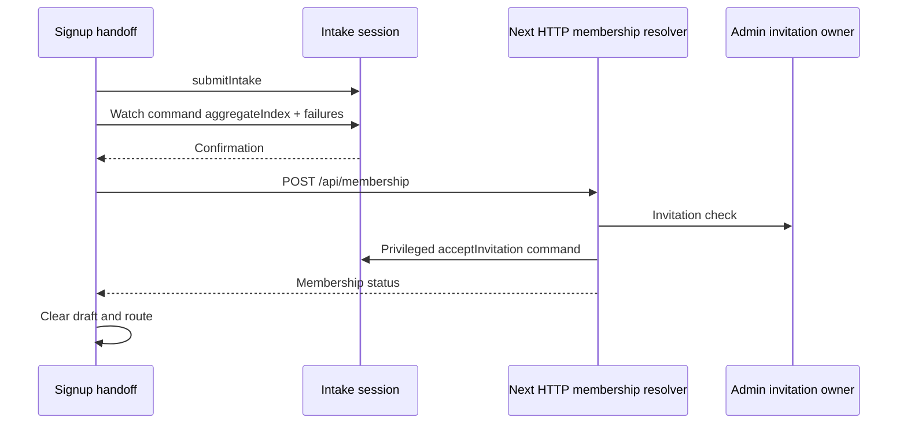
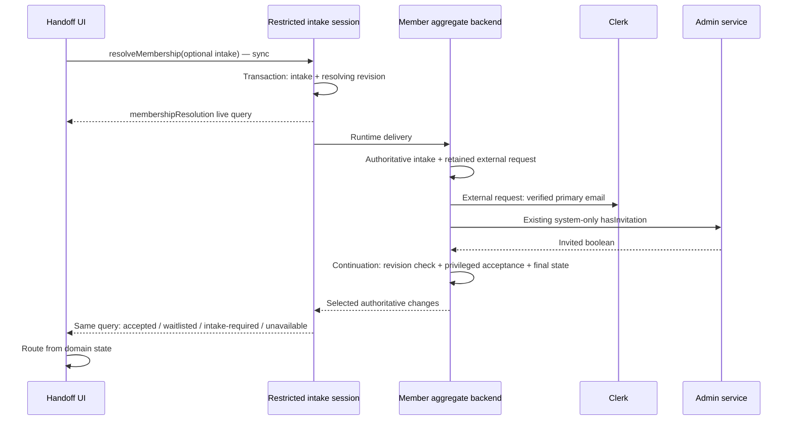

# Plan 166: Red Rope membership resolution as retained domain work

**Date:** 2026-10-15  
**Status:** Complete; verified and archived  
**Owner repository:** `redropeparking`  
**Parent:** [Plan 160](160-plan-command-query-ui-cleanup.md)  
**Research:** [Async UI audit](../../research/async-ui-command-query-audit.md#conditional-domain-and-policy-changes)

## Current instance and privilege boundary

[`SignedUpHandoff`](<../../../../redropeparking/apps/web/app/(user)/signed-up/SignedUpHandoff.tsx>) stages `submitIntake`, waits for its `commands.aggregateIndex`, then starts another HTTP membership check. `useMembershipStatus` (removed) also drives [`SignedInHandoff`](<../../../../redropeparking/apps/web/app/(user)/signed-in/SignedInHandoff.tsx>) and [`WaitlistHandoff`](<../../../../redropeparking/apps/web/app/(user)/waitlist/WaitlistHandoff.tsx>).

The HTTP `resolveMembership` (removed) authenticates the caller, checks invitations and invokes privileged [`acceptInvitation`](../../../../redropeparking/apps/zerospin/src/contracts/acceptInvitation.ts). `submitIntake` optimism proves only local intake staging. It must never grant membership. The restricted [`intakeActor`](../../../../redropeparking/apps/zerospin/src/member/actors/intake/intakeActor.ts) currently selects only this authenticated user's member row.

The protected username layout also calls [`resolveCurrentMembership`](../../../../redropeparking/apps/web/lib/resolveCurrentMembership.ts) on the server. Replace its mutating resolver usage with an authoritative read; do not replace server authorization with optimistic browser state.

## Chosen proposed architecture

Add a `membershipResolution` model to the existing member aggregate, with one row per member identity: `memberId`, `clerkUserId`, integer `revision`, `state` (`resolving`, `intake-required`, `waitlisted`, `accepted`, `unavailable`) and nullable public `message`. It is selected only for the authenticated Clerk user, with a relation to that member. No invitation rows or other members are exposed.

Add a proposed ordinary aggregate command `resolveMembership({ intakeForm: optionalAnswers })`. The shared program derives identity from claims, saves supplied incomplete intake through the existing intake rules, and writes the next revision as `resolving` in the same local transaction. If the Member is absent and no answers exist, create an unaccepted stub with the existing safe defaults (`fleetSize: null`, `garagesAlsoIn: []`, `isInBeta: false`, `invitationAcceptedAt: null`) so the relation always identifies a real Member. It never writes invitation acceptance or optimistic `accepted`. If no answers exist, resolution can still discover an invited member needing intake. Completed intake remains unchanged on retries.

Its authoritative adapter performs those writes and queues proposed `asyncResolveMembership({ memberId, clerkUserId, revision })` atomically. The external request uses the existing server-side Clerk lookup and verified-primary-email checks demonstrated by [`announceWaitlistedMember`](../../../../redropeparking/apps/zerospin/src/contracts/announceWaitlistedMember.ts), then calls the existing system-only [`hasInvitation`](../../../../redropeparking/apps/zerospin/src/contracts/hasInvitation.ts). No browser bearer token is retained in the model or external payload. An already accepted invitation retains the current acceptance policy.

The continuation checks current member identity and resolution revision. Only this backend path may write `invitationAcceptedAt`; it applies that privileged write and final resolution state in one transaction. `accepted` requires both authoritative invitation acceptance and completed authoritative intake. Otherwise return `intake-required` or `waitlisted`. Expected profile/lookup unavailability produces `unavailable` with a safe message and an explicit retry command. Unexpected infrastructure failures follow the runtime's failure policy. Older revisions cannot overwrite a newer resolution.

Exact proposed UI query:

```ts
db.query.membershipResolution.findFirst({
  where: { clerkUserId: { eq: verifiedClerkUserId } },
  with: { member: true },
});
```

Its rows drive progress, retry and routing. The server protected layout independently reads authoritative membership; browser optimism cannot authorize access.

## Before



## After



## Proposed pseudocode

Names below are proposed domain APIs, not existing SDK helpers:

```tsx
const { data: resolution } = useLiveQuery({
  session,
  query: ownResolutionWithMember,
});

// Existing handoff/session bootstrap, once authentication and browser draft hydration finish.
// Lifecycle ownership may stage once per mount; it must not track acknowledgement or completion.
function beginHandoff() {
  stageAggregateSessionCommand({
    session,
    contractName: 'resolveMembership',
    payload: { intakeForm: completeDraftOrUndefined() },
  });
}
function retry() {
  stageAggregateSessionCommand({
    session,
    contractName: 'resolveMembership',
    payload: { intakeForm: completeDraftOrUndefined() },
  });
}
// Rendering/navigation observes resolution.state; draft clearing waits for a final domain outcome.
```

```ts
resolveMembership.sharedTransaction(claims, payload) {
  const memberId = memberIdFromVerifiedClaims(claims);
  if (payload.intakeForm) saveIncompleteIntakeAtomically(memberId, payload.intakeForm);
  const revision = currentResolutionRevision(memberId) + 1;
  putResolution(memberId, revision, 'resolving');
}
resolveMembership.serverAdapter(checked) {
  recordCheckedOperations();
  enqueueAsyncResolveMembership(checked.memberId, checked.revision);
}
asyncResolveMembership.externalRequest(payload) {
  const profile = readClerkUser(payload.clerkUserId);
  const email = requireMatchingVerifiedPrimaryEmail(profile, payload.clerkUserId);
  return { clerkUserId: profile.id, invited: executeSystemOnlyHasInvitation(email) };
}
asyncResolveMembership.continuationTransaction(payload, outcome) {
  if (!matchesCurrentIdentityAndRevision(payload)) return;
  if (outcome.unavailable) return setResolution('unavailable', safeMessage);
  if (outcome.invited) writeInvitationAcceptanceAsBackend();
  setResolution(authoritativeIntakeComplete()
    ? authoritativeInvitationAccepted() ? 'accepted' : 'waitlisted'
    : 'intake-required');
}
```

## Implementation steps

1. Consult Red Rope's local Intent/pattern guidance before implementation. Define the concrete model/contracts and release cutover using fresh storage where schemas are incompatible.
2. Add identity-scoped model selection and the revision-checked ordinary/external contract pair. Preserve existing intake/garage atomicity and system-only acceptance guards.
3. Keep waitlist Slack notification ownership intact; membership success must not depend on Slack delivery. Reuse Clerk verification logic only through a focused existing-domain procedure if extraction actually removes duplication.
4. Replace signup bootstrap's submit/journal/HTTP chain with one ordinary domain request and the resolution query. Keep browser draft hydration/clearing and navigation lifecycle work.
5. Migrate sign-in and waitlist consumers to the same command/query lifecycle. Keep bootstrap once-per-mounted-session behavior explicit; replay/duplicate requests must be harmless and older continuations ignored.
6. Change protected server layout helpers to read authoritative resolution/member state without accepting invitations. Route unresolved users back to the handoff; retain backend user-actor authorization checks.
7. Delete obsolete HTTP workflow plumbing and update existing stories/docs.

## Delete

Delete `SignedUpHandoff` command IDs, command-journal query, acknowledgement-dependent second membership hook, submission race refs/failure subscription and transport retry counters. Delete `useMembershipStatus`, `/api/membership`, and the obsolete HTTP mutating resolver after all callers migrate. Keep server-side read/auth helpers, intake storage hydration safeguards, real unsaved answers, restricted intake authentication, invitation guards and existing notification operations.

## Acceptance checks and limits

- One synchronous request stages intake and resolution together. No UI reads `aggregateIndex`, polls HTTP or treats optimism as authoritative membership.
- Invited/incomplete, invited/complete and uninvited/complete resolve to `intake-required`, `accepted` and `waitlisted` respectively.
- Only backend continuation writes invitation acceptance; direct client acceptance remains refused. Other members/invitations are absent from the selected session.
- Verified Clerk profile identity/email must match retained request identity. No bearer tokens or secret keys appear in retained rows/payloads.
- A stale continuation is a no-op. Retrying unavailable work retains intake and produces a new revision; completed intake is not duplicated.
- Server-protected routes reject optimistic/pending membership. Browser draft clearing follows a final authoritative domain outcome.
- Preserve existing Slack notification and user-actor authorization behavior.
- Red Rope forbids tests and standalone automated checks. Use source/transaction review and existing permitted app/story workflows; add no fixtures, test suites, runners or gates.

## Dependencies and design status

This is a proposed domain migration, not a deletion-only patch. It uses the already synchronous aggregate staging API and has no service-staging consumer prerequisite. The schema and proposed API names require implementation review, but the privilege requirements above are mandatory. No generic workflow engine is proposed.

## Implementation outcome

Implemented membershipResolution, the synchronous resolveMembership command, canonical adapter and revision/identity-checked external continuation. The backend verifies Clerk primary email and calls system-only hasInvitation; only authoritative continuation writes acceptance and final state. Intake/initial garages remain atomic, completed intake survives retry, and existing waitlist notification work stays independent. Restricted actor selects only this Clerk user's Member/resolution. The shared UI hook owns only bootstrap and actual browser storage lifecycle; signup/signin/waitlist render the domain query. Removed HTTP membership route/hook, command-journal tracking and mutating server resolver. Protected layout now reads authenticated authoritative state without a secret capability. Existing handoff stories now use domain outcomes. Fresh isolated backend runtime accepted the authored System at port3432; no existing storage or real provider credentials were used.

## Verification

1. Red Rope installs exact 11.3.2 throughout its framework package set using pnpm 9.15.9. Frozen install passes. Installed JavaScript is synchronous and the declaration returns IResult with corrected local-staging documentation; sqlite.wasm and bundled SharedWorker assets are present. Bundled Intent submission guidance states synchronous staging.
2. Existing Nx production builds pass for web and admin, including TypeScript and prerendering. The existing web Storybook production build passes. No test suite, runner, fixture file or check configuration was created. Existing UI stories/supporting fixtures were adapted in place.
3. The existing backend development workflow, run against fresh temporary inspection storage through unchanged config/source links, reaches Ready on http://127.0.0.1:3432 with the system spec accepted. Existing repository storage was untouched. No real Clerk or Slack delivery was attempted.
4. Source review and independent authority/recovery review cover capability isolation, public model/contract selection, atomic adapter re-emission, stale-revision rejection, recorded request failure, immutable acceptance time, synchronous refusal and retry/edit access. The retained consumer system-worker patch was adapted to validateExternalOutcome and command.externalOutcome; payload-only external emission and commandOutcome callers match the consumed SDK.

## Remaining work

None.
