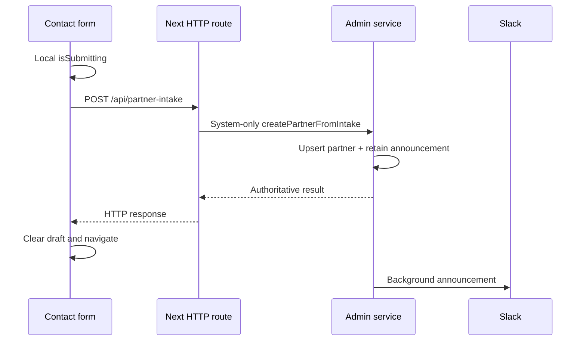

# Plan 167: Red Rope public partner intake through a restricted session

**Date:** 2026-10-15  
**Status:** Complete; verified and archived  
**Owner repository:** `redropeparking`  
**Parent:** [Plan 160](160-plan-command-query-ui-cleanup.md)  
**Research:** [Async UI audit](../../research/async-ui-command-query-audit.md#conditional-domain-and-policy-changes)

## Current instance and boundary

The public [`PartnerContactInfoPage`](<../../../../redropeparking/apps/web/app/(visitor)/partner/intake/contact-info/page.tsx>) sets local submission/error state and awaits `POST /api/partner-intake` (removed). That server route validates fields, owns a secret-key SystemApi connection, allocates a Partner ID and invokes [`createPartnerFromIntake`](../../../../redropeparking/apps/zerospin/src/contracts/createPartnerFromIntake.ts). Its guard explicitly requires system-only claims. The [`adminActor`](../../../../redropeparking/apps/zerospin/src/admin/actors/adminActor.ts) admits admins and selects all partners/invitations; it cannot be reused for anonymous visitors.

The authoritative adapter already deduplicates partners by `googlePlaceId` and queues an asynchronous Slack announcement only when a partner is created. Preserve that behavior and ownership.

## Chosen proposed architecture

Keep anonymous intake. Add a narrow `partnerIntake` actor/session to the existing **admin service**, plus a `partnerIntakeSubmission` model. Sharing the owner allows the submission, canonical partner mutation and retained notification operation to commit atomically; no new cross-owner bridge is needed.

Use a browser-generated 256-bit random receipt capability as this anonymous session's credential. Retain it with the existing intake draft for refresh recovery. The actor derives `submissionId` from a cryptographic digest of that credential; callers cannot supply another row identity. Never retain/log the raw capability in model attributes or expose all submissions. Admission/bootstrap is legitimate asynchronous session lifecycle work and must finish before the form is active.

The actor selects only the one submission matching its verified capability-derived identity. It exposes no Partner, Invitation, admin-list or privileged SystemApi capability. The public submission row contains this visitor's normalized business/contact snapshot; avoid duplicating internal partner identity or Slack outcome in the public selection. Possession of a receipt capability authorizes access only to that one inquiry.

Add proposed ordinary service command `submitPartnerIntake({ business, contact })`. Its shared transaction validates required fields and creates the submission row with the identity derived from claims. An identical repeat is idempotent; changing an already-submitted snapshot is refused. Starting a new inquiry explicitly rotates the browser credential. This is an ordinary submission record, so do not invent a transport-acknowledgement status machine.

The authoritative adapter validates the checked public operations and atomically creates the submission, reuses/creates the canonical Partner under the existing Google Place rule, and queues the existing announcement only for a newly created partner. It must not remove the guard on `createPartnerFromIntake` or grant the public actor permission to invoke it. Extract its server-owned upsert procedure if needed; the adapter's private operation list owns privileged writes.

The form stages synchronously and the receipt/completion view renders this exact proposed query:

```ts
db.query.partnerIntakeSubmission.findFirst({
  where: { id: { eq: capabilityDerivedSubmissionId } },
});
```

Row presence means the inquiry is staged in the session, following ordinary optimistic semantics. Do not label it a guaranteed remote receipt. The runtime owns delivery/rejection; central notifications present later refusal. Retain browser draft inputs until explicit dismissal/new inquiry so rejected optimism can return to an editable form without an acknowledgement subscription. Slack delivery does not control completion.

## Before



## After

```mermaid
sequenceDiagram
  participant F as Contact and receipt views
  participant S as Restricted public session
  participant A as Admin service backend
  participant K as Slack
  Note over F,S: Session admission uses the private receipt capability
  F->>S: submitPartnerIntake(snapshot) — sync
  S->>S: Transaction: own submission + journal
  S-->>F: Own submission live query
  F->>F: Render submitted snapshot
  S->>A: Runtime delivery
  A->>A: Transaction: submission + canonical partner + retained announcement
  A-->>S: Authoritative result or rejected optimism
  S-->>F: Same query; central refusal notification
  A->>K: Existing external announcement
  Note over A,K: Slack outcome does not gate submission
```

## Proposed pseudocode

New actor/model/contract names below are proposals; cryptographic/admission details must use real supported SDK APIs during implementation:

```tsx
const { data: submission } = useLiveQuery({ session, query: ownSubmission });
function submit(event) {
  event.preventDefault();
  const result = stageServiceSessionCommand({
    session,
    contractName: 'submitPartnerIntake',
    payload: { business: selectedBusiness, contact: { name, email } },
  });
  if (result._tag === 'Success') router.push('/partner/intake/complete');
}
// Completion view renders submission; if rollback removes it, retain editable draft access.
```

```ts
partnerIntakeActor.authenticate({ receiptCapability }) {
  requireStrongCapabilityShape(receiptCapability);
  return { submissionId: submissionIdFromDigest(receiptCapability) };
}
submitPartnerIntake.sharedTransaction(claims, payload) {
  const snapshot = normalizeAndValidateIntake(payload);
  const prior = ownSubmission(claims.submissionId);
  if (prior) return requireIdenticalSubmission(prior, snapshot);
  createOwnSubmission(claims.submissionId, snapshot);
}
submitPartnerIntake.serverAdapter(checked) {
  recordCheckedSubmissionOperations();
  const partner = findPartnerByGooglePlaceId(checked.snapshot.business.placeId);
  if (partner) return;
  createCanonicalPartnerWithDeterministicSubmissionDerivedId(checked.snapshot);
  enqueueExistingPartnerAnnouncement();
}
```

## Implementation steps

1. Consult local Intent/pattern guidance. Define the capability credential/claims, strict public actor contract surface and one-row selection. Validate that session cache identity isolates distinct capabilities before activating the public view.
2. Add the submission model and deterministic identity/idempotency rules. Use fresh isolated storage for an incompatible schema cutover.
3. Refactor only the existing private partner-upsert ownership needed by the new authoritative adapter. Preserve system-only contract guards, Google Place deduplication and notification queuing.
4. Add the restricted public session initializer around contact/receipt routes. Keep existing browser draft hydration and Places lookup ownership.
5. Stage synchronously from the contact form, render the submission query on the completion view, and configure central expected-refusal notifications and terminal session rendering.
6. Preserve retry/edit access when rejected optimism removes the row. Rotate capability only for an explicit new inquiry, not on remount or transport retry.
7. Delete the obsolete HTTP submission route and its dedicated secret/RPC imports/configuration references. Keep shared secrets still required by other server features.

## Delete

Delete `/api/partner-intake`, component `isSubmitting`/transport error state, fetch/HTTP response parsing, `finally` submission cleanup and route-only SystemApi connection/timeout/ID allocation plumbing. Delete no generic session subscriptions, admin guards, browser Places APIs or intake draft hydration. Do not replace the bridge with a public privileged command.

## Acceptance checks and limits

- A ready session accepts one synchronous ordinary command and displays its own submission query immediately; no command-ID tracking or acknowledgement status is introduced.
- Two independently generated capabilities select disjoint submissions. Guessing a submission ID without its credential does not grant access; raw capabilities never appear in public model data/logs.
- No public session can select Partner/Invitation rows, invoke admin commands, choose another submission identity or call the system-only intake command.
- Same identity/snapshot repeats are harmless; a changed submitted snapshot is refused. Transport replay and remount preserve the same receipt identity.
- Authoritative partner creation and submission commit together; duplicate Google Place inquiries preserve current reuse semantics and do not duplicate creation announcements.
- Refusal removes rejected optimism and leaves editable draft access; Slack failures do not undo submitted inquiries or gate the UI.
- Red Rope forbids tests and standalone automated checks. Review authentication, selection and transaction paths and use existing permitted app/story workflows; add no runner, fixture, integration suite or gate.

## Dependencies and design status

The restricted actor/model and anonymous capability policy are a proposed domain design, not already-approved public APIs. This plan requires the synchronous service SDK from [Plan 161](161-plan-synchronous-staging-consumer-release.md), even though it is a new public caller rather than an existing async consumer. It can be implemented separately from the two admin forms. Capability possession grants access to one inquiry's contact details; keep that credential private and bounded to this session.

## Implementation outcome

Implemented the narrow partnerIntake actor/session, SHA-256 capability-derived identity, submission model, synchronous submitPartnerIntake and private canonical adapter. Actor selection exposes only its own submission; canonical Partner is available only to the private adapter's database, not its public models. Required fields normalize in the ordinary transaction, identical repeats are idempotent and changed submitted snapshots are refused. Canonical partner deduplication and new-partner Slack queuing commit with the submission. Browser draft/capability survive refresh and rejection; completion queries the submission and offers edit/retry after rollback. Explicit new inquiry rotates the 256-bit capability. Removed privileged HTTP bridge. Fresh isolated backend accepted the authored System at port3432; no existing storage or real provider credentials were used.

## Verification

1. Red Rope installs exact 11.3.2 throughout its framework package set using pnpm 9.15.9. Frozen install passes. Installed JavaScript is synchronous and the declaration returns IResult with corrected local-staging documentation; sqlite.wasm and bundled SharedWorker assets are present. Bundled Intent submission guidance states synchronous staging.
2. Existing Nx production builds pass for web and admin, including TypeScript and prerendering. The existing web Storybook production build passes. No test suite, runner, fixture file or check configuration was created. Existing UI stories/supporting fixtures were adapted in place.
3. The existing backend development workflow, run against fresh temporary inspection storage through unchanged config/source links, reaches Ready on http://127.0.0.1:3432 with the system spec accepted. Existing repository storage was untouched. No real Clerk or Slack delivery was attempted.
4. Source review and independent authority/recovery review cover capability isolation, public model/contract selection, atomic adapter re-emission, stale-revision rejection, recorded request failure, immutable acceptance time, synchronous refusal and retry/edit access. The retained consumer system-worker patch was adapted to validateExternalOutcome and command.externalOutcome; payload-only external emission and commandOutcome callers match the consumed SDK.

## Remaining work

None.
