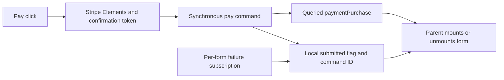
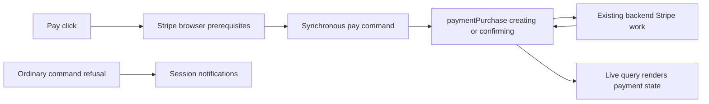

# Stackshirts payment: render the purchase after staging

**Status:** Complete; build and source review verified 2026-10-15.  
**Date:** 2026-10-15  
**Owner repository:** `../stackshirts`, `apps/storefront`  
**Parent:** [Command/query UI cleanup](160-plan-command-query-ui-cleanup.md)  
**Research:** [Payment finding](../../research/async-ui-command-query-audit.md#stackshirts-payment-form-remove-post-stage-completion-bookkeeping)

## Outcome and scope

After Stripe supplies a confirmation token, synchronously stage the existing
`pay` command. The queried `paymentPurchase` then owns payment progress. Remove
the form's second representation of whether that command was submitted.

This is a small UI cleanup, not a new payment design. Keep Stripe Elements
validation, confirmation-token creation, private action-secret reads, 3DS,
browser-operation guards, account/session identity checks and cancellation.
Those steps really are asynchronous browser/provider work. Keep the existing
payment identities, payload, provider idempotency and authoritative state machine.

## Before



## After



## Proposed shape

Pseudocode keeps the legitimate asynchronous prerequisite explicit. No new
submission helper or command-completion subscription is introduced.

```tsx
const { data: purchase } = useLiveQuery({
  session,
  key: purchaseId,
  query: (db, id) =>
    db.query.paymentPurchase.findFirst({
      where: { id: { eq: id } },
    }),
});

async function pay() {
  if (!stripe || !elements || browserOperationRunning || !isCurrentAccount())
    return;
  // This flag covers Stripe.js work only, and ends in finally.
  await validateElementsAndCreateConfirmationToken(); // existing inline sequence
  if (!isCurrentAccount()) return;
  const result = stageAggregateSessionCommand({
    session,
    contractName: 'pay',
    payload: { purchaseId, submissionId, design, confirmationTokenId },
  });
  if (result._tag === 'Failure') return; // existing session refusal presentation
  // No submitted flag, receipt retention, wait, or refresh.
}

// Parent already renders this choice from the purchase query.
const canSubmit = !purchase || purchase.paymentState === 'declined';
const needsAuthentication = purchase?.paymentState === 'requires-action';
```

`validateElementsAndCreateConfirmationToken` above names the existing sequence
for explanation; it is not a proposed extracted utility. Keep the real account
checks after each asynchronous step. The contract rechecks current purchase
state transactionally, so stale React props cannot authorize a second attempt.

## Implementation steps

1. Verify the installed synchronous staging and notification API. Consume
   [the framework release](161-plan-synchronous-staging-consumer-release.md) only
   if required by the central failure-presentation change; do not rebuild public
   framework packages in Stackshirts.
2. Delete `submitted`, the retained command ID, its matching failure subscription
   and the waiting-for-submission button branch from `PaymentForm`.
3. Leave local `busy`/operation guards around Elements, token creation and 3DS.
   Let parent query state determine form lifetime and eligibility after staging.
4. Fix the `PaymentDetails` subscription that currently escalates every failure
   through `onFailure`: route ordinary command refusals to the session's central
   notification owner and terminal/runtime failures to the existing session
   boundary. Do not silently drop refusals when deleting the form subscription.
5. Preserve the private `readPaymentAction` credential boundary. No client secret
   enters command payloads, replicated purchase rows or notification text.
6. Update payment ownership documentation and remove now-unused imports only.

## Acceptance and verification

1. Local `pay` success creates `creating`, or changes `declined` to `confirming`,
   before return. The query drives subsequent controls without acknowledgement.
2. A stale second submission is refused by the existing contract. A refusal
   leaves no new optimism and has one notification, without a terminal-page swap.
3. Decline remounts an editable payment form; `requires-action` keeps 3DS working;
   account change/unmount still prevents an old token/action from being applied.
4. Keep the purchase query by the same purchase ID; preserve paid, canceled,
   reconciliation and provider-webhook handling.
5. Follow [Stackshirts policy](../../../../stackshirts/AGENTS.md): no new test files,
   fixtures, runners, integration suites or check gates. Use its existing
   storefront build and source review; any provider exercise uses an explicitly
   authorized Stripe test environment, never real payment credentials or charges.
   Record unperformed provider scenarios rather than claiming verification.

## Source anchors

- [Purchase query and parent form lifetime](../../../../stackshirts/apps/storefront/src/screens/Payment.tsx#L94-L134).
- [Redundant state and failure subscription](../../../../stackshirts/apps/storefront/src/screens/Payment.tsx#L150-L173).
- [Stripe prerequisite and synchronous staging](../../../../stackshirts/apps/storefront/src/screens/Payment.tsx#L210-L245).
- [Existing optimistic purchase states and refusal](../../../../stackshirts/apps/storefront/src/domain/payments/contracts/payV1.ts#L37-L85).
- [Private payment-action authorization](../../../../stackshirts/apps/storefront/src/server/readPaymentAction.ts#L13-L49).

## Implementation outcome

Removed `submitted`, retained command ID, the per-form failure subscription,
and the waiting-for-submission button branch. The purchase query controls form
eligibility and lifetime. Kept Elements validation, token creation, private
action-secret reads, 3DS, cancellation, and account/browser-operation guards.
`PaymentDetails` escalates only runtime/session failure events; ordinary staging,
admission, and execution refusals use the session notification layer and one
shared dismissible view. The installed exact 11.0.1 API already supports this
notification path, so no framework package rebuild or upgrade was required.

Verification: existing storefront `pnpm build` passed, including Next TypeScript
and route compilation. Scoped `git diff --check` and source reference review
passed. Existing Bootstrap/Sass deprecation and circular-chunk warnings remain.
No tests, fixtures, runners, schema changes, or storage resets were introduced.

Stripe provider/card scenarios, decline, 3DS, and account-change behavior were
reviewed in source; no live provider exercise or charge was performed. These
scenarios require an explicitly authorized Stripe test environment and are not
claimed as runtime-verified.

## Remaining work

None.
