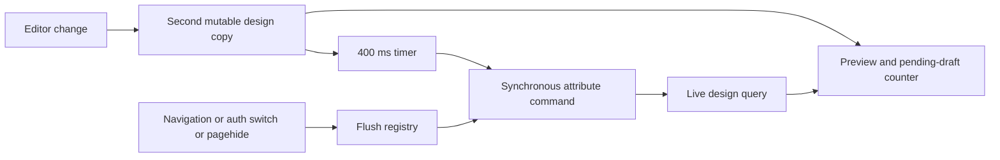
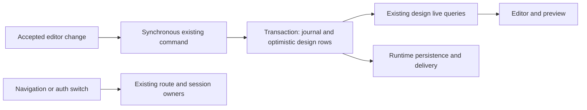

# Stackshirts designs: stage each edit immediately

**Status:** Complete; build and source review verified 2026-10-15.  
**Date:** 2026-10-15  
**Owner repository:** `../stackshirts`, `apps/storefront`  
**Parent:** [Command/query UI cleanup](160-plan-command-query-ui-cleanup.md)  
**Research:** [Draft buffering finding](../../research/async-ui-command-query-audit.md#conditional-domain-and-policy-changes)

## Outcome and policy

Remove the 400 ms application buffer. Each accepted design edit synchronously
stages its existing command; `useDesignState` renders the resulting optimistic
rows. Navigation, account switching and signup no longer flush application
state before proceeding. Zerospin owns retention and safe session release.

The tradeoff is deliberate: more small journal commands replace coalesced edits.
Do not introduce a second queue or a new debounce under another name. Legitimate
unsaved form fields and editor gestures can remain transient until they produce
an accepted edit; this plan does not turn every pointer-move or IME intermediate
event into a separate domain command. Incomplete text already accepted by the
attribute commands remains an ordinary persisted draft design.

## Before



## After



## Proposed shape

```tsx
const { stack, shirt, progress } = useDesignState(stackId);
const scope = useDesignScope();

<LogoEditor products={stack.products} onChange={products => {
  stageAggregateSessionCommand({ session: scope.session,
    contractName: 'replaceStackProducts',
    payload: { stackId: stack.id, products },
  });
}} />

<StackAttributes stack={stack} onChange={attributes => {
  stageAggregateSessionCommand({ session: scope.session,
    contractName: 'updateStackAttributes',
    payload: { stackId: stack.id, ...attributes },
  });
}} />

// Equivalent direct handler for updateShirtAttributes.
// Full attribute values required by the existing payload come from the editor.
// No useSavedDraft shadow, timer or flush.

function continueToShirt() {
  const shirt = getOrCreateShirt(scope, stack.id); // existing synchronous domain action
  router.push(`/stacks/${stack.id}/shirts/${shirt.id}/attributes`);
}
```

This pseudocode preserves the existing command names and full attribute
payloads. Do not rebuild those payloads from a stale second design copy. Audit
editor callback semantics while replacing the buffer so consecutive complete
values and field edits preserve all intended attributes. Session transactions
remain the authority for commands that read preceding optimistic edits.

## Implementation steps

1. Remove `useSavedDraft` from products, stack attributes and shirt attributes.
   Pass queried values to editors and synchronously stage their accepted values
   through the existing guest/account commands. Preserve validation and
   signed-out guest design behavior.
2. Delete `DraftProvider`'s map, registration, dirty/latest state, timer,
   pagehide/unmount flushing, pending counter and discard machinery. Remove the
   provider from `App` after all references are replaced.
3. Remove flush/discard dependencies from `WorkspaceOwner`, Keep/Discard,
   `StorefrontAuth`, navigation, design lists and guest reset. Keep the actual
   guest/account import and clear commands in their current sequence. Do not
   replace them with waits for persistence, receipts or handoff.
4. Replace `DesignLink` with ordinary Next links and remove `useGuestNavigation`
   where its only purpose is flushing. Keep actual route transitions and auth
   hydration behavior with their existing owners.
5. Remove draft errors and retry-flush controls from `WorkspaceFrame`. Preserve
   truthful informational runtime/offline status without using synchronization
   or acknowledgement to block edits, navigation or owner release. A local
   command commit must not be described as confirmed account persistence.
6. Move the still-used error formatting out of the deleted draft module to one
   appropriate shared error owner. Route command refusals through central
   session notifications; keep component-local validation and browser errors.
   Coordinate with [payment cleanup](178-plan-stackshirts-payment-query-state.md)
   so neither change leaves `Payment` importing a deleted provider.
7. Update design/ownership docs to state immediate staging and the command-volume
   tradeoff. Preserve auth identity, domain versions, existing command payloads
   and unrelated WIP.

## Acceptance and verification

1. Accepted name, theme, products and shirt edits enter the local journal before
   their handlers return. The preview is produced by the normal design query.
2. Immediate navigation, unmount, signup and account switching require no draft
   flush; the last accepted edit remains under the correct session owner.
3. Rapid edits preserve complete attributes and product ordering. Rejection
   displays reconciled rows rather than retaining a local optimistic shadow.
4. Empty/incomplete permitted text stays editable; product search, IME and
   in-progress drag gestures retain appropriate transient presentation state.
5. Keep/Discard and guest recovery retain their actual declared domain commands;
   no consumer waits for transport, storage or authoritative confirmation.
6. Follow [Stackshirts policy](../../../../stackshirts/AGENTS.md): use existing build
   and source review; do not create or require test suites, fixtures, runners,
   standalone automated check gates or backend integration tests. If a runtime
   exercise is authorized, use fresh isolated storage and preserve existing
   browser databases. Record the command-volume behavior and any unverified cases.

## Source anchors

- Buffer, timer and flush lifetime (removed).
- [Current design save callbacks](../../../../stackshirts/apps/storefront/src/screens/Design.tsx#L70-L169).
- [Existing queried design rows](../../../../stackshirts/apps/storefront/src/domain/queries.ts#L41-L67).
- Navigation interception (removed).
- [Account ownership and Keep/Discard](../../../../stackshirts/apps/storefront/src/sessions/WorkspaceOwner.tsx#L23-L42).
- [Draft-derived saving status](../../../../stackshirts/apps/storefront/src/components/WorkspaceFrame.tsx#L38-L63).
- [Permitted incomplete stack attributes](../../../../stackshirts/apps/storefront/src/domain/contracts/updateStackAttributesV1.ts#L17-L41).

## Implementation outcome

Removed `DraftProvider`, `useSavedDraft`, the 400 ms timer, flush/discard
registries, draft counters/errors, `DesignLink`, and `useGuestNavigation`.
Accepted products and attribute edits stage existing commands immediately; the
normal queries render editor values and previews. Removed the logo editor's
accepted-products shadow while retaining transient search/drag presentation.
Next links own navigation. Account selection preserves auth hydration and
changes owner without a draft flush; Keep/Discard still stage their declared
commands in order. Connection text is informational rather than a claim of
confirmed account persistence. Shared error formatting and session notifications
replace the deleted provider's error responsibilities. Updated application and
ownership documentation, including the increased command-volume tradeoff.

Verification: existing storefront `pnpm build` passed, including Next TypeScript
and route compilation. Scoped `git diff --check` and source reference review
passed. Existing Bootstrap/Sass deprecation and circular-chunk warnings remain.
No tests, fixtures, runners, schema changes, or storage resets were introduced.

Rapid-edit, IME/drag, navigation, signup/account-switch, and rejection behavior
were reviewed in source; no browser runtime exercise was performed and existing
browser databases were preserved.

## Remaining work

None.
