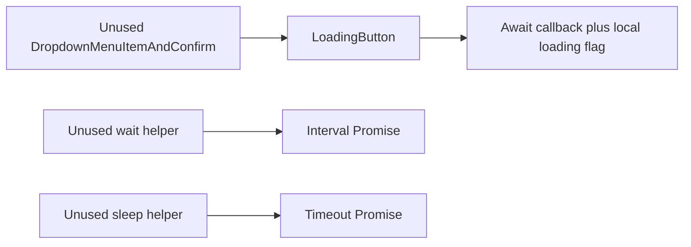
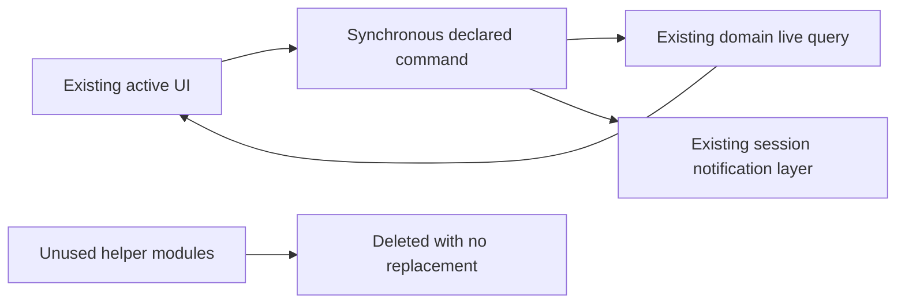

# Mentor Mailbox: delete unused asynchronous UI residue

**Status:** Complete; verified 2026-10-15.  
**Date:** 2026-10-15  
**Owner repository:** `../mentormailbox`, `apps/app`  
**Parent:** [Command/query UI cleanup](160-plan-command-query-ui-cleanup.md)  
**Research:** [Mentor Mailbox finding](../../research/async-ui-command-query-audit.md#mentor-mailbox-sound-active-usage-and-unused-residue)

## Outcome

Delete the unused `LoadingButton`, `DropdownMenuItemAndConfirm`, `wait` and
`sleep` modules after a current reference/export check. There is no new
command, query, model or service to build. Active Mentor Mailbox UI already
stages commands synchronously and presents failures centrally.

## Before



## After



## Pseudocode

```text
find first-party imports, exports, stories and documentation references
for LoadingButton, DropdownMenuItemAndConfirm, wait and sleep

if the current unused graph is unchanged:
  delete the four source modules
  remove only their now-unused references
else:
  classify each actual caller before editing it
  retain real browser/server asynchronous operations with their existing owner
  migrate a synchronous command caller to the existing ordinary Button

do not add a replacement loading primitive or a command-completion waiter
```

## Implementation steps

1. Recheck the entire first-party repository, excluding installed/generated code,
   for direct imports, barrel exports and dynamic references. The current
   `NavButton.displayName = "LoadingButton"` string is unrelated to the unused
   module; do not count it as a consumer or rename it merely to satisfy a search.
2. Delete the two unused components and two timer helpers. Preserve existing
   Storybook stories/configuration and genuine React form/browser behavior.
3. Remove imports/exports/docs that exist solely for these modules. Do not prune
   shared dependencies such as React Hook Form or Radix without proving they
   are unused across the application.
4. Keep active project, calendar and planner command/query flows unchanged.

## Acceptance and verification

1. No first-party code imports any deleted module; no replacement waiter,
   loading-state primitive or command-ID tracking is introduced.
2. Existing central notifications and synchronous project/calendar commands are
   unchanged. This cleanup makes no claim to fix an observed active UI incident.
3. Follow [repository policy](../../../../mentormailbox/AGENTS.md) and
   [app policy](../../../../mentormailbox/apps/app/AGENTS.md): inspect the existing
   Turbo/app build configuration and use the configured build when appropriate.
   Do not introduce or require tests, runners, standalone automated check gates
   or backend integration tests; no schema/storage reset is needed.

## Source anchors

- Promise-click loading wrapper (removed).
- Only direct LoadingButton consumer (removed).
- Unused interval helper (removed).
- Unused timeout helper (removed).
- [Existing notification layer](../../../../mentormailbox/apps/app/src/zerospin/studentSession.ts#L55-L60).

## Implementation outcome

Deleted the unused `LoadingButton`, `DropdownMenuItemAndConfirm`, `wait`, and
`sleep` modules after a repository reference/export check. The unrelated
`NavButton.displayName` string and active command/query/notification paths are
unchanged. Preserved all unrelated WIP and Storybook files.

Verification: `pnpm exec turbo run build --filter=app` passed with one successful
app build. Source reference review found no imports/exports of deleted modules;
scoped `git diff --check` passed. No tests, fixtures, runners, schema changes, or
storage resets were added.

## Remaining work

None.
