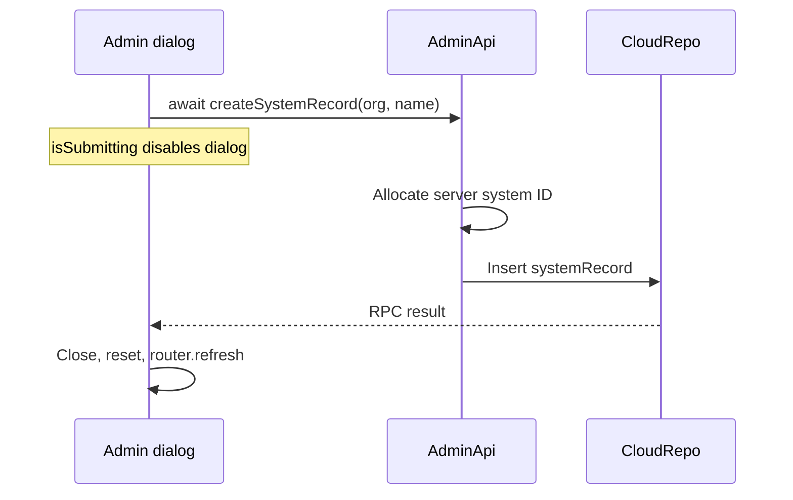

# Cloud Admin system creation: one control-plane owner and synchronous staging

**Status:** Complete; implementation and required verification passed 2026-10-15.  
**Date:** 2026-10-15  
**Owner repository:** `../zerospin-cloud`, `apis` and `admin`  
**Parent:** [Command/query UI cleanup](160-plan-command-query-ui-cleanup.md)  
**Research:** [Cloud candidates](../../research/async-ui-command-query-audit.md#zerospin-cloud-larger-domain-migration-candidates)  
**Shared prerequisite for:** [Cloud creation](182-plan-cloud-system-creation.md), [key provisioning](183-plan-cloud-key-provisioning.md)

The design sections below retain the approved migration rationale. The
implementation outcome and verification at the end describe current code. The user's 2026-10-15 request to implement the full collection authorized
the described service, model, authentication, and ownership changes.

## Outcome and current limitation

Admin's dialog validates a name, allocates the system's `sys_` identity once,
synchronously stages creation and closes on local success. Its organization
system list reads the session's `systemRecord` query. There is no submission
spinner, acknowledgement waiter or router refresh.

Cloud currently has no local Zerospin session for this domain. Both creation
RPCs generate IDs on the server and write `CloudRepo.systemRecord`. Removing
`await` would not create synchronous semantics. The prerequisite below is an
explicit architecture proposal, with real data-owner and runtime changes.

## Before



## After

```mermaid
sequenceDiagram
  participant D as Admin dialog
  participant S as Organization-scoped admin session
  participant C as Cloud control-plane service
  D->>S: createSystemRecord(systemId, name), synchronous
  S->>S: Journal plus optimistic systemRecord transaction
  S-->>D: Local result; close and reset
  S-->>D: Existing organization list live query includes row
  S->>C: Runtime delivery
  C->>C: Authorize admin and create same system ID
  C-->>S: Authoritative confirmation or rejection
  S-->>D: Reconciled list; ordinary refusal notification
```

## Shared control-plane design

1. Introduce one native service, proposed name `cloudControlPlane`, as the
   **sole canonical owner** of system metadata. Its `systemRecord` model keeps
   the `sys` abbreviation and declares only `name`, `organizationId` and nullable
   `systemVersion` as domain attributes. The legacy nullable `version` is displayed
   and searched as the system's version; current source only initializes it to
   null, so do not invent published/deployment-version semantics. Rename it to
   `systemVersion` at every reader. Native `id`, `createdAt`, `updatedAt`,
   `modelName` and `version` are framework properties, not declared attributes:
   framework `version` identifies the model release and framework `createdAt`
   supplies creation time. Reuse public service staging, sessions, notifications
   and reconciliation; do not build a generic provisioning engine.
2. Define `createSystemRecord({ systemId, name })` once. Its shared program
   creates the record with `organizationId` from admitted session claims and
   the supplied ID. The ordinary authoritative program performs the same write.
   Creation itself has no external business operation, so it needs no fabricated
   creation-progress model or `pending` flag.
3. Admit separate Admin and Cloud actors. Admin credentials are verified against
   the existing internal Admin Clerk configuration; the session's selected
   organization is authorized by that admin admission. The Cloud actor derives
   its organization/user from the verified active Cloud Clerk session. Neither
   trusts the organization route param or payload as authority. Both actors
   select only the admitted organization's system rows.
4. Keep the initialized session above the organization's list/detail routes.
   Replacing the principal or organization replaces the session; cached local
   rows and pending commands cannot cross that identity boundary. Use native
   initialization and terminal-session presentation, not component bootstrap.
5. Bootstrap the control-plane service independently of customer system/deploy
   routing, through an explicitly configured platform binding behind `apis`.
   Otherwise hosted routing would require a system lookup from the service it
   is still trying to reach. `apis` remains the hosted trust boundary; do not
   move privileged admission into `admin` or `cloud`.
6. Remove `CloudRepo.systemRecord` and its canonical CRUD path in this cutover.
   CloudRepo continues owning deploy/system-instance and private credential
   records. Convert their cross-owner system references to opaque `sys` IDs;
   update system authorization and existence reads in hosted routing, CLI,
   deploy readers, Admin/Cloud queries and key issuance to the control-plane
   owner's authoritative query. Do not keep a second canonical system table,
   dual writes or a permanently mirrored legacy path.

## Proposed UI and domain shape

All application declarations below are proposed; only the public SDK staging
and ID functions already exist in the current sibling framework.

```tsx
// Inside the admitted, initialized organization-scoped Admin session.
const { data: systems } = useLiveQuery({
  session,
  query: db => db.query.systemRecord.findMany(),
});

function onSubmit({ systemName }) {
  const systemId = makeServiceSessionModelId({
    session,
    model: systemRecordV1,
  });
  const outcome = stageServiceSessionCommand({
    session,
    contractName: 'createSystemRecord',
    payload: { systemId, name: systemName },
  });
  if (outcome._tag === 'Failure') return;
  setOpen(false);
  form.reset();
}

// Shared native contract program, evaluated transactionally on both sides.
validateSystemName(payload.name);
refuseAnExistingSystemIdentity(payload.systemId);
createSystemRecord({
  resourceId: payload.systemId,
  attributes: {
    organizationId: claims.organizationId,
    name: payload.name,
    systemVersion: null,
  },
});
// Native model operations supply createdAt and model-release version.
```

Domain calls in this pseudocode describe contract operations and checks; they
are not a request to add forwarding utilities or an alternative submission API.

## Implementation steps

1. Resolve the repository's explicit implementation-scope constraints before
   introducing services/types or moving validation/auth/RPC ownership; see the
   constraints below. Inspect installed Intent skills and public SDK support.
   Consume [the synchronous release](161-plan-synchronous-staging-consumer-release.md)
   through the existing subtree/package workflow if the installed service API
   still waits for acceptance. Do not edit public vendor code as an app fix.
2. Build the shared service/model/actors/contract/session declarations above,
   with one declaration per file and exact credential boundaries. Keep privileged
   gateway wiring in `apis` and presentation in `admin`/`cloud`/`ui`.
3. Execute the canonical-owner cutover together with all existing system metadata
   readers, relations and types. Replace `ISystemRecord`'s legacy CloudRepo table
   inference with the native record shape. Change Admin table search and Cloud's
   system overview from the legacy business `version` to `systemVersion`; never
   display the framework model-release `version` as the system's version. Use
   native `createdAt` without a second declared creation-time attribute. Use
   fresh isolated storage for changed fixed schemas; preserve current development
   data and unrelated WIP. Do not add dual business-version fields, compatibility
   aliases, row translators or fallback owner reads.
4. Replace `CreateSystemDialog`'s awaited RPC with direct synchronous staging.
   Keep unsaved name/open state and name validation. Delete submission-only
   disable/spinner logic, the RPC error/result branch and `router.refresh`.
5. Make the organization's system list/query use the same admitted session.
   Expected creation refusals use central notifications; terminal session errors
   replace session content through its boundary. Reconciliation removes refused
   optimistic rows without a component acknowledgement watcher.
6. Remove the superseded creation RPC declarations/failure implementations and
   system-only CloudRepo methods after their callers migrate; preserve unrelated
   real authenticated RPC operations. Update local dashboard/API patterns.

## Acceptance and verification

1. Local success returns with a stable `sys` identity and optimistic row before
   network acknowledgement. Confirmation keeps that ID; rejection removes the
   row and reports an ordinary refusal.
2. Consecutive valid creations do not serialize around delivery. Duplicate
   identity is refused atomically by the owner; no unique-name rule is invented
   unless the existing product explicitly requires it.
3. Admin admission and selected-organization scoping are enforced server-side;
   ordinary Cloud credentials cannot select the Admin actor or another org.
4. All canonical system metadata readers use one owner. Hosted customer routing
   and CLI/deploy/key authorization still work without a control-plane bootstrap
   cycle, stale CloudRepo mirror or secret-bearing session selection.
   Model construction accepts no reserved framework keys as domain attributes;
   UI version display/search uses nullable `systemVersion`, while native
   `version` remains the model release. There is no legacy-field adapter.
5. Follow [Cloud testing policy](../../../../zerospin-cloud/AGENTS.md): use existing
   configured Nx build/type tasks after inspecting targets. Do not add or require
   test suites, fixtures, standalone check runners, new check gates or client-side
   backend integration tests. Record architecture/source checks and build evidence
   separately from any explicitly authorized runtime exercise.

## Implementation scope authorization

The user explicitly authorized implementation of the whole command/query cleanup
collection on 2026-10-15. That covers the native control-plane service, shared
models/contracts, selected Clerk admission, hosted bootstrap binding, private
credential workflow, and canonical-owner cutover described here. No additional
implementation-scope approval is pending.

## Source anchors

- [Native system record](../../../../zerospin-cloud/apis/src/controlPlane/systemRecordV1.ts).
- [Synchronous shared creation contract](../../../../zerospin-cloud/apis/src/controlPlane/createSystemRecordV1.ts).
- [Native owner and canonical queries](../../../../zerospin-cloud/apis/src/controlPlane/cloudControlPlaneV1.ts).
- [Admin admission](../../../../zerospin-cloud/apis/src/controlPlane/adminActorV1.ts), [Cloud admission](../../../../zerospin-cloud/apis/src/controlPlane/cloudActorV1.ts).
- [Independent platform bootstrap](../../../../zerospin-cloud/apis/src/controlPlane/initializeControlPlane.ts), [gateway routing](../../../../zerospin-cloud/apis/src/Worker.ts), [bindings](../../../../zerospin-cloud/apis/wrangler.jsonc).
- [Canonical server read](../../../../zerospin-cloud/apis/src/controlPlane/readSystemRecord.ts).
- [Opaque cross-owner references](../../../../zerospin-cloud/apis/src/CloudRepo/cloudRepoSchema.ts).
- [Admin dialog](../../../../zerospin-cloud/admin/src/components/dashboard/CreateSystemDialog.tsx), [system table](../../../../zerospin-cloud/admin/src/components/dashboard/SystemRecordsTable.tsx).

## Implementation outcome

The native `cloudControlPlane@1.0.0` service now owns system metadata. Its
shared create command preserves the supplied `sys` ID and takes organization
authority from admitted claims. Admin verifies the internal Clerk instance and
selected organization; Cloud verifies its active organization. Projections are
scoped to the admitted organization and appropriate key/user scope. The Admin
dialog and organization list use the native session/query.

Removed CloudRepo's system table, creation methods, and obsolete create RPCs.
Hosted routing, CLI/deploy authorization, API metadata reads, and key
authorization use canonical native queries. Cross-owner references are opaque
`sys` IDs. The old initial CloudRepo migration is retired in favor of the new
empty-storage schema; existing storage is preserved.

The API Worker owns explicit platform bindings and a config alias. It accepts
the current native spec and initializes the fixed platform singleton directly,
independently of customer records/deploys/keys. The gateway uses production
credential policy even locally; arbitrary development `sk_` prefixes do not
grant platform System API access. Domain `systemVersion` is separate from the
native model release `version`.

First-party Cloud packages consume exact Zerospin 11.3.2 from the local
credential-free registry. All first-party framework dependencies, including
UI dev/peer declarations, were checked; the vendored checkout is unchanged.
`pnpm install --frozen-lockfile` passed.

Verification completed: `pnpm nx run apis:lib`, `pnpm nx run apis:types`,
existing Wrangler dry-run compilation, source/security review, and scoped
`git diff --check`. A fresh isolated local run through existing `apis:dev`
reached ready on port 3004 with dummy Clerk configuration, evaluated native
owner assertions, accepted the authored platform spec, and initialized its
service. GET `/control-plane` then returned the expected RPC method-only 400,
after bootstrap. No real authentication or provider/key issuance was exercised.
No tests, fixtures, runners, or check gates were added; existing databases and
unrelated WIP are preserved.

Final frontend verification: `pnpm nx run-many -t build -p admin,cloud` passed
both Next applications and their two required API/UI library dependencies in
8.9 seconds. The resolved task graph scheduled no vendored framework build.
First-party ambient/project references to vendored framework types were removed
while keeping required local dependency execution. The temporary dummy local
API server was stopped after verification; no user server or registry process
was stopped.

## Remaining work

None.
