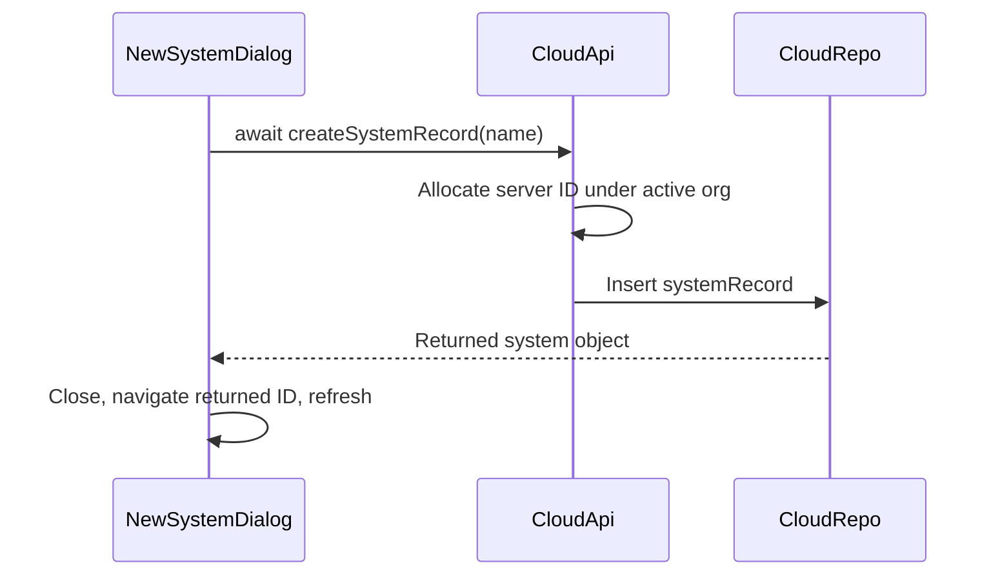
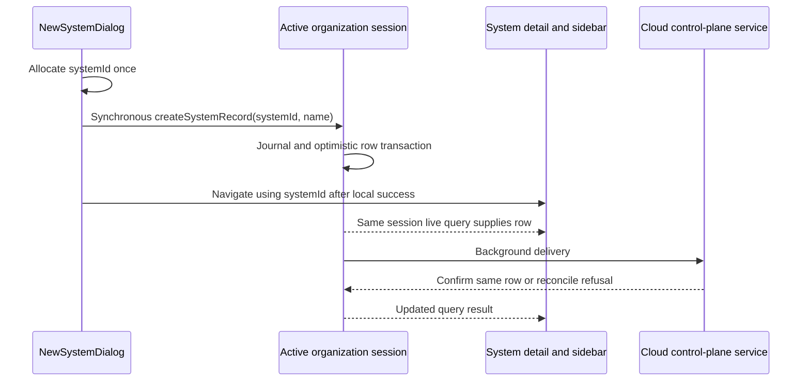

# Cloud NewSystemDialog: create locally and navigate with the retained identity

**Status:** Complete; implementation and required verification passed 2026-10-15.  
**Date:** 2026-10-15  
**Owner repository:** `../zerospin-cloud`, `cloud`  
**Parent:** [Command/query UI cleanup](160-plan-command-query-ui-cleanup.md)  
**Prerequisite:** [Shared control-plane owner and admission](181-plan-cloud-admin-system-creation.md#shared-control-plane-design)  
**Research:** [Cloud candidates](../../research/async-ui-command-query-audit.md#zerospin-cloud-larger-domain-migration-candidates)

The design sections below retain the approved migration rationale. The
implementation outcome and verification at the end describe current code. The user's 2026-10-15 request to implement the full collection authorized
the described service, model, authentication, and ownership changes.

## Outcome

Validate the unsaved name, allocate a `sys` ID once in the submit handler, stage
the shared creation command synchronously, close and navigate using that same
ID. The destination and sidebar render the session's system query. They do not
await creation, refresh server props or retain a second pending system object.

The native control-plane service, models, contract, and session from
[plan 181](181-plan-cloud-admin-system-creation.md) are implemented. This plan
consumes that single owner; it does not add another creation service or mirror
the CloudRepo table.

## Before



## After



## Proposed shape

```tsx
// Proposed application session/record from plan 181; current public SDK calls.
function handleCreateSystem(event) {
  event.preventDefault();
  const name = validateUnsavedName(newSystemName);
  if (!name) return;
  const systemId = makeServiceSessionModelId({
    session,
    model: systemRecordV1,
  });
  const result = stageServiceSessionCommand({
    session,
    contractName: 'createSystemRecord',
    payload: { systemId, name },
  });
  if (result._tag === 'Failure') return;
  setNewSystemName('');
  onOpenChange(false);
  router.push(createHref(systemRoutePattern, { organizationId, systemId }));
}

// Destination lives below the same initialized organization session.
const { data: system } = useLiveQuery({
  session,
  key: systemId,
  query: (db, id) =>
    db.query.systemRecord.findFirst({ where: { id: { eq: id } } }),
});
return system ? <SystemDetails system={system} /> : <SystemUnavailable />;
```

Validation in this pseudocode names the existing inline schema operation; it is
not a new helper API. Initial restoration/loading uses the session initializer.
Missing query rows remain ordinary unavailable results, including rollback after
refusal. Do not interpret missing acknowledgement as a domain state.

## Implementation steps

1. Complete the shared service and canonical-owner cutover in plan 181, including
   the synchronous public staging release when necessary.
2. Mount its Cloud session above organization sidebar/detail routes. Derive its
   principal and organization from verified active Clerk claims, and replace the
   session on organization/account change. A route parameter is a navigation
   identity, never authorization.
3. Replace the awaited `callCloudApi` creation with the proposed shared native
   `createSystemRecord` command and a locally allocated model ID. Retain local
   unsaved name validation and dialog state.
4. Use the synchronous success branch to clear, close and navigate. Delete
   creation-specific `useCloudApi`, returned-system plumbing and `router.refresh`.
   Do not add an effect that waits for the row to become authoritative.
5. Replace system sidebar/detail RPC data ownership with session live queries.
   Display the nullable domain `systemVersion` chosen in plan 181 wherever the
   legacy record used business `version`; the native row's framework `version`
   is the model release, not that UI value. Keep native `createdAt` without a
   duplicate declared attribute or compatibility adapter. Preserve genuine
   authenticated reads for unrelated deploys or private secrets.
6. Centralize ordinary command-refusal presentation and preserve terminal session
   replacement. Update dialog/data-ownership patterns invalidated by this change.

## Acceptance and verification

1. The destination opens after local success before acknowledgement, using the
   exact command ID payload's `systemId`; the optimistic row survives confirmation.
2. A local refusal keeps the dialog/input available. A later authoritative
   refusal removes the optimistic row, gives one notification and produces the
   destination's ordinary unavailable presentation.
3. Two accepted creations can proceed while earlier delivery is pending; there
   is no generic creation lock. IDs are generated once per actual submit.
4. Account/organization switching cannot expose or modify another org's rows;
   deep links are selected under authenticated claims.
   System overview/search reads `systemVersion`, including null presentation;
   framework version metadata never replaces the displayed business value.
5. Follow [Cloud AGENTS.md](../../../../zerospin-cloud/AGENTS.md): inspect existing
   Nx targets and use configured builds/types only; no new tests, fixtures,
   standalone check runners, check gates or backend integration suite. Use
   isolated storage for the prerequisite schema cutover, preserving existing WIP.
6. The full implementation scope was authorized with the collection; its shared
   service and trust boundaries are implemented once under plan 181.

## Source anchors

- [Synchronous creation and navigation](<../../../../zerospin-cloud/cloud/app/(authed)/NewSystemDialog.tsx>).
- [Organization session lifetime](../../../../zerospin-cloud/cloud/controlPlane/CloudControlPlaneProvider.tsx).
- [Live system list](<../../../../zerospin-cloud/cloud/app/(authed)/(console)/[organizationId]/systems/SystemRecordsSection.tsx>).
- [Shared system identity and creation](../../../../zerospin-cloud/apis/src/controlPlane/createSystemRecordV1.ts).
- [Verified active-organization admission](../../../../zerospin-cloud/apis/src/controlPlane/cloudActorV1.ts).

## Implementation outcome

Cloud mounts its native session above organization routes, keyed to the
authenticated principal and active organization. `NewSystemDialog` allocates
one system ID, stages creation synchronously, and closes/navigates on immediate
success. Sidebar, list, and overview render native live queries, including the
ordinary unavailable result after reconciliation. The business version display
uses nullable `systemVersion`. Ordinary refusals use session notifications;
private credential reads and unrelated deploy queries remain authenticated RPCs.

First-party Cloud packages consume exact Zerospin 11.3.2 from the local
credential-free registry. All first-party framework dependencies, including
UI dev/peer declarations, were checked; the vendored checkout is unchanged.
`pnpm install --frozen-lockfile` passed.

Verification completed: `pnpm nx run apis:lib`, `pnpm nx run apis:types`,
existing Wrangler dry-run compilation, source/security review, and scoped
`git diff --check`. A fresh isolated local run through existing `apis:dev`
reached ready on port 3004 with dummy Clerk configuration, evaluated native
owner assertions, accepted the authored platform spec, and initialized its
service. GET `/control-plane` then returned the expected RPC method-only 400,
after bootstrap. No real authentication or provider/key issuance was exercised.
No tests, fixtures, runners, or check gates were added; existing databases and
unrelated WIP are preserved.

Final frontend verification: `pnpm nx run-many -t build -p admin,cloud` passed
both Next applications and their two required API/UI library dependencies in
8.9 seconds. The resolved task graph scheduled no vendored framework build.
First-party ambient/project references to vendored framework types were removed
while keeping required local dependency execution. The temporary dummy local
API server was stopped after verification; no user server or registry process
was stopped.

## Remaining work

None.
