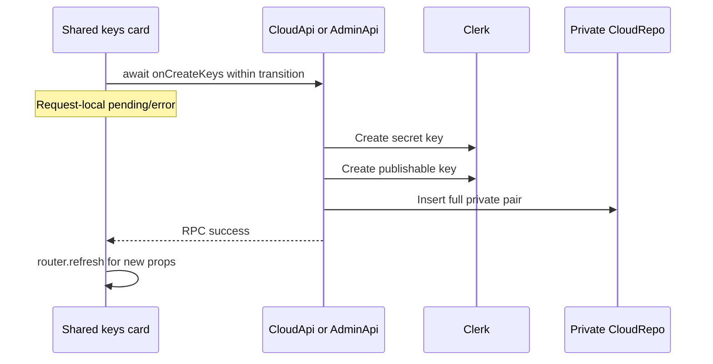
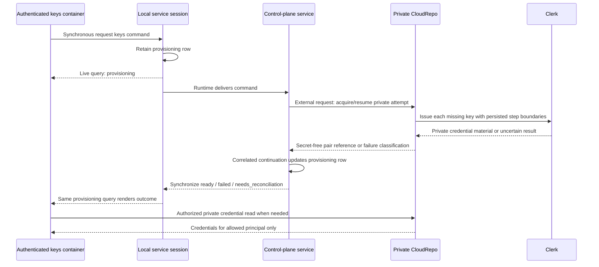

# Cloud API keys: retained provisioning, private credential reads

**Status:** Complete; implementation and required verification passed 2026-10-15.  
**Date:** 2026-10-15  
**Owner repository:** `../zerospin-cloud`, `apis`, `cloud`, `admin`, `ui`  
**Parent:** [Command/query UI cleanup](160-plan-command-query-ui-cleanup.md)  
**Prerequisite:** [Shared Cloud control-plane service](181-plan-cloud-admin-system-creation.md#shared-control-plane-design)  
**Research:** [Cloud key candidate](../../research/async-ui-command-query-audit.md#zerospin-cloud-larger-domain-migration-candidates)

The design sections below retain the approved migration rationale. The
implementation outcome and verification at the end describe current code. The user's 2026-10-15 request to implement the full collection authorized
the described service, model, authentication, and ownership changes.

## Instances and outcome

Migrate the shared `ZerospinKeysCard` and its three callers together: Cloud dev
keys, Cloud production keys and Admin production keys. Keep the card as shared
presentation; the authenticated runtime's container owns direct synchronous
staging and one provisioning query.

Clicking create synchronously retains intent and provisioning state. Backend
external work calls the existing Clerk API and stores credentials privately.
The query observes safe provisioning metadata, never credential tokens. Showing
or copying credentials still uses an authenticated private read/browser action.
That asynchronous read is a security boundary, not creation-completion tracking.

This is not available through the current RPC API. The session/model/contracts
below are proposals, consuming the single service defined in plan 181.

## Before



## After



## Proposed ownership and state

1. The native control-plane service owns one `keyProvisioning` row per unique
   key scope, with a stable row ID, current request ID, system ID, environment,
   requesting user where applicable, safe state/error and nullable private pair
   reference. A retry updates that same row's current request ID instead of
   leaving multiple indistinguishable attempt rows for `findFirst`. No secret or publishable token belongs
   in replicated models, command payloads, recorded external responses or toasts.
2. Declare separate `requestDevelopmentKeys` and `requestProductionKeys`
   contracts. Derive org/user authority from admitted claims and authoritative
   system ownership, not card props. Dev scope is `(systemId, clerkUserId)`;
   production scope is the system. Preserve the current Admin/Cloud capability
   distinction and strengthen no permission merely for UI convenience.
   Use the native system record shape from plan 181: nullable domain version is
   `systemVersion`, while `version` and `createdAt` remain framework metadata.
   Do not decode the native row through the deleted CloudRepo business-version
   shape or introduce a compatibility field mapping in key authorization.
3. The transaction reuses an existing ready/provisioning request for that scope,
   or creates/updates the one scope row to provisioning and retains external work. Repeated clicks
   therefore cannot start parallel issuance. A known failed/no-side-effect
   request can be retried through the same declared command with a new request
   identity; an uncertain issuance remains locked for reconciliation.
4. CloudRepo remains the only private credential owner. Retain a private attempt
   keyed by request identity and scope, including per-key issuance phase and
   returned provider IDs/material. Commit completed pair storage atomically.
   This private step record is necessary because the current sequence creates
   two external keys before persisting either result.
5. Use states `provisioning`, `ready`, `failed` and `needs_reconciliation`.
   A definite refusal before issuance can be failed; partial issuance, ambiguous
   provider response or uncertain persistence must not be presented as safe to
   start again. The continuation checks current request ID/scope/state before
   applying any result. An old response cannot complete a newer request.

## Provider outcome and retry rule

The current `createClerkApiKey` calls `clerk.apiKeys.create` and provides no
provider idempotency key. This source establishes no exactly-once guarantee.
Keep actual Clerk calls and their documented/installed SDK contract; do not
invent an idempotency option or wrap an ambiguous failure in blind retry.

Before each issuance, persist that the individual step has begun. After a
definite successful response, store its provider identity and credential material
privately before moving on. A restarted request returns an already completed
pair or resumes a definitely unstarted step. An interrupted/uncertain issuance
step becomes `needs_reconciliation`, since repeating it could mint another key.
If supported provider inspection/revocation can resolve a partial pair, implement
that behind the same private owner after verifying the real Clerk API. Otherwise
retain the uncertainty for an authorized operator; never claim safe automatic
recovery. Failure after private pair commit is recoverable by reading that
completed attempt without reissuing keys.

## Proposed shape

```tsx
// In each runtime container, below its admitted session. Names are proposed.
const { data: provisioning } = useLiveQuery({
  session,
  key: { systemId, environment },
  query: (db, scope) =>
    db.query.keyProvisioning.findFirst({
      where: {
        systemId: { eq: scope.systemId },
        environment: { eq: scope.environment },
      },
      // Actor selection already restricts the dev user identity.
    }),
});

<ZerospinKeysCard
  provisioning={provisioning}
  onCreateKeys={() =>
    stageServiceSessionCommand({
      session,
      contractName: development
        ? 'requestDevelopmentKeys'
        : 'requestProductionKeys',
      payload: {
        systemId,
        requestId: makeServiceSessionModelId({
          session,
          model: keyProvisioningV1,
        }),
      },
    })
  }
  // Existing authorized secret read and clipboard/reveal remain separate.
/>;

// Shared program, within one service transaction:
requireAuthorizedSystemAndKeyScope(claims, payload.systemId);
const current = readProvisioningForScope();
if (current?.state === 'ready' || current?.state === 'provisioning')
  return current;
if (current?.state === 'needs_reconciliation') refuseUnsafeNewIssuance();
if (current)
  updateProvisioning(current.id, {
    currentRequestId: payload.requestId,
    state: 'provisioning',
    safeScope,
  });
else
  createProvisioning({
    id: payload.requestId,
    currentRequestId: payload.requestId,
    state: 'provisioning',
    safeScope,
  });
// Authoritative adapter alone retains the external issuance operation.

// External request, outside model transaction:
return privateCredentialOwner.issueOrResumeForRequest(requestId); // proposed private procedure
// Returns { state: 'ready', pairId } or safe failed/uncertain metadata, never tokens.

// Recorded continuation, within one service transaction:
if (!matchesCurrentRequestScopeAndProvisioningState()) return;
updateProvisioningFromSafeOutcome();
```

The production/dev branch above illustrates the two fixed container variants;
do not expose a caller-chosen environment as a substitute for actor admission.
The query explicitly selects environment while actor admission restricts the
allowed user/org scope. UI and backend phase names are explanatory pseudocode,
not a generic engine.

## Implementation steps

1. Complete plan 181 and resolve its Cloud implementation-scope constraints.
   Inspect installed Intent skills and actual provider SDK interfaces; preserve
   Clerk configuration in the trusted `apis` runtime and never read real env
   values into research, docs or tool output.
2. Add the scoped metadata model, two admission-specific command bindings,
   authoritative external scheduling and correlated continuation. Keep all
   metadata operations transactionally owned by the one native service.
3. Add only the private attempt/step state necessary for safe key issuance and
   resume. Keep existing pair insertion and credential reads in CloudRepo; remove
   superseded direct browser create RPC paths when callers migrate.
4. Make all three containers stage directly and query provisioning metadata.
   Change shared card callbacks to synchronous props; delete creation-only
   transition/pending/error state, Promise callback signature and router refresh.
5. Keep reveal state, clipboard Promise/feedback and syntax highlighting as
   presentation. Read ready credentials through the existing authenticated
   private read boundary; revalidate principal, organization and pair ownership.
   Cancel/discard a stale read on principal/scope change. Never use refresh or
   poll to determine whether provisioning completed.
6. Remove diagnostic logging of rendered highlighted credentials from the card.
   Update dashboard/API ownership patterns and describe uncertain issuance and
   operator reconciliation without claiming exactly-once provider execution.

## Acceptance and verification

1. Local command success returns before Clerk work, with a queried provisioning
   row. Remount sees the same retained state; repeated click cannot mint parallel
   pairs for one scope.
2. Ready is projected only after the private pair is committed. Loss of the
   continuation response does not reissue a completed pair.
3. Known pre-issuance refusal is retryable; partial/ambiguous issuance becomes
   needs-reconciliation and blocks another attempt. Stale continuations do not
   overwrite a newer request. Do not claim provider exactly-once behavior.
4. Production/dev and user/org scoping remain enforced at command admission,
   authoritative execution and private read. No token reaches replicated rows,
   external continuation payloads, journal-visible results, logs or toasts.
5. Reveal/copy still works for an authorized ready pair; browser read failure is
   presented as a private read failure, not a new provisioning attempt.
6. Follow [Cloud policy](../../../../zerospin-cloud/AGENTS.md): inspect existing Nx
   build/type targets; add no tests, fixtures, standalone runners/check gates or
   client-side backend integration tests. Provider calls/credentials are not part
   of planning or an implicit verification step. Use fresh isolated storage for
   new fixed schemas and report any unexercised provider recovery cases plainly.

## Source anchors

- [Safe provisioning metadata](../../../../zerospin-cloud/apis/src/controlPlane/keyProvisioningV1.ts).
- [Development request](../../../../zerospin-cloud/apis/src/controlPlane/requestDevelopmentKeysV1.ts), [production request](../../../../zerospin-cloud/apis/src/controlPlane/requestProductionKeysV1.ts).
- [Exact external work and correlated continuation](../../../../zerospin-cloud/apis/src/controlPlane/issueKeysV1.ts).
- [Private issuance checkpoints and pair transaction](../../../../zerospin-cloud/apis/src/CloudRepo/CloudRepo.ts).
- [Existing Clerk API boundary](../../../../zerospin-cloud/apis/src/auth/createClerkApiKey.ts).
- [Private Cloud reads](../../../../zerospin-cloud/apis/src/CloudApi/CloudApi.ts), [private Admin reads](../../../../zerospin-cloud/apis/src/AdminApi/AdminApi.ts).
- [Shared synchronous presentation](../../../../zerospin-cloud/ui/src/components/ZerospinKeysCard.tsx).
- [Development container](<../../../../zerospin-cloud/cloud/app/(authed)/(console)/[organizationId]/system/[systemId]/dev-api-keys/DevKeysCard.tsx>), [Cloud production container](<../../../../zerospin-cloud/cloud/app/(authed)/(console)/[organizationId]/system/[systemId]/production-api-keys/ProductionKeysCard.tsx>), [Admin production container](<../../../../zerospin-cloud/admin/src/app/(authed)/(console)/organization/[organizationId]/system/[systemId]/production-api-keys/ProductionKeysCard.tsx>).

## Implementation outcome

The three key containers stage the appropriate native request synchronously and
query one safe provisioning row. The shared card uses synchronous creation
callbacks and query-derived progress/error; creation transitions, router refresh,
and highlighted-credential logging are removed. Reveal/copy retains its separate
authenticated private read and browser feedback, with stale-scope reads discarded.

The service transaction reuses ready/provisioning scope state and refuses an
uncertain scope. Canonical adapters explicitly re-emit public checked model
operations and schedule the registered external contract. Its continuation
checks current request identity, system, organization, environment, user, and
state before applying evidence. No credential token enters replicated state,
command payloads/results, recorded external outcomes, or notifications.

CloudRepo's private attempt and in-memory coalescing keys include the complete
immutable request scope. Private key/pair UUIDs are persisted once, preventing
cross-scope request-ID collisions. Each Clerk issuance is checkpointed before
the call and its response is stored before the next step. Only definitely
unstarted steps resume; uncertain/partial issuance is locked for operator
reconciliation. The existing SQL transaction commits both key records and the
pair atomically. A completed pair recovers a lost response without reissuance.
No provider exactly-once guarantee is claimed.

First-party Cloud packages consume exact Zerospin 11.3.2 from the local
credential-free registry. All first-party framework dependencies, including
UI dev/peer declarations, were checked; the vendored checkout is unchanged.
`pnpm install --frozen-lockfile` passed.

Verification completed: `pnpm nx run apis:lib`, `pnpm nx run apis:types`,
existing Wrangler dry-run compilation, source/security review, and scoped
`git diff --check`. A fresh isolated local run through existing `apis:dev`
reached ready on port 3004 with dummy Clerk configuration, evaluated native
owner assertions, accepted the authored platform spec, and initialized its
service. GET `/control-plane` then returned the expected RPC method-only 400,
after bootstrap. No real authentication or provider/key issuance was exercised.
No tests, fixtures, runners, or check gates were added; existing databases and
unrelated WIP are preserved.

Final frontend verification: `pnpm nx run-many -t build -p admin,cloud` passed
both Next applications and their two required API/UI library dependencies in
8.9 seconds. The resolved task graph scheduled no vendored framework build.
First-party ambient/project references to vendored framework types were removed
while keeping required local dependency execution. The temporary dummy local
API server was stopped after verification; no user server or registry process
was stopped.

## Remaining work

None.
