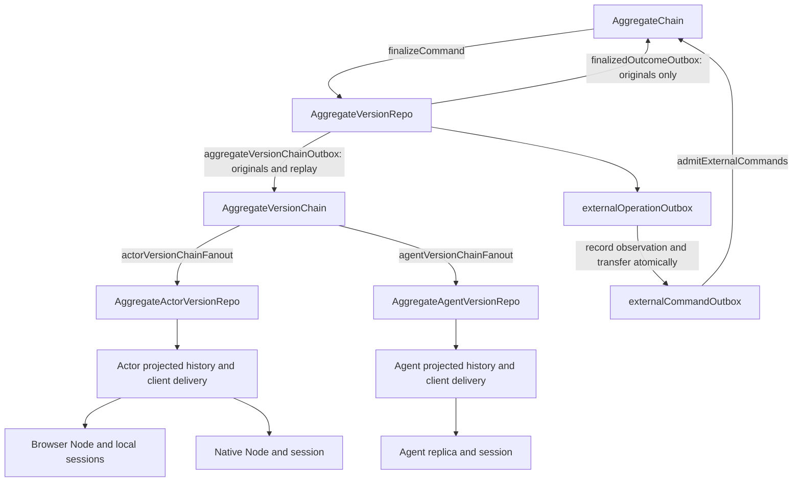

# Aggregate delivery, execution history and projection ownership

**Date:** 2026-10-15

**Status:** Completed and verified jointly with Plan 189 on 2026-10-15.

**Parent review:** [Plan 151 — storage table purpose review](../../plans/151-plan-storage-table-review.md).

**Related:** [Plan 189 — aggregate command execution resolution](189-plan-aggregate-command-execution-resolution.md), [executedCommands review](../../reviews/storage-tables/aggregate-version-repo-executed-commands.md), [completed Plan 188 — model-operation storage](188-plan-aggregate-version-repo-model-operation-storage.md).

**Original capture:** The planning conversation authorized this architecture record. The implementing-chat authorization below subsequently authorized the combined source cutover.

**Implementing-chat authorization (2026-10-15):** The maintainer requested Plans 189 and 190 together, selected separate projection Repos and history Chains, and selected parent lineage retention only while delivery is pending. No storage reset or message to another chat is authorized.

## 1. Governing intent and decision status

Make each table and durable owner express a straightforward responsibility in the command lifecycle. Delivery rows own complete pending messages and have explicit deletion conditions. Resource state, execution history, projection state and projected client history have distinct meanings. Existing readers do not by themselves justify retaining copied input or a second permanent history.

The maintainer explicitly declared everything through the external-work, naming, self-contained delivery and JSON-operation decisions **locked and sacrosanct**, then confirmed the AggregateChain/AVR/AVC ownership, reintroduction of actor and agent projection Repos, and placement of the AVC outbox and fanouts. These are decisions to implement, not options to seek approval for again.

This plan distinguishes three categories:

- **Locked:** the vocabulary, ownership and delivery contracts in sections 2–8.
- **Required consequences:** transaction, authority, ordering, recovery and deletion guarantees needed to make those decisions correct, in sections 9–11.
- **Resolved construction:** the implementing chat settled physical schemas, separate projected-history owners and interface details in section 12.

Section 13 links the implemented source. Completion evidence is recorded below the checklist.

## 2. Locked vocabulary

| Name/change                                        | Agreed meaning                                                                                                                                                                                                                                                                                                                                   |
| -------------------------------------------------- | ------------------------------------------------------------------------------------------------------------------------------------------------------------------------------------------------------------------------------------------------------------------------------------------------------------------------------------------------ |
| AVR `executeCommand` → **`finalizeCommand`**       | The authoritative original-command workflow: obtain ordered predecessor state, evaluate the selected contract, apply successful output or retain a public refusal, and durably record the outcome and required outgoing deliveries. Finalization does not imply that external work, history publication or client delivery has already finished. |
| Keep **`contract.evaluate`**                       | Run the selected contract and collect its validated result and deferred operations. Evaluation does not apply the model operations. The owning Repo applies/commits them. Do not rename it to `contract.execute`.                                                                                                                                |
| Keep **`commandOutcome`**                          | This command execution's terminal Success or Failure, including its first `recordedAt`. Do not rename it to `finalizedOutcome`. The entity-qualified name distinguishes it from an external observation.                                                                                                                                         |
| **`finalizedOutcomeOutbox`**                       | Pending delivery of an original command's outcome back to its AggregateChain. It is not a source of new admitted commands.                                                                                                                                                                                                                       |
| `asyncOperations` → **`externalOperationOutbox`**  | Pending external requests that have not yet been transferred as commands carrying a recorded terminal observation.                                                                                                                                                                                                                               |
| `asyncCommandOutbox` → **`externalCommandOutbox`** | Complete external commands with recorded observations, pending admission to their originating Chain.                                                                                                                                                                                                                                             |
| `continuationCommandId` → **`externalCommandId`**  | The stable ordinary command ID allocated for the future external command. The continuation is that external command; there are not two identities.                                                                                                                                                                                               |
| `admitAsyncCommands` → **`admitExternalCommands`** | Admit source-proven external commands carrying their recorded observations.                                                                                                                                                                                                                                                                      |
| **`aggregateVersionChainOutbox`**                  | AVR-owned pending publication of complete execution packets to the corresponding AVC. Contains both original and replay results.                                                                                                                                                                                                                 |
| **`actorVersionChainFanout`**                      | AVC-owned ordered distribution to the actor projection pipeline. With projection Repos reintroduced, the materializing receiver is the actor projection Repo.                                                                                                                                                                                    |
| **`agentVersionChainFanout`**                      | AVC-owned ordered distribution to the agent projection pipeline. Its materializing receiver is the agent projection Repo.                                                                                                                                                                                                                        |

An **external operation** performs the authored request outside the database. An **external command** is the subsequently admitted Zerospin command that consumes the recorded observation. Use those terms consistently instead of retaining parallel async/continuation names for the same roles.

Keep canonical Actor, Agent and System Origin variants, including their agreed literal `kind` fields. Preserve the separate all-null or complete producer tuple. External commands preserve frozen Origin but use an all-null producer tuple; they do not reuse the initiating browser submission's producer position.

## 3. Locked durable ownership

| Owner                                               | Responsibility                                                                                                                                                                                                            |
| --------------------------------------------------- | ------------------------------------------------------------------------------------------------------------------------------------------------------------------------------------------------------------------------- |
| **AggregateChain**                                  | Authoritative admitted input, shared aggregate ordering and original command outcomes. It assigns the external command's aggregate position during admission.                                                             |
| **AggregateVersionRepo (AVR)**                      | Current canonical resources for one aggregate release, local execution progress, and complete pending outgoing deliveries. Original and replay execution use this Repo's selected implementation against its owned state. |
| **AggregateVersionChain (AVC)**                     | Immutable execution history for that aggregate release, including local outcomes and model operations; owns the actor/agent fanouts. It retains history after publication outboxes or fanout copies are deleted.          |
| **AggregateActorVersionRepo**                       | Actor projection materialization, its local projection progress, computation of selected resource deltas, and required outgoing projected output. Reintroduce this resource owner.                                        |
| **AggregateAgentVersionRepo**                       | Corresponding projection materialization/progress/output for the exact agent version. Reintroduce this resource owner too.                                                                                                |
| **Client-facing projected-history/delivery owners** | AggregateActorVersionChain and AggregateAgentVersionChain own ordered projected output, reconnect/catch-up, private completion recovery and client delivery, separately from the projection Repos.                        |

The actor projection identity includes its aggregate scope/release, actor name/version and actor identity/path. The agent projection identity includes its aggregate scope/release and agent name/version. Browser/native platform choice does not create a different server view owner.

Projection Repos consume committed output; they never re-evaluate the original contract or become a second command-outcome authority. Their resource materialization must support the declared relational selections and membership changes. Do not assume that the rows needed to compute a stable projection are exactly the rows exposed to clients, or automatically carry forward every current canonical-table copy without examining the actual selection dependencies.

## 4. Locked topology



**AVR has `aggregateVersionChainOutbox`; AVC has both fanouts.** Do not leave actor/agent fanouts on AVR as a second publication path after introducing AVC. Do not insert another owner merely to make a locked fanout name look like its immediate receiving class; the newly reintroduced projection Repos are the materializing receivers.

The two lower history/delivery boxes are AggregateActorVersionChain and AggregateAgentVersionChain. They are not browser-specific versus native-specific Chain families. Browser and native actor clients share the same projected stream/protocol; browser Nodes can distribute it to local sessions, while native hosts its persistent Node/Session. Agent replicas consume the agent projection stream.

## 5. Locked delivery ownership: complete rows, deliberate duplication

Every outbox/fanout must retain the data required for its own pending delivery. Duplicating fields between delivery tables is **explicitly wanted** so each table can be drained and deleted independently.

- Do not replace a complete pending message with a marker requiring a join to another deletable outbox.
- Do not make one fanout's deletion depend on retaining another fanout's payload row.
- A stable receiver history may serve deliberate history reads, but a sender's pending delivery is still self-contained.
- Duplicate payloads do not create a second authority: receiver identity, first-outcome rules, position and immutable retry comparison determine authority.
- Retain domain positions already serving ordering. Add no extra queue counters, hashes, mode flags or status columns without a specific unresolved requirement.

The earlier one-column Chain-outcome marker, retained ten-column `executionResults`/`executionHistory` proposals in AVR, and the `commandOutcomeOutbox`/`chainResultOutbox` names are superseded by the decisions in this plan. The proposed `admittedAggregateVersion` output column is also discarded. Authoritative admitted input remains on AggregateChain; do not manufacture a complete command from compact execution-output fields.

### `finalizedOutcomeOutbox`: exactly three logical columns

```ts
{
  aggregateIndex: number; // primary key; existing aggregate position
  commandId: string;
  commandOutcome: ICommandOutcome;
}
```

Populate it only for original Success or retained public Failure, atomically with local finalization and the other required outgoing rows. Keep the complete encoded result/refusal and its original `recordedAt`; do not obtain them later from a deletable publication row. Replay must never enqueue a replacement original outcome.

AggregateChain records the original outcome durably, then acknowledges. Only after that acknowledgement may AVR delete this row. An acknowledged duplicate original must not recreate it. Stable original authority still comes from the designated executor's bound aggregate release, not from the shape of an arbitrary well-formed packet.

### `aggregateVersionChainOutbox`: complete execution packet

The agreed packet contains the local execution facts needed by AVC and downstream projection:

```ts
{
  aggregateIndex: number;
  commandId: string;
  commandName: string;
  origin: ActorOrigin | AgentOrigin | SystemOrigin;
  nodeId: string | null;
  sessionName: string | null;
  pushIndex: number | null;
  commandOutcome: ICommandOutcome;
  executionStartedAt: Date;
  dispositionHash: string;
  operations: readonly IEncodedOperation[]; // typed JSON column
}
```

Use the existing aggregate position for ordered publication and retain command-ID uniqueness/association. Resolve the precise physical indexes/codecs during schema design. Owner System/aggregate identity and executing release follow from the bound AVR/AVC identity; do not store redundant owner columns merely to reuse a complete-command decoder.

Publish **every** local original/replay result, including refusals and zero-model-operation successes. AVC durably appends the packet before acknowledging. AVR then deletes its pending publication row. AVC history remains available for new projection subscribers, historical checkpoints and local-result recovery after the sender's row is gone.

### AVC fanout copies

`actorVersionChainFanout` and `agentVersionChainFanout` belong to AVC. Their deliveries include complete execution metadata and model-operation batches. Independent copies are permitted and desired; do not require reading another pending delivery's row to complete a send.

They are multi-recipient fanouts, not single-recipient outboxes. Delete a fanout row only after every subscriber covered by it has durably acknowledged it. One actor's acknowledgement cannot erase another actor's backlog. Actor and agent fanout payloads may be deleted independently; permanent AVC history supplies later enrollment/catch-up. Enrollment must connect catch-up to live delivery without a gap.

## 6. Locked operation representation

Store the ordered model-operation batch in a **typed, schema-validated JSON `operations` column** on execution-history/publication/fanout packets. The batch is read and delivered as a command-sized unit.

- Preserve canonical operation-leaf encoding, exact model/version validation, operation-specific bodies, resource identity and authored operation indexes.
- Preserve strictly increasing authored `operationIndex` values. Sparse indexes remain valid because external-operation slots are omitted.
- Include model operations only. External request recipes must not enter projection fanout or be performed again downstream.
- Keep `executionStartedAt` once on the parent packet and use that exact value for source/projection resource application. Do not repeat per-operation application time/aggregate position or substitute receipt time or the later outcome `recordedAt`.
- Use `operations: []` for refusals and zero-model-operation results. They still occupy ordered history and can settle client commands.
- JSON batches hold encoded portable operations, not live descriptors, executable callbacks, whole-command canonical byte copies, rollback inverses or another output hash.

This representation replaces Aggregate's separate per-operation SQL history. Remove AVR `modelOperations` and its lookup/join path when the packet storage is implemented; do not preserve both permanent representations without a demonstrated operation-level query requirement. Existing production readers currently fetch operations by command and deliver the batch together. Service's distinct table context is not automatically redesigned by this Aggregate decision.

## 7. Locked external-work lifecycle

### Pending operation

`externalOperationOutbox` freezes the request data during the original command's synchronous business transaction:

- `initiatingCommandId` and authored `operationIndex` for parent lineage.
- Stable `externalCommandId`, allocated once before invoking the request.
- Exact `externalContractName` and `externalContractVersion`.
- Contract-encoded frozen `payload` and canonical `origin`.

Row presence means the work still needs a recorded terminal observation. The outcome no longer lives as a nullable mutable column on this pending stage. Original execution alone writes this outbox. Replay discards external descriptions before preparation and never launches the requests.

Requests start after commit, outside SQL transactions and execution permits. Preserve the authored request/timeout/retry behavior and one-live-item reservation semantics. A request failure is an external observation; it does not automatically make the initiating command fail or prove that no remote effect occurred.

### Atomic move to a complete external command

When the request produces its first Success or terminal Failure:

1. Encode/validate the observation, including successful JSON null and its first `recordedAt`.
2. In **one synchronous local transaction**, insert a complete `externalCommandOutbox` row and delete the matching `externalOperationOutbox` row.
3. Commit before beginning delivery to AggregateChain.

The new row must contain the stable external command ID, frozen input, exact contract identity, Origin, recorded outcome and any required lineage fields. It must be reconstructible and deliverable after the operation row has disappeared, without the initiating command or a current external declaration. The external command's browser producer tuple is all-null; retain the originating release through the producing Repo's bound identity.

Never delete the operation row on request completion before the command row commits. Encoding/insertion/transaction failure leaves the pending operation recoverable. Concurrent/late completions must neither replace the first recorded outcome nor recreate an already transferred/admitted command after its rows have been acknowledged and removed.

Preserve existing FIFO `outboxIndex` semantics for recorded external commands and the monotonic allocator across an empty pending queue. One parent can emit multiple requests and requests can finish out of order, so neither the initiating position nor a not-yet-assigned external command `aggregateIndex` substitutes for that queue position. Propagate the family rename to the existing head/allocator consumers; do not add a second allocator or reset its history when rows drain.

This is a local durable handoff, not an exactly-once remote-call claim. A process can die after a remote effect but before recording its observation. Recovery may invoke the pending request again; authored remote idempotency/reconciliation remains necessary where applicable.

### External command admission and deletion

`admitExternalCommands` verifies a fresh external command against the producing AVR's recorded **external command outbox**, rather than the operation row that has now been deleted. It validates the complete frozen child and the appropriate declaration/authority before assigning a new aggregate position.

An already admitted exact retry recovers the Chain's retained command before requiring sender evidence that may legitimately have been deleted. For fresh admission, perform proof RPC outside SQL and recheck retained identity inside the local admission transaction. Preserve exact input equality and reject conflicting reuse of the stable command ID.

After Chain admission is durably acknowledged, delete the external command's pending row. Lost replies retain the row and retry the same identity; acknowledgement means admission, not command execution or success. The admitted external command then follows normal original execution and release replay, with its own `commandOutcome`; it does not overwrite the initiating command's outcome.

Both external outboxes are transient. Parent lineage is retained only while delivery is pending and disappears after admission acknowledgement, as explicitly selected in section 12.

## 8. Projection Repos and client-facing streams

Reintroduce actor and agent projection Repos as real owners of projection resources and computation. Their identities remain view identities, not individual browser tabs or native installations. Apply committed model operations, compute selected before/after deltas, advance projection progress and retain/enqueue required projected output atomically.

The downstream record is a **projected command**, not a new instruction to execute. It preserves command identity/name, aggregate position and checkpoint evidence, selected resource upserts/deletions, and properly scoped private completion information. A client must not receive raw canonical operation bodies, frozen input, claims or server result values merely because they exist in a source packet.

Client-facing histories support ordered catch-up, reconnect, empty-delta progress and private completion recovery. Browser and native actor clients share the same server stream/protocol and core Node semantics; agent replicas consume their agent view. Do not introduce another browser/native Chain family solely because the host differs, or assume one durable server Chain per local session is required.

AggregateActorVersionChain and AggregateAgentVersionChain own immutable projected history, connection admission, replay and delivery. Resource tables and delta computation belong to their separate projection Repos.

## 9. Required transaction and acknowledgement contracts

| Producer-side pending data        | Acknowledgement permitting deletion                                                                                              |
| --------------------------------- | -------------------------------------------------------------------------------------------------------------------------------- |
| `externalOperationOutbox` row     | The complete external command row commits locally in `externalCommandOutbox`, in the same transaction as operation-row deletion. |
| `externalCommandOutbox` row       | AggregateChain durably admits the stable external command.                                                                       |
| `finalizedOutcomeOutbox` row      | AggregateChain durably records/recognizes the identical original outcome.                                                        |
| `aggregateVersionChainOutbox` row | The bound AVC durably retains/recognizes the identical execution packet.                                                         |
| Actor/agent fanout row            | Every subscriber covered by that delivery durably acknowledges it; other family payloads and permanent history are independent.  |
| `projectedCommandOutbox` row      | The corresponding projected-history owner durably retains the exact projected output.                                            |

Receiver commit precedes acknowledgement; sender deletion follows acknowledgement. Lost acknowledgements redeliver immutable data safely. Duplicate outcomes include the original `recordedAt`; a conflicting retry must fail instead of replacing retained history. The disposition hash does not cover successful result values, model bodies, timestamps or complete input, so it cannot substitute for the receiver's required immutable packet comparison.

Original finalization commits resources or its retained refusal, local execution progress, `aggregateVersionChainOutbox`, `finalizedOutcomeOutbox` and any original external work in one synchronous outer transaction with the existing business savepoint semantics. Replay commits local model materialization/progress and its AVC publication packet, but no original-outcome or external-request rows. Infrastructure failure, interruption or unclassified defect commits no false finalized progress.

Arm durable delivery recovery before transactions can produce pending work. Run RPCs and external effects outside SQL transactions and execution permits. Failed recipients preserve pending responsibility, report through the existing invocation/log path and retry later; do not add persisted delivery diagnostics, manual pause gates or per-deployment resume switches.

## 10. Required ordering, authority and recovery changes

### AggregateChain dispatch versus outcome completion

Before this cutover, `commandOutcome === null` meant both “keep dispatching this original” and “its original outcome is not recorded.” The separate outcome outbox changes that protocol.

Represent dispatch acknowledgement and outcome completion as distinct durable facts. Replace completion-as-the-execution-RPC-return deliberately; do not leave two competing completion mechanisms or interpret dispatch acceptance as a successful command outcome. The exact Chain dispatch representation is recorded in section 12.

An original-outcome receipt must match the retained command ID and position and come from the executor bound to the command's designated original release. A well-shaped replay result is not sufficient authority to finalize the original. Preserve first-outcome immutability and identical retry recovery.

Independent delivery recovery does not promise independent business progression. Preserve finalized-predecessor ordering and the contiguous finalized prefix exposed to version replay. A command's original outcome, its AVC publication and actor/agent projection progress are separate observations; one acknowledgement does not silently stand for all of them.

### Durable execution progress after outbox deletion

AVR cannot continue deriving execution progress from the greatest pending outbox row or from a deleted local history. Retain the minimal local execution checkpoint atomically with resources and outgoing deliveries. Empty outboxes must not make it forget completed commands or reproduce external work.

Use permanent AVC history for historical execution-result/checkpoint recovery once publication rows have been acknowledged and removed. Adapt `awaitCommandResult`, exact checkpoint reads, flush/catch-up and inspection interfaces to the new owners. Perform any history RPC outside the local SQL/permit. Do not retain a second permanent full AVR journal just to keep old recovery DTOs unchanged.

Whole-input duplicate comparison must move out of the compact execution-output representation. AggregateChain owns immutable admitted input and rejects conflicting ID reuse. VersionRepo still enforces its bound owner, ordered progress and the required retained command identity/position association. Specify how historical association checks work after local payload deletion, using the authoritative source or AVC where required. Do not claim unchanged full-input local comparison or replace it with canonical input bytes/fingerprints.

### Coherent snapshots across the projection Repo/Chain split

A snapshot must associate resources, public checkpoint and the requesting client's completed-command prefix at the same aggregate position. Do not combine resources through N with a completion prefix known only through an earlier publication position.

Capture the resource snapshot/checkpoint at N locally, ensure projected publication through N outside SQL, and recover the client's matching completion prefix through N from retained projected history. Preserve the existing independent public/private replay cursors and the catch-up-to-live transition without gaps.

## 11. Scope and coordination

- This plan replaces the relevant storage/publication choices recorded as proposals in Plan 151 and its `executedCommands` review. It does not complete that parent table review or automatically review every new owner/table.
- Coordinate with **Plan 189**. Keep its locked `executionAggregateRelease`, `executionContract`, `sourceContract`, `resolveExecutionContract` and `decodeAndAdaptPayload` meanings, exact actor/contract lookup and ordinary/external input handling. This plan keeps `evaluate` and does not restore original-release coupling for input decoding.
- Preserve **Plan 188** semantics: exact pre-evaluation application time, canonical model binding, portable operation validation, sparse authored positions and unchanged body encoding. Its completed six-field per-operation Aggregate table is subsequently replaced by the newly locked JSON packet representation, not retained as a compatibility path. Do not rewrite its historical completion record.
- Aggregate ownership reintroduction is in scope. Service history-owner architecture is not automatically settled here. Required shared external schema/type/helper and admission-rename propagation must keep both aggregate and service consumers correct; preserve Service's authority/Origin restrictions and any distinct parent-position requirements. Do not add ServiceVersionChain/projection owners merely by analogy.
- Reconcile governing ADR ownership decisions, especially [ADR 007](../../adrs/007-canonical-results-and-selected-chain-ownership.md), with an appropriate successor during implementation. Preserve unrelated still-governing guarantees; do not treat old archived implementations or ADR 006 as wholesale authority for restoring obsolete paths.
- Update glossary, module READMEs, architecture/workflow docs, Explorer ownership/schema purposes, namespace registration/bindings/exports and existing verification when the implementation is made. Remove superseded paths directly; do not update shared skills as part of this repository-local change.
- Preserve unrelated WIP and concurrent work. Keep the parent storage review active for its separate table-review obligations.

Changed fixed schemas require empty affected storage. This plan authorizes no reset. Add no compatibility aliases, dual publication paths, fallback decoders, translation migrations, legacy tables or whole-command canonical byte storage.

## 12. Settled construction and interfaces

### Implementing-chat decisions and concrete contract

1. **Separate projection and history owners:** AggregateActorVersionRepo and AggregateAgentVersionRepo own resource materialization, projection progress and complete `projectedCommandOutbox` rows. The existing actor/agent Chains own immutable `projectedCommands`, connection locks, reconnect and sockets. Their exact view dimensions remain unchanged. The maintainer selected this layout explicitly.
2. **Projection materialization dependencies:** retain the aggregate release's canonical model tables in each projection Repo for this cutover. Query-DB model registries are already foreign-key closed, but captured `where.RAW` SQL does not declare every referenced table and currently runs against all aggregate models. Narrowing to exposed models or the query-DB registry would therefore impose an unvalidated new selection restriction. History Chains retain no resource tables.
3. **Execution packets:** use the section 5 eleven-field packet directly, with `aggregateIndex` primary key and unique `commandId`, in AVC `executionHistory`, both named AVC fanout payload tables, and AVR `aggregateVersionChainOutbox`. Typed JSON `operations` retains the existing portable leaf schema. AVR's singleton `executionCheckpoint` stores only `singletonId`, `aggregateIndex`, `commandId` and `dispositionHash`. Original outcome delivery retains exactly the locked three columns. No full AVR journal remains.
4. **Dispatch and finalization:** Chain `commands.originalDispatchAcknowledged` records durable handoff separately from nullable `commandOutcome`. `finalizeCommandOutbox` / `finalizeCommandSubscriber` receipts contain only command ID and aggregate position. The source-bound `finalizedOutcomeSubscriber` validates original-release authority; only that outcome path completes the original. Bounded progression explicitly drains pending original outcomes outside SQL/permits before advancing the finalized prefix.
5. **External rows and lineage:** both pending stages retain the initiating command ID and authored operation index. Complete `externalCommandOutbox` rows additionally own FIFO `outboxIndex`, unique `externalCommandId`, exact external contract name/version, frozen payload, Origin and required observation. Service preserves its distinct parent position where required. The existing allocator becomes `externalCommandOutboxHead` with unchanged semantics. Parent lineage intentionally disappears after admission acknowledgement; the maintainer selected this retention policy explicitly. Add no permanent ancestry ledger or admitted-command lineage fields.
6. **Read and publication contracts:** AVC owns permanent packet/checkpoint reads; AVR uses its local checkpoint and pending publication or authoritative remote history as appropriate. Projection Repos capture resources/checkpoint at N, publish through N outside SQL, and obtain the matching Chain checkpoint and private completion prefix bounded through N. A later Chain tip cannot be substituted into that snapshot.
7. **Selected-history naming:** the host-neutral client record is `IAggregateProjectedCommand`; aggregate selected history is `projectedCommands`. Service ownership and its selected-history architecture are preserved. External command/operation schema and descriptor names use the external family consistently; asynchronous runtime utilities keep their separate technical meaning.

Concrete schemas and receiver interfaces:

- [Execution packet shape](../../../packages/system-worker/src/AggregateVersionChain/evaluatedAggregateCommand.ts), [AVC tables](../../../packages/system-worker/src/AggregateVersionChain/aggregateVersionChainDbConfig.ts) and [AVR checkpoint/delivery tables](../../../packages/system-worker/src/AggregateVersionRepo/aggregateVersionRepoDbConfig.ts).
- [External pending stages](../../../packages/system-worker/src/externalOperations/externalOperationsDbConfig.ts) and [Service-specific parent-position schema](../../../packages/system-worker/src/ServiceVersionRepo/serviceVersionRepoDbConfig.ts).
- [Projection progress/publication schema](../../../packages/system-worker/src/aggregateProjection/aggregateProjectionDbConfig.ts) and [projected history schema](../../../packages/system-worker/src/aggregateSessionChain/aggregateSessionChainDbConfig.ts).
- [AVC append/history/fanout capabilities](../../../packages/system-worker/src/AggregateVersionChain/AggregateVersionChain.ts), [original outcome admission](../../../packages/system-worker/src/AggregateChain/receiveFinalizedOutcomes.ts), [projected append](../../../packages/system-worker/src/aggregateSessionChain/appendProjectedCommands.ts) and [snapshot publication coordination](../../../packages/system-worker/src/aggregateProjection/getSnapshot/getSnapshot.ts).

Do not seek reapproval for `finalizeCommand`, retained `evaluate`/`commandOutcome`, the external naming/deletion lifecycle, full duplicated delivery data, JSON model-operation batches, AggregateChain/AVR/AVC roles, reintroduced projection Repos, or the AVC ownership of the two named fanouts.

## 13. Implemented source and ownership

- [AVR owner](../../../packages/system-worker/src/AggregateVersionRepo/AggregateVersionRepo.ts), [finalizeCommand](../../../packages/system-worker/src/AggregateVersionRepo/finalizeCommand/finalizeCommand.ts), [outer materialization transaction](../../../packages/system-worker/src/AggregateVersionRepo/materializeCommandTx.ts), [durable checkpoint](../../../packages/system-worker/src/AggregateVersionRepo/readAggregateCheckpoint.ts) and [historical command recovery](../../../packages/system-worker/src/AggregateVersionRepo/validateCommandIdentity.ts).
- [External observation transfer](../../../packages/system-worker/src/externalOperations/makeExternalOperationQueue.ts), [complete command recovery](../../../packages/system-worker/src/externalOperations/readPreparedExternalCommand.ts), [source proof](../../../packages/system-worker/src/externalOperations/verifyExternalCommandDeliveries.ts) and [external admission](../../../packages/system-worker/src/AggregateChain/admitExternalCommands/admitExternalCommands.ts).
- [Original dispatch acknowledgement](../../../packages/system-worker/src/AggregateChain/acknowledgeOriginalDispatch.ts), [original outcome admission](../../../packages/system-worker/src/AggregateChain/receiveFinalizedOutcomes.ts), [retained admission identity](../../../packages/system-worker/src/AggregateChain/admitAggregateCommands/readRetainedCommand.ts) and [contiguous finalized replay](../../../packages/system-worker/src/AggregateChain/readReplayPage.ts).
- [Contract evaluation](../../../packages/core/src/contracts/evaluateContract.ts), [portable operation codec](../../../packages/core/src/contracts/encodeAppliedOperation.ts) and [source output application](../../../packages/system-worker/src/AggregateVersionRepo/utils/applyAggregateOperationsTx.ts).
- [Actor projection Repo](../../../packages/system-worker/src/AggregateActorVersionRepo/AggregateActorVersionRepo.ts), [agent projection Repo](../../../packages/system-worker/src/AggregateAgentVersionRepo/AggregateAgentVersionRepo.ts), [projection transaction](../../../packages/system-worker/src/aggregateProjection/commitProjectionTx/commitProjectionTx.ts), [actor history Chain](../../../packages/system-worker/src/AggregateActorVersionChain/AggregateActorVersionChain.ts), [agent history Chain](../../../packages/system-worker/src/AggregateAgentVersionChain/AggregateAgentVersionChain.ts) and [reconnect reader](../../../packages/system-worker/src/aggregateSessionChain/getBrowserCommands/getBrowserCommands.ts).
- [Native Node synchronization](../../../packages/native/src/openAggregateNativeNodeOwner.ts), [browser transport](../../../packages/browser/src/AggregateNode/aggregateNodeNetwork.ts), [agent transport](../../../packages/browser/src/agentSession/connectAgentSession.ts) and [namespace registration](../../../packages/system-worker/src/SystemRepo/registerRepo/systemRepoNamespaces.ts).

The original planning snapshot was commit `e551f2dda217753685666442ae29a15e1ef5c719` with concurrent uncommitted work. This implementation preserves unrelated work and the historical completion record of Plan 188.

## 14. Implementation and completion checklist

- [x] Record the settled physical schemas, receiving identities and interfaces in section 12.
- [x] Introduce AVC and actor/agent projection Repo identities, bindings, exports, admission/activation and fixed schemas; reconcile projected-history ownership explicitly.
- [x] Implement `finalizeCommand`, complete outcome/publication outboxes and a durable local execution checkpoint. Replace old RPC-return completion and local full-command recovery contracts.
- [x] Move permanent per-release history and the two named fanouts to AVC. Validate ordered/idempotent append and complete pending fanout payloads; remove the old direct AVR publication path.
- [x] Implement typed JSON model batches, eliminate the replaced Aggregate per-operation table/readers and preserve model/time/application semantics.
- [x] Implement both external outboxes, atomic first-observation transfer/deletion, exact external command identity, full admission payload/proof and retained-first admission retries. Propagate names through required shared consumers.
- [x] Implement projection Repo materialization/publication, selected history/client delivery and coherent snapshot/private-completion recovery. Preserve browser/native compatibility through the common current protocol semantics, without legacy fixed-storage compatibility paths.
- [x] Reconcile relevant docs/glossary/ADRs/Explorer and remove obsolete source/schema/API names outright.
- [x] Run existing scoped Nx type/lint and applicable existing acceptance/Workerd checks. Use existing files/seams such as `scripts/verify-plan140.mjs`, owner/activation Workerd verification and projection/session recovery coverage; create no new tests, fixtures, runners or configuration without explicit authorization in the implementing chat.
- [x] Verify original success/refusal versus replay output; rollback/interruption; remote observation transfer; lost acknowledgements and conflicting retries; already acknowledged duplicates; external completion ordering; history after pending deletion; late subscriber enrollment; snapshot publication lag; private completion disclosure; and browser/native reconnect behavior. Use the smallest meaningful existing behavioral checks and report unavailable evidence as unfinished work.
- [x] Obtain independent implementation review in the implementing chat, record actual verification and archive only after all required implementation/verification work is complete.

## Completion evidence

1. AggregateVersionRepo now owns resources, the minimal checkpoint and complete pending outcome/history/external messages. AggregateVersionChain owns permanent execution packets and independent actor/agent fanouts. Separate actor/agent projection Repos own resources, delta computation and publication; their Chains own immutable projected history and client delivery. All three introduced owner identities are wired through bindings, namespaces, Repo services, inspection and Worker exports.
2. `node scripts/verify-plan140.mjs` passed all nine groups. Existing production seams verify atomic external observation transfer, stable FIFO after deletion, frozen source proof and retained-first admission, immutable AVC/projected append after sender deletion, conflicting retries, source/projection timestamp equality, sparse operation indexes, selection entry/exit, refusal/empty results, cold duplicate recovery, rollback and original-outcome authority. Private recovery stops at the requested position and public history redacts private completion data.
3. `node scripts/verify-session-identity.mjs` passed all six groups, covering common Node identity, reconnect/recovery, private refusal and empty progress, reopen, reset and fencing behavior shared by browser/native synchronization. The native package build/typecheck passed; no live native application smoke is claimed.
4. The combined scoped Nx type/lint/Workerd-typecheck graph in Plan 189 passed. Final `pnpm nx run system-worker:test-workerd-ts` passed. `pnpm nx run system-worker:test-workerd -- test/migratable-do-repo/system-repo-activation.workerd.spec.ts test/fanout-queue/fanout-queue.workerd.spec.ts src/AggregateChain/admitAggregateCommands/admitAggregateCommands.profiles.spec.ts test/telemetry/invocation-order.workerd.spec.ts` passed all 17 checks in four files. These exercise actual owner activation/restart, distinct physical resource/history schemas, original dispatch/outcome recovery, fanout delivery, blocked projection publication and later recovery, late actor enrollment from permanent history, coherent actor snapshots and agent bootstrap.
5. Explorer capture reports 12 concrete Repos and 59 table declarations. `pnpm nx run-many -t check build -p explorer --nxBail` passed; formatting is clean. Six existing lint warnings and existing build warnings remain outside scope. Nx Cloud returned an access 401 after successful local checks; local verification succeeded.
6. Independent source review found no confirmed correctness defects. ADR 013 records implemented ownership and scoped supersession; glossary, READMEs, architecture, local patterns and Explorer agree. Active source citations and relative links were checked. Superseded Aggregate storage/readers and framework async-family names were removed outright; authored contract identities remain intact.
7. No new test files, fixtures, runners or test configuration were created. No storage reset, commit or publication occurred. Changed fixed schemas require empty affected storage. Unrelated WIP and historical Plan 188 completion were preserved. Parent Plan 151 remains active for its distinct table-review obligations.

## Remaining work

None.
