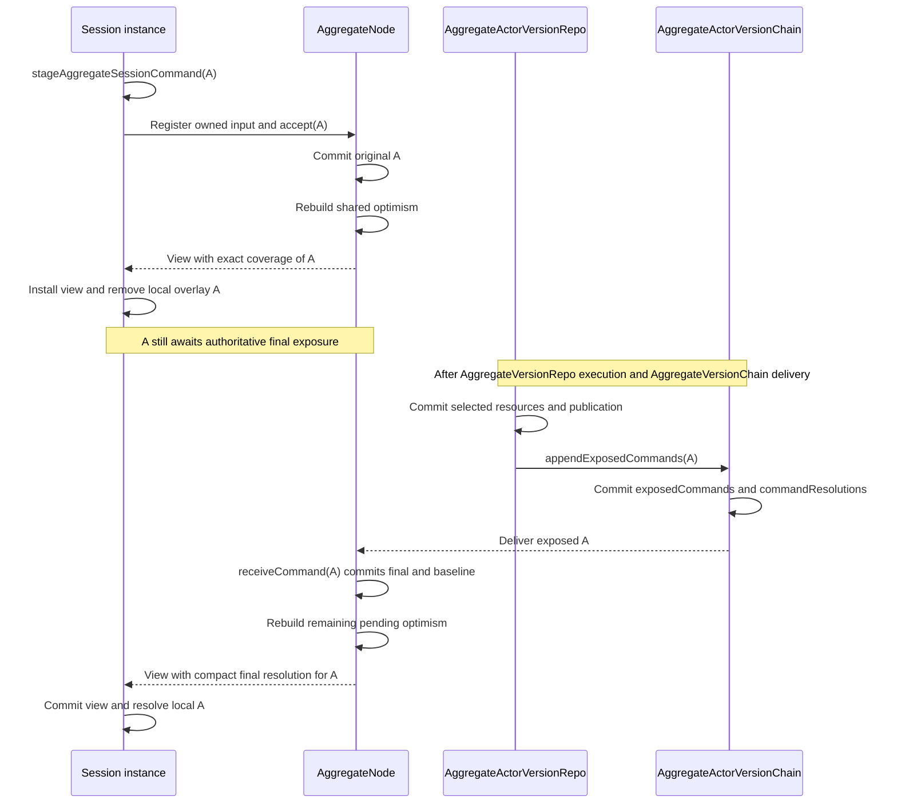

# Node-owned optimistic views and local session command records

**Date:** 2026-10-16

**Status:** Complete and archived on 2026-10-27. Current-source verification closes the consolidated Node/replica, actual Browser/Standalone and public Swift runtime obligations. The final closure record distinguishes runtime evidence from historical headless checks, fixes, applicable API limits and independent Plan 151 work.

**Scope:** Connected Aggregate and Service Nodes and their session replicas; existing Aggregate standalone and Native consumers of the shared Node/replica interfaces; affected public authoring interfaces, consumers and documentation. Current Agent observers retain their independently verified checkpoint-only ownership.

**Consolidation — 2026-10-26:** The maintainer approved archiving Plans 223–226 and 230–233 into this plan. Their surviving unfinished requirements are retained in [Consolidated requirements](#consolidated-verification-obligations); archival records consolidation, not verified completion. Plan 151 remains the storage-review tracker and gate. Plans 227–229 are separately superseded by completed [Plan 249](249-plan-aggregate-agent-backend-node.md), not additional client producer work.

**Current-source boundary:** Accepted [ADR 019](../../adrs/019-one-session-per-shared-worker.md) governs one exact session definition per SharedWorker with `sharedWorkerUrl`; multi-definition registration and ambiguity checking are retired. Plan 249 governs checkpoint-only browser Agent observers and backend Agent execution; do not recreate browser Agent staging, journals, producer coordinates or private recovery. Dated implementation outcomes below retain their historical proof boundaries and do not override these current decisions.

## Objective and required behavior

AggregateNode and ServiceNode already retain the shared original/final command sequence and authoritative resources. Make each Node also own the derived optimistic view of its retained pending originals. Each attached session installs that view and applies only its own locally staged originals that the installed Node view does not cover.

Preserve immediate synchronous staging, its returned local result, canonical IDs, exact original-input retry equality, selected-view privacy, independently proven admission and final exposure, and correct recovery after a lost reply or reconnect. Remove the machinery that makes each session reconstruct Node history.

The ownership equations are:

```text
AggregateNode view =
  authoritative Aggregate resources
  + pending originals retained by this AggregateNode in Node order

ServiceNode view =
  authoritative Service resources
  + pending originals retained by this ServiceNode in Node order

Attached session view =
  installed Node view
  + this session's local originals not covered by that installed view
```

Removing a local overlay transfers projection responsibility to the Node. It does not establish AggregateChain/ServiceChain admission or final exposure. A retained final with the same canonical ID establishes final exposure, including an empty delta and a null private failure.

This projection-side sequence illustrates the Aggregate flow. Service uses the corresponding ServiceNode, ServiceActorVersionRepo and ServiceActorVersionChain procedures with serviceIndex. Authoritative execution and Chain admission remain independent lifecycle steps.



## Settled ownership and scope

| Owner                                                 | Retained facts                                                                                            | Derived responsibility                                    |
| ----------------------------------------------------- | --------------------------------------------------------------------------------------------------------- | --------------------------------------------------------- |
| AggregateNode                                         | Immutable original/final rows, authoritative resources, Aggregate checkpoint, producer/admission progress | Shared optimistic resources from its pending originals    |
| ServiceNode                                           | Immutable original/final rows, authoritative resources, Service checkpoint, producer/admission progress   | Shared optimistic resources from its pending originals    |
| Aggregate/Service session replica                     | Its own immutable staging input/result/time, Node retention coordinates and applicable final resolution   | Node view plus its own uncovered local optimism           |
| Aggregate/Service Agent observer                      | Selected resources and materialization checkpoint only                                                    | Public selected-view observation under completed Plan 249 |
| AggregateActorVersionChain / ServiceActorVersionChain | Existing exposedCommands and private commandResolutions                                                   | Existing selected delivery and recovery                   |
| AggregateAgentVersionChain / ServiceAgentVersionChain | Retained public selected history and durable subscriber acknowledgement                                   | Public observer delivery under completed Plan 249         |

Different connected session definitions or bound identities have different Nodes. Several instances of the same exact connected session definition/identity can share a Node. Do not coordinate pending optimism across Nodes or across authorization scopes.

Standalone keeps its existing owner/storage rules, including different valid per-original claims within one permitted owner. Do not accidentally impose the connected full-claims storage partition on standalone. Node replay uses each original's captured claims.

Agent is included in shared evaluation/refusal cleanup, not converted into a SharedWorker-backed session. Its session already is the producer, resource owner and optimistic projector within one transient lifetime. Keep that direct owner. There is no current Service Agent session to mirror; do not invent one.

## Invariants

1. Keep canonical admitted-command input and full authoritative outcome semantics unchanged. Outcome remains result plus finalizedAt; branch selection uses outcome.result.\_tag. Optimistic replay never creates an authoritative outcome or advances aggregateIndex/serviceIndex/dispositionChainHash.
2. Keep Aggregate IEvaluatedCommand with its full admitted command and canonical id. Keep operationIndex and operation ordering wherever operations are evaluated/applied; never renumber after filtering.
3. Successful local staging is synchronous. Guard/program/result/model-application refusal rolls back the staging transaction and retains no original. Do not await a Node handoff or network operation before returning the local staging result.
4. Original stagingOutcome.result/completedAt is an immutable local staging fact. Rebase validates its newly computed result without overwriting that original fact. Reuse completedAt for optimistic resource timestamps. Agent keeps stagedAt rather than adding a stored stagingOutcome.
5. Node-retained originals are projected in Node order. Remaining local originals follow local sessionIndex. Do not use admission order, final order or another tab's local position as an interchangeable coordinate.
6. Expected replay refusal rolls back that original's attempted optimistic changes and leaves it pending without active inverses. It neither deletes the original nor reports an authoritative failure. Defects and unexpected failures remain failures.
7. An installed view covers original input even when replay produced no optimistic changes. That original must not reappear as a local overlay.
8. A Node retention reply alone may stop repeated handoff; it may not remove local optimism. Overlay removal and view installation commit together.
9. Checkpoints label the authoritative baseline beneath a Node view. nodeId and captured nodeIndex identify the Node generation/prefix represented by the view. Do not label optimistic resources as the authoritative resource graph at aggregateIndex/serviceIndex alone.
10. Keep Node original/final phase immutability, complete original-input equality, final duplicate equality, occupied-position/gap checks and contiguous private producer-prefix proof. Do not derive completion from maximum position or failure nullability.
11. Persisted baseline changes and final retention must remain correct if optimistic reconstruction fails. No distributed transaction is introduced between durable SQLite, the derived view and sessions.
12. Keep identity, claims, selected model/contract capabilities, exact contract names/versions, lifetime/attempt fences, explicit replacement and private failure notification ownership. Snapshot data is validated before destructive session replacement.

## Session definitions and host wiring

### One authored session definition shared by both execution locations

Use the existing pure authored Aggregate/Service session definitions as the executable source for local staging and Node replay. Register only their public ordinary contracts and models. Do not serialize functions, evaluate code strings, import backend server implementations or bring external-operation requests into browser replay.

Separate executable session definitions from host services:

- Browser session definition construction wraps the shared session definition with tab credentials, tab notification/lifetime services and a SharedWorker factory.
- Node registration supplies that same session definition with a worker-safe projection dependency layer.
- The Node layer provides the authored guard/program services needed for replay. It does not borrow a tab callback, tab credentials, React context or a tab-owned runtime.
- Native supplies its captured executable session definition and host dependency context directly in process. It does not need a simulated SharedWorker handshake.
- Standalone uses its existing executable session definition while keeping authoritative standalone execution distinct from optimistic replay.

Cut over authoring interfaces to the shared session definition shape and update all in-scope authors/imports together. Do not retain a second old construction signature or two ways to register equivalent execution facts merely for compatibility. Module composition still has one place where it is checked and assembled.

Use the accepted one-session-per-SharedWorker construction in ADR 019. The executable entry owns one exact Aggregate, Service or standalone session definition; its tab factory uses `sharedWorkerUrl` and the matching definition lock. Preserve complete owner/Actor/session identity without restoring the retired multi-definition registry or ambiguity checks.

The application owns the executable worker entry. Remove the generic connected worker route when its last real caller is migrated; it cannot remain as an execution path without authored code. Keep a focused factory only if it still owns real artifact/runtime selection.

### Match executable artifacts without another durable protocol

The current definitionHash hashes the portable session lock, which includes schemas/declaration facts, not program bodies. Keep this lock check and additionally match the application's executable artifact between the tab and the active SharedWorker.

Extend the existing build/factory/ready mechanism to include the authored worker artifact, using the application's generated artifact identity. Do not ask authors for manually synchronized revision strings or hash function.toString(). Do not confuse the browser-library runtime/WASM hash with the application session definition build.

Keep executable artifact fencing separate from durable producer identity. Reuse the exclusive namespace lease for the stable bound storage owner; loading another artifact must not create a second writer or silently allocate a parallel producer for the same pending journal. Incompatible attachment fails clearly or waits for the existing owner to close through existing lifetime handling. Add no reset, migration or automatic handoff to conceal incompatibility.

Preserve exact declaration versions for retained input. Never reinterpret pending commands through a different contract merely because its schemas match.

Inspect actual ordinary contract dependencies for replay-sensitive IDs, clocks and host state. Values whose identities must survive replay belong in captured original input; a second host cannot silently regenerate them differently. Preserve legitimate reevaluation against changed resource state and the original resource-application time. Do not introduce an effect-recording journal, new entropy protocol or blanket authored-contract rewrite to compensate for an unproven problem.

## Node projection and storage

Keep AggregateNode and ServiceNode durable command/resource schemas from the current normalized work. This plan adds no durable optimistic table, projection journal, per-command current inverse column in Node history, allocator or progress cache.

Each active Node owns one rebuildable synchronous in-memory SQLite projection containing the declared resource models. Keep any replay inverses inside that ephemeral projection's implementation, never in immutable Node command rows.

Use the existing synchronous resource/evaluation machinery so authored programs retain the same synchronous capability policy as local staging. Async host storage operations remain outside the synchronous authored evaluation. Reuse operation application and checked contract evaluation; do not copy the standalone authoritative executor and remove its outcome code to make a second evaluator.

For initial activation:

1. Validate the bound executable session definition and installed durable baseline.
2. Capture the authoritative resources and retained pending originals under the existing Node serialization.
3. Build the in-memory view and replay pending originals in Node order.
4. Publish readiness only when the view matches the captured generation/prefix.

For a new original:

1. Establish exact original retry/identity/contract semantics in the current append procedure.
2. Commit a newly retained original and its allocated positions durably.
3. Advance/rebuild the derived view through the captured Node prefix.
4. Publish a view including original coverage. Independent Chain dispatch keeps its current role.

For an exposed command:

1. Keep receiveCommand and existing authoritative final retention/delta/checkpoint application in one durable transaction.
2. Reconstruct pending projection from the advanced authoritative baseline, excluding originals with matching finals.
3. Publish only the complete derived view and matching resolution facts.
4. Observe private failure notifications after local session commitment, limited to that session's originating commands.

A projection defect invalidates the derived view and withholds its publication. Preserve the authoritative durable commit and pending input for reconstruction. Do not roll back an exposed final because an unrelated pending contract cannot rebuild optimism. Do not publish an authoritative-only graph under a prefix claiming pending originals have already been incorporated.

Start with correctness-first reconstruction against the current baseline; avoid repeated full baseline reads for no-change duplicate work. Improve incremental reconstruction only when an actual workload justifies it. Never trade away exact captured-prefix semantics for a performance shortcut.

## Replacement Node-to-session publication and recovery

Replace the existing initialization plus original/final command-import protocol with coherent view publication. Use the existing Node generation and inclusive captured nodeIndex; do not add a second durable optimistic sequence.

A publication contains:

| Fact                                                           | Purpose                                                                |
| -------------------------------------------------------------- | ---------------------------------------------------------------------- |
| Bound identity and nodeId                                      | Reject another session definition, authority or producer generation    |
| Captured nodeIndex                                             | Identify the Node prefix incorporated into the view                    |
| Aggregate or Service checkpoint                                | Identify the underlying authoritative baseline                         |
| Complete optimistic resources                                  | Install the Node-owned shared resource view                            |
| Exact coverage for the subscriber's unresolved original inputs | Decide which local overlays and handoffs remain                        |
| Applicable compact final resolutions                           | Settle this session's own commands and notify its originating failures |
| Existing availability/admission/pause progress                 | Preserve controls without conflating progress with coverage            |

Use separate Aggregate/Service concrete schemas and checkpoints over shared mechanics. Do not expose a new generic family-discriminator protocol solely to make validation easier.

A compact final resolution carries canonical id, commandName, aggregateIndex or serviceIndex, and the applicable private failure. It carries no original payload, selected resource delta, full authoritative result, fabricated outcome or duplicate final Node phase row for session import. Final checkpoint/hash validation and full duplicate equality remain owned by retained Node/Chain history.

### Exact recovery comparison

On initial attachment/reconnect, the session supplies its own unresolved original inputs and any already-known original Node coordinates. AggregateNode/ServiceNode reconstruct retained originals from immutable rows and the bound session definition, then compare complete canonical input, including payload bytes, full claims and immutable stagingOutcome.

Return exactly one compact status per requested original:

- Missing: no retained original exists within the capture. It remains local and eligible for handoff. A known retained original becoming missing in the same generation is an error.
- Retained: exact input matches a retained original within the capture. Report its original nodeId/nodeIndex and cover it in this view even if its current optimistic replay is inactive.
- Exposed: exact original matches and the matching final is inside the captured authoritative checkpoint. Include the original coordinates and compact final resolution.

Conflicting input, coordinates or generation fails before session graph mutation. If final-only history contradicts a supplied local original, reject it rather than treating the ID alone as proof of equal input. A point lookup newer than the captured graph cannot resolve a command in that older graph.

Use the same comparison procedure for exact handoff retries and recovery. Do not maintain parallel receipt equality implementations.

### Live coverage, coalescing and subscription lifecycle

The existing per-session attachment records its own unresolved input interests in memory. Seed them from recovery and register new local handoff input before Node acceptance/publication can race its reply. View capture compares those inputs and returns owned statuses. No tab-supplied callback executes while a Node SQL gate is held.

A lost retention reply must still yield coverage/resolution in a subsequent view. Knowing an ID from another tab is not sufficient to claim that the local original is covered; exact input comparison precedes that ownership statement.

Registering a new input interest or retrying an already-retained original must wake view delivery even when no row is appended and nodeIndex is unchanged. Equal-prefix publications can carry newly requested coverage or a previously unobserved final resolution. Do not keep the old command-page rule that returns early solely because the append cursor did not advance.

Publish full coherent views initially. Coalesce obsolete resource views for slow sessions without adding retained optimistic delta history. Keep unresolved interests until final resolution delivery is acknowledged or the attachment closes; do not lose private resolutions when resource views are coalesced. Recover them from retained Node history after reconnect.

Snapshot capture, interests and the represented Node prefix share one serialization boundary. Release SQL transactions before invoking session callbacks. A slow/disposed tab cannot hold up Node retention, authoritative progress, another subscriber or close/drain. Retain current cancellation, subscription replacement and explicit reset fences; remove their obsolete command-page plumbing.

## Local replica model and installation

Aggregate and Service replicas stop storing other sessions' originals and foreign final rows. Their commands table becomes one row per locally staged canonical ID.

Use exactly these ten columns per family:

| Column                        | Meaning/lifecycle                                                                   |
| ----------------------------- | ----------------------------------------------------------------------------------- |
| sessionIndex                  | Local insertion order, transactionally allocated from retained local commands       |
| id                            | Required unique canonical command ID                                                |
| commandName                   | Required canonical selected contract name                                           |
| payload                       | Required original encoded payload, immutable                                        |
| stagingOutcome                | Required original local result/completedAt, immutable                               |
| nodeId                        | Nullable original-retention generation, paired with nodeIndex                       |
| nodeIndex                     | Nullable original-retention position, paired with nodeId                            |
| inverseOperations             | Nullable current local overlay inverses, never an immutable staging fact            |
| aggregateIndex / serviceIndex | Nullable final exposure position; null means no final resolution retained           |
| failure                       | Nullable applicable final private failure; null alone says nothing about resolution |

Do not store a second original/final phase row, foreign commands, per-command exposedDelta or dispositionChainHash, producer pushIndex, repeated bound owner/Origin/session fields or copied contractVersion. Reconstruct full handoff input from the immutable bound session definition/identity and this local row. Enforce exact canonical selected name/version before encoding handoff; never fill conflicting incoming fields by dropping them.

Keep payload and stagingOutcome for the local replica lifetime after final resolution. Node history supplies complete shared original/final data when an explicit reader needs it. This is a deliberate distinction from Agent's existing pending-only input retention.

Keep the current four-column Aggregate sessionMetadata and three-column Service serviceSessionMetadata. afterNodeIndex now records the installed Node view prefix; the authoritative checkpoint still labels its baseline. Preserve singleton/local-lifetime checks and transactional sessionIndex allocation. Bind full Node identity/generation through the existing owning capability and known command coordinates rather than adding repeated metadata columns.

A retention reply enriches only the existing local row's original nodeId/nodeIndex. It does not clear inverseOperations or populate final fields. If its coordinate is newer than the installed afterNodeIndex, the local overlay remains active.

Install each view in one synchronous session transaction:

1. Validate identity, generation, resource codecs, captured-prefix monotonicity and exact requested-input coverage/resolutions.
2. Replace resources with the captured Node optimistic view; clear old local inverse state as part of replacement.
3. Enrich owned original coordinates and apply covered final resolutions to the same canonical local rows. Repeated identical resolutions allocate nothing; contradictory index/name/failure is an error.
4. Record the installed nodeIndex and authoritative checkpoint together.
5. Replay only locally staged unresolved rows that this installed prefix does not cover, in sessionIndex order; recreate their inverses.
6. Commit before publishing progress or notifying applicable originating failures.

A locally staged B created after capture must survive installation of that older view. Reject regressing publications; do not infer coverage from a retention reply, the greatest Node position, an admitted prefix or failure nullability. A retained-but-inactive original remains covered and must not be replayed as a local overlay.

Devtools local-command views read these local rows. Shared history is read explicitly from Node.history when needed; do not keep a hidden session history copy to preserve a Devtools implementation.

## Agent observer preservation and common evaluation cleanup

Completed Plan 249 supersedes this plan's former direct Agent producer section. Browser Agent Nodes retain selected resources and their materialization checkpoint only. Do not restore command journals, local staging/optimism, producer allocation, private command recovery or Agent-specific receipt importers.

Keep meaningful common Aggregate/Service evaluation procedures cohesive: checked contract/result evaluation, ordered model-operation application at the original staging time, inverse capture/rewind, synchronous savepoint fencing and expected replay refusal classification. Backend Agent canonical execution may reuse appropriate procedures under its existing owner; that reuse does not grant a browser observer command execution.

Preserve current public-observer behavior and checkpoint transactions when shared procedures change. Completed Agent verification retains its own proof boundary; the Node/replica consolidation adds no new Agent acceptance claim.

## Standalone, Native, mocks and other callers

- Standalone uses the same Node view publication/local replica model. Preserve local authoritative execution, original and final append phases, pushPaused/manual controls, storage lease and per-original claims. Optimistic evaluation cannot synthesize its authoritative final, advance its checkpoint or replace its authoritative drain. Reuse the existing standalone session definition/runtime ownership instead of creating another dependency runtime for it.
- Native Aggregate supplies executable session definitions to its existing local Node owner and consumes the same view interface. Update both its persistent replica schema/guard and its direct Node subscription/handoff consumers. Keep exact storage binding and disposal; no old receipt importer survives behind a Native-only branch.
- Mock Aggregate/Service sessions remain local and synchronous using the shared staging/evaluation procedures and new local command tables. No fake Node or fabricated authoritative final is needed to keep mock staging functional.
- Update browser/SDK exports, React release inputs, actual application/Studio/example authors and Devtools that depend on changed public interfaces. Preserve current Agent observer APIs and Service/Aggregate authoritative backend delivery protocols unless a concrete shared typing change requires an in-scope caller update.
- Update required Explorer source call sites only when a breaking public signature requires it. Never run Explorer typechecks, lint, tests, builds, browser or visual verification.

## Required removal ledger

These are completion requirements, not optional follow-up cleanup.

| Existing machinery                                                                                 | Required disposition                                                                                                                                                   |
| -------------------------------------------------------------------------------------------------- | ---------------------------------------------------------------------------------------------------------------------------------------------------------------------- |
| Node pendingReceipts with complete original/final pairs                                            | Remove from Aggregate/Service session publication and attachment schemas                                                                                               |
| Node unresolvedCommands / requestedCommandIds / missingCommandIds recovery partition               | Replace with exact owned-input statuses captured with the optimistic view; remove the superseded arrays and readers                                                    |
| validateNodeSnapshotReconciliation                                                                 | Delete after both Node families and all real consumers use the replacement; retain its required invariants in the new owning procedures                                |
| initializeAggregateNodeProjection / initializeServiceNodeProjection                                | Replace original/final import orchestration with coherent view installation; use names stating that responsibility                                                     |
| importAggregateNodeCommands / importServiceNodeCommands                                            | Remove Node phase-record transport/import paths and their throughNodeIndex/recovery branches                                                                           |
| applyAggregateSessionSnapshot and its transaction helper                                           | Migrate real initialization/mock/export callers to resource seeding or coherent view installation, then delete obsolete receipt/final import behavior and dead exports |
| applyOrderedAggregateOccurrencesTx / applyOrderedServiceOccurrencesTx                              | Delete obsolete foreign-original/final import orchestration after real callers migrate; move only still-required model application/equality behavior                   |
| Per-session replay of every Node pending original                                                  | Remove; local replica replay selects only owned uncovered originals                                                                                                    |
| Two-phase Aggregate/Service replica rows and partial phase indexes                                 | Replace with one canonical local row and direct same-row resolution                                                                                                    |
| Replica foreign final history, exposedDelta and per-final hash copies                              | Remove; resource changes arrive in the Node view and shared history stays on Node/Chain                                                                                |
| Full original/final arrays returned by local handoff                                               | Replace with minimal original retention coordinates and coherent view delivery                                                                                         |
| Handoff importReceipt coupling                                                                     | Replace with coordinate enrichment; it must no longer run resource/history reconciliation                                                                              |
| Generic connected.worker route and makeConnectedSharedWorker usage                                 | Remove after application-owned executable worker factories replace their real callers                                                                                  |
| Session-owned copies of guard/program/application/refusal loops                                    | Consolidate common procedures; delete superseded bodies rather than add a new parallel implementation                                                                  |
| Agent dependence on Aggregate replica replay/SQL types                                             | Remove, preserving the Agent's direct owner and existing physical model                                                                                                |
| Devtools dependence on imported shared history                                                     | Replace with local-row presentation or explicit Node.history reads                                                                                                     |
| Stale packet/occurrence/import/execution labels in affected Aggregate/Service Node-to-session flow | Use canonical command, view, coverage and resolution responsibility names                                                                                              |
| Old checks/seeds/docs describing removed schemas and protocols                                     | Update or remove within existing files; no compatibility-only assertions                                                                                               |

Keep durable Node original/final rows, authoritative exposedCommands/commandResolutions, synchronous local staging, required local inverseOperations, identity/privacy validation, explicit replacement fences and genuine transport retry machinery. These still own required facts or failure handling.

Do not introduce replacement durable optimistic queues, new per-view clocks/counters, per-command copied view resources, backward decoders, compatibility aliases, old/new mode flags or a second supported replica path.

## Planned source areas

The implementation may choose focused domain procedure filenames within these areas. New procedures must own cohesive work and replace existing responsibility; this list does not prescribe forwarding layers.

```text
packages/core/src/
  AggregateNode/ and ServiceNode/
    executable session definition binding, derived view ownership, capture/status procedures
    Node snapshot/subscription interfaces and original/final change publication
  Node/
    replace old recovery validator and command-page subscription mechanics
  sessionExecution/
    shared checked optimism evaluation/application/refusal procedures and requirement types
  aggregateSession/ and serviceSession/
    local canonical command tables, full-input reconstruction, coherent view installation
    uncovered-local replay and removal of original/final import orchestration
  agentSession/
    shared evaluator/refusal adoption and removal of Aggregate replica coupling
packages/browser/src/
  makeSharedWorker.ts, connected.worker.ts, makeConnectedSharedWorker.ts
  AggregateNode/, ServiceNode/, Node/
    application executable registration, owned-input interests, coherent view delivery
  sessionDefinition/, sessionReplica/, outbox/
    shared session definition authoring, local coordinate handoff and view installation
  StandaloneNode/, agentSession/, bootstrap*Session.ts
  makeBrowserSession/ and makeMockBrowserSession/
packages/native/src/
  executable Node owner, persistent local replica and direct subscription/handoff
packages/sdk/src/, packages/react/src/, packages/devtools/src/
  actual public authoring/consumer/export/history dependencies
actual application, Studio, example and required Explorer source callers
existing verification/assertion files only
wiki/
  affected module READMEs, glossary, governing ADRs and focused architecture/pattern docs
```

Do not change backend physical storage or delivery ownership for Aggregate/Service/Agent Chains and Repos. Keep AggregateNode and ServiceNode durable command schemas unless implementation proves a concrete necessary fixed-schema change; do not add optimistic state there. The explicit physical cutover is the Aggregate/Service local replica commands model, including Native's persistent Aggregate replica. Bump affected fixed-schema guards after inspecting their then-current values; require empty affected storage, with no translation, migration or automatic reset. Agent physical storage is unchanged.

## Implementation sequence and deletion checkpoints

- [x] Reconcile the then-current Plans 223–233 source state and capture the exact in-scope callers. Keep unrelated WIP intact and leave earlier verification status unchanged. Allocate no competing table-review work.
- [x] Cut over shared pure session definition authoring and executable host registration for both families. Pin artifact/lock identity and exclusive storage ownership, including Native/standalone callers.
- [x] Consolidate checked synchronous optimistic evaluation/application/refusal procedures used by local staging, Node replay and direct Agent replay. Remove duplicated bodies as callers move.
- [x] Implement one rebuildable Node optimistic resource view per active AggregateNode/ServiceNode, with authoritative durable commit independent of projection failure.
- [x] Replace Node subscription/attachment schemas with coherent views, exact owned-input recovery and compact final resolutions. Replace both original/final handoff reply paths in the same cutover.
- [x] Change Aggregate/Service replica commands to the ten-column canonical local model. Implement atomic view installation/uncovered-local replay and same-row final resolution. Preserve immediate public staging results.
- [x] Migrate standalone, Native and mocks; remove their old receipt/import branches. Adapt Agent direct code to shared evaluation while preserving its existing model.
- [x] Migrate exports, authored consumers, React and Devtools; remove generic connected-worker and hidden shared-history copies. Complete every removal-ledger item and exhaustive caller search.
- [x] Update docs and governing decisions to the implemented responsibilities. Record implementation separately from verification.
- [x] Run the smallest meaningful existing checks, resolve in-scope failures, complete source/docs/link/removal checks and review the full changed paths.
- [x] Archive this plan after implementation and all applicable required verification pass. Close the consolidated requirements against current representations without declaring the eight consolidation archives independently verified.

Each family should have short public orchestration: establish validated input, commit required facts, update the derived view, publish. Keep meaningful transaction boundaries visible. Do not create a generic framework to make Aggregate, Service, standalone and Agent owners look identical.

## Documentation and decisions

Amend [ADR 003](../../adrs/003-immutable-node-command-history-and-submission-order.md) to preserve immutable Node history while replacing claims that attached replicas need duplicate two-phase shared history. Update [ADR 004 on standalone authority](../../adrs/004-standalone-authority-and-storage-scope.md) for the shared publication model while retaining actual local execution authority and storage scope. Keep the [selected-view ownership ADR](../../adrs/007-canonical-results-and-selected-chain-ownership.md) consistent with unchanged backend Repo/Chain responsibilities.

Record a separate focused ADR only if the Node-derived-view/runtime trade-off needs a decision record beyond those amendments. Allocate ADR numbering independently at implementation time. Never supersede an entire governing ADR solely because one section changes.

Update the Aggregate/Service Node, Aggregate/Service/Agent sessionExecution and browser definition/Native module READMEs. Update glossary terms for Node optimistic view, local overlay, original coverage and final resolution while retaining canonical admitted command, outcome, finalizedAt, serviceIndex and dispositionChainHash.

Update the affected browser command lifecycle, session bootstrap/WebSocket, standalone execution, Native and authored-session worker examples. Diagrams must show Node retention, Chain admission, authoritative execution commit, exposed-command delivery and local overlay removal as distinct facts. Preserve invocation-specific failure notification and current Agent observer ownership.

## Required behavioral evidence when verification resumes

Use existing verification/spec/profile/assertion files and existing task configuration. Do not create tests, fixtures, runners, profile files or test configuration without explicit user authorization. Prefer the smallest representative success and rejection evidence that proves each real seam; do not enumerate every payload permutation. Never verify Explorer.

| Seam                                    | Required behavior                                                                                                                                                 |
| --------------------------------------- | ----------------------------------------------------------------------------------------------------------------------------------------------------------------- |
| Aggregate and Service immediate staging | Success returns synchronously with the original result/time; rejection retains no row/resource change                                                             |
| Multiple instances of one bound Node    | A becomes shared in Node order; another attached session need not evaluate A to see it; different session definitions/claims do not share connected Nodes         |
| Retention reply before view             | Coordinates stop duplicate handoff while the local overlay remains until a covering view installs                                                                 |
| Duplicate handoff with no append        | New owned input interests still receive exact coverage/resolution at the unchanged captured Node prefix                                                           |
| Lost reply and reconnect                | Exact input recovery covers already-retained A without double application; conflicting input or impossible absence rejects before mutation                        |
| A final before reply/reconnect          | Same-ID resolution applies even with empty delta/null failure; covered resources are not applied again                                                            |
| Concurrent local B                      | B staged after view capture survives replacement and replays once over the installed view                                                                         |
| Foreign authoritative command           | Node advances its baseline, rebases its pending originals once and publishes the resulting view                                                                   |
| Expected replay refusal                 | Pending input and original staging fact survive; failed optimistic changes roll back; no fabricated final/admission                                               |
| Projection defect after final commit    | Durable final/baseline survive, derived view is withheld and rebuild is possible after restart                                                                    |
| Publication coherence                   | Graph, original statuses, final resolutions and captured prefix agree; regression/newer-than-capture data is rejected                                             |
| Slow/disposed subscriber                | Capture releases SQL before callbacks; coalescing retains applicable final recovery and stale callbacks cannot mutate a replacement lifetime                      |
| Worker restart/build mismatch           | Same generation reconstructs from durable facts; artifact mismatch and changed Node generation cannot silently reinterpret or duplicate pending work              |
| Standalone and Native                   | Original claims, local authority, pause/manual control, storage binding, full reset and close/drain semantics remain correct on the new interface                 |
| Agent observer preservation             | Current public selected resources/checkpoints and observer lifetime retain their Plan 249 ownership; removed browser command paths stay absent                    |
| Removal and consumers                   | No executable old importer/protocol path remains; local Devtools reads do not require foreign history copies; authored public consumers use one construction path |

When deferral ends, inspect resolved scoped Nx targets before choosing exact commands. Validate core/browser/Native and actual direct consumer tasks with required dependencies, extending to current Agent paths only where shared procedure changes affect them. Do not broaden to a whole-repo polish or unrelated active plans.

Complete deferred documentation/formatting/link/source-reference checks and compare the explicit removal ledger against exhaustive searches. Confirm that no compatibility paths, new durable optimistic tables, duplicated runtime session definition authoring or background dependencies on a tab survived.

## Expected cost and success criteria

This adds one executable projection runtime and one derived resource graph per active Node. For one attached tab, memory/evaluation work may increase. For several attached tabs, the shared pending sequence is reevaluated once per Node instead of independently in every replica. Full view copying remains a deliberate initial trade-off; do not claim a performance result without measurement.

Success is a smaller session interface and a real ownership cutover: Nodes own shared history/projection/recovery comparison; sessions own immediate staging and uncovered local overlays; browser Agent sessions retain checkpoint-only observer ownership. It is not complete if the old receipt importer, per-tab Node replay or generic non-executable connected worker remains runnable behind a new facade.

## Written implementation outcome

- AggregateNode and ServiceNode receive an executable optimistic-view owner, cache a resource-only memory graph by generation/prefix/checkpoint, and publish coherent views. Authoritative final/resource commits precede derived reconstruction; a projection failure cannot roll them back.
- Application worker registrations select one exact pure session definition and public lock with independent Effect dependencies. Browser factories pin the executable asset URL in addition to the library runtime identity. Shopping and tic-tac-toe import the same checked session definitions in tab and worker. Native imports the same Aggregate session definition and uses host SQLite `:memory:` for its derived graph. Standalone reuses its existing authoritative ManagedRuntime.
- Original retention replies contain only id/nodeId/nodeIndex. Attachment interests register complete input before handoff and are sampled inside the Node SQL capture gate, preventing an intervening original from entering a captured graph without its interest. Duplicate retention wakes publication without allocating a new position.
- Both attached replica command declarations use ten columns and one row per own canonical ID. Atomic installers validate coverage, replace the graph, enrich existing rows with coordinates/final position/failure, commit metadata and replay only uncovered local originals. Original payload/stagingOutcome remain after final exposure. Direct Agent SQL and backend storage remain unchanged.
- Shared checked replay and model application replace duplicated Aggregate/Service/Agent replay bodies. Initial staging remains synchronous. Expected replay refusal leaves input pending with no active inverses; defects remain failures. Agent keeps its direct rewind/import/snapshot and admission paths.
- Removed the old Node recovery validator/partition arrays, phase-page sink interface, original/final receipt arrays and importers, Aggregate/Service rewind/shared-history replay, obsolete Aggregate snapshot import functions, and generic connected worker/factory. Devtools reads only the local canonical rows. Existing mocks keep direct resource seeding and shared staging.
- Native local replica guard is 6; nonempty previous-schema replica storage is refused and requires explicit empty storage. Node guards remain 17. Swift opens exact `:memory:` without creating a persistent namespace.
- Existing assertion script now describes shared Node projection, exact input coverage, minimal retention, own local overlays, empty-delta same-row final resolution, retry publication and storage-reset rollback. It has not run. ADRs 003/004 and the affected ADR 007 sentence, module READMEs, glossary, authoring pattern and browser lifecycle/bootstrap/publication/standalone docs describe the written ownership.

This work does not advance Plan 151 or declare earlier independently deferred plans verified. Unrelated table-review work in the shared checkout is preserved. No compatibility branch, migration, durable optimistic table, AgentNode or test file was introduced.

## Consolidated verification obligations

The completion record below closes these consolidated requirements against the current ten-column replicas, immutable Node history and coherent Node views. Historical column counts, guard stamps, phase-page importers and removed verification scripts are not acceptance requirements; the eight archived plans retain their original consolidation status.

1. **[Plan 223](223-plan-aggregate-replica-staging-outcome-and-inverses.md) — Aggregate staging and inverses.** Commit resources, original staging result/time, current inverses and allocation synchronously together. Rejection or invalid undo rolls back every change. Preserve the original result/time across rebase. Prove representative create/update/delete/move undo, reverse ordering, reference/timestamp restoration, null versus empty inverses, changed-baseline replay and final settlement with empty delta/null failure. Current inverses stay local and never enter Node/handoff input.
2. **[Plan 224](224-plan-aggregate-replica-metadata-and-session-index.md) — Aggregate binding and allocation.** Preserve current five-field metadata, including transactional lastSessionIndex allocation, exact singleton/local session identity and complete immutable bound claims. Reject wrong owner/session/claims/storage identity before mutation. Allocate positive safe `sessionIndex` transactionally from the persisted session allocator; duplicates and coordinate enrichment allocate nothing, rollback spends nothing, ordinary snapshots retain history and an explicitly authorized full reset restarts empty allocation. Preserve Standalone per-original claims and Native storage/definition/lock fences.
3. **[Plan 225](225-plan-service-replica-command-state.md) — Service staging and inverses.** Establish the same compact undo, stable original result/time and atomic rollback guarantees for Service. Preserve exact bound authenticated identity across reconnect, reset and withdrawn capability, complete handoff reconstruction, exact command version and Node coordinate enrichment, private progress and contiguous `serviceIndex` application. Verify current ten-column same-row settlement rather than the retired thirteen-column/two-phase replica representation.
4. **[Plan 226](226-plan-service-replica-checkpoint-and-session-index.md) — Service checkpoint and lifetime.** Preserve the current four-field metadata: transactional lastSessionIndex, afterNodeIndex, serviceIndex and dispositionChainHash, without duplicating bound Actor identity. Ordinary use requires exactly one row; initialization permits absence and rejects ambiguity before resource mutation. Resource replacement, inverse clearing, checkpoint and uncovered-local replay commit atomically. Preserve ID/DB/current-capability fences, stale-callback exclusion and safe transactional local allocation/retry/exhaustion/rollback.
5. **[Plan 230](230-plan-aggregate-node-derived-progress-and-checkpoint.md) — AggregateNode progress.** Preserve nullable prebaseline readiness, exact singleton/complete checkpoint pairs including valid zero, derived append/producer/first-gap private progress and safe successor allocation. Exact retries precede exhaustion. Independent admission, final-proof promotion and validated mismatch rewind remain distinct. Capture resources, progress and owned-input coverage coherently; preserve generation, pause/manual control, reset, close/drain and rollback fences.
6. **[Plan 231](231-plan-aggregate-node-normalized-command-history.md) — AggregateNode immutable input.** Preserve full reconstructed admitted command identity, per-original claims, payload and staging facts. Reject wrong selected contract key/name/version before writes; changed canonical-ID input conflicts while identical retry retains coordinates. Retain coherent immutable original/final phases, uniqueness, foreign finals, exact duplicate-final equality, private failure filtering and resource/checkpoint/admission transaction boundaries. Validate captured prefix, exact input coverage and known original retention before replica mutation through the current coherent-view protocol.
7. **[Plan 232](232-plan-service-node-derived-progress-and-checkpoint.md) — ServiceNode progress.** Preserve six-field singleton metadata, prebaseline identity, absent versus valid-zero checkpoints and initial resource/checkpoint rollback. Derive append/producer/first-gap private progress without copied counters. Preserve exact retries at exhaustion, receipt-based admission versus uncertain allocation, final-proof promotion, mismatch rewind, complete bound claims, captured publication/resume, generation replacement and pause/reset/close barriers.
8. **[Plan 233](233-plan-service-node-normalized-command-history.md) — ServiceNode immutable input.** Preserve complete bound Service/Actor/session/claims reconstruction and exact selected contract key/name/version. Exact input retry precedes readiness/allocation gates. Preserve coherent original/final row decoding, immutable payload/staging facts, positive safe coordinates, key/unique constraints, foreign final names, private first-gap recovery, exact final equality, old-final recovery and atomic resource/final/admission/checkpoint updates.

For all eight, inspect current schema guards and actual consumers; verify refusal of unsupported nonempty fixed schemas without translation or resetting existing storage. Complete scoped formatting, documentation/link/citation/obsolete-reference and source-provenance checks, independent review and relevant sibling-preservation comparisons once for the current changed paths. Reuse evidence only where it proves the named invariant. No application verification was performed by the 2026-10-26 archival/consolidation.

## Lost-retention-reply verification — 2026-10-26

The maintainer authorized focused new tests, starting with the same lost-reply scenario for Aggregate and Service. [node-view-recovery.spec.ts](../../../packages/core/tests/node-view-recovery.spec.ts) contains one scenario per family, with local declarations and SQLite setup. Both use the real Node, optimistic-view factory, synchronous staging procedure and replica snapshot installer. No replacement runner or test configuration was introduced.

Each scenario proves:

1. A stages locally with its original result/time, local index and null Node coordinates. `AggregateNode.accept` / `ServiceNode.accept` retains A, but the test withholds the returned coordinates from the originating replica. Its entire command row remains unchanged.
2. A snapshot requested with A's exact input and null local coordinates recovers A's Node position and captures one optimistic increment. A second replica installs the shared graph without retaining a foreign command row.
3. B stages after that capture, producing two increments locally. Retrying A returns its original Node coordinates and leaves one original Node history row. Installing the earlier captured view preserves value 2: covered A is not replayed, while newer local B survives with its original input/result/time/index and active inverses.
4. Injecting same-ID selected final delivery with empty delta and null failure appends one final Node row, advances the authoritative and contiguous private positions, and establishes admission progress from that final evidence. It does not prove an independent admission acknowledgement. The subsequent Node view excludes A's optimistic increment. Installing it settles A on its existing local row, preserves its original staging data, clears its inverses and retains B's pending increment, leaving value 1.

The first compiler pass exposed erased Effect requirements in [stageSessionCommandTx](../../../packages/core/src/aggregateSession/stageCommand/stageAggregateSessionCommandTx/stageAggregateSessionCommandTx.ts). Its typed declaration now retains the supplied contract's command/result and execution requirements plus `CuidFactory`, matching the existing Service typing boundary. The runtime implementation is unchanged; no Node recovery runtime defect was found by these scenarios. Test setup uses current resource dates, payload/staging codecs, required Aggregate claims and explicitly owned SQLite statements.

**Passing evidence:** `NX_NO_CLOUD=true NX_DAEMON=false pnpm nx run zerospin:test -- packages/core/tests/node-view-recovery.spec.ts --project node` passes both tests, the complete test-program TypeScript compilation and all eleven prerequisite library tasks. Other runtime tests were not selected.

`pnpm nx run @zerospin/core:lint` passes with zero errors and 50 existing warnings outside the changed staging declaration and new test. Scoped formatting, relative-link/whitespace checks and independent source/assertion review also pass. These documentation/quality results cover this focused change, not all historical implementation paths.

**Proof boundary:** This is deterministic headless SQLite coverage of Node retention, snapshot capture, exact retry, shared resource installation, uncovered-local replay and same-row final settlement. The selected final and checkpoint/hash are test inputs; the tests do not establish canonical backend execution, independent dispatch acknowledgement, hash derivation, authentication, real network loss/reconnect, subscription publication/coalescing, IndexedDB, SharedWorker sharing/restart, Standalone or Native/Swift behavior. Existing storage was not reset; no deployment or publication occurred. The old assertion-script and storage-format statements in the historical implementation record above are not current verification evidence.

## Conflicting-retry and incomplete-view verification — 2026-10-26

The next focused pass extends the same two [recovery scenarios](../../../packages/core/tests/node-view-recovery.spec.ts) with two refusal checkpoints per family. It retains the earlier recovery and empty-final assertions without duplicating setup or adding test infrastructure.

1. **Conflicting retained input:** After A is retained, retry its canonical ID with only `stagingOutcome.completedAt` changed by one millisecond to another valid ISO timestamp. `AggregateNode.accept` / `ServiceNode.accept` rejects with `node-command-input-conflict`. Complete Node command rows, directly queried authoritative resource rows and the snapshot's metadata/progress/status/coverage/optimistic resources remain equal to their pre-refusal values. The original exact retry subsequently returns its original coordinates without another allocation.
2. **Missing known-command coverage:** After a valid captured view installs and enriches A's Node coordinates while B remains local, offer the originating replica the real observer snapshot captured without pending-command requests. Its empty `commandCoverage` is valid for the observer but omits the originating replica's known retained A. `installAggregateNodeView` / `installServiceNodeView` rejects with `session-snapshot-pending-partition-invalid`. All replica command rows, including current inverse data, metadata rows and model resource rows remain exactly unchanged. Subsequent final settlement still succeeds and retains B's optimism.

Both failures use structurally valid inputs and exercise invariants owned by the receiving method. They establish **refusal before mutation**, not transaction rollback after partial writes. The direct Node resource queries complement snapshot equality because the snapshot may reuse a cached optimistic graph.

**Passing evidence:** `NX_NO_CLOUD=true NX_DAEMON=false pnpm nx run zerospin:test -- packages/core/tests/node-view-recovery.spec.ts --project node` passes both extended scenarios, covering four new refusal checkpoints as well as the prior success journey, complete test-program TypeScript compilation and all eleven prerequisite library tasks. No additional production change was needed for these failures; the earlier staging typing fix remains unchanged.

Core lint passes with zero errors and the same 50 existing warnings outside the changed test. Scoped formatting, documentation relative-path/whitespace checks and independent assertion/proof review pass. Existing unrelated source/document edits remain unchanged.

The headless proof boundary from the previous pass still applies. These checks do not establish other input/identity mismatches, coverage bounds, allocation exhaustion, rollback after writes, projection failure, real transport recovery, subscription publication, browser storage/SharedWorker behavior or Native parity. No existing storage reset, deployment or publication occurred.

## Post-write rollback and projection-failure verification — 2026-10-26

The prior recovery/refusal work is isolated in [PR 76](https://github.com/morgs32/zerospin/pull/76). This follow-up extends the same two [family scenarios](../../../packages/core/tests/node-view-recovery.spec.ts) on a branch based on that PR. Existing success/refusal and empty-final assertions remain in place; the new failure checkpoints share their real SQLite, Node, projection and replica setup.

**Installer rollback after partial writes:** Before the first valid captured-view installation, intercept B's replay through the real `applyOperationTx`. The test observes the replacement resource value 1, runs the actual update to value 2, and confirms that A already has its Node coordinates, its inverses have been cleared and the replica checkpoint has advanced to `afterNodeIndex: 1` inside the transaction. Only then does it inject a sentinel defect. The installer propagates the original injected defect; complete raw command/inverse rows, metadata and resource rows equal their pre-install values. Restoring the dependency allows the same installation to succeed. This establishes rollback of earlier installation writes as well as the failed replay savepoint, beyond the previous pre-mutation refusals.

**Projection failure after a durable commit:** After the earlier empty final settles A, retain B at `nodeIndex: 3` with `pushIndex: 2`, then deliver a nonempty foreign selected final at `aggregateIndex: 2` / `serviceIndex: 2`. The Node durably retains four rows (A original/final, B original, foreign final), authoritative counter value 1 and the new checkpoint. Its `outcomeIndex` and `admittedThroughPushIndex` remain 1 because B has no final or independent admission acknowledgement. Execute the real optimistic projector, observe value 2 from retained pending B, then inject a defect. `snapshot()` rejects with `node-optimistic-view-failed` and the Node reports failed local availability and blocked work. Direct SQL confirms that all committed history, resources and metadata survive unchanged.

Closing that Node and constructing a new `AggregateNode` / `ServiceNode` over the same caller-owned SQLite connection with a fresh real optimistic view preserves storage: `initialize(false)` returns false. The rebuilt snapshot has `nodeIndex: 4`, `pushIndex: 2`, `aggregateIndex: 2` / `serviceIndex: 2`, `outcomeIndex: 1` and optimistic value 2. B's recovered coverage remains unresolved at its original Node position. Complete durable rows remain equal to the committed state, and local availability returns to available.

**Passing evidence:** `NX_NO_CLOUD=true NX_DAEMON=false pnpm nx run zerospin:test -- packages/core/tests/node-view-recovery.spec.ts --project node` passes both extended family scenarios, including all prior assertions, four new fault/recovery checkpoints, complete test-program compilation and all eleven prerequisite library tasks. No production source or schema change was required by these fault tests. The stacked change contains tests and documentation only.

The isolated stacked branch also passes Core lint with zero errors and 50 existing warnings outside the changed test, scoped formatting, documentation relative-path/whitespace checks and independent assertion/proof review. The first PR was independently verified in the same isolated checkout before this follow-up began.

**Proof boundary:** The defects are controlled dependency failures after actual synchronous SQL/model work. Projection recovery is object reconstruction over retained SQLite, not connection reopen, process restart, IndexedDB/SharedWorker restart or Native recovery. The foreign selected final/checkpoint/hash are supplied inputs, not proof of canonical backend execution, authentication or hash derivation. Independent admission acknowledgement, subscription publication/coalescing and actual host lifetimes retain their separate obligations. No existing storage was reset, deployed or migrated.

## Initial staging rollback and stored delete/move inverses — 2026-10-26

This follow-up is stacked on [PR 78](https://github.com/morgs32/zerospin/pull/78). [session-staging-inverses.spec.ts](../../../packages/core/tests/session-staging-inverses.spec.ts) adds one focused scenario per family using real owner releases, session definitions, staging procedures and disposable SQLite. A seed graph contains two Folder rows and one Entry with a real Folder reference, nullable text, JSON attributes and distinct original creation/update times. The ordinary contract moves that Entry to the second Folder and then deletes the same Entry.

**Initial staging rollback:** The final `isCurrent` check in `stageSessionCommandTx` and `assertCurrent` check in `stageServiceSessionCommandTx` reject only after observing the newly inserted command row at `sessionIndex: 1`, its stored `[move, delete]` inverses and the deleted Entry. Aggregate returns `aggregate-session-not-ready`; Service returns `service-session-not-ready`. Earlier checks remain current while that row is absent, so the tests do not depend on callback invocation counts. After rejection, complete raw command rows, metadata and both model tables equal their seeded pre-invocation state. Retrying the same command ID succeeds with one command row at `sessionIndex: 1`, proving that the failed attempt retained neither the command nor its local allocation.

**Stored inverse restoration:** Decode the successful command row and its model-bound inverse codecs. The move inverse retains the original Folder and `previousUpdatedAt`; the delete inverse contains the complete moved Entry with the second Folder and successful staging timestamp. Applying the complete stored inverse array in reverse order, delete then move, through `applyInverseOperationTx` inside `makeTx` restores the exact original physical Entry row, including identity, Folder reference, nullable/JSON fields, `createdAt` and `updatedAt`. Both Folder rows and the retained command's original staging data remain unchanged. The declared SQLite foreign-key relationship is present and `PRAGMA foreign_key_check` reports no violations. Moving and deleting the same Entry makes the reverse ordering observable; restoring it in forward order would leave the moved Folder reference.

No production source or schema change was required by these scenarios.

**Passing evidence:** `NX_NO_CLOUD=true NX_DAEMON=false pnpm nx run zerospin:test -- packages/core/tests/node-view-recovery.spec.ts packages/core/tests/session-staging-inverses.spec.ts --project node` passes all four scenarios across both files, complete test-program TypeScript compilation and all eleven prerequisite library tasks. Core lint passes with zero errors and 50 existing warnings outside the new test. Scoped formatting, documentation relative-path/whitespace checks and independent assertion/proof review pass.

**Proof boundary:** Initial rollback directly exercises the current staging procedures through their post-insert lifetime checks. Stored inverse application is codec/helper coverage: `applyInverseOperationTx` currently has no production `src` caller, and current view installers replace resources and replay commands. Direct helper undo intentionally leaves the retained command/inverse row unchanged; these tests do not prove inverse-lifecycle cleanup or live browser rebase integration and do not authorize restoring removed rewind machinery. No canonical backend execution, host behavior, existing-storage reset or deployment is established by this disposable-replica evidence.

## Identity, captured coverage and allocation bounds — 2026-10-26

This pass starts from pulled `main` after PRs 76, 78 and 80 merged. It extends the existing [Node recovery scenarios](../../../packages/core/tests/node-view-recovery.spec.ts) and [staging scenarios](../../../packages/core/tests/session-staging-inverses.spec.ts), retaining one scenario per family in each file and adding no fixture files or test configuration.

**Identity before mutation:** New-ID inputs with a different bound Aggregate ID / Service name, Actor version, session name or complete claims reject with `node-command-identity-mismatch`. The claims cases preserve the owner identity while changing another authority field; Service now uses a nonempty `memberId` claim throughout its ordinary success journey. A known command name with a different contract revision rejects with `node-command-contract-mismatch`. Complete raw Node command, metadata and authoritative resource rows remain equal after every refusal. The installers separately reject a different session definition; Aggregate also rejects a different local `sessionId`. Replica command/inverse, metadata and resource rows remain unchanged.

**Captured bounds before replacement:** Before A has local Node coordinates, offer a view whose A coverage position exceeds the captured `nodeIndex`. Each installer rejects with `session-staged-coordinate-conflict`; no existing-coordinate mismatch can mask that upper-bound check. A resolution at index 1 against checkpoint 0 rejects with `session-snapshot-receipt-invalid` for `aggregateIndex` / `serviceIndex`. Complete replica SQL state remains unchanged, and the original valid view subsequently installs successfully.

**Node allocation and retry:** Sparse near-limit retained-history fixtures exercise the real append procedures. One fixture reaches the Node append limit while the producer position remains small; a separate final-free Node reaches both limits together. Both allocate the last permitted original at `Number.MAX_SAFE_INTEGER - 1`, then reject a new original with `node-index-invalid`. Exact retained-input retries return their original coordinates without another allocation. At the append limit, an existing selected final retries successfully while a distinct next final rejects with `node-index-invalid`, preserves complete command/metadata/resource rows and marks work blocked. These fixtures seed boundary positions directly in disposable SQLite; they do not perform quadrillions of appends or independently exercise an unreachable producer-only exhaustion state. In valid history `nodeIndex` is never smaller than `pushIndex`.

**Session allocation:** Retain a safe local `sessionIndex` of `Number.MAX_SAFE_INTEGER - 1`, then stage a different command. Both staging procedures reject with `session-index-invalid` and preserve every command/inverse, metadata and model row. Aggregate observes actual move/delete writes before allocation refuses and verifies their rollback. Service refuses before evaluation. Earlier successful staging and failed-attempt retry still establish allocation from 1 without spending an index on rollback.

**Passing evidence:** `NX_NO_CLOUD=true NX_DAEMON=false pnpm nx run zerospin:test -- packages/core/tests/node-view-recovery.spec.ts packages/core/tests/session-staging-inverses.spec.ts --project node` passes all four extended scenarios across both files, complete test-program TypeScript compilation and all eleven prerequisite library tasks. Core lint passes with zero errors and the same 50 existing warnings outside the changed tests. Scoped formatting, documentation relative-path/whitespace checks and independent assertion/proof review pass. Review corrected the near-limit producer fixture to use a separate final-free Node, and the final focused rerun includes that correction. No production source or schema change was required.

**Proof boundary:** These are deterministic Core checks over real disposable SQLite, model operations, Node methods and installers. Browser replica receivers separately own expected authenticated claims and immutable bound snapshot identity; this pass does not establish their host/lifetime behavior or authentication. Near-limit seeding establishes boundary handling, not complete-history replay at that size. The prior transport, subscription, SharedWorker/IndexedDB, Standalone and Native limitations remain. No existing storage reset, deployment or publication occurred.

## Immutable history, private failure filtering and gap recovery — 2026-10-26

This follow-up is stacked on [PR 83](https://github.com/morgs32/zerospin/pull/83). [node-history-recovery.spec.ts](../../../packages/core/tests/node-history-recovery.spec.ts) adds one focused scenario per family using real Node instances, model-bound optimistic views and disposable SQLite. [node-private-failure-replay.spec.ts](https://github.com/morgs32/zerospin/blob/cdcfcb2692b78a6d074a9bba4f7ae1e20bdbafaf/packages/system-worker/tests/node-private-failure-replay.spec.ts) adds one scenario per family through the actual selected-publication append and replay readers. No test runner or configuration was added.

**Immutable history and decoder validation:** Retain A and B with distinct payloads and original staging results/times. Final exposure appends separate immutable rows; raw original rows remain exactly equal, `history` pages retain Node order, and exact original retries return the retained coordinates after final exposure. An exact old B final retries after a newer checkpoint without changing any command, metadata or resource row. A foreign final whose command name is absent from the original-contract registry decodes normally; attempting an original with that final-only canonical ID rejects with `node-command-input-conflict`. Changing an old final's selected delta rejects with `node-outcome-conflict` and preserves complete SQL state. Copies of real retained rows verify refusal of mixed original/final fields and zero or unsafe Node coordinates; the tests do not corrupt SQLite to reach these decoder branches.

**Issue found and fixed:** The first executable regression run failed only the Aggregate scenario: `readAggregateStagedCommand` accepted a retained row with invalid `nodeIndex`. Inspection also found the same omission in `readAggregateFinalCommand`; Service already guarded both readers. The Aggregate readers now require positive safe Node positions before reconstructing either phase. SQLite's integer primary key does not establish those domain constraints. The change adds no schema, compatibility path or storage reset. The new decoder assertions cover both phases in both families.

**Selected and private gaps:** Deliver selected position 2 while the checkpoint is 0. Both Nodes reject with `node-execution-gap`, leave every command/metadata/resource row unchanged and block further work. Reconstructing the Node over the same retained SQLite permits ordered recovery at position 1. B's final then proves `admittedThroughPushIndex: 2` while unresolved A keeps `outcomeIndex: 0`; the greatest selected or producer position cannot conceal that private gap. Exact requested inputs recover B's failure while a snapshot with no input interests has no command coverage. Rewinding admission across retained B final proof rejects with `node-admission-history-conflict` without mutation. Another reconstruction preserves the private gap. A's final at position 2 closes it, producing `outcomeIndex: 2` and the selected resource update without changing the original staging facts.

**Actual private failure filtering:** Append three selected publications through `AggregateSessionChain.appendExposedCommands` / `ServiceActorVersionChain.appendExposedCommands`: own failed push 1, another Node's failed push 1, and own successful push 2. `AggregateSessionChain.getBrowserCommands` and Service `readServiceBrowserCommandPage` preserve the complete public commands and resource deltas while exposing failures only to the owning recipient. Execution-only/no-owner readers receive null failures. Own completion recovery still returns the two owned commands after the public checkpoint reaches 3, through Aggregate's independent push cursor and Service's `readServiceNodeOutcomes` (`resolvedThrough: 2`, `outcomeThrough: 2`). Changed nested claims or session identity cannot recover those private results. Complete retained public command and private resolution tables remain unchanged by the reads. This establishes selected replay redaction; raw `AggregateNode.history` / `ServiceNode.history` remain the explicit retained-history reader within its bound Node context.

**Passing evidence:** `NX_NO_CLOUD=true NX_DAEMON=false pnpm nx run zerospin:test -- packages/core/tests/node-history-recovery.spec.ts packages/system-worker/tests/node-private-failure-replay.spec.ts packages/core/tests/node-view-recovery.spec.ts packages/core/tests/session-staging-inverses.spec.ts --project node` passes all eight scenarios across four files, complete test-program TypeScript compilation and all eleven prerequisite library tasks. The first executable run recorded one failing Aggregate decoder scenario and three passing new scenarios; the corrected run includes both the new tests and all prior focused scenarios. Core and System Worker lint pass with zero errors and 50 / 6 existing warnings outside the changed files. Scoped formatting, documentation-link/whitespace checks and independent assertion/source review pass.

**Proof boundary:** Finals and selected publications are supplied test inputs. The tests establish retained-row validation, transaction refusal, actual replay privacy and object reconstruction over the same caller-owned SQLite connection. They do not establish canonical backend execution, authenticated admission, hash derivation, real transport loss, browser originating-command notification/lifetime behavior, subscription publication, connection/process restart, SharedWorker/IndexedDB or Native/Swift behavior. No existing storage was reset and no deployment or publication occurred.

## Final-before-reply and expected replay refusal — 2026-10-26

This follow-up is stacked on [PR 84](https://github.com/morgs32/zerospin/pull/84). [node-final-before-reply.spec.ts](../../../packages/core/tests/node-final-before-reply.spec.ts) and [session-replay-refusal.spec.ts](../../../packages/core/tests/session-replay-refusal.spec.ts) each add one focused scenario per family using real staging procedures, Nodes, model-bound optimistic views, installers and disposable SQLite. No runner or test configuration was added.

**Final before the replica observes retention:** Stage A, retain it in `AggregateNode` / `ServiceNode`, and withhold the returned coordinates from the local row. Deliver A's selected final with an empty delta and null private failure before capturing any covering view. The local row still has null Node coordinates and its resource still contains A's optimism. A snapshot captured at `nodeIndex: 2` for the exact original input with null coordinates returns original retention `nodeIndex: 1` and its same-ID final resolution at selected index 1, with authoritative resource value 0 and `outcomeIndex: 1`. Stage B after capture while the local value is still 1; B originally returns 2. Installing the captured view settles A in its existing row, clears its inverses and replays only B, producing value 1. Both original payloads, staging results/times and session positions remain unchanged; B's current inverses remain active. The replica checkpoint commits `afterNodeIndex: 2` and selected index 1. An exact late A retry returns the original coordinates without another allocation; complete Node history/metadata/resources and replica command/metadata/resource rows remain unchanged.

**Expected refusal after actual writes:** A two-update command first increments `cnt_first`, then updates `cnt_second`. Stage A and B successfully, retaining original results 1 and 2, and retain only A in the Node. A foreign selected final deletes `cnt_second`. During both Node projection of covered A and installer replay of uncovered B, the actual first update writes value 1 before the second update raises the recognized `operation-row-not-found` refusal. A delegating probe observes those real writes; it does not inject the refusal. Each command's savepoint rolls back its partial work, leaving the Node view and installed replica at the baseline value 0. Covered A is not replayed locally. Both local command rows retain their original staging facts with null active inverses; A has its original Node coordinates and B remains unretained. Coverage resolutions remain null, `outcomeIndex` and `admittedThroughPushIndex` stay 0, local availability remains available and work is not blocked. Complete durable Node commands, metadata and authoritative resources equal their pre-projection state.

**Reactivation without restaging:** A later foreign selected final restores `cnt_second` and changes the authoritative first counter to 10. Replaying the unchanged A produces Node value 11; installing that view replays only local B and produces 12. B again has two current inverses, while both commands retain their original results 1 / 2 and completion times. The installed `cnt_first.updatedAt` reuses B's original staging time. Neither command gains a fabricated final resolution or admission proof; an exact A retry still returns its original retention coordinates. No production source or schema change was required.

**Passing evidence:** `NX_NO_CLOUD=true NX_DAEMON=false pnpm nx run zerospin:test -- packages/core/tests/node-final-before-reply.spec.ts packages/core/tests/session-replay-refusal.spec.ts packages/core/tests/node-history-recovery.spec.ts packages/system-worker/tests/node-private-failure-replay.spec.ts packages/core/tests/node-view-recovery.spec.ts packages/core/tests/session-staging-inverses.spec.ts --project node` passes all twelve scenarios across six files, complete test-program TypeScript compilation and all eleven prerequisite library tasks. Core lint passes with zero errors and the same 50 existing warnings outside the changed tests. Scoped formatting, documentation-link/whitespace checks and independent assertion/proof review pass.

**Proof boundary:** Final-before-reply is a deterministic headless ordering with coordinates withheld from the replica, not a browser reply callback or real concurrent transport. The refusal scenarios establish representative `operation-row-not-found` handling in both Node projection and uncovered-local replay, not every declared-business or operation refusal classification. Supplied foreign finals/checkpoints are not canonical backend execution, authentication or hash-derivation evidence. Browser originating-command notification, subscription publication/coalescing/disposal, actual SharedWorker/IndexedDB and Standalone/Native/Swift lifetimes remain separate. No existing storage reset, deployment or publication occurred.

## Subscriber publication, coalescing and disposal fences — 2026-10-26

This follow-up is stacked on [PR 85](https://github.com/morgs32/zerospin/pull/85). [node-subscriber-publication.spec.ts](../../../packages/core/tests/node-subscriber-publication.spec.ts), [node-subscriber-disposal.spec.ts](../../../packages/core/tests/node-subscriber-disposal.spec.ts) and the Browser [node-subscriber-disposal.spec.ts](../../../packages/browser/tests/node-subscriber-disposal.spec.ts) each add one scenario per family. Ordering uses explicit Promise barriers rather than sleeps or elapsed-time polling. No runner or test configuration was added.

**Publication outside SQL and slow-subscriber isolation:** Real `AggregateNode.subscribe` / `ServiceNode.subscribe` deliver an initial view at prefix 0. Its callback awaits a reentrant `snapshot` and `accept(A)`, proving that delivery does not hold the SQL capture gate. Hold the next callback at prefix 1. While it remains held, a second subscriber initializes and Node methods retain B, A's private final and a foreign selected final. The second subscriber reaches captured prefix 4 and optimistic resource value 21 while the slow subscriber remains at prefixes 0 / 1. State notifications are separate captures; the tests assert coherence inside each view rather than requiring state and view callbacks to share a prefix.

**Coalescing without losing private recovery:** Releasing the slow callback delivers the newest prefix 4 directly, skipping obsolete resource views at prefixes 2 / 3. That view still contains A's requested original coordinates and private final resolution, together with selected checkpoint 2 and the resource graph containing pending B once. Add B's exact retained input to the subscriber's interests and retry B. No row is appended, but a second view at the same prefix 4 delivers B's unresolved coverage. Complete durable history, metadata and authoritative resources remain unchanged by that exact retry. These checks establish current-state coalescing and equal-prefix interest publication through the actual Node subscriptions.

**Core detach, reset and close fences:** Real family Nodes with empty model/history fixtures hold an old state callback while a SQL pause update, detach and replacement subscription complete. Releasing that state callback produces no additional view for the retired lease. Hold a replacement view across `prepareReset`; the reset acknowledgment and new-epoch publication complete before the old view finishes, and the new snapshot reflects the later pause state. Hold another view across `close`; close completes before that remote acknowledgment, preserves complete command/metadata rows and refuses a new snapshot with `node-closed`. No queued stale view is delivered. The reset test exercises the publication barrier without replacing the storage generation or resetting durable data.

**Issue found and fixed in both Browser procedures:** The first executable check passed both publication scenarios but failed both Browser regressions. After awaiting a sink's final-view callback, the Aggregate and Service `subscribe` procedures unconditionally acknowledged command coverage. An old callback completing after subscription replacement could therefore delete the replacement's same-ID recovery interest. A reset on the same subscription also needs a fence because its active lease remains current. Each procedure now captures a delivery epoch, increments it before reset clears interests, and acknowledges only after delivery completes with the same epoch and an active/current/attached subscription.

The Browser regressions use the real subscription owner, command-interest owner, production procedure and local `RpcStub` sink with controlled Node registration. They hold an old final callback across replacement, then a final callback across same-lease reset, and verify that neither removes the new interest. A current final delivery still acknowledges and removes that interest. A callback invoked after disposal neither forwards to the sink nor acknowledges. Already-entered external sink work can still finish; the repaired fence prevents its stale acknowledgment from mutating current interests.

**Passing evidence:** `NX_NO_CLOUD=true NX_DAEMON=false pnpm nx run zerospin:test -- packages/core/tests/node-subscriber-publication.spec.ts packages/core/tests/node-subscriber-disposal.spec.ts packages/browser/tests/node-subscriber-disposal.spec.ts packages/core/tests/node-final-before-reply.spec.ts packages/core/tests/session-replay-refusal.spec.ts packages/core/tests/node-history-recovery.spec.ts packages/system-worker/tests/node-private-failure-replay.spec.ts packages/core/tests/node-view-recovery.spec.ts packages/core/tests/session-staging-inverses.spec.ts --project node` passes all eighteen scenarios across nine files, complete test-program TypeScript compilation and all eleven prerequisite library tasks. The initial executable run recorded two failing Browser regressions and two passing publication scenarios; the corrected final run includes the Core lifecycle scenarios and all prior focused checks. Core and Browser lint pass with zero errors; Core retains its 50 existing warnings outside the changed files and Browser has none. Scoped formatting, documentation-link/whitespace checks and independent assertion/source review pass.

**Proof boundary:** Core publication tests use real SQLite, model projections and Node subscriptions; Core lifecycle tests deliberately use empty model/history fixtures. Browser tests isolate the real wrapper and interest/subscription owners around controlled Node deliveries and a local RPC capability. They do not establish browser processes, SharedWorker/IndexedDB, real transport cancellation, physical storage-generation replacement, canonical backend execution, authentication or Native/Swift behavior. No existing storage reset, deployment or publication occurred.

## Subscriber PR integration with main — 2026-10-27

Resolved PR 88's plan-only merge conflict with current `main`, retaining the subscriber results and their proof boundaries. The first verification run also exposed ten obsolete release-input `contracts` declarations across five focused Core test files. These fixtures now register the same claims-free contracts through the supported `system` registry, matching the already-migrated recovery fixtures; session definitions continue to use the derived `release.contracts`. No execution, assertion, schema or compatibility behavior changed.

Built the already-linked CLI with `NX_NO_CLOUD=true NX_DAEMON=false pnpm nx run @zerospin/cli:lib` to provide missing declarations required by the existing full test-program compilation. The eighteen-scenario, nine-file command above then passes again, including compilation and all eleven prerequisite library tasks. Core and Browser lint pass with zero errors; Core reports 52 existing warnings outside the changed files and Browser reports none. Fresh standards and behavior review found no issues. The broader runtime obligations below remain open.

## Browser admitted claims, failure notification and replica lifetimes — 2026-10-26

This follow-up is stacked on [PR 88](https://github.com/morgs32/zerospin/pull/88). [aggregate-replica-lifetime.spec.ts](../../../packages/browser/tests/aggregate-replica-lifetime.spec.ts) and [service-replica-lifetime.spec.ts](../../../packages/browser/tests/service-replica-lifetime.spec.ts) add two journeys per family through the actual replica receiver, real session/store, model-bound staging, replica SQLite and `makeSessionFailureObserver`. The Service fixture also constructs and disposes the real `SessionLifecycle`. Node views and handoff notifications are controlled inputs. No runner or test configuration was added.

**Admitted claims and immutable binding:** Before initial binding, a structurally valid change to nested authorization claims rejects with `session-claims-mismatch`. After binding, a changed definition hash rejects with `session-snapshot-identity-conflict`. Complete replica SQL, domain store state and handoff/notification activity remain unchanged on refusal. The admitted-claims callback receives its own copy: changing that notification payload cannot rewrite the snapshot, initialized claims or privately bound identity. Aggregate previously passed its decoded claims object directly to this callback; it now matches Service's existing copy isolation.

**Failure reports after commit:** Stage an originating command through the real family staging procedure and deliver its final resolution. At the report callback, an empty independent `BEGIN IMMEDIATE` / `ROLLBACK` succeeds, proving the installation transaction has ended. The probes observe settled local rows, cleared inverses, resources and published session progress before the actual session failure reporter runs; Aggregate also checks the SQL checkpoint at that point. The recognized failure produces one nonterminal command report, and repeated final views produce none. Aggregate additionally settles a local command absent from this lifetime's originating map without reporting it; Service suppresses a foreign command's admission-failure notification. These checks use the actual failure observer and recognition path rather than replacing notification filtering with a mock.

**Retirement before installation and replacement fences:** An admitted-claims callback retires the lifetime while `view` is running. Both procedures now recheck `current()` before invoking the SQL installer, leaving pending rows, inverse state, checkpoint, resources and published state unchanged. A new receiving lifetime can then use the same test replica database. Old `view`, `state`, `reset`, coordinate-retention and `reconnect` handlers cannot change the replacement's SQL/store state, handoff activity or notifications. The Service journey disposes the old executor before constructing the replacement; its old reconnect must return without entering that closed executor. Aggregate verifies the receiving boundary with an aborted lifetime predicate and a replacement receiver over the same session/store/database.

**Issues found and fixed:** The first executable run failed all four new journeys: Aggregate's callback could mutate admitted claims, both families installed SQL after callback-triggered retirement, and Service's stale reconnect entered a disposed executor. Aggregate now passes a structured clone to the claims callback. Both receivers check the lifetime after that callback and fence reconnect before executor entry and again inside execution. Existing correct notification ordering/filtering and the other stale-handler guards required no production change. No schema or session-context typing change was made.

**Passing evidence:** `NX_NO_CLOUD=true NX_DAEMON=false pnpm nx run zerospin:test -- packages/browser/tests/aggregate-replica-lifetime.spec.ts packages/browser/tests/service-replica-lifetime.spec.ts packages/core/tests/node-subscriber-publication.spec.ts packages/core/tests/node-subscriber-disposal.spec.ts packages/browser/tests/node-subscriber-disposal.spec.ts packages/core/tests/node-final-before-reply.spec.ts packages/core/tests/session-replay-refusal.spec.ts packages/core/tests/node-history-recovery.spec.ts packages/system-worker/tests/node-private-failure-replay.spec.ts packages/core/tests/node-view-recovery.spec.ts packages/core/tests/session-staging-inverses.spec.ts --project node` passes all twenty-two scenarios across eleven files, complete test-program TypeScript compilation and all eleven prerequisite library tasks. Browser lint passes with zero errors and zero warnings. Scoped formatting, documentation-link/whitespace checks and independent assertion/source review pass. The first executable run recorded four failing receiver journeys; the corrected run includes all new and prior focused checks.

**Proof boundary:** These are headless receiver tests with real SQLite, stores and execution/notification code. The shared test database exposes stale-write hazards; it is not evidence of browser persistence or a physical database surviving bootstrap replacement. Supplied admitted identity/views are not backend authentication, canonical execution or transport evidence. Actual SharedWorker/IndexedDB, storage/definition/generation binding and Standalone/Native/Swift lifetimes remain separate obligations. No existing storage reset, deployment or publication occurred.

## Browser PR integration with main — 2026-10-27

PR 88 is merged. Resolved PR 89's conflicts with current `main`, retaining the migrated Core scenarios and both verification records. Browser fixtures now register contracts through the release `system` registry and use the current `sessionId` / `sessionIndex` submission identity, canonical Node command IDs and complete `pushIndex` retention/coverage. The inherited Browser disposal and Core publication scenarios needed the same submission update; their ordering, coalescing, privacy and stale-acknowledgment assertions remain intact.

**Integration issue reproduced and fixed:** After compilation passed, two receiver journeys failed and two passed. Aggregate reported the same final twice; Service retained its unresolved originating-submission marker. Both receivers recreated notification eligibility from every covered command, while bootstrap registration skipped fresh submissions without Node coordinates. Bootstrap now registers the exact session submission before handoff. A shared `retainOriginatingCommand` procedure consumes that marker once when validated retention or coverage supplies the canonical Node command ID. Retention-driven promotion runs only after SQL commit; both promotion paths check the current lifetime. A repeated final or late retention reply cannot recreate a consumed marker or make an inherited command reportable. The receiver scenarios cover retention before final delivery, final delivery before the retention reply, and late same-coordinate replies followed by repeated final views.

**Passing evidence:** The twenty-two-scenario command above passes across all eleven files, including full test-program TypeScript compilation and all eleven prerequisite library tasks. Core and Browser lint pass with zero errors; Core has 30 existing warnings outside the changed files and Browser has none. Scoped formatting, whitespace and independent source review pass. This integration adds no schema change, compatibility path or new test runner; the actual host/storage proof boundary above and remaining work below are unchanged.

## Integration with the session-lifetime and Node-command cutover — 2026-10-27

Main advanced to `f7f699b736` (PR 93) during the next Browser host verification slice. Retained its replacement lifetime/connection owners, unified Node-command schemas and updated Core/subscriber scenarios. PR 89's originating-submission registration now belongs to `openAggregateSessionReplica` / `openServiceSessionReplica`; the removed Aggregate bootstrap stays deleted. The receivers preserve claims-copy, pre-install retirement and post-commit one-time notification correlation, with the retired-executor fence on the current `attachmentReady` method. No old callback alias, input schema or lifecycle machine was restored.

The current focused command passes twenty-nine scenarios across ten files, including complete test-program compilation and all eleven prerequisite library tasks. Both receiver files retain their original claims, post-commit, duplicate/late-reply, inherited-command and replacement-lifetime assertions. The additional current Node scenarios come from PR 93; their integration is not a new acceptance claim for the remaining actual-host and Native consumers.

## Actual Browser storage and SharedWorker replacement — 2026-10-27

Initially verified against `41c94bb7da`, then adapted the fixtures to PR 93's unified Node commands and repeated the actual Browser checks against `f7f699b736` with PR 89's current replica fixes. [Aggregate host actions](../../../packages/browser/tests/aggregate-host.browser.ts), [Service host actions](../../../packages/browser/tests/service-host.browser.ts) and their sibling worker entries provide disposable fixtures for the existing Shopping Vite `dev:app` task. They use the same pure session-definition authoring and production `makeSharedWorker` entry as applications. No browser runner or configuration was added. The checks below ran manually through the existing Playwright tool in an isolated Chromium context, loading the fixture modules through Vite's `/@fs/` route.

**Actual storage and retention:** Each family seeds a fresh, uniquely claimed namespace using `openNodeStorage`, a real Node and baseline initialization, then closes every seed SQL/VFS/projection handle. Discovery receives a supplied eligible identity. An actual SharedWorker opens that existing IndexedDB database, accepts an offline attachment and retains one valid session submission through its RPC subscriber. The coherent view has `nodeIndex: 1`, original coverage with `pushIndex: 1` and optimistic counter value 1; durable authoritative resources remain at 0 with exactly one original and no final. A second client shares that same Node ID and view. Exact retries retain all five original coordinate fields without another row or application.

**Refusal and ownership:** Both family attachment APIs reject changed complete claims with `node-attachment-identity-mismatch` and a differently named session lock with `node-definition-session-mismatch`; coherent retained-view facts remain unchanged. A subscriber acquired for another expected Node ID refuses the next valid submission with `outbox-source-replaced`. The production artifact comparison rejects a different expected URL against the actual `ready()` reply with `node-worker-artifact-mismatch`. A second exclusive namespace lease is unavailable while the SharedWorker owns storage. After the last client closes, hold that same lease in the page and start another actual worker connection: the namespace request is observable in `navigator.locks.query().pending`, and readiness waits until release. Reopening reconstructs the same Node ID, original input and optimism once.

**SharedWorker target and document replacement:** With the retained input still present, the browser driver terminates only the fixture's SharedWorker target in its isolated context and closes its tab. A new tab opens the same namespace; Chromium reports a different SharedWorker target ID for each family. Both reconstructed views retain the original Node ID, checkpoint, original coordinates and value 1. Exact retry still returns the same coordinates. Complete raw metadata, command, authoritative-resource and `user_version` arrays equal the earlier post-close inspection after the subsequent retries and replacement. The test databases retain their existing schema stamp; no storage is reset or translated.

**Execution and limits:** Run `NX_NO_CLOUD=true NX_DAEMON=false pnpm nx run @zerospin/browser:lib`, then `PORT=12134 NX_NO_CLOUD=true NX_DAEMON=false pnpm nx run shopping:dev:app` to serve the action/worker fixtures. Use their `prepare` / `prepareServiceHost`, `connect` / `connectServiceHost`, submission and inspection exports from a disposable same-origin document. Each manual journey asserts the facts above; the compiled fixture modules are not an automated browser suite. The supplied credentials provider stays pending and can produce the expected authentication timeout while local storage remains usable. These checks do not establish backend authentication, canonical execution, normal tab bootstrap/local staging, deployment cache/build rollout, actual storage-generation reset, incompatible-schema refusal, a full-browser/OS-process crash or Standalone/Native/Swift behavior. The artifact negative case checks URL comparison against a real ready reply, not changed executable code in a deployed application.

The surviving focused Node/receiver command passes twenty-nine scenarios across ten files, including complete test-program compilation and all eleven prerequisite library tasks. Main's Actor-history archival removed the former two-scenario `node-private-failure-replay.spec.ts`; its historical evidence above is not counted as a current file or rerun here. The original receiver and subscriber assertions remain intact. Browser lint passes with zero errors and warnings; scoped formatting and fixture/documentation review pass. Browser source required no fix in this slice; fixture review identified and repaired a Service capability-cleanup gap during port-acquisition failure. The final Service connection/retention/cleanup check passes after that repair. The disposable browser context and temporary Vite server are closed.

## Public Browser bootstrap, staging and replacement — 2026-10-27

Started from freshly pulled `main` at `46a8cb6137` after PRs 89 and 95 merged. [Aggregate public-session assertions](../../../packages/browser/tests/aggregate-public.browser.ts) and [Service public-session assertions](../../../packages/browser/tests/service-public.browser.ts) reuse the preceding pure definitions, seed/discovery preparation and worker entries. They construct the actual `makeConnectedAggregateSession` / `makeConnectedServiceSession`, initialize real replicas and stage through the current family staging procedures. No production source, schema, runner, configuration or dependency change is required.

**Public bootstrap and staging:** Each public session restores a supplied eligible identity after the backend snapshot request fails offline, publishes ready state with the bound claims and baseline counter 0, and starts with no local command rows. Aggregate supplies an immediately completing credential provider and expected claims; Service uses its supported direct-claims mode. Synchronous staging returns result 1 and commits counter 1, one owned local row and inverse data before the first await. Actual SharedWorker retention and covering-view installation add the original Node coordinates and clear inverses while preserving the original payload, staging outcome and local session index. The counter remains 1. A second public session shares the same Node and optimistic counter while retaining no foreign local command row and using a different local session ID.

**Two public replacement phases:** Aggregate pauses its first initialization inside the credential provider, disposes it and immediately initializes a replacement. Only after the replacement is ready does the old provider complete. The retired initialization rejects; the replacement stays ready with the same database, session ID, model rows and command rows. Service disposes synchronously from the store's first initialized publication, before its queued `onInitialized` callback can run. That initialization rejects without a terminal failure, the queued callback stays suppressed, and subsequent initialization creates a new replica database/session ID while restoring the same Node view and separate local ownership. These are credential-completion and initialized-publication fences, respectively; they do not repeat the prior physical SharedWorker/document replacement claim.

**Definition refusal before storage:** Each family supplies a valid differently named session definition and an eligible discovery identity to the original authored worker executable. Public initialization fails with `node-session-definition-mismatch`, publishes no initialized replica, and creates no database for that mismatched namespace. Disposal releases its namespace lease, checked with a bounded Web Lock barrier. Complete raw SQL inspection of the original namespace before and after refusal is equal. Only fresh disposable fixture namespaces are seeded; existing application storage is not reset.

**Execution and limits:** The assertion exports run through the existing Playwright tool in an isolated Chromium context against the existing `shopping:dev:app` Vite task. Modules and fresh fixture storage are prepared first. The driver marks the context offline and fulfills local Vite JS/WASM asset responses; the page remains offline before and after the assertions. Chromium's SharedWorker can still fetch despite its offline navigator state: a diagnostic request to Aggregate's former unused local backend path returned Vite HTML. The Aggregate fixture now uses the same unreachable `.invalid` backend origin as Service, so backend transport fails while local fixture assets remain available. This establishes public offline discovery, SharedWorker attachment, replica initialization, local staging, covering-view installation and the two specified replacement fences. Seeded eligibility, baseline resources and dummy credentials do not establish live backend authentication, admission authority, canonical execution, deployment-cache behavior or changed executable rollout. Node Vitest compiles these `.browser.ts` files but does not execute their assertions.

**Passing Browser evidence:** All five assertion exports pass in a fresh isolated Chromium context after the fixture-origin correction. Both staging journeys return 1, retain one owned command at `nodeIndex: 1` and leave peer command counts at 0. Aggregate's late credential completion leaves the replacement unchanged. Service's retired initialization rejects, its queued callback count stays 0 and its replacement owns no inherited command. Both definition refusals report `node-session-definition-mismatch`, open no mismatched database and preserve complete original SQL state. No production defect was found; review also tightened Aggregate disposal and bounded its refusal cleanup wait.

**Passing quality evidence:** `NX_NO_CLOUD=true NX_DAEMON=false pnpm nx run zerospin:test -- packages/browser/tests/aggregate-replica-lifetime.spec.ts packages/browser/tests/service-replica-lifetime.spec.ts packages/core/tests/node-subscriber-publication.spec.ts packages/core/tests/node-subscriber-disposal.spec.ts packages/browser/tests/node-subscriber-disposal.spec.ts packages/core/tests/node-final-before-reply.spec.ts packages/core/tests/session-replay-refusal.spec.ts packages/core/tests/node-history-recovery.spec.ts packages/core/tests/node-view-recovery.spec.ts packages/core/tests/session-staging-inverses.spec.ts --project node` passes twenty-nine scenarios across ten files, complete test-program TypeScript compilation and all eleven prerequisite library tasks. Browser lint passes with zero errors and warnings. Scoped formatting, documentation-link/whitespace checks and independent assertion/proof review pass. The disposable Chromium context and temporary Vite server are closed. Plan 234 remains active for the obligations below.

## Browser replica boundaries and owned cleanup — 2026-10-27

Fast-forwarded main from e675756969 to 41c94bb7da, then integrated concurrent
PR 93 at f7f699b736 while preserving the unrelated untracked Plan 274. This follow-up adds four scenarios in two existing Browser
specs, using released ordinary contracts and current production receivers,
Core sessions, session lifetimes and SQLite. It creates no test/fixture/runner or
configuration file and changes no fixed schema.

**Claims and definition binding:** One Aggregate and one Service scenario in
[node-authentication.spec.ts](../../../packages/browser/tests/node-authentication.spec.ts)
offer valid same-schema claims that differ from expected admitted claims. Both
receivers refuse before metadata/command writes, outbox refresh or capability
publication. Matching claims install a valid checkpoint-zero view and publish a
usable capability. A subsequent change to the bound definitionHash refuses while
preserving rows and the current capability. These fixtures deliberately have no
models: they establish metadata/command/capability boundaries, not another
resource-graph application proof or actual worker artifact matching.

**Originating-command failure regression and repair:** A released no-op contract
stages one actual local command. A foreign admission failure does not notify the
session. Its own selected final reports a command-origin failure. Repeating that
same coherent final view originally reported it again: both new receiver cases
failed with two notifications. A delayed exact handoff retry can legitimately
re-add recovery interests and request this final again, although these cases
supply the coherent views directly rather than instantiating Node admission or
that transport race.

makeSessionFailureObserver now tracks reported canonical command
IDs for its own lifetime. It checks origin/current lifetime first, consumes any
reintroduced interest for an already-reported failure, and records a newly
recognized failure before invoking synchronous failure observers. This covers
admission and final notifications through the existing common path and prevents
reentrant duplication. Recognition defects retain their existing session-failure
behavior. This is transient notification bookkeeping, not command history,
admission proof, a producer generation or a new durable field. A new lifetime
constructs another observer; actual Node reset generations have distinct canonical
command IDs.

**Retired callbacks:** Disposing the actual session lifetime aborts its signal.
Later view/state/reset callbacks to the retired receiver leave complete retained
rows, session state and notification count unchanged. The SQLite replica belongs
to the test scope and remains open for those assertions. This proves signal-based
callback fencing; it does not prove bootstrap-owned database closure or a complete
replacement-lifetime/SharedWorker storage journey.

**Owned cleanup:** Two cases in
[node-subscriber-disposal.spec.ts](../../../packages/browser/tests/node-subscriber-disposal.spec.ts)
exercise closeNodeStorageOwner with explicit Promise barriers. Namespace release
waits until storage drainage finishes. An earlier cleanup failure still permits
all later independent cleanup attempts; a later storage failure does not replace
the first error, and namespace exclusion is not released. These are shared
cleanup-procedure guarantees used by Aggregate/Service/Standalone Browser owners
and the Native owner, not actual WebLocks, IndexedDB or Swift host proof.

**Current-main integration:** The first 41c94bb7da run required migrating obsolete
subscriber input/coverage fixtures to session coordinates and Node-derived IDs.
Concurrent PR 93 then supplied the complete flat-command cutover. The final
follow-up keeps upstream Core publication fixtures and Browser subscriber cases
unchanged, adding only the two owned-cleanup cases to the latter. The receiving
replica cases continue using current constructors and APIs. Only the observer's
reported-ID changes are reapplied; upstream's removed observeAdmissionFailure
export, old bootstraps and lifetime state machine remain removed. The same two
notification regressions fail before the fix on f7f699b736 and pass after it.

**Verification:** The initial corrected focused run passes twelve cases across three
files. The broader current Node/Browser run passes thirty-six cases across ten
files, including complete test-program compilation and all eleven prerequisite
library tasks. The CLI declaration build also passes. Browser and Native typing
and lint pass with zero errors/warnings, including the current Native bundle
build. Core lint passes with thirty pre-existing warnings outside the changed
files. Independent source/assertion review finds no unresolved issue in this
bounded change. Scoped formatting, whitespace, documentation links/source ranges and current
source-provenance checks pass. Tracked changes remain confined to this observer,
two existing specs and the affected plans/architecture page. Other tracked
production/schema/consumer files and the untracked Plan 274 are preserved.

No existing store reset, deployment, provider send, publication or commit occurs.
Plan 151 and this plan remain active for the actual host/storage/Native and broader
original-cutover obligations below. Documentation follows current ownership in
wiki/architecture and Fragment; source-module READMEs are not added.

## Actual SharedWorker and IndexedDB verification — 2026-10-27

**Host and isolation:** Chromium 156.0.8078.48 runs the existing Tic-tac-toe
application, its unchanged `gameSessionDefinition` and actual emitted
`game.node.worker.ts` entry against the local development backend. A separate
browser context at `http://127.0.0.1:14501` and a copied application under
`/private/tmp/plan234-browser-20261027-6qct5ilk` keep user storage untouched.
The backend at port 14503 reports whole-SystemSpec acceptance and uses that
copy's fresh `.wrangler` directory. The copy's Vite filesystem allowance includes
the installed workspace dependencies; no WASM or RPC response is mocked.
Tic-tac-toe lacked its documented CLI's Wrangler dependency. Add the already
installed exact `wrangler@4.127.1` through pnpm, with only its importer lock entry
changed. No new test fixture, runner or configuration is added to the repository.

**Observed runtime facts:**

1. Two initialized tabs have different Session IDs, identical authenticated
   claims and the same `nodeId: node_fhstTvWiuJQJd-wGrHJp9`. CDP shows one
   SharedWorker, and WebLocks shows one exclusive namespace lease plus two
   document client locks. The released `createGame` command reaches
   `aggregateIndex: 1`, `admittedThroughPushIndex: 1` and `outcomeIndex: 1`;
   both replicas show the canonical empty board. Only the originating replica
   retains its local command row.
2. Closing both app tabs removes the worker and all held/pending locks while
   IndexedDB remains. A neutral same-origin document acquires the production
   namespace lease and opens the existing database with `create: false`, using
   the packaged Node WASM. Read queries find schema stamp 22, the same Node ID,
   the original/final command pair, checkpoint/hash and authoritative game row.
   Closing SQLite/VFS before releasing the lease permits a new worker to reopen
   that same Node generation and board with an empty new replica command table.
3. A second aggregate has a distinct namespace and
   `nodeId: node_ZUl4fzhM2_c6JzZHgQZ3X`. Pausing pushes through the existing
   Devtools control before staging `createGame` retains one original at
   `nodeIndex: 1`, `pushIndex: 1`, checkpoint zero and admission prefix zero.
   After all app clients close, physical IndexedDB contains that original and
   `pushPaused: 1`, with no authoritative game row. A new Session reconstructs
   the optimistic board from that retained original while staying paused.
4. Terminating that known probe SharedWorker through CDP retires its old Session
   and releases storage ownership. Reload creates another worker incarnation,
   preserving the same durable Node ID, paused original and optimistic board.
   Unpausing produces one canonical final and advances admission/checkpoint/
   outcome to one. Worker incarnation replacement does not rotate `nodeId`.
5. An unchanged definition attached through an alternate worker-script query
   creates another worker realm in this Chromium host. Its exclusive namespace
   lease waits behind the existing owner; no second writer or parallel producer
   appears. Uncancelled initialization reports `node-connection-unavailable`;
   explicitly disposing a waiting facade reports
   `session-initialization-canceled` and removes its pending namespace request.
   This is observed lease exclusion and startup failure, not an exercised
   `assertWorkerArtifact` mismatch or a program-body content-hash guarantee.
6. The maintainer explicitly authorizes resetting only this disposable
   Tic-tac-toe origin/backend. Keep both app attachments alive through a browser
   offline interval, stop the owned backend, move only its temporary `.wrangler`
   directory aside, then restart the same backend with fresh storage. The actual
   DEV checkpoint-rejection recovery runs without invoking a Core reset or
   modifying SQLite rows. Both original Session IDs first report
   `initialized: false` / `localAvailability: unavailable`, then install
   `node_KK7gTWe5a42e6y2HOKEAy` at checkpoint zero in the same exact
   `.../d80626964496a4bf894d19f5fdb9646f13b482469bded452690649f17c51b033`
   namespace. Their old paused `playX` original and optimistic board disappear.
   Physical reads after drainage confirm that new Node ID, checkpoint/admission
   prefix zero, `pushPaused: 0`, and empty commands/resources. A subsequent
   explicit `createGame` reaches checkpoint one under the new canonical command
   ID; physical history contains only its original/final pair, with no old
   `playX`. The saved backend directory remains available for inspection.

**Actual Service host:** An isolated Shopping backend at port 14513 and browser
origin `http://127.0.0.1:14511` run the unchanged catalog definition/worker through
the public Service facade. A fresh local RSA key and short-lived token exercise
the registered signature/subject/authorized-party validation; they do not prove
live Clerk login, issuance or provider integration. Shopping's existing seed
program executes twelve released `createProduct` commands. Two sessions have
distinct Session IDs, identical verified claims and one SharedWorker with
`nodeId: node_W4_NK-mGROYuKsNufLufM`, `serviceIndex: 12` and twelve products.
Disposing one session leaves the other usable. Last-client departure releases
all namespace/client locks and removes the worker. Physical schema-22 IndexedDB
contains the same Node ID, checkpoint/hash and twelve product rows. A new
worker/session reopens that same identity and materialization. A further released
system `createProduct` command publishes live through the actual subscription:
the Service replica reaches `serviceIndex: 13`, and physical storage retains the
thirteenth product, checkpoint/hash and corresponding final command. The catalog
session exposes no command contracts, so this establishes selected Service
materialization/publication, not Service-originated pending-command recovery.

The maintainer subsequently authorizes resetting only this disposable Shopping
origin/backend and creating one temporary Standalone worker fixture, with no
repository test files/runners added. Replacing the Shopping backend during an
offline interval triggers actual Service DEV checkpoint recovery. The same two
Session IDs withdraw readiness and install `node_UiA-8flL-EaHpNNEIKq0k` at
`serviceIndex: 0`, with empty products/commands. Exclusive physical reads confirm
that new ID and empty checkpoint-zero baseline in the same
`.../6818fbd685015440601385dc00fe76092b1c451d17e83c56df1045a4793bf7d3`
namespace. Caller credential refresh supplies a new locally signed token with
the same verified subject; it does not replace identity validation.

**Standalone finding and repair:** The authorized temporary fixture registers a new exact
Standalone definition using the existing released game model/claims/`createGame`
contract. The tab imports that same declaration; its worker entry remains inert
in the document. Actual initialization exposes no `getPushPaused`,
`setPushPaused` or `pushNow` Devtools controls. Source confirms automatic local
execution also ignores the retained pause flag. This violates this plan's
explicit pause/manual preservation requirement. Restore the existing Devtools
control pattern through the Standalone connection/RPC/runtime. The authoritative
`AggregateNode.executeNext` transaction now checks pause and the bound Node ID
before selecting/evaluating an original. Automatic draining honors pause;
manual push executes one original without changing pause. Reset races refuse
the old Node ID inside that same transaction. No schema, sequence, scheduler
or compatibility path is added.

One existing Core spec adds a concise real-SQL transaction regression with a
controlled valid-final callback: pause executes none, manual execution retains
one final, the pause remains set, a stale Node ID refuses without progress, and
unpause permits the remaining original. A test-program inference failure is
resolved without casts by keeping that controlled evaluator boundary explicit.
The focused Node/Browser suite then passes **37 cases across 10 files**, including
the prior receiver regressions, test-program compilation and prerequisite
builds. Core compilation/lint, Browser/Native/Tic-tac-toe typing/lint and Native
bundle generation pass through **23 Nx tasks**. Core retains thirty pre-existing
warnings outside the changed files. Independent source review finds no
unresolved issue in the control repair.

Actual Chromium verifies the repaired controls using the released authored
`createGame` contract. Two Standalone sessions with different valid `instanceId`
claims share one permitted owner/worker and `node_nyazABHTh4PTjLUY4C7Tx`.
Pausing through Devtools and staging from the second session retains one
original at checkpoint zero, with optimistic resources in both replicas.
Last-client departure releases all locks. Physical IndexedDB contains that
original with its captured second-session claims and `pushPaused: 1`, but no
authoritative game row. A new first-claims session reopens the same generation
and reconstructs the second session's optimistic board. Its manual push runs
the authored guard/program using the retained second-session claims, commits
one original/final pair plus the authoritative game at checkpoint one, and
keeps pause set. Another manual push reports empty. A retired facade's control
refuses after disposal, while its remaining peer stays usable. The stable
physical namespace survives the rebuilt worker artifact.

**Standalone reset finding and repair:** After the maintainer explicitly authorizes the
exact temporary Standalone namespace, `session.reset()` rotates its Node ID,
clears the caller's history/resources and preserves pause. The other live
session instead fails with `node-epoch-changed`, whose message says no replica
reset was acknowledged. Source identifies two omissions: the runtime never
calls `prepareReset` before replacing a live owner, and the connector lacks
acknowledged replacement/rebinding through a fresh generation-bound API. The
peer's `initialized: false` observation alone does not prove that its reset
callback ran; terminal retirement also clears initialization. This is a
reproduced implementation defect, not an expected refusal of an unannounced
replacement. Preserve stale-capability fencing while repairing the complete
reset/acknowledgement/rebinding path before continuing verification. Automatic
approval review initially rejected the broader reset permission; the exact
namespace authorization preceded the actual reset above.

The repair now calls `prepareReset` outside SQL before replacing a live owner's
baseline. Acknowledged peers retire handoff/callbacks and obtain fresh
generation-bound APIs over the existing port, without awaiting that acquisition
inside the reset callback. That avoids deadlocking the runtime's attachment
serial. Replacement subscriptions carry no retired pending interests; normal
cold attachment still requests retained-input recovery. State/view forwarding
checks the API's immutable Node ID, including startup racing reset, and a stale
startup subscription reacquires its binding. Existing `attachmentReady`
certifies the prepared local replica after replacement. Connected replacement
still withholds that certification until real online replay; Standalone does
not fabricate an online state. The existing Aggregate receiver regression now
explicitly verifies non-null replacement initialization and inert retired calls.

The final Chromium regression starts two sessions at checkpoint zero with pause
set. The second stages a valid original and both observe its optimistic board.
The first calls public `reset()`. Both install
`node_v8yWZ9fcSi01FrpVH8ySE`, checkpoint zero, pause true and empty
resources/commands. The peer retains its Session ID and restores a non-null
initialized database after the observed unavailable/replacement-view/certified
readiness sequence; its pause control works through the fresh API. The caller's
retired control refuses. Physical reads of the exact same namespace confirm the
new Node ID, empty commands/game tables and `pushPaused: 1`. A cold reopen then
unpauses and executes one fresh first-session `createGame`; physical history has
only that new original/final pair and game. The discarded second-session
original never returns. The final source rerun passes the same **37 cases / 10
files** and **23 scoped quality tasks**, including Native bundle generation.
Source review is clear, and both reproduced Standalone findings are addressed.

**Evidence:** Temporary host logs and captured browser results are in
`/private/tmp/plan151-continue-2026-10-27/host-{backend,frontend}.log` and
`host-browser-evidence.json`. These are direct application/host observations,
not another committed test harness. Registered local Actor authentication and
canonical backend command execution are exercised; no external provider is called.
Twenty-four checks over the recorded browser/storage observations pass, including
both connected generations and the repaired Standalone lifecycle. The current thirty-seven-case suite and twenty-three-task
quality run supersede the earlier seventeen-task application-only run, without
turning compiler/bundle checks into Native runtime proof.

**Remaining proof boundary:** Both connected families now have actual authorized
DEV generation recovery evidence. Service-originated pending-command host
recovery remains unverified. Standalone pause/manual preservation now has both
transaction-level regression and actual authored-program host evidence, including
acknowledged reset, peer replacement, pending discard and fresh automatic work.
Native/Swift remains separate. This pass does not establish every replica connection's physical
closure, production authentication/provider integration, every failure ordering
or the original cutover's complete consumer/documentation acceptance. Keep this
plan and Plan 151 active.

## Main refresh and closure audit — 2026-10-27

Pulled main through `f8b0f71bf5` (PRs 89, 95 and 96), preserving the local
Standalone fixes, both verification records and unrelated untracked Plan 274.
The public Browser host and lifetime evidence above supersedes the earlier
claim that Service-originated offline retention/reopen lacks a current fixture.
Current-source closure and any necessary reruns are recorded below as they finish.
No new store reset, fixture or deployment is authorized by this tracking merge.

## Final host, Native and consumer closure — 2026-10-27

**Main integration:** Current verification uses `f8b0f71bf5` plus the preserved
Standalone changes and the Native fixes below. Upstream
`retainOriginatingCommand` consumes the originating session marker once when
canonical Node coordinates arrive. It replaces the intermediate reported-ID Set
described in the dated record above. The upstream Aggregate/Service lifetime
files retain their claims, repeated-final, late-reply and replacement assertions;
the unique Standalone `attachmentReady` assertion is retained there. Duplicated
older receiver cases are removed rather than maintained as another test path.

**Actual Browser database closure and schema refusal:** The existing public
Aggregate and Service fixtures run in isolated Chromium against the copied
Tic-tac-toe Vite application at port 14601. Both retired replica SQL handles
reject a direct command-table read after disposal/retirement. A replacement
installs the shared counter once with fresh local command ownership. For each
family, a fresh nonempty IndexedDB namespace is stamped `2147483646`; actual
public initialization refuses with `node-storage-reset-required`, publishes no
initialized replica and fires no initialization callback. Every raw metadata,
command, resource and schema-stamp array remains byte-for-byte equal after
failure and lease reacquisition. Browser networking stays offline while local
JS/WASM assets are fulfilled by the driver; backend transport is unavailable.
These fixture observations do not claim backend authentication or canonical
execution; the earlier actual application journeys retain that evidence.

**Emitted application artifacts:** Two complete production builds use the existing
Tic-tac-toe Vite configuration, identical Browser runtime/WASM and identical
session-definition sources. Only a diagnostic application-worker marker differs.
Vite emits `game.node.worker-BvUtXe7R.js` and
`game.node.worker-BraQd2mt.js`; normalized worker bytes are otherwise identical.
A real ready reply from the first artifact refuses comparison with the second
artifact URL as `node-worker-artifact-mismatch`. While the first owns a paused
original, the second waits for that exact namespace lease, then fails startup
without initializing a replica or allocating another producer. The first retains
its Node ID, `pushIndex: 1` and admission prefix zero. After the first owner
drains, an initial retry also refuses during owner retirement; a fresh public
initialization with the second artifact succeeds with the same Node ID, the same
pending original, board `.........` and retained pause. This proves exclusion and
explicit retry over one durable journal. It introduces no automatic handoff,
body-content compatibility protocol or deployed-cache guarantee.

**Native findings implemented:** The real Swift probe exposed a first-command
failure: `openAggregateNativeNodeOwner` constructed its Drizzle proxy without
`durableSQLiteCodecs`. JSON/boolean decoding then poisoned retained-command reads
and `pushNow()` refused synchronization. The adapter now uses the same codecs as
Browser Node storage. Native's originating-command registration also follows the
shared one-time marker procedure across suspend/resume. The authored Native
application binds cached and in-flight sessions to the complete decoded
configuration; Swift joins only the same normalized JSON and bundle URL, owns
initialization before suspension, and refuses a changed loaded bundle.

**Actual public Swift runtime:** The explicitly authorized temporary executable
imports production `Zerospin.Session`; Swift 6.4/Xcode 27.1 run JavaScriptCore,
real Native SQLite and the isolated Workerd backend at port 14603. The successful
probe proves checkpoint-zero initialization, same-input joining, released
`createGame` staging, manual push, canonical admission/execution and exposed
resource publication. Physical Node schema 22 retains the original at
`nodeIndex: 1` and the canonical final at `nodeIndex: 2`, `aggregateIndex: 1`;
replica schema 11 retains one settled local command at `sessionIndex: 1` and
`afterNodeIndex: 2`. Suspend rejects staging and resume restores use. API/key/
claims-credentials changes, different in-flight configuration and a changed
loaded bundle refuse. Clear authentication withdraws publication while retaining
the host directory lease. Idempotent disposal releases it; reopen preserves the
exact Node/replica dumps, Node ID, local session ID and prefix. Interrupted
initialization cannot publish after disposal and releases the directory for a
new owner. Unsupported nonempty Node and replica schema stamps each refuse,
preserving both databases' complete dumps and stamps. Native has no public
push-pause setter or full-reset method; those clauses are established by the
Standalone evidence above. This is macOS public Swift runtime evidence, without
an iOS UI, ScenePhase or OS-process-crash claim. Private failure event counts
remain established by the shared receiver tests and the independently reviewed
Native registration path, not an event-count API invented for the probe.

**Current scoped checks and documentation:** The ten-file focused command from
the public Browser section passes **32 scenarios**, full test-program TypeScript
compilation and all eleven prerequisite library tasks. The explicit Nx graph for
Core, Browser, Native, React, Devtools, SDK, Studio, Tic-tac-toe and Shopping
completes **32 applicable tasks**; the Swift build and both actual application
production builds also pass. Two changed Standalone lint warnings are repaired;
Core's 30 pre-existing warnings outside changed files remain. Source formatting,
whitespace, relevant source hashes/ranges and independent review pass. Runtime
docs and ADRs 003/004 describe current ownership, Node22/replica11 guards,
13/12-field Node commands, 10-field local commands, 5/4-field metadata and
five-coordinate retention. The glossary's four view/coverage terms and governing
ADR 007 remain consistent; these repairs need no new ADR. The six named
AuthoredSystem citation obligations in Plan 151 are reconciled. Source-module
README instructions above are superseded by current documentation ownership:
runtime details live in architecture and the existing Native package README.

The removal-ledger identifiers, generic connected worker and old importReceipt
coupling have no matches in scoped production consumers or live documentation.
Current Agent observer APIs retain Plans 211/212/249's separate completed
ownership. No compatibility path, schema migration, new durable optimistic table
or Explorer verification is introduced. The unrelated untracked Plan 274 is
preserved. Relevant links are repaired on archival; historical evidence retains
its dated limits. Plan 151 stays active for Plans 236/241 and its separate
provider/inventory obligations.

**Evidence location:**
`/private/tmp/plan234-finish-20261027-foxs5m_2` retains
`browser-closure-evidence.json`, `artifact-browser-evidence.json`,
`artifacts/manifest.json`, `native-runtime-r5.log`, the authorized `native-probe`,
`final-node-tests.log`, `final-scoped-quality.log` and final formatting/lint logs.
The earlier actual browser generation/reset evidence remains at
`/private/tmp/plan151-continue-2026-10-27/host-browser-evidence.json`. Only the
previously authorized disposable stores were reset; this final pass creates fresh
storage and changes only its intentional incompatibility inputs. No deployment,
publication, commit or user-store reset occurs.

## PR integration with refreshed main — 2026-10-27

Pulled `main` through `30bd5a99ef` (Plan 277 / PR 97) before preparing the PR.
Production changes apply cleanly; the sole AuthoredSystem conflict is resolved
by preserving upstream canonical-release/history-handoff documentation and the
Plan 234 browser/Native ownership updates. Affected declaration citations now
match the current decodeSystemProps and makeSystemSpec source.

The focused Node command above, extended with the existing
`node-network-errors.spec.ts` for main's changed admission-backpressure behavior,
passes **36 scenarios across eleven files**, complete test-program compilation
and all eleven prerequisite library tasks. The same explicit consumer graph
passes **32 applicable Nx typing/lint/build tasks**. Existing Core warnings remain
outside changed files. The actual Chromium and macOS Swift evidence in the final
closure record retains its earlier source boundary; this integration reruns the
focused regressions and quality checks without claiming another actual-host run.
No remaining behavior or verification is introduced by the clean source merge.
Unrelated untracked Plan 274 remains outside the PR.

Integration logs and the pre-pull WIP backup are retained at
`/private/tmp/plan234-pr-20261027-udkw7cvm`.

## Remaining work

None. Plan 151 remains active for its independent child plans, provider proof and physical-context inventory.
