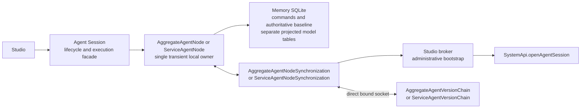

# Replace direct Agent machinery with transient Agent Nodes

**Date:** 2026-10-18

**Status:** Complete and archived on 2026-10-18. Implementation, permitted checks, source review and current documentation reconciliation passed.

**Basis:** The requested `AggregateAgentNode` / `ServiceAgentNode` replacement and [source research](../../research/agent-sessions-nodes-and-command-journals.md). The inspected working tree is based on `6debae86d5`, including the uncommitted Service Agent browser/Studio implementation. Reinspect that work before implementation; do not restore HEAD or discard the useful Service Agent declaration, backend, broker and Studio work.

**Reference decisions:** [ADR 003 — Node history and optimistic views](../../adrs/003-immutable-node-command-history-and-submission-order.md), [ADR 007 — identity, privacy and browser lifetime](../../adrs/007-canonical-results-and-selected-chain-ownership.md), and [ADR 015 — Service delivery/history ownership](../../adrs/015-service-delivery-history-and-projection-ownership.md). Their current direct-Agent exception is context to replace, not a requirement to retain it.

## Problem and agreed result

1. Ordinary Nodes now separate authoritative selected resources and final evidence from a rebuildable optimistic view. Direct Aggregate Agent sessions retained an older snapshot/import/rewind pipeline; the new Service Agent implementation copied it. Their snapshot/import transactions currently couple authoritative installation to successful speculative replay. The browser replica, journal and connection procedures cooperate over the same database; merely renaming those procedures does not change this ownership or failure boundary.
2. Replace that direct machinery with explicit `AggregateAgentNode` and `ServiceAgentNode` owners. Each owns one mounted lifetime's producer, originating commands, exposed-command evidence, authoritative baseline/checkpoint, optimistic graph and synchronization. The Agent Session owns its existing application execution/lifecycle facade and observes the Node's view; it owns no second command store, resource replica, replay pipeline or producer.
3. Preserve synchronous optimistic staging, typed local results, transactional rehearsal, exact canonical model/contract bindings, the administrative access boundary, private completion after selection removal, reconnect readiness and disposal. This is an ownership refactor, not a change to authoritative-only submission.
4. Keep Aggregate and Service APIs explicit, with one signature per new Agent entrypoint. Remove Agent branches from ordinary overloaded entrypoints rather than adding another branch. Preserve ordinary Actor and Standalone behavior; do not redesign their APIs or storage.
5. Keep each AgentNode on the main thread with fresh memory SQLite. It is a local runtime owner, not a Durable Object. One mounted Session owns one Node. Reconnect retains that Node; disposal releases it; reinitialization creates a fresh producer. Add no SharedWorker, backup, durable browser storage, multi-attachment handoff, reset coordination or cross-session sharing.
6. Leave Shopping declarations, contracts, versions and application behavior for later. Retain the completed Service Agent backend and Studio administrative broker. No backend wire change, new endpoint or Durable Object schema change is required for this replacement.

## Responsibilities and observable state

| Component                                      | Responsibility                                                                                                                                                                                                                              |
| ---------------------------------------------- | ------------------------------------------------------------------------------------------------------------------------------------------------------------------------------------------------------------------------------------------- |
| `AggregateAgentNode`                           | Aggregate Agent binding, local command evaluation/retention, selected Aggregate baseline and `aggregateIndex` / `dispositionChainHash`, producer progress, derived optimistic model tables and Node publication.                            |
| `ServiceAgentNode`                             | The corresponding explicit Service Agent responsibilities, using `serviceIndex` / `dispositionChainHash` and no Aggregate ID.                                                                                                               |
| Family-specific browser synchronization        | Scoped bootstrap/ticket refresh, direct socket, serialized events, one in-flight admission, timeouts and retry classification. Calls Node methods for every SQL, identity, cursor and reconciliation decision.                              |
| Agent Session                                  | Cold construction, exact release/application-service typing, shared `makeSessionLifecycle`, initialization/disposal and session-failure reporting. Delegates staging, validation, query access and command-state reads to its current Node. |
| Studio                                         | Reads the Node-owned model view and normalized command states through the Session facade. Retains inspector command identity independently of selected row membership.                                                                      |
| Studio broker and `SystemApi.openAgentSession` | Existing credential-owning administrative bootstrap and exact registered Agent / bound ticket issuance. They own no local command queue or ongoing Agent synchronization.                                                                   |

1. Bind the exact Agent release and its owner identity once. Aggregate identity includes the registered Aggregate ID and Aggregate name/version; Service identity includes Service name/version. Both include system name, Agent name/version and session name from the release. Do not accept a different identity through a later command or reconnect response.
2. Allocate one producer identifier per Node lifetime. Continue exposing the Session's lifetime identifier and passing that same producer value as socket `nodeId`; do not introduce another independently allocated identifier or persist repeated identity on every command.
3. Keep the canonical distinctions: local staging, Chain admission acknowledgement, and final exposed-command evidence are separate facts. The bootstrap field named `outcomes` contains projected exposed commands/private failure evidence, not the full canonical `outcome` `{ result: Success | Failure, finalizedAt }` retained by authoritative execution.
4. The Node is the sole writer of command state, connection/progress observations and view availability. Keep one Node publication/read capability. Stable Session stores may project that current lifetime for existing consumers, but must not implement a second state machine or retain their own command/resource facts.
5. During an allowed network retry, keep the last usable read view and inspector available, visibly stale, and withhold writable readiness. A projection defect instead invalidates resource readiness and follows existing terminal session-failure policy. Private final evidence is independent of resource membership and projection availability until normal disposal releases the transient Node.



## Local data model

1. Use **one synchronous SQLite connection per AgentNode**, with logically separate authoritative and projected state. This allows originating input and optimistic staging writes to commit atomically, while received authoritative data and later speculative reconstruction use separate transactions. Do not introduce cross-database compensation or an attached Session replica to achieve those boundaries.
2. Give each family its own Node DB configuration and owner-specific index field. Declare each configuration once. Share focused field/procedure construction only where it removes real duplication without a neutral overloaded Node, nullable owner fields or actor/Agent identity union.
3. Retain one `commands` row per canonical `id`, with unique `id`, Node-allocated `sessionIndex`, `commandName`, nullable originating `payload`, `stagedAt` and `pushIndex`, and nullable final `exposedDelta`, `failure`, owner index and `dispositionChainHash`. Keep `sessionIndex` as the existing lifetime-local staging/inspection ordinal; add no second append `nodeIndex`. Store no inverse operations in command history.
4. An originating row retains its encoded payload and original staging time for the mounted lifetime, including after final exposure. Its exact contract version and complete bound identity derive from the immutable release. A foreign exposed command has no originating payload, staging time or producer position. Final presence is proved by its owner index; a null failure never proves completion. Preserve complete final evidence for redelivery equality, including exposed delta and private failure.
5. Store the authoritative selected graph in `baselineResources`, keyed by `(modelName, id)`, with normalized encoded authored attributes, `createdAt` and `updatedAt`. Derive model version from the bound canonical model. Do not duplicate the envelope's ID/name/version inside the attribute JSON, store a giant snapshot in metadata, or cache canonical whole-command/resource bytes. Owning model codecs validate both inbound resources and baseline reconstruction.
6. Keep the normal authored model tables as the **derived optimistic view** queried by contracts and Studio. Rebuild them from `baselineResources` plus unresolved originating commands ordered by `sessionIndex`. An authoritative baseline write never mutates those model tables in the first transaction.
7. Keep an exact singleton `nodeMetadata` with the nullable owner-index / `dispositionChainHash` pair until first baseline, and `admittedThroughPushIndex`. Keep immutable producer/release/environment binding on the lifetime owner rather than repeating it in SQL. Derive local allocation maxima from retained rows and derive the private completion cursor as the first-gap originating `pushIndex` prefix with final evidence. Add no stored next-counter or redundant `outcomeIndex` cache.
8. Retain only lifetime-local command history. Do not copy ordinary Nodes' separate original/final append phases, foreign-history transfer to Sessions, attachment coverage protocol, durable generations or audit functionality merely to reuse an existing table helper.

## Transactions, projection and publication

### Synchronous staging and validation

1. Stage only against the current Node's valid writable view and exact registered ordinary claims-free Agent contract. Payload decoding, guard/program execution, result validation, optimistic operation application and originating-row retention remain synchronous.
2. Commit projected model changes and the new originating command row in one transaction on the Node connection. Return the existing typed local staging result and `sessionIndex` only after commit. A recognized refusal rolls back both input and speculative writes and retains no command. Check current lifetime/readiness before evaluation and before commit.
3. Preserve the original staging time for optimistic resource timestamps during replay. Revalidation may recompute a result but must not present that value as the authoritative `outcome` or silently replace the result already returned to the caller.
4. Node validation rehearses the same checked evaluation inside an always-rolled-back transaction with validation-local ID factories. It consumes no retained command, producer coordinate or production ID sequence.
5. Bind private evaluation requirements to the Session's captured application runtime when creating the Node. Preserve exact release, contract name, payload, result, failure and application-service inference at public entrypoints. Do not use erased overload implementations, new `any`, `ALLOWED_CAST` markers or a duplicate Session command-execution service to bypass typing.

### Received snapshots and exposed commands

1. Decode and validate identity, model ownership, resource envelopes, final equality, occupied owner positions, source checkpoint continuity and the complete private originating prefix before destructive replacement. A same-ID conflicting original/final, conflicting checkpoint or unexplained public gap fails closed.
2. **Fence staging, outgoing pushes and resource-view publication before the first authoritative transaction.** SQLite change listeners can run synchronously on commit; no listener may reenter staging against the old graph and the new checkpoint. Keep this fence through reconstruction and the final Node publication.
3. The first synchronous transaction installs validated baseline changes, final command evidence and authoritative checkpoint together. An initial snapshot atomically installs its resource/checkpoint pair and complete covered private prefix. An exposed command already covered by the baseline may supply private final evidence without reapplying its historical resource delta. A final arriving before its admission reply is valid admission evidence for that exact originating position.
4. Commit that transaction **before** replaying pending input. Then run a second synchronous transaction that replaces only the projected model tables from the authoritative baseline and replays unresolved originating commands in order, using `replayOptimisticCommandTx` and the checked operation/savepoint primitives.
5. A recognized replay refusal rolls back only that command's attempted speculative writes and leaves its input pending without active optimism. An unexpected replay failure rolls back the projection transaction, keeps the authoritative commit, withholds the resource capability and stages/pushes, and reports the original failure through the existing session-failure boundary. It must not resurrect a finalized or definitively refused command.
6. Publish the rebuilt resource capability, matching checkpoint/progress and derived command states only after successful reconstruction. Use a Node-owned publication fence and read adapters; do not assume React batching makes the two commits atomic. Raw SQL observer delivery between commits must not expose a supposedly current resource view or enable writes. A failure publication can expose retained private completion while marking the resource graph unavailable.
7. Studio consumes a Node-owned normalized command-state read/observation capability separately from model selection membership. The Node publishes stable command snapshots containing `id`, `commandName`, `sessionIndex`, owner-index-derived final presence and a decoded public failure; Studio no longer parses SQL JSON columns. Use the existing observable-store pattern, with the Node as sole publisher, rather than another history/subscription protocol. Studio must not import either family's internal command-table schema or copy command history into the optimistic graph. Preserve selected-row removal and reconnect inspector behavior.
8. Reuse the model-only replacement/replay phase of `makeNodeOptimisticView` through a focused transaction-local helper accepting `tx`, canonical models, baseline resources, pending originals and a checked replay callback. Its existing ordinary-Node wrapper may delegate to that helper without changing its public return, storage, replay or actor behavior. Do not expose its separate private database to Agents and then add cross-database staging coordination.

```text
Received final or initial snapshot
  fence resource readiness, staging and pushing
  transaction 1: authoritative baseline + final evidence + checkpoint
  COMMIT
  transaction 2: replace projected models + replay surviving input
  COMMIT -> publish one usable Node view
  FAILURE -> keep transaction 1; withhold view; report failure

New local command
  one transaction: checked evaluation + projected writes + originating input
  COMMIT -> return typed local result and wake synchronization
```

## Submission, reconnect and disposal

1. Keep a single ordered in-flight admission per Node. Allocate `pushIndex` lazily when first sending an originating command, retain it before transmission and retry the exact same canonical ID/payload/position after uncertainty. Do not allocate a later submission until the prior one has admission or final evidence. Local commands may continue to stage while a previous admitted command awaits final exposure.
2. Advance admission progress only from validated retained admission/final evidence. A received final never resolves a different command, and a later private final never skips an unresolved earlier originating position. Exact retries/redeliveries are idempotent; conflicting evidence is a protocol failure.
3. Preserve the current continue-after-definitive-pre-admission-refusal behavior. After proving exact command identity, no admission acknowledgement/final, and no later allocated position, remove only that definitively non-admitted original and reclaim its last producer coordinate in the authoritative transaction; then rebuild the view. Report the command-origin refusal without fabricating an owner index or canonical `outcome`. The one-in-flight rule removes the need to renumber later submissions. Do not copy ordinary Nodes' block-on-refusal behavior or add rejected-command audit storage.
4. An uncertain transport failure does not authorize deletion/reallocation. An admission-index mismatch is not a definitive command refusal: preserve input, validate the expected position against retained producer/final evidence, and retry the exact retained missing prefix only if those facts prove it. Otherwise fail closed without rewriting acknowledged/final coordinates or manufacturing a new identity.
5. The asynchronous synchronization component owns no independent SQL journal. Serialize socket, stage-wakeup and timeout events; use existing socket-attempt and lifetime fences. It asks the Node for the next exact submission and passes admission/exposure messages back to Node methods. Never hold a SQL transaction across bootstrap or network calls.
6. On the first bootstrap, validate the full owner/Agent/session identity and private prefix and install the baseline before socket resume. On reconnect, keep the existing Node's baseline, originals, producer and cursors. Obtain a fresh bound ticket through the existing bootstrap callback, validate its identity, and resume the retained checkpoint/private completion cursor instead of reinstalling each newly returned snapshot. The existing bootstrap response may contain a newer snapshot; this path needs only its validated connection credentials. Add no ticket-only endpoint or reconnect migration.
7. Validate replay completion against the Node's actual committed owner index/hash and contiguous private prefix before publishing writable readiness. A `state-required` response or contradictory retained checkpoint is an explicit recovery/protocol failure, not permission to silently reset the producer or replace established history. Preserve the existing online-terminal versus explicitly-offline retry policy.
8. Disposal synchronously fences new staging, reads/publication from retired capabilities and pending socket callbacks. Abort the synchronization attempt, cancel timers/listeners, join admitted work, then close SQLite exactly once. Late acquisition closes its resource instead of publishing. A fresh initialization creates a new empty Node; it does not recover a disposed lifetime's memory history.

## Public API and hard cutover

1. Add single-signature `makeAggregateAgentSession`, symmetric with `makeServiceAgentSession`. Both take the exact browser Agent release via `sessionDefinition` and the family's existing bootstrap inputs; Aggregate also takes `aggregateId`. Preserve release authoring, `system.agents`, application Layer inference, common lifecycle/reporting and observable `sessionId` semantics.
2. Export explicit structural `IAggregateAgentBrowserRelease` and `IServiceAgentBrowserRelease` types independently of the ordinary factory union. Remove the Aggregate Agent branch and Agent-specific conditional types from `makeBrowserSession` / its input/output unions. Keep ordinary Aggregate, Service and Standalone call shapes and behavior; do not redesign their remaining implementation signatures.
3. Add single-signature `stageAggregateAgentCommand`, `validateAggregateAgentCommand` and `makeAggregateAgentModelId` to replace the existing Aggregate Agent overloads in ordinary Aggregate helpers. Preserve the explicit `stageServiceAgentCommand` / `validateServiceAgentCommand` names and rebind them to the Node. Add no Service Agent model-ID helper solely for symmetry without a caller needing it.
4. Remove only Agent overloads/union branches from `stageAggregateSessionCommand`, `validateAggregateSessionCommand` and `makeAggregateSessionModelId`. Ordinary Actor execution remains intact. Keep shared checked evaluation/replay primitives that still have real callers; do not prune a useful algorithm solely because its previous Agent orchestration is deleted.
5. Make Session initialization expose the Node's existing query capability and command reads, replacing `makeInitializedAggregateAgentSession` / `makeInitializedServiceAgentSession` and their direct-replica execution capabilities. Those constructors do not themselves own separate state; remove them once Node construction/methods own the binding checks and evaluation they supported. Remove the direct-only `commandExecution` facade as well. Keep lifecycle names and state fields only where they still describe a real current capability, not as compatibility aliases for deleted stores.
6. Update Studio's Aggregate Agent factory/staging imports, both previews, shared inspector/status adapter and browser-safe registry types. Keep current Aggregate URLs and Service URLs. Preserve empty selections, existing row actions and Submit flow; add no Shopping-specific UI or `availableWhen` metadata.
7. Delete both browser direct `agentSession` / `serviceAgentSession` replica-journal-connection pipelines after their callers move. Delete the corresponding core direct-session DB configs, allocators, snapshot/import/retain/rewind/replay orchestration and obsolete README descriptions. Keep focused evaluation code only when the Node directly reuses its responsibility; move/rename it into the owning feature rather than preserve forwarding wrappers.
8. Retain backend-shared Service Agent session lock, lock constructor, snapshot schema and socket schema. Keep Aggregate wire/session-lock schemas required by backend and ordinary Actors. Replace authoring/registration reserved-table checks currently importing the deleted Agent session DB config with checks against the actual Node internals. No obsolete `sessionMetadata` reservation or old table/config export survives just for compatibility.

## Implementation sequence and planned files

1. Reinspect the working tree, research and real callers. Capture the ordinary Actor/Standalone API and backend wire boundaries that must remain unchanged. Preserve unrelated work; do not discard the in-progress Service feature to make the refactor easier.
2. Implement the two explicit core Nodes, their data configurations and one focused transaction-local projection/replay seam. Establish baseline-first commitment, atomic local staging, publication fencing and command-read ownership before adapting sessions.
3. Implement family-specific transient browser opening/synchronization. Reuse `makeSessionLifecycle` and socket primitives, bind application execution once, and keep asynchronous transport outside synchronous Node transactions.
4. Cut over the two Session factories, explicit command helpers, Studio and reserved-name validation together. Remove the superseded direct modules and Agent overload branches in the same implementation; leave no selectable old path or compatibility alias.
5. Run the permitted checks below, fix in-scope failures, review the finished diff, and reconcile documentation with the implemented result. Record exact results here before completing or archiving this plan.

`+` creates; `~` modifies or moves; `-` deletes superseded direct machinery. Listed directories group cohesive code; do not create one module per trivial forwarding step.

```text
zerospin/
├── packages/core/src/
│   ├── + AggregateAgentNode/{AggregateAgentNode.ts,aggregateAgentNodeDbConfig.ts,types.ts}
│   ├── + ServiceAgentNode/{ServiceAgentNode.ts,serviceAgentNodeDbConfig.ts,types.ts}
│   ├── + Node/rebuildOptimisticResourcesTx.ts
│   ├── ~ Node/makeNodeOptimisticView.ts
│   ├── + aggregateAgentSession/{stageAggregateAgentCommand.ts,validateAggregateAgentCommand.ts,makeAggregateAgentModelId.ts}
│   ├── - agentSession/                     direct replica implementation
│   ├── ~ serviceAgentSession/              keep shared wire schemas and explicit public command helpers
│   ├── ~ agent/{types.ts,makeAggregateAgentRelease.ts,makeServiceAgentRelease.ts}
│   ├── ~ aggregateSession/                remove Agent overloads/branches only
│   └── ~ system/make/makeSystem/validateAgentReleases.ts
├── packages/browser/src/
│   ├── + AggregateAgentNode/{openAggregateAgentNode.ts,AggregateAgentNodeSynchronization.ts}
│   ├── + ServiceAgentNode/{openServiceAgentNode.ts,ServiceAgentNodeSynchronization.ts}
│   ├── + makeAggregateAgentSession.ts
│   ├── ~ makeServiceAgentSession.ts
│   ├── ~ bootstrapAggregateAgentSession.ts
│   ├── ~ bootstrapServiceAgentSession.ts
│   ├── - agentSession/                     old replica/journal/connection
│   ├── - serviceAgentSession/              move useful release typing; delete old pipeline
│   ├── - makeBrowserSession/createAggregateAgentBrowserSession.ts
│   └── ~ makeBrowserSession/{makeBrowserSession.ts,types.ts}, index.ts
├── packages/studio/
│   ├── ~ src/{AgentExplorer.tsx,AgentPreview.tsx,ServiceAgentPreview.tsx,AgentSelectionBrowser.tsx,agents.d.ts}
│   └── ~ README.md                         existing stories only if imports require cutover
└── wiki/
    ├── + plans/244-plan-transient-agent-nodes.md
    ├── ~ glossary.md                       after implementation
    ├── ~ architecture/{AuthoredSystem.md,SystemApi.md,browser/**}
    └── ~ adrs/{003-immutable-node-command-history-and-submission-order.md,
                007-canonical-results-and-selected-chain-ownership.md,
                015-service-delivery-history-and-projection-ownership.md}
```

## Verification and completion

1. Add no tests, profiles, fixtures, test/check runners or configuration. Use existing scoped Nx declaration builds, typechecks and lint for Core, Browser, Studio, System Worker, CLI and the dev/production worker variants, with dependencies scheduled in one graph and explicit project selection. Core's declaration build checks its source types. Run only targets that exist; do not use root all-workspace wrappers.
2. Run the existing `test-external-types` and `test-external-examples` regression targets with their existing selection. They do not authorize Shopping feature edits or startup. Run formatting checks on changed files and `git diff --check`. Review authored source and emitted declarations for obsolete direct machinery, broken exports, accidental Agent overloads, type erasure and changed ordinary Actor/Standalone signatures.
3. Review these seams against finished source, explicitly separating source evidence from executed behavioral checks:

   | Seam                              | Required evidence                                                                                                                                                       |
   | --------------------------------- | ----------------------------------------------------------------------------------------------------------------------------------------------------------------------- |
   | Local staging/refusal/rehearsal   | Input and optimistic writes commit together; recognized refusal and validation rollback retain nothing; typed return and application requirements survive.              |
   | Final plus failing pending replay | Authoritative final/baseline/checkpoint remain committed; view readiness, staging and pushes stay fenced; original error remains intact.                                |
   | Reentrant commit observer         | No staging or supposedly current resource publication occurs between authoritative and projection commits.                                                              |
   | Admission uncertainty/refusal     | Same-ID retry preserves its input/coordinate; definitive nonadmission alone permits reclamation; no acknowledged/final command is deleted or renumbered.                |
   | Public/private progress           | Admission does not manufacture completion; private first-gap proof cannot skip an original; empty deltas and null failure still resolve with final evidence.            |
   | Selection exit and command status | Both previews continue observing the originating command after its row exits; no Session copy of history is required.                                                   |
   | Identity and capability rejection | Wrong Agent, family, owner/version, contract, model, session or producer fails without installing authority; no actor credentials are borrowed.                         |
   | Reconnect                         | Same Node/producer/input survives, fresh ticket resumes retained checkpoint, inspector stays available stale, and writable readiness waits for exact replay completion. |
   | Disposal and reinitialization     | Late callbacks cannot touch released SQLite or publish capability; all resources close once; a fresh lifetime gets a new producer.                                      |

4. Record that the new AgentNode runtime behavior has no dedicated automated coverage under the current no-new-tests boundary. Existing external regression success does not prove these new paths. Do not claim runtime or browser verification when only source review/builds ran.
5. Perform no application startup, browser-driven Shopping verification, publication, sibling rollout, deployment, storage activation or reset. Do not verify Explorer. This plan changes transient local schemas; it provides no migration, fallback decoder or automatic clearing of durable storage.
6. After implementation, reconcile glossary, module READMEs, Studio documentation, architecture diagrams/source citations and the governing ADRs' direct-Agent exception with the actual Node model. Update existing governing decisions rather than create an ADR solely for renaming. Create a new ADR only if a resulting implemented trade-off meets the repository's criteria. Preserve historical research/archives and every earlier plan's deferred verification status, including Plans 227–234 and Shopping Plan 239. Supersede only directly replaced descriptions; do not imply their other work was verified.
7. Record implementation, permitted check results, known limits and **Remaining work** here. Archive this plan with its filename and repaired links only after implementation and all permitted required checks pass. Keep it active if any required item is failed, blocked or unrun.

## Implementation and verification results

Implemented both explicit transient Agent Nodes, their memory schemas, private publication stores and guarded read capabilities. Sessions now retain lifecycle, application execution, telemetry and their current Node. Studio consumes normalized Node command state independently of selection membership and displays terminal Session failures without unmounting the inspector. Both direct replica/journal pipelines and the Aggregate Agent branches of ordinary factories/helpers are removed. Backend-shared Service Agent lock/snapshot/socket schemas and the existing broker/backend work are retained.

The public factories and command helpers have one signature each. Emitted declarations retain exact release, selected contract name/version, payload, result, failure and application-service requirements. Ordinary Actor/Standalone implementation signatures and execution paths retain their behavior. The shared projection extraction preserves the existing ordinary Node algorithm and transaction order. There are no Shopping source edits, new tests/fixtures/profiles/runners, overloads, compatibility paths, storage activation or application startup.

### Executed checks

- Passed the explicitly selected Nx `lib`, `ts` and `lint` graph for `@zerospin/core`, `@zerospin/browser`, `system-worker`, `@zerospin/studio`, `@zerospin/cli`, `@zerospin/dev-worker` and `@zerospin/production-worker`, including existing dependency targets: 30 tasks. Core's declaration build checks its source types. Existing unrelated warnings remain: 33 in Core and one in Studio.
- Passed the final Browser lint target and its declaration-build dependencies after removing all new Browser lint warnings. Browser lint reports no diagnostics.
- Passed existing `zerospin:test-external-types` and `zerospin:test-external-examples` with their existing selection: six tests passed, zero failed. No new runtime test was added.
- Inspected authored source and emitted declarations for removed direct modules, broken exports, Agent overload branches and widened command-name/version inference. Both explicit browser factories are exported; ordinary Aggregate helpers contain no Agent reference.
- Passed scoped formatting and formatting checks on all 73 changed/current files, `git diff --check` and current relative source/document links. Archival links were repaired and checked after the move. The apparent Markdown `](...)` in AuthoredSystem's existing Mermaid invocation is code, not a file link.

### Source review evidence and limits

| Seam                           | Reviewed implementation                                                                                                                                                                                                                                                                                                 |
| ------------------------------ | ----------------------------------------------------------------------------------------------------------------------------------------------------------------------------------------------------------------------------------------------------------------------------------------------------------------------- |
| Staging, refusal and rehearsal | Each Node's `stage` retains input with optimistic writes in one synchronous transaction. `validate` always rolls back and overrides captured production ID factories with local factories. Public helpers preserve typed local results.                                                                                 |
| Authority plus failing replay  | `reconcile` commits authority before `rebuild`; internal captured-context interpretation lets its catch publish normalized final evidence before the outer Session failure boundary retires the lifetime. Projection failure leaves the view unavailable and pushes/staging fenced.                                     |
| Reentrant publication          | Read-only public stores, isolated observers and a publication epoch prevent observers from staging between commits or resurrecting a revoked view after either commit. Captured query/selection capabilities expire.                                                                                                    |
| Admission uncertainty/refusal  | One in-flight transport claim, retained original input/position and a sourced definitive-refusal allowlist preserve uncertain input. Receipt/infrastructure/unknown failures cannot delete it. Mismatch recovery requires exact retained expected/submitted coordinates; no acknowledged/final coordinate is rewritten. |
| Public/private progress        | `retainFinalTx` requires assigned producer evidence for own finals, supports final-before-admission-reply, checks redelivery equality and advances only a contiguous private first-gap prefix. Null failure and empty delta do not manufacture final presence.                                                          |
| Selection exit and status      | Both previews retain the same shared inspector across selected-row removal, temporary view unavailability and reconnect. Normalized command state comes from the Node, with no SQL JSON parsing or Session history copy.                                                                                                |
| Identity and capability        | Family bootstrap codecs, `validateBootstrap`, exact release-bound contract checks and owning resource codecs reject inconsistent Agent/owner/version/session/model input. Existing administrative tickets and backend allowlists retain their boundary.                                                                 |
| Reconnect                      | Family adapters validate each fresh bootstrap identity but install its snapshot only initially. Subsequent attempts resume the same Node's retained owner checkpoint and private cursor; exact replay completion restores writable readiness.                                                                           |
| Disposal/reinitialization      | Abort/attempt fences reject late continuations; scoped cleanup joins socket work before Node retirement and SQLite close. Failed cleanup retains a disposed Node's immutable command snapshot until explicit Session disposal detaches it. A fresh lifetime allocates a new producer and memory connection.             |

Independent review found and repaired the reentrant revocation, premature lifetime-gated failure publication, uncertain-refusal deletion, never-submitted final, validation-factory override and mutable-public-store defects. These conclusions are source review, not executed AgentNode behavioral or browser verification. The new AgentNode runtime paths have **no dedicated automated coverage** under this plan's no-new-tests boundary. Existing external-example success does not establish those paths. Earlier plans' deferred verification, including Plans 227–234 and Shopping Plan 239, remains unchanged.

Current glossary, module/Studio documentation, architecture source citations and governing ADR 003/007/015 describe the implemented Node ownership. No new ADR was needed.

## Remaining work

**None.** Plan 244 is complete within its stated boundaries.
