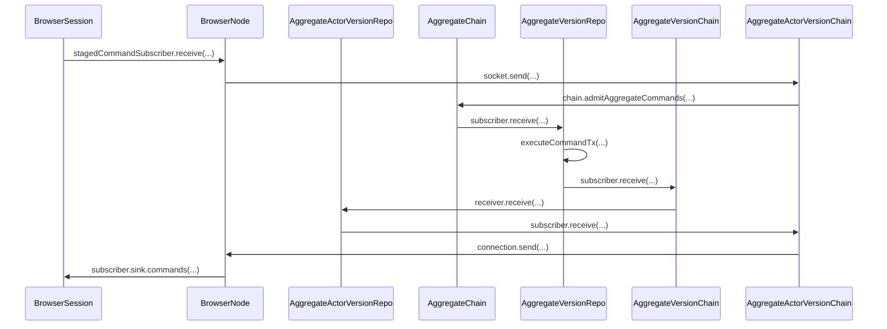

# Command history and projections

Admitted commands feed original execution in their retained version. Final histories feed actor projections, and actor output histories feed browser nodes and sessions.

## Annotated workflow steps

1. Session staging constructs and evaluates the command, applies optimistic operations, and retains history in one transaction.
   - [`stageAggregateSessionCommandTx.ts:28-253`](../../packages/core/src/aggregateSession/stageCommand/stageAggregateSessionCommandTx/stageAggregateSessionCommandTx.ts#L28-L253) — owns command evaluation, resource writes, sequence advancement, command history and inverse-operation retention. (`packages/core/src/aggregateSession/stageCommand/stageAggregateSessionCommandTx/stageAggregateSessionCommandTx.ts:28-253`)
2. The node owns durable ordered push and server synchronization.
   - [`AggregateNodeSynchronization.ts:342-391`](../../packages/browser/src/AggregateNode/AggregateNodeSynchronization.ts#L342-L391) — sends the staged command over the bound socket. (`packages/browser/src/AggregateNode/AggregateNodeSynchronization.ts:342-391`)
3. The authenticated actor chain admits the original input directly to AggregateChain, validates its singleton immutable receipt, and acknowledges the assigned input position.
   - [`onMessage.ts`](../../packages/system-worker/src/aggregateSessionChain/onMessage/onMessage.ts) — preserves the connection lock and submitted provenance while sending ordinary command admission.
4. The original outbox delivers the oldest pending command to its retained aggregate version.
   - [`AggregateChain.ts:121-136`](../../packages/system-worker/src/AggregateChain/AggregateChain.ts#L121-L136) — reads the oldest pending original command within the requested admission bound. (`packages/system-worker/src/AggregateChain/AggregateChain.ts:121-136`)
   - [`AggregateChain.ts:164-173`](../../packages/system-worker/src/AggregateChain/AggregateChain.ts#L164-L173) — resolves the selected command's retained aggregateVersion execution subscriber. (`packages/system-worker/src/AggregateChain/AggregateChain.ts:164-173`)
5. One command transaction evaluates the guard/program/mapper before applying resource output, then commits direct finalization and publication work with the version head.
   - [`materializeCommandTx.ts:329-376`](../../packages/system-worker/src/AggregateVersionRepo/materializeCommandTx.ts#L329-L376) — prepares the shared input, validates aggregate owner access and collects contract output before application. (`packages/system-worker/src/AggregateVersionRepo/materializeCommandTx.ts:329-376`)
   - [`materializeCommandTx.ts:428-446`](../../packages/system-worker/src/AggregateVersionRepo/materializeCommandTx.ts#L428-L446) — marks authored guard/program refusals for retained finalization after the business savepoint rolls back. (`packages/system-worker/src/AggregateVersionRepo/materializeCommandTx.ts:428-446`)
   - [`materializeCommandTx.ts:454-499`](../../packages/system-worker/src/AggregateVersionRepo/materializeCommandTx.ts#L454-L499) — applies collected model operations and retains ordered model and async outputs. (`packages/system-worker/src/AggregateVersionRepo/materializeCommandTx.ts:454-499`)
   - [`materializeCommandTx.ts:532-581`](../../packages/system-worker/src/AggregateVersionRepo/materializeCommandTx.ts#L532-L581) — constructs direct finalization and commits publication intent with the version head. (`packages/system-worker/src/AggregateVersionRepo/materializeCommandTx.ts:532-581`)
6. Version history retains complete final commands and owned operations.
   - [`receiveExecutedCommands.ts:177-191`](../../packages/system-worker/src/AggregateVersionChain/receiveExecutedCommands/receiveExecutedCommands.ts#L177-L191) — inserts final history and owned operation rows. (`packages/system-worker/src/AggregateVersionChain/receiveExecutedCommands/receiveExecutedCommands.ts:177-191`)
7. Actor projection validates each original delivered row before duplicate skipping and replays new owned operations in one page transaction.
   - [`applyExecutedCommandsTx.ts:59-166`](../../packages/system-worker/src/aggregateProjection/applyExecutedCommands/applyExecutedCommandsTx.ts#L59-L166) — validates envelopes, final commands and ordered operations before skipping repeats or applying release-owned operations. (`packages/system-worker/src/aggregateProjection/applyExecutedCommands/applyExecutedCommandsTx.ts:59-166`)
8. Selected delta and projection checkpoint commit together.
   - [`applyEvaluatedCommandsTx.ts:101-146`](../../packages/system-worker/src/aggregateProjection/applyEvaluatedCommands/applyEvaluatedCommandsTx.ts#L101-L146) — inserts browser output and advances actor checkpoint. (`packages/system-worker/src/aggregateProjection/applyEvaluatedCommands/applyEvaluatedCommandsTx.ts:101-146`)
9. Actor history preserves selected delivery and private command outcomes.
   - [`getBrowserCommands.ts:88-140`](../../packages/system-worker/src/aggregateSessionChain/getBrowserCommands/getBrowserCommands.ts#L88-L140) — selects retained browser outputs and private completions in execution order. (`packages/system-worker/src/aggregateSessionChain/getBrowserCommands/getBrowserCommands.ts:88-140`)
10. Browser replay keeps the original staging result while rebuilding optimism.
    - [`replayPendingCommandsTx.ts:144-203`](../../packages/core/src/aggregateSession/replayPendingCommandsTx.ts#L144-L203) — prepares input once, recalculates operations, and reapplies optimism in the active replay transaction. (`packages/core/src/aggregateSession/replayPendingCommandsTx.ts:144-203`)

Services use the same owned-execution → version-history → actor-projection → session boundary. Verified async continuations enter admission in one ordered batch after every row matches recorded evidence. Original receipts finalize the retained admission rows; independent replay reads only the contiguous finalized prefix and never initializes async producer lifecycle. The changed fixed schemas require empty storage.
