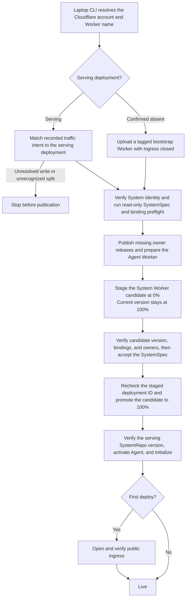

# Handoff for laptop-only self-hosted deployment

**Date** 2026-11-20

**Focus** Live verification of first deploy, redeploy, and interruption recovery.

## Implemented

`zerospin deploy` uses the laptop's Wrangler credentials and reports progress through **Live**. The first verified deploy establishes the System at its Cloudflare account and authored name. The authored `systemId` continues to address retained storage. Run one deployment at a time. The same change includes the package split for separate Agent and owner-release Workers.

Before an initial upload, the CLI saves its run ID under `.wrangler/zerospin/`. A rerun can reconcile a lost response by matching the serving Worker version's upload tag. The CLI keeps the record through the first public cutover.

## Interrupted deployment recovery

Each `zerospin deploy` builds the working tree. If an interrupted run left System
Worker version A at 100% and candidate B at 0%, the CLI verifies that the split
belongs to that run and that its prior traffic writes are settled. It then uses
A to preflight the current `SystemSpec` against the retained catalog.
`SystemRepo` retains any `SystemSpec` it accepted for B, including when B never
served normal traffic. A preflight rejection leaves the existing split in place.

After preflight, the CLI uploads candidate C from the working tree and replaces
the split with A at 100% and C at 0% in one traffic write. It verifies C's version,
bindings, and owner releases, then calls `acceptSystemSpec` and promotes C. Before
each staging or promotion write, the CLI saves the intended version IDs and
traffic weights locally so a later invocation can reconcile the write with
Cloudflare. An ambiguous write or an unrecognized split blocks new traffic
writes.

When Cloudflare confirms that the previous candidate reached 100%, the next
invocation uses that exact System Worker version as its incumbent and deploys
from the working tree. This applies when the earlier invocation ended before
`SystemRepo` switched versions, Agent Worker activation finished, or
`SystemApi.initialize` completed. On a first deploy, the bootstrap record stays
pending until the CLI verifies public ingress against the serving deployment.

## Verification

The CLI build, eight recovery tests, and 29 Workerd Repo lifecycle tests passed.
The retry tests cover lost bootstrap responses, deployment drift, replacement
of a zero-traffic candidate, unresolved promotion, and interrupted owner Worker
publication and acceptance. Workerd verifies that a committed pin survives Repo
reconstruction and that acceptance rejects a different Worker version even
when the SystemSpec hash matches.

The split Agent Worker wake-delivery regression and the Agent installation
replacement regression in the same-Worker fixture passed locally.

## Remaining

1. Live first deploy and redeploy were skipped at the operator's request.
2. Existing catalogs without exact owner Worker pins require a separately
   approved storage upgrade.
   [Owner Worker version acceptance](../adrs/030-generic-system-worker-and-actor-projections.md#owner-worker-version-acceptance)

## Suggested skills

1. `$implement` for completing the remaining deployment work.
2. `$update-wiki-architecture` if the rollout or recovery sequence changes.

## Pointers

1. [MOR-489](https://linear.app/morganatwork/issue/MOR-489/make-the-self-hosted-deploy-workflow-read-as-ordered-operations)
2. [Deploy implementation](../../packages/cli/src/deploy/deployWranglerFn.ts)
3. [Detailed deployment sequence](../architecture/AuthoredSystem.md)
4. [System Worker package split handoff](2026-11-20-handoff-system-worker-package-split.md)
