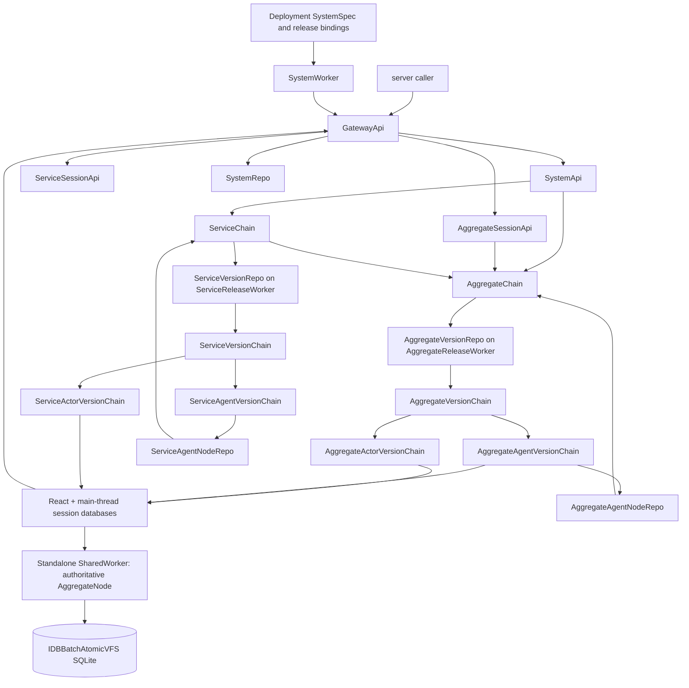

# SystemRepo Durable Architecture

`SystemWorker` hosts GatewayApi, SystemRepo, and the root Chains. It reads the
SystemSpec attached to its serving Worker version. Each Aggregate
or Service release Worker owns its materialization, evaluated history, and
Actor projections and sockets. `AgentWorker` owns the Agent Node Repos, the
versioned Agent projections and their sockets.

- [Stable SystemWorker](../packages/production-worker/src/SystemWorker.ts)
- [Release Durable Object bindings](../packages/dev-worker/src/makeWranglerConfig.ts)
- [AgentWorker entrypoint](../packages/agent-worker/src/AgentWorker.ts)

## Runtime topology

Gateway exposes SystemApi to secret-key callers and independently acquired
aggregate or service session capabilities to publishable-key callers.

- [`GatewayApi.ts`](../packages/system-worker/src/GatewayApi/GatewayApi.ts) — defines the three root capability getters.
- [`getSystemApi.ts`](../packages/system-worker/src/GatewayApi/getSystemApi/getSystemApi.ts) — validates the secret key and binds SystemApi to configured `systemId`.

## Durable identity and framework schema revisions

Durable Object identity includes `systemId` plus the logical instance fields.
Each physical owner has an up-only framework migration ledger, separate from
its immutable authored release/model/contract versions. Fresh storage provisions
the resolved current graph; cold activation validates history and applies pending
migrations before recovery or alarm dispatch. The initial baseline requires empty
pre-release storage.

| Repo                       | Durable identity                                                                                 |
| -------------------------- | ------------------------------------------------------------------------------------------------ |
| AggregateChain             | `{ systemId, aggregateId, aggregateName }`                                                       |
| ServiceChain               | `{ systemId, serviceName }`                                                                      |
| AggregateVersionRepo       | `{ systemId, aggregateId, aggregateName, aggregateVersion }`                                     |
| ServiceVersionRepo         | `{ systemId, serviceName, serviceVersion }`                                                      |
| AggregateActorVersionChain | `{ systemId, aggregateId, aggregateName, aggregateVersion, actorName, actorVersion, actorPath }` |
| AggregateAgentVersionChain | `{ systemId, aggregateId, aggregateName, aggregateVersion, agentName, agentVersion }`            |
| ServiceActorVersionChain   | `{ systemId, serviceName, serviceVersion, actorName, actorVersion, actorPath }`                  |
| SystemRepo                 | `{ systemId }`                                                                                   |

- [`types.ts`](../packages/core/src/system/types.ts) — defines the current Repo kinds and registration shape without schema targets.
- [`aggregateChainMigratableDORepoConfig.ts`](../packages/system-worker/src/AggregateChain/aggregateChainMigratableDORepoConfig.ts) — keeps AggregateChain on the unversioned `{ systemId, aggregateId, aggregateName }` name.
- [`AggregateVersionRepo.ts`](../packages/owner-release-worker/src/AggregateVersionRepo/AggregateVersionRepo.ts) — binds each aggregate implementation to `{ systemId, aggregateId, aggregateName, aggregateVersion }`.
- [`aggregateActorVersionChainMigratableDORepoConfig.ts`](../packages/system-worker/src/AggregateActorVersionChain/aggregateActorVersionChainMigratableDORepoConfig.ts) — resolves model and framework tables from the exact owner and actor identity.
- [`makeMigratableDORepo.ts`](../packages/system-worker/src/makeMigratableDORepo/makeMigratableDORepo.ts) — validates the framework migration ledger before activation and applies pending up migrations.

## SystemRepo boundary and command execution

SystemRepo is the singleton keyed by `{ systemId }`. It owns Repo inspection, one-time session
WebSocket tickets, and WebSocket routing. AC reconciles its VAR destinations
from deployed aggregate definitions during activation. Commands and direct RPCs
activate VARs.

- [`SystemRepo.ts`](../packages/system-worker/src/SystemRepo/SystemRepo.ts) — Owns Repo registration, inspection, and singleton ticket routing.
- [`systemRepoDbConfig.ts`](../packages/system-worker/src/SystemRepo/systemRepoDbConfig.ts) — Persists tickets and Repo registrations.
- [`onRepoStartup.ts`](../packages/system-worker/src/AggregateChain/onRepoStartup/onRepoStartup.ts) — Reconciles supported destinations while preserving retained command progress.
- [`AggregateVersionRepo.ts:288-323`](../packages/owner-release-worker/src/AggregateVersionRepo/AggregateVersionRepo.ts#L288-L323) — initializes declared predecessor history, catches up materialized state and wakes the publication outbox during activation.

AggregateChain admits complete inputs with exact-byte idempotency. It resolves
the recorded release's VersionRepo to execute the admitted command. The
VersionRepo commits the evaluated command in its publication outbox, then
publishes it to the bound VersionChain. Additional Aggregate releases retain
the same System ID and root command history.

On first deploy, the CLI confirms that Cloudflare has no Worker under the
System's name, then installs an ingress-closed `SystemWorker`. A redeploy
starts from the exact serving version. The CLI checks retained declarations
before publishing dependencies in either case.

- [`SystemRepo.ts`](../packages/system-worker/src/SystemRepo/SystemRepo.ts) — Owns the singleton system registry and service initialization.
- [`makeMigratableDORepo.ts`](../packages/system-worker/src/makeMigratableDORepo/makeMigratableDORepo.ts) — Provisions fresh storage atomically and migrates retained schemas before recovery.
- [`getAggregateVersionRepo.ts`](../packages/system-worker/src/AggregateVersionRepo/getAggregateVersionRepo.ts) — opens the release's VersionRepo through its Worker binding or the co-located namespace.
- [`deployWranglerFn.ts`](../packages/cli/src/deploy/deployWranglerFn.ts) — verifies the serving version, preflights the SystemSpec, checks the staged candidate and promotes it before initialization.

## Browser convergence and standalone execution

Each selected session owns an in-memory wa-sqlite database, finalized-output
socket, and recovery loop on the page main thread. Aggregate recovery fetches
a published ActorVAR snapshot, pins its aggregateVersion in the ticket, and replays
ActorVAC outputs strictly after the captured session cursor. Snapshot resolved
command IDs and per-command originating resolutions reconcile local optimism.
Service recovery captures a published FVSR snapshot, pins its serviceVersion,
and replays FSC strictly after its serviceIndex.

- [`getSnapshot.ts`](../packages/system-worker/src/AggregateProjectionRepo/getSnapshot/getSnapshot.ts) — captures state and cursor together and awaits bounded projection publication.
- [`bootstrapAggregateSession.ts`](../packages/browser/src/bootstrapAggregateSession.ts) — installs published state, validates contiguous replay, and retains the live socket.
- [`bootstrapServiceSession.ts`](../packages/browser/src/bootstrapServiceSession.ts) — captures the service snapshot before obtaining its version-pinned ticket.

Standalone tabs use the same optimistic staging, Node acceptance, and ordered
reconciliation primitives. The worker owns authoritative IndexedDB SQLite and
executes accepted invocations in durable submission order. A generated backup
path and session definition scope select storage independently of incidental claims and
the compiled worker version; one aggregate ID binds the database. A lifetime
Web Lock serializes worker builds before SQLite opens.

Guard/program Effects read declared models through `findFirst` and `findMany`.
Tab/server entrypoints enforce synchronous evaluation; the standalone worker
awaits SQLite reads inside the same command transaction. Resources, terminal
outcomes, indexes, and disposition hashes commit together. Declared business
failures retain terminal outcomes; defects roll back and leave accepted work
pending. Reset reseeds history/resources, rotates the node identity, fences old
capabilities, and rebuilds every attached tab from the new snapshot.

- [`makeStandaloneSharedWorker.ts`](../packages/browser/src/StandaloneNode/makeStandaloneSharedWorker.ts) — owns storage locking, original claims, and ordered execution.
- [`bootstrapAggregateSession.ts`](../packages/browser/src/bootstrapAggregateSession.ts) — reuses acceptance, optimistic replay, and projection rebuilding.
- [`makeStandaloneAggregateSession.ts`](../packages/browser/src/makeStandaloneAggregateSession.ts) — receives the pure definition and host wiring separately, binds captured claims/path and owns reset of that instance.

See [Authored System](./architecture/AuthoredSystem.md),
[System API](./architecture/SystemApi.md),
[Command Chains](./architecture/server/admitAggregateCommands.md),
[Standalone SharedWorker execution](./architecture/browser/StandaloneSharedWorkerExecution.md), and the browser/server
workflow pages for method-level paths.

The complete service path is described in [Versioned Service Execution and Delivery](./architecture/server/serviceExecution.md).
