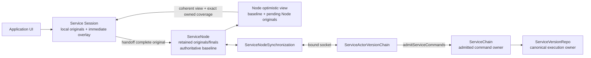
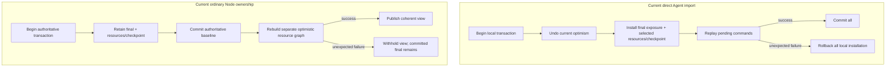
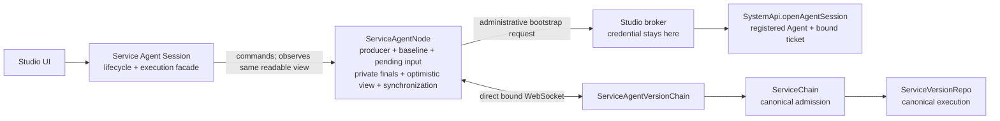

# Agent sessions, Nodes and command journals

**Historical research — superseded.** Agent browser Sessions now only observe
selected resources. Automatic execution belongs to System-registered scheduled
behavior. The source descriptions below record the earlier design; use
[Plan 249](../archive/plans/249-plan-aggregate-agent-backend-node.md) and the current
[Agent observation workflow](../architecture/browser/SessionWebSocket.md#public-agent-observation).

**Date:** 2026-10-18. **Status:** Source research and design recommendation; no implementation authorization implied. Examined the working tree based on `6debae86d5`, including the uncommitted Service Agent browser/Studio increment. Current source links below refer to that working tree. No runtime, build, lint, test, storage or application-startup verification was performed for this research.

## Finding

The concern is justified. Ordinary Aggregate and Service sessions now use an explicit Node owner: the Node retains local commands, synchronizes with the backend and builds the shared optimistic view. Agent sessions still use the earlier direct arrangement: the browser's replica, command journal and connection procedures together perform those responsibilities. The new Service Agent implementation mirrors that Aggregate Agent exception. It does **not** construct an `AgentNode`. This exception was explicitly preserved when Node ownership evolved; it is a historical scope decision, not proof that the exception remains the best design. [Node decision][adr-node], [Agent bootstrap][agent-bootstrap], [Agent connection][agent-connect].

The name `CommandJournal` is not evidence that retained command state is obsolete. An interrupted submission still needs its original command ID, payload and producer position so that a retry cannot accidentally become a new command. An admission receipt still differs from a final command exposure, and private completion still needs to survive the selected row disappearing. Those facts remain necessary under a Node design. What deserves reconsideration is **which component owns them**, how many copies of reconciliation exist, and whether a speculative replay failure should undo the local installation of an authoritative final. [Agent producer journal][agent-journal], [Agent submission allocation][agent-allocation], [Agent history and private recovery][agent-history], [current Node final retention][node-final].

**Recommended direction:** use explicit `AggregateAgentNode` and `ServiceAgentNode` owners for the main-thread, transient Agent runtime. Let each Agent Session be the lifecycle/execution/UI facade over its Node's readable optimistic view. Do not add an ordinary attached-session replica, SharedWorker, durable browser storage or actor identity to obtain that boundary. Preserve the distinction between an authoritative baseline and its fallible optimistic projection. The current replica, journal and connection cooperate over the same replica database; giving that subsystem a Node name would not itself remove complexity. The substantive change is separating baseline commitment from speculative projection and consolidating the duplicated family-specific direct reconciliation pipeline. One explicitly consolidated direct Agent Session owner remains defensible if the Node name adds no practical boundary. [Existing Node owner][node-owner], [derived projection][node-projection], [current direct import][agent-import], [actor-shaped Node identity][node-identity].

The Studio broker still has a separate purpose. It keeps Studio's administrative credential outside the browser bundle and exchanges that credential for a bound Agent bootstrap and socket ticket. Moving local command ownership into an AgentNode does not remove that credential boundary. [Studio broker request execution][broker-execute], [Studio Vite boundary][broker-vite].

## What “Node” and “Session” mean in current source

| Component                    | Actual ownership today                                                                                                                                                                                                                                          | What it does not establish                                                                      |
| ---------------------------- | --------------------------------------------------------------------------------------------------------------------------------------------------------------------------------------------------------------------------------------------------------------- | ----------------------------------------------------------------------------------------------- |
| Ordinary Service Session     | A transient per-session database, locally staged originals and immediate local optimism; installs its ServiceNode's coherent view and replays only its own originals not covered by that view.                                                                  | Local staging does not establish Node retention, ServiceChain admission or canonical execution. |
| `ServiceNode`                | Local original/final history, producer identity and admission progress, authoritative selected resources/checkpoint, one rebuildable optimistic view and attachment subscriptions.                                                                              | `accept` establishes local retention only. It does not create a canonical `outcome`.            |
| `ServiceNodeSynchronization` | Backend authentication, socket resume, sequential pushes, admission receipts, exposed-command delivery and exact replay-completion checking.                                                                                                                    | Socket admission is not execution completion.                                                   |
| Direct Service Agent runtime | `openServiceAgentReplica` owns the transient database/capability; `makeServiceAgentCommandJournal` owns submission/recovery operations; `connectServiceAgentSession` owns the socket pump; core Service Agent procedures own staging and direct reconciliation. | No `ServiceAgentNode` currently unifies those responsibilities.                                 |
| Studio broker                | Local HTTP bootstrap, administrative credential use, cancellation and telemetry.                                                                                                                                                                                | It owns no Agent SQLite database, command queue, optimistic replay or ongoing command socket.   |

Sources: [Session staging][session-stage], [Session view installation][session-install], [Node owner and retention][node-owner], [Node synchronization][node-sync], [sequential Node pushes][node-push], [Agent replica][agent-replica], [Agent journal][agent-journal], [Agent connection][agent-connect], [broker lifecycle][broker-lifecycle].

An ordinary browser Session has its own database because a Node can outlive or serve multiple attached sessions, and a Session can stage a local command before the Node's next coherent view reaches it. The local overlay is removed only when an installed view proves that the Node already covers that exact input. A bare retention reply supplies coordinates, not ownership of the optimistic view. The current Session installer therefore validates coverage, replaces resources and replays only uncovered local input. That handoff is meaningful for the ordinary architecture; it is not automatically needed for one main-thread Agent consumer reading its owner's view directly. [Session handoff][session-handoff], [Node coverage][node-coverage], [Session view installation][session-install], [uncovered replay][session-replay].

The first four links are implemented in [browser bootstrap][session-bootstrap], [Session handoff][session-handoff], [Node snapshot/coverage][node-coverage] and [Session view installation][session-install]. The backend links are implemented in [Service synchronization][node-sync], [socket admission][actor-admission], [ServiceChain admission][chain-admission] and [canonical execution resolution][execution-owner]. The diagram abbreviates backend publication/fanout; it does not imply that `ServiceVersionRepo` returns an execution result directly through the original push call.

### A Node does not inherently mean a SharedWorker or persistent browser storage

The core `ServiceNode` constructor receives a database, definition and optimistic-view capability. It does not construct a SharedWorker or open IndexedDB. Browser hosting supplies those choices. Native already constructs `AggregateNode` with a host SQLite database and a separate in-memory optimistic graph, then adds synchronization independently. A transient in-memory AgentNode host is therefore feasible as a design inference. It is not an already-supported Agent configuration of the current Node classes. [Node constructor][node-owner], [browser host][node-host], [Native host][native-host].

The existing `ServiceNode` is actor-shaped: its identity, command input, executable definition and authentication assume actor name/version, claims and an ordinary Service Session lock. `AggregateNode` also retains actor-shaped identity and authentication assumptions despite Aggregate locks admitting both actor and agent forms. Passing an Agent release to either existing Node unchanged is not supported by current source. This is why “just use ServiceNode” would lead back into an actor refactor unless the Agent boundary stays explicit. [Service identity/input][node-identity], [Node executable binding][node-execution], [Aggregate identity/authentication][aggregate-node-identity].

## What the new Agent files actually do

The screenshot contains sixteen new core TypeScript modules and a README. They are not sixteen independent features. They implement approximately five responsibilities, and the file-per-helper decomposition is an implementation choice. The following inventory covers those modules without treating every filename as a required architectural boundary. [Current Service Agent schema][agent-schema], [staging][agent-stage], [evaluation][agent-evaluate], [snapshot installation][agent-snapshot], [import][agent-import].

| Responsibility             | Files from the screenshot                                                                                                                                              | Necessary behavior versus incidental packaging                                                                                                                                                                                                       |
| -------------------------- | ---------------------------------------------------------------------------------------------------------------------------------------------------------------------- | ---------------------------------------------------------------------------------------------------------------------------------------------------------------------------------------------------------------------------------------------------- |
| Public command interface   | `stageServiceAgentCommand`, `validateServiceAgentCommand`, `types`                                                                                                     | Exact Service Agent contract typing, readiness and execution requirements matter. Separate stage and validation APIs follow the explicit-domain rule; a module for each small wrapper is not a protocol requirement.                                 |
| Bound execution capability | `makeInitializedServiceAgentSession`                                                                                                                                   | Checks exact Agent origin and checkpoint before making a writable capability. It is a capability constructor, not a new data owner.                                                                                                                  |
| Local storage/checkpoints  | `serviceAgentSessionRepoDbConfig`, `ServiceAgentSessionSnapshotSchema`, `readServiceAgentSessionMetadataTx`, `allocateServiceAgentSessionIndexTx`                      | The schema distinguishes pending input, selected final exposure, local order and authoritative progress. Exact singleton reads and transactional allocation matter; four source files are not inherently required.                                   |
| Local evaluation           | `evaluateServiceAgentCommandTx`, `stageServiceAgentCommandTx`, `validateServiceAgentCommandTx`                                                                         | Evaluates the exact ordinary claims-free contract, applies optimism and retains pending input transactionally; validation rehearses then rolls back. Optimism is a product choice, while correct atomic staging is required if optimism is retained. |
| Reconciliation             | `applyServiceAgentSessionSnapshot`, `importServiceAgentCommands`, `retainServiceAgentCommandTx`, `rewindServiceAgentOptimismTx`, `replayPendingServiceAgentCommandsTx` | Installs selected resources/final exposure, removes previous optimism and replays surviving pending commands. These are the earlier direct-Agent algorithm; a Node owner can change that algorithm and consolidate its orchestration.                |

Sources: [public stage][agent-stage], [public validation][agent-validate], [capability][agent-capability], [schema][agent-schema], [evaluation][agent-evaluate], [stage transaction][agent-stage-tx], [validation transaction][agent-validate-tx], [snapshot][agent-snapshot], [import][agent-import], [retention][agent-retain], [rewind][agent-rewind], [replay][agent-replay].

There is another layer outside the screenshot. The browser runtime opens SQLite, constructs the journal and runs a scoped connection pump. The journal selects pending commands, allocates/reuses `pushIndex`, serializes exact bound input, advances admission progress, handles pre-admission refusal and derives the contiguous private completion prefix. The connection owns bootstrap, socket listeners, timers, serialized events, replay readiness and lifetime fencing. These procedures cooperate over the same replica database, with additional transient connection/admission state. Together they perform a local producer and synchronization subsystem's work without an explicit AgentNode boundary. Ordinary Nodes likewise separate the Node class, synchronization and projection procedures; collapsing filenames or classes would not eliminate those responsibilities. [Browser bootstrap][agent-bootstrap], [replica][agent-replica], [journal][agent-journal], [connection][agent-connect], [Node synchronization][node-sync], [Node projection][node-projection].

The duplication is visible without guessing intent: `makeAggregateAgentCommandJournal` and `makeServiceAgentCommandJournal` contain corresponding pending queries, admission-prefix retention, private completion-prefix derivation, next submission, page import, acknowledgement and refusal branches. The connection and replica modules repeat the same general lifecycle with family-specific identity, index, protocol and command types. Copying was a direct way to obey “mirror Aggregate agents”; it also duplicated the older direct exception instead of reconsidering its ownership. This is maintenance duplication, not evidence that any one retry/equality/privacy check is unnecessary. [Aggregate journal][aggregate-journal], [Service journal][agent-journal], [Aggregate connection][aggregate-agent-connect], [Service connection][agent-connect].

The earlier restart review called a transient browser journal necessary. That conclusion was too specific: the pending-input, retry, reconciliation and private-completion duties are necessary for the stated behavior; their exact `CommandJournal` API, module arrangement and ownership were not established by that argument. This note narrows that conclusion without rewriting the historical report. [Earlier restart review][restart-review], [current producer requirements][agent-journal].

There is some meaningful shared machinery already: Service Agent replay calls `replayOptimisticCommandTx`; evaluation uses `evaluateSynchronousSavepoint` and `applyOptimisticOperationsTx`. The current ordinary `replayServiceCommandTx` is actor-definition-shaped and has overloaded signatures. Reusing it wholesale would conflict with the requested explicit Service Agent boundary; sharing its narrow checked-operation machinery does not require that widening. [Agent replay][agent-replay], [Agent evaluation][agent-evaluate], [ordinary Service replay][ordinary-service-replay], [generic replay][checked-replay].

## The substantive difference: baseline commit versus speculative replay

This is the strongest reason to reopen the design. It is more consequential than the number of files.

`ServiceNode.receiveCommand` commits final retention, selected resource changes and authoritative progress in its owning transaction, then publishes. Its derived optimistic graph is reconstructed afterwards. A reconstruction defect withholds that derived view but does not roll back the already committed authoritative final. [Node final retention][node-final], [Node projection][node-projection], [optimistic graph construction][optimistic-view].

The new direct Service Agent import does something different: it rewinds, retains incoming exposure and replays pending input **inside the same transaction**. Snapshot installation similarly replaces resources/checkpoint, merges private finals and replays before committing. An unexpected replay failure therefore rolls back the local authoritative installation as well. This does not remove the backend's retained history or canonical `outcome`, but it couples local authoritative progress to a speculative local program succeeding. Expected contract refusals are handled as inactive optimism; this concern is about unexpected failures/defects. [Agent import transaction][agent-import], [Agent snapshot transaction][agent-snapshot], [Agent replay][agent-replay], [transaction rollback][transaction-rollback], [checked replay failure classification][checked-replay].

Sources: [Agent import][agent-import], [Agent snapshot][agent-snapshot], [Node final retention][node-final], [Node projection][node-projection]. This diagram describes source sequencing, not an exercised failure test.

Adopting an AgentNode should carry over this ownership invariant. Letting the Session read the Node's view avoids an extra **Session replica**. It does not necessarily eliminate a separate local authoritative baseline and derived optimistic database: that separation is what lets authoritative commitment survive failed speculative reconstruction. “One Node owner” and “one physical SQLite database” are different decisions. [Node optimistic graph][optimistic-view], [Node final commit][node-final].

## Which facts survive any simplification

| Fact                                                                | Why the distinction remains necessary                                                                                          |
| ------------------------------------------------------------------- | ------------------------------------------------------------------------------------------------------------------------------ |
| Canonical command `id` plus immutable submitted input               | An uncertain transmission must retry the same command, not create another command or change its meaning.                       |
| `pushIndex`                                                         | Orders this producer's originating submissions. Reusing an uncertain assignment differs from allocating a new submission.      |
| `admittedThroughPushIndex`                                          | Records canonical admission acknowledgement; it does not establish execution or a final exposure.                              |
| Contiguous private completion prefix (`outcomeIndex` on the socket) | Resume must not skip an unresolved originating command simply because a later one is known.                                    |
| `serviceIndex` and `dispositionChainHash`                           | Identify the selected authoritative Service history beneath optimism; they are not the producer sequence.                      |
| Private final correlation after selection removal                   | A command can remove the row the UI selected. Its originating command status must remain observable independently of that row. |
| Lifetime/readiness fences                                           | Disposed or superseded socket attempts must not stage, mutate or publish a writable capability.                                |

Sources: [Agent allocation][agent-allocation], [Agent journal][agent-journal], [Node indexes/private completion][node-indexes], [socket completion checks][agent-connect], [Agent private recovery][agent-history], [Agent replica lifetime][agent-replica], [Agent execution fencing][agent-command-execution].

The socket's exposed command is not the full canonical `outcome`. `IServiceExposedCommand` contains a browser command with selected delta/private nullable failure plus `serviceIndex` and `dispositionChainHash`. The canonical `outcome` is `{ result: Success | Failure, finalizedAt }`. A local staging result is neither. Names such as “journal outcome” or a UI “Confirmed” label must not collapse those different facts. [Browser exposure][browser-exposure], [canonical outcome schema][canonical-outcome], [current Studio status mapping][studio-status].

Not everything in ordinary Nodes is required for transient Agents. Two immutable physical original/final rows, a Node append `nodeIndex`, multi-attachment coverage/handoff, durable restart recovery, SharedWorker discovery, executable-worker artifact fencing and Native hosting each address additional requirements in ordinary Nodes. One-consumer Agent correctness does not by itself require copying those representations or hosts. A one-row local command representation can retain immutable input and final evidence if its retry/equality/progress rules remain complete; that is a design possibility, not a verified replacement schema. [Ordinary Node schema][node-schema], [coverage/handoff][node-coverage], [browser host][node-host], [Native host][native-host], [current direct Agent schema][agent-schema].

## Proposed direction, without another actor refactor

1. **Make the local owner explicit.** An `AggregateAgentNode` or `ServiceAgentNode` owns its producer, baseline, pending inputs, private final evidence, derived optimism and backend synchronization. The Agent Session owns initialization/disposal, application Effect execution and the UI-facing store. The Node subsystem can still use focused synchronization and projection procedures. Its value must come from clear baseline/projection ownership and consolidated reconciliation, not the Node name or fewer classes. This recommendation follows the separation implemented in current Node source, while avoiding the unnecessary attached-session handoff for a lifetime-local reader. [Node ownership][node-owner], [current Agent split][agent-bootstrap], [Session handoff][session-handoff].
2. **Keep public families explicit.** Keep `makeAggregateAgentRelease`, `makeServiceAgentRelease`, their contract APIs, session APIs and proposed Node APIs separate. Factor family-neutral transaction, resource-codec, socket-attempt and checked replay procedures only where their inputs already describe the full responsibility. Do not make ordinary actor identity nullable, add agent branches to actor constructors or extend overloaded APIs to obtain reuse. The existing Service and Aggregate Nodes cannot host Agents unchanged. [Explicit-domain pattern][explicit-methods], [actor-shaped identity][node-identity], [Aggregate actor assumptions][aggregate-node-identity], [checked replay][checked-replay].
3. **Separate baseline commitment from speculative reconstruction.** Reuse `makeNodeOptimisticView`'s model-only graph/replay seam or an equivalent focused owner; keep private final evidence independent of selection membership. Do not copy ordinary two-phase history merely to reuse table-specific Node helpers. [Optimistic graph seam][optimistic-view], [Node final commit][node-final], [private history][agent-history].
4. **Keep the transient host simple.** Main thread, memory SQLite, one mounted owner, one readable Node view. Do not introduce a Worker registry, backup, multi-consumer protocol or persistent recovery guarantee without a real caller needing it. A Node is a responsibility boundary; those are hosting/product choices. [Injected Node dependencies][node-owner], [Native separation][native-host], [current transient Agent lifetime][agent-replica].
5. **Retain Studio's administrative bootstrap boundary.** The broker asks `SystemApi.openAgentSession` for an exact registered Agent. The backend resolves Service identity and issues the bound single-use ticket. The browser/AgentNode then uses the bound socket directly. This remains independent of local SQLite ownership. [Broker execution][broker-execute], [Agent registration resolution][agent-resolution], [SystemApi session opening][agent-open], [socket forwarding][socket-forwarding].

This last diagram is a **proposal**. The backend Agent admission/execution responsibilities already exist; `ServiceAgentNode` does not. It preserves the current Agent authority boundary instead of impersonating an actor. [Current Agent socket admission][agent-admission], [canonical execution][execution-owner].

### Decisions to settle before implementing that change

- **Optimistic Agents or authoritative-only Agents?** Current staging evaluates contracts locally and changes the selected graph immediately. If administrative Agents need only submit and observe authoritative results, removing local evaluation/optimism would remove inverses and speculative replay, but it would change the current staging behavior and still leave submission/private-resolution tracking. Choose that product behavior explicitly before deriving the machinery. [Current staging behavior][agent-evaluate], [retained submission responsibility][agent-journal].
- **What is an Agent lifetime?** Current SQLite/producer identity survives allowed connection retries but closes at disposal; reconnect is not restart recovery. A proposed transient AgentNode should retain that promise unless a new requirement changes it. [Replica lifetime][agent-replica], [connection retry policy][agent-connect].
- **How much local history is actually needed?** Immutable full input/final equality, private recovery and Studio command status require evidence. They do not automatically require ordinary Node's two-row append history or long-lived audit UI. Establish retention needs before choosing the local table representation. [Node retry/final rules][node-original], [current Agent final evidence][agent-retain], [Studio command reader][studio-agent-preview].

These are design choices for a subsequent conversation. This research neither removes the current implementation nor declares a new AgentNode design complete. Existing deferred Node verification remains deferred; the current ADR expressly records that limitation. [ADR verification status][adr-node].

## Studio broker: what still stands to reason

`executeStudioRequest` gets authenticated `SystemApi` using `zerospinSecretKey` in Studio's local HTTP process. Its Agent branch returns the snapshot, private exposed commands and ticket-bearing WebSocket URL. Vite's browser defines contain the public System specification and trace template; Vite installs the local broker middleware. `openStudioServer` owns that process/lifecycle. The broker does not forward every command over HTTP and does not act as another replica. [Broker request execution][broker-execute], [Vite setup][broker-vite], [Studio startup ownership][studio-server], [broker lifecycle][broker-lifecycle].

This reduces credential exposure to the browser but is not a claim that Studio has a narrowly scoped server credential: the broker authenticates with the full administrative `SystemApi` credential. The backend's bound ticket/session supplies the Agent-specific connection authority. The broker's HTTP request/cancellation/telemetry implementation can be assessed separately; removing it would require another trusted administrative credential holder, not an AgentNode rename. [Broker administrative call][broker-execute], [bound ticket issuance][agent-open], [ticket-based socket routing][socket-forwarding].

## Primary sources

[adr-node]: ../adrs/003-immutable-node-command-history-and-submission-order.md#L14-L40
[explicit-methods]: ../patterns/typescript/explicit-domain-methods-no-overloads.ts#L8-L17
[node-owner]: ../../packages/core/src/ServiceNode/ServiceNode.ts#L110-L259
[node-coverage]: ../../packages/core/src/ServiceNode/ServiceNode.ts#L262-L403
[node-projection]: ../../packages/core/src/ServiceNode/ServiceNode.ts#L406-L455
[node-final]: ../../packages/core/src/ServiceNode/ServiceNode.ts#L594-L655
[node-schema]: ../../packages/core/src/ServiceNode/serviceNodeTables.ts#L14-L47
[node-identity]: ../../packages/core/src/ServiceNode/types.ts#L14-L29
[node-original]: ../../packages/core/src/ServiceNode/acceptServiceOriginalTx.ts#L26-L108
[node-indexes]: ../../packages/core/src/ServiceNode/readServiceNodeOutcomeIndex.ts#L8-L26
[optimistic-view]: ../../packages/core/src/Node/makeNodeOptimisticView.ts#L20-L57
[checked-replay]: ../../packages/core/src/sessionExecution/replayOptimisticCommandTx.ts#L12-L75
[node-execution]: ../../packages/browser/src/Node/nodeExecution.ts#L109-L143
[aggregate-node-identity]: ../../packages/browser/src/AggregateNode/aggregateNodeNetwork.ts#L29-L39
[node-host]: ../../packages/browser/src/ServiceNode/makeServiceSharedWorker.ts#L12-L31
[native-host]: ../../packages/native/src/openAggregateNativeNodeOwner.ts#L34-L117
[session-bootstrap]: ../../packages/browser/src/bootstrapServiceSession.ts#L87-L261
[session-handoff]: ../../packages/browser/src/sessionReplica/bindServiceReplicaCommands.ts#L45-L84
[session-stage]: ../../packages/core/src/serviceSession/stageServiceSessionCommandTx.ts#L18-L75
[session-install]: ../../packages/core/src/serviceSession/installServiceNodeView.ts#L50-L198
[session-replay]: ../../packages/core/src/serviceSession/replayLocalServiceCommandsTx.ts#L37-L79
[node-sync]: ../../packages/browser/src/ServiceNode/ServiceNodeSynchronization.ts#L247-L536
[node-push]: ../../packages/browser/src/ServiceNode/ServiceNodeSynchronization.ts#L597-L662
[actor-admission]: ../../packages/system-worker/src/ServiceActorVersionChain/onMessage/admitServiceSocketCommand.ts#L40-L81
[chain-admission]: ../../packages/system-worker/src/ServiceChain/admitServiceCommands/admitServiceCommandsTx.ts#L17-L51
[execution-owner]: ../../packages/system-worker/src/ServiceVersionRepo/utils/resolveServiceExecution.ts#L32-L92
[agent-bootstrap]: ../../packages/browser/src/bootstrapServiceAgentSession.ts#L11-L24
[agent-replica]: ../../packages/browser/src/serviceAgentSession/openServiceAgentReplica.ts#L28-L230
[agent-journal]: ../../packages/browser/src/serviceAgentSession/makeServiceAgentCommandJournal.ts#L18-L221
[agent-connect]: ../../packages/browser/src/serviceAgentSession/connectServiceAgentSession.ts#L23-L376
[agent-allocation]: ../../packages/browser/src/serviceAgentSession/nextServiceAgentSubmissionTx.ts#L8-L60
[agent-command-execution]: ../../packages/browser/src/serviceAgentSession/makeServiceAgentCommandExecution.ts#L10-L49
[aggregate-journal]: ../../packages/browser/src/agentSession/makeAggregateAgentCommandJournal.ts#L19-L217
[aggregate-agent-connect]: ../../packages/browser/src/agentSession/connectAgentSession.ts#L18-L372
[agent-schema]: ../../packages/core/src/serviceAgentSession/serviceAgentSessionRepoDbConfig.ts#L9-L53
[agent-stage]: ../../packages/core/src/serviceAgentSession/stageServiceAgentCommand.ts#L12-L55
[agent-validate]: ../../packages/core/src/serviceAgentSession/validateServiceAgentCommand.ts#L12-L51
[agent-capability]: ../../packages/core/src/serviceAgentSession/makeInitializedServiceAgentSession.ts#L24-L60
[agent-evaluate]: ../../packages/core/src/serviceAgentSession/evaluateServiceAgentCommandTx.ts#L22-L109
[agent-stage-tx]: ../../packages/core/src/serviceAgentSession/stageServiceAgentCommandTx.ts#L13-L60
[agent-validate-tx]: ../../packages/core/src/serviceAgentSession/validateServiceAgentCommandTx.ts#L12-L36
[agent-snapshot]: ../../packages/core/src/serviceAgentSession/applyServiceAgentSessionSnapshot.ts#L29-L176
[agent-import]: ../../packages/core/src/serviceAgentSession/importServiceAgentCommands.ts#L19-L48
[agent-retain]: ../../packages/core/src/serviceAgentSession/retainServiceAgentCommandTx.ts#L19-L136
[agent-rewind]: ../../packages/core/src/serviceAgentSession/rewindServiceAgentOptimismTx.ts#L13-L48
[agent-replay]: ../../packages/core/src/serviceAgentSession/replayPendingServiceAgentCommandsTx.ts#L16-L79
[ordinary-service-replay]: ../../packages/core/src/sessionExecution/replayServiceCommandTx.ts#L15-L75
[transaction-rollback]: ../../packages/core/src/drizzle/make/makeTx.ts#L71-L120
[browser-exposure]: ../../packages/core/src/contracts/BrowserCommandSchema.ts#L7-L12
[canonical-outcome]: ../../packages/core/src/contracts/CommandOutcomeSchema.ts#L4-L18
[agent-history]: ../../packages/system-worker/src/ServiceAgentVersionChain/readServiceAgentHistory.ts#L22-L231
[agent-admission]: ../../packages/system-worker/src/ServiceAgentVersionChain/admitServiceAgentSocketCommand.ts#L41-L81
[broker-execute]: ../../packages/studio/src/server/executeStudioRequest.ts#L16-L51
[broker-vite]: ../../packages/studio/src/server/makeStudioViteConfig.ts#L27-L57
[broker-lifecycle]: ../../packages/studio/src/server/makeStudioBroker.ts#L11-L146
[studio-server]: ../../packages/studio/src/server/openStudioServer.ts#L18-L34
[agent-resolution]: ../../packages/system-worker/src/SystemApi/openAgentSession/resolveRegisteredServiceAgentSelection.ts#L8-L54
[agent-open]: ../../packages/system-worker/src/SystemApi/openAgentSession/openAgentSession.ts#L18-L121
[socket-forwarding]: ../../packages/system-worker/src/SystemRepo/handleFetch/forwardSessionSocket.ts#L27-L77
[studio-agent-preview]: ../../packages/studio/src/ServiceAgentPreview.tsx#L85-L114
[studio-status]: ../../packages/studio/src/AgentSelectionBrowser.tsx#L207-L217
[restart-review]: ./service-agent-restart-review.md#L40-L48
