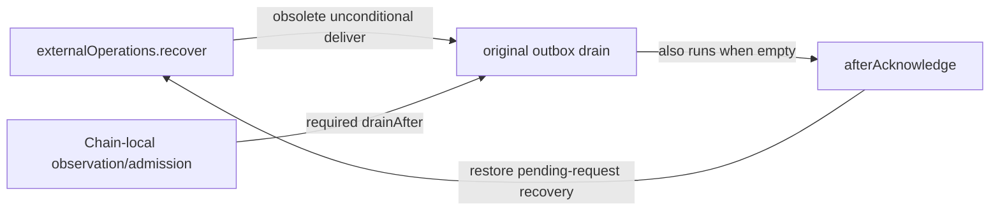

# Chain external recovery and delivery ownership

**Current-source update, 2026-10-23:** The dated research below retains earlier
representations and verification lanes. Both admission Chains now retain first
`commands.outcome` with six-field pending requests; ServiceChain has no
`originalExecutions`. ServiceVersionRepo publishes a complete
`IEvaluatedServiceCommand` through ServiceVersionChain. [Plan 214](../archive/plans/214-plan-service-ordered-operations-and-finalized-at.md)
and [Plan 256](../archive/plans/256-plan-service-evaluated-commands.md) supersede
the older output/time descriptions. [Plan 196](../archive/plans/196-plan-service-chain-original-operations-and-external-work.md#current-agreed-design)
records the connected Service recovery proof; [Plan 257](../archive/plans/257-plan-direct-system-worker-verifications.md)
retires the old acceptance runners. Historical source names and runtime counts
below describe their dated snapshots, not current acceptance requirements.

**Interface update, 2026-10-18:** The source descriptions below record the earlier
`drainAfter` interface. Both queues now expose `producerLease` for durable
pre-production recovery and producer bookkeeping, with explicit caller `wake()`
after production. Lease release performs no scheduling. Awaited `drain()` retains
its acknowledgement contract. See the [implemented replacement](drain-after-explicit-queue-progress.md#implemented-replacement).

**Date:** 2026-10-15

**Scope:** Source review of AggregateChain, ServiceChain, their original-delivery queues, external request settlement and alarm recovery after Plans 195/196, including the concurrently approved Aggregate-only outcome-retention simplification. Official Cloudflare documentation was checked on the same date. This note distinguishes static findings from the implementation chat's runtime observations; it does not verify real providers, process termination or deployed storage.

**Finding:** The shared external runtime retained a delivery callback from the former VersionRepo-to-Chain observation protocol. Its current callers drain the very original-delivery queues whose completion hooks invoke external recovery. Unconditional delivery during recovery therefore creates a cycle even when there are no commands or external requests. The implementation now removes that callback and the redundant pre-subscriber external alarm API, and replaces unused Promise-valued reservation storage with a Set. Atomic Chain-local observation/admission, the original queue's recovery handoff and private pending-request alarm reconciliation remain. Final verification against the settled source passes all 27 existing Workerd tests, both native acceptance scripts and the scoped backend quality graphs. The final evidence below supersedes the earlier partial and pre-simplification runs.

## Which architecture governs

| Document                                                                                                                                                                                                                                                                                                                  | Relevant responsibility at that time                                                                                                                                                                                                                                                                                                                                                                                                | Current interpretation                                                                                                                                                                                                                                             |
| ------------------------------------------------------------------------------------------------------------------------------------------------------------------------------------------------------------------------------------------------------------------------------------------------------------------------- | ----------------------------------------------------------------------------------------------------------------------------------------------------------------------------------------------------------------------------------------------------------------------------------------------------------------------------------------------------------------------------------------------------------------------------------- | ------------------------------------------------------------------------------------------------------------------------------------------------------------------------------------------------------------------------------------------------------------------ |
| [Plan 150, locked decisions 2–10](../archive/plans/150-plan-opaque-external-work.md#locked-decisions)                                                                                                                                                                                                                     | Original AggregateVersionRepo/ServiceVersionRepo owned requests. Recorded responses crossed into the originating admission Chain; request recovery and recorded-command delivery needed independent progress. Terminal request failure initially created no continuation.                                                                                                                                                           | Historical ownership. Payload-only requests, exact declaration identity, author-owned retries, version pinning, first observation and remote uncertainty remain; later outcome/ownership decisions replace the transfer protocol and no-continuation failure rule. |
| [Plan 189, execution contract](../archive/plans/189-plan-aggregate-command-execution-resolution.md#scope-limits-and-transaction-invariants)                                                                                                                                                                               | Receiving AggregateVersionRepo resolved declarations for synchronous original/replay execution while preserving original-only external production.                                                                                                                                                                                                                                                                                  | Keep synchronous evaluation and release-local replay. This plan does not require today's request runner to drain admitted commands.                                                                                                                                |
| [Plan 190, topology](../archive/plans/190-plan-aggregate-delivery-history-and-projection-ownership.md#4-locked-topology)                                                                                                                                                                                                  | AggregateVersionRepo transferred `externalOperationOutbox` to complete `externalCommandOutbox`, then called AggregateChain admission. Complete independent publication/fanout messages moved history out of resource Repos.                                                                                                                                                                                                         | The former two-stage observed-command delivery had a real separate message and acknowledgement. Plans 195/196 remove that message by colocating observation and admission. Resource/history separation and complete publications still govern.                     |
| [Plan 193, AggregateChain completion](../archive/plans/193-plan-synchronous-original-finalization.md#4-aggregatechain-completion-order-and-recovery)                                                                                                                                                                      | The original RPC returned its outcome. An original queue completion hook transferred durable recovery to replay, including after an empty restarted drain. External requests still belonged to AggregateVersionRepo.                                                                                                                                                                                                                | Preserve the empty-queue completion hook. It closes a crash window independently of the deleted external delivery callback.                                                                                                                                        |
| [Plan 195](../archive/plans/195-plan-aggregate-chain-original-operations-and-external-work.md#1-agreed-ownership), [Plan 196](../archive/plans/196-plan-service-chain-original-operations-and-external-work.md#current-agreed-design), [ADR 016](../adrs/016-aggregate-original-operations-and-external-work.md#decision) | AggregateChain retains admitted input plus its original `commands.commandOutcome` and pending requests. ServiceChain retains admitted input, complete `originalExecutions` and pending requests. Each Chain executes its family's requests. Each VersionRepo commits resources, its checkpoint and one complete VersionChain publication. Observation, external-command admission and request deletion share one local transaction. | Current governing architecture. No observed-command outbox, FIFO allocator, remote source proof, reverse original-output confirmation or request execution in VersionRepos remains necessary.                                                                      |

The callback's historical necessity follows from a **cross-owner message**: a VersionRepo could have no request left but still have an observed command awaiting Chain admission. In the current architecture, deletion of a pending request and insertion into Chain `commands` are the same transaction. There is no intermediate observed message for the external runtime to deliver. [Old topology, lines 81–83](../archive/plans/190-plan-aggregate-delivery-history-and-projection-ownership.md#L81-L83), [Aggregate transaction, lines 22–65](../../packages/system-worker/src/AggregateChain/recordExternalOutcomeAndAdmitCommandTx.ts#L22-L65), [Service transaction, lines 22–64](../../packages/system-worker/src/ServiceChain/recordExternalOutcomeAndAdmitCommandTx.ts#L22-L64).

## Current durable facts and their owners

| Durable fact                                                                                  | Owner and transaction                                                                        | What the fact proves                                                                                                                                                                                                                                                                               |
| --------------------------------------------------------------------------------------------- | -------------------------------------------------------------------------------------------- | -------------------------------------------------------------------------------------------------------------------------------------------------------------------------------------------------------------------------------------------------------------------------------------------------- |
| Admitted command with assigned `aggregateIndex`/`serviceIndex`                                | AggregateChain/ServiceChain `commands`                                                       | Immutable admitted input and its order. AggregateChain additionally stores nullable `commands.commandOutcome`; ServiceChain joins its outcome from `originalExecutions`. The presence of admitted input alone proves neither VersionRepo execution commit nor Chain retention of `commandOutcome`. |
| Resource changes/refusal, local checkpoint and complete pending publication                   | AggregateVersionRepo/ServiceVersionRepo `materializeCommandTx`                               | Execution committed for that receiving release. The complete packet includes `commandOutcome`, timestamps, model operations and frozen external operations. It can return before VersionChain publication or the admission Chain's separate original `commandOutcome` retention.                   |
| Original `commandOutcome`; pending external requests                                          | AggregateChain `acknowledgeOriginalFinalization`, one transaction                            | The bound complete AVR reply was validated; AggregateChain retains only its exact outcome on `commands` and the complete pending request rows. It does not retain original packet history. A repeat compares exact `commandOutcome` and returns before pending insertion.                          |
| Complete original output; pending external requests                                           | ServiceChain `acknowledgeCommand`, one transaction                                           | The bound complete ServiceVersionRepo reply is retained in `originalExecutions` along with the pending requests. A repeat compares the complete packet and returns before pending insertion. In both families, request invocation follows the first receipt transaction.                           |
| First `externalOutcome` in a newly admitted external command; original pending request absent | The containing Chain's `recordExternalOutcomeAndAdmitCommandTx`, one synchronous transaction | One observation was recorded and its external command admitted at the next local position. It does not prove that command's synchronous continuation has executed.                                                                                                                                 |
| Immutable release-local execution history and complete pending projection fanout              | AggregateVersionChain/ServiceVersionChain append transaction                                 | Publication durably committed for that release. Pending sender publication may then be deleted; history persists. Projection delivery has its own acknowledgement.                                                                                                                                 |

Sources: [AggregateChain schema, lines 10–62](../../packages/system-worker/src/AggregateChain/aggregateChainDbConfig.ts#L10-L62), [ServiceChain schema, lines 13–69](../../packages/system-worker/src/ServiceChain/serviceChainDbConfig.ts#L13-L69), [Aggregate materialization, lines 33–49](../../packages/system-worker/src/AggregateVersionRepo/materializeCommandTx.ts), [Aggregate retention, lines 22–62](../../packages/system-worker/src/AggregateVersionRepo/utils/retainEvaluatedCommandTx.ts), [Service materialization, lines 28–44](../../packages/system-worker/src/ServiceVersionRepo/materializeCommandTx.ts#L28-L44), [Current Service retention](../../packages/system-worker/src/ServiceVersionRepo/utils/retainEvaluatedCommandTx.ts#L16-L39), [Aggregate acknowledgement, lines 52–121](../../packages/system-worker/src/AggregateChain/recordOriginalCommandOutcomeTx.ts), [Current Service receipt](../../packages/system-worker/src/ServiceChain/recordOriginalCommandOutcomeTx.ts#L49-L140), [AVC append, lines 158–171](../../packages/system-worker/src/AggregateVersionChain/appendEvaluatedCommandsTx.ts).

The current local resource progress is `materializationHead(singletonId, aggregateIndex, dispositionChainHash)` for AggregateVersionRepo and Aggregate actor/agent projection Repos, and `materializationHead(singletonId, serviceIndex, dispositionChainHash)` for ServiceVersionRepo and ServiceActorVersionRepo. No head retains commandId. Archived Plan 197 records the earlier Aggregate checkpoint/hash snapshot; the subsequent naming cutover has separate implementation and verification tracked in its implementation chat. `dispositionChainHash` commits the previous hash, command position/ID and the Success/Failure tag. It cannot establish full-output equality. ServiceChain original acknowledgement and AVC/SVC history append preserve complete packet equality. AggregateChain intentionally compares only exact `commandOutcome`, including `recordedAt`, before its idempotent return; changed repeated operation bodies, execution-start time or hash are outside that retained fact. This Aggregate-only change leaves the recovery-cycle correction unchanged. [Aggregate checkpoint write, lines 48–61](../../packages/system-worker/src/AggregateVersionRepo/utils/retainEvaluatedCommandTx.ts), [Current Service checkpoint write](../../packages/system-worker/src/ServiceVersionRepo/utils/retainEvaluatedCommandTx.ts#L27-L38), [ADR 016](../adrs/016-aggregate-original-operations-and-external-work.md#decision).

```mermaid
sequenceDiagram
    participant AC as AggregateChain
    participant AVR as AggregateVersionRepo
    participant AVC as AggregateVersionChain
    participant Request as Authored external.request
    AC->>AVR: finalize admitted original N
    Note over AVR: One transaction: resources/refusal + checkpoint + complete AVC publication
    AVR-->>AC: Complete original packet
    Note over AC: One transaction: commands.commandOutcome + pending external requests
    AC->>AC: afterAcknowledge establishes replay and request recovery
    par Independent request execution
        AC->>Request: Frozen payload, outside SQL/execution permit
        Request-->>AC: Usable response or terminal request Failure
        AC->>AC: Original queue drainAfter arms recovery
        Note over AC: One transaction: re-read request + admit external command + delete request
        AC->>AVR: Later finalize admitted external command
    and Independent history publication
        AVR->>AVC: Complete publication packet
        Note over AVC: One transaction: immutable history + complete fanout packets
        AVC-->>AVR: Durable publication acknowledgement
        Note over AVR: Delete pending publication; keep checkpoint/resources
    end
```

ServiceChain/ServiceVersionRepo/ServiceVersionChain use the corresponding Service methods and `serviceIndex`; no Aggregate-specific Origin variant is added to Service. Full publications retain both arrays, while request execution belongs only to admission Chains. [ADR 016](../adrs/016-aggregate-original-operations-and-external-work.md#decision), [ServiceChain request recording](../../packages/system-worker/src/ServiceChain/recordExternalOutcomeAndAdmitCommandTx.ts#L33-L64).

## The observed activation failure and the source-proven cycle

The implementation chat observed three existing Workerd integration tests time out at 45 seconds. A bounded diagnostic found name resolution, System acceptance and `SystemLog.ready` progressing while `AggregateChain.ready` did not return. Those are runtime observations reported by the implementation chat, not a new test executed for this note. They locate a failure near AggregateChain activation but do not individually prove every timeout has the same cause.

The inspected pre-repair source supplies a concrete recurrence:

```text
AggregateChain.onDOActivation
  -> externalOperations.recover
  -> background run(deliver())                // unconditional, even for zero rows
  -> finalizeCommandOutbox.drain
  -> empty queue: afterAcknowledge
  -> externalOperations.recover
  -> background run(deliver())
  -> ...
```

ServiceChain has the same recurrence through `executeCommandOutbox`. The pre-repair shared runtime also awaited `deliver()` after `record`; each Chain's `record` already used that queue's `drainAfter`, which independently arms and starts its drain. Both calls are stale responsibilities of the external request runtime. Removing only the empty-drain hook would hide this cycle by breaking Plan 193's required crash recovery. [current Aggregate wiring, lines 178–232](../../packages/system-worker/src/AggregateChain/AggregateChain.ts#L178-L232), [current Service wiring, lines 165–216](../../packages/system-worker/src/ServiceChain/ServiceChain.ts#L165-L216), [Current request runtime](../../packages/system-worker/src/externalOperations/makeExternalOperationQueue.ts#L95-L149), [queue producer and completion handling, lines 267–341](../../packages/system-worker/src/makeOutboxQueue/makeOutboxQueue.ts#L267-L341).



This is a recurring local scheduling cycle, not evidence that a provider is slow or that a retry deadline is too small. It exists without a provider invocation. Constructor startup awaits `onDOActivation` under `blockConcurrencyWhile`; incoming `ready` cannot run until that startup gate opens. The passing post-removal full Workerd run supplies the contained runtime comparison: the activation/restart tests complete after the cycle is removed. That result does not turn every earlier failure into the same scheduler diagnosis; the telemetry assertion and Shopping fault-injection cleanup were separate corrections. [Constructor gate, lines 281–330](../../packages/system-worker/src/makeMigratableDORepo/makeMigratableDORepo.ts#L281-L330), [Current ready and alarm dispatch](../../packages/system-worker/src/makeMigratableDORepo/makeMigratableDORepo.ts#L319-L335).

## Why each remaining recovery boundary exists

1. **`makeOutboxQueue.drainAfter` must surround external observation/admission.** It holds the original queue's alarm before producing a new admitted command and starts delivery on every producer outcome. Admission rollback leaves no command; successful admission survives process loss before the immediate drain. Its active-producer count and revision prevent an older empty drain from releasing a newer producer's wake. [Queue producer, lines 267–304](../../packages/system-worker/src/makeOutboxQueue/makeOutboxQueue.ts#L267-L304), [release check, lines 327–340](../../packages/system-worker/src/makeOutboxQueue/makeOutboxQueue.ts#L327-L340).
2. **`afterAcknowledge` must recover even when the queue is empty.** A prior run can retain AggregateChain.commands.commandOutcome or ServiceChain.originalExecutions and then stop before establishing replay/request recovery. The queue holds its alarm before delivery, runs the completion hook before releasing it, and leaves the alarm held if the hook fails. Removing empty-queue recovery loses this exact handoff. [Queue drain, lines 327–341](../../packages/system-worker/src/makeOutboxQueue/makeOutboxQueue.ts#L327-L341), [Plan 193](../archive/plans/193-plan-synchronous-original-finalization.md#4-aggregatechain-completion-order-and-recovery).
3. **The external runtime's private `reconcileAlarm` must remain.** Pending request rows need their own wake after the original queue has completed. Recovery reconciles from durable rows before launches, and execution reconciles in a finalizer. Successful observation removes the request; execution of the newly admitted external command then belongs to the original queue's separate alarm. [Private reconciliation and finalizer, lines 38–43 and 112–150](../../packages/system-worker/src/externalOperations/makeExternalOperationQueue.ts#L38-L150), [alarm holds/releases, lines 27–47](https://github.com/morgs32/zerospin/blob/ece535eaf7f5d7fa5838347d45e490733c61bd5f/packages/system-worker/src/makeAlarmRegistry/makeAlarmRegistry.ts#L27-L47).
4. **The exported external `arm` and the two pre-subscriber calls can be deleted.** The original queue already holds durable recovery before obtaining its original subscriber. Its completion hook calls external recovery before its own release. A crash after the Aggregate outcome/Service original packet and pending requests commit but before that hook therefore leaves the original alarm available; a failed hook leaves it held. Cold activation reestablishes original/replay alarms and external recovery, and `AlarmRegistry.run` executes every registered recovery operation rather than filtering by its lost in-memory lease set. No distinct unprotected transaction is purchased by a second pre-subscriber lease. [Queue drain, lines 327–340](../../packages/system-worker/src/makeOutboxQueue/makeOutboxQueue.ts#L327-L340), [Aggregate activation, lines 19–37](../../packages/system-worker/src/AggregateChain/onDOActivation/onDOActivation.ts#L19-L37), [Service activation, lines 20–37](../../packages/system-worker/src/ServiceChain/onDOActivation/onDOActivation.ts#L20-L37), [registry registration/run, lines 49–76](https://github.com/morgs32/zerospin/blob/ece535eaf7f5d7fa5838347d45e490733c61bd5f/packages/system-worker/src/makeAlarmRegistry/makeAlarmRegistry.ts#L49-L76).

Cloudflare gives each Durable Object one persistent alarm and at-least-once alarm execution. Throw-based retries are bounded; this repository explicitly rearms alarms from durable pending work rather than depending on retry count. Cloudflare also warns that a constructor can replace an already scheduled alarm, so activation must reconstruct all relevant local work before allowing an empty queue to clear the shared alarm. Those facts support durable-state recovery; they do not require an extra external-command queue or status row. [Cloudflare alarms](https://developers.cloudflare.com/durable-objects/api/alarms/).

Cloudflare's `blockConcurrencyWhile` blocks other incoming events until its callback settles and has a 30-second timeout. It is appropriate to the constructor gate, but request execution/delivery must not become an awaited constructor dependency. `waitUntil` can keep a live promise active for up to 15 minutes; it does not constitute durable recovery or determine RPC completion. [Cloudflare Durable Object State](https://developers.cloudflare.com/durable-objects/api/state/).

## Request invocation and settlement semantics

- **Freeze once, resolve exactly.** Original synchronous output preparation validates the registered declaration object, encodes portable JSON and allocates the stable `externalCommandId`. Family wrappers add the emitting `aggregateVersion`/`serviceVersion`. Pending recovery resolves only that authored release and exact external contract version. Missing release/definition leaves pending infrastructure work; it does not pick a newer release or turn absence into a provider Failure. [Preparation, lines 27–67](../../packages/system-worker/src/externalOperations/prepareExternalOperation.ts#L27-L67), [family wrappers, lines 70–132](../../packages/system-worker/src/externalOperations/prepareExternalOperation.ts#L70-L132), [resolution, lines 17–31](../../packages/system-worker/src/externalOperations/resolveWorkContract.ts#L17-L31).
- **Reserve before launch; re-read before invocation.** Recovery reserves each ID synchronously before the deferred `run(execute(work))`, suppressing overlapping live launches. Execution checks current pending membership again, because its earlier snapshot may have become stale. Reservation remains held through producer finalizers, recording and alarm cleanup. The reservation is process-local and reconstructs from pending rows after a restart; it makes no cross-restart exactly-once promise. [Current request reservation](../../packages/system-worker/src/externalOperations/makeExternalOperationQueue.ts#L124-L145).
- **Author-owned retries stay inside `external.request`.** The framework invokes the authored Effect with `{ payload }`. `timeoutMs`, default 30,000, surrounds that request invocation, including authored retry waits. Response type validation, encoding and JSON validation follow in a synchronous isolated codec boundary; the current timeout is not a separately enforced codec CPU limit. No persisted retry counter, backoff cursor or new automatic provider policy is needed. [Request execution](../../packages/core/src/contracts/externalExecution/executeExternalRequest.ts), [default, lines 548–565](../../packages/core/src/contracts/make/constructContractVersion.ts#L548-L565), [shared synchronous codec operations](../../packages/shapes/src/utils/syncCodec.ts), [producer timeout and response codecs, lines 70–110](../../packages/system-worker/src/externalOperations/makeExternalOperationQueue.ts#L70-L110).
- **Success, terminal Failure and infrastructure failure differ.** A usable response is encoded as `externalOutcome.Success`, including explicit JSON-null success. Request/response-codec failure is captured as `externalOutcome.Failure` with `ExternalRequestFailure`; ordinary interruption runs protected observation recording after interruptible request settles. Declaration-resolution or recording failure leaves the request pending as infrastructure recovery. If the request and recording both fail, their Causes are combined. A terminal external Failure still admits an external command; its authored synchronous continuation may successfully handle that observation and commit model operations. [Protected outcome recording, lines 112–150](../../packages/system-worker/src/externalOperations/makeExternalOperationQueue.ts#L112-L150), [Aggregate recording, lines 30–65](../../packages/system-worker/src/AggregateChain/recordExternalOutcomeAndAdmitCommandTx.ts#L30-L65), [Service recording, lines 30–64](../../packages/system-worker/src/ServiceChain/recordExternalOutcomeAndAdmitCommandTx.ts#L30-L64), [outcome decoding](../../packages/core/src/contracts/decodeExternalCommandInput.ts).
- **First observation owns admission.** The transaction re-reads authoritative pending work instead of trusting an earlier callback's row. Missing work makes a late callback a no-op. The stable ID, original Origin and emitting version populate the admitted external command; producer tuple fields are null. The transaction assigns the next position from the current Chain tip and deletes the request. Failure rolls back both changes; completion commit order, not authored operation order or start time, determines admission order. [Aggregate transaction, lines 22–65](../../packages/system-worker/src/AggregateChain/recordExternalOutcomeAndAdmitCommandTx.ts#L22-L65), [Service transaction, lines 22–64](../../packages/system-worker/src/ServiceChain/recordExternalOutcomeAndAdmitCommandTx.ts#L22-L64), [synchronous transaction fence, lines 63–118](../../packages/core/src/drizzle/make/makeTx.ts#L63-L118).
- **Process loss still permits repeated remote effects.** A provider can act before local observation commits. Recovery sees the unchanged pending request and can invoke it again with its frozen payload. The continuation's stable external command ID is not automatically a provider idempotency key: `external.request` receives only payload. Authors must freeze whatever provider key/reconciliation identity their request requires into that payload. This is an existing architectural limit, not justification for recreating the deleted observed-command delivery stage. [Payload-only invocation](../../packages/core/src/contracts/externalExecution/executeExternalRequest.ts), [ADR 016 consequences](../adrs/016-aggregate-original-operations-and-external-work.md#consequences).

Cloudflare's synchronous storage transaction callback must complete synchronously, and throwing rolls back its storage changes. Output gates delay outgoing network messages until pending writes complete. Those guarantees support the local transaction/acknowledgement boundaries; they do not combine AggregateChain, AggregateVersionRepo and a remote provider into one transaction. [Cloudflare SQLite storage](https://developers.cloudflare.com/durable-objects/api/sqlite-storage-api/#transactionsync), [Cloudflare input/output gates](https://developers.cloudflare.com/durable-objects/best-practices/rules-of-durable-objects/#understand-how-input-and-output-gates-work).

## Failure and restart matrix

The rows below are source-derived requirements. Passing evidence for any existing runtime seam must be recorded separately.

| Interruption point                                                  | Durable fact after interruption                                                                                                              | Required next action                                                                                                                                                             |
| ------------------------------------------------------------------- | -------------------------------------------------------------------------------------------------------------------------------------------- | -------------------------------------------------------------------------------------------------------------------------------------------------------------------------------- |
| Before VersionRepo materialization commit                           | No new checkpoint/resource/publication progress; Chain original remains pending.                                                             | Original queue retries normal execution.                                                                                                                                         |
| After VersionRepo commit, before original RPC reply                 | VersionRepo checkpoint and complete publication exist; admission Chain lacks the original `commandOutcome`.                                  | Duplicate finalization recovers the exact publication; after its deletion it reads retained VersionChain history. It never reevaluates to recreate external IDs.                 |
| After publication committed, its acknowledgement lost               | VersionChain history exists; VersionRepo publication may remain.                                                                             | Retry identical publication; validate complete equality, acknowledge and delete only the pending publication.                                                                    |
| After pending publication deletion, VersionChain unavailable        | VersionRepo checkpoint exists, but original duplicate packet lookup is unavailable.                                                          | Leave Chain original pending and retry history recovery. No reevaluation or fallback retained history in VersionRepo.                                                            |
| After Chain original receipt/request commit, before completion hook | AggregateChain.commands.commandOutcome or ServiceChain.originalExecutions and pending requests exist; original queue recovery remains armed. | Empty original drain reruns the completion hook; external recovery obtains its own pending-work lease and launches requests.                                                     |
| During an authored request before a local outcome                   | Request still exists; reservation is live memory only.                                                                                       | Same process suppresses overlap. A later process may repeat remote effects with the frozen payload.                                                                              |
| Producer settled, observation/admission transaction fails           | Request remains; no admitted external command or consumed position commits.                                                                  | Infrastructure recovery retries pending work; remote request repetition is possible.                                                                                             |
| Observation/admission commits, immediate command drain never starts | Admitted external command exists; request is absent; `drainAfter` already armed original delivery.                                           | Original queue executes the admitted external command independently of the finished producer.                                                                                    |
| Late callback after observation commit                              | Pending request absent; immutable admitted external command already contains first observation.                                              | No new command, position or replacement observation.                                                                                                                             |
| Original acknowledgement retries after request deletion             | AggregateChain has exact commands.commandOutcome; ServiceChain has the complete original packet.                                             | AggregateChain exact-outcome comparison or ServiceChain full-packet comparison returns without recreating the request. AVC/SVC still reject contradictory complete publications. |
| External command executes to its own `commandOutcome`               | Its VersionRepo checkpoint/publication then admission Chain original `commandOutcome` retention are distinct commits.                        | Follow ordinary original/replay/publication rules; do not revise the initiating command's earlier `commandOutcome`.                                                              |

Sources: [duplicate original branch, lines 56–108](../../packages/system-worker/src/AggregateVersionRepo/finalizeCommand/finalizeCommand.ts#L56-L108), [Current pending/history lookup](../../packages/system-worker/src/AggregateVersionRepo/readEvaluatedCommand/findEvaluatedCommand.ts), [AVC equality, lines 64–74](../../packages/system-worker/src/AggregateVersionChain/appendEvaluatedCommandsTx.ts#L64-L74), [AVC append, lines 158–171](../../packages/system-worker/src/AggregateVersionChain/appendEvaluatedCommandsTx.ts), [Chain acknowledgement, lines 52–121](../../packages/system-worker/src/AggregateChain/recordOriginalCommandOutcomeTx.ts), [Chain observation transaction, lines 22–65](../../packages/system-worker/src/AggregateChain/recordExternalOutcomeAndAdmitCommandTx.ts#L22-L65), [queue producer/drain, lines 267–341](../../packages/system-worker/src/makeOutboxQueue/makeOutboxQueue.ts#L267-L341), [ADR 016](../adrs/016-aggregate-original-operations-and-external-work.md#decision).

## Original, replay and projection boundaries

Original and replay execution both run synchronous release-local programs and may produce model operations. Only original preparation freezes external operations; replay skips an external entry **before** preparation or ID allocation and retains an empty external array. Authored sparse model `operationIndex` values remain unchanged. The originating admission Chain alone schedules requests from pending rows inserted by its first original receipt. Permanent AVC/SVC history and ServiceChain original history are evidence, not runnable request queues; AggregateChain retains no original packet history. [Aggregate preparation, lines 23–45](../../packages/system-worker/src/AggregateVersionRepo/utils/prepareAggregateOutput.ts#L23-L45), [Service preparation, lines 23–41](../../packages/system-worker/src/ServiceVersionRepo/utils/prepareServiceOutput.ts#L23-L41), [ADR 016](../adrs/016-aggregate-original-operations-and-external-work.md#decision).

Complete AVC/SVC publication/history/fanout packets retain model and external descriptions. Projection Repos apply model operations and retain their own materialization progress plus complete pending selected publications. Separate projection Chains retain selected history/private completion. Full external descriptions do not become browser/native/agent command frames or authorize another provider invocation. Therefore stripping external arrays from AVC/SVC to simplify request recovery would undo the current full-packet lost-reply recovery design. [ADR 016](../adrs/016-aggregate-original-operations-and-external-work.md#decision), [AVC external validation, lines 89–116](../../packages/system-worker/src/AggregateVersionChain/appendEvaluatedCommandsTx.ts#L89-L116), [complete history/fanout insertion, lines 161–171](../../packages/system-worker/src/AggregateVersionChain/appendEvaluatedCommandsTx.ts), [projection model application, lines 61–111](../../packages/system-worker/src/aggregateProjection/applyEvaluatedCommands/applyEvaluatedCommandsTx.ts#L61-L111).

## Stale machinery and the smallest justified cleanup

| Item                                                                                                                               | Classification and action                                                                                                                                                                                                                                                                                                                                                                 |
| ---------------------------------------------------------------------------------------------------------------------------------- | ----------------------------------------------------------------------------------------------------------------------------------------------------------------------------------------------------------------------------------------------------------------------------------------------------------------------------------------------------------------------------------------- |
| Shared `deliver` property, delivery error/service type parameters, post-record delivery and unconditional recovery delivery        | **Confirmed stale executable machinery and source-proven cycle.** Delete together with both Chain `deliver` callbacks and obsolete existing verification assumptions. Local admission's `drainAfter` already owns command delivery.                                                                                                                                                       |
| Exported external `arm`, AggregateChain/ServiceChain pre-subscriber `arm` calls                                                    | **Confirmed redundant lease API.** Delete while retaining private pending-request reconciliation. Original queue recovery spans the transaction-to-hook handoff.                                                                                                                                                                                                                          |
| `runs: Map<externalCommandId, Promise<void>>` when only membership is read                                                         | **Mechanical simplification.** A Set expresses live reservation. Preserve reserve-before-launch, deferred invocation, rejection observation and finally deletion; do not replace these with an untracked fire-and-forget callback.                                                                                                                                                        |
| `afterAcknowledge` on empty original drains                                                                                        | **Required current recovery.** Preserve. This is not an obsolete delivery hook merely because the new callback cycle passes through it.                                                                                                                                                                                                                                                   |
| `recordExternalOutcomeAndAdmitCommandTx` under original `drainAfter`                                                               | **Required current local handoff.** Preserve; an ad hoc second command queue, callback ownership counter or remote proof would recreate removed responsibility.                                                                                                                                                                                                                           |
| Request row codecs, response type/encoding/JSON validation, shared synchronous codec operations, exact authored release resolution | **Required current boundaries.** Retain. Row decoding restores physical JSON/date encodings; payload decoding restores authored domain values, such as Date, from portable JSON. Runtime `resolveRequest` repeats some identity checks from `resolveWorkContract`; consolidating them would require a precise resolved-contract type/ownership change, not deleting checks speculatively. |
| Process-local reservation, uninterruptible observation settlement, Cause combination and pending alarm finalizer                   | **Required current failure behavior.** Retain. These prevent live overlap or loss after ordinary interruption; they do not promise provider exactly-once behavior.                                                                                                                                                                                                                        |
| Removed external-command queue/allocator/source-proof/reconstruction names in production external/Chain code                       | **No surviving production path found in the bounded source scan.** Do not recreate them. Current request lifecycle storage consists of Chain pending requests, admitted input/observations and original outcomes; only ServiceChain additionally retains complete original packets.                                                                                                       |

The minimal production change removes responsibilities whose current callers already own them. It needs no new persistence, coordination service, retry policy, migration, compatibility branch or constructor lock. The schema changes already required by Plan 197 still require empty affected storage; this runtime cleanup does not authorize any reset. Sources for classification are the current methods cited above and the [current external module README](https://github.com/morgs32/zerospin/blob/79c1824b1a0353f770211851c0bfe1cc54d0ba46/packages/system-worker/src/externalOperations/README.md).

## Documentation drift requiring reconciliation

The following stale descriptions were recorded at the start of this investigation, before concurrent documentation corrections. Original line positions identify the inspected snapshot; they are not claims about subsequently edited text. They are not evidence that the deleted runtime still exists. Archived implementation plans should preserve their historical spelling/ownership and receive precise supersession context rather than be rewritten as though they implemented the new design.

| Document/range inspected                                                                                                                                                               | Stale assertion                                                                                                                                                                                                           |
| -------------------------------------------------------------------------------------------------------------------------------------------------------------------------------------- | ------------------------------------------------------------------------------------------------------------------------------------------------------------------------------------------------------------------------- |
| [AuthoredSystem](../architecture/AuthoredSystem.md), initial lines 945–959                                                                                                             | Cites old request-runtime line ranges and `afterExecution`; claims active-callback/observed-command ownership and independent recorded-child delivery.                                                                    |
| [AuthoredSystem](../architecture/AuthoredSystem.md), initial lines 1271–1304                                                                                                           | Describes `externalCommandOutbox`, retained FIFO allocator, old proof Repo/reconstruction methods and model-only source packets. Those files/queues were removed; AVC/SVC now retain external descriptions.               |
| [External request retry ownership](external-request-retry-ownership.md), initial lines 12–20                                                                                           | Says terminal Failure creates no continuation and locates observations/child enqueue in VersionRepo-era storage. Retry/idempotency principles remain useful, but this lifecycle is superseded.                            |
| [External outcomes and failure continuations, current-source section](external-outcomes-and-failure-continuations.md#current-source-verification-2026-10-15)                           | Correctly requires a Failure continuation, but still claims separate VersionRepo observed-command delivery and remote proof before Chain admission. Its linked removed files/ranges no longer establish current behavior. |
| [External work and continuation addressing, current boundary](external-work-and-continuation-addressing.md#current-boundary)                                                           | Correct payload-only/originating-Chain principles coexist with obsolete request ownership, `asyncOperations` storage and recorded-child proof/reconstruction.                                                             |
| [Parallel release replay](parallel-release-replay.md), [system-worker storage evolution](system-worker-storage-evolution.md), [command Origin guards](command-origin-schema-guards.md) | Historical research still uses receiving-address/VersionRepo lifecycle or cites removed prepared-command methods. Treat as historical analysis, not current-source authority.                                             |

These are explicit bounded findings. They do not justify a repo-wide documentation rewrite in this investigation. Update current governing workflow/ownership text needed for the implemented correction; label or link old research to ADR 016 without replacing its historical verification claims with unrun results.

## Unsettled requirements and verification limits

No new architectural decision is needed to remove `deliver` or the redundant exported `arm`: existing queue and transaction ownership covers their useful behavior. Do not reopen accepted external release pinning, payload-only requests, author-owned retries or full AVC/SVC packet history while repairing the scheduling cycle.

Concurrent correction updates AuthoredSystem's affected external/alarm/activation sections and labels the three earlier external research notes as historical ownership snapshots. The initial evidence above remains useful for explaining the correction; archived plan verification is not being rewritten.

The source still permits repeated provider effects before observation commit and requires historical request code while work remains pending. Stronger provider deduplication, request cancellation, retired-release execution, persisted retry budgets, poisoned-row isolation or selective alarm dispatch would each change requirements/failure semantics; none is established by the observed startup loop. They belong to a separate source-backed decision only if the maintainer requests that capability. [ADR 016 consequences](../adrs/016-aggregate-original-operations-and-external-work.md#consequences), [current request recovery](../../packages/system-worker/src/externalOperations/makeExternalOperationQueue.ts).

Verification used the existing native external-operation/original-recovery seams, Workerd activation/restart tests, scoped TypeScript/lint and in-place assertion updates. The required behaviors were cold Chain readiness, pending-request recovery, durable command execution after local observation/admission, replay recovery through an empty restarted original drain, duplicate callback no-ops and progress independent of blocked producers. This note itself ran no tests, created no test/fixture/runner/configuration, and performed no Explorer verification, live provider invocation or storage reset. The implementation chat records actual pass/fail results in the completed Plan 197 and related governing plans; the final evidence is recorded below independently of the static review.

## Verification record for this correction

**Status:** Complete against the settled source, including the concurrent Aggregate-only outcome-retention simplification. No required checks remain for this correction.

- **Final Workerd and quality evidence:** `/tmp/ac-outcome-final-quality.log`, produced by the concurrent AggregateChain implementation chat and checked directly, records all 27 existing Workerd tests passing across six files. Its nine-task graph passes `ts`, `lint`, `test-workerd-ts` and `test-workerd` with dependencies after the existing Shopping fault-injection triggers were cleaned up. This verifies the final source rather than the cancelled intermediate invocation.
- **Independent backend verification:** `/tmp/plan197-current-backend.log` records the implementation chat's passing eight-task graph for `lib`, `ts`, `lint` and `test-workerd-ts` with dependencies. Backend lint has zero errors and 14 existing warnings. Nx Cloud workspace access still reports code 401; local tasks pass.
- **Latest native acceptance:** `/tmp/plan197-plan140-current.log` passes all 13 existing contract/runtime groups; `/tmp/plan197-session-current.log` passes all six existing session/recovery groups. These final runs cover the settled AggregateChain representation and the external-runtime cleanup.
- **Initial failure evidence:** `/tmp/plan197-workerd.log` recorded 23 passing tests and four failures: three activation timeouts and one telemetry output-shape assertion. `/tmp/plan197-workerd-diagnostic.log` recorded local Miniflare readiness, `/names` HTTP 200, rejection/acceptance flow and SystemLog readiness before the first `AggregateChain.ready` stalled. Temporary diagnostic edits were removed. The corrected full Workerd result above supersedes these failures.
- **Earlier cleanup snapshot:** `/tmp/plan197-plan140-recovery.log` passed 13 native contract groups, `/tmp/plan197-session-recovery.log` passed six session/recovery groups, and `/tmp/plan197-quality-recovery.log` recorded a passing 32-task graph. Those results preceded the concurrent Aggregate outcome-retention simplification and do not by themselves verify the settled source. The separate telemetry repair had six passing checks in `/tmp/plan197-telemetry.log`.
- **Cancelled intermediate runtime:** `/tmp/plan197-workerd-recovery.log` showed the activation file completing in about 13.5 seconds with two passing tests and one Shopping failure. The full invocation was stopped after concurrent source drift and was never a passing Workerd run. The final full run above, after the existing fault-injection cleanup, replaces that partial evidence.

These are contained local checks. They do not establish real-provider delivery or actual Durable Object process eviction. No new test files, fixtures, runners or configuration were created, and no live provider call or storage reset was performed. The earlier 32-task framework graph included Explorer checks/build; no additional Explorer verification followed the concurrent Aggregate metadata update.
