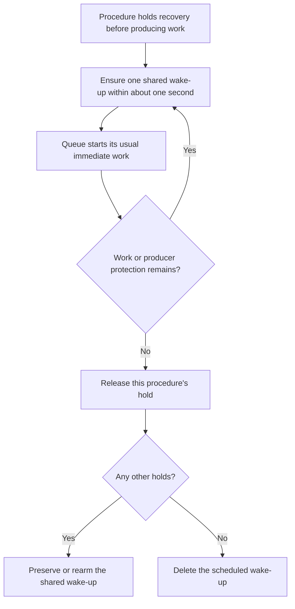

# Recovery registrations and one shared wake-up

**Date:** 2026-10-18

**Scope:** Static research against the current working tree at `ece535eaf7f5d7fa5838347d45e490733c61bd5f`, including existing unrelated uncommitted changes. Inspected the registry, all production `hold()` callers, queue producer/recovery lifecycles, Repo activation and official Cloudflare documentation. This note records findings and recommendations; it does not approve or implement a production change. No builds or runtime verification were performed.

**Implementation update, 2026-10-18:** Implemented as `makeRecoveryRegistry` with `recoveryHolds: Set<string>`, the durable alarm as the shared scheduled time, and one local scheduling permit for alarm reconciliation. Hold/release membership changes precede waiting for that permit; reconciliation then reads the current Set. This resolves the overlapping-read limitation identified in the investigation below while preserving producer protection, all-procedure recovery and last-hold cancellation. Current queues use scoped `producerLease` protection and explicit `wake()`. Scoped `system-worker:lib`, `system-worker:lint` and formatting passed through Nx. See [the current implementation][current-registry]. The investigation below records the preceding source; its source snapshot links are pinned to the inspected commit.

**Finding:** Remove the public deadline parameter and replace the per-name deadline map with a `Set<string>` of recovery holds. Favor `makeRecoveryRegistry` / `recoveryRegistry`, retaining `register`, `hold`, `release` and `run`. Keep one shared one-second recovery delay, the durable Cloudflare alarm, and a map of registered recovery procedures. The Set controls whether another wake-up remains necessary; durable queue state remains authoritative for the work itself. This recommendation follows the current callers and ownership below, rather than a need for a general scheduler. [Registry][registry], [queue production][outbox-producer], [fanout production][fanout-producer], [external work][external], [initialization][initialization], [coordination guidance][coordination].

## Source snapshot before implementation

`makeAlarmRegistry` owns two in-memory maps: `operations` associates a name with a lazy recovery Effect, and `leases` associates a name with an absolute timestamp. `register()` only adds the Effect. `hold(name)` replaces that name's timestamp with `Date.now() + 1_000` by default, then writes the earliest timestamp to storage, clamped to the current time. `release(name)` removes that timestamp and either deletes the storage alarm or replaces it with the earliest remaining timestamp. [Registry][registry].

Every production `hold()` call supplies only the name. There is no current caller selecting a distinct delay, business deadline or per-queue retry time. The complete production caller groups are:

| Caller                          | Why it holds recovery                                                                                                                                    |
| ------------------------------- | -------------------------------------------------------------------------------------------------------------------------------------------------------- |
| `makeOutboxQueue`               | Protect production before committing rows, start immediate delivery and recover interrupted delivery. [Source][outbox-producer], [source][outbox-drain]. |
| `makeFanoutQueue`               | Protect production/enrollment, start fanout delivery and recover unsuccessful delivery. [Source][fanout-producer], [source][fanout-drain].               |
| `makeExternalOperationQueue`    | Keep recovery armed while its pending external-request table is nonempty. [Source][external].                                                            |
| `AggregateChain.onDOActivation` | Arm original command execution and replay before enrolling authored aggregate releases. [Source][aggregate-activation].                                  |
| `ServiceChain.onDOActivation`   | Arm original command execution and replay before enrolling authored service releases. [Source][service-activation].                                      |
| `SystemRepo.initialize`         | Keep service initialization recoverable until its declared service owners are ready. [Source][initialization].                                           |

`run()` invokes **every registered procedure**, independent of the lease map. It waits for all procedure exits before combining failures. The procedures determine pending work from their own durable rows or subscriber progress. `makeMigratableDORepo` recreates the registry during construction, registers an inherited alarm procedure when supplied by the base class, gates activation, and dispatches its `alarm()` method to `run()`. [Registry][registry], [Repo lifecycle][repo-lifecycle], [local lifecycle convention][lifecycle-pattern].

## Platform facts that constrain simplification

- Cloudflare permits one scheduled alarm per Durable Object. `setAlarm()` replaces an existing schedule. During `alarm()`, `getAlarm()` returns `null` unless a subsequent alarm has been set. Therefore, a retained in-memory hold does not prove a future wake-up exists. [Cloudflare alarms][cloudflare-alarms].
- Alarm delivery is at least once. An uncaught handler failure receives exponential-backoff retries starting at two seconds, up to six retries. An application needing further attempts must schedule them. Deleting the alarm inside its handler may suppress retries on a best-effort basis. [Cloudflare alarms][cloudflare-alarms].
- `deleteAlarm()` does not stop the currently executing handler. A scheduled time is an intended wake-up time; maintenance or failover can delay execution. [Cloudflare SQLite storage][cloudflare-storage].
- In-memory state can be discarded. When an alarm activates an inactive Durable Object, the constructor precedes the handler. Therefore, the Set must remain disposable and recovery must inspect durable state. [Cloudflare lifecycle][cloudflare-lifecycle].

These rules support simplifying scheduling state. They do not support using the Set as a durable inventory or dispatching only the names currently in it. On a fresh instance, the Set starts empty while durable pending rows may remain. Preserve the current all-procedure sweep. [Registry][registry], [Repo lifecycle][repo-lifecycle].

## Recommended semantics from the investigation

Use `recoveryHolds: Set<string>` to mean **“this named procedure still requires recovery protection.”** That can include a producer preparing work before any pending row exists. Keep `operations` as the independent registration map. The durable alarm already stores the single future wake-up time, so no replacement in-memory deadline or cached timestamp is needed. [Current pre-commit protection][outbox-producer], [fanout producer lease][fanout-producer], [Cloudflare alarm storage][cloudflare-storage].

Adopt this timing policy deliberately:

1. `hold(name)` adds the name and requests a wake-up about one second from now. Read the actual durable alarm even if the name was already held. Keep an already visible earlier wake-up; set `now + 1_000` only if the alarm is absent or later.
2. `release(name)` removes the name. Delete the scheduled alarm only when no holds remain. If other holds remain, run the same scheduling check: preserve an earlier wake-up, and rearm if it has been consumed.
3. Queue recovery retains its existing hold-before-work ordering. `run()` continues invoking every registered procedure and settling their exits independently. The separate initialization procedure keeps its existing retry behavior, described below.

The pseudocode describes the proposed API and scheduling behavior, not a verified implementation:

```text
operations = Map()             // registered procedures
recoveryHolds = Set()          // names requiring recovery protection

register(name, procedure):
    reject duplicate names
    operations[name] = procedure

ensureWake():
    wakeAt = now() + 1 second
    scheduledAt = await storage.getAlarm()
    if scheduledAt is absent or scheduledAt > wakeAt:
        await storage.setAlarm(wakeAt)

hold(name):
    recoveryHolds.add(name)
    await ensureWake()

release(name):
    recoveryHolds.remove(name)
    if recoveryHolds is empty:
        await storage.deleteAlarm()
    else:
        await ensureWake()

run():
    exits = await every registered procedure independently
    propagate combined failures after all exits settle
```

The scheduling check must not become an early return such as `if alreadyHeld: return`: after the current alarm starts, the same name can still require another alarm. Independent source review identified overlapping `ensureWake()` reads: `run()` starts unbounded concurrent Effects, and external-operation finalizers can also reconcile recovery. Two calls can both observe `null` and redundantly schedule; the later write can shift the time slightly. The proposal prevents repeated postponement of an **already visible** earlier wake, rather than guaranteeing the exact earliest timestamp across overlapping reads. No concrete lost-wake-up path was identified with the existing producer guards. This is static reasoning, not runtime verification, and does not establish a need for another lock. [Registry concurrency][registry-run], [external finalizers][external-finalizer], [outbox release guard][outbox-drain], [fanout release guard][fanout-drain].



### This changes timing, not just representation

Removing the unused deadline argument removes an unused capability. Replacing the map with a Set also changes observable scheduling policy: currently a repeated hold by the **same** name overwrites its earlier deadline; another name's earlier deadline can still win. Releasing the earliest name can move the shared alarm later to the next name's deadline. [Registry][registry].

For example, one name held at `0 ms` requests `1,000 ms`; holding it again at `500 ms` currently requests `1,500 ms` if no other earlier lease exists. Under the recommendation, its already visible `1,000 ms` wake remains. A later ordinary hold therefore does not postpone that wake. Likewise, removing an early holder can leave one harmless earlier sweep for the remaining holders. These are deliberate improvements, not an exact preservation of the deadline-map behavior. [Derivation from current scheduling][registry].

The earlier one-second explanations also need this qualification: the present map can contain an elapsed timestamp belonging to another hold, causing a later call to request an immediate alarm. A Set with one shared future wake policy removes that per-name elapsed-deadline behavior. It preserves the requirement to recover unfinished work, rather than every incidental timestamp choice. [Registry][registry].

## What must stay with each queue

`makeOutboxQueue.producerLease` increments `activeProducers` before acquiring recovery, arms recovery before production and updates the producer count/revision on release. Callers explicitly run `wake()` after production; lease release performs no scheduling. This replaces the former `drainAfter` wrapper as of 2026-10-18. Its drain releases only after no pending delivery remains, its completion hook succeeds, no producer is active and the revision is unchanged. `makeFanoutQueue.producerLease` and drain use corresponding active-producer/revision protection; an unsuccessful fanout drain renews recovery. Preserve these guards when changing the registry. A Set cannot replace them: an empty read can occur while a producer is still preparing its commit. [Outbox producer][outbox-producer], [outbox drain][outbox-drain], [fanout producer][fanout-producer], [fanout drain][fanout-drain].

`makeExternalOperationQueue` reconciles its hold from its pending table before launching requests and after observation settlement. Its live `inFlightCommandIds` Set prevents duplicate execution within the active instance; that Set and the proposed `recoveryHolds` Set have different responsibilities. Preserve both. [External queue][external].

`SystemRepo.initializeServices` releases its hold after preparing declared service owners, but does not itself renew the hold when its alarm invocation starts. On a failed alarm attempt it currently relies on Cloudflare's bounded retries. Do not describe the registry change as introducing unlimited retries or silently broaden it to change initialization failure policy. [Initialization][initialization], [SystemRepo registration][system-registration].

## Naming recommendation

| Name                     | Assessment                                                                                                                                                                                                |
| ------------------------ | --------------------------------------------------------------------------------------------------------------------------------------------------------------------------------------------------------- |
| **`recoveryRegistry`**   | Preferred: it registers procedures that recover durable work and owns their shared wake-up protection. `hold` / `release` describe protection accurately, including production before a row exists.       |
| `wakeupRegistry`         | Understandable, but emphasizes how procedures are triggered more than their recovery responsibility. Existing queue `wake()` methods also start immediate work, so this can blur two separate operations. |
| `unfinishedWorkRegistry` | Suggests an inventory of individual work items. The registry holds procedure names and can hold before a work item is committed; each queue owns its durable inventory.                                   |

These are naming judgments derived from the inspected ownership, not platform terminology requirements. The compact API should be:

```text
recoveryRegistry.register(name, recover)
recoveryRegistry.hold(name)
recoveryRegistry.release(name)
recoveryRegistry.run()
```

Use Cloudflare's required `alarm()` method and `storage.getAlarm/setAlarm/deleteAlarm` names at the platform boundary. In explanation, call that storage operation a **scheduled wake-up** and call the registered work a **recovery procedure**. No new durable table, item registry, per-procedure timer or compatibility alias is justified by the current callers. [Repo dispatch][repo-lifecycle], [current scheduling][registry], [coordination guidance][coordination].

[registry]: https://github.com/morgs32/zerospin/blob/ece535eaf7f5d7fa5838347d45e490733c61bd5f/packages/system-worker/src/makeAlarmRegistry/makeAlarmRegistry.ts#L17
[registry-run]: https://github.com/morgs32/zerospin/blob/ece535eaf7f5d7fa5838347d45e490733c61bd5f/packages/system-worker/src/makeAlarmRegistry/makeAlarmRegistry.ts#L60
[outbox-producer]: https://github.com/morgs32/zerospin/blob/ece535eaf7f5d7fa5838347d45e490733c61bd5f/packages/system-worker/src/makeOutboxQueue/makeOutboxQueue.ts#L279
[outbox-drain]: https://github.com/morgs32/zerospin/blob/ece535eaf7f5d7fa5838347d45e490733c61bd5f/packages/system-worker/src/makeOutboxQueue/makeOutboxQueue.ts#L344
[fanout-producer]: https://github.com/morgs32/zerospin/blob/ece535eaf7f5d7fa5838347d45e490733c61bd5f/packages/system-worker/src/makeFanoutQueue/makeFanoutQueue.ts#L298
[fanout-drain]: https://github.com/morgs32/zerospin/blob/ece535eaf7f5d7fa5838347d45e490733c61bd5f/packages/system-worker/src/makeFanoutQueue/makeFanoutQueue.ts#L340
[external]: https://github.com/morgs32/zerospin/blob/ece535eaf7f5d7fa5838347d45e490733c61bd5f/packages/system-worker/src/externalOperations/makeExternalOperationQueue.ts#L56
[external-finalizer]: https://github.com/morgs32/zerospin/blob/ece535eaf7f5d7fa5838347d45e490733c61bd5f/packages/system-worker/src/externalOperations/makeExternalOperationQueue.ts#L120
[aggregate-activation]: https://github.com/morgs32/zerospin/blob/ece535eaf7f5d7fa5838347d45e490733c61bd5f/packages/system-worker/src/AggregateChain/onDOActivation/onDOActivation.ts#L19
[service-activation]: https://github.com/morgs32/zerospin/blob/ece535eaf7f5d7fa5838347d45e490733c61bd5f/packages/system-worker/src/ServiceChain/onDOActivation/onDOActivation.ts#L20
[initialization]: https://github.com/morgs32/zerospin/blob/ece535eaf7f5d7fa5838347d45e490733c61bd5f/packages/system-worker/src/SystemRepo/initialize/initialize.ts#L12
[system-registration]: https://github.com/morgs32/zerospin/blob/ece535eaf7f5d7fa5838347d45e490733c61bd5f/packages/system-worker/src/SystemRepo/SystemRepo.ts#L77
[repo-lifecycle]: https://github.com/morgs32/zerospin/blob/ece535eaf7f5d7fa5838347d45e490733c61bd5f/packages/system-worker/src/makeMigratableDORepo/makeMigratableDORepo.ts#L258
[lifecycle-pattern]: https://github.com/morgs32/zerospin/blob/ece535eaf7f5d7fa5838347d45e490733c61bd5f/wiki/patterns/system-worker/repo-lifecycle.md#L16
[coordination]: ../../../wiki/skills/use-morgs32-wiki-patterns/references/patterns/runtime/yagni-before-coordination.md
[cloudflare-alarms]: https://developers.cloudflare.com/durable-objects/api/alarms/
[cloudflare-storage]: https://developers.cloudflare.com/durable-objects/api/sqlite-storage-api/#alarms
[cloudflare-lifecycle]: https://developers.cloudflare.com/durable-objects/concepts/durable-object-lifecycle/
[current-registry]: ../../packages/system-worker/src/makeRecoveryRegistry/makeRecoveryRegistry.ts
