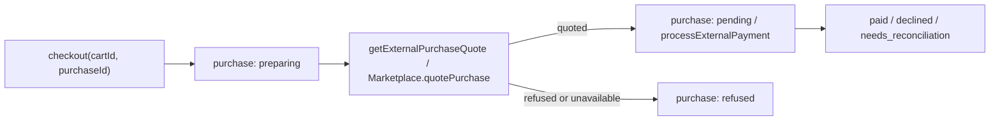

# Shopping checkout: commands, one live query and session notifications

**Date:** 2026-10-15  
**Implementation:** [Plan 156](../archive/plans/156-plan-command-query-checkout.md)

This consolidates the supplied checkout and synchronous-service-staging handoffs.
The earlier HTTP/nonce checkout and Marketplace cart ownership are superseded.

## Ownership and identity

Cart edits and checkout share the user aggregate's journal. The verified Clerk
subject identifies the aggregate; it owns cart, cartItem, purchase and
purchaseItem. Marketplace retains the catalog and a read-only quotation query.
[User release](../../examples/shopping/src/zerospin/aggregates/user/userAggregateReleaseV1.ts),
[user authorization](../../examples/shopping/src/zerospin/aggregates/user/actors/userActorV1.ts),
[Marketplace](../../examples/shopping/src/zerospin/services/marketplace/marketplaceServiceReleaseV1.ts).

`addToCart` receives creation candidates once per click, then reuses or creates
the cart and product line transactionally. Consecutive local commands see prior
optimistic changes. Checkout receives a purchase ID generated synchronously in
the click handler and retains it in its payload. Component memo/state is not the
owner of purchase identity. React documents `useMemo` as a cache that may be
discarded, including on initial suspension.
[Add command](../../examples/shopping/src/zerospin/aggregates/user/contracts/addToCartV1.ts),
[checkout button](../../examples/shopping/src/components/CheckoutButton.tsx),
[React useMemo](https://react.dev/reference/react/useMemo).

## One observed purchase throughout checkout

The ordinary checkout creates a preparing purchase and frozen item rows and sets
`cart.checkoutPurchaseId`. The server adapter explicitly records the same checked
model operations and schedules quotation from that frozen snapshot. Authoritative
confirmation therefore supplies the same selected purchase identity. A rejected
command can remove its optimistic purchase; no second status model is required.
[Shared checkout](../../examples/shopping/src/zerospin/aggregates/user/contracts/checkoutV1.ts),
[adapter](../../examples/shopping/src/zerospin/aggregates/user/contracts/checkoutServerV1.ts),
[transactional reconciliation](../../packages/core/src/aggregateSession/applyOrderedAggregateOccurrencesTx.ts).

One query reads the cart with its items and `checkoutPurchase`. The pointer remains
after settlement, retaining the outcome without local pending state, a completion
subscription, timer, signal or command-history watcher. A missing row is an
ordinary query result; query failure uses the existing terminal-session path.
[Button query](../../examples/shopping/src/components/CheckoutButton.tsx),
[session-error research](session-fatal-errors-and-live-query.md).

Quotation runs outside the model transaction. The continuation validates frozen
line identities, products, quantities, prices and total before storing pricing
and scheduling payment. Expected quote refusals are response data; read-only
request failure can safely refuse the purchase because no charge began. Payment
uses its existing stable provider key. Paid state and clearing matching cart
items commit together; decline leaves the cart editable, while uncertain payment
retains the lock for reconciliation. Real payment providers must honor idempotency
because external requests may repeat.
[Quotation continuation](../../examples/shopping/src/zerospin/aggregates/user/contracts/getExternalPurchaseQuoteV1.ts),
[payment continuation](../../examples/shopping/src/zerospin/aggregates/user/contracts/processExternalPaymentV1.ts).

## Synchronous staging and notifications

Service staging already used one local journal/optimism transaction. The public
acknowledgement wait was additional choreography. Both service and aggregate
staging now return their local `IResult` synchronously. Background handoff and
reconciliation remain runtime-owned; internal handoff waiters remain available
for native suspension. Local staging, worker persistence, authoritative execution
and checkout completion remain distinct boundaries.
[Service staging](../../packages/core/src/serviceSession/stageServiceSessionCommand.ts),
[service transaction](../../packages/core/src/serviceSession/stageServiceSessionCommandTx.ts),
[browser binder](../../packages/browser/src/sessionReplica/bindServiceReplicaCommands.ts),
[handoff owner](../../packages/browser/src/outbox/makeSessionCommandHandoff.ts).

Mentor Mailbox establishes the sibling ownership pattern: notification handling in
the session layer and one root toaster. Shopping uses that pattern for genuine
StageFailure, AdmissionFailure and ExecutionFailure events. Quote refusal,
payment decline and reconciliation needs are successful retained domain
transitions rendered through the query; backend continuations do not automatically
notify the originating browser session. Terminal errors remain with
`Initializer.renderError` rather than producing duplicate toasts.
[Shopping notification layer](../../examples/shopping/src/zerospin/applicationLayer.ts),
[root toaster](../../examples/shopping/src/routes/_app.tsx),
[notification origin filtering](../../packages/browser/src/Node/makeSessionFailureObserver.ts),
[Mentor session](../../../mentormailbox/apps/app/src/zerospin/studentSession.ts),
[Mentor root toaster](../../../mentormailbox/apps/app/src/app/lazy/AppImports.tsx).

## Verification evidence and limits

- Fresh WA-SQLite with production service staging/binding/reconciliation verified
  immediate pre-ack return, consecutive optimism, full rollback after a partial
  write, authoritative rebase and duplicate confirmation.
- Fresh aggregate sessions using Shopping's actual contracts and one live query
  verified cart reuse, frozen quantities, duplicate/locked refusal, same-ID
  confirmation without transient disappearance, and rejected-purchase rollback.
- Production contract/SQLite probes verified authoritative pricing despite stale
  display prices, frozen request retries, quote refusal/unavailability/correlation,
  payment key checks, atomic paid clearing, decline, uncertainty and stale input.
- The updated existing `scripts/verify-plan140.mjs` passed all eight runtime groups.
- The existing configured Workerd activation file passed all three tests. Its
  Shopping scenario uses the actual secret-authenticated Gateway/SystemApi,
  authoritative catalog pricing, originating-chain quotation/payment and retained
  paid/refused outcomes; all storage is isolated and disposable.

Final package/source verification uses an isolated snapshot of the approved
checkout/staging and original terminal-error changes because concurrent recovery
and command-origin edits were changing the primary worktree. The isolated Nx
graph passed its six-project source/build/lint and backend-test type checks, all
29 inferred typecheck tasks, three configured Workerd tests and eight existing
contract-runner groups. The archived implementation plan records the snapshot
boundary and non-failing baseline warnings.

No new test files, fixtures or runners were created. No Shopping browser
verification was performed. Provider behavior is deterministic/example-only;
contained checks do not establish real payment-provider delivery. Changed fixed
schemas require empty storage; verification uses fresh isolated databases.
